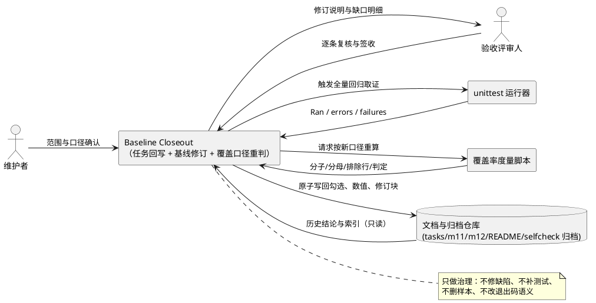
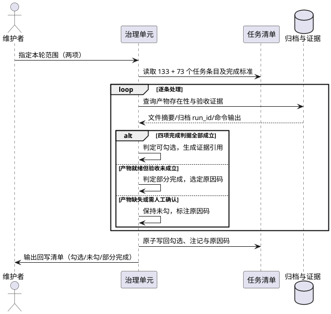
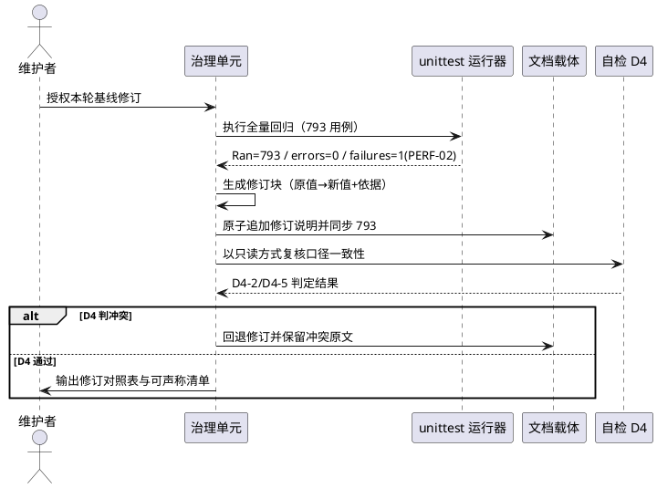
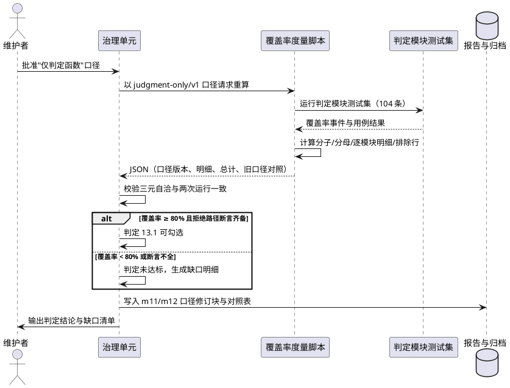

# Baseline Closeout（基线收尾与覆盖口径重构）· 需求规格

## 1. 组件定位

### 1.1 核心职责

本组件负责把"已实现但未回写"的任务清单与基线数字按证据校正为可复算的单一事实源，并把核心判定覆盖率口径收敛为"仅判定函数"后重新判定覆盖门槛，使对外结论可复算、历史结论可追溯。

### 1.2 核心输入

| 输入 | 来源 | 内容概要 |
|---|---|---|
| 本轮范围指令 | 维护者 | 仅两项：①文档收尾与基线回写；②G-11 覆盖率口径重构 |
| 自检框架任务清单 | `.codeartsdoer/specs/selfcheck_harness/tasks.md` | 133 个复选框条目，当前 133/133 未勾 |
| 主平台任务清单 | `.codeartsdoer/specs/verifix/tasks.md` | 73 个条目；第 12.4 项（行 321）与第 13.1 项（行 333）为本轮焦点 |
| 历史结论载体 | `docs/devlog/m11-coverage-report.md`、`m12-closure-and-blockers.md`、`m13-selfcheck-report.md`、`m13-analysis-plan.md` | 旧覆盖率数值、690 用例口径、可声称/不可声称边界、自检基线 |
| 自检归档实据 | `docs/devlog/selfcheck/index.json` 与 `SC-20261115T144308+0800-v1`…`SC-20261115T165051+0800-v4` | 4 条归档登记（均 `exit_code=3`）、入口副本、`definition_version` |
| 全量回归原始输出 | unittest 运行器 | `Ran 793 tests`、`errors=0`、`failures=1`（PERF-02） |
| 覆盖率度量原始输出 | 覆盖率度量脚本 | 逐模块已执行行/可执行行、总计、阈值、退出码 |
| 对外材料现状 | `README.md`、`deliverables/CodeArts方案.md`、`deploy/` | 自检入口小节、指标数字、一键启动文件就绪状态 |

### 1.3 核心输出

1. 回写后的两份 `tasks.md`：勾选状态、未勾原因码、勾选证据引用、部分完成标注。
2. 修订后的基线文档：`m11-coverage-report.md`、`m12-closure-and-blockers.md`、`README.md`（必要时含 `deliverables/CodeArts方案.md`）的新数值、口径修订块与新旧对照表。
3. 覆盖率重算产物：新口径 JSON 结果 + 人类可读对照表（含分子、分母、比率、排除行数、旧口径对照）。
4. 覆盖门槛判定结论：`verifix/tasks.md` 13.1 是否可勾选的结论及缺口明细。
5. 变更登记：覆盖率口径版本、定义版本、修订时间与签发人。

### 1.4 职责边界

**不负责（本轮明确不做）**

1. 不修复任何业务缺陷，包括 `PERF-02` 抖动、`D1-2` 的 1 个失败用例、D3/D4 自检阻塞项。
2. 不新增测试用例、不改断言、不跳过用例来提升覆盖率数值。
3. 不删除被测代码、测试样本或文件来缩小分母。
4. 不做云上部署、24h 连续运行、CodeArts 真实凭据链路、Git 远端自举、PPT/演示视频制作、OQ-1…OQ-5 人工签字。
5. 不改变 `--scope D1,D3,D4` 退出码恒为 `2` 的既有语义，不改变自检 `0/2/3` 退出码定义。
6. 不伪造勾选，不以"实现已完成"替代"验收已达成"。
7. 不改写历史文档正文结论；修订只允许追加修订块并在原位标注。

**边界说明（易误解处）**

- "文档回写"不是"重新评估项目价值"，只校正事实层：条目是否完成、数字是多少、口径是什么。
- "覆盖率口径重构"不是"降低门槛"，而是把不产生执行事件的声明行移出分母；阈值仍为 80%，判定仍按是否达标。
- "13.1 重新判定"不是"13.1 补测"；本轮只判定，不补测试。

---

## 2. 领域术语

**任务条目（Task Item）**
: 以 `- [ ]` 或 `- [x]` 复选框为最小单位、可独立验收的一行工作项，包含任务描述与完成标准。

**完成判据（Completion Criterion）**
: 一条任务条目可被勾选所需的最小证据集合，必须同时满足：产物存在、验收命令可执行、执行结果符合完成标准、结果可回读。

**部分完成（Partial Completion）**
: 产物已就绪但至少一项验收条件因外部环境未成立的状态；其结论为"未完成且非伪造"，表现形式为保持未勾并标注已就绪部分与阻塞原因。

**阻塞原因码（Blocker Reason Code）**
: 未勾条目必须携带的封闭集合归因标签，取值包括 `PRECONDITION_UNMET`、`RUNTIME_UNAVAILABLE`、`EXTERNAL_CREDENTIAL_MISSING`、`MANUAL_PENDING`、`PARTIAL_EVIDENCE`、`SCOPE_DEFERRED`。

**基线数字（Baseline Figure）**
: 对外材料中可被引用、需可复算的数值结论，例如用例数、覆盖率、通过项数、任务完成比。

**口径（Caliber）**
: 一组数值的统计边界，由目标集、纳入规则、排除规则与定义版本共同确定。

**判定函数口径（Judgment-Only Caliber）**
: 仅统计承担判定职责的可执行行（守卫、条件分支、断言、异常处理、阈值比较、状态迁移）的覆盖率口径，排除不产生执行事件的声明类行。

**口径修订（Caliber Revision）**
: 在不删除旧数值与旧结论的前提下，追加新口径定义、新旧数值对照、生效版本与影响范围的变更记录。

**可复算（Recomputable）**
: 在同一仓库状态、同一命令下可重复得到同一分子、分母与比率，且三者满足"比率 = 分子 ÷ 分母"的自洽关系。

**欣证缺失（Evidence Gap）**
: 声称存在但无法定位到可回读证据的状态；其结论必须为"未验证"，不得外推为通过。

---

## 3. 角色与边界

### 3.1 核心角色

- 维护者：签发本轮范围与口径定义，确认修订块，承担最终对外口径责任。
- 验收评审人：按本文档验收条件逐条复核勾选与数字，只接受可回读证据，不接受口头说明。
- 自检框架（M13 selfcheck_harness）：回写后的只读消费方，对三类文字载体做口径一致性判定（D4 类），不参与文档修改。

### 3.2 外部系统

- unittest 运行器：提供全量回归的 `Ran/errors/failures` 原始输出与单用例标识。
- 覆盖率度量脚本：按指定目标集输出分子、分母、逐模块明细与判定结果的 JSON。
- 文档与归档目录：`docs/devlog/`、`docs/devlog/selfcheck/`、`docs/devlog/metrics/`、`.evidence/`，提供历史结论与归档索引。
- 版本控制/文件摘要：当 Git 不可用时，以文件 sha256 摘要替代差异比对。
- CodeArts 远端：本轮不依赖，不作为任何判定的证据来源。

### 3.3 交互上下文

---

## 4. DFX 约束

### 4.1 性能

1. 单次覆盖率重算（4 个判定模块目标集 + 现有 104 条判定测试）必须在 **5 分钟内**完成；超过 10 分钟判"度量失败"，不得以部分结果代替。
2. 单次全量回归取证（793 用例）必须在 **15 分钟内**完成；记录墙钟耗时。
3. 除回归与度量外，单次文档回写操作对维护者的交互等待不得超过 2 秒。

### 4.2 可靠性

1. 同一仓库状态下，覆盖率重算连续执行两次，分子、分母、比率必须完全一致；不一致判"口径不可复算"并阻塞。
2. 文档写入必须原子化：先写临时文件再替换；任何失败不得留下半成品勾选或半截修订块。
3. 修订不得删除历史结论：旧数值、旧结论与旧章节必须保留，并可按关键词检索到。
4. 回写操作必须幂等：对同一仓库状态重复执行，勾选集合与修订块内容不得重复追加。

### 4.3 安全性

1. 文档与报告不得出现凭据、token、密钥明文，不得出现宿主绝对路径中的用户目录段。
2. 禁止通过修改断言、增加 `skip`、调整阈值、删除样本或缩小目标集来使数值"变绿"；出现任一类行为即判违规，数值回退至修订前并记为阻塞。
3. 覆盖率与回归输出中的敏感片段须经现有脱敏规则处理后才可入文档。

### 4.4 可维护性

1. 每个基线数字必须可用一条命令复算，且报告中同时给出命令、生成时间、口径版本与证据路径。
2. 覆盖率结果必须同时提供机器可读 JSON 与人读 Markdown 对照表。
3. 所有口径变更必须在 `m11` 与 `m12` 同步登记，登记内容包含原值、新值、依据、生效版本与影响范围。
4. 未勾条目必须可按原因码聚合统计，便于交接时一键列出"环境阻塞"与"真实未完成"。

### 4.5 兼容性

1. 旧口径数值与旧结论保留可检索路径，新口径以新增章节/新增文件呈现，不覆写旧值。
2. 自检 D4 读取的三类文字载体路径保持 `README.md`、`docs/devlog/m12-closure-and-blockers.md`、`deliverables/CodeArts方案.md` 不变。
3. `scripts/selfcheck.py` 的退出码语义（`0` 全通过 / `2` 警告或未验证 / `3` 阻塞或人工待填 / 范围裁剪固定 `2`）不得变更。
4. 回写不得改变 `verifix/tasks.md` 与 `selfcheck_harness/tasks.md` 的章节编号与任务编号，避免依赖引用失效。

---

## 5. 核心能力

### 5.0 现状事实基线（本轮修订的起点）

| 事实 | 实测/来源 | 与既有文档的差异 |
|---|---|---|
| 自检任务清单勾选 | `selfcheck_harness/tasks.md` 共 133 个复选框，未勾 133、已勾 0 | 与"实现已完成"的上下文不一致，需逐条回写 |
| 自检归档 | `index.json` 共 4 条：`v1`–`v4`，均全量范围、`exit_code=3`、`overall=不通过` | `v4` 报告含 `definition_version=v2` 与 R1/R2 口径修订说明 |
| 归档基线连续性 | `v1` 与 `v2` 指纹不同；`v3` 与 `v4` 指纹不同 | 无"同一基线连续两次运行"的实据，8.5 不能直接勾选 |
| `m11` 行覆盖 | 总计写 `651/1192`（标 54.5%），但明细各行分子合计 **832**、分母合计 **1514** | 报告自身不可复算：总计与明细不自洽 |
| 本次复核实测覆盖 | `845/1554 = 54.38%`（104 条测试，0 失败 0 错误） | 分母较 `m11` 明细多 40 行：`orchestration/service.py` 77→105、新增各 `__init__.py` 共 12 行、其余差异 |
| `m12` 覆盖率 | 写 `648/1192`（54.5%） | 与 `m11` 分子 651 不一致，两文档互不对齐 |
| 用例数 | `m12`/`README` 冻结 690；实测 `Ran 793`，唯一失败 `PERF-02`（268.8ms > 200ms，单跑稳定通过） | 数字漂移 103，需统一为 793 并加修订说明 |
| `verifix` 12.4 | `README.md`、`deploy/docker-compose.yml`、`.env.example`、`scripts/run_eval.py` 均存在 | 验收"15 分钟出第一份评测报告"受 `VF-8003` 拒绝启动阻塞 |
| `verifix` 13.1 | 未勾；覆盖率未达 80% | 需按新口径重算后重判 |
| `README` 自检小节 | 已含 `--scope`、`--dry-run`、退出码 `0/2/3`、归档路径、两个豁免开关含义 | 缺"范围裁剪退出码恒为 `2`"的显式说明 |

### 5.1 能力一：任务清单证据化回写

#### 5.1.1 业务规则

1. **完成判据完整性规则**：一条任务条目只有在"产物存在 + 验收命令可执行 + 结果符合完成标准 + 证据可回读"四项全部成立时才可勾选。
   a. 验收条件：任一项不成立 → 该条目保持 `[ ]`，并写入阻塞原因码。
2. **证据引用规则**：每个新勾选的条目必须附带证据引用（验收命令 + 关键输出摘要，或归档 `run_id` / 报告路径 + 摘要）。
   a. 验收条件：勾选项无证据引用 → 视为回写无效，必须回退为未勾。
3. **部分完成表达规则**：产物就绪但验收未达成的条目，必须保持未勾并标注"已就绪部分 / 阻塞原因"，不得以"文件就绪"勾选。
   a. 验收条件：`verifix/tasks.md` 12.4 → 保持 `[ ]`，标注"四项文件就绪；15 分钟评测验收受 `VF-8003` 阻塞"，原因码 `PRECONDITION_UNMET`。
4. **环境依赖项禁令**：依赖 Docker、云凭据、Git 远端、24h 连续运行的条目，本机无法完成时一律不得勾选，即使代码与清单存在。
   a. 验收条件：`selfcheck_harness/tasks.md` 中涉及容器运行时/外部凭据/人工签字的条目若未实测 → 保持 `[ ]` 并标注原因码。
5. **人工待填项隔离规则**：D2/D5/OQ 类需负责人确认的条目，治理过程不得代填结论或代替签字。
   a. 验收条件：人工待填条目未勾且原因码为 `MANUAL_PENDING`，文档中不出现伪造的"确认：是"。
6. **归档实据核对规则**：涉及归档、索引、回读校验的条目，必须以归档目录、`index.json` 条目与 `verify_report` 回读结果为证据，不得以"已运行过"作为证据。
   a. 验收条件：8.4（首次归档）→ 存在归档目录 + 入口副本 + 索引条目 → 可勾选；8.7（新基线）→ 存在 `definition_version=v2` 的新 `run_id` 且旧条目摘要不变 → 可勾选；8.5（同基线版本递增 + 两次回读）→ 现无同一基线连续两次运行的实据 → 保持未勾，原因码 `PARTIAL_EVIDENCE`。
7. **状态翻转留痕规则**：任何条目勾选状态被修正时，必须保留"原状态 → 新状态、时间、依据"。
   a. 验收条件：`git diff` 或摘要比对可看出每个翻转条目均带一行回写注记。
8. **禁止项**：禁止把"实现已完成"作为唯一勾选理由；禁止批量勾选未经逐条核对的条目；禁止为凑完成比把人工待填项改判为通过。
   a. 验收条件：抽查任一条目，其勾选理由均可追溯到具体命令或归档件。

#### 5.1.2 交互流程

#### 5.1.3 异常场景

1. **条目文本模糊**
   a. 触发条件：条目含"视情况""尽量""待定"等不可判定表述。
   b. 系统行为：标记"待确认"，不勾选，在注记中引用含糊原文。
   c. 用户感知：交接清单出现"待确认项 N"，并列出编号。

2. **验收命令在本机不可用**
   a. 触发条件：命令依赖 Docker、云凭据或外部网络且本机不具备。
   b. 系统行为：不勾选，记录原因码 `RUNTIME_UNAVAILABLE` 或 `EXTERNAL_CREDENTIAL_MISSING`，保留已完成部分说明。
   c. 用户感知：报告中该条显示"未完成（环境不可用）"，并给出解除条件。

3. **证据不可回读**
   a. 触发条件：归档目录存在但摘要校验失败或索引无登记。
   b. 系统行为：不勾选，原因码 `PARTIAL_EVIDENCE`，列出缺失的摘要/登记项。
   c. 用户感知：条目显示"证据不完整"，禁止在对外材料中引用。

4. **回写后自检判口径冲突**
   a. 触发条件：回写后的载体在 D4 类判定中出现数值不一致。
   b. 系统行为：以自检结果为准回退对应修订，保留冲突原文与位置。
   c. 用户感知：出现"口径冲突"告警，附载体与行号。

5. **历史勾选被误改**
   a. 触发条件：修订脚本重复执行导致已确认条目被翻转。
   b. 系统行为：按幂等规则拒绝重复写入，恢复至首次确认状态。
   c. 用户感知：输出"已存在同内容注记，跳过写入"。

### 5.2 能力二：基线数字修订与自检入口对齐

#### 5.2.1 业务规则

1. **单一事实源规则**：同一指标在 `README.md`、`m12-closure-and-blockers.md`、`deliverables/CodeArts方案.md` 中的取值必须一致；不一致必须先统一再对外引用。
   a. 验收条件：全文检索"690 用例"仅出现在修订说明的旧值位置，其余位置均为 793。
2. **用例数基线规则**：全量回归基线统一为实测 `Ran` 数（793），并保留"`PERF-02` 偶发抖动、单跑稳定通过"的口径；不得通过修改断言或跳过用例消除该失败。
   a. 验收条件：`README` §8/§11 与 `m12` §1/§4 的用例数一致为 793，且均含 PERF-02 说明。
3. **修订块规则**：基线数字变更必须追加"修订说明"块，包含修订时间、原值、新值、依据（命令 + 输出摘要 + 证据路径）、影响范围、签发人；旧结论原文保留。
   a. 验收条件：`m11` 与 `m12` 均存在可检索的"口径修订"小节，且原值 690、651/1192、648/1192 均在对照表中出现。
4. **覆盖率旧值保留规则**：`m11` 的 651/1192、`m12` 的 648/1192 与"54.5%"必须并列保留，并标注"旧口径、明细与总计不自洽、不可复算"；新值只来自本轮重算。
   a. 验收条件：对照表含"旧值（不可复算）/新值（判定函数口径）"两列，且旧值不被删除。
5. **可声称/不可声称同步规则**：数字修订后，"可声称"清单更新为"793 用例、功能性失败 0、PERF-02 为测量抖动"；"不可声称"清单继续包含"分支覆盖率 80%""云上已验证""24h 连续运行"。
   a. 验收条件：自检 D4-5（未验证统一表述）在修订后仍为通过，不出现"已达标/已验证"类表述。
6. **自检入口完整性规则**：`README` 自检小节必须覆盖：`--scope` 语义（含范围裁剪退出码恒为 `2`）、`--dry-run` 无写入、退出码 `0/2/3` 判定顺序、归档路径与索引、`--allow-writes` 与 `--refresh-evidence` 的豁免范围与默认关闭。
   a. 验收条件：六项逐条命中；缺项只允许追加说明，不得改动既有指标数值。
7. **禁止项**：禁止只改数字不改口径说明；禁止只改口径不重算；禁止在修订中把"未达标"改写为"达标"。
   a. 验收条件：抽查任一处数字变更，均可在同文档找到对应口径说明或重算依据。

#### 5.2.2 交互流程

#### 5.2.3 异常场景

1. **回归结果非确定**
   a. 触发条件：两次运行 `Ran` 数不同，或 `PERF-02` 之外出现新失败。
   b. 系统行为：暂停数字修订，保留旧基线并记录两次输出差异。
   c. 用户感知：报告显示"基线不可冻结"，附差异用例标识。

2. **载体数字冲突无法判定谁为准**
   a. 触发条件：同一指标三处取值不同且均无采集时间/命令。
   b. 系统行为：标记"口径冲突"，不选任一值，要求补充来源后重试。
   c. 用户感知：输出冲突矩阵（载体、位置、取值）。

3. **修订块重复追加**
   a. 触发条件：同一修订被执行两次。
   b. 系统行为：按幂等规则识别同内容块，跳过写入。
   c. 用户感知：提示"修订已存在"。

4. **自检读取失败**
   a. 触发条件：三类文字载体路径变更或不可读。
   b. 系统行为：不做"跳过校验"处理，标阻塞并保留原修订。
   c. 用户感知：D4 维度出现阻塞，附缺失载体名。

### 5.3 能力三：覆盖率口径重构与覆盖门槛重判

#### 5.3.1 业务规则

1. **目标集不缩小规则**：判定函数口径的目标集保持现有 4 个判定模块目录（编排、门禁、评审、补丁）不变，不得缩至单个文件或单条规则。
   a. 验收条件：报告中目标集清单与修订前一致，文件数不少于修订前。
2. **纳入规则**：纳入所有承担判定职责的可执行行，包括条件分支、守卫、断言、异常处理、阈值比较、状态迁移与分级映射。
   a. 验收条件：任取一条含 `if`/`assert`/`raise`/`except` 的行，均出现在分母中。
3. **排除规则**：仅排除不产生执行事件的声明类行：dataclass 字段声明、Protocol/抽象方法签名、类型别名、`TYPE_CHECKING` 块、`__all__`、纯导入、仅文档字符串的行。
   a. 验收条件：排除清单可导出（文件 + 行号 + 排除类别），抽样 20 行人工核对均属上述类别。
4. **禁止扩大排除规则**：不得排除任何函数体中的分支或断言；不得按文件名/行号手工剔除；不得删除文件、用例或样本。
   a. 验收条件：排除清单中不存在含判定语义的行；被测文件数与被测用例数与修订前一致。
5. **三元自洽规则**：报告必须同时给出分子、分母与比率，且比率 = 分子 ÷ 分母，保留两位小数；禁止出现"54.5% + 651/1192"这类不自洽组合。
   a. 验收条件：任取一行，按分子/分母复算比率与展示值误差 ≤ 0.01 个百分点；总计行满足同一关系。
6. **可复算规则**：必须提供一条命令输出 JSON，含口径版本（如 `judgment-only/v1`）、规则版本、逐模块明细、排除行数、总计、旧口径对照、测试数与生成时间。
   a. 验收条件：同一仓库状态连续执行两次，两次 JSON 的分子/分母/比率逐项相同。
7. **新旧并列表述规则**：任何对外表述必须同时给出新口径主结论与旧口径对照，不得只展示更高值，不得只展示新值而隐去旧值。
   a. 验收条件：`m11` 与 `m12` 的对照表均含两组数值与"不可直接比较"说明。
8. **覆盖门槛判定规则**：`verifix` 13.1 可勾选需同时满足：①新口径覆盖率 ≥ 80%；②每类拒绝路径存在"命中项 + 阈值 + 位置"断言。仅满足其一不得勾选。
   a. 验收条件：若覆盖率 < 80% → 13.1 保持 `[ ]`，报告给出缺口行数、缺口文件与"达到 80% 仍需覆盖的行数"；若 ≥ 80% 但拒绝路径断言不全 → 同样保持未勾并列出缺失断言类别。
9. **零容忍规则**：禁止为达标修改测试、跳过用例、缩小目标集、删减分母口径之外的代码样本。
   a. 验收条件：修订前后被测文件清单、测试文件清单与用例数一致；出现差异即回退并判违规。

#### 5.3.2 交互流程

#### 5.3.3 异常场景

1. **重算后仍低于 80%**
   a. 触发条件：新口径覆盖率 < 80%。
   b. 系统行为：如实标注"未达标"，列出缺口文件、缺口行数与达到 80% 所需覆盖行数；不勾选 13.1，不补测。
   c. 用户感知：报告显示"未达标（缺口 N 行）"，并给出下一步补测建议清单。

2. **两次运行结果不一致**
   a. 触发条件：同仓库状态两次重算的分子或分母不同。
   b. 系统行为：判"口径不可复算"，保留旧值，不产出新结论。
   c. 用户感知：报告出现"可复算性失败"阻塞项，附两次差异。

3. **排除清单混入判定行**
   a. 触发条件：抽样核对发现含分支/断言的行被排除。
   b. 系统行为：整批排除清单作废，恢复旧口径值并记录违规。
   c. 用户感知：输出"排除规则违规"与命中行位置。

4. **测试集执行失败**
   a. 触发条件：判定模块测试集出现 error 或 failure。
   b. 系统行为：不产出覆盖率结论，标注"度量失败"，保留旧值。
   c. 用户感知：报告显示失败用例标识，且 13.1 维持原状态。

5. **旧口径值被误覆盖**
   a. 触发条件：修订写入覆盖了 `m11` 旧表格数值。
   b. 系统行为：从归档恢复旧值，改为追加对照表。
   c. 用户感知：输出"历史结论被改写"告警，并给出恢复路径。

6. **口径版本冲突**
   a. 触发条件：同一文档出现两套新口径版本（如 `judgment-only/v1` 与 `v2`）且未登记。
   b. 系统行为：判口径冲突，阻塞对外引用，要求提升定义版本并登记。
   c. 用户感知：D4-4 类自检项判阻塞，附两处版本标识位置。

---

## 6. 数据约束

### 6.1 任务条目（Task Item）

1. **条目编号**：必须唯一，格式为"文档路径 + 章节号"，不得重复。
2. **复选框状态**：只能取 `[ ]` 或 `[x]`，不得出现空复选框或其他标记。
3. **任务描述**：非空，且保留原始业务语义，不得改写为"已完成/未完成"。
4. **完成判据**：勾选项必填，且必须可由命令或回读结果验证。
5. **证据引用**：勾选项必填，格式为"命令 + 输出摘要"或"归档 `run_id` + 摘要"。
6. **阻塞原因码**：未勾项必填，取值限于 `PRECONDITION_UNMET` / `RUNTIME_UNAVAILABLE` / `EXTERNAL_CREDENTIAL_MISSING` / `MANUAL_PENDING` / `PARTIAL_EVIDENCE` / `SCOPE_DEFERRED`。
7. **部分完成标记**：布尔值；为真时复选框必须为 `[ ]`，且同时给出"已就绪部分"与"未达成验收"。
8. **状态翻转注记**：条目状态被修正时必填，含原状态、新状态、时间（含时区）与依据。

### 6.2 基线数字（Baseline Figure）

1. **指标名**：必须与既有口径名称一致（用例数 / 行覆盖率 / 任务完成比等），不得自造同义名。
2. **数值**：必须给出原值与新值；覆盖率必须同时给出分子与分母。
3. **口径版本**：必填，与覆盖率口径版本或定义版本对应。
4. **采集时间**：必须含时区，精确到秒。
5. **来源命令**：必填，且必须可复制执行。
6. **证据路径**：必填，指向归档件、报告或 `run_id`。
7. **可复算标记**：取值"是/否"；标"否"时必须同时标注"不可复算原因"。
8. **修订标记**：凡发生过变更的数值必须带修订标记，并链接到修订记录。

### 6.3 覆盖率度量结果（Coverage Measurement）

1. **口径版本**：必填，例如 `judgment-only/v1`，与旧口径 `line/v1` 明确区分。
2. **目标集**：必须列出全部被测目录或文件，数量不得少于修订前。
3. **规则版本**：必填，标识纳入/排除规则集合，规则变更必须提升版本。
4. **分子**：已执行的判定函数行数，非负整数。
5. **分母**：纳入的判定函数可执行行数，必须大于 0。
6. **比率**：必须等于分子 ÷ 分母，展示保留两位小数，原始值至少保留四位。
7. **排除行数**：必须给出总数与按类别分解（dataclass / Protocol / 类型别名 / 导入 / 文档字符串 / 其他），并附可导出清单。
8. **阈值**：固定 0.80，不得随结果调整。
9. **判定**：只能取"达标/未达标"；未达标时必须附缺口明细。
10. **逐模块明细**：每个被测文件必须给出分子、分母、比率，且明细合计与总计一致。
11. **旧口径对照**：必须包含旧口径的分子、分母、比率及"不可直接比较"说明。
12. **一致性约束**：明细合计 = 总计；比率与分子/分母自洽；两次运行结果逐项一致。

### 6.4 修订记录（Revision Record）

1. **时间**：含时区，精确到秒。
2. **对象**：被修订的文档与章节。
3. **原值**：修订前数值或旧结论原文。
4. **新值**：修订后数值。
5. **依据**：命令、输出摘要、归档路径三者齐备。
6. **影响范围**：受影响的对外表述、可声称清单与自检判定项。
7. **旧结论保留路径**：可检索的章节或归档位置，不得为空。
8. **签发人**：维护者标识。
9. **唯一性**：同一对象同一口径版本的修订记录不得重复追加。

---

## 附：本轮交付判定（不新增任务）

以下 8 条同时成立时，本轮视为收敛：

1. `selfcheck_harness/tasks.md` 的 133 个条目均已给出"勾选 + 证据"或"未勾 + 原因码"，无空复选框。
2. `verifix/tasks.md` 12.4 保持未勾并标注"文件就绪 / `VF-8003` 阻塞"；13.1 的勾选状态与新口径判定结论一致。
3. `README.md`、`m12`、`m11` 的用例数统一为 793，且含 `PERF-02` 口径说明。
4. `m11` 与 `m12` 均含"口径修订"块，旧值 690、651/1192、648/1192 可检索且未被删除。
5. 覆盖率重算输出满足三元自洽，且连续两次运行一致；排除清单可导出并抽样核对通过。
6. 13.1 若未达标，报告给出缺口文件、缺口行数与达到 80% 所需覆盖行数；若达标，同时给出拒绝路径断言清单。
7. `README` 自检小节覆盖 `--scope`（含范围裁剪退出码 2）、`--dry-run`、退出码 `0/2/3`、归档路径、两个豁免开关含义。
8. 修订后的三类文字载体在自检 D4 维度不再因用例数/覆盖率口径产生新的数值冲突。