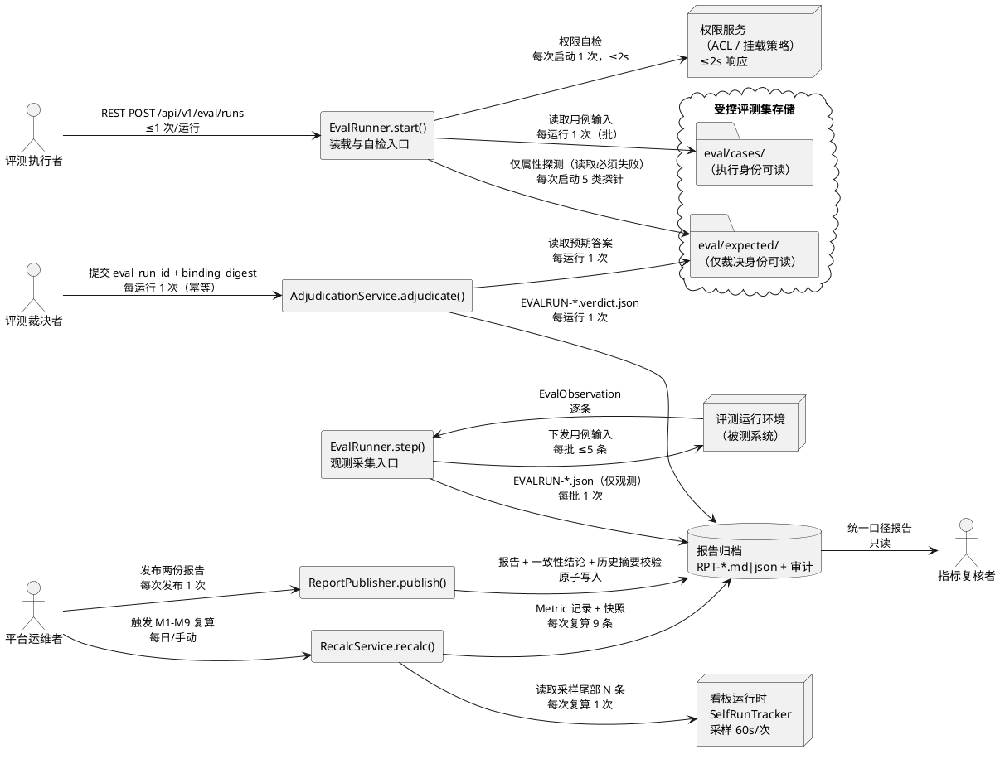
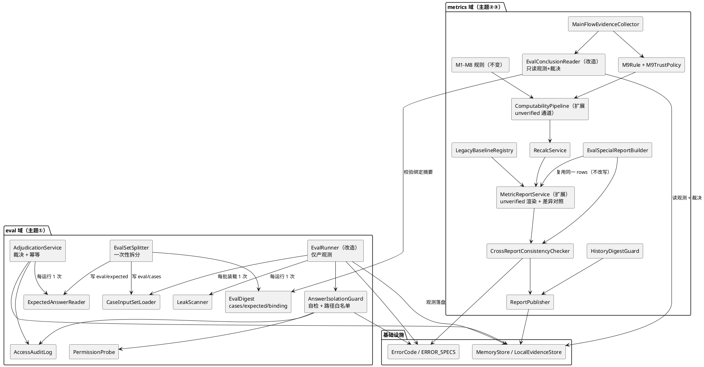
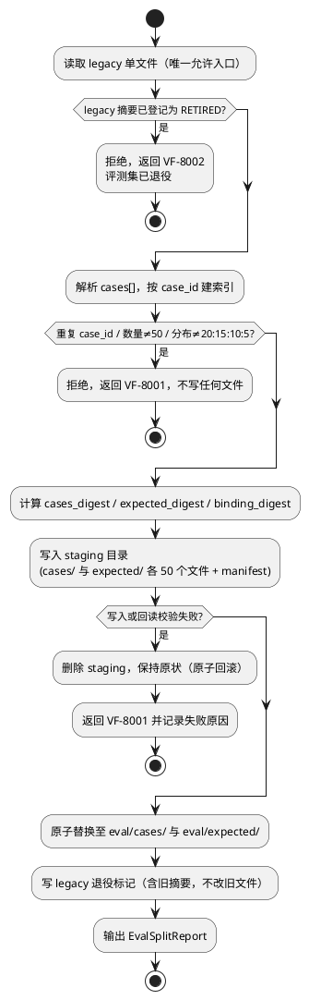
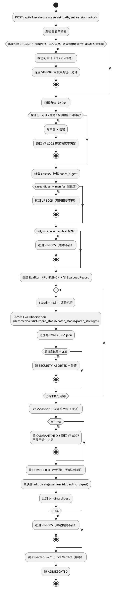
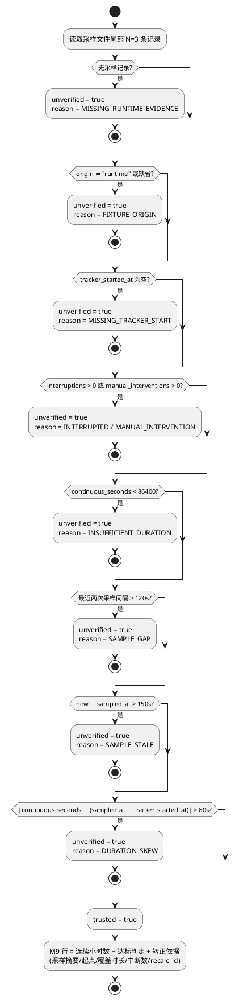
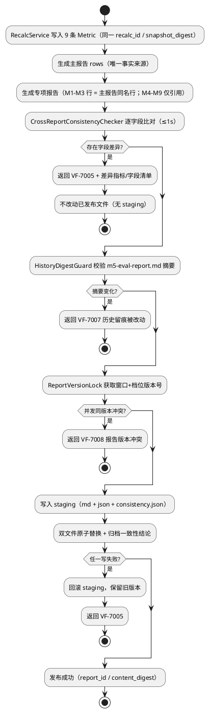
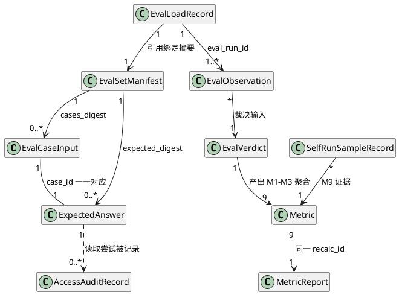

# 评测集防泄漏与指标口径统一 · 增量设计方案

> 版本：v1.0（2026-11-13）
> 对应需求：`.codeartsdoer/specs/eval_leak_hardening/spec.md`（v1.0，605 行）
> 本文档只描述"如何构建"（架构、接口、数据、迁移、验证），不包含完整代码实现。

---

## 0. 设计前置约定

### 0.1 需求编号映射规则

`spec.md` 未使用显式 REQ 编号，本设计按其章节条目建立稳定可追溯编号，覆盖矩阵见第 3 章：

| 编号前缀 | 对应 spec 章节 | 条目范围 |
|---|---|---|
| `REQ-CAP1-nn` | 5.1.1 评测集拆分与答案隔离 · 业务规则 | 01–18 |
| `REQ-CAP2-nn` | 5.2.1 M1–M9 口径统一 · 业务规则 | 01–22 |
| `REQ-CAP3-nn` | 5.3.1 M9 未验证状态 · 业务规则 | 01–10 |
| `REQ-EX1-n` / `REQ-EX2-n` / `REQ-EX3-n` | 5.1.3 / 5.2.3 / 5.3.3 异常场景 | 1–8 / 1–7 / 1–6 |
| `REQ-DFX-a.b-n` | 4.1–4.5 DFX 约束 | 按条款 |
| `REQ-DATA-c.n` | 6.1–6.7 数据约束 | 按字段 |

### 0.2 代码事实基线（实检索确认，非推测）

| 关注点 | 真实位置 | 当前事实 |
|---|---|---|
| 评测集装载与配比校验 | `backend/app/eval/service.py:40`（`EvalCaseSet`）、`:45`（`load`）、`:57`（`validate`）、`:81`（`assert_valid`） | 单文件 `eval/eval_set.json`；`cases[]` 中用例输入与 `ground_truth` 同处；配比校验 `TOTAL_MIN=50`、`CATEGORY_RATIO`、`MIN_NEGATIVE_RATIO=0.30`；摘要为 `sha256(cases)` |
| 评测执行 | `backend/app/eval/runner.py:63`（`EvalRunner`）、`:70`（`start`）、`:88`（`step`）、`:126`（`_run_case`）、`:207`（`_persist`） | 执行侧直接读 `case.ground_truth` 与 `case.category`，直接产出 `status`（PASS/FAIL）、`verdict_agrees`、`shallow_fix_rejected`；运行产物落 `eval/runs/EVALRUN-*.json` |
| 评测结论读取 | `backend/app/metrics/collectors/eval_channel.py:68`（`EvalConclusionReader`）、`:105`（m1）、`:110`（m3）、`:114`（m2） | 从 `EVALRUN-*.json` 回读 `category/status/detected/verdict_agrees` 计算 M1/M2/M3；`m2` 仅当每条结果都有 `vuln_detected` 才存在 |
| 主流程证据采集 | `backend/app/metrics/collectors/main_flow.py`（`CollectedEvidence`、`MainFlowEvidenceCollector.build`） | 注入 `eval_conclusion`、`self_run_sample`；评测通道 Issue 计入 `channel_excluded_count` 后从 M4–M9 分母剔除 |
| 指标定义登记 | `backend/app/metrics/definitions.py`（`V2_BINDINGS`、`TARGETS`、`DefinitionRegistry`） | v1/v2 双版本登记，v2 生效日 `2026-12-01`；M9 目标 24.0 小时、`HIGHER_IS_BETTER` |
| 指标记录与复算 | `backend/app/metrics/service.py`（`RecalcService.recalc`、`_metric_record`）、`backend/app/domain/models.py:281`（`Metric`） | 9 项指标共享 `recalc_id`/`snapshot_digest`；`Metric` 无"未验证"字段 |
| 报告生成与校验 | `backend/app/metrics/report.py:52`（`generate`）、`:127`（`_validate`）、`:186`（`_met`）、`:194`（`_conclusion`）、`:211`（`_markdown`） | 只做单报告内校验；M9 可计算为 True 时直接判达标；`_fmt` 将 `None` 渲染为 `-` |
| 不可计算原因码 | `backend/app/metrics/reason_codes.py`（`UncomputableReason`、`REASON_STAGE`、`EXCLUSION_ALLOWED_REASONS`） | 固定 8 个原因码，无"未验证"语义 |
| 采样读取 | `backend/app/metrics/collectors/runtime_sampler.py:12`（`SelfRunSampleRecord`）、`:53`（`_read_last_record`）、`:82`（`append`） | 记录含 `tracker_started_at`（可空），无来源标识、无人工干预标识 |
| 自运行追踪器 | `backend/app/runtime/self_run.py`（`SelfRunTracker`、`sample()`） | `sample()` 可导出 `tracker_started_at`，但 `scripts/recalc_metrics.py:122` 的夹具记录未写该字段 |
| M9 规则 | `backend/app/metrics/rules/m9.py:16`（`evaluate`） | 仅校验采样新鲜度（120s+30s）与心跳，直接 `continuous_seconds/3600` 作为值；不校验起点、中断、间隔、来源 |
| 报告归档 | `backend/app/metrics/report.py`（归档写盘）、`backend/app/main.py:443`（`POST /api/v1/metrics/reports`）、`:468`（`GET /api/v1/metrics/reports/{report_id}`） | 版本号递增 `RPT-{window}-{tier}-{000n}`；回读校验 `content_digest` |
| 错误码 | `backend/app/api/envelope.py`（`ErrorCode`、`ERROR_SPECS`） | 评测相关仅 `VF-8001 EVAL_INVALID`；`VF-7005 REPORT_INCONSISTENT` 已存在 |
| 评测脚本 | `scripts/seed_eval.py`、`scripts/run_eval.py`（生成 `docs/devlog/eval-report.md`）、`scripts/recalc_metrics.py` | `run_eval.py` 自算 M1–M3 并硬编码 M2 为 `SOURCE_MISSING`；`recalc_metrics.py` 写入 86400 秒夹具采样 |
| 历史留痕 | `docs/devlog/m5-eval-report.md` | 当前 `sha256=931d20442673b0922a32cfb42de1dcc9996925836607f6ddedbc5e8b1f165502`，内容含 M1/M2/M3=1.0、M4–M9 不可计算、结论 PASS |
| 报告归档基线 | `docs/devlog/metrics/RPT-2026-12-PRELIMINARY-0001…0005`（`.md` 与 `.json` 各一份） | 0005 号报告 M9=24.0000、达标 True、结论 PASS |
| 评测集基线 | `eval/eval_set.json`（`sha256=75079f7b…`）、`eval/eval_set.sha256`（cases 摘要 `355ffaf7…`，count=50） | 50 条，分布 20/15/10/5 |

### 0.3 设计范围声明

- 本设计只覆盖 `spec.md` 三大主题，不改变状态机、证据写入语义、main 硬约束、M1–M8 计算规则。
- M9 由"可计算 24h"改为"未验证"会导致当前 `metrics-report.md`（0005 号）的结论由 PASS 变为 UNDETERMINED；该文件属于"当前对外报告"而非历史留痕，允许被更新版本替代；`docs/devlog/metrics/` 下已归档版本保持只读。

---

# 一、需求与存量功能关系分析

## 1.1 需求功能与存量功能对比

### 1.1.1 已实现功能

| 需求功能 | 存量功能 | 代码位置 | 匹配度 |
|---|---|---|---|
| M1 = 正例+边界检出数 ÷ 正例+边界总数 | `EvalConclusionReader` 按 `category in {POSITIVE,BOUNDARY}` 聚合 `detected` | `backend/app/metrics/collectors/eval_channel.py:105`；`backend/app/metrics/rules/eval_merge.py`（`M1Rule`） | 75%（口径一致，但数据来自含答案的单文件运行产物） |
| M2 无显式漏洞检出字段即无值 | `m2 = None` 除非每条结果都有 `vuln_detected`；`M2Rule` 置 `evidence_present=False`，由 pipeline 映射 `SOURCE_MISSING` | `backend/app/metrics/collectors/eval_channel.py:114`；`backend/app/metrics/rules/eval_merge.py`（`M2Rule`）；`backend/app/metrics/judgment.py`（`_fail` + `SOURCE_MISSING`） | 100% |
| M3 = 一致数 ÷ 有标注样本数，披露分母 | `labelled = [row for row in results if row.get("verdict") is not None]` 作为 `covered_count` | `backend/app/metrics/collectors/eval_channel.py:110`；`backend/app/metrics/rules/eval_merge.py`（`M3Rule`） | 75%（口径一致，样本来源待拆分） |
| M4/M5/M6/M7/M8 v2 主流程口径 | 各规则 + v2 采集源绑定 | `backend/app/metrics/rules/m4.py`–`m8.py`；`backend/app/metrics/definitions.py`（`V2_BINDINGS`） | 100% |
| M6 采集源为门禁结论/门禁尝试 | v2 绑定为 `GateResult`/`GateAttempt`，报告已不含"缺 Pipeline 日志" | `backend/app/metrics/definitions.py`（M6 绑定与 `note`）；`backend/tests/test_metrics_report.py`（断言不含该字样） | 100% |
| 固定 8 个不可计算原因码 | `UncomputableReason` 枚举 + `is_reason_code`/`coerce_reason` 强校验 | `backend/app/metrics/reason_codes.py` | 100% |
| 9 行覆盖 + 定义版本一致 + 复算标识一致 | `_validate` 校验 `definition_version` 唯一、`recalc_id` 唯一且非空、值与分子/覆盖一致 | `backend/app/metrics/report.py:127` | 75%（仅单报告内，缺跨报告） |
| 可计算/不可计算的值呈现 | `_fmt`：`None` → `-`；比率 4 位小数 | `backend/app/metrics/report.py`（`_fmt`） | 75%（缺"未验证"呈现） |
| 评测集配比 50 条、20/15/10/5、无重复 | `validate()` 校验样本数、四类占比区间、负例下限、`content_digest` 唯一 | `backend/app/eval/service.py:57` | 75%（校验存在，模型未拆分） |
| 评测通道数据不进入 M4–M9 分母 | `ChannelResolver` + 采集器累计 `channel_excluded_count` 并跳过评测通道 Issue | `backend/app/metrics/isolation.py`（`resolve`/`summarize`）；`backend/app/metrics/collectors/main_flow.py`（channel 分支） | 100% |
| 报告版本递增与摘要回读 | `next_report_version` + `content_digest` + `GET /api/v1/metrics/reports/{id}` 校验 `digest_ok` | `backend/app/metrics/report.py:52`；`backend/app/main.py:468` | 100% |
| 运行时连续运行可导出起点 | `SelfRunTracker.sample()` 输出 `tracker_started_at` | `backend/app/runtime/self_run.py` | 50%（能力存在，但采集链未使用） |

### 1.1.2 需要扩展的功能

| 需求功能 | 存量功能 | 差异说明 | 扩展方向 |
|---|---|---|---|
| 用例输入与预期答案分离 | `EvalCase` 单模型同时承载 `category`/`ground_truth`/`proof_*` 与执行定位字段 | 输入输出同处；执行侧可见答案；无法分别登记摘要 | 拆为 `EvalCaseInput` 与 `ExpectedAnswer` 两模型 + 两目录 + 双摘要与绑定摘要；`EvalCase` 降级为拆分器专用的 legacy 结构 |
| 执行与裁决分离 | `_run_case` 在 `EvalRunner` 内比对 `ground_truth.reachable`/`should_reject` 产出 `status`、`verdict_agrees`、`shallow_fix_rejected` 并落盘 | 运行产物含裁决字段（违反 5.1.1-10/17、6.3-9） | 运行侧只产 `EvalObservation`；新增裁决侧 `AdjudicationService`，产物写 `eval/verdicts/EVALRUN-*.json`，运行产物去除裁决字段 |
| 装载路径白名单与越权拒绝 | `EvalRunner.start(set_path, digest)` 直接 `Path(path).read_text` | 无路径约束，任意路径可装载 | 新增 `AnswerIsolationGuard.assert_load_path()`，白名单根 + 禁止答案目录/其父目录/符号链接目标 |
| 启动前权限自检 | 无 | 无"执行身份对答案目录零读取"的可验证属性 | 新增 `PermissionProbe`（本地 ACL + 哨兵文件探测）与 `start()` 前置自检，超时按无权限处理并拒绝启动 |
| 摘要强校验（三摘要） | 仅单 `expected_digest` 比对 `sha256(cases)` | 摘要含义与 spec 的"用例摘要/答案摘要/绑定摘要"不对应 | 新增三摘要计算、`EvalSetBinding` 结构与 `EvalLoadRecord` 装载记录 |
| M9 可信性判定 | `M9Rule.evaluate` 只判断 `sampled_at` 新鲜度与 `heartbeat_ok`，直接取 `continuous_seconds/3600` | 不校验 `tracker_started_at`、`interruptions`、采样间隔、来源、人工干预；夹具记录可转正 24h | 新增 `M9TrustPolicy`，六条件全满足才转正，否则 `unverified=True` |
| M9 展示状态 | `Metric.computable=False` + `value=None` → 显示 `-` | 无"未验证"状态与可读原因 | `Metric` 增 `unverified`/`unverified_reason`；报告值列渲染"未验证"、达标列"-" |
| 与历史 m5 报告的口径差异对照 | 无 | 报告缺 9 项差异对照 | 新增 `LegacyBaselineRegistry`（静态登记历史旧值/旧状态）+ 报告章节渲染 |
| 跨报告一致性校验 | `report.py:127` 仅校验同一批 9 条记录 | 无两份报告逐字段比对，无发布闸门 | 新增 `CrossReportConsistencyChecker` + `ReportPublisher`（原子发布/拒绝） |
| 评测专项报告 | `scripts/run_eval.py` 自算四类通过率与 M1–M3，M4–M9 以文字声明引用 | 自算 = 第二事实来源；M2 硬编码；无头信息字段 | 改为 `EvalSpecialReportBuilder`，M1–M3 行直接取同一批 `Metric` 记录，M4–M9 只写引用指针 |
| 历史留痕保护 | 仅靠脚本"不写"约定 | 无校验，任何人可改写 | 新增 `HistoryDigestGuard`，发布前比对登记摘要，失败即阻断 |
| 报告头信息一致性 | 主报告头仅窗口/档位/时间/主体/结论 | 缺 `eval_run_id`/`cases_digest`/`binding_digest`/定义版本 | `MetricReport` 与 `ReportOutcome` 增加头信息字段并写入 markdown/json |
| 报告发布原子性 | `report.py` 逐文件 `write_text`，无事务 | 可能半份报告 | staging 目录 + 双文件 rename + 失败回滚 + 版本冲突检测 |

### 1.1.3 需要新增的功能或接口

**A. 评测集拆分与装载（主题①）**

| 功能点 | 输入 | 输出 | 核心逻辑 | 依赖 |
|---|---|---|---|---|
| `EvalSetSplitter.split()` | legacy 单文件路径、`set_version`、`actor` | 新增 `EvalSplitReport`（含三摘要、样本数、分布、写入条目数） | 解析 legacy `cases[]` → 按 `case_id` 拆成输入/答案两份；全量校验后落盘；失败全回滚；重复 `case_id` 或分布不等于 20/15/10/5 即拒绝 | `EvalCase`、`EvalDigest` |
| `CaseInputSetLoader.load()` | `eval/cases/`、`set_version` | `CaseInputSet`（`cases: list[EvalCaseInput]`、`cases_digest`） | 逐文件读取 + 目录级规范化摘要；禁止跟随符号链接到答案目录 | `AnswerIsolationGuard` |
| `ExpectedAnswerReader.read()` | `eval/expected/`、裁决身份上下文、`eval_run_id` | `ExpectedAnswerSet`（`answers`、`expected_digest`） | 仅裁决身份可调用；每次调用写一条访问审计；路径非法即拒绝并审计 | `AccessAuditLog` |
| `EvalSetBinding.compute()` | `cases_digest`、`expected_digest`、`set_version` | `binding_digest`（64 位十六进制） | `sha256(cases_digest + ":" + expected_digest + ":" + set_version)`，同名函数单一实现，装载/裁决/报告共用 | — |
| `AnswerIsolationGuard.self_check()` | 执行身份、答案根、用例根 | `IsolationVerdict`（`ok`、`basis`、`elapsed_ms`、`denied_probes`） | 2 秒预算内的探针组合：目录列举、文件名候选打开、相对路径、路径穿越、符号链接跟随；任一可读即 `ok=False`；超时 `ok=False` | `PermissionProbe` |
| `AccessAuditLog.record()` / `search()` | `occurred_at`、`actor`、`target_path`、`operation`、`result`、`reason`、`run_ref` | 审计记录 id | 只记路径不记内容；按时间与 `run_ref` 可检索；`actor=exec` 且 `result=成功` 数量必须为 0 | `MemoryStore` / 归档存储 |
| `AdjudicationService.adjudicate()` | `eval_run_id`、`observations`、`binding_digest`、答案集 | `EvalVerdict`（四类通过率、M1–M3 聚合、用例级判定、`binding_digest`） | 幂等键 `(eval_run_id, binding_digest)`；重复请求返回既有结论；答案原文不写入结果 | `ExpectedAnswerReader` |
| `LeakScanner.scan()` | 运行目录、日志、响应体、专项报告文本、答案敏感词表 | `LeakScanReport`（`hits`、`hit_fields`、`artifacts`） | 5 秒预算内扫描字段名与取值；命中即 `LEAK_DETECTED` | — |

**B. 口径统一与报告发布（主题②）**

| 功能点 | 输入 | 输出 | 核心逻辑 | 依赖 |
|---|---|---|---|---|
| `CrossReportConsistencyChecker.compare()` | 主报告 `rows[9]`、专项报告引用行、`Metric` 记录 | `ConsistencyReport`（`differences: list[FieldDiff]`） | 按 16 字段逐项比对（值/可计算/原因码/分子/分母/覆盖/剔除/通道排除/不适用/采集源/复算标识/快照摘要/评测运行/定义版本/目标/达标）；1 秒预算 | `MetricReportService` |
| `ReportPublisher.publish()` | 两份待发布报告 + 一致性结论 + 历史留痕摘要 | `PublishOutcome`（`report_id`、`version`、`digests`） | 先校验（一致性、版本冲突、历史摘要）→ staging 写盘 → 原子替换 → 归档一致性结论；任一失败不改动已发布版本 | `HistoryDigestGuard`、`ReportVersionLock` |
| `HistoryDigestGuard.verify()` | 历史文件路径 + 登记摘要 | `HistoryVerdict` | 比对 `docs/devlog/m5-eval-report.md` 的 sha256 与登记基线；不一致返回 `HISTORY_TAMPERED` | 基线登记 |
| `LegacyBaselineRegistry.entries()` | — | 9 项 `LegacyBaselineEntry`（旧值/旧状态/差异原因） | 历史值与旧状态必须静态登记（历史不可重算），新值运行时从 `rows` 取 | — |
| `EvalSpecialReportBuilder.build()` | 主报告 `ReportOutcome`、裁决结论、装载记录 | 专项报告 `SpecialReportOutcome` | 四类通过率来自裁决；M1–M3 行 = 主报告同名行（不改写、不重算）；M4–M9 只输出 `ref` | `AdjudicationService` |

**C. M9 未验证（主题③）**

| 功能点 | 输入 | 输出 | 核心逻辑 | 依赖 |
|---|---|---|---|---|
| `M9TrustPolicy.evaluate()` | 采样尾部 N 条记录、`now`、复算标识 | `TrustVerdict`（`trusted`、`reason`、`evidence: dict`） | 六条件全满足才 `trusted=True`；否则给出固定原因枚举（`FIXTURE_ORIGIN`/`MISSING_TRACKER_START`/`INSUFFICIENT_DURATION`/`INTERRUPTED`/`SAMPLE_GAP`/`SAMPLE_STALE`/`DURATION_SKEW`/`MANUAL_INTERVENTION`） | `SelfRunSampleReader` |
| `UnverifiedReason`（展示层） | `TrustVerdict.reason` | 一句可读原因 | 只说明"缺少真实运行证据"及缺哪一项，不暴露绕过手段 | — |
| `Metric.unverified` / `unverified_reason` | 规则与 pipeline | 记录字段 | 与 `computable=False`、`reason_code=EVIDENCE_MISSING` 同时成立 | `Metric` 模型校验 |

## 1.2 存量功能详细分析

### 1.2.1 `EvalCaseSet`（装载侧）

- **接口契约**：`load(path, expected_digest) -> EvalCaseSet`；`validate() -> EvalValidation(ok, issues, ratio, digest)`；`assert_valid()` 抛 `EvalSetError(issues, code=VF-8001)`。
- **业务规则**：样本数 ≥50；四类占比落在 `CATEGORY_RATIO` 区间；负例 ≥30%；不允许只有正例；`content_digest` 全集合唯一。
- **扩展点**：摘要比对集中在 `load()`；配比常量集中在模块顶部，便于按新 `set_version` 参数化。
- **约束**：`load()` 只接受单文件，且摘要基于 `json.dumps(cases, sort_keys=True)`——该摘要算法必须与拆分后 `cases_digest` 的规范化方式兼容（否则旧摘要无法复用，正是 spec 4.5-1 的要求：旧摘要不得复用）。
- **风险点**：`EvalCase(**item)` 直接接受含 `ground_truth` 的字典；拆分后若继续复用该构造器，答案会重新流入输入侧，必须在装载路径上禁用。

### 1.2.2 `EvalRunner` + `EvalCaseResult`（执行侧）

- **接口契约**：`start(set_path, expected_digest)`、`step(id, limit)`、`resume(id, limit)`、`interrupt(id, reason)`、`status(id)`；产物 `to_dict()` 含 `results[]`。
- **业务规则**：`_run_case` 在 `Outcome` 分支上做 PASS/FAIL 判定（`expected_reject = category == NEGATIVE`），并在 `should_reject` 分支计算 `shallow_fix_rejected`。
- **副作用**：`_persist` 每次 step 全量重写 `eval/runs/{id}.json`，落盘内容含 `category`、`status`、`verdict_agrees`、`shallow_fix_rejected` —— 这是当前最大泄漏面（4.3-4 直接违反）。
- **约束**：`step` 内部每条用例都新建 `MemoryStore`（每批新实例），属于既有实现约束；改造时不得改变"批次可中断/可恢复"语义。
- **扩展点**：`_run_case` 是唯一的判定集中点，适合整体替换为"观测收集"。

### 1.2.3 `EvalConclusionReader`（评测结论回读）

- **接口契约**：`latest_completed(expected_digest) -> dict | None`，返回 `eval_run_id/set_digest/digest_match/total/completed/category_stats/m1/m3/m2/results`。
- **业务规则**：只取 `status=COMPLETED` 且 `completed==total` 的最新一次；`m2` 只有全部结果含 `vuln_detected` 时才非空。
- **约束**：`digest_match` 基于单一 `set_digest`，改造后需升级为绑定摘要比对；该 reader 同时被 `main.py:164`、`scripts/recalc_metrics.py`、`collectors/main_flow.py` 消费，签名变更需同步三处。
- **风险点**：reader 会把整个 `results[]` 传给 `CollectedEvidence.eval_conclusion`，若结果仍含答案派生字段，会经由快照进入 `.evidence/metrics-recalc`（第二泄漏面）。

### 1.2.4 `MetricReportService`（报告侧）

- **接口契约**：`generate(window, tier, actor, now) -> ReportOutcome(record, markdown, rows)`；异常 `ReportInconsistent(issues)`。
- **业务规则**：必须 9 条记录齐全；定义版本唯一；`recalc_id` 唯一且非空；`computable` 与 `reason_code` 互斥；可计算时 `value ≈ numerator/covered_count`；`publishable` 规则（M1–M3 需 `eval_run_id`，其余需 `snapshot_digest`）；`_conclusion` 对初赛档检查 `REQUIRED_PRELIMINARY=(M1,M4,M5,M9)`。
- **扩展点**：`_row` 是唯一的行装配点（新增 `unverified` 只需在此与 `_fmt` 扩展）；`_markdown` 是唯一的渲染点（差异对照章节在此追加）。
- **约束**：`_validate` 的"值与分子/覆盖一致"校验直接 `float(record.value)`，对 `value=None` 的未验证行必须在短路分支中放过，否则会抛 `TypeError`。

### 1.2.5 `M9Rule` + `SelfRunSampleReader`（M9 现状）

- **接口契约**：`M9Rule.evaluate(evidence, definition, now) -> RuleResult`；`SelfRunSampleReader.latest()/latest_record()/append(sample)`。
- **业务规则**：当前只有 3 个门：`sampled_at` 存在、`heartbeat_ok=True`、`age <= 120+30`；通过后 `covered_count=1`、`numerator=continuous_seconds/3600`。
- **约束**：`RuleResult.value()` 在 `covered_count>0` 时恒返回 `numerator/covered_count`，无法表达"有证据但不可采信"；必须新增"不可采信"通道（`evidence_present=False` + `details["unverified"]`）。
- **风险点**：`scripts/recalc_metrics.py:122` 直接 `append` 一条 `continuous_seconds=86400.0`、无 `tracker_started_at`、无来源标记的记录，当前会被判为 24h 达标 —— 这是 spec 5.3.1-4/8 明确禁止的转正路径，必须在代码层面阻断而不只是靠约定。

### 1.2.6 `ErrorCode` / `ERROR_SPECS`（错误码）

- **接口契约**：`ApiError(code, detail)` → HTTP 状态由 `ERROR_SPECS[code].http_status` 决定；`error_response` 输出 `code/message/data/trace_id`。
- **约束**：新增码必须同时登记 `ErrorCode` 与 `ERROR_SPECS`，否则 `ApiError.__init__` 抛 `KeyError`；`Envelope.code` 为字符串码，前端与测试按码断言，新增码不改变既有码语义。
- **扩展点**：`VF-7005 REPORT_INCONSISTENT`、`VF-7002 RECALC_CONFLICT`、`VF-8001 EVAL_INVALID` 可直接复用，避免语义重叠。
---

# 二、增量设计方案

## 2.1 实现模型

### 2.1.1 上下文视图



关键约束：评测执行链路（`Start`/`Step`）与 `Expected` 之间**只有失败探测**，没有任何成功读取路径；`Expected` 的唯一成功读取方是 `AdjudicationService`。

### 2.1.2 服务/组件总体架构



模块职责划分：

| 模块（新增/改造） | 建议路径 | 职责 | 依赖方向 |
|---|---|---|---|
| `EvalCaseInput` / `ExpectedAnswer` / `EvalObservation` / `EvalVerdict` / `EvalLoadRecord` / `AccessAuditRecord` / `EvalSplitReport` | `backend/app/eval/models.py`（新增） | 领域模型（字段级见 2.3） | 依赖 `domain.models` 基础类 |
| `EvalDigest` | `backend/app/eval/digest.py`（新增） | 三摘要规范化与唯一算法 | 无外部依赖 |
| `EvalSetSplitter` | `backend/app/eval/splitter.py`（新增） | 一次性拆分、原子落盘、退役标记 | models、digest |
| `CaseInputSetLoader` / `ExpectedAnswerReader` | `backend/app/eval/loader.py`（新增） | 双目录装载、目录级摘要 | models、digest、guard |
| `AnswerIsolationGuard` / `PermissionProbe` / `AccessAuditLog` | `backend/app/eval/isolation.py`（新增） | 自检、白名单、审计、越权计数 | models |
| `EvalRunner`（改造） | `backend/app/eval/runner.py` | 只产 `EvalObservation`；三摘要校验；安全中止 | loader、guard、leak |
| `AdjudicationService` | `backend/app/eval/adjudication.py`（新增） | 观测 + 答案 → 四类通过率与 M1–M3、幂等 | loader、audit |
| `LeakScanner` | `backend/app/eval/leak_scan.py`（新增） | 产物零泄漏扫描 | — |
| `EvalConclusionReader`（改造） | `backend/app/metrics/collectors/eval_channel.py` | 只聚合观测 + 裁决，禁止自算答案派生判定 | eval.models |
| `M9TrustPolicy` | `backend/app/metrics/rules/m9.py`（改造） | 六条件可信性判定 | runtime_sampler |
| `SelfRunSampleReader`（扩展） | `backend/app/metrics/collectors/runtime_sampler.py` | 新增 `origin`、`manual_interventions`、尾部 N 条读取 | — |
| `ComputabilityPipeline`（扩展） | `backend/app/metrics/judgment.py` | `unverified` 通道（不可采信但非采集源缺失） | reason_codes |
| `MetricReportService`（扩展） | `backend/app/metrics/report.py` | `unverified` 渲染、差异对照、头信息 | baseline、definitions |
| `EvalSpecialReportBuilder` | `backend/app/metrics/eval_special_report.py`（新增） | 专项报告仅引用 | report |
| `CrossReportConsistencyChecker` / `ReportPublisher` / `HistoryDigestGuard` / `LegacyBaselineRegistry` | `backend/app/metrics/consistency.py`、`publisher.py`、`history_guard.py`、`legacy_baseline.py`（新增） | 口径闸门与历史保护 | report |
| 错误码扩展 | `backend/app/api/envelope.py`（改造） | 新增 9 个码 + 复用规则 | — |
| 评测集拆分/报告脚本 | `scripts/split_eval.py`（新增）、`scripts/run_eval.py`（改造）、`scripts/eval_report.py`（新增）、`scripts/recalc_metrics.py`（改造） | 运维入口 | 上述模块 |

配置项新增（`MetricsConfig` / 顶层 `eval` 段需作为 `AppConfig` 子模型接入，保持 `extra="forbid"` 严格性）：

| 配置项 | 默认值 | 取值策略 |
|---|---|---|
| `eval.cases_dir` | `eval/cases` | 只允许在受控根之内；相对路径按项目根解析 |
| `eval.expected_dir` | `eval/expected` | 同上；与 `cases_dir` 不得互为父子目录 |
| `eval.legacy_set_path` | `eval/eval_set.json` | 仅拆分器可读；运行期一律拒绝 |
| `eval.set_version` | 空（必填） | 拆分时写入 manifest，装载必须匹配 |
| `eval.isolation_probe_timeout_ms` | `2000` | 上限 2000（DFX 4.1-1） |
| `eval.max_violations` | `3` | 达到即安全中止（5.1.1-13） |
| `eval.leak_scan_budget_ms` | `5000` | 上限 5000（DFX 4.1-5） |
| `eval.report_dir` | `docs/devlog` | 专项报告与主报告同目录 |
| `metrics.m9_min_continuous_seconds` | `86400` | 不得下调 |
| `metrics.m9_min_sample_gap_seconds` | `60` | 相邻采样目标间隔（用于间隔上限 120s 的派生校验） |
| `metrics.m9_max_sample_gap_seconds` | `120` | 不得放宽 |
| `metrics.m9_max_sample_age_seconds` | `150` | 不得放宽 |
| `metrics.m9_max_tracker_skew_seconds` | `60` | 不得放宽 |
| `metrics.history_baseline` | `docs/devlog/m5-eval-report.md=931d2044…` | 登记摘要，发布前比对 |

### 2.1.3 实现设计文档

#### A. 评测集一次性拆分与旧格式退役（主题①）



- 触发条件与策略：拆分仅由运维者通过 `scripts/split_eval.py` 触发；组件内不提供 HTTP 入口，避免运行期二次拆分。
- 原子性：单次拆分最多写 102 个文件；回滚依赖 staging 目录整体丢弃，禁止"先写 cases 再写 expected"。
- 退役语义：`eval/eval_set.json` 保留原文件与原文摘要（不删除、不改写），仅在 `eval/expected/_retired/legacy.json` 登记 `{path, sha256, retired_at, replaced_by}`；运行期任何指向该路径的装载请求一律返回 `VF-8002`。

#### B. 装载自检与执行—裁决分离（主题① 主链路）



- 关键决策：`binding_digest` 由装载侧写入 `EvalLoadRecord` 与每条 `EvalObservation`，裁决侧只接受与之相同的答案集，杜绝"运行 A 版本、裁决 B 版本"。
- 状态机（`EvalRun.status`）：`RUNNING → COMPLETED → ADJUDICATED`；异常分支 `RUNNING → INTERRUPTED →（resume）RUNNING`、`RUNNING → SECURITY_ABORTED`、`COMPLETED → QUARANTINED`。`SECURITY_ABORTED`/`QUARANTINED` 不可裁决、不可出报告。
- 观测写入语义：`EvalObservation` 落盘为 append-only 分片（每批一个分片文件），避免 `_persist` 全量重写导致中途产物含半份结果；`EVALRUN-*.json` 只保留运行级元数据与观测分片索引。

#### C. M9 可信性判定（主题③）



- 判定顺序固定为"来源 → 起点 → 干预 → 时长 → 间隔 → 新鲜度 → 一致性"，原因码取**第一个**不满足项，保证 `unverified_reason` 稳定可复现。
- 所有阈值从 `metrics.m9_*` 配置读取，但**代码中对上限值做硬校验**（间隔 ≤120、新鲜度 ≤150、偏差 ≤60、时长 ≥86400），配置放宽即启动失败——对应 spec 5.3.1-9 禁止项。
- 原始采样记录只读：`SelfRunSampleReader` 不提供改写/删除接口；转正与否只产生新的 `Metric` 记录。

#### D. 跨报告一致性校验与发布闸门（主题②）



- 一致性比对字段（16 项）：`value`、`computable`、`unverified`、`reason_code`、`numerator`、`denominator`、`covered_count`、`excluded_count`、`channel_excluded_count`、`not_applicable_count`、`source_ref`、`recalc_id`、`snapshot_digest`、`eval_run_id`、`definition_version`、`met`。
- 结论一致性：两份报告的 `conclusion` 必须由同一函数 `_conclusion` 产出，专项报告不单独计算结论，直接引用主报告结论并断言相等。
- 发布原子性：文件系统无事务，采用 `staging/<report_id>/` 预写 + `os.replace` 顺序替换（md 先、json 后、consistency 最后）；替换失败时按已替换清单逆序回滚，并保证旧版本文件未被触碰（新版本号文件才写）。

#### E. 专项报告只引用不重算（主题②）

| 报告区块 | 数据来源 | 允许的计算 | 禁止事项 |
|---|---|---|---|
| 头信息 | `MetricReport` + `EvalLoadRecord` + `EvalVerdict` | 无 | 禁止在专项报告内重新生成 recalc_id |
| 四类通过率 | `EvalVerdict.category_stats` | 通过数/类别总数 | 禁止用 M1 值反推 |
| M1–M3 行 | 主报告 `rows[0..2]` 同对象 | 无（直接拷贝引用） | 禁止改写 `value`/`reason_code`/`source_ref` |
| M4–M9 行 | 主报告 `rows[3..8]` | 仅生成引用字符串 `RPT-…-000n#M4` | 禁止出现"不可计算/缺采集源"自判文案 |
| 结论 | 主报告 `conclusion` | 无 | 禁止单独判定 PASS/FAIL |
## 2.2 接口设计

### 2.2.1 总体设计

接口按"装载 / 执行 / 裁决 / 报告"四类划分，稳定性等级：**稳定**（对外契约，版本化）、**实验**（本轮新增，允许演进）、**内部**（模块内）。

| 接口 | 分类 | 稳定性 | 变更类型 | 对应需求 |
|---|---|---|---|---|
| `POST /api/v1/eval/runs` | 装载 | 稳定 | 请求体扩展（新增 `set_version`、保留 `set_path` 但语义收紧） | CAP1-08/09 |
| `GET /api/v1/eval/runs/{id}` | 执行 | 稳定 | 响应去除裁决字段，新增 `binding_digest`/`status` 枚举扩展 | CAP1-10 |
| `POST /api/v1/eval/runs/{id}/step` | 执行 | 稳定 | 行为不变，产物语义变更 | CAP1-10 |
| `POST /api/v1/eval/runs/{id}/resume` | 执行 | 稳定 | 必须沿用同一 `binding_digest` | DFX 4.2-6 |
| `POST /api/v1/eval/runs/{id}/interrupt` | 执行 | 稳定 | 不变 | — |
| `POST /api/v1/eval/runs/{id}/adjudicate` | 裁决 | 实验（新增） | 新增 | CAP1-04/10/14 |
| `GET /api/v1/eval/runs/{id}/load-record` | 装载 | 实验（新增） | 新增 | CAP1-15 |
| `GET /api/v1/eval/audit/access` | 审计 | 实验（新增） | 新增 | CAP1-12、DFX 4.4-3 |
| `POST /api/v1/metrics/reports` | 报告 | 稳定 | 响应新增 `unverified` 行字段与差异对照；内部改走 `ReportPublisher` | CAP2-12/13 |
| `POST /api/v1/metrics/reports/eval-special` | 报告 | 实验（新增） | 新增 | CAP2-02/19 |
| `GET /api/v1/metrics/reports/{id}` | 报告 | 稳定 | 响应新增头信息字段 | CAP2-19 |
| `GET /api/v1/metrics/reports/consistency` | 报告 | 实验（新增） | 新增 | CAP2-12/13 |

变更策略：`GET` 只增字段不删字段；`POST` 新增字段一律可选且有默认；`EVAL_*` 错误码与 `status` 枚举值只增不改；已发布报告字段列结构保持不变（4.5-3）。

### 2.2.2 接口清单

#### （1）装载：启动评测运行

```python
# backend/app/eval/runner.py（签名变更）
def start(
    self,
    case_set_path: Path,           # 必须是 eval/cases 之下的目录或 manifest
    set_version: str,              # 必须与 cases/manifest.json 一致
    actor: str,                    # 发起主体，写入 EvalLoadRecord
    expected_binding: str | None = None,  # 可选，调用方预置绑定摘要，用于强校验
) -> EvalRun: ...
```

- **业务说明**：启动一次评测运行，完成路径白名单、权限自检、用例摘要校验与装载记录生成；不读取预期答案内容。
- **前置条件**：`case_set_path` 位于白名单根内；`set_version` 已登记；执行身份的 ACL 自检通过；上一版本运行不处于 `RUNNING`（同 `case_set` 可并发，但需不同 `eval_run_id`）。
- **后置条件**：生成 `EvalRun(status=RUNNING)`、`EvalLoadRecord`（三摘要 + 分布 + 主体 + 时刻）；`binding_digest` 写入运行元数据；审计中新增一条启动自检记录。
- **异常映射**：路径非法 → `VF-8004`（403）；隔离不满足/超时 → `VF-8003`（403）；摘要或版本不符 → `VF-8005`（409）；结构/配比非法 → `VF-8001`（422）；旧单文件 → `VF-8002`（410）。
- **调用契约示例**：

```python
run = runner.start(
    case_set_path=ROOT / "eval" / "cases",
    set_version="2026.11.13",
    actor="eval-executor",
    expected_binding=binding_digest,
)
# run.binding_digest / run.cases_digest / run.eval_run_id
```

#### （2）执行：步进与观测落盘

```python
def step(self, eval_run_id: str, limit: int = 5) -> EvalRun: ...
def resume(self, eval_run_id: str, limit: int = 5) -> EvalRun: ...

@dataclass(frozen=True)
class EvalObservation:
    case_id: str
    detected: bool
    verdict: str | None
    repro_status: str | None
    patch_status: str | None
    patch_strength: float | None
    binding_digest: str
    observed_at: datetime
```

- **业务说明**：逐条驱动被测系统并记录原始事实；不产生 PASS/FAIL、是否一致、浅修复拒绝等判定。
- **前置条件**：运行处于 `RUNNING` 或 `INTERRUPTED`。
- **后置条件**：追加一个观测分片；`completed` 递增；全部完成后 `status=COMPLETED`；越权计数随审计更新。
- **异常映射**：运行不存在 → `VF-7001`（500，沿用）；累计越权 ≥3 → 运行置 `SECURITY_ABORTED` 并返回 `VF-8008`（403）；`limit` 超上限按 `MAX_STEPS_PER_CALL` 截断（沿用）。
- **禁止项落地**：`EvalObservation` 无 `status`/`verdict_agrees`/`shallow_fix_rejected`/`category` 字段——类型层面即无法写入（对应 CAP1-10、6.3-9）。

#### （3）裁决：观测 + 答案 → 结论

```python
# backend/app/eval/adjudication.py
class AdjudicationService:
    def adjudicate(
        self,
        eval_run_id: str,
        binding_digest: str,
        actor: str,                     # 必须是裁决身份
    ) -> EvalVerdict: ...

@dataclass(frozen=True)
class EvalVerdict:
    eval_run_id: str
    binding_digest: str
    category_stats: dict[str, CategoryStat]   # total / passed
    m1: RatioStat                              # detected / total
    m2: RatioStat | None                       # 仅显式字段存在时
    m3: RatioStat                              # agrees / labelled
    case_verdicts: tuple[CaseVerdict, ...]     # case_id / passed / reason
    adjudicated_at: datetime
```

- **业务说明**：读取预期答案，对观测做 PASS/FAIL 判定并汇总四类通过率与 M1–M3；结论中不得出现答案原文。
- **前置条件**：运行 `status=COMPLETED` 且 `QUARANTINED` 未置位；`binding_digest` 与运行元数据一致；调用者身份具有答案读权限。
- **后置条件**：写 `eval/verdicts/EVALRUN-*.verdict.json`；运行置 `ADJUDICATED`；审计记录一次成功读取（仅裁决身份可得 `result=成功`）。
- **异常映射**：绑定摘要不符 → `VF-8005`；运行未完成/已隔离 → `VF-8006`（409）；重复裁决 → 返回既有结论（幂等，HTTP 200）；身份无权限 → `VF-8003`。
- **幂等**：唯一键 `(eval_run_id, binding_digest)`；已存在则直接返回，不写第二份（CAP1-14、DFX 4.2-3）。

#### （4）审计查询

```python
# backend/app/eval/isolation.py
class AccessAuditLog:
    def record(self, entry: AccessAuditEntry) -> AccessAuditRecord: ...
    def search(self, since: datetime | None = None, run_ref: str | None = None) -> list[AccessAuditRecord]: ...
```

- **业务说明**：记录每一次对答案目录/答案文件的读取、枚举、打开、链接跟随尝试；只记路径与结果，不记内容。
- **后置条件**：`actor=exec` 且 `result=成功` 的记录数必须为 0（CAP1-07/12，6.7-5）。
- **异常映射**：审计写入失败 → 视为安全失败，拒绝进行中的操作（故障关闭）。

#### （5）报告：统一发布与一致性查询

```python
# backend/app/metrics/publisher.py
class ReportPublisher:
    def publish(
        self,
        window: str,
        tier: StageTier,
        actor: str,
        now: datetime | None = None,
    ) -> PublishOutcome: ...
```

- **业务说明**：一次调用生成并发布"主报告 + 专项报告 + 一致性结论"，任一校验失败则整体拒绝。
- **前置条件**：9 条 `Metric` 记录齐全且共享 `recalc_id`/`snapshot_digest`；定义版本为 v2；历史留痕摘要匹配。
- **后置条件**：归档新版本号的两个 `.md`/`.json` 与 `consistency-<report_id>.json`；旧版本文件不改动。
- **异常映射**：字段差异 → `VF-7005`；历史被改 → `VF-7007`；版本冲突 → `VF-7008`；定义缺失 → `VF-7004`；复算并发 → `VF-7002`（沿用）。

#### （6）M9 可信性

```python
# backend/app/metrics/rules/m9.py
class M9TrustPolicy:
    def evaluate(self, samples: list[SelfRunSampleRecord], now: datetime) -> TrustVerdict: ...

@dataclass(frozen=True)
class TrustVerdict:
    trusted: bool
    reason: str | None            # FIXTURE_ORIGIN / MISSING_TRACKER_START / INTERRUPTED /
                                  # MANUAL_INTERVENTION / INSUFFICIENT_DURATION /
                                  # SAMPLE_GAP / SAMPLE_STALE / DURATION_SKEW / MISSING_RUNTIME_EVIDENCE
    evidence: dict                # sampled_at / tracker_started_at / continuous_seconds /
                                  # interruptions / gap_seconds / age_seconds / skew_seconds
```

- **业务说明**：判定采样是否构成"真实连续运行证据"；不修改采样文件。
- **前置条件**：`SelfRunSampleReader.latest_n(3)` 可读（文件缺失返回空列表）。
- **后置条件**：`trusted=False` 时 M9 行 `unverified=True`、`value=None`、`reason_code=EVIDENCE_MISSING`、达标 `-`。
- **异常映射**：无错误码（属正常状态）；`unverified_reason` 进入行字段，不进入 `reason_code`。

## 2.3 数据模型

### 2.3.1 设计目标

- 支持"输入/答案物理分离 + 摘要绑定 + 运行可追溯"三类场景：任一运行都能由 `eval_run_id → binding_digest → 三摘要 → 装载记录` 一次定位。
- 支持"评测通道数据不得进入 M4–M9 分母"：模型层面区分 `MetricChannel.EVAL/MAIN`（沿用），并在报告层暴露 `channel_excluded_count`。
- 支持"未验证"与"不可计算"的语义区分：`unverified` 与 `reason_code` 正交但受联合校验约束。
- 与存量数据兼容：`Metric`/`MetricReport` 只增可选字段；历史归档 JSON 反序列化不要求新字段。

### 2.3.2 模型实现



字段级约束（与 spec 第 6 章逐项对应）：

| 模型 | 字段 | 类型 | 约束 | 对应 |
|---|---|---|---|---|
| `EvalCaseInput` | `case_id` | `str` | `^EVAL-\d{4}$`，集合内唯一 | 6.1-1 |
| | `set_version` | `str` | 非空，必须等于 manifest 版本 | 6.1-5 |
| | `location` | `Location` | `file` 非空、`line` 正整数 | 6.1-2 |
| | `rule_id` | `str` | 非空，不得含类别/结论暗示词 | 6.1-3 |
| | `severity` | `Severity` | 枚举 | 6.1-4 |
| | `public_exec_params` | `dict[str, str] \| None` | 仅公开参数白名单键 | 6.1-6 |
| | （禁止字段） | — | 无 `category`/`reachable`/`fixable`/`expected_fix_kind`/`should_reject`/`proof_*`/`answer_digest` | 6.1-7 |
| `ExpectedAnswer` | `category` | `EvalCategory` | 四类；总分布 20/15/10/5 | 6.2-2 |
| | `reachable`/`fixable`/`should_reject` | `bool` | 必填；对抗样本 `should_reject=True`，其余 `False` | 6.2-3/4/6 |
| | `expected_fix_kind` | `FixParadigm` | 枚举 | 6.2-5 |
| | `proof_pre_patch`/`proof_post_patch` | `ProofResult \| None` | 正例必填且 `FAIL`→`PASS` | 6.2-7 |
| | `content_digest` | `str` | 非空、全集合唯一 | 6.2-8 |
| | `answer_digest` | `str` | 非空，整集合摘要 | 6.2-9 |
| `EvalSetManifest` | `cases_digest`/`expected_digest`/`binding_digest` | `str` | 64 位十六进制 | 6.4-2/3/4 |
| | `case_count` | `int` | 正整数，本次 50 | 6.4-5 |
| | `category_distribution` | `dict[str,int]` | 四项之和 == `case_count` | 6.4-6 |
| `EvalLoadRecord` | `loaded_at`/`actor`/`validation_result` | 见类图 | 带时区；主体非空；`通过` 或具体失败原因 | 6.4-7/8/9 |
| | （禁止） | — | 无答案原文、无"类别→case_id"明细映射 | 6.4-10 |
| `EvalObservation` | `detected` | `bool` | 必填，仅事实 | 6.3-3 |
| | `verdict` | `str \| None` | 原文，不含一致性判断 | 6.3-4 |
| | `repro_status`/`patch_status`/`patch_strength` | 枚举/浮点 | 不含期望结论 | 6.3-5/6/7 |
| | `binding_digest` | `str` | 必填，与装载记录一致 | 6.3-8 |
| `EvalVerdict` | `m1`/`m3` | `RatioStat(numerator, denominator)` | 分母 >0 才可计算 | 6.5-6 |
| | `m2` | `RatioStat \| None` | 无显式字段即 `None` | CAP2-05 |
| `AccessAuditRecord` | 全字段 | 见类图 | 只记路径；`result ∈ {拒绝, 成功}` | 6.7-1…8 |
| `Metric` | `unverified` | `bool` | 仅 M9 可为真；真 ⇒ `computable=False`、`value=None`、`reason_code=EVIDENCE_MISSING` | 6.5-14 |
| | `unverified_reason` | `str \| None` | 未验证时必填一句可读原因 | 4.4-5 |
| `SelfRunSampleRecord` | `origin` | `str` | `runtime`/`fixture`；缺省按 `fixture` 处理 | 5.3.1-4 |
| | `manual_interventions` | `int` | 默认 0；>0 即不可转正 | 5.3.1-5(f) |

`Metric` 的联合校验（新增，模型层强制）：

1. `unverified=True` ⇒ `computable=False` 且 `value is None` 且 `reason_code == "EVIDENCE_MISSING"`；
2. `unverified=True` ⇒ `metric_id is MetricId.M9`（其他指标置真即报错）；
3. `computable=True` ⇒ `unverified=False`；
4. 兼容历史记录：两者缺省时 `unverified=False`，旧 JSON 反序列化不触发新校验。

生命周期策略：

- `EvalCaseInput`/`ExpectedAnswer`：由拆分器创建，之后只读；版本变更只能整体重建目录（不允许单文件热改，摘要会暴露）。
- `EvalObservation`：append-only 分片，运行结束后不可修改；重跑生成新 `eval_run_id`。
- `EvalVerdict`：与 `(eval_run_id, binding_digest)` 一一对应，不可覆盖。
- `Metric`：同一 `(metric_id, stage_tier, window)` 由新的 `recalc_id` 原子覆盖（沿用 `MemoryStore.add_metric`），历史报告归档中的行不受影响。
- `MetricReport`：版本号单调递增，文件写入后只读。

持久化策略（不含表结构）：评测侧沿用本地目录（`eval/cases`、`eval/expected`、`eval/runs`、`eval/verdicts`）；指标与报告沿用 `MemoryStore`（内存态）+ 报告归档目录落盘 + `LocalEvidenceStore` 保存快照与一致性结论。部署侧通过挂载与 ACL 表达"执行身份不可读 expected"（`deploy/` 需在实现阶段补充目录权限声明，属实现任务，不在本设计展开）。
## 2.4 错误码沿用与新增

### 2.4.1 沿用（不改语义）

| 错误码 | 枚举 | HTTP | 本设计中的用途 |
|---|---|---|---|
| `VF-8001` | `EVAL_INVALID` | 422 | 评测集结构非法、配比不符、拆分输入非法、写入回滚后的失败原因 |
| `VF-7001` | `EVIDENCE_MISSING` | 500 | 评测运行/报告/采样引用不可解析 |
| `VF-7002` | `RECALC_CONFLICT` | 409 | 同窗口同档复算进行中 |
| `VF-7004` | `DEFINITION_MISSING` | 422 | 9 项定义未登记 |
| `VF-7005` | `REPORT_INCONSISTENT` | 409 | 单报告校验失败、跨报告字段差异、复算标识不一致、定义版本混用、发布写失败 |
| `VF-7006` | `SNAPSHOT_INTEGRITY` | 409 | 快照摘要/事件链校验失败 |

### 2.4.2 新增

| 错误码 | 枚举 | HTTP | 语义 | 触发条件 | 用户可见文案（不含路径细节与答案） | 需求来源 |
|---|---|---|---|---|---|---|
| `VF-8002` | `EVAL_LEGACY_RETIRED` | 410 | 评测集已退役 | 装载路径指向 legacy 单文件或在退役登记中 | "评测集已退役，请使用用例输入集" | CAP1-16、EX1-8、4.5-1 |
| `VF-8003` | `EVAL_ISOLATION_UNMET` | 403 | 答案隔离不满足 | 自检探针可读、超时、权限服务不可判定 | "答案隔离不满足，评测未启动" | CAP1-08、EX1-1、EX1-7、4.2-1、4.3-2 |
| `VF-8004` | `EVAL_PATH_FORBIDDEN` | 403 | 评测集路径不允许 | 路径指向答案目录/答案文件/其父目录/白名单外/符号链接指向答案 | "评测集路径不允许" | CAP1-09、EX1-4、4.3-3 |
| `VF-8005` | `EVAL_DIGEST_MISMATCH` | 409 | 摘要或版本不符 | 用例摘要/答案摘要/绑定摘要/set_version 任一不符 | "摘要不符：<用例|答案|绑定|版本>" | CAP1-06、EX1-3、4.3-5 |
| `VF-8006` | `EVAL_NOT_ADJUDICATED` | 409 | 未完成裁决 | 运行未 `COMPLETED`、被隔离或未裁决却请求出报告 | "未完成裁决，不展示通过率与 M1–M3" | EX1-6 |
| `VF-8007` | `EVAL_LEAK_DETECTED` | 409 | 运行产物存在答案泄漏 | 泄漏扫描命中 >0 | "运行产物存在答案泄漏"（不展示命中内容） | CAP1-17、EX1-5、4.3-4 |
| `VF-8008` | `EVAL_SECURITY_ABORT` | 403 | 安全中止 | 单次运行越权尝试累计 ≥3 | "评测运行因安全策略中止" | CAP1-13 |
| `VF-8009` | `EVAL_INCOMPLETE` | 422 | 评测集不完整 | 输入与答案条数或 `case_id` 集合不一致 | "评测集不完整：缺失 N，多余 M" | CAP1-01/05、EX1-2 |
| `VF-7007` | `HISTORY_TAMPERED` | 409 | 历史留痕被改动 | `m5-eval-report.md` 摘要 ≠ 登记基线 | "历史留痕被改动" | CAP2-10/22、EX2-4、4.2-5 |
| `VF-7008` | `REPORT_VERSION_CONFLICT` | 409 | 报告版本冲突 | 同窗口同档并发发布，版本号被占用且内容不同 | "报告版本冲突" | EX2-5 |

设计取舍：`VF-8001` 与 `VF-8009` 并存——前者"内容本身非法"，后者"两份数据集合对不上"，便于运维区分是拆分问题还是拷贝问题；`VF-8005` 用 `detail` 前缀区分四种摘要类型，避免把 4 种语义挤进 1 个码导致前端无法定位。

## 2.5 迁移与兼容策略

### 2.5.1 迁移步骤（每步可独立回滚、幂等）

| 步骤 | 动作 | 幂等/回滚 | 验收点 |
|---|---|---|---|
| S1 | 新增配置项与模型（`EvalCaseInput`/`ExpectedAnswer`/`Metric.unverified` 等），默认值保证旧行为不变 | 无副作用；回滚仅删除新字段默认值 | 现有 462 条测试全绿 |
| S2 | 落地 `EvalSetSplitter` + `scripts/split_eval.py`，先执行 `--dry-run` 输出三摘要与分布 | dry-run 不写盘；正式执行 staging + 原子替换 | `eval/cases/` 50 文件、`eval/expected/` 50 文件、分布 20/15/10/5 |
| S3 | 切换装载与执行链路（`EvalRunner` 只产观测 + 自检 + 白名单 + 泄漏扫描） | 保留 `--legacy-runner` 开关**仅供本地回放**，默认关闭；开关上线 1 个版本后删除 | 运行产物不含裁决字段；旧路径返回 `VF-8002` |
| S4 | 落地裁决链路（`adjudicate` 端点 + 幂等 + 审计） | 旧 `EvalConclusionReader` 保留"兼容读取"分支：仅当运行产物含裁决字段时降级读取，并标记 `legacy_conclusion=True` | `eval/verdicts/` 产出；重复裁决返回同一结论 |
| S5 | M9 改为未验证（`M9TrustPolicy` + `Metric.unverified` + 渲染 + `scripts/recalc_metrics.py` 夹具改 `origin=fixture`） | 旧采样文件无 `origin` 时按 `fixture` 处理（保守）；回滚需恢复 M9 规则与脚本 | M9 行"未验证"/达标"-"/初赛结论 UNDETERMINED |
| S6 | 报告统一（差异对照 + 跨报告一致性 + 原子发布 + 历史守卫） | 发布失败不改动已发布文件 | 两份报告逐字段零差异；`m5-eval-report.md` 摘要不变 |

迁移顺序不可交换：S5 必须在 S6 之前完成，否则"口径统一"会先发布出一份 M9=24h 的报告，再被下一次发布推翻，制造第二份误导留痕。

### 2.5.2 历史文档只读与 sha256 不变

- **锚定对象**：`docs/devlog/m5-eval-report.md`，基线 `sha256=931d20442673b0922a32cfb42de1dcc9996925836607f6ddedbc5e8b1f165502`（本次实检索计算值）。
- **登记方式**：基线写入 `metrics.history_baseline` 配置；首次发布成功后，`HistoryDigestGuard` 把该基线与校验时刻写入 `.evidence/metrics-recalc/history-baseline.json`，之后每次发布前比对。
- **保证手段**：① 组件与脚本不提供任何写该文件的路径（`scripts/run_eval.py` 的 `LEGACY_REPORT` 仅做存在性打印）；② 发布前硬校验；③ 归档时只读取摘要，不复制、不规范化、不重命名。
- **替代关系**：`docs/devlog/metrics-report.md` 是"当前对外报告"，允许被新版本覆盖写入；`docs/devlog/metrics/RPT-*.md|json` 是已归档版本，只读；专项报告使用新文件名 `docs/devlog/eval-report.md`（沿用既有脚本目标路径）并新增版本号 `EVALRPT-{window}-{tier}-{000n}`。

### 2.5.3 旧评测集退役

| 项 | 处理 |
|---|---|
| `eval/eval_set.json` | 保留原文件与原文，不删除不改写；仅作为拆分器一次性输入 |
| `eval/eval_set.sha256` | 标记退役（新增 `"retired": true` 字段；或旁挂 `eval/expected/_retired/legacy.sha256`），**不再**作为新评测集校验摘要 |
| 摘要域 | `cases_digest` 基于"按 `case_id` 排序、键序规范化、逐文件内容摘要再聚合"的目录级算法；与旧 `sha256(json.dumps(cases))` 不同域，因此旧摘要天然不可复用（符合 4.5-1） |
| 运行期引用 | `main.py` 默认路径改为 `eval/cases`；任何显式传入 legacy 路径的请求返回 `VF-8002` |
| 遗留运行产物 | `eval/runs/EVALRUN-27714aeffb.json`、`EVALRUN-eb3389f049.json` 保留为历史（含裁决字段），`EvalConclusionReader` 兼容读取时置 `legacy_conclusion=True`，其参与的 M1–M3 记录需重新复算后才可作为发布依据 |

### 2.5.4 指标记录与报告字段兼容

- `Metric` 新增字段全部可选/有默认：`unverified=False`、`unverified_reason=None`，历史 JSON 反序列化无需迁移。
- `MetricReport` 新增 `eval_run_id`/`binding_digest`/`history_digest` 可选字段；`scripts/recalc_metrics.py::_load_previous_reports` 重建旧报告对象时缺省填空，不报错（4.5-5）。
- 报告 markdown 列结构不变（16 列 + 指标名列），"未验证"仅出现在 M9 的**值列**与**达标列**（4.5-3）。
- M1–M9 编号、名称、v2 定义版本不回退（4.5-4）；`definitions.py` 的 `V1` 仅用于历史对照，不参与新复算。

### 2.5.5 脚本兼容

| 脚本 | 兼容策略 |
|---|---|
| `scripts/run_eval.py` | 保留全部 CLI 参数；新增 `--set-version`（必填）；内部改为"启动 → 驱动 → 裁决 → 引用主报告"；`--legacy` 参数被拒绝并提示退役 |
| `scripts/recalc_metrics.py` | 保留参数；夹具采样写入改为 `origin="fixture"`、不写 `tracker_started_at`；新增 `--real-sample-path` 指向运行时采样文件 |
| `scripts/seed_eval.py` | 仅用于重建 legacy 单文件（测试夹具），增加显著警告"产物必须经 split_eval.py 拆分" |
| `scripts/eval_report.py`（新增） | 仅生成专项报告，强制要求主报告 `report_id` |

### 2.5.6 明确不改动的范围

状态机 17 条主迁移、证据写入语义、main 硬约束、M1–M8 计算规则与采集源绑定、`ChannelResolver` 隔离口径、`RecalcGuard`/`RecalcScheduler`、报告 16 列结构。

## 2.6 风险与权衡

| # | 风险 | 影响 | 权衡决策 | 缓解措施与可验证手段 |
|---|---|---|---|---|
| R1 | 单进程内无法真正"以另一 OS 身份"证明零读取 | 高 | 不追求进程内 OS 级证明，改为"可读即失败"的双探针（`os.access` + 真实 `open` 哨兵）+ 部署期挂载/ACL 声明 | 探针失败关闭（超时也失败）；`deploy/` 增加目录权限声明并在发布检查单中人工核验；审计抽查 `actor=exec & result=成功` 必须为 0 |
| R2 | 探针自身被误配置为"永远返回不可读" | 高 | 增加"反向探针"：对 `cases/` 必须返回可读，若 `cases` 也不可读则视为探针失效 | 探针自检用例：`cases` 可读 + `expected` 不可读才算通过 |
| R3 | 拆分后消费方遗漏（main.py、tests、scripts、dashboard） | 中 | 不做"双读兼容"，只做"旧路径明确拒绝"，避免隐性双事实源 | 全仓检索 `eval_set.json` 引用点并逐项改造；兼容读取仅限历史运行产物 |
| R4 | M9 全部降为"未验证"导致初赛结论由 PASS 变 UNDETERMINED | 高（对外表述） | 语义正确优先于"好看"；不用估算值或夹具转正 | 报告中同时给出"M9 未验证原因 + 转正条件清单"；提供真实 24h 运行 SOP 作为后续转正证据 |
| R5 | 一致性校验过严误杀正常发布（浮点尾差、`source_ref` 文本差异） | 中 | 明确 16 字段比对+浮点 `1e-9` 容差；`source_ref` 只做规范化空白比较，不做子串宽松匹配 | 反例探针 T-31（仅空白差异应通过）、T-32（语义差异必须拒绝） |
| R6 | 双文件原子替换在 Windows/跨卷下退化 | 中 | staging 与目标同卷；按"md → json → consistency"顺序替换并逆序回滚 | 注入写失败探针验证旧版本摘要不变 |
| R7 | 历史摘要基线一旦被改写无法自愈 | 中 | 不自动修复、不自动重写基线；阻断发布并告警，人工确认后显式更新基线并留痕 | `HistoryDigestGuard` 单测覆盖"改动一个字即失败" |
| R8 | 权限自检 2s / 泄漏扫描 5s / 拆分 102 文件 IO 超预算 | 中 | 探针并行 + 单次打开即关闭；泄漏扫描只扫本次运行产物与固定字段词表 | 复用 `backend/tests/test_metrics_perf.py` 模式新增 PERF 用例并记录实测值 |
| R9 | `EvalCase` legacy 构造器被误用于新链路导致答案回流 | 高 | 类型隔离：`EvalRunner` 只接受 `EvalCaseInput`；`EvalCase` 标注 legacy，仅允许 `splitter.py` 导入 | 静态探针：`grep` 断言 `EvalCase(` 仅出现在 splitter 与 tests；运行期泄漏扫描兜底 |
| R10 | 并发裁决同一运行产生两份结论 | 中 | `(eval_run_id, binding_digest)` 唯一键 + 单写者文件锁 | 并发探针：10 线程同时 adjudicate，结论文件数必须为 1 |
| R11 | 专项报告与主报告同名/同前缀混淆 | 低 | 专项报告使用 `eval-report.md` + `EVALRPT-` 版本前缀；主报告保持 `RPT-` | 文件名断言用例 |
| R12 | 历史运行产物含裁决字段，被当作新口径证据 | 中 | 兼容读取时置 `legacy_conclusion=True`，并强制在报告中标注"历史运行，需重新复算" | 反例探针：直接使用 legacy 运行出报告必须被拒 |
| R13 | M9 转正阈值被配置放宽 | 高 | 代码对上限硬校验（120/150/60/86400），配置放宽即启动失败 | 配置反例探针 T-41…T-44 |
## 2.7 验证方案

### 2.7.1 验证分层与测试资产

| 层 | 位置 | 覆盖对象 | 说明 |
|---|---|---|---|
| L1 单元 | `backend/tests/`（pytest/unittest） | 摘要算法、模型校验、M9 可信性、一致性比对、历史守卫 | 纯函数优先，无 IO |
| L2 集成 | `backend/tests/` + 临时目录 | 拆分/装载/自检/裁决/报告发布全链路 | 使用 `TemporaryDirectory`，不依赖网络 |
| L3 端到端 | `scripts/eval_pipeline_check.py`（新增） | 命令行"拆分 → 运行 → 裁决 → 复算 → 发布" | 支持 `--mutate <id>` 注入变异，用于防空转 |
| L4 性能 | `backend/tests/test_metrics_perf.py`（扩展） | 5 项 DFX 预算 | 记录实测毫秒/秒，比对预算 |
| L5 合规扫描 | `scripts/eval_pipeline_check.py --scan` | 用例输入/运行产物/日志/报告/归档 | 字段名词表 + 取值词表双向扫描 |

测试文件规划：

| 文件 | 状态 | 责任 |
|---|---|---|
| `backend/tests/test_eval_split.py` | 新增 | 拆分原子性、分布保持、幂等、退役标记 |
| `backend/tests/test_eval_isolation.py` | 新增 | 探针、白名单、穿越、符号链接、审计、越权计数 |
| `backend/tests/test_eval_adjudication.py` | 新增 | 幂等、绑定摘要、无答案回写、未裁决拒绝 |
| `backend/tests/test_eval_leak.py` | 新增 | 产物扫描、命中即隔离 |
| `backend/tests/test_metrics_m9_trust.py` | 新增 | 六条件、原因枚举、阈值硬校验、禁止人工改写 |
| `backend/tests/test_metrics_consistency.py` | 新增 | 16 字段比对、发布闸门、版本冲突、原子回滚 |
| `backend/tests/test_metrics_history_guard.py` | 新增 | 历史摘要基线、变动即阻断 |
| `backend/tests/test_eval.py` / `test_eval_runner.py` | 改造 | 适配拆分模型；断言运行产物无裁决字段 |
| `backend/tests/test_metrics_report.py` | 改造 | 未验证渲染、差异对照 9 行、头信息字段 |
| `backend/tests/test_metrics_rules.py` | 改造 | M9 N-28 由"SOURCE_MISSING"改为"未验证/证据缺失" |
| `backend/tests/test_metrics_perf.py` | 扩展 | PERF-01…05 |

### 2.7.2 正反例探针（主题①：拆分与隔离）

| ID | 类型 | 操作 | 期望结果 | 防空转 / 防误杀机制 |
|---|---|---|---|---|
| T-01 | 正例 | 隔离配置正确，`start(cases, set_version)` | 成功；返回三摘要；`status=RUNNING` | 改造后必须通过；若误杀正常用例即失败 |
| T-02 | 反例 | 把 `expected/` 权限放开为执行身份可读后启动 | `VF-8003`；`completed==0`（未执行任何用例）；告警 1 条 | 变异 M-01（删除自检调用）必须使本用例失败 → 证明非空转 |
| T-03 | 反例 | 在 `cases/` 内建符号链接指向答案文件并启动 | `VF-8004`；审计 1 条（`operation=链接跟随`） | 变异 M-07 必须使本用例失败 |
| T-04 | 反例 | 路径穿越 `cases/../expected/EVAL-0001.answer.json` | `VF-8004`；审计 1 条；拒绝率 100% | 同上；同时校验未发生实际读取（读取计数 0） |
| T-05 | 反例 | 仅改动一个 case 文件的空白字符 | `VF-8005` 且 detail 含"用例摘要" | 与 T-06 配对，防止"任何改动都报同一摘要类型" |
| T-06 | 反例 | 仅改动一个 answer 文件内容（cases 不变） | `VF-8005` 且 detail 含"答案摘要" | 证明双摘要独立校验，而非只校验一份 |
| T-07 | 反例 | `set_version` 与 manifest 不符 | `VF-8005` 且 detail 含"版本" | 变异 M-03 必须使本用例失败 |
| T-08 | 反例 | 删除 1 个 answer 文件 | `VF-8009`，detail 含缺失计数；不进入执行 | 与 T-18 配对 |
| T-09 | 正例 | 完整跑一轮后检查 `eval/runs/*.json` 键集合 | 不含 `status`/`category`/`verdict_agrees`/`shallow_fix_rejected` | 变异 M-02 必须使本用例失败 |
| T-10 | 变异反例 | 在 `_run_case` 注入"写回 verdict_agrees" | `LeakScanner` 命中 >0 → `QUARANTINED` + `VF-8007`；错误信息不含命中内容 | 证明泄漏扫描不是空跑 |
| T-11 | 反例 | 单次运行触发 3 次越权请求 | `SECURITY_ABORTED` + `VF-8008`；后续 step 拒绝 | 2 次时不中止（边界正例）需另测，避免一刀切误杀 |
| T-12 | 正例 | 发起 1 次答案目录读取 | 审计 1 条，字段含时间/身份/路径/操作/结果；无答案内容 | 审计字段完整性断言 |
| T-13 | 正例 | 同一运行连续两次 adjudicate | 结论文件 1 份；两次返回相同聚合；第二次不写盘 | 变异：去掉唯一键后必须失败 |
| T-14 | 正例 | 查询 load-record | 三摘要 + 四类分布 + 主体 + 时刻齐全，缺项 0 | 字段级断言 |
| T-15 | 反例 | 以 `eval/eval_set.json` 启动 | `VF-8002`；提示使用用例输入集 | 变异：放开白名单必须使本用例失败 |
| T-16 | 反例 | 用历史 `EVALRUN-27714aeffb.json`（含裁决字段）直接出专项报告 | 拒绝 `VF-8006`；标记 `legacy_conclusion=True` | 与 T-17 配对，防止"历史产物被当新证据" |
| T-17 | 反例 | 运行仅 `COMPLETED` 未裁决即请求 M1–M3 | `VF-8006`；只允许展示"未裁决" | — |
| T-18 | 正例 | 拆分后统计 | 50 输入 + 50 答案；`case_id` 集合相等；分布 20/15/10/5；无重复 | 直接对应 CAP1-01/05 |
| T-19 | 正例 | 扫描 `eval/cases/`、运行目录、日志、响应体 | 答案字段名与取值命中数 0 | 字段名词表与取值词表分别扫描，避免只扫字段名 |
| T-20 | 正例 | 连续执行两次拆分 | 第二次识别已存在且摘要一致 → 跳过；摘要不一致 → `VF-8001` 且不改动现有目录 | 防重复与防覆盖双断言 |

### 2.7.3 正反例探针（主题②：口径统一）

| ID | 类型 | 操作 | 期望结果 | 防空转 / 防误杀机制 |
|---|---|---|---|---|
| T-21 | 正例 | 同窗口同档发布两份报告 | 16 字段零差异；结论相同；一致性文件归档 | 改造后必须通过 |
| T-22 | 反例 | 篡改专项报告 M2 行为 `1.0/可计算` | `VF-7005` + 差异清单含 `M2.value`；两份已发布文件摘要不变 | 变异 M-05 必须使本用例失败 |
| T-23 | 反例 | 让专项报告写入 M4 自算值 | 结构校验拒绝（专项报告行只允许 `ref`，不允许 `value`） | 断言 M4–M9 行无 `value` 键 |
| T-24 | 正例 | 正常发布 | 两份报告 M2 均为 `SOURCE_MISSING`、值 `-`；全文不含"缺 Pipeline 日志" | 与 T-22 配对 |
| T-25 | 正例 | 检查 M1 行 | 分子 30、分母 30、`source_ref` 含 `eval_run_id=`、`definition=v2` | 数值与引用双断言 |
| T-26 | 正例 | 检查 M3 行 | 分子/分母均披露，分母 = 有标注样本数（35） | 分母来源断言，避免硬编码 50 |
| T-27 | 正例 | 检查 M4–M8 行 | 每行含 v2、采集源绑定、`recalc_id`、`snapshot_digest` | 逐行循环断言 |
| T-28 | 正例 | 向窗口注入 1 条评测通道 Issue 后复算 | `channel_excluded_count` +1；M4–M8 分子分母不变 | 前后差量断言 |
| T-29 | 反例 | 修改历史 `m5-eval-report.md` 一个字符后发布 | `VF-7007`；发布中止；已发布文件不变 | 变异 M-06 必须使本用例失败 |
| T-30 | 正例 | 检查差异对照章节 | 9 个指标各 1 行（旧值/旧状态、新值/新状态、原因），缺项 0 | 解析章节表格计数 |
| T-31 | 正例 | 仅 `source_ref` 存在首尾空白差异 | 一致性判定通过 | 防误杀：空白不视为口径差异 |
| T-32 | 反例 | `recalc_id` 不同 | 拒绝，detail 含"复算标识" | 与 T-31 配对 |
| T-33 | 反例 | 将 1 行改回 v1 | 拒绝，detail 列出非 v2 指标 | — |
| T-34 | 反例 | 并发发布同窗口同档 | 一方成功；另一方 `VF-7008`；不产生同号不同内容 | 并发探针 10 轮，最终版本数 = 成功次数 |
| T-35 | 正例 | M9 未验证时检查结论 | 两份报告结论均为 `UNDETERMINED`，不含 PASS/FAIL 混用 | 直接对应 CAP2-14 |

### 2.7.4 正反例探针（主题③：M9 未验证）

| ID | 类型 | 操作 | 期望结果 | 防空转 / 防误杀机制 |
|---|---|---|---|---|
| T-36 | 反例（关键） | 用 `scripts/recalc_metrics.py` 夹具写入 86400 秒（无 `origin`、无起点） | M9 `unverified=True`、值"未验证"、达标 `-`、结论 `UNDETERMINED`；库内不存在 `M9=24 且 met=True` | 变异 M-04 必须使本用例失败；与 T-37 构成"夹具 vs 真实"对照 |
| T-37 | 正例 | `origin=runtime` + 六条件全满足 | `24.0000` 且达标 `True`；行含采样摘要/起点/覆盖时长/中断数/`recalc_id` | 防误杀：真实证据必须能转正，禁止"一律未验证"的偷懒实现 |
| T-38 | 反例 | `interruptions=1` | 未验证，原因 `INTERRUPTED` | 与 T-37 仅差一个字段，验证逐条件独立 |
| T-39 | 反例 | `tracker_started_at=None` | 未验证，原因 `MISSING_TRACKER_START` | 同上 |
| T-40 | 反例 | `continuous_seconds=82800`（23h） | 未验证，原因 `INSUFFICIENT_DURATION` | 临界值另测 86400 必须通过 |
| T-41 | 反例 | 相邻采样间隔 130s | 未验证，原因 `SAMPLE_GAP` | 120s 边界必须通过 |
| T-42 | 反例 | 采样 age 200s | 未验证，原因 `SAMPLE_STALE` | 150s 边界必须通过 |
| T-43 | 反例 | 连续秒数与起点推算偏差 120s | 未验证，原因 `DURATION_SKEW` | 60s 边界必须通过 |
| T-44 | 反例 | 配置 `m9_max_sample_gap_seconds=300` | 启动失败（配置校验） | 证明阈值不可放宽 |
| T-45 | 正例 | 检查未验证行原因文本 | 一句可读原因，指明"缺少真实连续运行证据"，不含补造/绕过手段 | 文本断言（黑名单词） |
| T-46 | 正例 | 同时读取专项引用行、主报告、归档 json、看板 payload | 四处 M9 状态一致为"未验证" | 四处并行读取比对 |
| T-47 | 正例 | 由未验证转正后发布 | 新版本报告含转正依据；旧版本报告仍为"未验证"（只读） | 旧版本文件摘要不变 |
| T-48 | 反例 | 调用接口直接写 `M9=24/达标=True` | 拒绝写入 + 记录 1 次口径违规；报告仍"未验证" | 变异：去掉模型联合校验必须使本用例失败 |

### 2.7.5 变异探针清单（防空转机制）

| 变异 ID | 注入方式 | 必须被哪些探针捕获 |
|---|---|---|
| M-01 | 注释掉 `AnswerIsolationGuard.self_check()` 调用 | T-02 |
| M-02 | 在观测写入处回填 `status`/`verdict_agrees` | T-09、T-10 |
| M-03 | 删除 `binding_digest` 比对 | T-06、T-07 |
| M-04 | `M9Rule` 忽略 `origin` 与 `tracker_started_at` | T-36、T-39 |
| M-05 | 专项报告改为自算 M2/M4 | T-22、T-23 |
| M-06 | 删除 `HistoryDigestGuard` 调用 | T-29 |
| M-07 | 把 `expected/` 加入路径白名单前缀 | T-03、T-04 |
| M-08 | `_fmt` 把 `None` 渲染为 `0` | T-36、T-45 |

执行方式：`python scripts/eval_pipeline_check.py --mutate M-01` 期望**失败**（退出码非 0）；`--mutate none` 期望**通过**（退出码 0）。CI 中两者都必须按期望结果退出。

### 2.7.6 防误杀（正常用例保护）

- **回归基线**：改造后 `python -m unittest discover -s backend/tests -p "test_*.py"` 必须全绿（当前基线以 `docs/devlog/metrics-report.md` 记录的 429 用例为准，最终以改造前实测值为准，禁止下调通过数）。
- **正例白名单**：T-01、T-18、T-19、T-21、T-24、T-25、T-26、T-27、T-28、T-30、T-31、T-37、T-45、T-46、T-47 必须在改造后全部通过；任一失败视为"误杀正常用例"缺陷，优先级高于新功能。
- **阈值边界**：T-37（正好 86400 / 间隔 120 / age 150 / 偏差 60）必须通过，反向各 +1 单位必须失败，防止把边界写成"小于"而漏判。
- **历史运行**：T-16 的兼容读取必须成功但不可发布，避免"为了安全把所有历史都打死"。

### 2.7.7 性能预算与测量

| 预算 | 目标 | 测量方式 | 失败判据 |
|---|---|---|---|
| PERF-01 权限自检 | ≤2000ms | `time.perf_counter()` 包住 `self_check()`，5 类探针并行 | 超时即判失败（同时也是功能上的拒绝启动路径） |
| PERF-02 三摘要校验（50 条） | ≤500ms | 对拆分包连续计算 10 次取中位数 | >500ms |
| PERF-03 跨报告一致性 | ≤1000ms | 9 行 × 16 字段比对 | >1000ms |
| PERF-04 评测总时长增幅 | ≤10% 且运行期无逐条远程调用 | 同机同集对比改造前后单轮耗时；对 `ExpectedAnswerReader.read` 调用计数必须为 0（运行进程内） | 增幅 >10% 或调用计数 >0 |
| PERF-05 泄漏扫描 | ≤5000ms | 扫描单次运行全部分片 + 日志 + 报告 | >5000ms |

### 2.7.8 验收执行顺序

1. `python scripts/split_eval.py --dry-run` → 核对三摘要与分布；
2. `python scripts/split_eval.py --apply` → 落地目录；
3. `python -m unittest discover -s backend/tests -p "test_*.py"` → 全绿；
4. `python scripts/eval_pipeline_check.py --mutate none` → 退出码 0；
5. 对 M-01…M-08 逐个运行 `--mutate` → 均退出码非 0；
6. `python scripts/recalc_metrics.py --window 2026-12 --tier PRELIMINARY --now 2027-01-06T12:00:00+00:00` → M9 未验证、结论 UNDETERMINED；
7. 校验 `sha256sum docs/devlog/m5-eval-report.md` = `931d2044…`；
---

# 三、需求覆盖矩阵

类型说明：**N** = 新增模块/能力，**E** = 扩展存量，**R** = 复用存量（不改动）。

## 3.1 主题①：评测集拆分与答案隔离（5.1.1，18 条）

| REQ | 需求要点 | 设计落点 | 类型 | 探针 |
|---|---|---|---|---|
| CAP1-01 | 50 条拆成 50 输入 + 50 答案，`case_id` 集合相等 | 2.1.3-A 拆分流程；2.3.2 `EvalCaseInput`↔`ExpectedAnswer` | N | T-18 |
| CAP1-02 | 用例输入最小化，答案字段/取值命中 0 | 2.3.2 禁止字段约束；`LeakScanner` 词表扫描 | N | T-19 |
| CAP1-03 | 四类类别只进答案，执行侧无法判断类别 | 2.3.2 `ExpectedAnswer.category`；`EvalObservation` 无 category | N | T-09 |
| CAP1-04 | 答案唯一入口，装载只可读摘要 | 2.2.2(1)(3)；`ExpectedAnswerReader` 仅裁决身份 | N | T-13、T-17 |
| CAP1-05 | 数量/标识/分布保持，无重复缺失 | 拆分校验 + `EvalSetManifest.category_distribution` | E | T-18、T-08 |
| CAP1-06 | 双摘要分别登记并生成绑定摘要，缺一即拒 | 2.1.3-A；`EvalDigest`；`EvalSetBinding` | N | T-05、T-06 |
| CAP1-07 | 执行身份对答案目录零读取（含穿越/链接） | 2.1.3-B 自检；`AnswerIsolationGuard` 5 类探针 | N | T-02、T-03、T-04 |
| CAP1-08 | 启动前自检，可读即拒绝启动 | 同上；`start()` 前置校验；故障关闭 | N | T-02 |
| CAP1-09 | 装载路径白名单，越权 100% 拒绝 | `assert_load_path()` + `VF-8004` | N | T-04、T-15 |
| CAP1-10 | 执行只产观测，产物无裁决字段 | 2.2.2(2) `EvalObservation`；`EvalRunner` 改造 | E | T-09、T-10 |
| CAP1-11 | 答案零回写（运行记录与报告） | `EvalVerdict.case_verdicts` 只含 `passed/reason` | N | T-10、T-19 |
| CAP1-12 | 越权尝试审计（时间/身份/路径/操作/结果） | `AccessAuditLog` + `AccessAuditRecord` | N | T-12 |
| CAP1-13 | 同运行累计 3 次越权即终止 | `eval.max_violations=3` → `SECURITY_ABORTED` + `VF-8008` | N | T-11 |
| CAP1-14 | 裁决幂等，不产生第二份结论 | `AdjudicationService` 唯一键 `(eval_run_id, binding_digest)` | N | T-13 |
| CAP1-15 | 装载记录含三摘要 + 四类分布 + 版本/时刻/主体 | `EvalLoadRecord`；`GET .../load-record` | N | T-14 |
| CAP1-16 | 旧单文件一次性退役，再装载即拒 | 退役登记 + `VF-8002`；2.5.3 | E | T-15 |
| CAP1-17 | 禁止答案进输入/文件名/目录名/运行标识/日志/响应 | `LeakScanner` 全产物扫描 + `VF-8007` | N | T-10、T-19 |
| CAP1-18 | 禁止"先运行后校验"，自检失败直接停 | 2.1.3-B 顺序固定；`VF-8003` 早于用例执行 | N | T-02 |

## 3.2 主题②：M1–M9 口径统一（5.2.1，22 条）

| REQ | 需求要点 | 设计落点 | 类型 | 探针 |
|---|---|---|---|---|
| CAP2-01 | 16 字段逐项相同，任一不同即不一致 | `CrossReportConsistencyChecker` 16 字段比对 | N | T-21、T-32 |
| CAP2-02 | 专项报告只披露四类通过率 + M1–M3，M4–M9 只引用 | `EvalSpecialReportBuilder` 行级引用规则 | N | T-23 |
| CAP2-03 | M1 口径固定，给分子分母 + 评测运行标识 | 沿用 `M1Rule`；`source_ref` 含 `eval_run_id=` | E | T-25 |
| CAP2-04 | 四类通过率不得替代 M1 | 专项报告分别标注名称与口径，禁止互相赋值 | N | T-23、T-25 |
| CAP2-05 | M2 无显式字段即 `SOURCE_MISSING`，禁本地推导 | 沿用 `M2Rule`（`evidence_present=False`）；已移除 `MetricCalculator` 的可达性推导（仅 legacy） | R | T-24 |
| CAP2-06 | M3 披露分母（有标注样本数） | 沿用 `M3Rule`（`covered_count=labelled`） | R | T-26 |
| CAP2-07 | M4–M8 按 v2 主流程口径，带定义版本/采集源/复算标识/快照摘要 | 沿用规则与 `build_source_ref`；报告行已有字段 | R | T-27 |
| CAP2-08 | M6 采集源为门禁，禁出现"缺 Pipeline 日志" | 沿用 v2 绑定；报告断言 | R | T-24 |
| CAP2-09 | 评测通道数据只进 M1–M3，M4–M9 计 `channel_excluded_count` | 沿用 `ChannelResolver` + 采集器 | R | T-28 |
| CAP2-10 | 历史 `m5-eval-report.md` 只读、摘要不变 | `HistoryDigestGuard` + 2.5.2 | N | T-29 |
| CAP2-11 | 主报告含 9 项口径差异对照 | `LegacyBaselineRegistry` + 报告章节 | N | T-30 |
| CAP2-12 | 发布前跨报告校验，不一致禁止发布 | 2.1.3-D；`ReportPublisher` 闸门 | N | T-22 |
| CAP2-13 | 校验失败不部分更新、退出非成功 | staging + 逆序回滚；`VF-7005` | N | T-22 |
| CAP2-14 | 两份报告结论一致，同一判定规则 | 共用 `_conclusion`；专项报告引用主报告结论 | E | T-35 |
| CAP2-15 | 未验证/不可计算一律不判达标，显示"-" | `_met` 对 `unverified`/不可计算返回 `None` | E | T-36、T-45 |
| CAP2-16 | 数值呈现统一（4 位小数、单位、"-"、"未验证"） | `_fmt` 扩展；分钟/小时由 `MetricUnit` 决定 | E | T-36、T-45 |
| CAP2-17 | 只接受 8 个固定原因码，"未验证"不入原因码集合 | `UncomputableReason` 不变；`unverified_reason` 独立字段 | E | T-36、T-45 |
| CAP2-18 | 报告版本化，旧版本保留摘要 | 沿用 `next_report_version`；`ReportVersionLock` | E | T-34 |
| CAP2-19 | 专项报告头信息与主报告语义一致 | `MetricReport` 新增头信息字段；`SpecialReportOutcome` | E | T-21 |
| CAP2-20 | 全部指标行同一 v2 定义版本 | 沿用 `_validate` 版本唯一校验 | R | T-33 |
| CAP2-21 | 9 行共享同一 `recalc_id`/`snapshot_digest` | 沿用 `RecalcService` + `_validate` | R | T-32 |
| CAP2-22 | 禁止删除/移动/改写历史报告 | 同 CAP2-10；归档只增不改 | N | T-29 |

## 3.3 主题③：M9 未验证（5.3.1，10 条）

| REQ | 需求要点 | 设计落点 | 类型 | 探针 |
|---|---|---|---|---|
| CAP3-01 | 默认未验证：无值/可计算否/证据缺失/展示"未验证" | `M9TrustPolicy` 默认分支 + `Metric` 联合校验 | N | T-36 |
| CAP3-02 | 未验证不判 FAIL/达标，达标列"-" | `_met` → `None`；`_fmt` 达标列 | E | T-36 |
| CAP3-03 | 未验证阻断 PASS，初赛结论 UNDETERMINED | 沿用 `REQUIRED_PRELIMINARY` 含 M9 + `_conclusion` | R | T-35、T-36 |
| CAP3-04 | 夹具采样/缺起点不构成转正证据 | `origin` 缺省按 `fixture`；`tracker_started_at` 必填校验 | N | T-36、T-39 |
| CAP3-05 | 六条件全满足才可转正 | `M9TrustPolicy` 六门顺序判定（a–f） | N | T-37…T-43 |
| CAP3-06 | 未验证须附一句可读原因（指向真实运行证据） | `unverified_reason` 枚举 → 可读文案映射 | N | T-45 |
| CAP3-07 | 四处展示一致 | 统一由 `Metric` 记录渲染（报告/归档/看板 payload） | E | T-46 |
| CAP3-08 | 禁止夹具 24h 写入报告/归档/看板并达标 | 模型联合校验 + 发布前全量断言 | N | T-36、T-48 |
| CAP3-09 | 禁止放宽心跳/删中断/补造起点 | 阈值硬校验 + 采样记录只读 + `manual_interventions` | N | T-44、T-48 |
| CAP3-10 | 转正留痕（采样摘要/起点/覆盖/中断/`recalc_id`）+ 新版本报告 | `TrustVerdict.evidence` 写入行；旧报告保持未验证 | N | T-47 |

## 3.4 DFX 约束（4.1–4.5，28 条）

| REQ | 需求要点 | 设计落点 | 探针/测量 |
|---|---|---|---|
| DFX-4.1-1 | 自检 ≤2s，超时按无权限拒绝 | `eval.isolation_probe_timeout_ms=2000`，并行探针 | PERF-01、T-02 |
| DFX-4.1-2 | 三摘要校验 ≤500ms（50 条） | 单次遍历 + 目录级摘要 | PERF-02 |
| DFX-4.1-3 | 跨报告一致性 ≤1s | 16 字段内存比对 | PERF-03 |
| DFX-4.1-4 | 评测总时长增幅 ≤10%，无逐条远程调用 | 运行期零 `ExpectedAnswerReader` 调用；摘要仅在装载时计算 | PERF-04 |
| DFX-4.1-5 | 泄漏扫描 ≤5s | 仅扫本次运行产物 + 固定词表 | PERF-05 |
| DFX-4.2-1 | 故障关闭（权限不可用/不可判定/答案不可读） | 2.1.3-B 三分支全部拒绝 | T-02、T-44 |
| DFX-4.2-2 | 拆分原子性，失败全回滚，重试不重复 | staging + 原子替换 + 幂等跳过 | T-20 |
| DFX-4.2-3 | 裁决幂等 | 唯一键 + 单写者 | T-13 |
| DFX-4.2-4 | 报告完整性（不写半份/不回读不一致） | staging + `content_digest` + 回读校验 | T-22、T-34 |
| DFX-4.2-5 | 历史摘要不变、变动次数 0 | `HistoryDigestGuard` | T-29 |
| DFX-4.2-6 | 中断恢复沿用同一绑定摘要 | `EvalRun.binding_digest` 冻结，`resume` 校验 | T-13（扩展断言） |
| DFX-4.3-1 | 零可读（直接/相对/穿越/链接）100% 失败 | 5 类探针 + 白名单 | T-02…T-04 |
| DFX-4.3-2 | 启动自检可读即拒绝 + 告警 | `VF-8003` + 告警事件 | T-02 |
| DFX-4.3-3 | 参数越权拒绝率 100% | `VF-8004` | T-04、T-15 |
| DFX-4.3-4 | 产物零泄漏，命中数 0 | `LeakScanner` | T-10、T-19 |
| DFX-4.3-5 | 三摘要不符接受率 0 | `VF-8005` | T-05、T-06 |
| DFX-4.3-6 | 越权审计覆盖 100%，不含答案 | `AccessAuditLog` + 字段约束 | T-12 |
| DFX-4.3-7 | 权限最小化（不得读归档答案附件） | 白名单根 + 审计 + 归档目录不在读白名单 | T-04（扩展） |
| DFX-4.4-1 | 可追溯：运行标识 → 绑定摘要 → 装载记录 | `EvalLoadRecord` + `binding_digest` | T-14 |
| DFX-4.4-2 | 口径差异对照 9 项缺项 0 | `LegacyBaselineRegistry` | T-30 |
| DFX-4.4-3 | 四类安全/口径事件可按时间与运行检索 | `AccessAuditLog.search(since, run_ref)` + 一致性/未验证事件登记 | T-12（扩展） |
| DFX-4.4-4 | 日志脱敏 | 沿用 `SecretRedactor`；泄漏扫描覆盖日志 | T-19 |
| DFX-4.4-5 | 状态可解释（固定原因码或未验证 + 一句原因） | `unverified_reason` + `reason_label` | T-45 |
| DFX-4.5-1 | 旧集退役，旧摘要不得复用 | 退役登记 + 摘要域分离 | T-15 |
| DFX-4.5-2 | 旧报告只读，新版本替代 | 2.5.2 | T-29、T-47 |
| DFX-4.5-3 | 报告字段兼容，"未验证"只出现在 M9 值与达标列 | 列结构不变；渲染规则限定 M9 | T-36、T-45 |
| DFX-4.5-4 | M1–M9 编号/名称/v2 不回退 | `definitions.py` v1 仅对照 | T-33 |
| DFX-4.5-5 | 历史指标记录/复算标识可读，不要求重写 | `Metric`/`MetricReport` 新字段可选；`_load_previous_reports` 容错 | T-16、T-34 |

## 3.5 异常场景（5.1.3 / 5.2.3 / 5.3.3，21 条）

| REQ | 触发 → 行为 → 感知 | 设计落点 | 探针 |
|---|---|---|---|
| EX1-1 | 答案目录可读 → 终止启动 + 告警 → "答案隔离不满足" | `VF-8003` | T-02 |
| EX1-2 | 条数/标识不匹配 → 拒绝装载 → "评测集不完整" + 计数 | `VF-8009` | T-08 |
| EX1-3 | 摘要不符 → 拒绝装载/裁决 → 指明摘要类型 | `VF-8005` | T-05、T-06 |
| EX1-4 | 路径指向答案/穿越 → 拒绝 + 审计 → "路径不允许" | `VF-8004` | T-04 |
| EX1-5 | 产物出现答案字段 → 扫描失败 + 不可发布 + 告警 → "存在泄漏" | `VF-8007` + `QUARANTINED` | T-10 |
| EX1-6 | 未裁决却要报告 → 拒绝 M1–M3 → "未裁决" | `VF-8006` | T-17 |
| EX1-7 | 权限服务不可用 → 故障关闭 → "权限不可判定" | `VF-8003` | T-02（超时分支） |
| EX1-8 | 仍用旧单文件 → 拒绝 + 退役摘要 → "评测集已退役" | `VF-8002` | T-15 |
| EX2-1 | 口径不一致 → 定位差异 + 拒发 → 差异清单 | `VF-7005` + `ConsistencyReport` | T-22 |
| EX2-2 | M2 无显式字段 → 无值/不可计算/`SOURCE_MISSING` → "-" | `M2Rule` | T-24 |
| EX2-3 | M9 无真实证据 → 未验证 + "-" + UNDETERMINED | `M9TrustPolicy` + `_conclusion` | T-35、T-36 |
| EX2-4 | 历史摘要变化 → 阻断 + 告警 → "历史留痕被改动" | `VF-7007` | T-29 |
| EX2-5 | 报告版本冲突 → 一方成功一方冲突 → "版本冲突" | `VF-7008` | T-34 |
| EX2-6 | 复算标识不一致/缺失 → 拒绝 → "复算标识不一致" | `_validate`（沿用）+ `VF-7005` | T-32 |
| EX2-7 | 定义版本混用 → 拒绝 + 指标清单 → "定义版本混用" | `_validate` + `VF-7005` | T-33 |
| EX3-1 | 夹具写入采样 → 维持未验证 → 原因"缺少真实连续运行证据" | `origin=fixture` | T-36 |
| EX3-2 | 采样超时/心跳不健康 → 未验证 + 剔除记录 → "心跳超时" | `SAMPLE_STALE`/心跳分支 | T-42 |
| EX3-3 | 连续秒数与起点矛盾 → 未验证 → "证据矛盾" | `DURATION_SKEW` | T-43 |
| EX3-4 | 中断 >0 → 未验证 + 中断次数 | `INTERRUPTED` | T-38 |
| EX3-5 | 缺起点 → 未验证 → "缺少运行起点" | `MISSING_TRACKER_START` | T-39 |
| EX3-6 | 要求人工填 24h → 拒绝写入 + 记录违规 → 仍未验证 | `Metric` 联合校验 + `VF-8001`（拒绝写入） | T-48 |

## 3.6 数据约束（6.1–6.7）

| REQ 组 | 条目 | 设计落点 | 探针 |
|---|---|---|---|
| DATA-6.1（1–7） | 用例输入 7 条字段/禁止字段约束 | 2.3.2 `EvalCaseInput` 字段表 + 禁止字段集合校验 | T-18、T-19 |
| DATA-6.2（1–10） | 预期答案 10 条（含分布、唯一摘要、可读范围） | 2.3.2 `ExpectedAnswer` + `answer_digest` + 权限约束 | T-06、T-18 |
| DATA-6.3（1–9） | 观测 9 条（含禁止字段） | 2.3.2 `EvalObservation`（无裁决字段） | T-09、T-10 |
| DATA-6.4（1–10） | 装载记录 10 条（三摘要/计数/分布/时刻/主体/结论/禁止内容） | 2.3.2 `EvalLoadRecord` | T-14 |
| DATA-6.5（1–15） | 指标记录 15 条（含 `unverified`、`recalc_id` 共享、`eval_run_id` 必填规则） | 2.3.2 `Metric` + 联合校验 1–4 | T-36、T-32 |
| DATA-6.6（1–10） | 报告 10 条（`report_id` 格式、结论枚举、9 行、每行 16 字段、未验证呈现、差异对照、摘要、禁止内容） | 2.3.2 `MetricReport` + 2.1.3-D/E | T-21、T-30、T-35 |
| DATA-6.7（1–8） | 审计 8 条（时间/身份/路径/操作/结果/原因/运行引用/禁止内容） | 2.3.2 `AccessAuditRecord` | T-12 |

## 3.7 覆盖统计

| 分类 | 条目数 | 已覆盖 | 新增 N | 扩展 E | 复用 R |
|---|---|---|---|---|---|
| 5.1.1 拆分与隔离 | 18 | 18 | 15 | 3 | 0 |
| 5.2.1 口径统一 | 22 | 22 | 8 | 7 | 7 |
| 5.3.1 M9 未验证 | 10 | 10 | 7 | 2 | 1 |
| 4.x DFX | 28 | 28 | — | — | — |
| 5.x 异常场景 | 21 | 21 | — | — | — |
| 6.x 数据约束 | 69（按 7 组映射） | 69 | — | — | — |
| **合计** | **168** | **168** | **30** | **12** | **8** |

说明：N/E/R 仅对 5.1.1–5.3.1 的 50 条业务规则逐条归类（N+E+R = 50）；4.x DFX、5.x 异常场景与 6.x 数据约束按其对应业务规则的设计落点实现，不重复计入类型统计。

未覆盖条目：无（缺项数 0）。所有 `5.x` 业务规则与异常场景均有对应设计落点与至少一个探针；`6.x` 字段级约束逐条落入 2.3.2 字段表，表中以组行聚合展示。

---

# 四、待确认事项（开放问题）

| # | 问题 | 备选方案 | 建议 | 影响 |
|---|---|---|---|---|
| Q1 | 执行身份的权限隔离落地方式 | A. 纯应用层探针（当前设计）；B. 容器/OS 用户级只读挂载；C. 二者结合 | 建议 C：应用层探针负责"可验证属性"，部署侧挂载负责真实边界 | 决定 `deploy/` 改造量与安全强度 |
| Q2 | `expected/` 是否纳入本仓库工作区 | A. 仓库内目录（仅逻辑隔离）；B. 仓库外受控存储（凭据/挂载） | 建议 A（当前环境无 Git、无外部存储），B 作为部署期选项 | 影响拆分器路径参数与验收环境 |
| Q3 | 专项报告文件名 | A. `docs/devlog/eval-report.md`（沿用现有脚本路径，新增 `EVALRPT-` 前缀）；B. 新路径 + 从旧文件迁移 | 建议 A，避免新增断链 | 影响历史留痕清单 |
| Q4 | `metrics-report.md`（0005 号）的处理 | A. 覆盖写入新版（0006）；B. 重命名归档后写新文件 | 建议 A：该文件是"当前对外报告"，0001–0005 归档已只读 | 影响评审看到的"当前结论" |
| Q5 | M9 未验证时初赛总体结论是否可接受 UNDETERMINED | A. 接受（语义正确）；B. 引入"部分达标"中间态 | 建议 A；B 需新增结论枚举，与 spec 6.6-4 冲突 | 对外表述 |
| Q6 | 历史运行产物（`EVALRUN-27714aeffb` 等，含裁决字段）是否重新裁决 | A. 保留并标记 legacy，M1–M3 重新复算后才可发布；B. 直接删除 | 建议 A（可追溯优先） | 影响 M1–M3 首次发布所引用的运行 |
| Q7 | `legacy_conclusion` 兼容读取的保留时长 | A. 1 个版本后删除；B. 长期保留 | 建议 A，避免第二事实源长期存在 | 影响 S4 回滚窗口 |
| Q8 | 差异对照的"旧值/旧状态"来源 | A. 静态登记（本设计）；B. 解析历史报告文件动态生成 | 建议 A（历史不可重算、B 会引入解析脆弱性） | 影响 `LegacyBaselineRegistry` 维护成本 |
| Q9 | 审计记录存储位置 | A. `MemoryStore` + `.evidence` 归档；B. 独立审计文件 | 建议 A（与现有证据链一致），B 作为部署期替换点 | 影响检索接口实现 |
| Q10 | `eval.max_violations=3` 是否按"运行累计"还是"会话累计" | A. 运行累计（spec 5.1.1-13 原文"同一评测运行内"）；B. 会话累计 | 建议 A | 影响安全强度 |