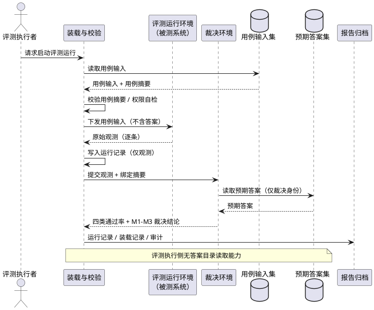
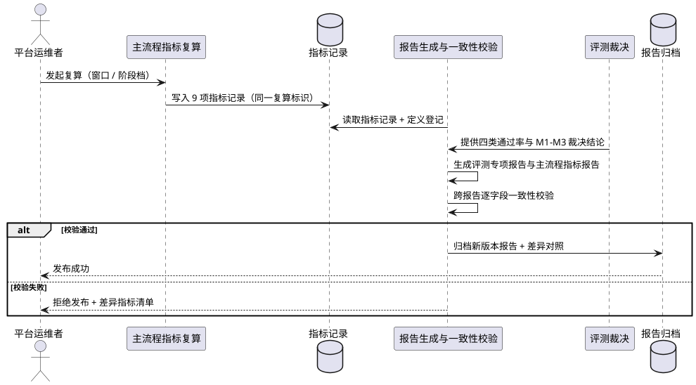
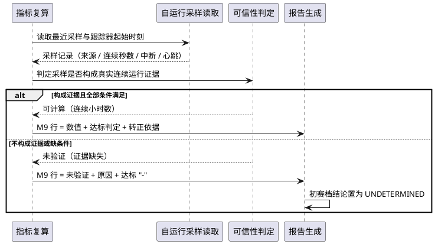

# 评测集防泄漏与指标口径统一 · 需求规格说明

> 版本：v1.0（2026-11-13）
> 范围：评测集拆分与答案隔离、评测专项报告与主流程指标报告口径统一、M9 未验证状态
> 本文档只描述"要构建什么"与"如何验收"，不描述"如何构建"。

---

# **1. 组件定位**

## **1.1 核心职责**

本组件负责把评测用例输入与预期答案彻底分离、阻断评测执行侧读取预期答案，并让评测专项报告与主流程指标报告使用同一套 M1–M9 口径，同时把 M9 连续自运行统一标记为"未验证"。

## **1.2 核心输入**

1. **评测源数据**：50 条评测样本，含用例输入信息与人工预期答案（可达性、可修复性、期望修复方式、是否应拒绝、补丁前后期望结果）；来源为受控评测集。
2. **拆分与装载请求**：把评测源数据拆分为用例输入集与预期答案集的动作请求，携带评测集版本、发起主体与校验摘要。
3. **评测运行观测结果**：评测执行侧对每条用例产出的原始观测（是否检出、可达性结论、复现是否成功、补丁是否就绪、补丁强度与浅修复证据）；不包含对错判定。
4. **主流程指标记录**：M1–M9 每个指标的定义版本、值、可计算标记、原因码、分子、分母、覆盖数、剔除数、通道排除数、不适用数、采集源引用、复算标识、快照摘要、评测运行标识与达标判定；来源为主流程指标复算。
5. **指标定义登记信息**：M1–M9 的 v2 名称、分子、分母、单位、适用通道、采集源绑定、初赛与总决赛目标、方向与生效时间。
6. **运行时自运行采样**：连续的运行时计数器采样记录，含采样时刻、连续运行秒数、中断次数、心跳状态与跟踪器起始时刻；来源为看板运行时。
7. **报告生成请求**：窗口、阶段档、发起主体与触发方式，用于生成评测专项报告、主流程指标报告及归档。
8. **访问身份与权限配置**：评测执行身份、裁决身份、报告复核身份及其对用例输入集、预期答案集、报告归档目录的访问权限。

## **1.3 核心输出**

1. **用例输入集**：按目录组织、可被评测执行侧读取的用例文件；仅含执行所需的最小信息，不含任何预期答案。
2. **预期答案集**：独立目录组织、仅裁决侧可读的答案文件；按用例标识与用例输入一一对应。
3. **装载记录**：含用例摘要、答案摘要、绑定摘要、样本数、四类分布、评测集版本、装载时刻、发起主体与校验结论。
4. **评测运行结论**：在观测结果基础上由裁决侧结合预期答案产出的四类通过率与 M1/M2/M3 结论，含评测运行标识与绑定摘要。
5. **统一口径的评测专项报告**：只披露四类通过率与 M1/M2/M3，并对 M4–M9 引用主流程指标报告，不自行计算。
6. **统一口径的主流程指标报告**：M1–M9 全量行，含值、可计算、原因码、分子、分母、覆盖、剔除、通道排除、不适用、采集源、复算标识、快照摘要、评测运行、目标与达标；附与历史报告的口径差异对照。
7. **未验证标注**：M9 的"未验证"展示状态及其原因说明，不给出数值、不判定达标。
8. **跨报告一致性校验结果**：两份报告逐字段一致或不一致的结论；不一致时拒绝发布并给出差异定位。
9. **越权访问审计记录**：对预期答案集的读取尝试记录（时间、身份、路径、操作、结果），不含答案内容。

## **1.4 职责边界**

本组件明确不负责以下事项：

1. **不负责生成或重新标注评测样本**：只对既有评测源数据做输入与答案的拆分和校验，不改动任何样本的预期结论。
2. **不负责执行被测系统的检测、判定、复现与补丁生成**：评测执行侧只产出原始观测，不参与对错裁决。
3. **不负责实现操作系统或云平台的权限系统**：只提出"评测执行身份不得读取预期答案集"这一可验证属性，并要求在权限不满足时拒绝运行。
4. **不负责重算 M4–M9 的主流程证据**：主流程指标由指标复算组件产出，本组件只统一展示口径与一致性校验。
5. **不负责为达标而调整指标定义、窗口、分母或目标值**：M9 未验证时不得通过更换采集源、放宽心跳口径或伪造采样转正。
6. **不负责覆写历史留痕**：`docs/devlog/m5-eval-report.md` 作为历史留痕保持只读，不允许就地修改其内容。
7. **不负责以任何形式把评测通道数据混入主流程指标分母**：评测通道数据只用于 M1–M3。
8. **不负责代码实现、部署与权限脚本落地**：具体隔离机制由后续实现方案决定。

# **2. 领域术语**

**评测用例输入**
: 可由评测执行侧读取、仅包含执行一条用例所需最小信息的记录，不含任何可直接判定预期结果的字段。

**预期答案**
: 对应用例的人工结论，包含样本类别、可达性、可修复性、期望修复方式、是否应拒绝与补丁前后期望结果，只能由裁决侧读取。

**答案隔离**
: 用例输入与预期答案分别存储于不同位置，且评测执行身份对预期答案所在位置无任何读取能力的属性。

**评测执行侧**
: 按用例逐条驱动被测系统并采集原始观测的运行环境与身份；不得获得判定预期结论的能力。

**裁决侧**
: 持有预期答案、把原始观测转换为 PASS/FAIL 与 M1–M3 结论的受控环节；不得把答案写入评测执行侧可见的任何介质。

**用例摘要**
: 对全部用例输入内容计算的唯一摘要，用于确认评测执行侧装载的是登记版本。

**答案摘要**
: 对全部预期答案内容计算的唯一摘要，仅在裁决侧与装载记录中使用。

**绑定摘要**
: 用例摘要与答案摘要共同计算出的唯一摘要，用于证明某次评测运行的观测结果与某份答案集属于同一评测集版本。

**装载记录**
: 记录一次评测集装载所用用例摘要、答案摘要、绑定摘要、样本数、四类分布、版本与发起主体的事实凭证。

**原始观测**
: 评测执行侧对单条用例产出的、不含对错判断的事实结果，例如是否检出、判定结论原文、复现状态、补丁状态与浅修复证据。

**裁决**
: 依据预期答案对原始观测做 PASS/FAIL 判定并汇总四类通过率与 M1–M3 的过程。

**评测通道专项报告**
: 只面向评测集执行结果的报告，披露四类通过率与 M1–M3，并对 M4–M9 引用主流程指标报告。

**主流程指标报告**
: 面向 M1–M9 全量口径的报告，是 M1–M9 数值、可计算性、原因码与达标判定的唯一对外事实来源。

**单一事实来源**
: 同一指标在所有对外材料中的值、可计算性、原因码、分子、分母、覆盖、剔除、通道排除、不适用、采集源、复算标识、快照摘要、评测运行标识、目标与达标判定必须来自同一份指标记录与同一份定义登记。

**口径一致**
: 两份报告对同一指标在同一窗口、同一阶段档下给出完全相同的值、可计算性、原因码、分子分母与达标判定；差异仅允许出现在报告用途与展示详略上。

**未验证**
: 指标缺少可采信的真实运行证据，既不能给出数值也不能判定达标的状态；报告必须显示"未验证"，不得显示 0、估算值或 FAIL。
: 备注：与"不可计算"同属无数值状态，但语义强调"证据不足而非采集源缺失"。

**历史留痕**
: 已发布且被要求保持原样的报告文件，其内容与摘要不得随口径变更而改写，只能被新版本报告替代。

**泄漏面**
: 评测执行侧可能间接获得预期答案的渠道，包括文件读取、装载参数、运行记录、日志、响应体、被评测代码可见的工作目录与链接跟随。

# **3. 角色与边界**

## **3.1 核心角色**

- **评测执行者**：发起评测运行、查看四类通过率与原始观测，不接触预期答案。
- **评测裁决者**：持有预期答案并执行裁决，对 PASS/FAIL 与 M1–M3 结论负责。
- **指标复核者 / 评委**：按报告核对 M1–M9 口径、分子分母、原因码、复算依据与差异对照。
- **平台运维者**：配置评测执行身份与裁决身份的访问权限、发起指标复算与报告发布。
- **安全审计者**：检查越权访问审计、泄漏扫描结果与历史留痕完整性。

## **3.2 外部系统**

- **受控评测集存储**：提供评测源数据与拆分后的用例输入集、预期答案集；按身份区分读写权限。
- **评测运行环境**：承载被测系统并按用例逐条执行，只可读取用例输入集。
- **裁决环境**：读取预期答案并对原始观测做裁决，产出评测运行结论。
- **主流程指标复算组件**：产出 M1–M9 指标记录、复算标识与快照摘要。
- **看板运行时**：提供连续自运行采样与跟踪器起始时刻。
- **报告归档存储**：保存报告、装载记录、一致性校验结果与审计记录，并支持按摘要校验回读。
- **权限服务**：判定某身份对某路径是否具有读取能力，并向装载与启动自检提供结果。

## **3.3 交互上下文**

```plantuml
@startuml
left to right direction
actor "评测执行者" as Exec
actor "评测裁决者" as Judge
actor "指标复核者 / 评委" as Reviewer
actor "平台运维者" as Ops
participant "评测集防泄漏与口径统一组件" as Comp
participant "受控评测集存储\n（用例输入 / 预期答案）" as Store
participant "评测运行环境\n（被测系统）" as Env
participant "裁决环境" as JudgeEnv
participant "主流程指标复算组件" as Recalc
participant "看板运行时" as Tracker
participant "报告归档存储" as Archive

Exec --> Comp : 发起评测运行
Comp --> Store : 装载用例输入（不含答案）
Store --> Comp : 用例输入 + 用例摘要
Ops --> Comp : 配置身份权限 / 发起复算与报告
Comp --> Env : 下发用例输入
Env --> Comp : 原始观测
Comp --> JudgeEnv : 提交观测与绑定摘要
JudgeEnv --> Store : 读取预期答案（仅裁决身份）
JudgeEnv --> Comp : 裁决结论（四类通过率 + M1–M3）
Comp --> Recalc : 读取 M1–M9 指标记录
Recalc --> Comp : 指标记录 + 复算标识 + 快照摘要
Comp --> Tracker : 读取连续自运行采样
Comp --> Archive : 报告 / 装载记录 / 审计 / 一致性结论
Archive --> Reviewer : 统一口径报告与差异对照
@enduml
```

# **4. DFX约束**

## **4.1 性能**

1. **权限自检时延**：评测运行启动前的答案隔离自检必须在 2 秒内完成；触发场景：单次启动；预期行为：自检结果在 2 秒内返回，超时按"不可判定为无权限"处理并拒绝启动。
2. **摘要校验时延**：用例摘要、答案摘要与绑定摘要的校验单次不得超过 500 毫秒（50 条规模）。
3. **跨报告一致性校验时延**：两份报告的逐字段一致性校验单次不得超过 1 秒。
4. **评测执行开销**：拆分后单轮 50 条评测的总时长相对拆分前增幅不得超过 10%，不得因答案隔离引入额外的逐条远程调用。
5. **泄漏扫描时延**：对单次评测运行全部产物（记录、日志、响应体）的泄漏扫描必须在 5 秒内完成。

## **4.2 可靠性**

1. **故障关闭**：当权限服务不可用、权限结果不可判定或预期答案集不可读时，评测运行必须拒绝启动，不得降级为"先运行后补权限"。
2. **拆分原子性**：评测集拆分必须全量成功或完全回滚，不得留下部分用例或部分答案；失败后重试不得产生重复用例。
3. **裁决幂等**：同一次评测运行的裁决只能产生一份结论；重复请求返回既有结论或明确拒绝，不得覆盖或叠加。
4. **报告完整性**：报告生成失败时不得写出半份报告或只更新部分归档文件；已发布报告必须可回读且摘要一致。
5. **历史留痕完整性**：历史报告在改造前后的内容摘要必须完全相同，变动次数必须为 0。
6. **可恢复性**：评测运行被中断后恢复时，必须继续使用同一绑定摘要，不得重新装载另一版本的答案集。

## **4.3 安全性**

1. **答案零可读**：以评测执行身份读取预期答案目录中任一文件（含直接读取、相对路径、路径穿越、符号链接跟随）必须 100% 失败。
2. **启动自检**：评测运行启动时必须验证"评测执行身份对预期答案目录无读取能力"；若验证结果为可读，必须拒绝启动并发出告警，不得仅记录警告后继续。
3. **参数越权拒绝**：任何请求把评测集路径指向预期答案目录、答案文件或其上级目录时，必须拒绝，且拒绝率 100%。
4. **产物零泄漏**：评测运行记录、接口响应、日志、事件与评测专项报告中不得出现预期答案字段名或答案取值；对单次运行产物的扫描命中数必须为 0。
5. **摘要强校验**：用例摘要、答案摘要或绑定摘要任一不符时，必须拒绝装载或拒绝裁决，接受率必须为 0。
6. **越权审计**：所有对预期答案集的读取尝试必须被记录并可检索，审计覆盖率 100%；审计记录本身不得包含答案内容。
7. **权限最小化**：评测执行身份只能读取用例输入集与自身运行目录；不得读取报告归档目录中的答案相关附件。

## **4.4 可维护性**

1. **可追溯**：每次评测运行必须能通过评测运行标识、绑定摘要与装载记录定位到所用用例版本与答案版本，定位成功率 100%。
2. **口径可对照**：主流程指标报告必须包含与历史报告的口径差异对照，逐项可核对，缺项数必须为 0。
3. **审计可检索**：越权尝试、摘要不符、一致性校验失败、M9 未验证四类事件必须可按时间与运行标识检索。
4. **日志脱敏**：日志中不得出现预期答案内容；出现即视为缺陷。
5. **状态可解释**：每个无数值指标必须给出固定原因码或"未验证"状态与一句可读原因，不允许空白。

## **4.5 兼容性**

1. **旧评测集退役**：旧版单文件评测集只能作为一次性拆分来源；拆分完成后不得再被评测执行侧读取，旧摘要不得复用为新评测集的校验摘要。
2. **旧报告只读**：历史 `m5-eval-report.md` 必须保持原内容与摘要不变；新口径以新版本报告替代，不得就地改写。
3. **报告字段兼容**：统一口径后的报告保留既有列结构与字段语义；新增"未验证"仅出现在 M9 的值与达标列，不改变其他指标的呈现规则。
4. **指标定义兼容**：M1–M9 的编号、名称与 v2 定义版本保持不变；不得为统一口径而回退到 v1 定义。
5. **历史指标记录兼容**：既有指标记录与复算标识保持可读，新报告不得要求重写历史记录。

# **5. 核心能力**

## **5.1 评测集拆分与答案隔离**

### **5.1.1 业务规则**

1. **输入与答案分离**：每条评测样本必须拆分为一份用例输入与一份预期答案，两者按用例标识一一对应。
   a. 验收条件：When 对 50 条评测源数据执行拆分，the 组件 shall 产出 50 条用例输入与 50 条预期答案，且用例标识集合完全相等。
2. **用例输入最小化**：用例输入只允许包含执行所需的最小信息（用例标识、定位、规则标识、严重度、目标仓库与公开执行参数），不得包含样本类别、可达性结论、可修复性、期望修复方式、是否应拒绝与补丁前后期望结果。
   a. 验收条件：When 扫描全部用例输入文件，the 组件 shall 不命中任何预期答案字段名与答案取值，命中数为 0。
3. **类别归入答案**：样本的四类类别（正例、负例、边界、对抗）必须归入预期答案，不得出现在用例输入中。
   a. 验收条件：When 以评测执行身份读取单条用例输入，the 组件 shall 无法据此判断该用例属于正例、负例、边界还是对抗样本。
4. **答案集唯一入口**：预期答案只能由裁决侧读取；装载校验可以读取答案摘要，但不得把答案内容传递给评测执行侧。
   a. 验收条件：When 评测执行侧请求任何包含预期答案内容的响应，the 组件 shall 拒绝并记录一次越权尝试。
5. **一一对应与分布保持**：拆分后的样本数量、用例标识与四类分布必须与源数据完全一致。
   a. 验收条件：When 拆分完成，the 组件 shall 保持 50 条总数与 20/15/10/5 的四类分布，且无重复、无缺失用例标识。
6. **摘要分离与绑定**：用例摘要与答案摘要必须分别登记，并共同生成绑定摘要；不得只校验其中一份。
   a. 验收条件：When 仅用例摘要匹配而答案摘要不匹配，the 组件 shall 拒绝装载并给出"答案摘要不符"；反之亦然。
7. **评测执行无答案读权限**：评测执行身份对预期答案目录必须具备零读取能力。
   a. 验收条件：When 以评测执行身份尝试读取答案目录中任一文件、相对路径、穿越路径或经符号链接指向的答案文件，the 组件 shall 全部拒绝。
8. **启动前权限自检**：每次评测运行启动前必须验证答案隔离属性；验证为可读时必须拒绝启动。
   a. 验收条件：When 权限配置把答案目录设为评测执行身份可读，the 组件 shall 在启动阶段失败并返回"答案隔离不满足"，不得进入任何用例执行。
9. **装载路径白名单**：评测运行只能装载受控的用例输入位置；任何外部传入的路径若指向答案目录、答案文件、其上级目录或受控位置之外，必须拒绝。
   a. 验收条件：When 启动请求携带指向预期答案目录的路径，the 组件 shall 拒绝请求并记录越权尝试，拒绝率为 100%。
10. **执行与裁决分离**：评测执行只产出原始观测；PASS/FAIL、四类通过率与 M1–M3 只能由裁决侧结合预期答案计算。
    a. 验收条件：When 评测执行完成，the 组件 shall 只持久化原始观测，运行记录、响应与日志中不得出现 PASS/FAIL、verdict_agrees、shallow_fix_rejected 等裁决结论字段。
11. **答案零回写**：裁决结论必须只包含聚合结果与用例级判定，不得把预期答案原文写入评测运行记录或报告。
    a. 验收条件：When 裁决完成，the 组件 shall 使运行记录与报告中的答案字段命中数为 0，仅保留判定结果与绑定摘要。
12. **越权尝试审计**：任何对预期答案目录的读取尝试必须被记录，含时间、身份、目标路径、操作与结果。
    a. 验收条件：When 评测执行身份发起一次答案目录读取，the 组件 shall 生成一条审计记录，且记录中不含答案内容。
13. **重复越权告警**：同一评测运行内出现多次越权尝试时，必须发出安全告警并终止该次运行。
    a. 验收条件：When 单次运行累计越权尝试达到 3 次，the 组件 shall 终止运行并标记为安全失败。
14. **裁决幂等**：同一评测运行只能被裁决一次。
    a. 验收条件：When 对已完成裁决的运行再次提交裁决，the 组件 shall 返回既有结论或拒绝，不得生成第二份结论。
15. **装载记录可追溯**：装载必须记录用例摘要、答案摘要、绑定摘要、样本数、四类分布、评测集版本、装载时刻与发起主体。
    a. 验收条件：When 查询任一评测运行的装载记录，the 组件 shall 能同时出示三份摘要与四类分布，缺项数为 0。
16. **旧格式一次性退役**：旧单文件评测集只允许被拆分工具读取一次；拆分完成后评测执行侧不得再读取旧文件。
    a. 验收条件：When 完成拆分后再次发起评测运行，the 组件 shall 只接受新用例输入集，若仍指向旧单文件则拒绝并提示"评测集已退役"。
17. **禁止项**：禁止把预期答案以任何形式嵌入用例输入、文件名、目录名、运行标识、日志或接口响应。
    a. 验收条件：When 对用例输入目录、运行目录与日志做全量扫描，the 组件 shall 对答案关键字与答案取值的命中数为 0。
18. **禁止项**：禁止通过"先运行、后校验权限"或"权限不足时跳过答案校验"的方式绕过隔离。
    a. 验收条件：When 权限自检失败，the 组件 shall 直接拒绝启动，不得继续执行任何用例。

### **5.1.2 交互流程**



### **5.1.3 异常场景**

1. **答案目录可被评测执行身份读取**
   a. 触发条件：权限配置错误或目录被复制到评测执行可访问位置。
   b. 系统行为：启动自检判定不满足隔离，立即终止启动，不执行任何用例，并发出安全告警。
   c. 用户感知：返回"答案隔离不满足"，其中不含答案路径细节与内容。
2. **用例与答案条数或标识不匹配**
   a. 触发条件：拆分中断、手工删改或版本错配。
   b. 系统行为：拒绝装载，列出缺失与多余的用例标识数量，不进入执行。
   c. 用户感知：返回"评测集不完整"与不匹配计数。
3. **摘要不符**
   a. 触发条件：用例内容、答案内容或绑定关系被改动。
   b. 系统行为：拒绝装载或拒绝裁决，记录不一致项，不生成结论。
   c. 用户感知：返回"摘要不符"及不符的摘要类型（用例/答案/绑定）。
4. **启动参数指向答案目录或目录外路径**
   a. 触发条件：调用方传入任意路径或构造路径穿越。
   b. 系统行为：拒绝请求并记录越权尝试；累计多次则终止运行。
   c. 用户感知：返回"评测集路径不允许"。
5. **运行产物出现答案字段**
   a. 触发条件：实现缺陷或调试输出把答案写入记录、日志或响应。
   b. 系统行为：泄漏扫描判定失败，标记本次运行结果不可发布，触发告警并保留现场。
   c. 用户感知：返回"运行产物存在答案泄漏"，不展示命中内容。
6. **裁决缺失却被要求出报告**
   a. 触发条件：仅完成执行、未完成裁决。
   b. 系统行为：拒绝生成评测专项报告中的 M1–M3 与通过率，只允许展示"未完成裁决"。
   c. 用户感知：报告明确标注"未裁决"，不得以观测结果替代结论。
7. **权限服务不可用**
   a. 触发条件：权限查询超时或返回不可判定。
   b. 系统行为：按故障关闭原则拒绝启动，不执行用例。
   c. 用户感知：返回"权限不可判定，评测未启动"。
8. **旧单文件评测集仍被使用**
   a. 触发条件：改造后仍以旧文件发起评测。
   b. 系统行为：拒绝并提示需使用拆分后的用例输入集，同时记录旧文件摘要为已退役。
   c. 用户感知：返回"评测集已退役，请使用用例输入集"。

## **5.2 M1–M9 口径统一**

### **5.2.1 业务规则**

**口径差异基线（改造前事实）**

| 指标 | 历史 m5 报告 | 主流程指标报告（v2） | 统一后口径 |
|---|---|---|---|
| M1 有效告警率 | 1.0，可计算，采集源写"评测集 ground truth" | 1.0000，可计算，分子 30 / 分母 30，采集源"评测运行结果 + 评测集标注" | 采用 v2：正例+边界中被检出数 ÷ 正例+边界总数，披露分子分母 |
| M2 漏洞检出率 | 1.0，可计算（由可达性结论本地推导） | 无值，`SOURCE_MISSING` | 采用 v2：无显式漏洞检出字段即 `SOURCE_MISSING`，禁止本地推导 |
| M3 可达性判定准确率 | 1.0，可计算，未披露分母 | 1.0000，可计算，分子 35 / 分母 35 | 采用 v2：有标注样本一致数 ÷ 有标注样本数 |
| M4 复现成功率 | 不可计算（缺采集源） | 0.6667，可计算 | 采用 v2 主流程口径，专项报告只引用 |
| M5 一次修复通过率 | 不可计算（缺采集源） | 1.0000，可计算 | 采用 v2 主流程口径，专项报告只引用 |
| M6 回归破坏率 | 不可计算（缺 Pipeline 日志） | 0.0000，可计算，采集源为门禁结论与门禁尝试 | 采用 v2，禁止再以 Pipeline 日志作为采集源 |
| M7 MTTR | 不可计算（缺采集源） | 30.0000 分钟，可计算 | 采用 v2 主流程口径，专项报告只引用 |
| M8 自动处置率 | 不可计算（缺采集源） | 0.6667，可计算 | 采用 v2 主流程口径，专项报告只引用 |
| M9 连续自运行 | 不可计算（缺采集源），目标 24h | 24.0000，可计算且达标 | 统一为"未验证"，不给出数值、不判定达标 |
| 报告结论 | PASS | PASS | 两份报告一致；M9 未验证时初赛档结论为 UNDETERMINED |

1. **单一事实来源**：两份报告中的同一指标必须在值、可计算性、原因码、分子、分母、覆盖数、剔除数、通道排除数、不适用数、采集源、复算标识、快照摘要、评测运行标识、目标与达标判定上逐项相同。
   a. 验收条件：When 对两份报告的同名指标做逐字段比对，the 组件 shall 报告零差异；任一字段不同即判定为口径不一致。
2. **禁止自建指标**：评测专项报告必须只披露四类通过率与 M1/M2/M3，并引用主流程指标报告中的 M4–M9；不得在专项报告中另行计算或重述 M4–M9 的"可计算/缺采集源"结论。
   a. 验收条件：When 生成评测专项报告，the 组件 shall 不包含 M4–M9 的自算值或自判状态，仅包含到主报告的引用。
3. **M1 口径固定**：M1 必须是"正例与边界样本中被检出数 ÷ 正例与边界样本总数"，数据来自已完成评测运行与预期答案，采集源不得只写"评测集 ground truth"。
   a. 验收条件：When 计算 M1，the 组件 shall 同时给出分子 30 与分母 30（本次 50 条评测集）并引用评测运行标识。
4. **四类通过率不得替代 M1**：四类通过率是按类别的 PASS/FAIL 统计，不得直接作为 M1 的值或分母。
   a. 验收条件：When 四类通过率与 M1 同时出现，the 组件 shall 分别标注名称与口径，二者数值可不同且不得相互覆盖。
5. **M2 禁止本地推导**：评测运行未提供显式漏洞检出字段时，M2 必须为无值、可计算为否、原因码为 `SOURCE_MISSING`；不得用"可达性结论为可达"推导漏洞检出。
   a. 验收条件：When 评测运行结果缺少显式漏洞检出字段，the 组件 shall 在两份报告中同时给出 `SOURCE_MISSING`，且不给出任何数值。
6. **M3 分母披露**：M3 必须以"有标注样本中判定一致数 ÷ 有标注样本数"计算并披露分母。
   a. 验收条件：When 生成 M3 行，the 组件 shall 展示分子与分母，分母为有可达性标注的样本数。
7. **M4–M8 采用 v2 主流程口径**：M4、M5、M6、M7、M8 必须按主流程证据计算，采集源分别为：复现尝试/证明/判定、首次补丁尝试/门禁尝试/处置历史、门禁结论/门禁尝试、告警首次观测/处置就绪时刻、处置/门禁尝试。
   a. 验收条件：When 生成任一 M4–M8 行，the 组件 shall 给出 v2 定义版本、对应采集源、复算标识与快照摘要；不得出现"缺采集源"而主流程已有记录的情况。
8. **M6 采集源更正**：M6 的采集源必须为门禁结论与门禁尝试，禁止再以 Pipeline 日志缺失为由判定不可计算。
   a. 验收条件：When 生成 M6 行，the 组件 shall 展示门禁类采集源，且报告中不得出现"缺 Pipeline 日志"字样。
9. **评测通道分母隔离**：评测通道产生的数据只能进入 M1–M3，不得进入 M4–M9 的分子或分母。
   a. 验收条件：When 评测运行产生的 Issue 被统计，the 组件 shall 将其计入通道排除数，M4–M9 的分子分母不受影响。
10. **历史留痕只读**：历史 `m5-eval-report.md` 的内容与摘要必须保持不变；口径统一只能通过新版本主流程报告与评测专项报告体现。
    a. 验收条件：When 改造完成，the 组件 shall 使历史报告的内容摘要与改造前一致，变动次数为 0。
11. **差异披露**：主流程指标报告必须包含"与历史 m5 报告的口径差异对照"，逐指标列出旧值/旧状态、新值/新状态与差异原因。
    a. 验收条件：When 打开统一口径后的主流程指标报告，the 组件 shall 展示 9 个指标的差异对照，缺项数为 0。
12. **跨报告一致性校验**：发布任一份报告前必须校验另一份报告与同一指标记录；不一致时禁止发布。
    a. 验收条件：When 两份报告存在任一字段差异，the 组件 shall 拒绝发布并返回"报告口径不一致"及差异指标清单。
13. **失败即拒绝发布**：一致性校验失败时不得生成"部分更新"的报告，也不得仅覆盖其中一份。
    a. 验收条件：When 一致性校验失败，the 组件 shall 保持两份已发布报告不变，退出状态为非成功。
14. **结论一致**：两份报告的总体结论必须相同，且由同一套判定规则产生。
    a. 验收条件：When M9 为"未验证"，the 组件 shall 在两份报告中给出同一结论（初赛档为 UNDETERMINED），不得一份 PASS、一份 UNDETERMINED。
15. **达标判定统一**：可计算指标按初赛目标与方向判定达标；不可计算与未验证指标一律不判定达标，既不记达标也不记失败。
    a. 验收条件：When 某指标未验证，the 组件 shall 在达标列显示"-"，不得显示 False 或 0。
16. **数值呈现统一**：可计算比率显示 4 位小数；时长按分钟或小时并标注单位；不可计算显示"-"；未验证显示"未验证"；禁止以 0 或估算值代替无值状态。
    a. 验收条件：When 查看任一报告行，the 组件 shall 使无数值状态只出现"-"或"未验证"，不出现 0 或空白的伪值。
17. **原因码固定**：不可计算原因码必须限于既有 8 个固定原因码；"未验证"不得作为新原因码插入原因码集合，只能作为展示状态并映射到"证据缺失"。
    a. 验收条件：When 校验报告原因码取值，the 组件 shall 只接受 8 个固定原因码；"未验证"出现在值列而非原因码列。
18. **报告版本化**：口径变更后的报告必须以新版本号生成并归档，旧版本保留摘要；不得就地覆盖已发布版本。
    a. 验收条件：When 重新生成报告，the 组件 shall 递增报告版本并保留旧版本归档，旧版本摘要仍可校验。
19. **评测专项报告头信息统一**：评测专项报告必须包含窗口、阶段档、定义版本、生成时间、发起主体、评测运行标识、用例摘要、绑定摘要与结论，字段语义与主流程指标报告一致。
    a. 验收条件：When 生成评测专项报告，the 组件 shall 展示上述头信息，缺项数为 0。
20. **定义版本一致**：所有报告行必须使用同一 v2 定义版本；不得在同一报告中混用 v1 与 v2。
    a. 验收条件：When 校验报告定义版本，the 组件 shall 使全部指标行的定义版本一致，混用数为 0。
21. **复算标识一致**：同一份报告内的全部指标必须共享同一复算标识与同一快照摘要。
    a. 验收条件：When 校验报告复算标识，the 组件 shall 使 9 个指标行的复算标识完全一致，不一致即拒绝发布。
22. **禁止项**：禁止以"历史报告已被新报告取代"为由删除、移动或改写历史报告文件。
    a. 验收条件：When 检查历史报告路径与摘要，the 组件 shall 使文件仍存在且摘要不变。

### **5.2.2 交互流程**



### **5.2.3 异常场景**

1. **两份报告口径不一致**
   a. 触发条件：指标记录被覆盖、报告生成时点不同、定义版本混用或专项报告自算指标。
   b. 系统行为：逐字段定位差异，拒绝发布两份报告，保留既有已发布版本。
   c. 用户感知：返回"报告口径不一致"与差异指标、字段清单。
2. **M2 无显式漏洞检出字段**
   a. 触发条件：评测运行结果未提供漏洞检出字段。
   b. 系统行为：M2 置为无值、不可计算、`SOURCE_MISSING`，不本地推导，两份报告一致。
   c. 用户感知：M2 行显示"-"与原因码 `SOURCE_MISSING`。
3. **M9 未验证导致结论不可判定**
   a. 触发条件：M9 无可采信的真实连续运行证据。
   b. 系统行为：M9 标记未验证，达标列"-"，初赛档总体结论置为 UNDETERMINED；不得判 PASS。
   c. 用户感知：报告结论为 UNDETERMINED，并注明"M9 未验证"。
4. **历史报告摘要变化**
   a. 触发条件：历史文件被改写、格式化或迁移。
   b. 系统行为：判定历史留痕完整性失败，阻止发布并告警。
   c. 用户感知：返回"历史留痕被改动"，并给出期望摘要。
5. **报告版本冲突**
   a. 触发条件：并发生成同一窗口、同一阶段档的报告。
   b. 系统行为：仅允许一个版本成功，另一方返回冲突；不得产生同版本号的两份不同内容。
   c. 用户感知：返回"报告版本冲突"。
6. **复算标识不一致或缺失**
   a. 触发条件：指标记录来自不同复算批次或旧数据缺失复算标识。
   b. 系统行为：拒绝生成统一口径报告，要求重新复算。
   c. 用户感知：返回"复算标识不一致"。
7. **定义版本混用**
   a. 触发条件：部分指标仍为 v1 定义。
   b. 系统行为：拒绝发布，列出使用非 v2 的指标。
   c. 用户感知：返回"定义版本混用"与指标清单。

## **5.3 M9 未验证状态**

### **5.3.1 业务规则**

1. **默认未验证**：在缺少可采信的真实连续运行证据时，M9 必须呈现"未验证"，不得给出连续小时数。
   a. 验收条件：When 读取当前 M9 指标记录，the 组件 shall 返回无值、可计算为否、原因码为"证据缺失"、展示状态为"未验证"。
2. **未验证不等于失败**：M9 未验证不得判定为 FAIL，也不得判定为达标；达标列必须显示"-"。
   a. 验收条件：When M9 为未验证，the 组件 shall 使达标列为"-"，不得出现 True 或 False。
3. **未验证阻断 PASS**：初赛档必填指标包含 M9；M9 未验证时总体结论必须为 UNDETERMINED。
   a. 验收条件：When M9 未验证且其余必填指标达标，the 组件 shall 输出 UNDETERMINED，不得输出 PASS。
4. **夹具采样不构成证据**：由离线脚本、夹具构造或人工写入的采样记录不得作为 M9 的转正证据。
   a. 验收条件：When 采样记录被标记为夹具来源或缺少运行时跟踪器起始时刻，the 组件 shall 维持"未验证"。
5. **转正条件（全部满足才可转正）**：只有在满足以下全部条件时，M9 才可从"未验证"转为可计算：
   a. 采样由运行时自身写入并带有运行时跟踪器起始时刻；
   b. 连续运行时长 ≥ 24 小时；
   c. 中断次数为 0；
   d. 相邻采样间隔 ≤ 120 秒，且最近一次采样距复算时刻 ≤ 150 秒；
   e. 连续运行时长与"采样时刻 − 跟踪器起始时刻"的偏差 ≤ 60 秒；
   f. 无人工干预记录。
   a. 验收条件：When 上述任一条件不满足，the 组件 shall 保持"未验证"；When 全部满足，the 组件 shall 允许转为可计算并给出连续小时数。
6. **未验证可解释**：未验证必须附带一条可读原因，指明缺失的是"真实运行证据"而非"采集源"。
   a. 验收条件：When 展示 M9 未验证，the 组件 shall 给出原因说明，且原因中不得出现具体伪造或推断手段。
7. **展示一致性**：M9 在评测专项报告引用行、主流程指标报告、报告归档文件与看板中的状态必须一致。
   a. 验收条件：When 同时读取任两处 M9 状态，the 组件 shall 返回一致的"未验证"。
8. **禁止项**：禁止把离线夹具生成的 24 小时连续时长写入报告、归档或看板并标记为达标。
   a. 验收条件：When 检查当前指标记录与全部报告，the 组件 shall 不存在"M9=24 且达标=True"的行。
9. **禁止项**：禁止通过放开心跳间隔、删除中断计数或补造跟踪器起始时刻的方式使 M9 转正。
   a. 验收条件：When 采样缺少跟踪器起始时刻或中断计数大于 0，the 组件 shall 拒绝转正，且不修改原始采样记录。
10. **转正留痕**：M9 由未验证转为可计算时必须记录转正依据（采样摘要、跟踪器起始时刻、覆盖时长、中断次数、复算标识），并生成新版本报告。
    a. 验收条件：When M9 转正，the 组件 shall 在新报告行中引用该次复算标识与采样摘要，旧报告保持"未验证"不变。

### **5.3.2 交互流程**



### **5.3.3 异常场景**

1. **采样由离线夹具写入**
   a. 触发条件：复算脚本在本地构造连续运行秒数并写入采样文件。
   b. 系统行为：判定为夹具来源，维持未验证；不把该记录计入可采信证据。
   c. 用户感知：M9 显示"未验证"，原因为"缺少真实连续运行证据"。
2. **采样超时或心跳不健康**
   a. 触发条件：最近采样超过容许偏差或心跳标记为不健康。
   b. 系统行为：维持未验证，保留剔除记录与原因，不放宽阈值。
   c. 用户感知：M9 显示"未验证"及"心跳超时"。
3. **连续秒数与跟踪器起始时刻矛盾**
   a. 触发条件：连续秒数大于"采样时刻 − 跟踪器起始时刻"容许偏差。
   b. 系统行为：判定证据不一致，维持未验证并记录证据矛盾。
   c. 用户感知：M9 显示"未验证"，原因为"证据矛盾"。
4. **中断次数大于 0**
   a. 触发条件：采样记录出现任何中断。
   b. 系统行为：判定不满足"无人干预"，维持未验证。
   c. 用户感知：M9 显示"未验证"及中断次数。
5. **缺少跟踪器起始时刻**
   a. 触发条件：采样记录仅有连续秒数与采样时刻。
   b. 系统行为：判定无法证明连续运行起点，维持未验证。
   c. 用户感知：M9 显示"未验证"及"缺少运行起点"。
6. **有人要求把 M9 临时填为 24h**
   a. 触发条件：为满足初赛目标而要求人工改值。
   b. 系统行为：拒绝写入，记录一次口径违规尝试；报告仍为未验证。
   c. 用户感知：返回"禁止人工改写 M9 证据"。

# **6. 数据约束**

## **6.1 评测用例输入**

1. **case_id**：必填，格式为 `EVAL-` 加 4 位数字，在用例输入集内唯一，且必须与预期答案中的用例标识一一对应。
2. **location**：必填，包含文件路径与行号；文件路径必须非空，行号必须为正整数。
3. **rule_id**：必填，非空字符串；不得包含样本类别或预期结论的暗示信息。
4. **severity**：必填，取值限于既定严重度枚举。
5. **set_version**：必填，标识用例输入集版本；与预期答案集的评测集版本必须相同。
6. **public_exec_params**：可选，仅允许包含执行所需的公开参数（如目标仓库、测试入口提示）；不得包含补丁前后期望结果。
7. **禁止字段**：用例输入中禁止出现样本类别、可达性、可修复性、期望修复方式、是否应拒绝、补丁前后期望结果、答案摘要等字段。

## **6.2 预期答案**

1. **case_id**：必填，与用例输入一一对应，全集合唯一。
2. **category**：必填，取值限于 `POSITIVE` / `NEGATIVE` / `BOUNDARY` / `ADVERSARIAL` 四类；总分布必须为 20/15/10/5。
3. **reachable**：必填，布尔值，表示人工判定的可达性结论。
4. **fixable**：必填，布尔值，表示人工判定的可修复性。
5. **expected_fix_kind**：必填，取值限于既定修复范式枚举。
6. **should_reject**：必填，布尔值；对抗样本必须为真，其余类别必须为假。
7. **proof_pre_patch / proof_post_patch**：正例必填，取值限于既定测试结果枚举，且必须为"补丁前失败、补丁后通过"；非正例可为空。
8. **content_digest**：必填，非空且全集合唯一，用于识别样本重复。
9. **answer_digest**：必填，非空，为整个答案集的内容摘要，与用例摘要共同生成绑定摘要。
10. **可读范围**：仅裁决身份与装载校验可读；评测执行身份对该对象所在位置的读取能力必须为零。

## **6.3 评测运行观测**

1. **eval_run_id**：必填，全局唯一，用于关联运行记录、装载记录、裁决结论与报告。
2. **case_id**：必填，必须属于本次装载的用例输入集。
3. **detected**：必填，布尔值，表示是否被检测流程受理；仅记录事实，不表示对错。
4. **verdict**：可选，为被测系统输出的可达性结论原文；不得包含与预期答案的一致性判断。
5. **repro_status**：可选，取值限于复现流程既定状态；不得写入"应通过/应失败"的期望。
6. **patch_status**：可选，取值限于补丁流程既定状态；不得写入"是否应被拒绝"的结论。
7. **patch_strength**：可选，数值，用于后续裁决浅修复；执行侧只记录事实。
8. **binding_digest**：必填，与装载记录一致，用于证明观测与答案属于同一评测集版本。
9. **禁止字段**：观测中禁止出现 PASS/FAIL、与预期一致性、浅修复拒绝结论、样本类别与任一答案字段。

## **6.4 装载记录**

1. **set_version**：必填，非空，标识评测集版本。
2. **cases_digest**：必填，64 位十六进制摘要，与用例输入内容一致。
3. **expected_digest**：必填，64 位十六进制摘要，与预期答案内容一致。
4. **binding_digest**：必填，64 位十六进制摘要，由用例摘要与答案摘要共同确定。
5. **case_count**：必填，正整数；本次必须为 50。
6. **category_distribution**：必填，四类计数之和必须等于 case_count。
7. **loaded_at**：必填，带时区的时间戳。
8. **actor**：必填，发起装载的身份标识。
9. **validation_result**：必填，取值限于"通过"或具体失败原因；失败时不得进入评测执行。
10. **禁止内容**：装载记录禁止包含任何预期答案原文与类别明细到用例的映射。

## **6.5 指标记录**

1. **metric_id**：必填，取值限于 M1–M9。
2. **window / stage_tier**：必填，窗口格式为 `YYYY-MM`，阶段档限于初赛与总决赛；同一指标在同一窗口、同一阶段档内唯一。
3. **value**：可计算时必填且为有限数值；不可计算与未验证时必须为空，禁止填 0。
4. **computable**：必填，布尔值；未验证必须为否。
5. **reason_code**：不可计算与未验证时必填，取值限于既有 8 个固定原因码；可计算时必须为空。
6. **numerator / denominator**：可计算时必填；分母不得为负；覆盖数与剔除数之和必须等于分母。
7. **covered_count / excluded_count**：必填，非负整数。
8. **channel_excluded_count**：必填，非负整数，用于记录被通道排除的评测数据量。
9. **not_applicable_count**：必填，非负整数。
10. **source_ref**：必填，必须能指向具体采集对象；M2 无显式字段时必须指向"评测运行结果缺失该字段"。
11. **definition_version**：必填，当前对外口径必须为 v2。
12. **recalc_id / snapshot_digest**：同一份报告内的 9 项指标必须共享同一复算标识与同一快照摘要。
13. **eval_run_id**：M1–M3 必填，且必须指向已完成且完成裁决的评测运行；其他指标可为空。
14. **unverified**：可选，仅 M9 使用；为真时表示"未验证"，与 computable 为否、原因码为证据缺失同时成立。
15. **computed_at**：必填，带时区的时间戳。

## **6.6 指标报告**

1. **report_id**：必填，格式为报告前缀、窗口、阶段档与 4 位递增版本号；全局唯一。
2. **window / stage_tier / definition_version**：必填；定义版本在同一报告内必须唯一且为 v2。
3. **generated_at / actor**：必填；生成时间带时区，发起主体非空。
4. **conclusion**：必填，取值限于 PASS / FAIL / UNDETERMINED；两份报告的结论必须相同。
5. **rows**：必填，必须覆盖 M1–M9 共 9 行，缺项数为 0。
6. **每行字段**：必须包含值、可计算、原因码、分子、分母、覆盖、剔除、通道排除、不适用、采集源、复算标识、快照摘要、评测运行、目标与达标，缺项数为 0。
7. **未验证呈现**：M9 未验证时，值列必须为"未验证"，达标列必须为"-"，原因码列为证据缺失。
8. **口径差异对照**：必填，覆盖 M1–M9 共 9 项，含旧值/旧状态、新值/新状态与差异原因。
9. **content_digest / archive_ref**：必填；归档后可回读且摘要一致。
10. **禁止内容**：报告不得包含预期答案原文、夹具采样明细与任何绕过口径的临时标记。

## **6.7 访问审计记录**

1. **occurred_at**：必填，带时区的时间戳。
2. **actor**：必填，发起访问的身份标识。
3. **target_path**：必填，被访问的答案目录或答案文件路径；仅记录路径，不记录内容。
4. **operation**：必填，取值限于读取、枚举、打开、链接跟随等既定操作类型。
5. **result**：必填，仅允许"拒绝"或"成功"；评测执行身份对答案目录的成功记录数必须为 0。
6. **reason**：可选，说明拒绝原因（如路径不允许、权限不足、链接指向答案）。
7. **run_ref**：可选，关联的评测运行标识；越权尝试必须可回溯到运行。
8. **禁止内容**：审计记录禁止包含答案内容、答案摘要原文与可用于还原答案的片段。