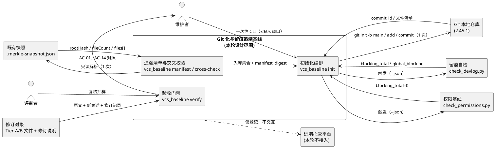
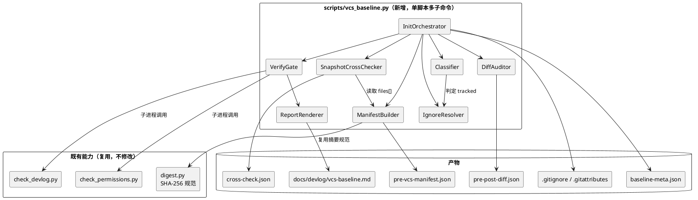
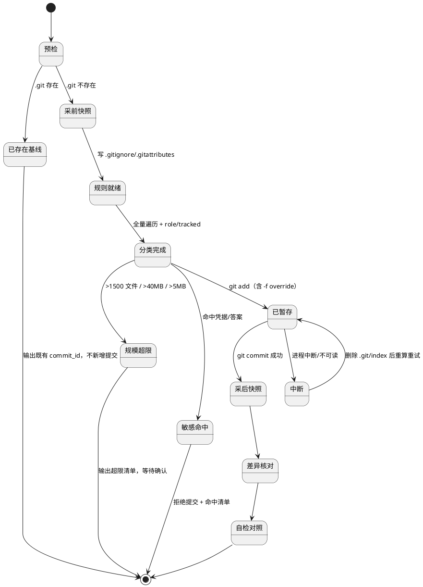
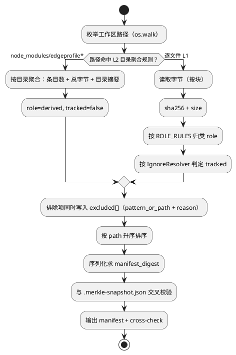
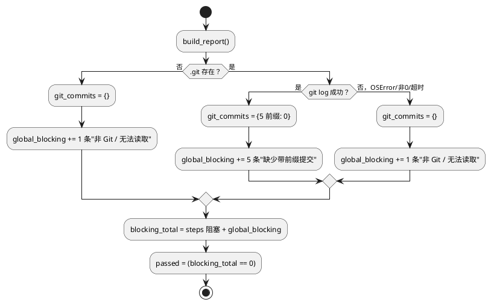
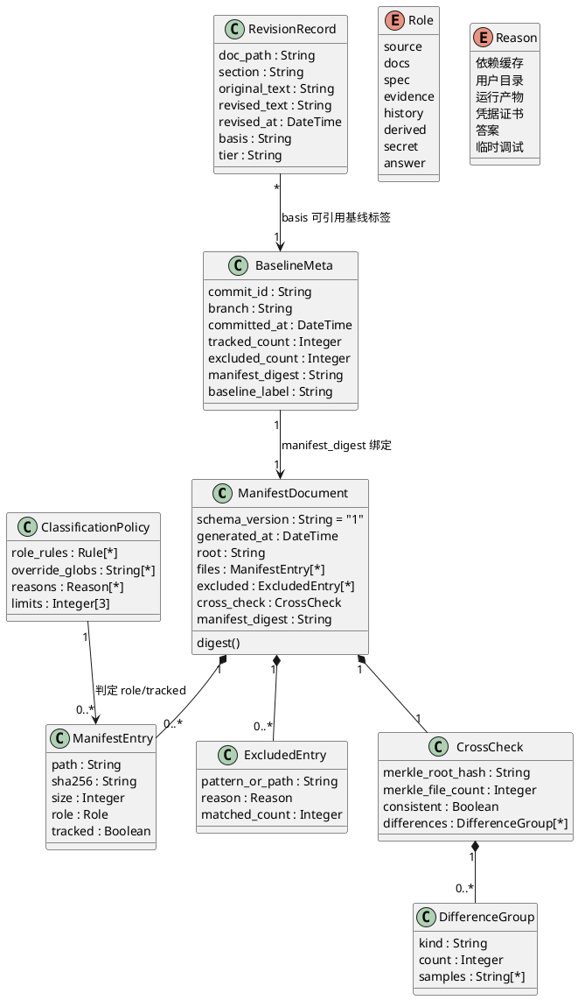

# Git 化与留痕追溯基线 · 实现方案（design）

> 版本：v1.0（2026-11-18）
> 上游需求：`.codeartsdoer/specs/git_adoption/spec.md`（v1.0，618 行）
> 本文档只描述"如何构建"，不含实现代码；所有代码位置均经 2026-11-18 实检索确认。
> 命名空间声明：本文出现的 `vcs-baseline/<短标识>` 属版本控制基线标识；`v1`–`v4` 为自检口径版本；`definition_version=v2` 为指标定义版本。三者互不替代。

---

# 一、需求与存量功能关系分析

## 1.1 需求功能与存量功能对比

### 1.1.1 已实现功能

| 需求功能 | 存量功能 | 代码位置 | 匹配度 |
|---|---|---|---|
| 文件内容指纹（sha256 规范） | `content_digest` / `file_digest` / `directory_digest` / `binding_digest` 四种摘要能力，统一 SHA-256 | `backend/app/eval/digest.py:9-44` | 100% |
| 五步留痕结构性校验（文件存在 / 记录时间 / 状态 / 前缀） | `STEPS` 五元组、`_parse_step()`、`build_report()`、`render_text()`、`main()` 退出码 `0/2` | `scripts/check_devlog.py:15-21`、`57-85`、`113-131`、`134-156`、`159-178` | 100% |
| Git 提交前缀计数 | `.git` 存在性判定 + `git log --format=%s` 主题前缀统计（5 个前缀计数） | `scripts/check_devlog.py:88-110` | 100% |
| "非 Git 仓库"回退口径 | `_git_commits()` 返回 `{}` 时追加 1 条全局阻塞"非 Git 仓库或无法读取提交历史" | `scripts/check_devlog.py:125-126` | 100% |
| 凭据 / `.env` 占位 / 分支守卫基线 | `check_branch_guard()`（基于 `LocalRepoAdapter`，不读 git 状态）、`scan_secrets()`、`check_env_example()` | `scripts/check_permissions.py:22-42`、`45-86`、`89-102` | 100% |
| 前版本控制期指纹证据（既有） | `.merkle-snapshot.json`：`rootHash=e7aefa1dd8b076d5d9cfa5439766cb599e385988df533c2ee5532ebf00c4571e`、`fileCount=334`、`files[]` 含 `path/hash/size/modified` | `.merkle-snapshot.json`（实读，2026-11-18） | 75% |
| 固定历史指纹锚点 | `docs/devlog/m5-eval-report.md` 实算 sha256 = `931d20442673b0922a32cfb42de1dcc9996925836607f6ddedbc5e8b1f165502` | `docs/devlog/m5-eval-report.md` | 100% |
| 单次运行的证据自校验 | 每个证据运行目录内含 `EVIDENCE.sha256` 与 `manifest.json` | `.evidence/sandbox-realscan/<RUN>/EVIDENCE.sha256`（多个 RUN） | 50% |
| 排除规则的既有表达 | `.codeartsdoer/.gitignore` 与 `eval/.gitignore` 内容均为 `*` | `.codeartsdoer/.gitignore`、`eval/.gitignore`（实读） | 50% |

**匹配度判定依据**

- 100%：接口契约、字段语义与本轮需求可直接复用，无需改造。
- 75%：数据结构可用，但缺"角色 / 入库判定 / 清单摘要 / 交叉校验"四类字段，且覆盖口径不等于本轮全量口径。
- 50%：语义方向一致，但生效范围与本轮需求冲突（嵌套 `*` 会连带排除必须入库的规格目录；`EVIDENCE.sha256` 仅覆盖单次运行目录）。

### 1.1.2 需要扩展的功能

| 需求功能 | 存量功能 | 差异说明 | 扩展方向 |
|---|---|---|---|
| 全量追溯清单（spec 5.4.1-2、6.1） | 摘要能力 `digest.py` + 快照 `files[]` | 输入：存量只接受单文件/单目录；输出：缺 `role`、`tracked`、`excluded`、`manifest_digest`、`cross_check`；边界：不处理依赖目录与中文路径归一 | 新增"清单装配层"，复用 `digest.py` 的 SHA-256 规范；分层覆盖（见 D-03）；路径统一 `/` |
| 自检"如实转述"口径（spec 5.5.1-1、4.4.3） | `render_text()` 只输出 `blocking_total` 与逐条文本，未分"环境前提类 / 留痕未执行类" | 输出：缺少分类标签与口径对照；语义：`global_blocking` 与"阻塞合计"未区分 | 不改判定逻辑（5.5.1-3 要求差异=0）；在**外部对照层**（修订说明 + 验收报告）给出 `1→5`（全局）与 `3→7`（合计）双口径对照 |
| `00-conventions.md` §3（spec 5.3.1 Tier A） | 单段式"工作区尚未初始化为 Git 仓库……" | 现状与历史混写，无基线标识、无前版本控制期边界、无基线后提交规则 | 原位拆为 3.1 / 3.2 / 3.3 三段，保留原句作为"前版本控制期事实"引述 |
| `00-conventions.md` §2（spec 5.3.1 Tier A） | 硬性要求 1–5，未区分基线提交与步骤提交 | 基线提交会被第 1 条"每步至少一条带前缀提交"误伤 | 追加第 6 条"基线提交不归属任何步骤"，原 1–5 条逐字保留（含"禁止脚本批量伪造提交时间"） |
| `sandbox_realscan/tasks.md` C8（spec 5.3.1 Tier A） | "工作区**非 Git 仓库**，禁止依赖分支/提交/回滚命令" | 前提失效；但"禁止以分支/提交/回滚作为交付手段"仍应保留 | 改写为"只读 git 查询允许 + 写类 git 操作禁止 + 回滚仍 staging + 文件替换 + 基线不计入五步" |
| 分支守卫与凭据基线复跑（spec 4.3.1、5.5.1-4） | `check_permissions.py` 全量能力（不依赖 git 状态） | 无功能差异；差异在于"Git 化后必须复跑并冻结输出" | 原样复跑，以 JSON 输出作为 AC-04 / AC-11 证据；不修改脚本 |
| 沙箱 P4-01 `.git` 事实表述（spec 5.5.1-5） | 合成夹具结论 `fixture=true`、`basis="合成夹具；工作区非 Git 仓库"` | 事实由"非 Git 工作区"变为"Git 工作区"，但"已验证真实 `.git`"仍不成立 | 仅追加前提变更标注；`basis` 原文不升级、不改探针 |

### 1.1.3 需要新增的功能或接口

**A. 初始化编排（新）**

- 输入：工作区根目录、入库/排除策略、分支名（默认 `main`）。
- 输出：`.git`、基线提交、`baseline-meta`、`pre-vcs-manifest`、验收报告。
- 核心逻辑：幂等前置检查 → 分类 → 规模校验 → 敏感扫描 → 暂存 → 提交 → 复核。
- 依赖：Git 2.45.1（实测 `git version 2.45.1.windows.1`）、`digest.py` 摘要规范。

**B. 排除规则文件（新）**

- 根 `.gitignore`：按六类分段（依赖缓存 / 用户目录 / 运行产物 / 凭据证书 / 答案 / 临时调试），每段中文注释。
- 根 `.gitattributes`：`* -text`，锁定换行不做转换。
- 依赖：无（与既有嵌套 `.gitignore` 的共存规则见 D-01）。

**C. 追溯清单与交叉校验（新）**

- 输入：工作区全量文件、有效排除规则（根 + 嵌套 + override 清单）、`.merkle-snapshot.json`。
- 输出：`pre-vcs-manifest.json`、`cross-check.json`、`pre-post-diff.json`。
- 核心逻辑：逐文件 SHA-256、角色归类、入库判定、清单摘要、与快照的集合级比对。
- 依赖：`backend/app/eval/digest.py`；快照 `hash` 算法不可复算（见 D-02）。

**D. 前提变更修订说明（新，单一文档）**

- 输入：Tier A/B/C 修订对象与原文。
- 输出：`docs/devlog/vcs-baseline.md`（逐条"文件 / 章节 / 原文 / 新表述 / 时间 / 依据 / tier"）。
- 依赖：修订记录 schema（spec 6.3）。

**E. 双采集差异核对（新）**

- 输入：Git 化前清单（pre）与 Git 化后清单（post）。
- 输出：指纹差异清单（排除 Tier A/B 后差异数必须为 0）。
- 依赖：C 的清单生成能力。

---

## 1.2 存量功能详细分析

### 1.2.1 `scripts/check_devlog.py`（本轮唯一会被"环境前提变化"影响的脚本）

**接口契约**

- `build_report(devlog: Path | None, skip_git: bool) -> Report`；`Report` 含 `steps[]`、`global_blocking[]`、`git_commits{}`、`blocking_total`、`passed`。
- `main(argv) -> int`：`passed=True → 0`，否则 `2`；`--json` 改变序列化形态，不改变判定；`--strict` 参数存在但**当前未参与判定**（声明了却未使用，属既有事实，不在本轮修改范围）。
- `--skip-git-check`：跳过 `_git_commits()`，且**不追加**任何 Git 相关全局阻塞（`check_devlog.py:122-124`）。

**业务规则**

1. 每步 3 类阻塞：记录文件缺失 / 记录时间缺失或非法 / 状态缺失或命中 `未执行|阻塞|UNVERIFIED` / 正文缺前缀。
2. 时间序列：仅对 `ok=True` 且已解析记录时间的步骤做相邻比较，倒退即全局阻塞。
3. Git 分支：`.git` 不存在 → `{}` → 1 条全局阻塞（非 Git 口径）；`.git` 存在且 `git log` 成功 → 逐前缀计数，`count<1` 各产生 1 条全局阻塞；`.git` 存在但 `git log` 失败（返回码非 0 或 `OSError`/超时 30s）→ 仍返回 `{}` → 回退非 Git 口径。

**实测基线（2026-11-18 实跑 `--json`）**

| 观测项 | 实测值 |
|---|---|
| `steps` 阻塞 | 2 条（`04-bootstrap.md`、`05-release.md` 状态为"**未执行（阻塞）**"） |
| `global_blocking` | 1 条（"非 Git 仓库或无法读取提交历史……"） |
| `blocking_total` | **3** |
| `git_commits` | `{}` |
| `passed` / 退出码 | `false` / `2` |

**约束**

- `ROOT` 固定为 `scripts/` 的父目录，脚本不能"从任意 cwd 判断当前仓库"。
- 只读，不写任何文件；不修改 `.git`。
- 中文提交信息经 `errors="replace"` 解码，前缀匹配只用 ASCII，不受影响；但**不得依赖提交信息正文做任何判定**。

### 1.2.2 `scripts/check_permissions.py`

**接口契约**：`build_report(scan_roots) -> dict`（`branch_guard` / `secret_scan` / `env_example` / `blocking_total` / `passed`），`main()` 退出码 `0/2`。

**业务规则与约束**

1. 分支守卫验证的是 `LocalRepoAdapter` 的内存/模型层拒绝逻辑（`main` 禁写、`verifix/*` 与 `release/*` 允许），**不读真实 `.git`**，因此 Git 化不改变其结果。
2. 凭据扫描根固定 `backend/app`、`scripts`、`deploy`；`SKIP_DIRS` 已含 `.git`、`certs`、`__pycache__`；`SKIP_NAMES` 含 `.env`、`.env.example`；`DETECTOR_FILES` 豁免两个检测器自身。
3. 实测基线（2026-11-18）：`blocking_total=0`、`passed=true`。
4. 结论：Git 化后**行为应完全不变**，只需复跑并冻结 JSON。若复跑结果变化，属环境/代码变更，不得归因于 Git 化。

### 1.2.3 嵌套 `.gitignore`（关键约束，直接决定方案）

实读结果：

| 文件 | 内容 | 影响 |
|---|---|---|
| `.codeartsdoer/.gitignore` | `*` | `.codeartsdoer/` 下所有文件（含 `specs/**`，spec 5.2.1-6 要求必须入库）会被排除 |
| `eval/.gitignore` | `*` | `eval/` 下 107 个文件全部被排除（与"评测集不入仓库"方向一致） |

Git 规则约束（决定方案取舍）：**子目录 `.gitignore` 的规则优先于上层 `.gitignore`，上层无法用 `!` 否定规则覆盖下层 `*`**。同时 spec 5.1.1-6 与 AC-05 禁止修改既有文件内容。因此只有两条路：修改嵌套文件（禁止）或使用"显式强制纳入（override）+ 有效判定清单"（采用，见 D-01）。

### 1.2.4 `.merkle-snapshot.json`

**结构**：`{rootHash, timestamp=1794916749441, fileCount=334, files:[{path, hash, size, modified}]}`。

**覆盖口径（实测统计）**：backend 237、`.evidence` 42、scripts 29、frontend 15、verifix-target 7、mcp 2、根目录 2 个 `.patch_fix*.py`；**不含** `docs/`、`.codeartsdoer/`、`deploy/`、`eval/`、`sandbox/`、`deliverables/`。

**关键事实**：对 334 项逐项以 `sha256(文件字节)` 复算，**0 项匹配**；再试 `path+content`、`content+path`、`git blob`、CRLF→LF 归一、文本模式归一等候选，仍不匹配。结论：`hash` 使用了未随仓提供的算法（或含路径/时间盐），**本轮不可复算**。因此交叉校验只能做"计数 + 路径集合 + 大小"级，不能声称内容级一致（见 D-02）。

**约束**：只读；不得覆盖同名文件；`rootHash`、`fileCount`、`timestamp` 三项在 Git 化前后必须字节不变。

### 1.2.5 修订对象精确定位（实检索纠偏）

| 层级 | spec 表述 | 实测位置 | 结论 |
|---|---|---|---|
| Tier A | `sandbox_realscan/tasks.md` C8 | `tasks.md:21`（表格行，含验收列）；另 `tasks.md:233` 第 6 条亦含"不初始化真实 Git 仓库" | C8 改写；第 6 条转 Tier B 追加 |
| Tier A | `00-conventions.md` §2 | 行 `22-28`（5 条硬性要求） | 追加第 6 条 |
| Tier A | `00-conventions.md` §3 | 行 `30-32`（单段） | 拆 3.1/3.2/3.3 |
| Tier B | `eval_leak_hardening/tasks.md` C3 | `tasks.md:16` | 原位追加前提变更行 |
| Tier B | `metrics_recalc/design.md` 前言 | `design.md:6`（另 `189`、`1438` 含同类"非 Git"短语） | 前言追加；`189/1438` 因属验收条件正文，只登记不改 |
| Tier B | `metrics_recalc/tasks.md` 第 4 条 | `tasks.md:33` | 追加适用范围截至 Git 化前 |
| Tier B | `sandbox_realscan/spec.md` 前提修正段 | `spec.md:6` | 追加"该前提于 2026-11-18 被版本控制基线取代" |
| Tier B | `sandbox_realscan/design.md` §0.2 / §2.x / §2.9 | `design.md:56`（§0.2 表）、`520`（§2.6）、`1311`（§2.6 表）、`1454`（§2.8 第 10 条）、`1871`（§5.3 O-02 表） | 逐点追加标注；不改探针与 `fixture=true` |
| Tier B | `sandbox_realscan/tasks.md` "第 5.4.1、第 10 条" | **实际在 `design.md:520` 与 `design.md:1454`**（"5.4.1" 是 spec 章节引用，不是文件位置） | 设计按实际文件修订，并在修订记录中写明"位置纠偏" |
| Tier B | `selfcheck_harness/design.md` §1.2.4 约束 | `design.md:160` | 追加"自基线提交起改为前缀缺失阻塞" |
| Tier B | `selfcheck_harness/tasks.md` 8.6 项 | `tasks.md:658-662`（验收行 661） | 追加适用范围截至基线提交 |
| Tier C | spec 列 9 个文件 | 全部只读；**实测另发现** `docs/devlog/04-bootstrap.md:15`、`m6-sandbox-constraint-report.md:67`、`sandbox-realscan-index.md:124` 含同类前提陈述 | 只登记不改；Tier C 实际清单 12 个（见 2.5.4） |

### 1.2.6 工作区规模实测（用于规模上限与清单口径）

| 范围 | 文件数 | 体积 |
|---|---|---|
| 常规文件（不含 node_modules / `__pycache__` / edgeprofile / `.git`） | 693 | 6.94 MB |
| `frontend/node_modules` | 3 135 | 77.07 MB |
| `edgeprofile` / `edgeprofile2` / `edgeprofile3` | 368 / 267 / 267 | 17.70 / 7.04 / 6.91 MB |
| `eval/`（既有 `*` 规则下全排除） | 107 | — |
| `deliverables/`（交付材料） | 18 | 2.42 MB |
| `.evidence/`（其中 `.work` 51 个 0.03 MB） | 156 | 0.44 MB |
| `docs/` / `.codeartsdoer/` / `backend/` | 56 / 30 / 238 | 0.56 / 1.45 / 1.38 MB |

结论：入库集合预计约 650 文件、约 6.5 MB，满足 4.1-3 的 ≤1500 / ≤40 MB / 单文件 ≤5 MB（实测最大单文件 < 1 MB）。
---

# 二、增量设计方案

## 2.1 实现模型

### 2.1.1 上下文视图



通信方式：全部为**同进程 CLI + 文件产物**，无网络、无后台服务、无定时任务。调用频率：初始化 1 次，校验 1 次，`check_devlog`/`check_permissions` 各 1 次（可重复跑，只读幂等）。

### 2.1.2 服务/组件总体架构



**组件职责与配置项**

| 组件 | 职责 | 关键约束 |
|---|---|---|
| `InitOrchestrator` | 前置检查、步骤编排、中断恢复、提交 | 不写工作区文件内容（除新增 `.gitignore`/`.gitattributes`） |
| `Classifier` | 依据路径规则表产出 `role` 与 `tracked` | `role` 封闭集合；`secret`/`answer` 强制 `tracked=false` |
| `IgnoreResolver` | 解析根 + 嵌套 `.gitignore` 的有效判定，叠加 override 清单 | 只读既有 `.gitignore`，不修改 |
| `ManifestBuilder` | 逐文件 sha256/size、排序、`manifest_digest` | 路径统一 `/`；`manifest_digest` 不含时间 |
| `SnapshotCrossChecker` | 与快照做计数 / 路径集合 / 大小比对 | 不声称内容级一致 |
| `DiffAuditor` | pre/post 两份清单差异，按 Tier 白名单豁免 | 非豁免差异数必须 0 |
| `VerifyGate` | AC-01…AC-14 逐项校验并输出对照 | 只读 git 命令白名单 |
| `ReportRenderer` | 生成人类可读与 JSON 双形态 | 必须并列"全局阻塞 / 阻塞合计"两口径 |

配置项（常量表，不引入新配置文件格式）：`BRANCH=main`、`AUTOCRLF=false`、`ATTR_TEXT=false`、`SIZE_LIMITS=(1500, 40MB, 5MB)`、`OVERRIDE_GLOBS`、`ROLE_RULES`、`REASON_SET`、`TIER_A/B/C_PATHS`。

### 2.1.3 实现设计文档

#### 2.1.3.1 初始化状态机



| 分支 | 触发条件 | 处理策略 | 用户可见输出 |
|---|---|---|---|
| 已存在基线 | 根目录存在 `.git` 且 `git rev-parse HEAD` 成功 | 不执行任何写操作，读取 `commit_id` / 分支 / 提交数 | "已存在版本控制基线，提交 `<id>`，本次未做变更" |
| `.git` 存在但无提交 | `.git` 存在、`HEAD` 未 born | 判定为上次中断；删 `.git/index`，重算清单后重试（不删 `.git`） | "检测到未完成初始化，按断点续做" |
| 嵌套 `.git` | 遍历命中 `.git` 目录（实测 7 处，均在 `.evidence/sandbox-realscan/.work/**/fixtures/p4-01/.git`） | 其父级工作目录整体排除；仍被父级 `.work` 规则覆盖 | 排除条目 + 原因"合成夹具，避免子模块引用" |
| 不可读文件 | `OSError` / 路径超长 / 权限拒绝 | 中止，不产生部分提交；保留已算结果 | "初始化未完成：N 个文件不可读" + 路径 |
| 规模超限 | 三上限任一越界 | 不自动裁剪，输出超限项待确认 | 超限清单（路径/体积/类别） |
| 敏感命中 | 凭据/答案/`.env` 实体出现在候选 | 降级为排除项并登记；若命中源码则整体中止 | "检测到敏感/答案文件，已排除：`<路径>`" |

#### 2.1.3.2 初始化步骤与分支/提交策略

| 步骤 | 动作 | 判据 / 说明 |
|---|---|---|
| 0 | 前置检查：`.git` 不存在；`git --version` 可用；`core.autocrlf=false` 可写 | 幂等入口；git 不可用则中止并提示 |
| 1 | 采集 pre 清单（工作区尚未产生 `.git`） | 覆盖 693 个常规文件 + 3 个派生目录聚合（D-03） |
| 2 | 写入根 `.gitignore`、`.gitattributes` | 内容见 2.2.2；新增文件，不改既有 |
| 3 | 写局部配置：`core.autocrlf=false`、`core.quotepath=false`、`user.name` / `user.email`（沿用本机既有值，缺失则中止要求填写） | **不设置** `GIT_AUTHOR_DATE` / `GIT_COMMITTER_DATE`（4.2-4） |
| 4 | `git init -b main` | 只创建 `main` 一个分支（OQ-6 默认值） |
| 5 | 分类 + 有效规则判定 + override 清单 → 入库集合 | 见 2.3.2 判定表；override 只用 `git add -f`，不改 `.gitignore`（D-01） |
| 6 | 规模校验 | 输出文件数 / 总体积 / 最大单文件 |
| 7 | 敏感与答案扫描 | 复用 `check_permissions.scan_secrets` + 答案路径断言（`role=secret/answer` 的 `tracked` 必须 false） |
| 8 | `git add`（普通 + `-f` override）+ `git status --porcelain` 复核 | 复核"无未跟踪的派生产物噪声"（4.1-2） |
| 9 | 生成 post 清单与 `manifest_digest`；提交 | 提交信息见下 |
| 10 | `git commit` → 记录 `commit_id` / `committed_at` → 写 `baseline-meta.json` → 调 `check_devlog` / `check_permissions` → 输出 AC 对照 | 提交后工作区内容不变（`add`/`commit` 不改文件字节） |

**基线提交信息契约**（中性、不含敏感、不含步骤前缀）：

```text
[vcs-baseline] initialize repository baseline
tracked=<入库文件数>
excluded=<排除条目数>
manifest=<manifest_digest 的 64 位十六进制>
```

- 主题行以 `[vcs-baseline]` 开头，不匹配 `[step-1/requirement]` … `[step-5/release]` 任一前缀，`check_devlog._git_commits()` 统计结果必为 0。
- 正文三项为 spec 5.1.1-3 要求的"可自证三要素"；值必须与 `pre-vcs-manifest.json` 实际一致。
- 禁止出现 token、口令、内网地址、绝对盘符路径。

**分支/提交策略**

1. 仅 `main` 一个本地分支；不创建 `verifix/*`、`release/*`；不设 remote、不推送、不建 tag。
2. 提交数恒为 1，无父提交；不得拆分、不得事后补建 `[step-*]`（OQ-7 默认"不补建"）。
3. `vcs-baseline/<commit_id 前 12 位>` 作为对外基线标签；与 `v1`–`v4`、`definition_version=v2` 分属不同命名空间。
4. Windows 平台显式 `core.autocrlf=false`，配合 `.gitattributes` 的 `* -text`，保证首次提交不重写既有文件（4.5-3）；`core.quotepath=false` 保证中文路径在 `git status` 中可读（4.5-4）。

#### 2.1.3.3 追溯清单生成流程



**清单摘要（`manifest_digest`）复算规范**

1. 取 `files[]`，按 `path` 的字节序升序排序。
2. 逐条序列化为 `path + "\u0000" + sha256 + "\u0000" + size + "\u0000" + role + "\u0000" + ("1"|"0") + "\n"`，UTF-8 编码（`path` 已统一为 `/`）。
3. 对拼接结果整体做 SHA-256，取小写十六进制。
4. **不含** `generated_at`、`root`、`excluded`，保证同一工作区状态下可复算且与时间无关。

#### 2.1.3.4 与 merkle 快照的交叉校验流程

| 阶段 | 动作 | 输出字段 |
|---|---|---|
| C1 | 只读解析快照，取 `rootHash` / `fileCount` / `timestamp` | 原值转述 |
| C2 | 快照 `path` 反斜杠归一为 `/`，与清单 `path` 求交/差 | `only_in_snapshot[]` / `only_in_manifest[]` |
| C3 | 对交集比对 `size`（快照 `size` 与清单 `size`） | `size_mismatch[]` |
| C4 | 内容指纹：因快照 `hash` 算法不可复算（1.2.4），**本轮不做内容级判定**，只登记 `hash_algorithm=unavailable` | `content_comparable=false` |
| C5 | 差异归因分组：①口径差异（快照仅覆盖代码域 + 部分证据）②时间差异（快照 2026-11-17 19:59 之后新增文件） | `differences[]`（分组 + 计数 + 代表路径样本） |
| C6 | 判定 `consistent = (fileCount 相等 且 两组差异均为空)` | 现状预期 `false`，差异非空，**不判失败**（5.4.3-1） |

约束：`consistent=false` 时 `differences` 必须非空且可读；完整差异明细另存 `cross-check-differences.json`，主文件只放分组摘要。**禁止**任何输出把 `consistent=false` 表述为"完全一致"。

#### 2.1.3.5 自检口径转换（脚本不变，只做外部对照）

`check_devlog.py` 不改一行；Git 化只改变其**输入的环境事实**，从而改变输出数字与分支走向：



**实测可预测结果（Git 化后、仅有基线提交、未补建五步）**

| 观测项 | Git 化前（实测） | Git 化后（预期） | 含义 |
|---|---|---|---|
| `steps` 阻塞 | 2 | 2 | 04/05 仍"未执行（阻塞）"，与 Git 化无关 |
| `global_blocking` | 1（非 Git） | 5（五前缀各缺 1） | spec 5.5.1-1 的"1→5"即此口径 |
| `blocking_total` | **3** | **7** | 对外材料必须用"合计"时写 3→7，用"全局"时写 1→5，禁止混用 |
| `git_commits` | `{}` | `{5 前缀: 0}` | JSON 形态由空对象变为 5 键 |
| `render_text` | 无"提交前缀统计"段 | 出现"提交前缀统计"5 行、每行 0 | 需在对照说明中解释 |
| `passed` / 退出码 | `false` / `2` | `false` / `2` | 不变 |
| `--skip-git-check` | 2 条（无全局阻塞） | 2 条（同前） | 语义不变，仅脚本自测 |
| `.git` 存在但 log 失败 | — | 回退 1 条非 Git 口径 | spec 5.5.3-1 的实际实现路径 |

**如实转述标准句**（对外唯一允许的表述）：

> Git 化前：留痕自检未通过，阻塞合计 3 条（④⑤ 未执行 2 条 + "非 Git 仓库"全局 1 条）。
> Git 化后：留痕自检仍未通过，阻塞合计 7 条（④⑤ 未执行 2 条 + 五步提交前缀缺失全局 5 条）。
> 基线提交不计入任何步骤；"仓库已 Git 化"不等于"五步留痕已通过"。
---

## 2.2 接口设计

### 2.2.1 总体设计

接口分三类，均为**本地 CLI 契约**，不新增网络接口、不新增 MCP 工具、不改既有 API：

| 编号 | 接口 | 形态 | 输入 | 输出 | 稳定性 |
|---|---|---|---|---|---|
| I-01 | `manifest` | CLI 子命令 | `--phase pre\|post`、`--out` | 追溯清单 JSON | 稳定（本轮冻结，字段见 6.1） |
| I-02 | `cross-check` | CLI 子命令 | `--manifest`、`--snapshot` | 交叉校验 JSON | 稳定（本轮冻结，字段见 6.1-9） |
| I-03 | `init` | CLI 子命令 | `--branch main`、`--confirm` | 基线提交 + `baseline-meta.json` | 实验（后续若接入远端需扩展） |
| I-04 | `diff` | CLI 子命令 | `--before`、`--after`、`--waive-tier` | 差异 JSON | 稳定 |
| I-05 | `verify` | CLI 子命令 | `--manifest`、`--meta`、`--json` | AC 对照报告 | 稳定 |
| I-06 | 根 `.gitignore` | 配置文件 | — | 判定规则 | 稳定（可追加，不可放宽） |
| I-07 | 根 `.gitattributes` | 配置文件 | — | `* -text` | 稳定 |
| I-08 | 基线提交信息 | 文本契约 | tracked/excluded/manifest 三要素 | 提交主题 + 正文 | 稳定 |
| I-09 | 修订记录 | 文档契约 | 见 6.3 | `docs/devlog/vcs-baseline.md` | 稳定 |

**接口变更策略**：I-01/I-02 的 JSON 字段只增不改；`schema_version` 保持 `"1"`；新增能力通过新增子命令表达，不改变既有子命令语义。

### 2.2.2 接口清单

#### I-01 `manifest`

```text
python scripts/vcs_baseline.py manifest --phase pre|post --out <path> [--json]
```

- **业务说明**：遍历工作区，产出 6.1 定义的追溯清单。`pre` 在 `git init` 之前执行，`post` 在提交之后执行。
- **前置条件**：工作区可读；`--phase pre` 时不得已有 `.git`（否则拒绝，防止污染"前版本控制期"语义）。
- **后置条件**：写出清单文件；不修改任何工作区文件；不触发网络。
- **异常映射**：文件不可读 → `EXIT_MANIFEST_UNREADABLE(3)` + 路径清单；`pre` 阶段检测到 `.git` → `EXIT_PRECONDITION_FAILED(4)`。
- **调用示例**：

```text
python scripts/vcs_baseline.py manifest --phase pre --out .evidence/git-baseline/pre-vcs-manifest.json
python scripts/vcs_baseline.py manifest --phase post --out .evidence/git-baseline/post-commit-manifest.json
```

#### I-02 `cross-check`

```text
python scripts/vcs_baseline.py cross-check --manifest <manifest.json> --snapshot .merkle-snapshot.json --out <path>
```

- **业务说明**：按 2.1.3.4 的 C1–C6 生成交叉校验结果。
- **前置条件**：清单 `schema_version="1"`；快照 `rootHash/fileCount/timestamp` 可解析。
- **后置条件**：`cross-check.json` 含 `merkle_root_hash`、`merkle_file_count`、`consistent`、`differences`；差异非空时另写明细文件。
- **异常映射**：快照缺失/解析失败 → `EXIT_SNAPSHOT_UNREADABLE(5)`，不得以 `consistent=true` 兜底。
- **调用示例**：

```text
python scripts/vcs_baseline.py cross-check --manifest .evidence/git-baseline/pre-vcs-manifest.json --snapshot .merkle-snapshot.json --out .evidence/git-baseline/cross-check.json
```

#### I-03 `init`

```text
python scripts/vcs_baseline.py init --branch main --confirm
```

- **业务说明**：执行 2.1.3.2 的 0–10 步，产生唯一基线提交。
- **前置条件**：根目录无 `.git`；`.gitignore`/`.gitattributes` 已按 I-06/I-07 写入；敏感扫描命中数 0；规模未超限；维护者已书面确认入库范围与 OQ 默认值。
- **后置条件**：`main` 分支上 1 个无父提交；`baseline-meta.json` 记录 `commit_id/branch/committed_at/tracked_count/excluded_count/manifest_digest/baseline_label`。
- **异常映射**：已存在 `.git` → `EXIT_ALREADY_INITIALIZED(0)`（幂等，输出既有标识，视为成功）；敏感命中 → `EXIT_SENSITIVE_HIT(6)` 且不提交；规模超限 → `EXIT_SIZE_EXCEEDED(7)`；不可读 → `EXIT_INIT_INCOMPLETE(8)`。
- **调用示例**：

```text
python scripts/vcs_baseline.py init --branch main --confirm
```

#### I-04 `diff`

```text
python scripts/vcs_baseline.py diff --before <pre.json> --after <post.json> --waive-tier docs/devlog/00-conventions.md,.codeartsdoer/specs/sandbox_realscan/tasks.md,... --out <path>
```

- **业务说明**：比对两份清单的 `path + sha256 + size`，输出新增/删除/变更三类差异；`--waive-tier` 列出的路径视为"已登记修订"，单独归组。
- **前置/后置**：两份清单均为 `schema_version="1"`；输出必须给出"非豁免差异数"。
- **异常映射**：任一侧缺失 → `EXIT_MANIFEST_UNREADABLE(3)`。
- **调用示例**：`python scripts/vcs_baseline.py diff --before .../pre-vcs-manifest.json --after .../post-commit-manifest.json --waive-tier <Tier A/B 清单> --out .../pre-post-diff.json`

#### I-05 `verify`

```text
python scripts/vcs_baseline.py verify --manifest <json> --meta <json> --json
```

- **业务说明**：执行 AC-01…AC-14 的机器可判部分（AC-05 依赖 I-04 结果），调用 `check_devlog.py --json` 与 `check_permissions.py --json`，输出逐项 `pass/fail + 证据`。
- **前置条件**：基线已提交；`baseline-meta.json` 存在。
- **后置条件**：只读 git 命令（白名单见下），不产生新提交、不暂存、不改配置。
- **只读 git 命令白名单**：`rev-parse`、`log`、`show`、`status`、`ls-files`、`check-ignore`、`cat-file`、`config --get`、`for-each-ref`。**禁止** `add`、`commit`、`reset`、`checkout`、`switch`、`branch -d`、`push`、`remote`、`tag`、`clean`、`stash`。
- **异常映射**：`git` 不可用 → `EXIT_GIT_UNAVAILABLE(9)`，按"非 Git 口径"输出并标记"未验证"。

#### I-06 根 `.gitignore` 契约

```text
# ── 1. 依赖缓存 ──
# 排除可重新安装的依赖与字节码，避免 84MB 依赖进入基线与后续提交
frontend/node_modules/
**/node_modules/
__pycache__/
*.py[cod]
.pytest_cache/
.mypy_cache/
.ruff_cache/
.venv/
venv/
env/

# ── 2. 用户目录 ──
# 排除浏览器用户数据（缓存、Cookie、配置），可重建且含本机隐私
edgeprofile/
edgeprofile*/
*profile*/

# ── 3. 运行产物 ──
# 排除运行期工作目录、构建输出、数据库与备份包，均可由源码重建
.evidence/**/.work/
.evidence/**/fixtures/**/.git/
frontend/dist/
verifix-target/target.db
verifix-target/backup.tgz
.codeartsdoer/.codebase/
.codeartsdoer/temp/
*.log

# ── 4. 凭据证书 ──
# 排除实体环境文件、私钥与整目录证书材料；仅保留占位样例
.env
.env.*
!.env.example
*.pem
*.key
*.pfx
*.p12
deploy/certs/

# ── 5. 答案 ──
# 排除评测集、靶场真值与红队真值；既有 eval/.gitignore 亦为 *，此处显式重申
eval/
verifix-target/ground_truth.json
.evidence/redteam-baseline/gt.txt

# ── 6. 临时调试 ──
# 排除一次性补丁脚本与调试抓取文本，属过程材料而非交付物
/dom.txt
/err.txt
/.patch_fix*.py
```

**逐条排除理由（四类归口）**

| 段 | 条目 | 六类 reason | 复核依据 |
|---|---|---|---|
| 1 | `frontend/node_modules/`、`**/node_modules/` | 依赖缓存 | 实测 3 135 文件 / 77.07 MB；`package-lock.json` 已入库可复装 |
| 1 | `__pycache__/`、`*.py[cod]`、`.pytest_cache/`、`.mypy_cache/`、`.ruff_cache/`、`.venv/`、`venv/`、`env/` | 依赖缓存 | 字节码与本地环境可由源码重建 |
| 2 | `edgeprofile/`、`edgeprofile*/`、`*profile*/` | 用户目录 | 实测 902 文件 / 31.65 MB；含本机浏览器状态 |
| 3 | `.evidence/**/.work/` | 运行产物 | 实测 51 文件 / 0.03 MB；打包中间目录 |
| 3 | `.evidence/**/fixtures/**/.git/` | 运行产物 | 实测 7 处合成 `.git`；避免被识别为子模块 |
| 3 | `frontend/dist/` | 运行产物 | OQ-2 默认排除；部署前需构建 |
| 3 | `verifix-target/target.db`、`verifix-target/backup.tgz` | 运行产物 | 靶场运行期数据库与备份 |
| 3 | `.codeartsdoer/.codebase/`、`.codeartsdoer/temp/` | 运行产物 | 工具缓存与临时目录 |
| 4 | `.env`、`.env.*`（`!.env.example` 除外） | 凭据证书 | 实体凭据零入库（4.3.1） |
| 4 | `*.pem`、`*.key`、`*.pfx`、`*.p12`、`deploy/certs/` | 凭据证书 | 实测 `deploy/certs/server.key`；整目录排除见 D-06 |
| 5 | `eval/` | 答案 | 评测集与运行结果；verifix spec 第 10/223 条"评测集不入代码仓库" |
| 5 | `verifix-target/ground_truth.json` | 答案 | 15 项靶场真值（`verifix-target/ground_truth.json:1-161`） |
| 5 | `.evidence/redteam-baseline/gt.txt` | 答案 | 红队真值，OQ-4 默认排除 |
| 6 | `/dom.txt`、`/err.txt`、`/.patch_fix*.py` | 临时调试 | OQ-3 默认排除；若含关键修复需先确认已被产品代码吸收 |

**必须纳入（负向断言，`verify` 会检查）**：`backend/`、`frontend/src/`、`frontend` 工程配置、`mcp/`、`scripts/`、`sandbox/spec.json`、`sandbox/Dockerfile.*`、`sandbox/requirements.target.txt`、`verifix-target/app|init_db.py|requirements.txt|tests|tools`、`deploy/`（除 `certs/`）、`docs/`、`deliverables/`、`.codeartsdoer/specs/`、`README.md`、`NOTES.md`、`.env.example`、`.merkle-snapshot.json`。

**`.gitignore` 自身不含会误伤源码的宽泛模式**：无 `*`、无 `*.py`、无目录级 `backend/`、`docs/`、`sandbox/`、`.codeartsdoer/`。

#### I-07 根 `.gitattributes` 契约

```text
# 禁止行尾转换，保证 Windows / 类 Unix 下同一文件字节一致（spec 4.5-3）
* -text
```

理由：`core.autocrlf=false` 只影响本地配置，换机/换平台后可能被重置；`.gitattributes` 随仓固化，可复核。该文件为新增文件（+1 入库条目），需在清单中登记。

#### I-08 基线提交信息契约

见 2.1.3.2。校验规则（`verify` 执行）：

1. 主题不以 `[step-` 开头；不命中五前缀正则。
2. 正文三键可解析且 `tracked` / `excluded` / `manifest` 与清单一致。
3. 敏感模式（`token|password|secret|AK|SK|内网 IP|盘符绝对路径`）命中数 0。
4. 作者时间与提交时间均落在初始化当日（4.2-4）。

#### I-09 修订记录契约（spec 6.3）

记录落点统一在 `docs/devlog/vcs-baseline.md`，每条含 7 字段；Tier C 条目的 `revised_text` 固定写"未改动（仅登记）"。字段定义见 2.3.2。

---

## 2.3 数据模型

### 2.3.1 设计目标

1. **全量可复算**：覆盖工作区全部文件（含被排除项），在无提交历史的条件下可凭清单 + `manifest_digest` 复算。
2. **口径可解释**：与 `.merkle-snapshot.json` 的差异必须能归因到"覆盖域不同"或"生成时间不同"，不得静默。
3. **命名空间隔离**：`vcs-baseline/`、`v1`–`v4`、`definition_version=v2` 三套标识互不混用。
4. **跨平台稳定**：路径统一 `/`；摘要只依赖文件字节；不依赖 mtime、不依赖遍历顺序。
5. **与既有数据兼容**：`.merkle-snapshot.json` 只读、算法冻结；`.evidence` 定稿文件原样入库。

### 2.3.2 模型实现



**角色（role）归类规则表**

| 路径域 | role | tracked | 依据 |
|---|---|---|---|
| `backend/**`、`scripts/**`、`mcp/**`、`frontend/src/**`、前端工程配置、`sandbox/**`、`verifix-target/{app,init_db.py,requirements.txt,tests,tools}/**`、`deploy/**`（除 `certs`）、`deliverables/**`、`.codeartsdoer/{agents,rule,skills,mcp}/**`、`.codeartsdoer/package.json`、`mem-exp-config.json` | `source` | true | 5.2.1-6 |
| `README.md`、`NOTES.md`、`docs/**`（除 `docs/devlog/**`） | `docs` | true | 5.2.1-6 |
| `docs/devlog/**` | `history` | true | 5.2.1-7（历史留痕） |
| `.codeartsdoer/specs/**` | `spec` | true（override） | 5.2.1-6；D-01 |
| `.evidence/**`（定稿）、`.merkle-snapshot.json` | `evidence` | true | 5.2.1-7、OQ-5 |
| `frontend/node_modules/**`、`edgeprofile*/**`、`**/__pycache__/**`、`*.py[cod]`、`frontend/dist/**`、`.evidence/**/.work/**`、`verifix-target/{target.db,backup.tgz}`、`.codeartsdoer/{.codebase,temp}/**`、`dom.txt`、`err.txt`、`.patch_fix*.py` | `derived` | false | 派生产物 |
| `.env` 实体、`*.pem`、`*.key`、`*.pfx`、`*.p12`、`deploy/certs/**` | `secret` | false（强制） | 4.3.1 |
| `eval/**`、`verifix-target/ground_truth.json`、`.evidence/redteam-baseline/gt.txt` | `answer` | false（强制） | 4.3.2 |

**`tracked` 判定规则（有效判定 = 既有规则 + override，按顺序短路）**

1. 若 `role ∈ {secret, answer}` → `tracked=false`，不再计算（6.1-6 强制）。
2. 若路径命中 `ClassificationPolicy.override_globs`（D-01 清单） → `tracked=true`，并在 `excluded` 中登记"override 生效"说明（该条 `reason` 不适用，改记 `matched_count=0` 与 note 字段由 I-02 输出）。
3. 否则，若命中根 `.gitignore` 或任一嵌套 `.gitignore`（`.codeartsdoer/.gitignore`、`eval/.gitignore`）→ `tracked=false`，`reason` 取对应段。
4. 其余 → `tracked=true`。

**D-01 override 清单（因嵌套 `*` 而必须强制纳入）**

| 路径 | 理由 | 是否入库 |
|---|---|---|
| `.codeartsdoer/specs/**` | spec 5.2.1-6 硬性要求 | 是 |
| `.codeartsdoer/agents/**`、`rule/**`、`skills/**`、`mcp/**`、`package.json`、`mem-exp-config.json` | 工具配置，属"排除不得掩盖审查"（4.3.4）；若不入库则排除理由无法归入六类 | 是 |
| `.codeartsdoer/.gitignore`、`eval/.gitignore` | 排除规则本身可审查（4.4.1） | 是（仅规则文件，不含评测内容） |

**不 override**：`.codeartsdoer/.codebase/**`、`.codeartsdoer/temp/**`（运行产物）、`eval/**` 内容（D-04）。

**`manifest_digest` 序列化规范**：见 2.1.3.3，字段顺序固定 `path, sha256, size, role, tracked`，分隔符 `\u0000`，行尾 `\n`，不含时间。同状态下两次生成必须相等。

**清单分层口径（D-03）**：L1 逐文件（常规文件，实测 693 项）；L2 目录聚合（`frontend/node_modules`、`edgeprofile`、`edgeprofile2`、`edgeprofile3` 各 1 条，记 `path`=目录、`sha256`=目录摘要、`size`=总字节、`role=derived`、`tracked=false`）。理由：若逐文件展开，清单将达 4 000+ 条、哈希耗时与文件体积不可控，且违反 4.1-1 的 60 秒窗口；分层后仍满足"含被排除项可复算"（AC-08 的抽样 3 个排除项从 L1 的 secret/answer/derived 条目中抽取）。此口径为**采用默认值，待确认**。
---

## 2.4 OQ 默认取法与设计侧补充决策

### 2.4.1 spec 待拍板项（7 项）

| 编号 | 问题 | 本方案取法 | 落地表现 | 状态 |
|---|---|---|---|---|
| OQ-1 | `sandbox/` 是否整体入库 | **整体入库** | 实测仅 `spec.json` + 3 个 Dockerfile + `requirements.target.txt`（5 文件，0 运行产物）；`role=source`、`tracked=true` | 采用默认值，待确认 |
| OQ-2 | `frontend/dist/` 是否入库 | **排除** | `.gitignore` 第 3 段；`role=derived`；交付说明登记"部署前需 `npm run build`" | 采用默认值，待确认 |
| OQ-3 | `.patch_fix1.py`、`.patch_fix2.py`、`dom.txt`、`err.txt` | **排除** | 第 6 段"临时调试"；`role=derived`；清单中 `tracked=false` 且保留指纹 | 采用默认值，待确认 |
| OQ-4 | `.evidence/redteam-baseline/gt.txt` | **排除** | 第 5 段；`role=answer`、`tracked=false`（强制） | 采用默认值，待确认 |
| OQ-5 | `.merkle-snapshot.json` 是否入库 | **入库且只读** | `role=evidence`、`tracked=true`；三项元数据冻结；后续快照另起文件名 | 采用默认值，待确认 |
| OQ-6 | 默认分支名 | **`main`** | `git init -b main`；§3 与 C8 同步写 `main` | 采用默认值，待确认 |
| OQ-7 | 是否立即补建五步提交 | **不补建** | 基线提交 1 个、无前缀；自检阻塞如实保留 | 采用默认值，待确认 |

拍板入口：若维护者改变任一取法，只需改 `ClassificationPolicy` 常量与 `init --branch`，不改变流程结构；变更须在 `docs/devlog/vcs-baseline.md` 登记，并在受影响文件内同步标注。

### 2.4.2 设计侧补充决策（规格未覆盖或存在冲突，必须显式登记）

| 编号 | 问题 | 事实依据 | 本方案取法 | 状态 |
|---|---|---|---|---|
| D-01 | 嵌套 `.gitignore` 均为 `*`，会连带排除 `.codeartsdoer/specs/**`（spec 硬性要求入库） | `.codeartsdoer/.gitignore`、`eval/.gitignore` 实读；Git 规则：下层优先 | **不修改既有文件**；用 `git add -f` 的 override 清单 + 有效判定规则（2.3.2）；`tracked` 与"最终判定"一致 | 采用默认值，待确认 |
| D-02 | `.merkle-snapshot.json` 的 `hash` 算法无法复算（334/334 不匹配 sha256 及 5 种常见变体），且覆盖域不含 docs/specs/deploy/eval | 1.2.4 实测 | 交叉校验降级为"计数 + 路径集合 + 大小"级；`content_comparable=false`；`consistent=false` 并输出分组差异；不声称内容级一致 | 采用默认值，待确认 |
| D-03 | "全量覆盖"若逐文件展开 node_modules/edgeprofile（4 000+ 文件），将突破 60 秒窗口且清单体积失控 | 4.1-1；实测 3 135 + 902 文件 | L1 逐文件 + L2 目录聚合（2.3.2） | 采用默认值，待确认 |
| D-04 | `eval/` 是否随 `eval_set.sha256` 入库 | 既有 `eval/.gitignore=*`；verifix spec 第 10/223 条"评测集不入仓库" | **整目录不入库**；`role=answer`；`eval_set.sha256` 仍在工作区可校验，历史引用登记"仅工作区可定位"（5.4.3-3） | 采用默认值，待确认 |
| D-05 | `verifix-target/` 内部需最小粒度排除 | `ground_truth.json`（15 项真值）、`target.db`、`backup.tgz` | 父目录保留、三文件排除（5.2.3-3 最小排除粒度）；`ground_truth` 的既有引用登记为工作区锚点 | 采用默认值，待确认 |
| D-06 | `deploy/certs/server.crt` 是否算"私钥材料" | 4.3.1 只列私钥；`check_permissions.SKIP_DIRS` 含 `certs` | 整目录排除，reason=凭据证书；在清单登记 `server.crt / server.key` | 采用默认值，待确认 |
| D-07 | Tier C 实清单比 spec 多 3 个文件 | 实测 `04-bootstrap.md:15`、`m6-sandbox-constraint-report.md:67`、`sandbox-realscan-index.md:124` 含同类前提 | 增补为 Tier C 只读登记（共 12 个），零改动 | 采用默认值，待确认 |
| D-08 | `deliverables/`（18 文件 2.42 MB）未在 spec 输入清单点明 | 实检为方案 PDF/PNG/HTML 交付物 | 按"产品与交付材料"入库，`role=source` | 采用默认值，待确认 |
| D-09 | 新增根 `.gitattributes` | 4.5-3 要求换行策略显式记录 | 新增 `* -text`，作为 1 个入库条目登记 | 采用默认值，待确认 |
| D-10 | 逐文件摘要遍历的规模 | 实测 693 文件 / 6.94 MB；`digest.py` 为纯 Python | 单线程顺序读 + 分块哈希；实测量级下预计 <10 秒，满足 60 秒窗口；若超时改为按目录并发（不改变结果） | 采用默认值，待确认 |

---

## 2.5 Tier A / B / C 文档修订方案

统一原则：**原位最小改动**；P 类（Tier A）替换限定语或追加条目，B 类只追加标注行，C 类零改动仅登记；每条修订在 `docs/devlog/vcs-baseline.md` 有且仅有一条记录，`original_text` 完整保留原句。

### 2.5.1 Tier A（必须修订）

| 对象 | 位置 | 原文（实检索） | 改法 |
|---|---|---|---|
| `docs/devlog/00-conventions.md` §3 | 行 `30-32` | "工作区尚未初始化为 Git 仓库，五步留痕先以 `docs/devlog/` 文件与归档副本留存；仓库初始化后按本规范补建提交序列，并保持文件时间早于首个实现提交。" | 拆三段：**3.1 版本控制基线**（初始化日期 2026-11-18、`vcs-baseline/<短标识>`、分支 `main`、入库/排除计数、清单摘要）；**3.2 前版本控制期留痕**（区间 = D1 留痕起至基线提交前；留存方式 = 文件 + 归档副本 + 内容指纹；"禁止以提交时间推断证据产生时间"）；**3.3 自基线起的提交要求**（后续变更须新增提交；基线提交豁免步骤前缀）。原句作为 3.2 的"历史事实"引述保留，不得删除 |
| `docs/devlog/00-conventions.md` §2 | 行 `22-28` | 硬性要求 1–5（含第 3 条"禁止脚本批量伪造提交时间"） | 1–5 条**逐字保留**；追加第 6 条："基线提交（`[vcs-baseline]`）不归属任何步骤，不计入步骤提交计数；步骤提交要求自基线提交之后生效。" |
| `.codeartsdoer/specs/sandbox_realscan/tasks.md` C8 | `tasks.md:21` 表格行 + 该行验收列 | "工作区**非 Git 仓库**，禁止依赖分支/提交/回滚命令；回滚只能 staging + 文件替换"；验收列"验收命令中不出现 `git `" | 约束列改为："工作区已 Git 化（基线 `vcs-baseline/<短标识>`）：**允许只读 git 查询**用于追溯（白名单见 2.2.2 I-05）；**仍禁止**依赖分支/提交/回滚作为交付手段；回滚继续以 staging + 文件替换实现；基线提交不计入五步留痕。" 验收列改为："验收命令不出现写类 git 操作；只读查询命中须在任务记录中说明用途并可回溯。" 不新增/不删除其他列 |

### 2.5.2 Tier B（追加前提变更标注，不改结论）

| # | 对象 | 位置 | 追加标注 |
|---|---|---|---|
| B-1 | `eval_leak_hardening/tasks.md` C3 | `tasks.md:16` | "**前提变更（2026-11-18）**：工作区已 Git 化，C3 的'非 Git'限定不再成立；'拆分与发布回滚只能用 staging + 文件替换'的约束仍然有效。" |
| B-2 | `metrics_recalc/design.md` 前言 | `design.md:6` | "**前提变更（2026-11-18）**：此句中的'非 Git 仓库'已由版本控制基线取代；'无 Docker、无华为云凭据'两项前提不变。" |
| B-3 | `metrics_recalc/tasks.md` 第 4 条 | `tasks.md:33` | "**前提变更（2026-11-18）**：本条'不安排任何 git 命令'的适用范围截至基线提交；此后只读 git 查询可用于追溯，分支守卫断言仍由模型层校验。" |
| B-4 | `sandbox_realscan/spec.md` 前提修正段 | `spec.md:6` | "**前提变更（2026-11-18）**：'非 Git 仓库'于本日被版本控制基线取代；'无华为云凭据、无 pytest'不变。" |
| B-5 | `sandbox_realscan/design.md` §0.2 | `design.md:56`（事实表行） | 行尾追加"〔2026-11-18 前提变更：现已成为 Git 仓库；P4-01 仍以合成夹具为准，`fixture=true` 结论不升级。〕" |
| B-6 | `sandbox_realscan/design.md` §2.6 | `design.md:520`、`1311` | 追加"〔2026-11-18：已成为 Git 仓库；同一视图规则继续排除真实 `.git`，探针无需改动；不得表述为'已验证真实仓库 `.git`'。〕" |
| B-7 | `sandbox_realscan/design.md` §2.8 第 10 条 | `design.md:1454` | 追加"〔2026-11-18 前提变更：本条的'工作区非 Git 仓库'不再成立；'不使用分支/提交/回滚作为交付手段'仍然有效。〕" |
| B-8 | `sandbox_realscan/design.md` §5.3 O-02 | `design.md:1871` | 追加"〔2026-11-18：O-02 的环境前提已变化；选项"要求真实 `.git`"仍不在本轮范围，合成夹具结论保持。〕" |
| B-9 | `sandbox_realscan/tasks.md` 第 6 条（明确不做） | `tasks.md:233` | 追加"〔2026-11-18：本条由后续 Git 化轮次取代；本轮已完成基线初始化，本条对 `sandbox_realscan` 阶段仍然有效。〕" |
| B-10 | `sandbox_realscan/tasks.md` T-SBX-20 basis 项 | `tasks.md:650` | 追加"〔2026-11-18：`basis` 原文不改写；工作区已 Git 化，但'不得表述为已验证真实仓库 `.git`'仍然有效。〕" |
| B-11 | `selfcheck_harness/design.md` §1.2.4 约束 | `design.md:160` | 追加"〔2026-11-18：自基线提交起，本约束改为'提交前缀缺失'阻塞；全局阻塞由 1 条变为 5 条、阻塞合计由 3 条变为 7 条，须如实转述。〕" |
| B-12 | `selfcheck_harness/tasks.md` 8.6 验收行 | `tasks.md:661` | 追加"〔2026-11-18：该'非 Git 阻塞结果不得被抵消'的表述适用范围截至基线提交；基线后以'五步前缀缺失'阻塞为准，同样不得抵消。〕" |

**位置纠偏声明**（写入修订记录）：spec 5.3.1 将 B-6/B-7 描述为"`sandbox_realscan/tasks.md` 第 5.4.1、第 10 条"，实检索确认二者位于 `sandbox_realscan/design.md:520` 与 `design.md:1454`（"5.4.1" 为 spec 章节号）。本方案按实际文件修订，并在修订记录 `section` 字段同时标注 spec 原表述与实际位置。

### 2.5.3 Tier C（零改动，仅登记）

处理方式：不触碰文件；在 `docs/devlog/vcs-baseline.md` 逐条登记"文件 / 原句 / 行号 / 时间边界 / 指纹"。

| # | 文件 | 待登记原句位置 |
|---|---|---|
| C-1 | `docs/devlog/m5-eval-report.md` | 全文只读；sha256 恒为 `931d20442673b0922a32cfb42de1dcc9996925836607f6ddedbc5e8b1f165502` |
| C-2 | `docs/devlog/m9-stage-anchors-review.md` | `:45` "`check_devlog.py` 当前如实返回阻塞（04/05 未执行 + 非 Git），未通过文案绕过。" |
| C-3 | `docs/devlog/m12-closure-and-blockers.md` | `:17` "`check_devlog.py` 返回 **3 个阻塞**（④⑤ 未执行 + 非 Git），如实" |
| C-4 | `docs/devlog/m13-selfcheck-report.md` | 前置结论段（含"非 Git"表述，登记时以检索到的原句为准） |
| C-5 | `docs/devlog/m13-analysis-plan.md` | 方案正文（同上） |
| C-6 | `docs/devlog/m11-coverage-report.md` | 结论段（含环境前提表述） |
| C-7 | `docs/devlog/03-build.md` | `:68` "提交前缀 \| 非 Git 仓库，无 `[step-3/build]` 提交；`check_devlog.py` 列为全局阻塞" |
| C-8 | `docs/devlog/02-codegen.md` | `:9`、`:66`（"尚未初始化为 Git 仓库"、"全局仍因'非 Git 仓库'阻塞"） |
| C-9 | `docs/devlog/metrics-report.md` | `:56` "无 Docker/无云凭据/非 Git 环境可执行" |
| C-10 | `docs/devlog/04-bootstrap.md` | `:15` "工作区**不是 Git 仓库**，无法创建分支、提交与 PR"（D-07 增补） |
| C-11 | `docs/devlog/m6-sandbox-constraint-report.md` | `:67` "工作区非 Git 仓库，使用合成 `.git` 夹具……"（D-07 增补） |
| C-12 | `docs/devlog/sandbox-realscan-index.md` | `:124` "未初始化真实 Git 仓库（P4-01 用合成夹具）"（D-07 增补） |

**禁止**：对 C-1…C-12 任何字节改动；`04-bootstrap.md` / `05-release.md` 是自检输入，改动会改变 `check_devlog` 判定，绝对禁止。

### 2.5.4 修订说明书结构（`docs/devlog/vcs-baseline.md`）

| 章节 | 内容 |
|---|---|
| 1. 摘要 | 基线标识、初始化时间、入库/排除计数、`manifest_digest`、自检双口径（1→5 / 3→7） |
| 2. 前提变更登记表 | Tier A（3 项）、Tier B（12 项）、Tier C（12 项），每条 7 字段 |
| 3. 排除规则对照 | `.gitignore` 六段 ↔ `excluded[].reason` 一一对应 |
| 4. 交叉校验结果 | 快照三项元数据转述、`consistent` 判定、差异分组 |
| 5. 明确不做 | 未补建五步提交、未接入远端、未修改历史报告、未修复任何缺陷 |
| 6. 标准表述 | 1.2.1 中的"如实转述标准句"逐字引用 |

---

## 2.6 回滚与失败恢复方案

### 2.6.1 断点状态判定与恢复

| 断点 | 判定 | 恢复动作 | 是否触碰工作区文件 |
|---|---|---|---|
| 无 `.git` | `rev-parse` 失败且目录不存在 | 从步骤 1 重跑 | 否（仅新增 `.gitignore`/`.gitattributes`，已存在则校验内容不变） |
| `.git` 存在、无提交 | `.git/HEAD` 指向未 born 分支 | 删 `.git/index`（不动 `.git`），重算清单，从步骤 5 重跑 | 否 |
| `.git` 存在、有 1 个基线提交 | `rev-parse HEAD` 成功且提交数=1、主题命中 `[vcs-baseline]` | 判定"已完成"：幂等返回既有标识 | 否 |
| `.git` 存在、有多个提交 | 提交数 > 1 | 停止并输出历史，要求人工确认（不得自动重置） | 否 |

### 2.6.2 主动回滚（撤销本轮 Git 化）

| 步骤 | 动作 | 校验 |
|---|---|---|
| R1 | 删除 `.git/`（工作区文件不因 `add`/`commit` 改变，删除后文件字节不变） | 删除后按 `pre-vcs-manifest.json` 复算，差异数必须为 0 |
| R2 | 删除新增文件：`.gitignore`、`.gitattributes`、`.evidence/git-baseline/*`、`docs/devlog/vcs-baseline.md` | 与 `excluded` 清单核对，不得误删既有文件 |
| R3 | 按修订记录 `original_text` 逐条还原 Tier A/B 的 12+3 处改动 | 还原后对 Tier A/B 文件复算 sha256，必须等于 `revision-record.pre_sha256` |
| R4 | Tier C 与 `m5-eval-report.md` 无需动作 | sha256 必须仍为 `931d2044…f165502` |
| R5 | 复跑 `check_devlog.py --json` | 必须回到 `blocking_total=3`、`git_commits={}` |

**可行性依据**：`git init` / `add` / `commit` 均不修改工作区文件内容；删除 `.git` 即回到非 Git 状态；所有修订原文完整留存在修订记录中（spec 6.3 要求 `original_text` 不得省略），因此回滚是**可逆且可验证**的。

### 2.6.3 部分失败

- 暂存完成但提交失败：`.git/index` 残留 → 按 2.6.1 第二行处理；工作区不变。
- 无法读取某文件：中止在提交前，`.git` 已创建但无提交 → 断点可恢复，且不产生部分提交（4.2-2）。
- 提交成功但 `verify` 失败：**不回滚提交**，先输出失败项；若失败属"入库范围错误"，按 2.6.2 全量回滚后重新分类（不得用追加提交掩盖）。

---

## 2.7 验收方案

### 2.7.1 AC 映射

| AC | 校验手段 | 通过判据 |
|---|---|---|
| AC-01 | `git rev-list --count HEAD`=1；`git rev-parse HEAD^` 失败；`git log --format=%s` 无五前缀 | 三项同时成立 |
| AC-02 | 清单 `tracked=true` 的路径集合 + `git ls-files` 输出 | 源码/文档/规格/定稿证据 100%；`node_modules`、`__pycache__`、`edgeprofile*`、`eval/`、`.env`、私钥、嵌套 `.git` 命中 0 |
| AC-03 | `git ls-files` 条目数、`git ls-files -s` 逐项 size 汇总 | ≤1500 / ≤40 MB / 单文件 ≤5 MB |
| AC-04 | `check_permissions.py --json` + 清单 `role=secret/answer` 断言 | 命中 0；`.env.example` `tracked=true` 且仅占位值 |
| AC-05 | I-04 `diff --before pre --after post --waive-tier <Tier A/B>` | 非豁免差异数 = 0；`m5` sha256 恒定 |
| AC-06 | 人工 + 关键词检索 `00-conventions.md` §2/§3 与 C8 | 三段式、第 6 条、C8 新语义齐备 |
| AC-07 | 检索 `docs/devlog/vcs-baseline.md` 与各文件标注 | Tier A/B 每项恰好 1 条记录；Tier C 12 个文件差异数 0 |
| AC-08 | 抽样 10 项（含 3 个 `tracked=false`）复算 | 指纹误差 0；`manifest_digest` 两次生成相等 |
| AC-09 | `cross-check.json` | 四字段齐备；`consistent=false` 时 `differences` 非空且有分组归因；无"完全一致"表述 |
| AC-10 | `check_devlog.py --json` | `blocking_total=7`（2 环节 + 5 前缀）、`global_blocking=5`、`passed=false`、退出码 2；`--skip-git-check` 仍为 2 条 |
| AC-11 | `check_permissions.py --json` | `blocking_total=0`；`branch_guard.problems` 为空 |
| AC-12 | 检索基线引用格式 | `vcs-baseline/` 与 `v1`–`v4` 可区分；`definition_version` 仍为 `v2`；`eval_set.sha256` 校验结果与 Git 化前一致 |
| AC-13 | 检索沙箱报告 | "已验证真实仓库 `.git`"命中 0；`fixture=true` 保留 |
| AC-14 | I-04 差异 + 人工核对 | 无源码/缺陷修复改动；无远端/云配置 |

### 2.7.2 执行顺序

1. **提交前**：`manifest --phase pre` → `cross-check` → `check_permissions` → `init --confirm`。
2. **提交后**：`manifest --phase post` → `diff --waive-tier` → `verify --json` → `check_devlog --json`。
3. **评审抽样**：评审者按 AC-08 抽 10 项（3 个排除项必须来自 secret/answer/derived 三类）复算。
4. **签发**：维护者在 `docs/devlog/vcs-baseline.md` 摘要段签署时间与责任人；仅当 AC-01…AC-14 全部为 pass 才可进入下一收尾路线项。

### 2.7.3 性能验收

| 项 | 判据 | 预估 |
|---|---|---|
| 初始化窗口（4.1-1） | 步骤 0–10 总耗时 ≤60 s（不含人工确认） | 693 文件 6.94 MB 哈希 + git add/commit，预计 10–20 s |
| 日常 `git status`（4.1-2） | 连续 3 次均 ≤3 s，且无派生产物噪声 | 依赖/用户目录已排除，预计 <1 s |
| 规模（4.1-3） | 见 AC-03 | ≈650 文件 / ≈6.5 MB |

---

## 2.8 风险与不做边界

### 2.8.1 风险与缓解

| 编号 | 风险 | 影响 | 缓解 |
|---|---|---|---|
| R-01 | 嵌套 `*` 规则导致"必须入库"项被静默排除 | 违反 5.2.1-6 / AC-02 | override 清单 + `verify` 负向断言（必须纳入项逐个出现在 `git ls-files`） |
| R-02 | 快照 `hash` 算法不可复算被误读为"内容已一致" | 违反 5.4.1-3 / AC-09 | `content_comparable=false` 显式字段 + 标准句"仅计数/集合级校验" |
| R-03 | 自检"3 → 7"被误读为退化 | 对外材料失真 | 强制并列双口径；单写任一数字即判表述不合格 |
| R-04 | 有人用基线提交宣称"留痕通过" | 违反 4.3/5.5.3-3 | 标准句 + `verify` 检索"留痕已通过"命中 0 |
| R-05 | 回滚时误删既有文件 | 不可逆数据损失 | 回滚只删"新增清单"中的路径；逐项与 `excluded`/新增登记比对 |
| R-06 | 修订 Tier B 时连带改动数值 | 违反 5.3.4-1 / AC-07 | 只追加标注行；`diff` 显示"仅新增行、无删除行"；出现删除行即回退 |
| R-07 | 目标文件在修订前已被他人改动 | 覆盖他人工作（5.3.4-2） | 修订前记录 `pre_sha256`；与基线不一致则停止并转人工 |
| R-08 | `git status` 因中文路径显示转义 | 违反 4.5-4 | `core.quotepath=false` + 清单统一 `/` |
| R-09 | 跨平台换行转换改写既有文件 | 违反 4.5-3 / AC-05 | `core.autocrlf=false` + `* -text`；`diff` 复核差异 0 |
| R-10 | `check_permissions` 复跑结果变化被归因于 Git 化 | 结论错误 | 冻结 Git 化前后两份 JSON 并逐字段比对；变化则登记为独立问题 |

### 2.8.2 明确不做（与 spec 1.4 对齐）

1. 不补建 `[step-1]`…`[step-5]` 提交，不拆分基线提交，不设置历史时间。
2. 不接入远端、不推送、不配置 CI、不涉及华为云任何真实链路。
3. 不修改任何源码、脚本判定逻辑、历史报告正文与数值（Tier C 字节不变）。
4. 不重算、不覆盖 `.merkle-snapshot.json`；不改其算法与覆盖口径。
5. 不删除任何被排除的派生产物与答案数据（排除仅作用于版本控制纳入范围）。
6. 不修复 8 个编码 error、`PERF-02`、D1-2 失败用例。
7. 不改变 `check_devlog.py` 的 `0/2/3` 语义与 `--skip-git-check` 用途；本轮脚本差异数 0。
8. 不把"工作区成为 Git 仓库"表述为"五步留痕验收通过"。
9. 不在本阶段执行任何 `git init` 或文档改动（本文件仅为方案设计）。

---

## 附录 A：设计产物清单（实施阶段将新增/修改）

| 类型 | 路径 | 归属 |
|---|---|---|
| 新增 | `scripts/vcs_baseline.py` | 实现（子命令 I-01…I-05） |
| 新增 | `.gitignore`、`.gitattributes` | 规则（I-06/I-07） |
| 新增 | `.evidence/git-baseline/pre-vcs-manifest.json`、`post-commit-manifest.json`、`cross-check.json`、`cross-check-differences.json`、`pre-post-diff.json`、`baseline-meta.json` | 证据 |
| 新增 | `docs/devlog/vcs-baseline.md` | 前提变更修订说明 + 修订记录 |
| 修改 | `docs/devlog/00-conventions.md`（§2/§3） | Tier A |
| 修改 | `.codeartsdoer/specs/sandbox_realscan/tasks.md`（C8） | Tier A |
| 修改 | Tier B 12 处标注（2.5.2） | Tier B |
| 零改动 | Tier C 12 个文件 | Tier C |