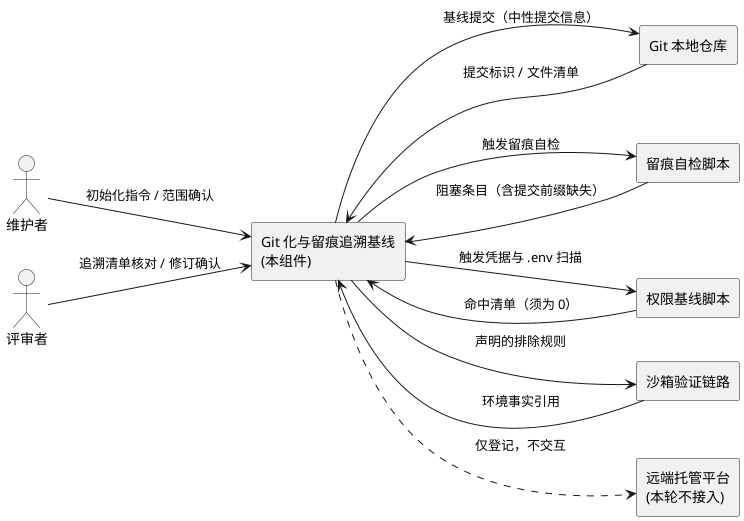
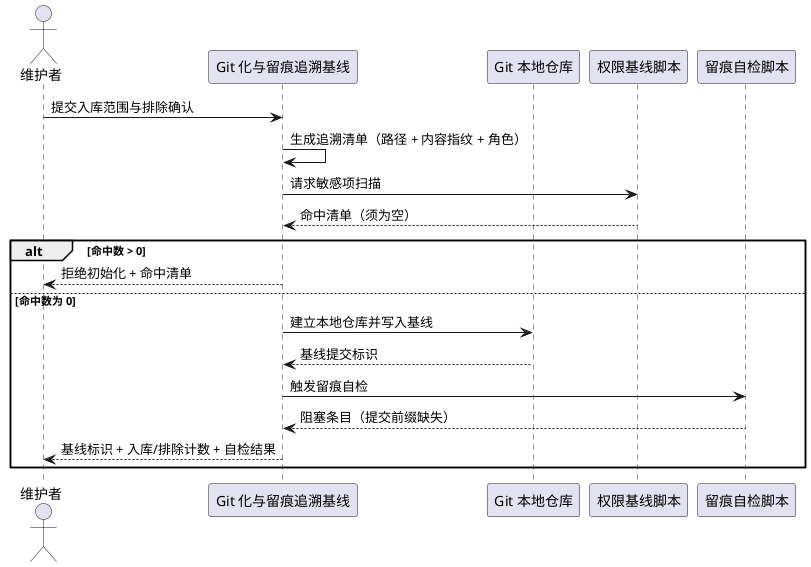
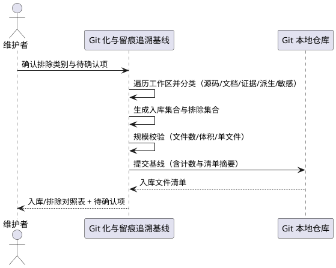
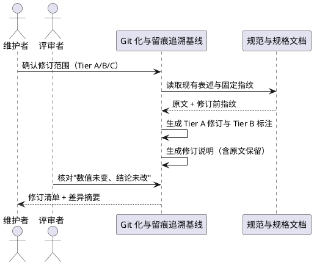
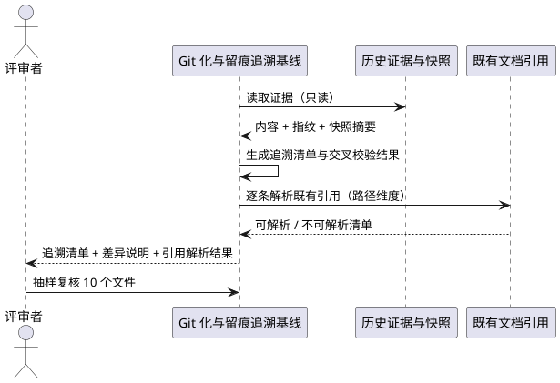
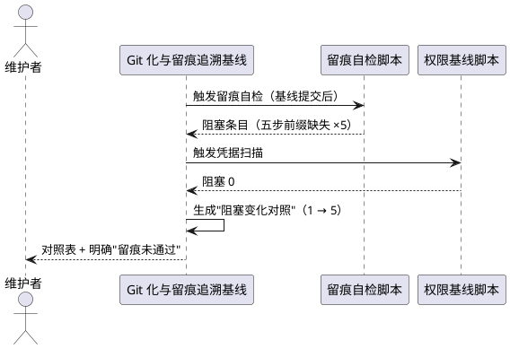

# Git 化与留痕追溯基线 · 需求规格

> 版本：v1.0（2026-11-18）
> 范围：为工作区引入版本控制基线、确定入库/排除范围、修订"非 Git 仓库"前提、建立历史证据的追溯口径
> 本文档只描述"要达成什么"与"如何验收"，不描述"如何构建"，不含可执行命令序列。

---

## 1. 组件定位

### 1.1 核心职责

本组件负责为工作区引入本地版本控制基线，并把初始化前已存在的留痕、证据与基线数字锚定为可复算的追溯关系，使"版本控制引入"不改变任何历史结论的可信度。

### 1.2 核心输入

| 输入 | 来源 | 内容概要 |
|---|---|---|
| 本轮范围指令 | 维护者 | 仅执行收尾路线第 1 项"Git 化"；第 2–6 项不在本轮范围 |
| 现有工作区文件树 | 仓库根目录 | 源码（`backend/`、`frontend/src/`、`mcp/`、`scripts/`）、文档（`docs/`）、规格（`.codeartsdoer/specs/`）、部署配置（`deploy/`）、靶场（`verifix-target/`） |
| 派生产物 | 仓库根目录 | `frontend/node_modules/`（84MB）、`edgeprofile/`、`edgeprofile2/`、`edgeprofile3/`（合计约 33MB）、`__pycache__`、`frontend/dist/` |
| 历史证据 | `.evidence/`、`.merkle-snapshot.json` | 377 个证据/工作文件；快照 `rootHash=e7aefa1dd8b0…`、`fileCount=334`、`timestamp=1794916749441` |
| 既有留痕规范 | `docs/devlog/00-conventions.md` | §1 五步前缀、§2 硬性要求（含"禁止脚本批量伪造提交时间"）、§3 当前仓库状态（"工作区尚未初始化为 Git 仓库"） |
| 既有约束 | `.codeartsdoer/specs/sandbox_realscan/tasks.md` C8 | "工作区非 Git 仓库，禁止依赖分支/提交/回滚命令；回滚只能 staging + 文件替换" |
| 受影响的既有规格 | 5 份 spec/design/tasks | 含同类"非 Git 仓库"前提陈述（清单见 5.3.1） |
| 自检与门禁脚本 | `scripts/check_devlog.py`、`scripts/check_permissions.py` | 前者以 `.git` 存在性与提交前缀计数判定留痕；后者扫描凭据与分支守卫 |
| 固定历史文件指纹 | `docs/devlog/m5-eval-report.md` | sha256 恒为 `931d2044…f165502`，任何修订均不得改变 |

### 1.3 核心输出

1. 已初始化的本地仓库与首个基线提交（含提交标识、分支、时间、纳入/排除计数）。
2. 根目录 `.gitignore`：按类别分段、逐段注明排除理由。
3. 修订后的 `docs/devlog/00-conventions.md` §2/§3：新增"版本控制基线"与"前版本控制期留痕"两段，保留原历史事实陈述。
4. 修订后的 `.codeartsdoer/specs/sandbox_realscan/tasks.md` C8 条目及配套修订记录。
5. 前版本控制期追溯清单（pre-VCS manifest）：全量文件的路径、内容指纹、角色、是否入库、摘要与交叉校验结果。
6. 前提变更修订说明：一份新增文档，逐条登记"原文陈述 / 现状 / 生效时间 / 影响 / 引用方式"，覆盖 Tier A/Tier B/Tier C 三类文档。
7. 自检行为变化说明：Git 化前后 `check_devlog.py` 阻塞条目数量与含义的对照，明确不得表述为"留痕已通过"。

### 1.4 职责边界

**本轮负责**

1. 本地仓库初始化与基线提交所需的业务规则、范围与验收口径。
2. `.gitignore` 的排除项清单与判定原则。
3. "非 Git 仓库"前提在规范与约束中的修订点、修订方式与追溯口径。
4. 历史证据、快照、基线版本号、评测摘要在新前提下的兼容规则。

**本轮不负责（明确不做）**

1. 不执行任何修复：8 个编码 error、`PERF-02` 抖动、D1-2 失败用例均不在本轮；不得在 Git 化过程中顺带改代码。
2. 不接入远端仓库、不推送、不配置 CI、不做 CodeArts/华为云真链路（收尾路线第 3–4 项）。
3. 不补建 `[step-1]`…`[step-5]` 的"事后提交"来填满五步留痕；基线提交不得拆分为带步骤前缀的多条提交。
4. 不修改任何历史报告正文与数值：`m5-eval-report.md`、`m9-*`、`m11-*`、`m12-*`、`m13-*`、`03-build.md`、`02-codegen.md`、`metrics-report.md` 全部保持字节不变。
5. 不重算、不覆盖 `.merkle-snapshot.json` 的既有 `rootHash`；不改变其摘要算法。
6. 不删除工作区中任何被排除的派生产物与答案数据（排除仅作用于版本控制纳入范围）。
7. 不改变自检 `0/2/3` 退出码定义，不改变 `--skip-git-check` 的"仅脚本自测"语义。
8. 不把"工作区成为 Git 仓库"表述为"五步留痕验收通过"。

**易误解的边界**

- **"Git 化"不等于"留痕补齐"**：只产生一个中性的基线提交，五步留痕仍为未执行状态。
- **"排除"不等于"删除"**：`.gitignore` 只决定是否进入版本控制，文件仍留在工作区。
- **"修订前提"不等于"改写历史"**：历史文档原文保留，修订以"现状段 + 修订说明"表达，禁止覆盖旧结论。
- **`sandbox/` 不是派生产物**：该目录只含 `spec.json`、3 个 Dockerfile 与 `requirements.target.txt`，属产品源码，必须入库；用户口语中的"sandbox 派生产物"指其运行期工作目录（见 OQ-1）。
- **"基线版本号"不等于自检口径版本**：自检归档的 `v1`–`v4` 是口径版本，不是 Git 版本；两者不得混用同一命名空间。

---

## 2. 领域术语

**前版本控制期（Pre-VCS Period）**
: 指从 D1 留痕开始到基线提交发生之前的全部时间区间；该区间内不存在任何提交，留痕仅以文件、归档副本与内容指纹留存。

**版本控制基线（VCS Baseline）**
: 指工作区首次被纳入版本控制时形成的单一提交，其职责是固定"初始化时刻的文件集合"，不承担任何五步留痕职责。

**基线提交（Baseline Commit）**
: 版本控制基线的具体提交对象，提交信息必须为中性标识，不得命中 `[step-1/requirement]` 至 `[step-5/release]` 任一前缀。
: 备注：与"基线版本（baseline_version）"不是同一概念，后者指自检口径版本。

**入库集合（Tracked Set）**
: 基线提交实际纳入版本控制的文件集合，由"工作区全量文件"减去 `.gitignore` 命中项与显式排除项得到。

**派生产物（Derived Artifact）**
: 可由源码或运行过程重新生成、不承载业务结论的文件或目录，例如依赖目录、字节码缓存、浏览器用户目录、构建输出、运行工作目录。

**历史证据（Historical Evidence）**
: 基线提交之前产生、用于支撑既有结论的文件，包括 `.evidence/` 下的证据包、`.merkle-snapshot.json`、各规格文档与 `docs/devlog/` 报告。

**内容指纹优先原则（Content-Fingerprint Primacy）**
: 当文档引用、提交锚点与内容指纹三者不一致时，以内容指纹（sha256 或等价清单摘要）作为该证据真实性的唯一判定依据，提交标识仅作附加定位。

**追溯清单（Pre-VCS Manifest）**
: 记录前版本控制期每个文件的路径、内容指纹、大小、角色与是否入库的结构化清单，其自身带总摘要，用于在无提交历史的条件下复算证据。

**追溯锚点（Trace Anchor）**
: 文档或报告中指向证据的引用形式，由"路径 + 内容指纹"构成，可选附加提交标识。

**口径版本（Definition Version）**
: 自检与指标定义的口径标识，当前为 `v2`；与 Git 基线标识分属不同命名空间，不得互换。

**前提变更修订块（Premise Revision Block）**
: 在不删除原文的前提下，追加"原文陈述 / 当前事实 / 生效时间 / 影响范围 / 引用方式"的修订记录单元。

---

## 3. 角色与边界

### 3.1 核心角色

- **维护者**：执行仓库初始化、确定入库与排除范围、签发修订记录；对"哪些文件进入基线提交"承担最终责任。
- **评审者**：核对追溯清单与既有报告指纹是否一致，确认修订范围没有越界改写历史结论。

### 3.2 外部系统

- **Git 本地仓库**：承载基线提交与后续留痕；本轮只使用本地能力，不涉及远端。
- **留痕自检脚本**：读取 `.git` 存在性与提交前缀计数，输出五步留痕阻塞清单。
- **权限基线脚本**：扫描入库内容中的凭据、`.env` 与分支守卫行为。
- **沙箱验证链路**：其 P4-01 探针依赖"工作区是否存在 `.git`"的环境事实；Git 化后同一排除规则需适配真实 `.git`。
- **远端托管平台（CodeArts Repo）**：本轮明确不接入，仅登记为后续路线。

### 3.3 交互上下文

---

## 4. DFX 约束

### 4.1 性能

1. **初始化窗口**：从开始到产生首个基线提交的总耗时不得超过 60 秒（不含人工确认时间），计算环境为宿主默认 Python/Node 运行时。
   a. 验收条件：当在已确认的入库范围上执行初始化时，系统必须给出总耗时且该值 ≤ 60 秒。
2. **日常状态开销**：`git status` 在工作区（已排除依赖目录与浏览器用户目录）上的响应时间不得超过 3 秒。
   a. 验收条件：当基线提交完成后连续执行 3 次状态查询时，系统必须在 3 秒内返回，且输出无"未跟踪的派生产物"噪声。
3. **入库规模上限**：入库文件数不得超过 1500 个，入库内容总体积不得超过 40MB，单个入库文件不得超过 5MB。
   a. 验收条件：当基线提交完成时，系统必须输出入库文件数与总体积；超过任一上限即判本轮不通过，并要求收窄范围或给出书面例外。
   b. 备注：现状 `frontend/node_modules/`（84MB）、`edgeprofile*`（约 33MB）已排除，不计入上述规模。

### 4.2 可靠性

1. **幂等初始化**：当工作区已存在 `.git` 时，系统必须拒绝重复初始化，并输出"已存在版本控制基线"及提交标识，不得产生第二个基线提交。
   a. 验收条件：当对已初始化工作区再次发起初始化时，系统必须返回既有基线标识且不新增提交。
2. **失败可恢复**：初始化中断时，系统必须保证工作区不残留"已暂存但未提交"的半成品状态；恢复后再次执行必须得到同一入库集合。
   a. 验收条件：当初始化在暂存完成后被中断，恢复执行所得入库集合的文件清单与内容指纹必须与中断前的计划清单一致。
3. **历史文件不变**：除 5.3.1 明确列出的修订对象外，所有既有文件在 Git 化前后的 sha256 必须逐一相同。
   a. 验收条件：当比对 Git 化前后的追溯清单时，系统必须报告"非修订文件指纹差异数 = 0"。
4. **提交时间真实**：基线提交时间必须等于实际初始化时刻，不得早于任何既有文件的内容形成时间，不得通过环境变量回填为历史时间。
   a. 验收条件：当检查基线提交的提交者时间与作者时间时，二者必须落在初始化当日，且与既有文件 mtime 的先后关系如实记录、不得声称"补建于历史时间点"。

### 4.3 安全性

1. **凭据零入库**：`.env` 实体文件、私钥与证书（`.pem`、`.key`、`deploy/certs/` 下私钥材料）、令牌类文件必须全部排除在入库集合之外。
   a. 验收条件：当对入库集合执行敏感扫描时，命中数必须为 0；`.env.example` 仅可含占位值并被纳入入库集合。
2. **答案集零入库**：评测答案目录（`eval/expected/`）与红队真值文件（`.evidence/redteam-baseline/gt.txt`）不得进入版本控制，其存在性与指纹仅在追溯清单中登记。
   a. 验收条件：当检索入库文件清单时，答案类路径的出现次数必须为 0，且追溯清单中对应条目必须标记 `tracked=false` 与 `role=answer`。
   b. 依据：既有规格 `verifix` 4.3.6 要求"评测集不入仓库"；Git 化不得推翻该约束。
3. **提交信息不含敏感内容**：基线提交信息与后续提交信息不得包含 token、口令、内网地址、个人绝对路径。
   a. 验收条件：当扫描提交信息时，敏感模式命中数必须为 0。
4. **排除不掩盖证据**：禁止通过 `.gitignore` 把应受审查的源码或结论性证据移出可见范围；排除项必须逐条给出可复核理由。
   a. 验收条件：当审查 `.gitignore` 时，每条排除项必须能对应到"派生产物 / 凭据 / 答案 / 临时调试"四类理由之一，且不存在以排除方式规避证据检查的条目。

### 4.4 可维护性

1. **可读的排除规则**：`.gitignore` 必须按类别分段并附注释，任何人可在 2 分钟内判断某文件是否应入库。
   a. 验收条件：当抽样 5 个路径（依赖目录、字节码、浏览器目录、答案目录、源码目录）时，依据 `.gitignore` 的解释必须与追溯清单的 `tracked` 字段一致。
2. **变更可审查**：修订文档必须携带修订记录（对象、章节、原文、新表述、时间、依据），不得静默修改。
   a. 验收条件：当检索修订记录时，每个被修订对象必须有且仅有一条对应记录，且记录中的原文与 Git 化前的文件内容一致。
3. **自检输出可读**：Git 化导致的阻塞条目变化必须以人类可读文本与结构化输出同时呈现。
   a. 验收条件：当运行留痕自检时，系统必须能同时给出阻塞条目数与逐条说明，读者无需推断"是否通过"。

### 4.5 兼容性

1. **历史引用可解析**：Git 化后，既有文档中所有已存在的证据引用必须仍可解析到原路径；引用语义不得因新增提交锚点而失效。
   a. 验收条件：当按既有引用逐条定位时，解析失败数必须为 0。
2. **命名空间隔离**：自检口径版本（`v1`–`v4`）、指标定义版本（`v2`）、Git 基线标识必须使用互不冲突的命名前缀。
   a. 验收条件：当在同一文档中引用上述三类标识时，必须能仅凭前缀区分，且不得出现"v4 即第四个提交"一类表述。
3. **跨平台一致**：Windows 与类 Unix 环境下，入库文件的内容指纹必须一致；换行转换配置必须显式记录，且不得导致既有文件在首次提交时被改写。
   a. 验收条件：当在两种环境下分别计算追溯清单时，同一文件的 sha256 必须相同；若因换行策略产生差异，该差异必须被显式登记而非静默接受。
4. **路径兼容**：含中文、空格与长路径的文件必须可正常入库，且追溯清单使用相对路径与统一分隔符。
   a. 验收条件：当中文命名文件被纳入入库集合时，其清单路径必须可被原样还原为工作区路径。

---

## 5. 核心能力

### 5.1 仓库初始化与基线提交

#### 5.1.1 业务规则

1. **单基线原则**：工作区只能存在一个"版本控制基线"提交；此后所有变更必须以新增提交表达。
   a. 验收条件：当基线提交完成时，系统必须能给出唯一基线提交标识，且该标识对应的提交不存在父提交。
2. **中性提交信息**：基线提交信息必须为中性标识，不得命中任何五步前缀。
   a. 验收条件：当检索提交信息时，命中 `[step-1/requirement]`、`[step-2/codegen]`、`[step-3/build]`、`[step-4/bootstrap]`、`[step-5/release]` 的条数必须为 0。
3. **基线内容可自证**：基线提交信息必须包含入库文件数、排除项数、追溯清单摘要三项要素，使提交本身可被外部核对。
   a. 验收条件：当读取基线提交信息时，必须能解析出上述三项要素，且与追溯清单实际值一致。
4. **不得拆分冒充留痕**：禁止把基线提交拆分为多条带步骤前缀的提交，也禁止以"文件修改时间"构造提交时间序列。
   a. 验收条件：当检查基线提交前后的提交历史时，提交数必须为 1，且不存在任何五步前缀提交。
5. **初始化前置条件**：仅当工作区根目录与排除规则已确定、且敏感扫描通过时，方可产生基线提交。
   a. 验收条件：当敏感扫描命中数 > 0 时，系统必须拒绝产生基线提交并输出命中清单。
6. **禁止项**：禁止在初始化过程中修改任何源码、规格、证据或历史报告的内容。
   a. 验收条件：当比对初始化前后的追溯清单时，除 5.3.1 列出的修订对象外，内容指纹差异数必须为 0。

#### 5.1.2 交互流程

#### 5.1.3 异常场景

1. **工作区已存在 `.git`**
   a. 触发条件：初始化前检测到根目录已有 `.git`。
   b. 系统行为：不执行初始化，不修改任何文件；读取既有基线标识与提交数。
   c. 用户感知：提示"已存在版本控制基线，提交 `<标识>`，本次未做变更"。
2. **存在嵌套 `.git` 目录**
   a. 触发条件：证据目录或夹具目录内存在合成 `.git`（现状：`.evidence/sandbox-realscan/…/fixtures/p4-01/.git/`）。
   b. 系统行为：将嵌套 `.git` 所在的工作目录整体排除，不纳入基线；如实登记排除原因"合成夹具，避免形成子模块引用"。
   c. 用户感知：输出排除条目及路径，入库集合中嵌套 `.git` 数量必须为 0。
3. **文件被占用或权限不足**
   a. 触发条件：初始化过程中某文件无法读取（被进程占用、权限拒绝、路径超长）。
   b. 系统行为：中止基线提交，保留已完成的分析结果，不产生部分提交；输出失败路径与原因。
   c. 用户感知：提示"初始化未完成：N 个文件不可读"，并给出重试前置条件。
4. **入库规模超限**
   a. 触发条件：入库文件数 > 1500 或总体积 > 40MB 或单文件 > 5MB。
   b. 系统行为：不自动裁剪源码；列出超限项并要求维护者书面确认例外或收窄范围。
   c. 用户感知：输出超限清单（路径、体积、类别）与"待确认"状态。
5. **敏感扫描命中**
   a. 触发条件：入库候选中出现凭据、私钥、`.env` 实体或答案文件。
   b. 系统行为：拒绝提交该文件，将其转为排除项并登记理由；若命中项属源码文件则整体中止。
   c. 用户感知：提示"检测到敏感/答案文件，已排除：`<路径>`"。
6. **自检阻塞条目增加**
   a. 触发条件：基线提交完成后运行留痕自检，因缺少五步前缀提交而产生多条阻塞。
   b. 系统行为：如实输出全部阻塞条目，不得以"已 Git 化"抵消；同时在输出中区分"环境前提类"与"留痕未执行类"。
   c. 用户感知：明确提示"阻塞条目由 1 条（非 Git）变为 5 条（五步前缀缺失），留痕仍未通过"。

### 5.2 入库范围与 `.gitignore`

#### 5.2.1 业务规则

1. **必须排除：依赖与缓存**：`frontend/node_modules/`、任意层级的 `__pycache__/`、`*.pyc`、`*.pyo`、`.pytest_cache/`、本地虚拟环境目录必须排除。
   a. 验收条件：当检索入库清单时，上述模式命中数必须为 0；`frontend/node_modules` 的 84MB 不得进入版本控制。
2. **必须排除：浏览器与工具用户目录**：`edgeprofile/`、`edgeprofile2/`、`edgeprofile3/` 及同类 `*profile*` 用户数据目录必须排除。
   a. 验收条件：当检索入库清单时，`edgeprofile*` 路径命中数必须为 0；其内容仍保留在工作区。
3. **必须排除：运行工作目录**：`.evidence/**/.work/`、证据打包过程产生的临时目录、沙箱运行输出目录（若出现）必须排除；证据包中已定稿的 JSON/JSONL/Markdown 文件必须保留。
   a. 验收条件：当检索入库清单时，`.work` 路径命中数必须为 0，而已定稿证据文件（如 `.evidence/metrics-recalc/history-baseline.json`、`.evidence/redteam-baseline/RT-*.json`）必须被纳入。
4. **必须排除：凭据、证书与答案**：`.env`（实体）、`.env.*`（非 `.example`）、`*.pem`、`*.key`、`deploy/certs/` 下私钥材料、`eval/expected/`、`.evidence/redteam-baseline/gt.txt` 必须排除。
   a. 验收条件：当检索入库清单时，上述路径命中数必须为 0；`.env.example` 必须被纳入且仅含占位值。
5. **必须排除：构建与调试派生物**：`frontend/dist/`（如维护者判定为可重建产物）、根目录 `dom.txt`、`err.txt`、`.patch_fix1.py`、`.patch_fix2.py` 必须排除，或在追溯清单中标注"临时调试/一次性补丁脚本"并纳入待确认项。
   a. 验收条件：当审查入库清单时，上述每一项必须明确处于"排除"或"纳入且标注理由"状态，不得遗漏未分类。
6. **必须纳入：产品与交付材料**：`backend/`、`frontend/src/` 与前端工程配置、`mcp/`、`scripts/`、`sandbox/`（`spec.json` 与三个 Dockerfile）、`verifix-target/`、`deploy/`（除私钥）、`docs/`、`.codeartsdoer/specs/`、`README.md`、`NOTES.md`、`.env.example`、`.merkle-snapshot.json` 必须纳入。
   a. 验收条件：当抽样检查上述目录时，其顶层源码/配置文件的 `tracked=true` 比例必须为 100%（排除项除外）。
7. **必须纳入：既有证据与规范**：`docs/devlog/` 全部留痕文档、`docs/devlog/selfcheck/` 归档、`.evidence/` 定稿证据必须纳入，以保证历史结论与证据同仓可追溯。
   a. 验收条件：当核对历史报告时，`docs/devlog/m5-eval-report.md` 必须存在于入库集合中且内容指纹为 `931d2044…f165502`。
8. **快照文件口径**：`.merkle-snapshot.json` 作为前版本控制期的基线指纹证据纳入，且保持只读；Git 化后新增快照必须使用带时间或版本后缀的新文件名，不得覆盖该文件。
   a. 验收条件：当检查该文件时，`rootHash`、`fileCount`、`timestamp` 三项必须与 Git 化前一致；同名文件不得出现第二次写入。
9. **禁止项**：禁止使用 `.gitignore` 排除任何源码目录、规格文档、留痕报告或定稿证据；禁止以"路径含 `.git`"为由排除正常源码。
   a. 验收条件：当审查排除项时，每条必须归入"依赖缓存 / 用户目录 / 运行产物 / 凭据证书 / 答案 / 临时调试"之一，且不得出现 `backend/`、`docs/devlog/`、`.codeartsdoer/specs/`、`sandbox/spec.json`。
10. **README 排除说明**：`.gitignore` 的排除类别必须在版本控制相关说明中可被人理解（可写入 `README.md` 或独立说明文档），且与清单一致。
    a. 验收条件：当对照说明文档与 `.gitignore` 时，类别数量与内容必须一致。

#### 5.2.2 交互流程

#### 5.2.3 异常场景

1. **类别判定歧义**
   a. 触发条件：某文件既可能是产品交付物又可能是构建产物（如 `frontend/dist/`）。
   b. 系统行为：不自行决定；标记为待确认项，给出两种选择的后果（可重建性 vs 交付完整性）。
   c. 用户感知：输出 OQ 编号与默认建议，等待维护者拍板后才进入基线。
2. **排除后证据断链**
   a. 触发条件：排除某项后，既有文档对其的引用无法解析。
   b. 系统行为：不提交；恢复该项为入库候选，或在追溯清单中登记"引用仅可由工作区定位"的例外说明。
   c. 用户感知：提示"`<文档>` 引用 `<路径>` 将不可解析，需选择纳入或登记例外"。
3. **同一路径同时命中纳入与排除规则**
   a. 触发条件：如 `sandbox/` 整体规则与运行产物规则冲突。
   b. 系统行为：以最小排除粒度处理，优先排除子路径而非父目录。
   c. 用户感知：输出冲突路径与最终判定，说明"仅排除子目录，父目录保留"。

### 5.3 "非 Git 仓库"前提的修订（C8 与 `00-conventions.md` §3）

#### 5.3.1 修订对象与修订范围

**Tier A：必须修订（作为仍生效的约束）**

| 对象 | 现表述 | 修订要求 |
|---|---|---|
| `.codeartsdoer/specs/sandbox_realscan/tasks.md` C8 | "工作区**非 Git 仓库**，禁止依赖分支/提交/回滚命令；回滚只能 staging + 文件替换" | 改写为"工作区已 Git 化（基线 `<标识>`）：允许只读 git 查询用于追溯；仍禁止依赖分支/提交/回滚作为交付手段，回滚继续以 staging + 文件替换实现；基线提交不计入五步留痕"。验收列同步改为"验收命令不出现写类 git 操作；只读查询命中须可回溯" |
| `docs/devlog/00-conventions.md` §3 | "工作区尚未初始化为 Git 仓库……" | 拆为三段：3.1 版本控制基线（时间、标识、分支、入库/排除计数）；3.2 前版本控制期留痕（区间、留存方式、内容指纹锚定、禁止以提交时间推断）；3.3 自基线起的分步提交要求与基线提交豁免 |
| `docs/devlog/00-conventions.md` §2 | 硬性要求 1–5（未区分基线与后续） | 新增一条：基线提交不归属任何步骤；步骤提交要求自基线提交之后生效。原 1–5 条语义保留，不得放宽"禁止伪造提交时间" |

**Tier B：需追加前提变更标注（不删除原文，不改写结论）**

| 对象 | 受影响陈述 | 处理方式 |
|---|---|---|
| `.codeartsdoer/specs/eval_leak_hardening/tasks.md` C3 | "仓库非 Git 管理，不得依赖分支/提交/回滚命令" | 原位追加一行"前提变更：2026-11-18 起工作区已 Git 化，C3 的'非 Git'限定不再成立，回滚实现方式约束仍然有效" |
| `.codeartsdoer/specs/metrics_recalc/design.md` 前言 | "本机无 Docker、无华为云凭据、非 Git 仓库" | 追加标注"非 Git 仓库"已被取代，其余前提不变 |
| `.codeartsdoer/specs/metrics_recalc/tasks.md` 第 4 条 | "非 Git 仓库：不安排任何 git 命令" | 追加标注其适用范围截至 Git 化前 |
| `.codeartsdoer/specs/sandbox_realscan/spec.md` 前提修正段 | "……'非 Git 仓库'仍然成立" | 追加"该前提于 2026-11-18 被版本控制基线取代" |
| `.codeartsdoer/specs/sandbox_realscan/design.md` §0.2/§2.x/§2.9 | "工作区非 Git 仓库；靶场源码树无 `.git`"、"未来成为 Git 仓库时同规则适配" | 追加"现已成为 Git 仓库；P4-01 合成夹具继续有效，真实 `.git` 依赖新增排除规则" |
| `.codeartsdoer/specs/sandbox_realscan/tasks.md` 第 5.4.1、第 10 条 | "工作区非 Git 仓库" | 同 Tier A 修订口径；保留"合成夹具"结论不升级为"已验证真实 `.git`" |
| `.codeartsdoer/specs/selfcheck_harness/design.md` §1.2.4 约束 | "当前工作区未初始化为 Git 仓库，D5 与 D1 引用其结果时必然得到阻塞" | 追加"自基线提交起改为'提交前缀缺失'阻塞；阻塞条目数与含义变化须如实转述" |
| `.codeartsdoer/specs/selfcheck_harness/tasks.md` 8.6 项 | 要求"非 Git 阻塞结果不得被抵消" | 追加"该表述的适用范围截至基线提交；基线后以提交前缀缺失阻塞为准，同样不得抵消" |

**Tier C：只读历史报告（禁止修改正文与数值，仅由新增修订说明统一登记）**

`docs/devlog/m9-stage-anchors-review.md`、`m12-closure-and-blockers.md`、`m13-selfcheck-report.md`、`m13-analysis-plan.md`、`m11-coverage-report.md`、`03-build.md`、`02-codegen.md`、`metrics-report.md`、`m5-eval-report.md`。

处理要求：不触碰上述文件；在新增的前提变更修订说明中按"文件 / 原句 / 时间边界"逐条登记，声明"该陈述描述的是前版本控制期事实"。

**修订方式**

1. 原位最小改动：只替换限定性措辞或追加标注行，不重排章节、不改动既有验收数值。
2. 每处修订必须附修订记录：`对象 | 章节 | 原文 | 新表述 | 修订时间 | 依据`。
3. 禁止批量替换导致历史语义丢失；原句若被替换，必须在修订记录中完整保留原文。

#### 5.3.2 业务规则

1. **现状优先**：§3 必须以"当前事实"开头，历史事实紧随其后，读者不得把历史事实误读为现状。
   a. 验收条件：当阅读 §3 时，第一段必须包含基线标识与初始化日期，第二段必须明确标注"前版本控制期"及其时间边界。
2. **修订最小化**：对仍生效的约束（C8、§2）必须修订；对已完成阶段的历史陈述（Tier B）只追加前提变更标注；对历史报告（Tier C）零修改。
   a. 验收条件：当比对各文件 Git 化前后的差异时，Tier C 文件差异数必须为 0；Tier A/B 差异必须仅为标注或限定语，且不含数值变动。
3. **C8 新语义自洽**：修订后的 C8 必须同时满足"允许只读追溯"与"禁止写类 git 操作"两项，且与 `sandbox_realscan` 的"回滚只能 staging + 文件替换"结论不冲突。
   a. 验收条件：当按新 C8 审查 `sandbox_realscan` 任务的验收命令时，写类 git 操作命中数必须为 0，只读查询须有明确用途说明。
4. **不得改写历史结论**：`m5-eval-report.md` 等历史报告的结论句、数值、sha256 必须保持不变。
   a. 验收条件：当复算 `m5-eval-report.md` 的 sha256 时，必须恒为 `931d20442673b0922a32cfb42de1dcc9996925836607f6ddedbc5e8b1f165502`。
5. **修订可检索**：所有被修订对象必须能在修订说明中被检索到，且与文件内标注一一对应。
   a. 验收条件：当检索修订说明时，Tier A/B 每个对象必须出现恰好一次，且文件中存在对应标注。
6. **禁止项**：禁止以"Git 化"为由删改既有验收条件、降低门槛、取消"禁止伪造"要求。
   a. 验收条件：当比对 `00-conventions.md` §2 时，"禁止脚本批量伪造提交时间"条款必须仍然存在且语义未减弱。

#### 5.3.3 交互流程

#### 5.3.4 异常场景

1. **修订触发历史数值变动**
   a. 触发条件：替换措辞时连带修改了验收命令中的阈值或数量。
   b. 系统行为：回退该处修订，改为追加标注；在修订说明中记录"原句保留"。
   c. 用户感知：提示"修订越界：检测到数值变动，已回退"。
2. **Tier B 文件已被其他工作修改**
   a. 触发条件：修订前文件指纹与本轮起点不一致。
   b. 系统行为：停止修订该文件，输出差异，转人工确认；不得覆盖他人改动。
   c. 用户感知：提示"`<文件>` 在修订前已变更，需先确认基线"。
3. **修订说明与实际标注不一致**
   a. 触发条件：说明中登记的对象在文件中找不到对应标注，或反之。
   b. 系统行为：判定修订未完成，整体不通过。
   c. 用户感知：输出不一致清单（对象 / 缺失方向）。

### 5.4 历史留痕的兼容与追溯口径

#### 5.4.1 业务规则

1. **前版本控制期隔离**：基线提交之前的全部时间区间必须显式标记为"前版本控制期"，该区间内的证据不得被表述为"有提交支撑"。
   a. 验收条件：当引用任一前版本控制期证据时，文档必须同时给出内容指纹；仅给路径或仅给提交标识均判不完整。
2. **追溯清单必备性**：Git 化必须产出追溯清单，覆盖工作区全量文件（含被排除项），并带自身摘要。
   a. 验收条件：当抽取任意 10 个文件（含 3 个排除项）核对时，清单记录必须与实际内容指纹一致，误差数必须为 0。
3. **交叉校验**：追溯清单必须与 `.merkle-snapshot.json` 交叉校验（`rootHash`、`fileCount`）；若范围不同导致不一致，必须如实输出差异清单，不得声称"完全一致"。
   a. 验收条件：当执行交叉校验时，系统必须输出"一致 / 不一致 + 差异路径"；现状若 `fileCount` 与清单范围不同，必须标注口径差异（快照覆盖 334 个文件，清单可能覆盖更多）。
4. **内容指纹优先**：任何"提交锚点与内容指纹冲突"的情形，必须以前者失效、后者为准处理，并记录冲突事件。
   a. 验收条件：当人为制造冲突（同一路径内容变更但引用旧提交）时，系统必须判定"证据与引用不一致"，不得判通过。
5. **基线命名的版本号解耦**：Git 化后的基线标识必须使用独立前缀（如 `vcs-baseline/<短标识>`），禁止复用 `v1`–`v4` 或 `definition_version` 命名。
   a. 验收条件：当检索文档中的基线引用时，`vcs-baseline/` 与 `v1`–`v4` 必须可区分，且 `definition_version` 仍为 `v2`。
6. **评测摘要绑定不变**：`eval/eval_set.sha256` 与评测样本的摘要绑定关系不得因 Git 化改变；评测结论继续按内容摘要校验，不引入"提交一致性"作为替代条件。
   a. 验收条件：当校验评测集时，摘要比对结果必须与 Git 化前一致；新增的提交锚点仅作附加信息。
7. **快照算法冻结**：既有 `.merkle-snapshot.json` 的 `rootHash` 算法与覆盖口径不得改变；Git 化后如需带提交锚点的新快照，必须新增文件并标注 `schema_version`。
   a. 验收条件：当复算既有快照时，`rootHash` 必须仍为 `e7aefa1dd8b0…`；新快照不得覆盖旧文件。
8. **证据引用格式统一**：新产生的引用必须采用"路径 + 内容指纹（+ 可选提交标识）"格式；既有引用不强制改写，但新修订块必须使用统一格式。
   a. 验收条件：当检查新增修订说明时，所有证据引用必须包含 64 位十六进制内容指纹。
9. **禁止项**：禁止用提交时间反推证据产生时间；禁止把基线提交写成"五步留痕第 1 步"；禁止以"仓库已版本控制"宣称历史证据"已验收"。
   a. 验收条件：当检索基线提交与新增文档时，上述三类表述命中数必须为 0。

#### 5.4.2 交互流程

#### 5.4.3 异常场景

1. **清单与快照范围不一致**
   a. 触发条件：追溯清单覆盖文件数 ≠ 快照 `fileCount`。
   b. 系统行为：不判失败；输出差异路径与口径说明（快照生成时间早于本轮新增文件）。
   c. 用户感知：提示"口径差异 N 项，已登记，不影响前版本控制期证据有效性"。
2. **历史证据在 Git 化前已被修改**
   a. 触发条件：某证据文件当前指纹与既有文档记录不符。
   b. 系统行为：如实登记为"预先存在的不一致"，不归因于 Git 化；不得修改证据以"对齐"。
   c. 用户感知：输出不一致清单与既有记录值、当前值。
3. **引用指向已排除内容**
   a. 触发条件：文档引用的路径被 `.gitignore` 排除（如 `eval/expected/`）。
   b. 系统行为：将该引用登记为"仅工作区可定位"，并在追溯清单中保留其指纹；不把引用改写为失效。
   c. 用户感知：提示"引用不可由仓库复位，已登记工作区锚点"。
4. **嵌套 `.git` 导致子模块误识别**
   a. 触发条件：证据夹具中的 `.git` 未被排除，版本控制将其识别为子模块或嵌套仓库。
   b. 系统行为：中止基线提交，修正排除规则后重算清单。
   c. 用户感知：提示"检测到嵌套仓库 `<路径>`，已中止，需排除后重试"。

### 5.5 自检与门禁的行为变化

#### 5.5.1 业务规则

1. **阻塞如实转述**：Git 化后留痕自检的阻塞条目必须如实输出，禁止以"新前提"抵消。
   a. 验收条件：当仅有基线提交时，自检必须输出 5 条"缺少带前缀提交"阻塞（对应五个步骤）；不得输出"通过"。
   b. 备注：Git 化前为 1 条全局阻塞（非 Git 仓库）；条目数由 1 增至 5 属预期变化，须在输出与收尾文档中说明。
2. **基线提交豁免而非冒充**：基线提交不得计入任何步骤的提交计数；自检对基线的处理必须是"识别并排除"，而非"计入某一步"。
   a. 验收条件：当自检统计各步骤提交数时，五个步骤计数必须均为 0；基线提交仅在"基线标识"字段中出现。
3. **脚本语义不擅自放宽**：本轮不得为"让自检变绿"而修改自检判定逻辑；若确需适配，必须单独登记为后续变更并保留原判定作为可选项。
   a. 验收条件：当比对自检脚本 Git 化前后的判定规则时，差异数必须为 0（本轮）；`--skip-git-check` 仍仅用于脚本自测。
4. **权限基线扫描必须复跑**：Git 化后必须重新执行凭据与 `.env` 扫描，且命中数为 0。
   a. 验收条件：当运行权限基线扫描时，输出必须为"通过、阻塞 0"，且分支守卫行为与 Git 化前一致。
5. **沙箱口径衔接**：P4-01 的"合成夹具"结论不得因 Git 化升级为"已验证真实 `.git`"；只能追加"视图排除规则已适配真实 `.git`"的说明。
   a. 验收条件：当检索沙箱验证报告时，"已验证真实仓库 `.git`"表述命中数必须为 0。

#### 5.5.2 交互流程

#### 5.5.3 异常场景

1. **自检仍报"非 Git 仓库"**
   a. 触发条件：初始化后自检仍无法读取提交历史（如 `.git` 位于上层目录或权限异常）。
   b. 系统行为：不修改脚本；登记为环境异常并输出诊断信息（根目录、`.git` 存在性）。
   c. 用户感知：提示"自检未能读取提交历史，阻塞仍按非 Git 口径输出"。
2. **阻塞条目数被误读为退化**
   a. 触发条件：对外材料直接引用"阻塞数"而未说明口径变化。
   b. 系统行为：在对照说明中强制并列"Git 化前 1 条 / Git 化后 5 条 / 含义不同"。
   c. 用户感知：材料中出现任一单独数字时，必须能追溯到对照表。
3. **有人以基线提交声明通过**
   a. 触发条件：文档或口头结论出现"已 Git 化，留痕已通过"。
   b. 系统行为：判该结论无效，要求改为"留痕仍未通过，阻塞 5 条"。
   c. 用户感知：输出纠正后的标准表述。

---

## 6. 数据约束

### 6.1 追溯清单（Pre-VCS Manifest）

1. **schema_version**：必须为固定字符串 `"1"`，用于后续兼容读取。
2. **generated_at**：必须为生成时刻的带时区时间戳，且不得早于基线提交时间。
3. **root**：必须为仓库根目录的相对标识（不带绝对盘符），用于跨机复算。
4. **files**：必须为数组，每项含 `path`、`sha256`、`size`、`role`、`tracked` 五个字段；`path` 使用相对路径与统一分隔符。
5. **role**：取值必须属于封闭集合 `source`、`docs`、`spec`、`evidence`、`history`、`derived`、`secret`、`answer`。
6. **tracked**：必须为布尔值，且与 `.gitignore` 判定结果一致；`role` 为 `secret` 或 `answer` 时 `tracked` 必须为 `false`。
7. **excluded**：必须为数组，每项含 `pattern_or_path` 与 `reason`；`reason` 必须属于"依赖缓存 / 用户目录 / 运行产物 / 凭据证书 / 答案 / 临时调试"六类。
8. **manifest_digest**：必须为对 `files` 按路径排序后逐条序列化再摘要得到的 64 位十六进制值，不含生成时间。
9. **cross_check**：必须含 `merkle_root_hash`、`merkle_file_count`、`consistent`、`differences` 四个字段；不一致时 `differences` 不得为空。

### 6.2 基线提交元数据

1. **commit_id**：必须为实际提交标识；不得手工编造或事后替换。
2. **branch**：必须为初始化时确定的默认分支名；不得在基线阶段创建其他分支。
3. **committed_at**：必须为实际提交时间，且不得早于追溯清单 `generated_at`。
4. **tracked_count**：必须等于 `files` 中 `tracked=true` 的条目数。
5. **excluded_count**：必须等于 `files` 中 `tracked=false` 的条目数。
6. **manifest_digest**：必须与 6.1 第 8 条的值一致，并出现在提交信息中。
7. **baseline_label**：必须采用 `vcs-baseline/<短标识>` 形式，禁止与 `v1`–`v4`、`v2` 定义版本混用。

### 6.3 修订记录

1. **doc_path**：必须为被修订文件的相对路径。
2. **section**：必须定位到章节或条目编号（如 `§3`、`C8`）。
3. **original_text**：必须为 Git 化前的原文完整片段，不得省略。
4. **revised_text**：必须为修订后的完整表述；若为追加标注，须标明"追加"。
5. **revised_at**：必须为实际修订时间。
6. **basis**：必须引用本轮需求条目或基线提交标识，说明修订依据。
7. **tier**：取值必须为 `A`、`B`、`C` 之一；Tier C 仅允许登记，不得出现 `revised_text` 实际改动。

### 6.4 `.gitignore` 条目

1. **pattern**：每条必须为最小可判定模式，禁止使用会误伤源码的宽泛模式（如 `*`、`*.py`）。
2. **category**：必须归属六类之一（依赖缓存 / 用户目录 / 运行产物 / 凭据证书 / 答案 / 临时调试）。
3. **comment**：每条（或每段）必须含中文说明，解释"排除什么、为什么"。
4. **no_source_cover**：不得存在覆盖 `backend/`、`frontend/src/`、`mcp/`、`scripts/`、`sandbox/spec.json`、`docs/devlog/`、`.codeartsdoer/specs/` 的条目。
5. **env_example_exception**：必须显式保留 `.env.example`，并确保 `.env`、`.env.local` 等实体文件被排除。
6. **nested_git**：必须排除证据夹具中的嵌套 `.git`（至少覆盖 `.evidence/**/fixtures/**/.git/`），避免形成子模块。
7. **stable**：同一工作区状态下，`.gitignore` 的判定结果必须稳定，不得依赖执行顺序。

---

## 7. 待确认项（OQ）

| 编号 | 问题 | 默认建议 | 影响 |
|---|---|---|---|
| OQ-1 | `sandbox/` 是否整体入库 | **入库**（现仅含 `spec.json`、3 个 Dockerfile、`requirements.target.txt`，无运行产物） | 若整体排除，将丢失沙箱策略源码，违反 5.2.1-9 |
| OQ-2 | `frontend/dist/` 是否入库 | **排除**（可重建），但在交付说明中登记"部署前需构建" | 若需离线交付，应改为入库并接受体积增长 |
| OQ-3 | 根目录 `.patch_fix1.py`、`.patch_fix2.py`、`dom.txt`、`err.txt` 是否入库 | **排除**并登记为临时调试/一次性补丁 | 若其中含关键修复逻辑，需先确认是否已被产品代码吸收 |
| OQ-4 | `.evidence/redteam-baseline/gt.txt` 是否按答案类排除 | **排除**（`role=answer`） | 与 `verifix` 4.3.6"评测集不入仓库"一致；红队基线证据以指纹登记 |
| OQ-5 | `.merkle-snapshot.json` 是否入库 | **入库且只读** | 作为前版本控制期基线指纹证据；后续快照另起文件名 |
| OQ-6 | 默认分支名 | `main`（与既有 `main` 硬拒规则命名一致，但仅指本地分支） | 若团队约定为 `master`，需在 §3 与 C8 中同步 |
| OQ-7 | 是否需要在基线提交后立即补建五步提交 | **不补建**（本轮仅做 Git 化） | 补建将触碰"禁止伪造时间/前缀"红线，须另立需求 |

---

## 8. 整体验收清单

| 编号 | 验收项 | 通过判据 |
|---|---|---|
| AC-01 | 基线唯一 | 提交数为 1，无父提交，无任何五步前缀提交 |
| AC-02 | 入库范围 | 源码/文档/规格/定稿证据 100% 纳入；`node_modules`、`__pycache__`、`edgeprofile*`、`eval/expected/`、`.env`、私钥、嵌套 `.git` 命中数为 0 |
| AC-03 | 规模 | 入库文件数 ≤ 1500、总体积 ≤ 40MB、单文件 ≤ 5MB |
| AC-04 | 敏感扫描 | 命中数为 0；`.env.example` 已纳入且为占位值 |
| AC-05 | 历史不变 | 除 Tier A/B 外文件 sha256 差异数为 0；`m5-eval-report.md` = `931d2044…f165502` |
| AC-06 | 规范修订 | `00-conventions.md` §3 拆为"现状/前 VCS/基线后"三段；§2 新增基线豁免条；C8 改写为"只读可追溯、写类禁止" |
| AC-07 | 修订范围 | Tier A/B 每项有标注与修订记录；Tier C 文件零改动且全部登记 |
| AC-08 | 追溯清单 | 覆盖全量文件，抽样 10 项指纹误差 0；`manifest_digest` 可复算 |
| AC-09 | 交叉校验 | 与 `.merkle-snapshot.json` 输出一致或差异清单；不得虚报一致 |
| AC-10 | 自检如实 | 自检输出 5 条前缀缺失阻塞；无"留痕通过"表述；`--skip-git-check` 语义未变 |
| AC-11 | 权限基线 | 扫描通过、阻塞 0；分支守卫行为不变 |
| AC-12 | 口径解耦 | `vcs-baseline/` 与 `v1`–`v4`、`definition_version=v2` 可区分；评测摘要绑定未变 |
| AC-13 | 沙箱衔接 | 无"已验证真实 `.git`"表述；P4-01 仍以合成夹具为准 |
| AC-14 | 不越界 | 未修改任何源码、未修复 8 个编码 error、未处理 PERF-02、未接入远端/云 |