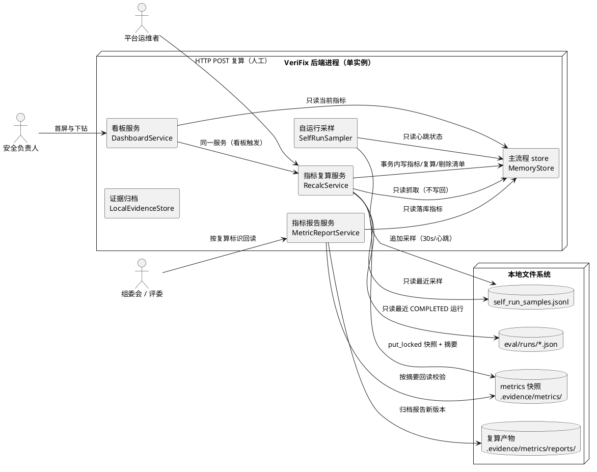
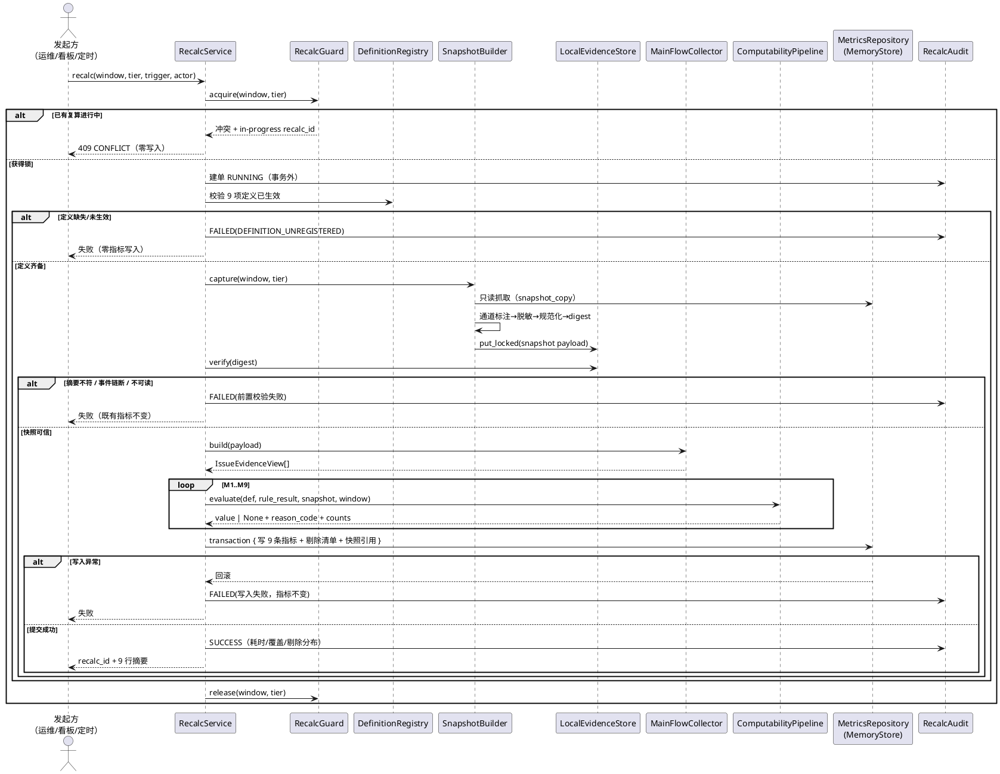
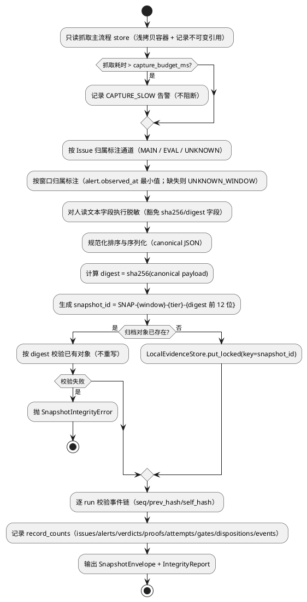
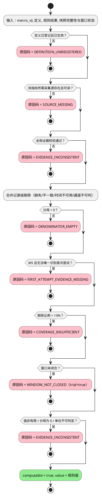
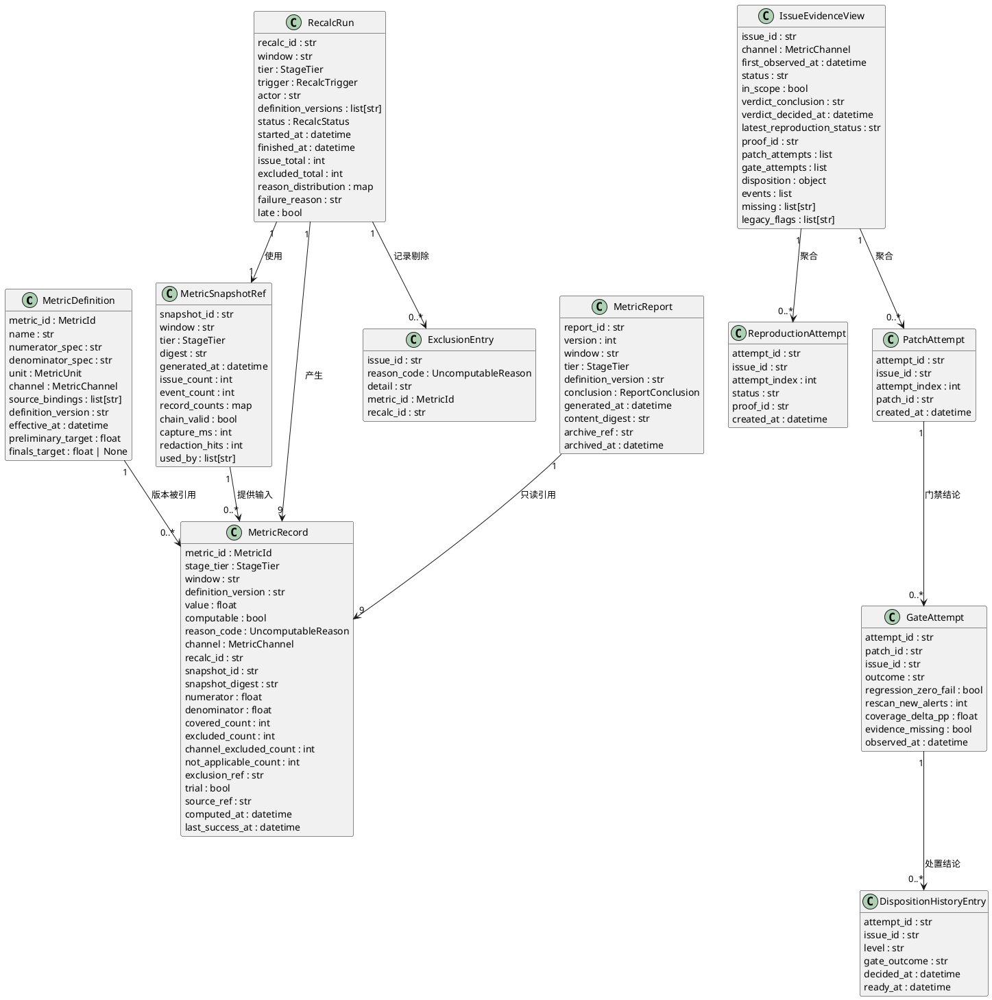

# 主流程指标复算 · 技术设计（design）

> 对应需求：`.codeartsdoer/specs/metrics_recalc/spec.md`
> 本文档只描述"如何构建"，不包含可直接执行的实现代码；接口签名与调用示例仅用于固定契约。
> 现状核实基线：`backend/app/` 当前实现（`metrics/calculator.py`、`repo/memory.py`、`evidence/*`、`orchestration/*`、`agents/*`、`eval/*`、`dashboard/*`、`runtime/*`），测试目录 `backend/tests/`，报告脚本 `scripts/run_eval.py`。
> 环境约束：本机无 Docker、无华为云凭据、非 Git 仓库。本方案所有验收路径均可在进程内 `MemoryStore` + 本地文件证据目录下完成，不以真实 Pipeline / CodeArts / OBS 连通为前提。**前提变更（2026-11-18）：此句中的"非 Git 仓库"已由版本控制基线取代；"无 Docker、无华为云凭据"两项前提不变。**

---

# 一、需求与存量功能关系分析

**分析口径**
1. 「已实现」只认能直接产生运行时行为的代码；仅有字段定义、无计算路径的记 50% 及以下。
2. 所有代码位置精确到文件，关键行为标注行号；匹配度判定依据写在本节表格的"依据"说明中。
3. `spec.md` 中 M4–M9 属本次范围；M1–M3 只做"读取与报告合并"，不重算口径，因此对 M1–M3 只评估其合并路径。

## 1.1 需求功能与存量功能对比

### 1.1.1 已实现功能

| 需求功能 | 存量功能 | 代码位置 | 匹配度 |
|---|---|---|---|
| 事件链可校验、只追加（spec 5.2.1-3/4、5.3.1） | `Event.prev_hash/self_hash` 哈希链 + `verify_chain` 逐条重算；`forbid_mutation` 拒绝改写 | `backend/app/repo/memory.py:282-305` | 100% |
| 证据只读归档、按摘要校验回读（spec 4.3.4、5.5.1-8） | `LocalEvidenceStore.put_locked/read/verify/release`：写后只读、路径逃逸防护、sha256 校验 | `backend/app/evidence/store.py:39-74` | 100% |
| 主流程状态机与处置分级产生（spec 5.1 输入证据） | 19 条迁移（T0–T18）与守卫，L0/L1 必须门禁 PASSED，`main` 不可作为补丁分支 | `backend/app/orchestration/state_machine.py:264-285`、`backend/app/domain/models.py:153-159` | 100% |
| 事件留痕与运行 replay（spec 5.2.1-6 时间基准） | `OrchestrationService.apply` 每次迁移追加 `Event`（`occurred_at` 为发生时刻）并回写 `RunStep`；`ReplayService.replay` 输出 chain_valid | `backend/app/orchestration/service.py:39-73`、`backend/app/evidence/replay.py:49-89` | 75%（事件缺目标状态字段，时间可用） |
| 指标不可计算时不得带值（spec 5.3.1-2、6.2.2） | `Metric` 模型校验：`computable=False` 时 `value` 必须为空，`True` 时必须非空 | `backend/app/domain/models.py:237-253` | 100% |
| 复现证明采集（M4 原料） | `Proof` 强制 `pre_patch_result=FAIL`；`ReproducerService` 在红态确认后 `add_proof` 并走 T7 | `backend/app/domain/models.py:122-137`、`backend/app/agents/reproducer/service.py:165-182` | 75%（每 Issue 仅保留最新一份） |
| 门禁三闸判据采集（M6 原料） | `GateResult` 含 `red_green_paired/regression_zero_fail/coverage_delta_pp/rescan_new_alerts/outcome`，`GateJudger.judge` 落库 | `backend/app/domain/models.py:171-181`、`backend/app/agents/gatekeeper/service.py:124-129` | 75%（每补丁仅保留最新一份） |
| 处置结论与 PR/合并动作采集（M7/M8 原料） | L0 合并 `release/auto`、L1 开 PR；随后写 `Disposition(level, gate_outcome=PASSED)` | `backend/app/agents/gatekeeper/service.py:131-182` | 75%（PR/合并完成时刻未独立记录） |
| 评测通道与主流程隔离（spec 5.2.1-2） | `EvalRunner` 每次 `step` 新建独立 `MemoryStore`，评测记录不进入主流程 store；评测结果持久化为 JSON | `backend/app/eval/runner.py:88-107`、`backend/app/eval/runner.py:205-208` | 75%（主流程侧无显式通道标记） |
| 评测集摘要校验（spec 5.1.1-1） | `EvalCaseSet.load` 对 `cases` 做 canonical sha256 比对，`assert_valid` 校验配比 | `backend/app/eval/service.py:44-85` | 100% |
| 自运行时计数器（M9 原料） | `SelfRunTracker` 维护连续秒数、心跳超时 120s、中断计数 | `backend/app/runtime/self_run.py:12-49` | 50%（纯内存、无采样时刻、重启清零） |
| 指标读取 API 与看板指标区（spec 5.6.1） | `GET /api/v1/metrics` 输出 `metric_id/stage_tier/window/value/computable/source_ref/definition_version`；看板 `summary.metrics` | `backend/app/main.py:270-284`、`backend/app/dashboard/service.py:61-70` | 50%（无原因码、复算标识、时效） |
| M1/M3 评测指标计算（spec 5.1.1-2(1)(3)） | 由评测结果行计算正例检出占比与判定一致率；空结果时输出不可计算 | `backend/app/metrics/calculator.py:78-91` | 75%（通道内可用，缺口径登记与标识） |
| M8 自动处置率底座（spec 5.1.1-2(8)） | `L0+L1` 处置数 ÷ `in_scope` Issue 数；看板级别分布同源 | `backend/app/metrics/calculator.py:123-125`、`backend/app/dashboard/service.py:44-50` | 75%（缺窗口归属与处置证据可信校验） |
| 事务回滚（spec 4.2.1） | `MemoryStore.transaction()` 快照/恢复全部现有集合 | `backend/app/repo/memory.py:89-141` | 50%（未覆盖本次新增集合，需同步扩展） |

### 1.1.2 需要扩展的功能

| 需求功能 | 存量功能 | 差异说明 | 扩展方向 |
|---|---|---|---|
| M4 复现成功率（spec 5.1.1-2(4)） | `calculator.py` 用状态前缀集合作分母、`store.proofs` 全量作分子 | ① 分母：`REPRO_FAILED` 被状态前缀过滤排除，违反"复现失败计入分母不计入分子"；② 分子：`proofs` 未与分母对齐，可能计入不在应复现范围的 Issue；③ "取最新复现结果"无记录（仅一份 `Proof`，失败重试不覆盖）；④ 无窗口归属、无剔除 | 新增 per-Issue 判定视图 + `ReproductionAttempt` 历史；口径改由 `M4Rule` 实现；判定与剔除交给统一判定流水线 |
| M5 一次修复通过率（spec 5.1.1-2(5)） | 分子=全部 L0/L1 `Disposition` 数，分母=`len(store.patches)` | ① 分子分母单位不一致（issue 级处置 ÷ issue 级补丁）；② 现有 store 按 Issue 覆盖补丁/门禁/处置，无法识别"首次尝试"，重试成功会被误判为一次通过；③ 无剔除 | 新增 `PatchAttempt`/`GateAttempt`/处置历史的 append-only 记录与 `attempt_id` 关联；首次尝试单独取 `attempt_index=1`；缺首次证据按 spec 走剔除与专用原因码 |
| M6 回归破坏率（spec 5.1.1-2(6)） | 固定 `value=None, computable=False`，`source_ref="缺 Pipeline 日志采集源"` | ① 采集源标注错误：`GateResult` 已含回归零失败、复扫新增、覆盖率差三项判据，真实缺失的是"补丁级历史"与"容忍阈值登记"；② `gate_results` 按 `patch_id` 覆盖（`patch_id` 固定为 `PA-{issue_id}`），重试后首次门禁结论丢失 | 采集源改绑主流程 `GateResult`（定义 v2）；新增门禁尝试历史；覆盖率容忍阈值登记为 `-0.5pp`（与 `_gate_passed` 一致），并作为可复算参数而非硬编码 |
| M7 MTTR（spec 5.1.1-2(7)） | `run` 首末事件时间差均值 | ① 起止点错误：未用告警首次观测时刻与 PR 就绪时刻；② 未筛 L0/L1 完成；③ 未剔除结束早于开始；④ 未校验 UTC 一致性 | 起点取 `Alert.observed_at` 最小值；终点取新增 `Disposition.ready_at`（L1=PR 创建成功时刻，L0=合并完成时刻）；缺 `ready_at` 的 Issue 计入剔除，不用 `decided_at` 估算 |
| M8 自动处置率（spec 5.1.1-2(8)） | `accepted / len(in_scope issues)` | ① 分母未按窗口归属过滤；② 分子未校验"处置结论与门禁证据一致"；③ 分母未声明包含未处置/处置中（虽逻辑上包含，但无显式口径与明细） | 分母取窗口内范围内 Issue 全集（含未处置）；分子要求 `Disposition.gate_outcome=PASSED` 且对应 `GateResult.outcome=PASSED`；不满足者剔除并计入剔除数 |
| M9 连续自运行（spec 5.1.1-2(9)） | 直接读 `tracker.continuous_hours()` | ① 无持久化采样，复算进程与看板进程不是同一实例；② 无采样时刻，无法证明取值时点；③ 心跳超时/重启后内存值丢失，无法区分"真实归零"与"缺采集源" | 新增采样归档（每次心跳写一条采样记录）与 `SelfRunSampleReader`；复算读最近采样并校验新鲜度；无采样=缺采集源，心跳超时=证据缺失 |
| M1–M3 报告合并（spec 5.5.1-2） | `calculator.py:78-98` 从内存 `eval_results` 计算；M2 用 `verdict==REACHABLE` 近似"漏洞检出" | ① 与 `spec` 口径不符（M2 应为"评测结果中被检出的已知漏洞数 ÷ 已知漏洞总数"，采集源为评测结果行 `detected`）；② 评测运行只在进程内存，服务重启后结论丢失 | 本次不重算 M1–M3，只新增 `EvalConclusionReader` 读取最近 `COMPLETED` 运行 JSON（含 `eval_run_id`、`set_digest`、四类通过情况），并在报告中校验标识齐备；M2 口径偏差列入"定义 v2 待对齐项"，由评测通道负责 |
| 指标定义登记（spec 5.1.1-1、6.1） | `SPECS` 三元组常量 + `_metric()` 固定 `v1/2026-12/PRELIMINARY` | 无通道、单位、分子分母口径、目标、生效时间；M4/M5 描述与 spec 不一致；无法判断"定义是否已登记/已生效" | 新增不可变 `MetricDefinition` 登记表（v1 归档 + v2 生效），提供按编号/版本/生效时间查询；报告生成前置校验"全 9 项已生效" |
| 通道隔离（spec 5.2.1-2） | `code_version.startswith("eval-")` 过滤 | 主流程记录无显式通道标记；前缀可被主流程版本号撞名；无"排除数量"记录；来源不可判定的记录未处理 | `Issue` 新增 `channel`（默认 `MAIN`），评测通道显式写 `EVAL`；`ChannelResolver` 依次判定 `channel` → legacy 前缀 → `UNKNOWN`；`UNKNOWN` 不计入分子分母并计入剔除 |
| 指标落库（spec 6.2） | `metrics[(metric_id, tier, window)] = Metric`，仅 4 个有效字段 | 无原因码、采集源引用（仅文本）、定义版本、复算标识、快照摘要、覆盖数/剔除数、剔除清单、试算标记、通道 | 扩展 `Metric`（全部新增字段带默认值以兼容旧记录）+ 新增复算记录、快照引用、剔除清单、报告版本四类集合；`MetricsRepository` 统一写入 |
| 报告生成（spec 5.5） | `scripts/run_eval.py` 用空 `MemoryStore` 计算 M4–M9 并硬编码"缺采集源"，直接覆盖同一文件 | ① 主流程指标在空 store 上计算，原因码不真实；② 无落库一致性校验；③ 无版本、无必备要素校验、结论规则只看 M1 | 新增 `MetricReportService`：只读落库记录、逐字段校验、版本递增、归档、结论规则（必需指标不可计算→不可判定）；脚本退化为"调用服务 + 输出文件" |
| 复算触发（spec 5.4） | 无复算 API、无调度、无互斥 | 无复算标识、无并发互斥、无窗口闭合判定、无补发 | 新增 `RecalcService` + `RecalcGuard` + `RecalcScheduler`，提供人工/看板/定时三种入口，共用同一执行路径 |
| 事务覆盖（spec 4.2.1/4.2.5） | `_take_snapshot/_restore_snapshot` 只覆盖既有 15 个集合 | 复算新增的复算记录/剔除清单/快照引用若不在事务快照内，失败回滚会残留部分结果 | 快照集合清单化扩展；复算记录采用"事务外建单 + 事务内计算落库 + 事务外收尾"的两段式 |
| 脱敏（spec 4.3.3） | `SecretRedactor` 可识别 7 类凭据模式 | `generic_secret_literal` 会命中 64 位 hex（sha256 摘要、`diff_ref`），若直接用于快照会导致摘要失效 | 快照脱敏只作用于人读文本字段，并对 `sha256:` 前缀与 digest 字段做白名单豁免 |

### 1.1.3 需要新增的功能或接口

**A. 定义与可计算判定（spec 5.1、5.3）**

| 功能点 | 输入 | 输出 | 核心逻辑 | 依赖 |
|---|---|---|---|---|
| 指标定义登记与版本查询 | 9 项定义（名称/分子/分母/单位/采集源/通道/目标/版本/生效时间） | `MetricDefinition` + 生效版本 | 校验编号固定、通道固定、单位固定；升级只增不改；旧版本保留 | R-DEF |
| 五道判定流水线 | 定义 + 采集源状态 + 证据完整性 + 分母 + 口径结果 | `MetricComputation`（值或空值 + 唯一原因码 + 定位） | 顺序短路，首个未通过环节给出原因码；不可计算强制空值 | JUDGE |
| 8 个原因码与定位 | 判定上下文 | 固定枚举 + 缺失采集对象列表 | 原因码限 8 值；定位精确到 issue_id / 记录类型 / 字段 | RC |

**B. 证据快照与通道隔离（spec 5.2）**

| 功能点 | 输入 | 输出 | 核心逻辑 | 依赖 |
|---|---|---|---|---|
| 主流程证据快照生成 | 主流程 `MemoryStore` + 窗口 + 阶段档 | 规范化 payload + `snapshot_id` + `digest` + 规模统计 | 只读抓取 → 通道/窗口标注 → 脱敏 → canonical JSON → sha256 | SNAP |
| 快照归档与回读校验 | payload + 摘要 | `MetricSnapshotRef` + 归档对象 | `put_locked` 写后只读；重放时按摘要校验；不一致拒绝复算 | evidence/store |
| 事件链完整性校验 | 快照内 events + runs | `chain_valid` + 断链 run 清单 | 逐 run 重算 seq/prev_hash/self_hash（复用 `verify_chain` 口径） | evidence/replay |
| 通道解析与排除计数 | Issue 记录 | MAIN / EVAL / UNKNOWN | 显式 `channel` → legacy 前缀 → UNKNOWN；EVAL 排除并计数，UNKNOWN 计入剔除 | CHAN |
| 快照只读探针 | 复算前后 store | 记录数与摘要对比 | 复算前后 `snapshot_digest` 与各类集合计数必须一致 | SNAP |

**C. 采集与口径（spec 5.1.1-2）**

| 功能点 | 输入 | 输出 | 核心逻辑 | 依赖 |
|---|---|---|---|---|
| 复现尝试历史（M4） | `ReproducerService` 每次结果 | `ReproductionAttempt` 追加记录 | 追加不覆盖；`attempt_index` 递增；标识 `PROVEN/REPRO_FAILED/INVALID_TEST/INFRA_ERROR` | R-ATT |
| 补丁/门禁/处置尝试历史（M5/M6） | `PatcherService`、`GatekeeperService` | `PatchAttempt`/`GateAttempt` + 处置历史 | append-only；`attempt_id` 贯穿补丁→门禁→处置 | R-ATT |
| PR 就绪时刻（M7） | L1 开 PR / L0 合并结果 | `Disposition.ready_at` | 动作成功后立即取 UTC 时刻，随处置一起落库 | R-DISP |
| 主流程 Issue 证据视图 | 快照 payload | `IssueEvidenceView`（Issue/告警/判定/证明/尝试/门禁/处置/事件） | 按 issue_id 聚合，缺失项显式标记，不填充默认值 | COLLECT |
| M4/M5/M6/M7/M8/M9 六条口径规则 | 视图集合 + 窗口 + 定义 | 分子/分母/覆盖/剔除/剔除原因分布 | 纯函数式，输入快照时间与参数，不读 store、不读上次结果 | RULES |
| 评测结论读取（M1–M3 合并） | `eval/runs/*.json` | 最近 `COMPLETED` 运行 + 标识 | 摘要校验、完成度校验、四类通过率复核 | EVAL-READ |
| 自运行采样读取（M9） | 采样文件 | 最近采样 + 新鲜度结论 | 采样时刻、连续秒数、中断数、心跳健康 | RUN-READ |

**D. 复算编排与触发（spec 5.4）**

| 功能点 | 输入 | 输出 | 核心逻辑 | 依赖 |
|---|---|---|---|---|
| 复算执行 | 窗口 + 阶段档 + 触发方式 + 发起主体 | `RecalcRun` + 9 条 `Metric` | 建单 → 前置校验 → 快照 → 逐指标计算判定 → 原子落库 → 收尾 | RECALC |
| 互斥执行 | (窗口, 阶段档) | 冲突或进行中 `recalc_id` | 进程内非阻塞锁，冲突立即返回且不写任何数据 | GUARD |
| 幂等覆盖 | (窗口, 阶段档, 定义版本) | 覆盖同一条指标记录 | 唯一键写覆盖，记录数为 9 且 `recalc_id` 为最后一次 | REPO |
| 人工触发 | actor + 角色 + 窗口 + 阶段档 | 复算标识 | 角色校验（运维者）；写审计记录 | API-RECALC |
| 看板触发 | 同上，`trigger=DASHBOARD` | 复算标识 | 与人工同一服务路径，仅触发方式与主体不同 | API-RECALC |
| 定时触发与补做 | 调度主体 + 窗口 | 复算标识 + `补做` 标记 | 窗口闭合满 1h 无成功→补做；此后每日 1 次直至归档 | SCHED |
| 失败不污染 | 异常 | `RecalcRun(FAILED, reason)` | 事务回滚指标写入；既有值、计算时间、复算标识不变 | TX |

**E. 落库、报告与看板（spec 5.5、5.6）**

| 功能点 | 输入 | 输出 | 核心逻辑 | 依赖 |
|---|---|---|---|---|
| 指标落库 | 判定结果 + 标识 | 指标记录 + 剔除清单 | 每个（指标, 阶段档, 窗口）一条；覆盖与清单同事务 | REPO |
| 报告要素校验与生成 | 窗口 + 阶段档 | 报告（新版本）+ 归档 | 必备字段逐项校验；落库一致性比对；结论规则 | REPORT |
| 报告版本与归档 | 报告内容 | `report_id` + 版本 + 归档引用 | 同窗口同档再次生成递增版本，历史版本可检索 | REPORT |
| 看板首屏改造 | 指标记录 + 最近复算记录 | 值/原因码/计算时间/失败信息/试算标注 | 不可计算显示原因码；最近失败并列展示上次成功时间 | DASH |
| 下钻 | 指标记录 + 剔除清单 + 快照引用 | 参与 Issue 清单 + 剔除清单 + 证据引用 | 快照不可用时提示"证据不可用"但保留值 | DRILL |
| 报告脚本迁移 | 窗口 + 阶段档 | `docs/devlog/metrics-report.md` | 只调用服务，不再本地计算 | SCRIPT |

## 1.2 存量功能详细分析

### 1.2.1 指标计算器与指标模型

**接口契约**
- `MetricCalculator.__init__(store, tracker=None)`，`calculate(eval_results: list[dict] | None) -> list[Metric]`，副作用是 `store.add_metric`（`backend/app/metrics/calculator.py:46-132`）。
- `MetricCalculator.describe(metric_id) -> dict` 返回 `metric_id/name/definition/source`，被 `scripts/run_eval.py:78-85` 直接用于报告渲染。
- `Metric` 模型字段：`metric_id/stage_tier/window/definition_version/value/source_ref/computed_at/computable`（`backend/app/domain/models.py:237-253`），`extra="forbid"`。

**业务规则与缺口**
1. `_metric()` 把阶段档固定为 `PRELIMINARY`、窗口固定为 `2026-12`、定义版本固定为 `v1`（`calculator.py:16-18、33-43`），调用方无法选择窗口与阶段档，违反 spec 5.4.1/6.3.4。
2. `_in_scope_issues()` 用 `code_version.startswith("eval-")` 做通道隔离（`calculator.py:51-56`），是唯一隔离手段；无排除计数、无 UNKNOWN 分支。
3. M4 分母是 `reachable` 状态前缀集合（`calculator.py:72-76`），排除了 `REPRO_FAILED`；分子是全部 `store.proofs`（`calculator.py:100-102`）。两者不是同一集合，且 `reachable` 判定与 spec 的"进入可达性判定且结论可达、并被尝试复现"不等价。
4. M5 分子取全部 L0/L1 处置、分母取 `len(store.patches)`（`calculator.py:104-111`）。`store.patches` 与 `store.dispositions` 都是按 Issue 覆盖的字典（`repo/memory.py:221-226、242-244`），因此重试后首次尝试信息已被覆盖。
5. M6 无条件 `None`（`calculator.py:113`）。
6. M7 遍历所有 run 的首末事件（`calculator.py:115-121`），未区分处置级别、未使用告警时间戳与 PR 就绪时刻。
7. M9 直接读 `tracker.continuous_hours()`（`calculator.py:127-128`），该值来自进程内 monotonic 计时（`runtime/self_run.py:39-45`），与复算进程无共享。

**扩展点与约束**
- 扩展点：`MetricCalculator` 是唯一指标生产入口，可作为兼容适配层保留；`Metric` 模型通过新增带默认值字段可向后兼容。
- 约束：`Metric` 的不可计算/无值校验必须保留；`extra="forbid"` 意味着新增字段必须进模型定义；`store.add_metric` 唯一键为三元组，天然幂等但无历史。

### 1.2.2 主流程 store 的证据写入语义（决定 M4–M8 口径能否落地）

| 记录 | 写入点 | 容器结构 | 覆盖行为 | 对指标的影响 |
|---|---|---|---|---|
| `Issue` | `normalizer.ingest_alert`、`IntakeService.submit_manual` | `issues[issue_id]`、`fingerprints[key]` | 指纹幂等，不覆盖 | 无显式通道标记 |
| `Alert` | 归一化/手工提交时 `link_alert` | `alerts[issue_id] -> list` | 追加 | `observed_at` 可作为 M7 起点与窗口归属依据 |
| `Verdict` | `ReachabilityService._record/review` | `verdicts[issue_id] -> list` | 追加，`is_effective` 互斥 | 可取"最后一次生效" |
| `Proof` | `reproducer` 成功路径 | `proofs[issue_id]` | **覆盖** | 失败重试不写 proof，旧 proof 残留会误判"复现成功" |
| `Patch` | `patcher.patch` | `patches[issue_id]` | **覆盖**（`patch_id` 固定 `PA-{issue_id}`） | 无法区分第 1 次与第 N 次补丁 |
| `GateResult` | `gatekeeper.dispose` | `gate_results[patch_id]` | **覆盖** | 无法按"补丁数"统计 M6，也无法取首次门禁结论 |
| `Disposition` | `gatekeeper` 四条路径 | `dispositions[issue_id]` | **覆盖** | L2→重试→L1 后，首次失败结论丢失，M5 会误算 |
| `Run/RunStep/Event` | 接入、各 Agent、`OrchestrationService.apply` | `runs[run_id]`、`events[run_id] -> list` | 事件只追加，链哈希 | 可直接用于链校验；事件不含目标状态 |

**结论**：M4/M5/M6/M7 的偏差不只是"采集源缺失"，根因是"按 Issue/补丁覆盖写"。设计必须在不改状态机语义的前提下增加 append-only 尝试历史；否则任何计算公式都无法还原首次尝试。

### 1.2.3 事件链与摘要能力

- `MemoryStore.verify_chain(run_id)` 逐条校验 `seq` 连续、`prev_hash` 相连、`self_hash` 可重算（`repo/memory.py:294-302`），可直接复用为快照完整性校验。
- `MemoryStore.snapshot_digest()` 只对 `issues` 键、`runs` 键、`events` 各 run 长度做摘要（`repo/memory.py:332-341`）。它**不能**证明内容未变（例如替换某个 Issue 的 `status` 不会改变摘要），因此不能作为"复算只读/快照一致"的唯一依据。
- 设计新增 `content_digest()`（对规范化后的完整记录内容取 sha256），保留原 `snapshot_digest()` 供既有测试/看板使用，避免语义变更。

### 1.2.4 证据归档存储

- `put_locked` 写入后 `chmod` 只读，返回 `EvidenceRef(key, sha256, size_bytes, content_type, locked)`；重复写同一 key 会因文件只读失败（`evidence/store.py:45-51`）。
- `read(key, expected_sha256)` 在摘要不符时抛 `EvidenceMissing`（`evidence/store.py:53-61`），`verify` 返回 `IntegrityCheck` 而不抛异常（`evidence/store.py:63-70`）。
- 约束：快照 key 必须唯一且包含摘要片段（避免重名）；重放同一快照时按 `snapshot_id` 命中已有对象，只做 `verify` 不重写。

### 1.2.5 评测通道

- `EvalRunner.step` 每次调用新建 `MemoryStore()`（`eval/runner.py:88-107`），主流程 store 与评测通道天然分离；结果通过 `_persist` 写 `{run_dir}/{eval_run_id}.json`（`eval/runner.py:205-208`），文件包含 `eval_run_id/set_digest/total/completed/status/results`。
- `EvalCaseSet.load` 的 digest 是对 `cases` 数组的 canonical sha256（`eval/service.py:44-50`），可作为"评测集内容摘要"。
- 缺口：`EvalRunner.runs` 在内存，服务重启后只能从文件恢复；当前无读取已完成运行的显式接口，报告合并需新增只读读取器（不改评测执行逻辑）。
- 缺口：M2 现有实现以 `POSITIVE` 中 `verdict==REACHABLE` 为分子（`calculator.py:92-98`），与 spec 定义的"评测结果中被检出的已知漏洞"不一致。本次只做合并与标注，不擅自改口径，列入定义 v2 的待对齐项。

### 1.2.6 自运行时计数器

- `SelfRunTracker` 使用 `time.monotonic`，`heartbeat()` 在超时后把 `_started_at` 重置为当前时刻并累加中断数，`interrupt()` 清零（`runtime/self_run.py:20-33`）。
- 无采样时刻、无持久化；`main.py:318-328` 的 `POST /api/v1/heartbeat` 仅在内存更新。
- 结论：M9 必须依赖"采样归档 + 新鲜度校验"，否则复算无法证明取值时点；实现可在心跳端点内追加采样（最低侵入），不要求外部中间件。

### 1.2.7 事务与并发边界

- `MemoryStore.transaction()` 用 `copy.deepcopy` 抓取 15 个集合的全量快照，异常时整体恢复（`repo/memory.py:89-141`）；嵌套事务只在最外层抓快照。
- `MemoryStore` 非线程安全，当前部署形态为单进程；复算互斥只能在进程内成立，跨实例互斥不在本次范围（设计显式声明该边界）。
- `add_run` 对重复 `run_id` 抛 `TransactionConflict`（`repo/memory.py:249-254`）；`add_metric` 无冲突检测，直接覆盖（`repo/memory.py:317-319`）。
---

# 二、增量设计方案

**总体设计取舍（先给结论）**
1. **不改主流程状态机与证据语义**：M4–M9 只读主流程 store；为还原"首次尝试"新增 append-only 尝试历史，属于证据侧增量，不改变任何迁移与守卫。
2. **复算只读快照、不读活 store**：复算的计算阶段只消费"已归档且摘要校验通过"的快照 payload，保证可重放、可审计、读写隔离（对应 spec 4.2.4、5.2.1-1）。
3. **单一判定流水线**：所有指标共用五道判定与 8 个原因码，口径规则只产出"分子/分母/剔除"，不自行决定可计算性，避免出现"某指标填 0 而另一个指标报缺采集源"的口径分裂。
4. **两段式事务**：复算建单在事务外（不可回滚），指标与剔除清单在同一事务内写入；失败只回滚计算产物，保留失败记录，满足 spec 4.2.5。
5. **不依赖外部系统验收**：M6 用主流程 `GateResult`；M9 用本地采样文件；M1–M3 用已落盘的评测运行 JSON。全程可在无 Docker、无云凭据环境完成正反例验证。

## 2.1 实现模型

### 2.1.1 上下文视图



**上下文约束**
- 复算对主流程只有读访问；唯一的写目标是 `metrics`、`recalc_runs`、`metric_snapshots`、`metric_exclusions`、`metric_reports` 五类指标侧集合。
- 评测通道仅通过文件读取接入；**不建立**从复算服务到 `EvalRunner` 内存实例的依赖，避免跨通道共享状态。
- 定时器与 HTTP 端点共用 `RecalcService`，不产生第二条计算路径。

### 2.1.2 服务/组件总体架构

```plantuml
@startuml
skinparam componentStyle rectangle
package "backend/app/metrics（新增/改造）" {
  [definitions.py\nMetricDefinition / Registry] as Def
  [reason_codes.py\nUncomputableReason / Stage] as RC
  [isolation.py\nChannelResolver] as Chan
  [snapshot.py\nSnapshotBuilder / SnapshotVerifier] as Snap
  [collectors/main_flow.py\nMainFlowEvidenceCollector] as Collect
  [collectors/eval_channel.py\nEvalConclusionReader] as EvalRead
  [collectors/runtime_sampler.py\nSelfRunSampleReader] as RunRead
  [rules/*.py\nM4Rule … M9Rule] as Rules
  [judgment.py\nComputabilityPipeline] as Judge
  [service.py\nRecalcService] as RecalcSvc
  [scheduler.py\nRecalcScheduler] as Sched
  [report.py\nMetricReportService] as ReportSvc
  [repository.py\nMetricsRepository Protocol] as RepoP
  [calculator.py（兼容层）] as Compat
}
package "backend/app/repo" {
  [MemoryStore\n+ 指标侧集合] as Store
}
package "backend/app/evidence" {
  [LocalEvidenceStore] as Ev
}
package "backend/app/dashboard" {
  [DashboardService\n+ 指标时效字段] as DashSvc
  [MetricDrilldownService] as Drill
}
package "backend/app/api" {
  [metrics 路由 + 授权依赖] as Api
}
package "backend/app/agents" {
  [Patcher / Reproducer / Gatekeeper\n+ 尝试历史写入] as Agents
}
package "backend/app/runtime" {
  [SelfRunTracker\n+ 采样钩子] as Tracker
}
package "backend/app/eval" {
  [EvalRunner（执行不变）] as EvalRunner
}

Api --> RecalcSvc
Api --> ReportSvc
Api --> DashSvc
Api --> Drill
Sched --> RecalcSvc
RecalcSvc --> Def
RecalcSvc --> Snap
RecalcSvc --> Collect
RecalcSvc --> EvalRead
RecalcSvc --> RunRead
RecalcSvc --> Judge
Judge --> Rules
Judge --> RC
RecalcSvc --> RepoP
RecalcSvc --> Snap
Snap --> Chan
Snap --> Ev
Collect --> Store
RepoP --> Store
ReportSvc --> RepoP
ReportSvc --> Def
ReportSvc --> Ev
DashSvc --> Store
Drill --> Store
Drill --> Ev
Agents --> Store
Tracker --> Store
Compat --> RecalcSvc
EvalRunner --> EvalRead
@enduml
```



**组件职责与改造点**

| 组件 | 职责 | 来源 | 改造要点 |
|---|---|---|---|
| `definitions.py` | M1–M9 定义登记、版本与生效时间、目标与通道 | 新增 | v1 归档（现有 `SPECS` 内容原样保留作历史）、v2 生效（对齐 spec 5.1.1-2 口径，M6 采集源改为 `GateResult`） |
| `reason_codes.py` | 8 个原因码、判定环节枚举、原因码到中文说明的映射 | 新增 | 枚举值用稳定英文码（落库/接口），中文仅展示，禁止自造 |
| `isolation.py` | 判定记录通道、统计排除数量 | 新增（替代 `calculator.py:51-56` 前缀法） | `MAIN/EVAL/UNKNOWN` 三级；`EVAL` 排除计数、`UNKNOWN` 计入剔除 |
| `snapshot.py` | 抓取、规范化、脱敏、摘要、归档、校验 | 新增（复用 `evidence/store.py`） | 内容摘要独立于 `snapshot_digest()`；抓取耗时记录；重名走 `verify` |
| `collectors/main_flow.py` | 把快照 payload 聚合为 per-Issue 视图 | 新增 | 缺失项显式 `None` + 缺失标记，禁止默认值 |
| `collectors/eval_channel.py` | 读最近 `COMPLETED` 评测运行 | 新增（不改 `EvalRunner` 执行） | 摘要/完成度校验，返回标识与四类通过率 |
| `collectors/runtime_sampler.py` | 读最近自运行采样 | 新增 | 新鲜度 = `now - sampled_at <= 120s + 容许偏差` |
| `rules/` | M4–M9 口径实现（纯函数） | 新增 | 只输出分子/分母/剔除/剔除原因；不判可计算 |
| `judgment.py` | 五道判定与原因码 | 新增 | 顺序短路；不可计算强制空值；试算标记 |
| `service.py` | 复算编排、互斥、幂等、原子性、审计 | 新增 | 两段式事务；前置校验失败=整次失败 |
| `scheduler.py` | 窗口闭合补做与每日复算 | 新增 | 幂等 key；补做标记；可配置关闭 |
| `report.py` | 报告要素校验、版本递增、归档、结论 | 新增 | 只用落库值；不一致拒绝生成 |
| `repository.py` | 指标侧存储契约 | 新增 | 定义、快照引用、复算、指标、剔除清单、报告六类 |
| `metrics/calculator.py` | 兼容旧调用 | 保留 | `describe()` 不变；`calculate()` 变为委托 `RecalcService` 的 legacy 模式（固定旧定义/窗口），避免出现两套口径 |
| `repo/memory.py` | 存储实现 | 扩展 | 六类新集合 + 尝试历史 + 处置历史 + 事务快照同步 |
| `agents/*` | 证据生产者 | 扩展 | 追加 `ReproductionAttempt/PatchAttempt/GateAttempt` 与 `ready_at`；不改状态机 |
| `runtime/self_run.py` | 自运行计数 | 扩展 | 心跳时输出采样对象（不改变计数语义） |
| `dashboard/service.py` | 指标首屏 | 扩展 | 增加 `reason_code/recalc_id/computed_at/trial/last_success_at/last_failure` |
| `main.py` | 路由 | 扩展 | 新增 6 个 metrics 端点；角色校验依赖 |

**配置项（`AppConfig` 新增 `metrics` 段，全部带默认值，保持 `extra="forbid"` 兼容）**

| 配置键 | 默认值 | 说明 |
|---|---|---|
| `metrics.definition_version` | `"v2"` | 复算默认使用的最新生效定义版本 |
| `metrics.exclusion_ratio_limit` | `0.10` | 剔除比例阈值（spec 5.3.1-4） |
| `metrics.coverage_delta_tolerance_pp` | `0.5` | M6 覆盖率下降容忍阈值，与 `state_machine._gate_passed` 的 `-0.5` 一致 |
| `metrics.snapshot_dir` | `".evidence/metrics"` | 快照归档根目录（仍受 `LocalEvidenceStore` 路径逃逸防护） |
| `metrics.report_dir` | `"docs/devlog/metrics"` | 报告归档目录 |
| `metrics.eval_run_dir` | `"eval/runs"` | 评测运行 JSON 目录 |
| `metrics.self_run_sample_path` | `".evidence/runtime/self_run_samples.jsonl"` | 自运行采样文件 |
| `metrics.scheduler_enabled` | `false` | 默认关闭，测试与本地手动触发；生产置 true |
| `metrics.scheduler_tick_seconds` | `300` | 调度轮询间隔 |
| `metrics.recalc_on_close_delay_seconds` | `3600` | 窗口闭合后首次复算的最后期限（spec 5.4.1-2） |
| `metrics.daily_recalc_seconds` | `86400` | 归档前每日复算间隔 |
| `metrics.operator_token` | `""` | 运维者令牌；为空时不强制（本地/测试），非空时写操作必须匹配 |
| `metrics.capture_budget_ms` | `200` | 快照抓取预算，超预算记录告警（spec 4.1-2） |

> 配置新增不影响既有配置文件加载：`AppConfig` 使用 `Field(default_factory=MetricsConfig)`，`config.yaml` 不写该段时全部取默认值；`_env_overrides` 增加 `VERIFIX_METRICS_*` 映射，不改变现有键。

**与既有模块的衔接矩阵（改造边界）**

| 既有模块 | 现状引用 | 本次关系 | 具体衔接点 | 明确不改动 |
|---|---|---|---|---|
| `metrics/calculator.py` | `calculate()` 唯一指标入口 | 改造 + 兼容 | `describe()` 保留；`calculate()` 降级为 legacy 委托；新增 `rules/`、`judgment.py`、`service.py` | 不改 `SPECS` 的 v1 文本（归档为历史定义） |
| `orchestration/state_machine.py` | 19 条迁移与守卫 | **不改** | 仅作为证据语义来源：L0/L1 与门禁 PASSED 的约束由 M5/M8 规则复用 | 不新增迁移、不放宽守卫、不写 `main` |
| `orchestration/service.py` | 追加事件并回写 RunStep | **只读** | 事件 `occurred_at`/`seq`/哈希链作为快照完整性输入；M7 不用事件首末时间 | 不改变事件 payload 与 step 语义 |
| `evidence/store.py` | 只读归档 + sha256 | 复用 | 快照/报告归档走 `put_locked`；回读走 `verify/read` | 不改 key 规则与路径逃逸防护 |
| `evidence/replay.py` | `RunReplay.chain_valid` | 复用口径 | 快照内逐 run 校验采用同一哈希算法 | 不改变 replay 输出结构 |
| `repo/memory.py` | 15 个集合 + 事务 | 扩展 | 新增 10 类集合与 `content_digest/snapshot_copy`；事务快照清单化 | 不改变既有集合语义与 `snapshot_digest()` 结果 |
| `repo/interfaces.py` | 7 个 Store Protocol | 扩展 | 新增 `MetricsRepository`、`AttemptRepository` | 不改既有 Protocol 签名 |
| `tracing/service.py` | 产出 `Verdict` | **只读** | effective verdict 结论与 `decided_at` 作为 M4 分母依据 | 不改判定与置信度逻辑 |
| `intake/*` | 产出 Issue/Alert/Run | 扩展 | `Issue.channel` 默认 `MAIN`；`Alert.observed_at` 作为窗口与 M7 起点；评测通道显式 `EVAL` | 不改指纹、去重、归一化规则 |
| `agents/reproducer` | 写 `Proof` 并走 T7/T8 | 扩展 | 每次结果追加 `ReproductionAttempt` | 不改红态判定与 T7/T8 迁移 |
| `agents/patcher` | 写 `Patch` 并走 T9/T10 | 扩展 | 写 `PatchAttempt`（`attempt_index` 递增） | 不改补丁生成、配额、分支命名 |
| `agents/gatekeeper` | 写 `GateResult/Disposition` | 扩展 | 写 `GateAttempt`；L0/L1 处置携带 `attempt_id` 与 `ready_at` | 不改三闸判据、回滚流程、L2/L3 触发条件 |
| `eval/runner.py` | 独立 store + JSON 持久化 | **执行不改** | 新增只读 `EvalConclusionReader` 读取已完成运行 | 不改评测执行、样本判定、摘要算法 |
| `eval/service.py` | 评测集校验 | **只读** | `set_digest` 作为评测集内容摘要写入报告 | 不改配比规则 |
| `runtime/self_run.py` | 内存连续时长 | 扩展 | 新增 `sample()` 只读快照对象；心跳端点追加采样 | 不改连续/中断计数语义 |
| `dashboard/service.py` | 首屏汇总 | 扩展 | 指标行新增 `reason_code/recalc_id/computed_at/trial/last_success_at/last_failure` | 不改在办数/熔断/失败 Top N 口径 |
| `api/envelope.py` | 统一错误码 | 扩展 | 新增 `VF-7002..7006` | 不改既有码与 HTTP 映射 |
| `main.py` | 路由注册 | 扩展 | 新增 6 个 `/api/v1/metrics/*` 端点 + 授权依赖 | 不改既有端点行为 |
| `scripts/run_eval.py` | 评测 + 指标 + 报告 | 改造 | 只输出评测通道结论并调用报告服务 | 不改评测集加载与执行流程 |
| `frontend` | 指标表 | 可选扩展 | 展示原因码/时效/复算标识/触发按钮 | 不改现有页面结构即可兼容 |

**衔接原则**
1. **证据生产侧只增不改**：尝试历史与 `ready_at` 是"补采"，不改变既有字段含义与迁移时序。
2. **读路径统一**：复算只读快照；看板/报告只读落库记录；不存在"报告时再算一次"的旁路。
3. **写路径统一**：指标侧写入只经 `MetricsRepository`，Agent 只写自己的尝试历史，避免交叉覆盖。

### 2.1.3 实现设计文档

#### （1）复算执行时序



**不变量**
- 任何失败路径都不得改变既有指标记录的 `value/computable/computed_at/recalc_id`。
- 复算标识在进入任何校验之前生成，失败记录也携带该标识，便于审计串联。
- 定义校验失败与前置校验失败的区别：前者不产生快照（无意义），后者产生快照但不被任何复算引用（`MetricSnapshotRef.used_by` 为空）。

#### （2）证据快照的生成与校验



**规范化口径（决定 digest 可复现）**

| 规则 | 取值 |
|---|---|
| 序列化 | `json.dumps(payload, sort_keys=True, ensure_ascii=False, separators=(",",":"))`，UTF-8 编码后取 sha256 |
| 时间 | 统一转为 UTC ISO8601 微秒（`+00:00`）；naive 时间戳在抓取阶段标记 `tz_unavailable`，不擅自补时区 |
| 列表顺序 | `issues` 按 `issue_id`；`alerts` 按 `alert_ref`；`verdicts/proofs/patches/dispositions` 按写入序保留；`events` 按 `(run_id, seq)` |
| 空值 | 显式输出 `null`，不省略键；缺失与空字符串必须可区分 |
| 浮点 | 用 `repr` 等价格式，禁止科学计数法歧义 |
| 排除项 | 不写入凭据原文；`diff_ref`、`payload_ref`、`EvidenceRef.sha256` 原样保留（属于证据定位，不属于秘密） |

**脱敏与摘要的相容性**：`tools/redactor.py:15` 的 `generic_secret_literal`（任意 32+ hex）会命中 sha256，若对整份 payload 直接脱敏则所有 `pending digest` 与 `diff_ref` 会被掩码，导致证据引用失效且重算结果不可重放。因此脱敏字段白名单为：`Alert.snippet`、`Verdict.basis`、`Verdict.taint_path`、`Disposition.action`、`Disposition.reason_code`、`RunStep.detail`、`Event.payload_ref`、`Patch.branch`；其余字段（尤其 `sha256`、`diff_ref`、`*_digest`）不参与脱敏。命中条数写入 `integrity.redaction_hits`，不写命中位置原文。

**快照校验的三层语义（解决 spec 5.2.3-2 与 5.4.1-5 的表述差异）**

| 层级 | 触发条件 | 系统行为 | 对应 spec |
|---|---|---|---|
| L0 前置校验 | 快照不存在/不可读/摘要与归档不符/事件链断裂/记录规模为 0 | **整次复算失败**，`RecalcRun=FAILED`，不写任何指标，既有值不变 | 5.4.1-5、5.4.3-3 |
| L1 指标级完整性 | 快照可信，但某类采集对象整体缺失（如无任何 `GateResult`、无自运行采样、无已完成评测运行） | 仅依赖该采集源的指标不可计算，原因码 `SOURCE_MISSING`；其它指标照常产出 | 5.2.3-1、5.2.1-3 |
| L2 记录级完整性 | 单条 Issue 缺字段/时间不可用/结论与证据矛盾/通道不可判 | 该 Issue 从分子分母剔除，计入剔除数；剔除比例超阈值时指标转 `COVERAGE_INSUFFICIENT` | 5.3.3-2、5.2.3-3 |

**快照定位与回读**：`MetricSnapshotRef` 记录 `snapshot_id/digest/generated_at/issue_count/event_count/record_counts/chain_valid/capture_ms/redaction_hits`。评委下钻时按 `recalc_id → snapshot_id → 归档对象 → verify(digest)` 回读；摘要不符时下钻返回"证据不可用"，指标值仍按原记录展示（spec 5.6.3-2）。

#### （3）五道可计算判定流水线



**判定表**

| 序 | 判定 | 检查内容 | 未通过原因码 | 影响范围 |
|---|---|---|---|---|
| 1 | 定义已登记 | 9 项全存在；版本已生效；通道与编号固定对应；单位合法 | `DEFINITION_UNREGISTERED` | 该指标不可计算；报告生成前置校验直接拒绝 |
| 2 | 采集源存在 | 定义声明的采集对象类别整体存在且可读：主流程快照 / 已完成评测运行 / 自运行采样 | `SOURCE_MISSING` | 该指标不可计算，定位到缺失采集对象 |
| 3 | 证据完整性校验通过 | 快照摘要与归档一致；事件链有效；记录可解析到 Issue；时间戳均为 UTC | `EVIDENCE_INCONSISTENT`（全局或记录级矛盾）/ `EVIDENCE_MISSING`（记录级缺失且全部缺失） | 全局→该指标不可计算且复算可继续其它指标；记录级→剔除 |
| 4 | 分母大于 0 | 分母计数 > 0 | `DENOMINATOR_EMPTY` | 不可计算，显示分母为 0 的采集范围 |
| 5 | 口径可判定 | ① M5 首次尝试唯一；② 剔除比例 ≤ 10%；③ 窗口已闭合；④ 数值有限 | `FIRST_ATTEMPT_EVIDENCE_MISSING` / `COVERAGE_INSUFFICIENT` / `WINDOW_NOT_CLOSED` | 不可计算；窗口未闭合时额外标 `trial=true` |

**判定顺序的裁决说明（spec 内部存在两处表述差异，必须固定）**
1. **剔除超阈值的原因码**：spec 5.3.1-4 规定"剔除比例 > 10% → 证据覆盖不足"，spec 5.3.3-2 写"剔除比例超阈值则指标不可计算（证据不一致）"。本设计统一使用 `COVERAGE_INSUFFICIENT`（通用规则优先），并把"主导剔除原因分布"作为该指标的计算明细与报告说明输出；仅当 `covered=0`（全部记录均证据不一致）时使用 `EVIDENCE_INCONSISTENT`。理由：同一现象只对应一个码，避免"同值不同码"导致报告与看板判定不一致。
2. **窗口未闭合的优先级**：spec 5.3.1-7 要求未闭合窗口结果标"不可计算（窗口未闭合）"。本设计把窗口闭合放在第 5 道判定的最后一步：若分母为 0，则前一道已给出 `DENOMINATOR_EMPTY`（更根本的缺失）；若分母 > 0，再报 `WINDOW_NOT_CLOSED`，并置 `trial=true`，禁止进入对外结论。
3. **不可计算必须无值**：判定流水线是唯一的空值来源；口径规则返回的中间值在不可计算时被丢弃，禁止"保留参考值"。

#### （4）8 个原因码与指标映射

| 原因码（枚举值） | 中文 | M1 | M2 | M3 | M4 | M5 | M6 | M7 | M8 | M9 |
|---|---|---|---|---|---|---|---|---|---|---|
| `SOURCE_MISSING` | 缺采集源 | ✓ | ✓ | ✓ | ✓ | ✓ | ✓ | ✓ | ✓ | ✓ |
| `DENOMINATOR_EMPTY` | 分母为空 | ✓ | ✓ | ✓ | ✓ | ✓ | ✓ | ✓ | ✓ | — |
| `EVIDENCE_MISSING` | 证据缺失 | — | — | — | ✓ | ✓ | ✓ | ✓ | ✓ | ✓ |
| `EVIDENCE_INCONSISTENT` | 证据不一致 | ✓ | ✓ | ✓ | ✓ | ✓ | ✓ | ✓ | ✓ | ✓ |
| `COVERAGE_INSUFFICIENT` | 证据覆盖不足 | — | — | — | ✓ | ✓ | ✓ | ✓ | ✓ | — |
| `DEFINITION_UNREGISTERED` | 定义未登记 | ✓ | ✓ | ✓ | ✓ | ✓ | ✓ | ✓ | ✓ | ✓ |
| `WINDOW_NOT_CLOSED` | 窗口未闭合 | ✓ | ✓ | ✓ | ✓ | ✓ | ✓ | ✓ | ✓ | ✓ |
| `FIRST_ATTEMPT_EVIDENCE_MISSING` | 首次尝试证据缺失 | — | — | — | — | ✓ | — | — | — | — |

**映射补充说明**
- M1–M3 的复算职责只有"读取评测通道结论并写记录"，因此 `EVIDENCE_MISSING`/`COVERAGE_INSUFFICIENT` 不适用；若评测运行摘要不符或评测集内容被改动，报 `EVIDENCE_INCONSISTENT`；若最近运行未 `COMPLETED`，报 `EVIDENCE_MISSING`（不是缺采集源，采集源存在但结论不完整）。
- M9 无分母，`DENOMINATOR_EMPTY`/`COVERAGE_INSUFFICIENT` 不适用；心跳超时且存在采样时报 `EVIDENCE_MISSING`；完全无采样时报 `SOURCE_MISSING`。
- M6 的分母是"有门禁结论的补丁数"，`NOT_EXECUTED`/`evidence_missing=True` 的门禁记录在进入分母前按口径排除，不计入剔除数（口径排除 ≠ 证据剔除，spec 6.2.10 的覆盖+剔除等于分母对应范围）。
- `FIRST_ATTEMPT_EVIDENCE_MISSING` 只在"受影响 Issue 同时占分母"时触发；若仅个别 Issue 无法识别首次尝试，则按剔除处理，不影响其它 Issue 口径。
#### （5）指标口径实现（M4–M9 及 M1–M3 合并）

**公共定义**
- **窗口**：`YYYY-MM` 对应 UTC `[当月 1 日 00:00, 次月 1 日 00:00)`；`closed = now >= end`。
- **范围内 Issue 全集（universe）**：`channel=MAIN` 且 `in_scope=True` 且"告警首次观测时刻"（该 Issue 全部 `Alert.observed_at` 的最小值）落在窗口内。`Alert` 缺失时用 `Issue.occurred_at` 兜底并记 `fallback_occurred_at=true`；若两者都不可用（naive/缺失）→ 剔除（`EVIDENCE_MISSING`）。
- **通道排除**：`channel=EVAL` 或 legacy `code_version` 以 `eval-` 开头 → 不计入任何分子分母，计入 `channel_excluded_count`（与剔除数分列，响应 spec 5.2.1-2"记录排除数量"）。
- **剔除原因码**：剔除清单只使用 8 码中的 `EVIDENCE_MISSING`、`EVIDENCE_INCONSISTENT` 两值。时间戳不可用/缺字段→`EVIDENCE_MISSING`；时钟回退/结论与证据矛盾/通道不明→`EVIDENCE_INCONSISTENT`；明细中附 `detail` 说明具体字段，不自造新码。
- **口径排除**（不计入分母也不计入剔除）：不可达/疑似/范围外/窗口外/非目标处置级别等，由规则显式声明并输出 `not_applicable_count`。
- **计数一致性**：`covered_count + excluded_count = 进入分母判定的记录总数`；`denominator = covered_count + excluded_count - not_applicable_count` 的表述改为：`denominator` 是口径内的记录数，其中 `covered_count` 实际参与计算、`excluded_count` 因证据问题被剔除。报告同时展示三者。

**M4 复现成功率（比例，0–1）**

| 项 | 规则 |
|---|---|
| 采集源 | 主流程 `Verdict`（effective）、`ReproductionAttempt`（新增，按 Issue 追加）、`Proof`、`Issue.status`、`Alert.observed_at` |
| 分母 | universe 中"应复现"：effective verdict 结论为 `REACHABLE`，且已进入/完成复现（存在 `RunStep(PROOF)` 状态非 `NOT_RUN`，或存在任意 `ReproductionAttempt`，或状态属于 `REPRODUCING/PROVEN/REPRO_FAILED/PATCHING/AUDITING/GATING/ROLLING_BACK/DISPOSED_*`）。仅判定可达但未尝试复现者**不计入分母** |
| 分子 | 分母中"最新一次复现结果"为 `PROVEN`（存在 `proof_id` 且 `pre_patch_result=FAIL`）。同一 Issue 多次复现只计一次，取 `attempt_index` 最大者 |
| 剔除 | 分母内：无 effective verdict、无 attempt 且状态与 proof 矛盾、告警时间不可用、proof 与最新 attempt 不一致、通道不明 |
| 值 | `numerator / denominator` |
| 原因码重点 | 旧数据无 attempt 记录但状态为 `PROVEN` 且有 proof → 允许按 legacy 计为成功，并在明细标 `legacy=true`；状态为 `REPRO_FAILED` 但存在旧 proof → 证据不一致剔除 |

**M5 一次修复通过率（比例，0–1）**

| 项 | 规则 |
|---|---|
| 采集源 | `PatchAttempt`（首次尝试）、`GateAttempt`（该尝试的门禁结论）、`Disposition` 历史（关联 `attempt_id`） |
| 分母 | universe 中"产生过首次补丁尝试"的 Issue 数（`attempt_index=1` 存在） |
| 分子 | 首次尝试同时满足：`gate.outcome=PASSED`、三闸字段通过（红绿配对、回归零失败、覆盖率下降 ≤ 容忍值、复扫新增=0）、处置级别 ∈ {L0,L1}、处置 `attempt_id` 与首次尝试一致。后续重试成功不计入分子 |
| 剔除 | 无法唯一识别首次尝试（仅存在最新补丁且无 attempt 历史，或 attempt_index 不连续）、首次尝试与门禁/处置无法关联、补丁创建时间不可用 |
| 值 | `numerator / denominator` |
| 原因码重点 | 若分母内全部记录都无法识别首次尝试 → `FIRST_ATTEMPT_EVIDENCE_MISSING`；部分无法识别 → 剔除，超阈值报 `COVERAGE_INSUFFICIENT` |

**M6 回归破坏率（比例，0–1）**

| 项 | 规则 |
|---|---|
| 采集源 | `GateAttempt`（按补丁/尝试级，append-only）；容忍阈值来自定义登记 `coverage_delta_tolerance_pp=0.5` |
| 分母 | universe 关联的补丁中，存在门禁结论的记录数：`gate.outcome ∈ {PASSED, FAILED}` 且 `evidence_missing=False`。`NOT_EXECUTED`/`evidence_missing=True` 按口径排除（不计剔除） |
| 分子 | 分母中满足任一：`regression_zero_fail=False`、`rescan_new_alerts > 0`、`coverage_delta_pp < -0.5`。三者任一即"引入新失败" |
| 剔除 | 门禁记录无法关联到补丁/Issue、补丁创建时间不可用、门禁结论与补丁 diff 引用不一致 |
| 值 | `numerator / denominator` |
| 原因码重点 | 无任何 `GateAttempt`/`GateResult` → `SOURCE_MISSING`（不是"缺 Pipeline 日志"，定义 v2 已更正采集源）；全部门禁为 `NOT_EXECUTED` → 分母为 0 → `DENOMINATOR_EMPTY` |

**M7 MTTR（分钟）**

| 项 | 规则 |
|---|---|
| 采集源 | `Alert.observed_at`（起点）、`Disposition.ready_at`（终点，新增）、`Disposition.level/decided_at` |
| 分母 | universe 中完成 L0/L1 处置且两端时间戳齐备的 Issue 数。未完成处置、超时、失败、L2/L3 按口径排除 |
| 分子 | 各 Issue 的 `ready_at - first_observed_at` 分钟数之和（浮点，允许小于 0 先剔除再求和） |
| 剔除 | `ready_at` 缺失（历史记录不估算）、起点缺失、任一端 naive 时间、`ready_at < first_observed_at`（时钟回退）、通道不明 |
| 值 | `numerator / denominator`（即平均分钟数） |
| 原因码重点 | `ready_at` 全量缺失 → 分母为 0 → `DENOMINATOR_EMPTY`（定位说明"PR 就绪时刻未采集"）；若快照中 L0/L1 处置存在但无任何 `ready_at`，明细明确列出受影响 Issue 数，禁止用 `decided_at` 代替 |

**M8 自动处置率（比例，0–1）**

| 项 | 规则 |
|---|---|
| 采集源 | universe（含未处置/处置中）、`Disposition`、对应 `GateAttempt/GateResult` |
| 分母 | universe 全部 Issue（必须包含 `RECEIVED/TRIAGING/REACHABLE/REPRODUCING/PROVEN/PATCHING/AUDITING/GATING/ROLLING_BACK` 等未完成状态） |
| 分子 | 分母中 `disposition.level ∈ {L0,L1}` 且 `gate_outcome=PASSED`，且能找到 `outcome=PASSED` 的对应门禁记录、门禁证据引用可校验 |
| 剔除 | 告警时间不可用、通道不明、处置结论与门禁证据矛盾（声称 L1 但无 PASSED 门禁）、同一 Issue 存在互相矛盾的处置历史 |
| 值 | `numerator / denominator` |
| 原因码重点 | 与 M5 的差异：M8 以 Issue 为计数单位且分母包含未处置；M5 以"首次尝试"为计数单位。两者不可互相替代 |

**M9 连续自运行（小时）**

| 项 | 规则 |
|---|---|
| 采集源 | 自运行采样归档（每次心跳追加一条：`sampled_at/continuous_seconds/interruptions/heartbeat_ok/tracker_started_at`） |
| 判定 | 取 `sampled_at` 最大的一条；要求 `heartbeat_ok=True` 且 `now - sampled_at <= heartbeat_timeout(120s) + 容许偏差(30s)`。不满足 → `EVIDENCE_MISSING`；无任何采样 → `SOURCE_MISSING` |
| 值 | `continuous_seconds / 3600`；分子=小时数、分母=1（满足 spec 6.2.2 的"值与分子除分母一致"） |
| 中断语义 | 中断/超时/重启后计数归零是**真实值 0.0**，不是"不可计算填 0"：报告需同时展示中断次数与最近中断时间，以区分"真实零"与"缺采集源" |
| 窗口 | M9 是当期快照值，仍按复算窗口落库；窗口未闭合时与其它指标一致标 `trial=true` |

**M1–M3（合并路径，不重算）**

| 项 | 规则 |
|---|---|
| 采集源 | `eval/runs/*.json` 中 `status=COMPLETED` 且 `completed=total` 的最近一次运行；必须带 `eval_run_id` 与 `set_digest` |
| 口径复核 | 只校验：运行完成度、`set_digest` 与 `eval/eval_set.sha256` 一致、四类样本计数与通过率可由 `results` 重算一致；**不重算 M1–M3 口径** |
| 值 | M1 = 正例+边界中 `detected` 占比（沿用评测通道产出值，报告标注来源）；M2/M3 取评测通道产出值；若通道未给出显式值，则记录 `SOURCE_MISSING` 而不是本地推导 |
| 记录 | 9 个指标全部落库（spec 5.5.1-1），M1–M3 记录 `channel=EVAL`，`recalc_id` 仍指向本次复算，`snapshot_id` 为空、`eval_run_id/eval_set_digest` 非空 |

#### （6）复算触发的执行路径

| 触发方式 | 入口 | 发起主体 | 关键行为 |
|---|---|---|---|
| 人工 | `POST /api/v1/metrics/recalc`，`trigger=MANUAL` | `x-actor` + 角色校验 | 校验窗口格式与阶段档；记录发起时间；返回 `recalc_id` 与 9 行摘要 |
| 看板 | 同一端点，`trigger=DASHBOARD` | `x-actor` + 角色校验 | 与人工共用 `RecalcService`，仅触发方式不同；看板仅运维者可见按钮（前端可选改造） |
| 定时 | `RecalcScheduler.tick()` 内部调用 | `scheduler:metrics` | 窗口闭合后补做 + 每日复算；`late=true` 标注补做 |

**定时调度算法（无外部依赖）**
1. 仅在 `metrics.scheduler_enabled=true` 时由 FastAPI lifespan 启动后台任务；每 `tick_seconds` 执行一次，单次 tick 有超时保护（避免阻塞）。
2. 候选窗口 = 当前窗口及前 11 个自然月。对每个 `(window, tier)`：
   - 若该窗口已存在已归档报告（`MetricReport.archived_at` 非空）→ 跳过。
   - 若 `window.closed` 且无成功复算记录：立即发起；若 `now > window.end + 1h`，标记 `late=true`（补做）。
   - 若已有成功复算且 `now - last_success_at >= 86400s` → 再发起一次。
3. 幂等 key：`scheduler:{window}:{tier}:{UTC 日期}`，同一天同一窗口同一阶段档只发起一次（进程内集合，重启后允许一次重复，由覆盖写保证不产生重复指标记录）。
4. 调度器只调用 `RecalcService.recalc()`，不直接写存储；锁冲突时跳过并在审计中记录 `skipped_locked`。

**互斥与幂等**
- `RecalcGuard` 持有 `dict[(window, tier) -> recalc_id]` 与 `threading.Lock`；用非阻塞 `acquire`，冲突立即返回 409 并附进行中的 `recalc_id`。
- 幂等由存储唯一键 `(metric_id, stage_tier, window)` 保证：重复复算覆盖同一 9 条记录，不新增；剔除清单按 `recalc_id` 追加保存（供历史报告回读），指标记录只引用最新 `recalc_id`。
- **边界声明**：`MemoryStore` 为进程内存储，互斥只在单实例成立；多实例部署需外部锁（Redis/DB），不在本次范围，`/readyz` 与文档需注明。

**失败与可重放**
- 计算阶段只用已归档快照 payload；重放同一 `snapshot_id` 必须得到相同 9 行结果（专有测试：同一快照复算两次，逐字段比对）。
- 复算异常：事务回滚指标与剔除清单；`RecalcRun` 置 `FAILED` 并记录原因；既有指标值、计算时间、复算标识不变；看板展示"最近复算失败 + 上次成功时间"。
- 前置校验失败不产生任何指标写入；若快照已归档则 `used_by` 为空，审计可见。

#### （7）落库与报告口径改造

**指标记录字段（`Metric` 扩展，全部带默认值以兼容旧记录）**

| 字段 | 类型 | 说明 |
|---|---|---|
| `metric_id/stage_tier/window/definition_version` | 既有 | 唯一键组成 |
| `value/computable` | 既有 | 可计算必须有值；不可计算必须为空 |
| `source_ref` | 既有 | 改为"采集对象 + 取值时点"的可定位描述（如 `Alert.observed_at@2026-12-01T.. / Disposition.ready_at@..`），禁止写"日志""系统数据" |
| `reason_code` | 新增 `UncomputableReason \| None` | 可计算时为空；不可计算时为 8 码之一 |
| `channel` | 新增 | `MAIN` / `EVAL` |
| `recalc_id` | 新增 | 产生该记录的复算标识 |
| `snapshot_id/snapshot_digest` | 新增 | 主流程指标必填；M1–M3 为空 |
| `numerator/denominator` | 新增 | 分子分母原值（M7 为分钟总和与 Issue 数；M9 为小时与 1） |
| `covered_count/excluded_count/channel_excluded_count/not_applicable_count` | 新增 | 计数一致性 |
| `exclusion_ref` | 新增 | 剔除清单引用（`recalc_id:metric_id`） |
| `trial` | 新增 | 窗口未闭合试算标记 |
| `computed_at` | 既有 | 本次计算时间 |
| `last_success_at` | 新增 | 该（指标, 档, 窗口）最近一次成功复算时间，失败时保留 |

**报告必备要素（spec 5.5.1-3）**：报告头含 `report_id/version/generated_at/window/window_start/window_end/tier/definition_version/conclusion`；每个指标行含定义、分子分母口径、采集源、通道、值、可计算、原因码、目标、是否达标、计算时间、复算标识、评测运行标识（M1–M3）、快照摘要（M4–M9）、覆盖/剔除摘要、覆盖率。缺任一字段则报告无效。

**结论判定**
1. 存在 `trial=true` 的记录 → 报告标记"试算"，结论文本固定"不可判定（试算，不对外）"，禁止进入对外材料。
2. 必需指标（初赛档：M1、M4、M5、M9；总决赛档按登记目标表）任一不可计算 → `不可判定`，并列出编号。
3. 必需指标全部可计算但任一未达标 → `FAIL`。
4. 全部达标且 M1–M3 均有 `eval_run_id/set_digest`、M4–M9 均有 `recalc_id/snapshot_digest` → `PASS`；任一标识缺失 → 该行不进对外报告，结论 `不可判定`。
5. 初赛评测集样本数 <50 → 不作"不可计算"，但在报告"目标达成说明"中标注"评测集数量不满足初赛要求"。

**落库与报告一致性**：`MetricReportService` 生成报告前逐指标比对 `value/computable/reason_code/definition_version/recalc_id/computed_at/covered_count/excluded_count` 与落库记录；不一致拒绝生成并列出编号。报告侧不得重算任何值。

**版本与归档**：`report_id = RPT-{window}-{tier}-{4 位序号}`，同窗口同档再次生成序号递增；内容摘要 `content_digest` 与归档引用写入记录；归档到 `metrics.report_dir` 且 `LocalEvidenceStore.put_locked`，历史版本永不覆盖。

**既有报告脚本改造**：`scripts/run_eval.py` 不再用空 `MemoryStore` 计算 M4–M9（会产出"缺采集源"的错误原因码），改为：① 输出评测通道专项报告（四类通过率 + M1–M3）；② 调用 `MetricReportService` 生成 `docs/devlog/metrics-report.md`（主流程无证据时如实输出 8 码原因码与缺失采集对象）。`docs/devlog/m5-eval-report.md` 保留为历史留痕，不再追加"不可计算（缺采集源）"的误导性行。

#### （8）扩展点设计

| 扩展点 | 接口 | 默认实现 | 扩展场景 |
|---|---|---|---|
| 指标口径规则 | `MetricRule.evaluate(views, definition, window) -> RuleResult` | M4–M9 六条规则 | 指标定义版本升级或口径细化 |
| 指标定义登记 | `DefinitionRegistry.effective(metric_id, at) -> MetricDefinition` | 内置 v1/v2 | 总决赛档独立目标、未来新增口径说明 |
| 通道解析 | `ChannelResolver.resolve(issue, legacy_marker) -> (Channel, reason)` | 显式字段→前缀→UNKNOWN | 接入外部历史数据时的来源判定 |
| 证据采集器 | `EvidenceCollector.collect(snapshot) -> View[]` | 主流程/评测/运行时三个 | 新增采样源（如外部监控） |
| 报告渲染 | `ReportRenderer.render(report) -> str` | Markdown + JSON | 对外材料模板变化 |
| 触发方式 | `RecalcTrigger` 枚举 + `RecalcService.recalc()` 统一入口 | 人工/看板/定时 | 新增 CI 触发等 |

扩展原则：新增规则只能通过 `MetricRule` 注入，禁止在判定流水线内写 `if metric_id == ...` 分支；定义升级只增版本，不回改历史记录。

#### （9）事务、只读与性能设计

**事务集合扩展**：`MemoryStore._take_snapshot/_restore_snapshot` 必须纳入新增的：`metric_definitions`、`metric_snapshots`、`recalc_runs`、`metric_exclusions`、`metric_reports`、`reproduction_attempts`、`patch_attempts`、`gate_attempts`、`disposition_history`。漏纳会导致"复算失败后残留部分指标"，直接违反 spec 4.2.5。

**两段式事务**
1. 事务外：生成 `recalc_id` → 写 `RecalcRun(RUNNING)` → 抓取/归档快照 → 定义与前置校验。
2. 事务内：写 9 条 `Metric` + 剔除清单 + 快照引用 + `RecalcRun(SUCCESS)` 的统计字段（统计字段可在事务内以 `model_copy` 更新）。
3. 失败时：事务回滚；事务外把 `RecalcRun` 更新为 `FAILED`（该记录不在回滚范围，因为它是审计凭证）。

**只读保证**
- 计算阶段不接触主流程 store；快照抓取使用 `snapshot_copy()`（浅拷贝容器 + 记录不可变引用），不调用任何 `add_*`/`update`。
- 复算前后执行只读探针：`snapshot_digest()`、新增 `content_digest()`、各集合计数、事件链长度必须逐项一致；不一致即判定测试失败。

**性能预算与措施**

| 指标 | 目标 | 措施 |
|---|---|---|
| 快照抓取 | ≤200ms（1000 Issue 量级） | 浅拷贝容器、记录复用不可变对象、不做 deepcopy；抓取耗时写入 `capture_ms`，超预算告警但不阻断 |
| 单窗口全量复算（50 Issue） | ≤5s | 快照只抓一次；`IssueEvidenceView` 一次构建；9 个指标共享视图；规则单遍扫描；剔除清单用列表追加 |
| 1000 Issue | ≤60s | 同上；避免每指标重扫 events；`events` 按 `run_id` 建索引一次 |
| 报告生成 | ≤3s | 只读落库记录，不重算、不重新抓快照；渲染为字符串直接写文件 |

**并发与阻塞**：HTTP 端点使用同步 `def`（FastAPI 线程池执行），避免复算阻塞事件循环；调度器 tick 在独立线程/任务中执行且设置单次 tick 超时；`RecalcGuard` 只保护复算，不保护读路径。
## 2.2 接口设计

### 2.2.1 总体设计

**接口分类**

| 分类 | 前缀 | 用途 | 稳定性 |
|---|---|---|---|
| 对外 HTTP API | `/api/v1/metrics/*` | 复算、查询、下钻、报告、快照校验 | 稳定（v1，只增不改） |
| 内部服务协议 | `SP-*` | 复算编排与规则/A 采集器契约 | 内部（进程内 Protocol，可演进） |
| 存储协议 | `R-*` | 指标侧与尝试历史的读写契约 | 内部（`MemoryStore` 实现） |
| 采样协议 | `SP-SAMPLE` | 自运行采样写入 | 内部 |

**关键不变量（接口层强制）**
1. 写接口（复算/报告生成）必须携带可识别主体；`metrics.operator_token` 非空时校验 `x-operator-token`，否则返回 `VF-1004`。
2. 复算请求必须显式携带 `window` 与 `tier`，不接受服务端隐式默认窗口（避免"复算错窗口"）。
3. 任何响应中的指标行，`computable=false` 时 `value` 必须为 `null` 且 `reason_code` 非空；两者组合非法时视为服务端错误（500）。
4. 查询接口不得触发计算；下钻不得重算指标。

**新增错误码（`backend/app/api/envelope.py` 扩展，保持既有码不变）**

| 码 | 名称 | HTTP | 触发 |
|---|---|---|---|
| `VF-7002` | `RECALC_CONFLICT` | 409 | 同（窗口, 阶段档）已有复算进行中 |
| `VF-7003` | `RECALC_FAILED` | 500 | 复算失败（前置校验/写入异常），附 `recalc_id` 与原因 |
| `VF-7004` | `DEFINITION_MISSING` | 422 | 定义未登记/未生效，附缺失编号 |
| `VF-7005` | `REPORT_INCONSISTENT` | 409 | 落库与报告要素不一致，拒绝生成 |
| `VF-7006` | `SNAPSHOT_INTEGRITY` | 409 | 快照摘要/事件链校验失败 |

**版本管理**
- HTTP 路径保持 `/api/v1`；新增端点为增量，不改变既有 `/api/v1/metrics` 响应字段语义（只新增字段）。
- 指标定义使用独立版本号（`v1` 归档、`v2` 生效）；复算记录与指标记录各自携带 `definition_version`，报告按记录版本展示，不回改历史。

### 2.2.2 接口清单

#### A. 对外 HTTP API

**API-01 发起复算**

```text
POST /api/v1/metrics/recalc
Headers: x-actor: <账号>  x-operator-token: <token，配置非空时必填>
Body: { "window": "2026-12", "tier": "PRELIMINARY", "trigger": "MANUAL|DASHBOARD" }
200/202: { "recalc_id": "RC-...", "status": "SUCCESS", "metrics": [ ... 9 行摘要 ... ] }
```

- 业务说明：按窗口与阶段档从主流程证据快照复算 M1–M9。
- 前置条件：窗口格式合法且已存在对应自然月；`trigger` 限于 MANUAL/DASHBOARD；调用者具备运维者角色。
- 后置条件：成功时 9 条指标记录被覆盖，`RecalcRun=SUCCESS`；失败时不改变任何既有指标记录。
- 异常映射：并发冲突→`VF-7002`；定义缺失→`VF-7004`；快照校验失败→`VF-7006`；其它失败→`VF-7003`；令牌不符→`VF-1004`。
- 调用示例：

```text
curl -X POST /api/v1/metrics/recalc -H "x-actor: ops01" -H "x-operator-token: ***" \
  -d '{"window":"2026-12","tier":"PRELIMINARY","trigger":"MANUAL"}'
```

**API-02 查询复算记录**

```text
GET /api/v1/metrics/recalc/{recalc_id}
200: { "recalc_id", "status", "trigger", "actor", "window", "tier",
       "definition_versions", "started_at", "finished_at",
       "issue_total", "excluded_total", "reason_distribution", "failure_reason", "late" }
```

- 业务说明：复算审计与排障；失败记录保留，便于看板展示"最近一次复算失败"。
- 前置条件：`recalc_id` 存在。
- 后置条件：只读，无副作用。
- 异常映射：不存在→`VF-7001 EVIDENCE_MISSING`。

**API-03 查询当前指标（扩展现有）**

```text
GET /api/v1/metrics?window=2026-12&tier=PRELIMINARY
200: { "data": [ { "metric_id","stage_tier","window","value","computable",
        "reason_code","source_ref","definition_version","channel","recalc_id",
        "snapshot_digest","numerator","denominator","covered_count","excluded_count",
        "channel_excluded_count","trial","computed_at","last_success_at" } ] }
```

- 业务说明：看板首屏与评测视图数据源；不传 `window/tier` 时返回全部记录（兼容既有行为）。
- 前置条件：无。
- 后置条件：只读。
- 异常映射：无（空结果返回空数组）。
- 调用示例：`GET /api/v1/metrics?window=2026-12&tier=PRELIMINARY`

**API-04 指标下钻**

```text
GET /api/v1/metrics/{metric_id}/drilldown?window=2026-12&tier=PRELIMINARY
200: { "metric": {...}, "covered_issues": [ { "issue_id","evidence_refs":[...] } ],
       "excluded": [ { "issue_id","reason_code","detail" } ],
       "channel_excluded_count", "snapshot": { "snapshot_id","digest","verifiable" } }
```

- 业务说明：展示参与计算 Issue 清单、剔除清单与证据引用（spec 5.6.1-2）。
- 前置条件：该（指标, 档, 窗口）存在记录。
- 后置条件：只读；若快照不可校验，`verifiable=false` 且保留指标值。
- 异常映射：记录不存在→`VF-7001`；窗口与记录不一致→`VF-7001`（禁止跨窗口拼合）。

**API-05 生成指标报告**

```text
POST /api/v1/metrics/reports
Body: { "window": "2026-12", "tier": "PRELIMINARY" }
200: { "report_id","version","conclusion","generated_at","archived","path","metrics":[9 行] }
```

- 业务说明：只读落库记录生成对外报告，版本递增并归档。
- 前置条件：9 项定义已生效；9 条指标记录存在且字段一致；窗口与阶段档匹配。
- 后置条件：新报告版本落库并归档；历史版本不变。
- 异常映射：定义缺失→`VF-7004`；记录缺失→`VF-7001`；落库不一致→`VF-7005`；归档不可用→报告标 `archived=false` 并返回成功（禁止对外发布，spec 5.5.3-3）。

**API-06 查询报告**

```text
GET /api/v1/metrics/reports/{report_id}
200: { "report_id","version","window","tier","definition_version","conclusion",
       "generated_at","content_digest","archive_ref","metrics":[...] }
```

- 业务说明：评委按复算标识/报告标识回读，内容与归档摘要可校验。
- 前置条件：报告存在。
- 后置条件：只读。
- 异常映射：不存在→`VF-7001`；摘要校验失败→`VF-7006`。

**API-07 快照校验**

```text
GET /api/v1/metrics/snapshots/{snapshot_id}/verify
200: { "snapshot_id","digest","exists","digest_match","chain_valid","record_counts" }
```

- 业务说明：按摘要回读快照，验证归档副本一致性（spec 5.5.1-8）。
- 前置条件：`snapshot_id` 存在。
- 后置条件：只读。
- 异常映射：对象不存在→`VF-7001`；摘要不符→`VF-7006`。

#### B. 内部服务协议（进程内 `Protocol`）

**SP-01 复算入口**

```text
RecalcService.recalc(window: str, tier: StageTier, trigger: RecalcTrigger,
                     actor: Actor) -> RecalcResult
```

- 业务说明：唯一复算入口，人工/看板/定时共用。
- 前置条件：定义已生效、无并发复算、窗口合法。
- 后置条件：成功写 9 条指标 + 剔除清单 + 快照引用；失败不改既有指标。
- 异常映射：`RecalcConflict`→`VF-7002`；`DefinitionMissing`→`VF-7004`；`SnapshotIntegrityError`→`VF-7006`；其它→`VF-7003`。
- 调用示例：`service.recalc("2026-12", StageTier.PRELIMINARY, RecalcTrigger.SCHEDULED, PRINCIPAL_SCHEDULER)`

**SP-02 指标口径规则**

```text
MetricRule.evaluate(views: list[IssueEvidenceView], definition: MetricDefinition,
                    window: Window) -> RuleResult
```

- 业务说明：只产出 `numerator/denominator/covered/excluded/not_applicable/exclusions`，不判可计算。
- 前置条件：视图来自同一快照、同一窗口；定义通道与规则匹配。
- 后置条件：纯函数，无副作用，不读 store。
- 异常映射：输入不一致抛 `RuleInputError`（内部错误，映射 `VF-7003`）。

**SP-03 定义查询**

```text
DefinitionRegistry.effective(metric_id: MetricId, at: datetime) -> MetricDefinition | None
DefinitionRegistry.all_effective(at: datetime) -> dict[MetricId, MetricDefinition]
```

- 业务说明：报告与复算的唯一定义来源。
- 前置条件：`at` 为 UTC。
- 后置条件：只读；不返回未生效版本。
- 异常映射：无（缺失返回 `None`，由调用方转 `VF-7004`）。

**SP-04 快照生成/校验**

```text
SnapshotBuilder.capture(window: Window, tier: StageTier) -> SnapshotEnvelope
SnapshotVerifier.verify(snapshot_id: str, expected_digest: str) -> IntegrityReport
```

- 业务说明：抓取、规范化、脱敏、摘要、归档与回读校验。
- 前置条件：主流程 store 可读；证据根目录可写（仅首次生成）。
- 后置条件：快照对象只读；重名时只校验不重写。
- 异常映射：`SnapshotIntegrityError`→`VF-7006`；磁盘不可用→`VF-7003`。

**SP-05 判定流水线**

```text
ComputabilityPipeline.evaluate(metric_id: MetricId, definition: MetricDefinition,
                               rule: RuleResult, snapshot: SnapshotEnvelope,
                               window: Window) -> MetricComputation
```

- 业务说明：五道判定、原因码、试算标记、定位信息的唯一产出点。
- 前置条件：`rule` 与 `definition.metric_id` 一致。
- 后置条件：不可计算时 `value=None`、`reason_code` 非空；可计算时两者互斥。
- 异常映射：内部输入非法→`VF-7003`。

**SP-06 评测结论读取**

```text
EvalConclusionReader.latest_completed(run_dir: Path, expected_set_digest: str | None) -> EvalConclusion | None
```

- 业务说明：读取最近完成的评测运行，返回 `eval_run_id/set_digest/completed/total/rows`。
- 前置条件：`run_dir` 可读。
- 后置条件：只读，不触发评测执行。
- 异常映射：摘要不符→`EVIDENCE_INCONSISTENT`（指标级）。

**SP-07 自运行采样读取**

```text
SelfRunSampleReader.latest(path: Path, now: datetime, heartbeat_timeout_s: int) -> SelfRunSample | None
```

- 业务说明：返回最近采样及新鲜度判定。
- 前置条件：采样文件可读；不存在时返回 `None`。
- 后置条件：只读。
- 异常映射：无（由判定流水线转原因码）。

**SP-08 通道解析**

```text
ChannelResolver.resolve(issue: Issue) -> ChannelResolution
```

- 业务说明：`MAIN/EVAL/UNKNOWN` 判定与依据（显式字段/legacy 前缀/不可判定）。
- 前置条件：`issue` 非空。
- 后置条件：纯函数。
- 异常映射：无。

**SP-09 报告生成与一致性校验**

```text
MetricReportService.generate(window: Window, tier: StageTier, actor: Actor) -> MetricReport
MetricReportService.verify_consistency(records: list[Metric], report: MetricReport) -> list[str]
```

- 业务说明：要素校验、落库一致性比对、版本递增、归档。
- 前置条件：9 条记录存在；定义齐备。
- 后置条件：新版本落库；历史版本不变。
- 异常映射：不一致→`VF-7005`；定义缺失→`VF-7004`。

**SP-10 自运行采样写入**

```text
SelfRunTracker.sample() -> SelfRunSample
```

- 业务说明：心跳或定时采样时输出可归档采样对象；不改变连续时长语义。
- 前置条件：tracker 已初始化。
- 后置条件：无 store 写入；由调用方（heartbeat 端点或 sampler 任务）追加到采样文件。

#### C. 存储协议

```text
MetricsRepository.put_definition(def: MetricDefinitionRecord) -> MetricDefinitionRecord
MetricsRepository.effective_definition(metric_id: MetricId, at: datetime) -> MetricDefinitionRecord | None
MetricsRepository.put_snapshot(ref: MetricSnapshotRef) -> MetricSnapshotRef
MetricsRepository.get_snapshot(snapshot_id: str) -> MetricSnapshotRef | None
MetricsRepository.put_recalc(run: RecalcRun) -> RecalcRun
MetricsRepository.update_recalc(run: RecalcRun) -> RecalcRun
MetricsRepository.get_recalc(recalc_id: str) -> RecalcRun | None
MetricsRepository.in_progress(window: str, tier: StageTier) -> RecalcRun | None
MetricsRepository.put_metric(metric: Metric) -> Metric
MetricsRepository.metrics_for(window: str, tier: StageTier) -> list[Metric]
MetricsRepository.put_exclusions(recalc_id: str, metric_id: MetricId, items: list[ExclusionEntry]) -> None
MetricsRepository.exclusions(recalc_id: str, metric_id: MetricId) -> list[ExclusionEntry]
MetricsRepository.put_report(report: MetricReport) -> MetricReport
MetricsRepository.get_report(report_id: str) -> MetricReport | None
MetricsRepository.next_report_version(window: str, tier: StageTier) -> int
```

```text
AttemptRepository.record_reproduction(attempt: ReproductionAttempt) -> ReproductionAttempt
AttemptRepository.reproduction_attempts(issue_id: str) -> list[ReproductionAttempt]
AttemptRepository.record_patch(attempt: PatchAttempt) -> PatchAttempt
AttemptRepository.patch_attempts(issue_id: str) -> list[PatchAttempt]
AttemptRepository.record_gate(attempt: GateAttempt) -> GateAttempt
AttemptRepository.gate_attempts(patch_id: str) -> list[GateAttempt]
AttemptRepository.record_disposition(entry: DispositionHistoryEntry) -> DispositionHistoryEntry
AttemptRepository.disposition_history(issue_id: str) -> list[DispositionHistoryEntry]
```

- 前置/后置：所有 `put_*` 幂等覆盖或按设计追加；`record_*` 一律追加，不覆盖，不提供更新/删除方法。
- 异常映射：存储内部冲突（如 `recalc_id` 重复）→`VF-7003`。

## 2.3 数据模型

### 2.3.1 设计目标

1. **与领域术语一致**：`证据快照/复算/复算标识/覆盖数/剔除数/首次补丁尝试/PR 就绪` 直接对应模型名，不引入"批次表""汇总表"等存储思维。
2. **历史不可变**：指标定义、快照、报告版本、尝试历史一经产生不可改；指标记录按（编号, 档, 窗口）覆盖当前值，但历史窗口与历史报告不受影响。
3. **可重放**：快照携带全部计算输入；同一 `snapshot_id` 重算结果必须逐字段一致。
4. **可下钻**：任一指标可反查覆盖 Issue、剔除 Issue、快照摘要、复算标识。
5. **兼容旧数据**：所有新增字段有默认值；旧 `Metric(v1)` 记录可读、可展示、不参与新复算的"定义变更"判定。
6. **容量目标**：单窗口 1000 Issue、约 1.2 万事件时快照 ≤10MB、复算 ≤60s、报告 ≤3s；内存 store 单进程可承载，不引入外部数据库。

### 2.3.2 模型实现



**关键关系与多重性**

| 关系 | 多重性 | 说明 |
|---|---|---|
| 定义 → 指标记录 | 1 : 0..* | 记录携带其计算时的版本；定义升级不回改记录 |
| 快照 → 指标记录 | 1 : 0..* | 同一次复算的 9 条记录共享 `snapshot_id/digest` |
| 复算 → 指标记录 | 1 : 9 | 每个（指标, 档, 窗口）一条当前记录 |
| 复算 → 剔除清单 | 1 : 0..* | 清单按 `(recalc_id, metric_id)` 索引，历史保留 |
| 报告 → 指标记录 | 1 : 9 | 只读引用；报告值与记录逐字段一致 |
| Issue → 复现尝试 | 1 : 0..* | 追加；`attempt_index` 从 1 递增 |
| Issue → 补丁尝试 | 1 : 0..* | 追加；`attempt_id` 为 `PA-{issue_id}#{index}` |
| 补丁尝试 → 门禁尝试 | 1 : 0..* | 每尝试至少 0 条；`evidence_missing` 显式记录 |
| 门禁尝试 → 处置历史 | 1 : 0..* | 处置携带 `attempt_id`，L0/L1 需对应 PASSED |

**对象生命周期**
1. `MetricDefinition`：登记（草稿）→ 生效（`effective_at`）→ 被新版本取代（仍可查询）。已生效版本不可修改字段，只能新增版本。
2. `MetricSnapshotRef`：`capture()` 生成 → `put_locked` 归档 → 被复算引用（`used_by` 追加）→ 永不修改；归档对象由文件系统只读保护。
3. `RecalcRun`：`RUNNING` → `SUCCESS` / `FAILED`；`FAILED` 只允许保留原因，不允许改回 `SUCCESS`；同一 `recalc_id` 不可复用。
4. `MetricRecord`：首次复算创建 → 后续复算覆盖（值、原因码、标识、时间）→ 历史窗口记录不受其它窗口复算影响。
5. `ExclusionEntry`：随复算追加，不修改；报告与下钻按 `recalc_id` 读取当时清单。
6. `MetricReport`：生成 → 归档（`archived_at`/`archive_ref`）→ 不可修改；同窗口同档再次生成产生新版本。
7. `ReproductionAttempt/PatchAttempt/GateAttempt/DispositionHistoryEntry`：在对应 Agent 动作完成后追加；不存在更新/删除接口。

**持久化策略（不涉及表结构）**
- `MemoryStore` 新增集合与键：

| 集合 | 键 | 值 |
|---|---|---|
| `metric_definitions` | `metric_id:version` | `MetricDefinitionRecord` |
| `metric_snapshots` | `snapshot_id` | `MetricSnapshotRef` |
| `recalc_runs` | `recalc_id` | `RecalcRun` |
| `metrics` | `metric_id:tier:window`（沿用） | 扩展后的 `Metric` |
| `metric_exclusions` | `recalc_id:metric_id` | `list[ExclusionEntry]` |
| `metric_reports` | `report_id` | `MetricReport` |
| `reproduction_attempts` | `issue_id` | `list[ReproductionAttempt]` |
| `patch_attempts` | `issue_id` | `list[PatchAttempt]` |
| `gate_attempts` | `patch_id` | `list[GateAttempt]` |
| `disposition_history` | `issue_id` | `list[DispositionHistoryEntry]` |

- 本地文件：快照 `{metrics.snapshot_dir}/{snapshot_id}.json`（只读）；报告 `{metrics.report_dir}/RPT-*.md|json`；采样 `{metrics.self_run_sample_path}`（JSONL 追加）；评测运行 `{metrics.eval_run_dir}/*.json`（只读）。
- 事务快照必须纳入上表全部新集合（见 2.1.3(9)）。
- 规模与清理：快照按窗口与报告引用保留；无引用且超过保留期的快照可清理，但清理不得影响已归档报告的回读（报告引用仍需可校验，故默认不自动清理）。

**字段约束（摘要）**
- `value`：`computable=false` 时必须为 `None`；`computable=true` 时必须为有限实数，且与 `numerator/denominator` 一致（M7/M9 为对应时长口径）。
- `reason_code`：可计算时必须为 `None`；不可计算时必须属于 8 码；模型层放宽以兼容旧记录，**复算与报告层强制**。
- `covered_count/excluded_count/channel_excluded_count/not_applicable_count`：均非负；`covered + excluded = 分母口径内记录数`。
- `exclusion_ref`：`excluded_count>0` 时非空。
- `trial=true`：必然 `computable=false` 且原因为 `WINDOW_NOT_CLOSED`。
- `MetricReport.conclusion`：`PASS | FAIL | UNDETERMINED`；存在 `trial` 或缺标识/必需指标不可计算时只能 `UNDETERMINED`。
## 2.4 兼容性与回归风险

### 2.4.1 兼容性策略

| 变更点 | 影响面 | 兼容策略 | 验证方式 |
|---|---|---|---|
| `Metric` 新增 14 个字段 | `tests/test_m4_admin.py:110-121` 等直接构造 `Metric` 的测试；外部读取 `/api/v1/metrics` 的前端 | 全部新增字段带默认值；模型层不强制 `reason_code`（由复算/报告层强制）；响应只增字段，前端忽略未知字段 | 既有测试不改断言即可通过；`GET /api/v1/metrics` 字段超集校验 |
| `Issue.channel` 新增 | 归一化、评测通道、既有 Issue 构造 | 默认 `MAIN`；评测通道显式写 `EVAL`；legacy `code_version` 前缀仍可识别 | 主流程与评测各一条通道断言 |
| `Disposition.ready_at` 新增 | `gatekeeper` 四条处置路径、既有测试 | 默认 `None`；网关在 PR/合并成功后填 UTC 时刻；历史记录为 `None` | M7 旧数据探针（分母为空而非估算） |
| 尝试历史集合 | `MemoryStore` 事务、既有测试 | 新增集合初始为空；`add_patch/add_gate_result/add_disposition` 保持"当前值覆盖"语义，同时追加历史 | `test_repo_and_service`、`test_gate` 回归 |
| `MetricCalculator.calculate()` | `scripts/run_eval.py`、可能的外部脚本 | 保留 `describe()` 不变；`calculate()` 转为 legacy 兼容入口（固定 v1 定义与旧窗口，委托新规则但标注 deprecated），生产报告不再调用 | `run_eval.py` 迁移后断言不出现"硬编码缺采集源" |
| 指标定义 v1 → v2 | 历史指标记录与历史报告 | v1 记录原值保留；一次复算只使用一个生效版本集合（缺任一项整次拒绝），不混用 | 定义缺失/版本冲突探针 |
| `AppConfig.metrics` 新增段 | 既有 `config.yaml`、`test_config.py` | 全部有默认值；`extra="forbid"` 不变；环境变量新增前缀映射 | `test_config` 回归 + 新配置默认值断言 |
| 新增错误码 `VF-7002..7006` | 错误码枚举与前端提示 | 只新增，不改既有码语义；前端未识别时按通用错误展示 | 错误码映射单测 |
| 新增 HTTP 端点 | 现有路由 | 全部挂在 `/api/v1/metrics/*` 增量路径；不改既有端点行为 | OpenAPI 快照对比（新增项允许） |
| 报告脚本产出路径 | `docs/devlog/m5-eval-report.md` 的历史留痕 | 旧文件保留不改写；新增 `docs/devlog/metrics-report.md` 承载主流程口径 | 文件存在性与内容检查 |

### 2.4.2 回归风险清单

| 编号 | 风险 | 触发条件 | 影响 | 缓解措施 | 验证探针 |
|---|---|---|---|---|---|
| RK-01 | 事务快照遗漏新增集合 | 复算中途异常 | 部分指标残留，违反 4.2.5 | 集合清单化并纳入 `_take_snapshot/_restore_snapshot`；代码评审核对清单 | N-20 |
| RK-02 | 快照抓取阻塞主流程写入 | 大 store 深拷贝 | 写延迟 >200ms | 浅拷贝容器+不可变记录；`capture_ms` 告警 | PERF-02 |
| RK-03 | 脱敏误伤证据摘要 | `generic_secret_literal` 命中 64 hex | 快照摘要变化、证据引用失效、重放不一致 | 字段白名单 + digest 豁免；脱敏后仍校验证据引用可解析 | N-17 |
| RK-04 | 尝试历史写入遗漏 | 新增/绕过 Agent 的写入路径 | M5/M6 误判首次尝试 | 写入统一封装在 Agent 服务内；无历史时按剔除而非猜测 | N-07、N-08 |
| RK-05 | 调度器与手动复算并发 | 定时与人工同时触发 | 重复计算、锁冲突 | 同一 `RecalcGuard`；冲突返回 409 并跳过调度 | N-19 |
| RK-06 | 时钟回退/naive 时间 | 外部导入或容器时钟漂移 | M7 出现负时长或异常均值 | 显式剔除规则；naive 不补时区直接剔除 | N-12 |
| RK-07 | 窗口边界归属错误 | 月末 23:59:59 与次月 00:00:00 | 分母多算/少算 | UTC 半开区间 `[start, end)`；边界用例 | N-21 |
| RK-08 | v1/v2 记录混用 | 报告读取历史窗口 | 口径混用、结论失真 | 报告只读同一次复算的 9 条记录；版本不一致拒绝生成 | N-24 |
| RK-09 | 评测运行文件缺失/被覆盖 | 本地清理或重跑 | M1–M3 行缺标识 | 缺标识该行不进对外报告，结论不可判定 | N-25 |
| RK-10 | 采样文件膨胀 | 长期心跳 | 读取变慢 | 读取末尾 N 条（流式）；按大小轮转（保留最近 7 天） | PERF-03 |
| RK-11 | 前端指标表未展示新字段 | 未改造前端 | 运维看不到原因码/时效 | 后端字段就绪；前端改造列为可选，先保证 API 与报告可用 | 手动验收 |
| RK-12 | `eval-` 前缀撞名 | 主流程版本号恰好以 `eval-` 开头 | 主流程记录被误排除 | 显式 `channel` 优先；legacy 前缀只作为兜底并在明细标注 | N-03 |
| RK-13 | 内存 store 多实例部署 | 多进程/多副本 | 互斥失效、记录不一致 | 明确单实例边界；`/readyz` 与文档标注；多实例需外部锁（非本次范围） | 文档核对 |
| RK-14 | 报告脚本仍用空 store 计算 | 未迁移 `run_eval.py` | 继续输出"不可计算（缺采集源）"误导 | 脚本改为调用报告服务；旧文件冻结 | N-26 |

## 2.5 测试策略（含正反例探针）

### 2.5.1 测试分层与文件规划（沿用现有 `unittest` 风格）

| 层 | 文件 | 覆盖 |
|---|---|---|
| 定义与原因码 | `backend/tests/test_metrics_definitions.py` | 9 项登记、v1/v2 生效、缺失拒绝、8 码集合固定 |
| 通道与快照 | `backend/tests/test_metrics_isolation.py`、`test_metrics_snapshot.py` | 通道判定、排除计数、规范化摘要、篡改检测、事件链断裂、重名回读 |
| 口径规则 | `backend/tests/test_metrics_rules.py` | M4–M9 正反例、边界、剔除与计数一致性 |
| 判定流水线 | `backend/tests/test_metrics_judgment.py` | 五道顺序、原因码优先级、试算、空值约束 |
| 复算服务 | `backend/tests/test_metrics_recalc.py` | 幂等、互斥、原子、失败不污染、只读探针、重放一致 |
| 报告与下钻 | `backend/tests/test_metrics_report.py` | 要素校验、一致性拒绝、版本递增、归档回读、结论规则 |
| API 与授权 | `backend/tests/test_metrics_api.py` | 6 个端点、错误码、令牌校验、字段超集 |
| 采样 | `backend/tests/test_metrics_sampler.py` | 采样写入、新鲜度、中断归零、无采样 |
| 性能 | `backend/tests/test_metrics_perf.py`（默认 `slow` 标记，可跳过） | 50/1000 Issue 时延、抓取预算 |
| 夹具 | `backend/tests/support/mainflow_builder.py` | 构造完整链路、半链路、矛盾证据、跨窗口、多尝试 Issue |

夹具原则：全部使用 `MemoryStore` + 临时目录 + `LocalEvidenceStore`，不使用 Docker、不触发真实 Pipeline/Repo/Model；时间用固定 UTC 基准，禁止 `sleep` 等待。

### 2.5.2 正例探针

| 编号 | 场景 | 期望 |
|---|---|---|
| P-01 | 完整链路：可达→复现成功→L1 门禁 PASSED→PR 就绪 | M4/M5/M7/M8 均 `computable=true`；M4=1.0、M5=1.0、M8=1.0；M7=正时长均值 |
| P-02 | L0 依赖升级合并成功 | M8 分子含该 Issue；M7 用合并完成时刻；M5 分子计入 |
| P-03 | 复现失败 Issue（`REPRO_FAILED`） | M4 分母 +1、分子 +0 |
| P-04 | 不可达/疑似/范围外 Issue | M4/M5/M7/M8 口径排除，不计分母、不计剔除 |
| P-05 | 同一 Issue 复现两次，第二次成功 | M4 只计 1 次且取最新（成功） |
| P-06 | 门禁 `coverage_delta_pp=-0.6` | M6 分子 +1 |
| P-07 | 门禁 `coverage_delta_pp=-0.4`、复扫 0、回归零失败 | M6 分子 +0、分母 +1 |
| P-08 | 剔除比例 9.9% | 指标可计算，报告中标注"覆盖 N/M，剔除 K" |
| P-09 | 主 store 混入 3 条 `channel=EVAL` 记录 | 分子分母不含、`channel_excluded_count=3`、剔除数不变 |
| P-10 | 同一快照复算两次 | 9 行逐字段一致（除 `computed_at`/`recalc_id` 按设计更新） |
| P-11 | 连续两次同窗口复算 | 指标记录仍为 9 条，`recalc_id` 为第二次 |
| P-12 | 复算前后只读探针 | `snapshot_digest`、`content_digest`、各集合计数、事件链长度全部一致 |
| P-13 | 报告生成两次 | 版本 1→2，版本 1 内容不变且可回读 |
| P-14 | M9 正常采样（新鲜、健康） | 值=连续小时数；无中断时中断数 0 |
| P-15 | M9 发生过中断后重新累计 | 值为重启后时长（可为 0.0），并展示中断次数 |

### 2.5.3 反例探针

| 编号 | 场景 | 期望 |
|---|---|---|
| N-01 | 窗口内只有不可达 Issue | M4 报 `DENOMINATOR_EMPTY`，`value=null` |
| N-02 | 主流程 store 为空、无快照证据 | M4–M8 报 `SOURCE_MISSING`（不是"分母为空"） |
| N-03 | Issue `channel=UNKNOWN`（来源不可判） | 不计入任何指标，计入剔除（`EVIDENCE_INCONSISTENT`，detail=通道不可判） |
| N-04 | 缺少 `GateResult` 全量记录 | M6 报 `SOURCE_MISSING`，定位"GateAttempt/GateResult 缺失" |
| N-05 | 门禁全部 `NOT_EXECUTED` | M6 报 `DENOMINATOR_EMPTY`（口径排除后分母为 0） |
| N-06 | M5 首次补丁失败、第二次成功 | M5 分子不含该 Issue、分母含；不因重试成功而变为 1 |
| N-07 | 仅保留最新补丁、无 attempt 历史（历史数据） | M5 报 `FIRST_ATTEMPT_EVIDENCE_MISSING`，受影响 Issue 计入剔除 |
| N-08 | attempt 索引不连续（缺 index=1） | 该 Issue 剔除；若分母全部受影响则 M5 不可计算 |
| N-09 | 声称 L1 处置但门禁未 PASSED | M5/M8 该 Issue 剔除（`EVIDENCE_INCONSISTENT`） |
| N-10 | `ready_at` 全量缺失（旧数据） | M7 报 `DENOMINATOR_EMPTY`，明细列出受影响 Issue 数，禁止用 `decided_at` 代替 |
| N-11 | 单条 `ready_at < first_observed_at` | 该 Issue 剔除并计 `EVIDENCE_INCONSISTENT`；其余正常 |
| N-12 | 时间戳为 naive 或跨时区非 UTC | 剔除（`EVIDENCE_MISSING`），不补时区 |
| N-13 | 剔除比例 10.1% | 报 `COVERAGE_INSUFFICIENT`，`value=null`，附主导剔除原因分布 |
| N-14 | 窗口未闭合 | 报 `WINDOW_NOT_CLOSED`，`trial=true`，报告结论"不可判定（试算）" |
| N-15 | 快照归档文件被篡改 | 复算前置校验失败：`RecalcRun=FAILED`、`VF-7006`、零指标写入、既有值不变 |
| N-16 | 事件链断裂（改一条事件内容） | 前置校验失败，同 N-15 |
| N-17 | 快照内含凭据文本 | 归档快照不含原文；`redaction_hits>0`；digest 可重算一致 |
| N-18 | 复算中途注入异常 | `RecalcRun=FAILED`；既有指标值/时间/复算标识不变；无残留剔除清单 |
| N-19 | 同窗口同档并发第二个请求 | 409 `VF-7002`，附进行中 `recalc_id`；零写入 |
| N-20 | 事务快照遗漏集合（人为移除一项） | 现有事务测试应失败（用于守护清单完整性） |
| N-21 | 告警时间恰为窗口结束时刻/次月 1 日 00:00 | 结束时刻不计入本窗口；次月 00:00 计入下一窗口 |
| N-22 | 定义缺失（移除 M7） | 复算整次拒绝 `VF-7004`；报告拒绝生成并指出 M7 |
| N-23 | 报告生成时人为篡改某条指标值 | `VF-7005` 拒绝生成，列出不一致编号 |
| N-24 | 报告读取到混合定义版本的记录 | 拒绝生成（不允许混用版本） |
| N-25 | 评测运行缺失或未 `COMPLETED` | M1–M3 报 `SOURCE_MISSING`/`EVIDENCE_MISSING`；对外报告缺标识行移除且结论不可判定 |
| N-26 | `run_eval.py` 空 store 场景 | 不再输出"缺采集源"硬编码；输出 8 码真实原因；`m5-eval-report.md` 不被覆盖 |
| N-27 | 令牌错误/缺失（配置非空） | 401 `VF-1004`，零写入 |
| N-28 | M9 无采样文件 | `SOURCE_MISSING` |
| N-29 | M9 采样存在但心跳超时 | `EVIDENCE_MISSING`（不是 0.0） |
| N-30 | 同一 Issue 两次不一致的处置历史 | 按 `EVIDENCE_INCONSISTENT` 剔除，并在明细列出冲突的 `attempt_id` |

### 2.5.4 性能与验收口径

| 编号 | 场景 | 门槛 |
|---|---|---|
| PERF-01 | 50 Issue 完整链路全量复算 M1–M9 | ≤5s |
| PERF-02 | 1000 Issue、约 1.2 万事件全量复算 | ≤60s；快照抓取 ≤200ms |
| PERF-03 | 采样文件 100 万行时读取最近采样 | ≤50ms（流式读取末尾） |
| PERF-04 | 报告生成（9 行，含一致性校验） | ≤3s |
| READ-01 | 复算前后主流程记录与摘要 | 逐项一致（记录数、摘要、事件链） |

## 2.6 分阶段实施顺序

| 阶段 | 交付物 | 关键改造 | 验收门 | 外部依赖 |
|---|---|---|---|---|
| 阶段 0：定义与判定基础 | `definitions.py`、`reason_codes.py`、`enums/models` 扩展、配置段 | v1 归档、v2 生效；`Metric` 新增字段；8 码枚举；`MetricCalculator` 兼容层骨架 | 定义查询单测；旧测试全绿；报告"缺定义即拒绝"探针 | 无 |
| 阶段 1：证据生产侧补齐 | `ReproductionAttempt/PatchAttempt/GateAttempt/DispositionHistoryEntry`、`Issue.channel`、`Disposition.ready_at` | Patcher/Reproducer/Gatekeeper 追加历史；`ready_at` 在 PR/合并成功后写入；事务快照同步 | P-01/P-05/P-06、N-07/N-08/N-10/N-11；既有 Agent 测试不回归 | 无（门禁用本地假 Pipeline/RRepo 即可，现有测试已具备） |
| 阶段 2：快照与通道隔离 | `isolation.py`、`snapshot.py`、`content_digest()`、`snapshot_copy()` | 规范化/脱敏/摘要/归档/回读；`ChannelResolver`；抓取预算 | N-15/N-16/N-17/P-09/P-12/READ-01；快照重名回读一致 | 无（仅本地文件） |
| 阶段 3：口径规则与判定 | `rules/`、`judgment.py`、`repository.py` | M4–M9 六条规则；五道判定；原因码优先级；计数一致性 | P-01..P-08、N-01..N-06、N-09、N-13/N-14、N-21、N-30 | 无 |
| 阶段 4：复算服务与落库 | `service.py`、`scheduler.py`（骨架）、`RecalcGuard` | 两段式事务；互斥；幂等；失败不污染；审计记录；调度算法 | P-10/P-11/P-12、N-18/N-19/N-22、PERF-01/02 | 无 |
| 阶段 5：报告、看板与 API | `report.py`、dashboard 扩展、`main.py` 6 个端点、授权依赖 | 报告要素/一致性/版本/归档；看板时效与原因码；下钻；三种触发入口 | P-13、N-23/N-24/N-25/N-27、报告结论规则探针 | 无（报告落本地目录） |
| 阶段 6：M9 采样与脚本迁移 | 采样写入/读取、`scripts/recalc_metrics.py`、`run_eval.py` 改造、文档 | 心跳采样归档；读最近采样；报告脚本只调用服务；更新 `docs/devlog` | P-14/P-15、N-28/N-29、N-26、PERF-03；`m5-eval-report.md` 不再被覆盖 | 无 |

**阶段间依赖与并行建议**
- 阶段 0 必须先完成（模型与枚举是所有后续的类型基础）。
- 阶段 1 与阶段 2 可并行：前者改证据生产，后者加快照读取；两者都不触碰判定逻辑。
- 阶段 3 依赖阶段 0/1/2（规则需要尝试历史与通道/窗口标注）。
- 阶段 4 依赖阶段 3（判定结果结构固定后才可编排与落库）。
- 阶段 5 依赖阶段 4（报告只读落库结果）。
- 阶段 6 可与阶段 5 并行（M9 采集与报告渲染互不阻塞），但脚本迁移必须在报告服务可用后进行。

**完成定义（DoD，对应 spec 现状问题的收口）**
1. M4/M5/M7/M8 在含完整链路证据的主流程 store 上均能给出可计算值，且分子分母可逐条下钻；M6 在存在门禁结论时可计算，无门禁时返回 `SOURCE_MISSING` 或 `DENOMINATOR_EMPTY`（不再是硬编码"缺 Pipeline 日志"）。
2. M9 在存在新鲜采样时可计算（小时），在无采样/心跳超时时分别返回 `SOURCE_MISSING`/`EVIDENCE_MISSING`，不以 0 冒充。
3. `docs/devlog/m5-eval-report.md` 中"不可计算（缺采集源）"的误导性结论由新的 `metrics-report.md` 取代；旧文件作为历史留痕保留。
4. 主流程状态机、证据写入语义、`main` 不自动合并的硬约束零改动（仅新增尝试历史与只读字段）。
5. 全部验收探针在无 Docker、无华为云凭据、非 Git 仓库环境下可执行并通过。