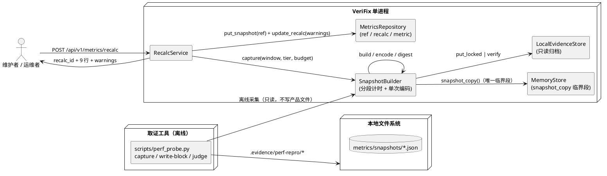
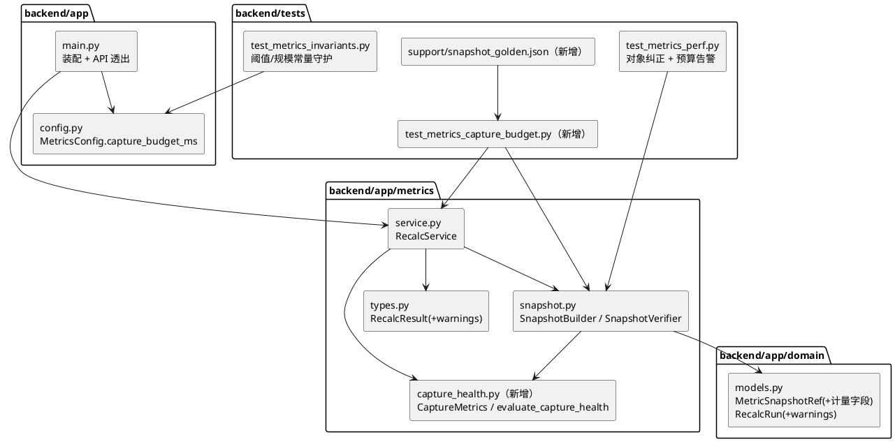
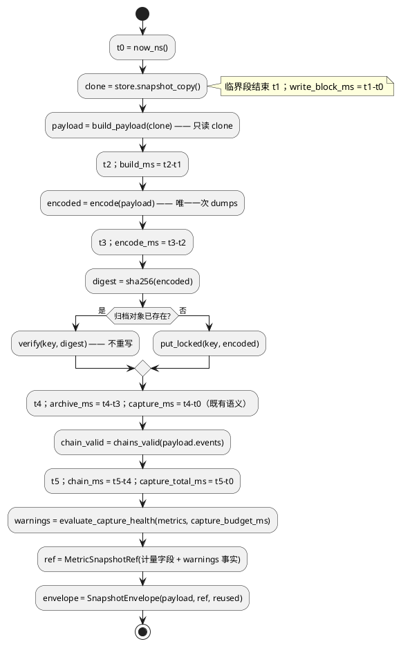
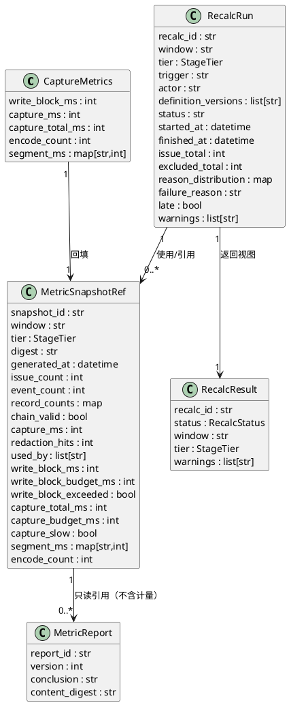

# PERF-02 测量口径纠正与抓取预算落地 · 增量实现方案

> 文档性质：**增量设计**（"如何修"），不替代既有基线文档。
> 需求基线：`.codeartsdoer/specs/metrics_recalc/spec.md`（只读，本次不改）。
> 设计/任务基线：`.codeartsdoer/specs/metrics_recalc/design.md`、`tasks.md`（只读，本次不改）。
> 既有裁定基线：`.codeartsdoer/specs/perf_repro_closeout/{spec,design,tasks}.md`（只读）与 `.evidence/perf-repro/decision-perf02-20261119T235056.json`。
> 代码基线：`main@259a1fc`，实测文件：`backend/app/metrics/snapshot.py`、`backend/app/domain/models.py`、`backend/app/metrics/service.py`、`backend/app/main.py`、`backend/app/config.py`、`backend/tests/test_metrics_perf.py`、`scripts/perf_probe.py`。
> 环境边界：单进程 `MemoryStore` + `LocalEvidenceStore`；无 Docker、无云凭据、无 redis。写阻塞结论不外推至 MySQL/持久化后端（GIL/无锁内存实现，见 `write-block-metrics-capture-20261119T234717.json` 的 `thread_model_note`）。

---

# 一、需求与存量功能关系分析

## 1.1 需求功能与存量功能对比

**本增量的需求事实（逐条可追溯）**

| 编号 | 需求事实 | 来源 |
|---|---|---|
| RQ-1 | 复算对主流程的读取不得阻塞主流程写入超过 200 毫秒 | `metrics_recalc/spec.md` §4.1-2 |
| RQ-2 | 快照抓取预算登记值为 200ms；超预算必须可观测且不阻断 | `metrics_recalc/design.md:360`、`:465-466`、`:766`；`perf_repro_closeout/spec.md` §5.1.1-5 |
| RQ-3 | "读对写的阻塞"与"抓取端到端耗时"不得互相替代 | `perf_repro_closeout/spec.md` §5.1.1-1、§5.1.1-2c；`decision-perf02` 的 `semantics_consistent=false` |
| RQ-4 | 抓取端到端含"两次序列化"，属已知实现事实 | `perf_repro_closeout/spec.md` §5.1.1-1；`perf_repro_closeout/design.md` §2.5.2 |
| RQ-5 | 不得以调大阈值、sleep、跳过用例、削减数据量修绿 | `perf_repro_closeout/spec.md` §5.1.1-6 |
| RQ-6 | 指标值、可计算状态、原因码、快照摘要、幂等语义不得因优化改变 | `metrics_recalc/spec.md` §4.2-2、§6.2、§6.4；本任务用户裁决 |

### 1.1.1 已实现功能

| 需求功能 | 存量功能 | 代码位置 | 匹配度 |
|---|---|---|---|
| RQ-1 的判定对象可测量 | 并发写延迟增量协议（基线/干扰两段 p50/p95/max、Δp95、GIL 说明），已产出 L3 证据 | `scripts/perf_probe.py:573-659`；`.evidence/perf-repro/write-block-metrics-capture-20261119T234717.json` | 75%（协议可用；未接入产品路径，仅离线取证） |
| RQ-1 的阈值登记 | 写阻塞 200ms 仅在取证脚本中作为常量 | `scripts/perf_probe.py:26`（`THRESHOLD_MS = 200`） | 50%（常量存在；产品侧无登记、无断言） |
| RQ-2 预算登记 | `metrics.capture_budget_ms = 200` + 下界校验 | `backend/app/config.py:140`、`:275-276` | 100%（登记）/ 0%（消费，全仓无读取点） |
| RQ-2 抓取有计时 | `capture()` 回填 `capture_ms`（clone→归档，不含链校验） | `backend/app/metrics/snapshot.py:148`、`:164`、`:176`；`backend/app/domain/models.py:355` | 50%（有计时；无分段、无预算比较、无告警） |
| RQ-4 快照可归档复用 | 同 digest 命中已有对象时只 `verify` 不重写，返回 `reused=True` | `backend/app/metrics/snapshot.py:156-163` | 100% |
| RQ-6 快照只读与摘要校验 | `put_locked` 写后只读；`read/verify` 按 sha256 校验 | `backend/app/evidence/store.py:45-70` | 100% |
| RQ-6 指标不可计算不填 0 | 模型层互斥校验 | `backend/app/domain/models.py:307-326` | 100% |

### 1.1.2 需要扩展的功能

| 需求功能 | 存量功能 | 差异说明 | 扩展方向 |
|---|---|---|---|
| RQ-2 预算消费点 | 预算值只登记 | ① 全仓无任何读取/比较点（检索命中仅 `config.py:140/275/276`）；② `capture_ms` 从未与预算比较；③ 无告警载体 | 在 `SnapshotBuilder.capture` 内完成"测量→比较→告警"，把结论落到 `MetricSnapshotRef` 与 `RecalcRun.warnings`；预算由装配层注入，不在构建器里读全局配置 |
| RQ-3 口径分离 | `capture_ms` 单一端到端计时 | ① 一个数字同时承担"写阻塞判据"和"抓取总开销"两种语义；② 无法回答"慢在容器拷贝还是慢在序列化/落盘"；③ 用例把 200ms 施加到端到端（`test_metrics_perf.py:104`） | 拆为三段：`write_block_ms`（临界段，200ms 判据）、`capture_ms`（既有窄语义，保持）、`capture_total_ms`（全链路，含链校验，作为 `capture_budget_ms` 比较对象）；另加 `segment_ms` 分项账 |
| RQ-4 序列化次数 | `_digest(payload)` 一次 dumps + 归档 `encoded` 第二次 dumps，参数相同、字节相同 | 同一 payload 被编码两次；结果完全可合并（第二次纯冗余）；在 1100 Issue / 12000 事件下构成可观测开销 | 新增单一编码入口，一次 `dumps` 得到 `bytes`，`digest = sha256(bytes)`，归档直接写 `bytes`；不得引入 `sort_keys` 等会改变字节序的参数 |
| RQ-6 幂等与摘要稳定 | digest 依赖 payload 字节 | 合并序列化若改变键序/编码参数，会静默改写 `digest → snapshot_id → 归档文件名`，破坏既有快照复用与历史可重放 | 用"改造前黄金快照"做字节级基线；新增跨版本复用测试（旧快照文件在新代码下 `reused=True` 且 `verify` 通过） |
| RQ-5 门禁可守护 | 取证脚本 `judge()` 有"不合规变更集"分支，但无产品侧守护 | 阈值/数据规模/跳过标记缺少机器断言，仅靠评审 | 在不变式测试中断言：写阻塞 200、`capture_budget_ms` 默认 200、PERF-01 5s、PERF-02 60s、PERF-04 3s、数据规模 1100/12000 常量不变 |
| RQ-3 用例对象 | `test_perf02_thousand_issues_and_twelve_thousand_events` 断言 `capture_elapsed < 0.2` | 数值正确、对象错误（既有裁定：阈值口径问题） | 断言改为 `write_block_ms ≤ 200`；新增 `encode_count == 1`、预算告警"非阻断但可见"断言；保留全量复算 <60s；不给 `capture_total_ms` 设置硬门槛 |

### 1.1.3 需要新增的功能或接口

**A. 测量与告警（RQ-1/RQ-2/RQ-3）**

| 功能点 | 输入 | 输出 | 核心逻辑 | 依赖 |
|---|---|---|---|---|
| 分段计时 | capture 各阶段边界 | `CaptureMetrics`（`write_block_ms`/`build_ms`/`encode_ms`/`archive_ms`/`chain_ms`/`capture_ms`/`capture_total_ms`/`encode_count`） | 仅在四个阶段边界取 `perf_counter_ns`，换算为毫秒整数；不含任何 IO | `snapshot_copy`、`_encode` |
| 预算/阈值判定 | `CaptureMetrics` + `capture_budget_ms` | `list[str]` 稳定告警码 | 纯函数，顺序固定；`write_block_ms > 200 → WRITE_BLOCK_EXCEEDED`；`capture_total_ms > capture_budget_ms → CAPTURE_SLOW` | 常量 `WRITE_BLOCK_BUDGET_MS=200` |
| 告警落库与透出 | 告警码列表 | `MetricSnapshotRef` 计量字段 + `RecalcRun.warnings` + `RecalcResult.warnings` | 非阻断：告警不影响复算成功、不改变 9 条指标任何字段 | `MetricsRepository.put_snapshot` |

**B. 单次编码（RQ-4）**

| 功能点 | 输入 | 输出 | 核心逻辑 | 依赖 |
|---|---|---|---|---|
| canonical 单次编码 | payload | `bytes` | `json.dumps(payload, ensure_ascii=False, separators=(",", ":")).encode("utf-8")`，参数与现状逐字一致 | 无 |
| 摘要复用 | `bytes` | `digest` | `sha256(bytes).hexdigest()`；与现状 `sha256(str.encode())` 等价 | 无 |
| 归档复用 | `bytes` | 只读对象 | 命中已有对象时仅 `verify`，不重写；未命中写同一 `bytes` | `LocalEvidenceStore` |

**C. 验收与证据（RQ-5/RQ-6）**

| 功能点 | 输入 | 输出 | 核心逻辑 | 依赖 |
|---|---|---|---|---|
| 黄金快照基线 | 固定 store fixture | `payload_sha256`/`digest`/`snapshot_id`/`archive_bytes` | 改造前用当前实现采集并冻结为测试常量 | 当前 HEAD |
| 跨版本复用 | 改造前归档文件 | `reused=True`、`digest_match=True` | 把旧文件放入临时 evidence root 后执行同 store capture | `SnapshotBuilder` |
| 阈值常量守护 | 常量集合 | 断言结果 | 数值与数据规模不得漂移 | `unittest` |
| 连续多轮证据 | 3 轮 × 5 样本 + 1 次写阻塞 + 1 次全量回归 | 每轮 JSON/JSONL + 汇总 | 同命令、同环境声明、带指纹 | `scripts/perf_probe.py` 扩展 |

## 1.2 存量功能详细分析

### 1.2.1 `SnapshotBuilder.capture` 的契约与副作用

**接口契约**
- `SnapshotBuilder(store, evidence, snapshot_dir=None, redactor=None, resolver=None)`，`capture(window: str, tier: StageTier) -> SnapshotEnvelope`（`snapshot.py:132-179`）。
- 副作用仅有一处：未命中归档时 `evidence.put_locked(key, encoded)` 写只读对象；不写主流程 store、不写指标集合。
- `SnapshotEnvelope` 携带 `payload`（大对象）、`ref: MetricSnapshotRef`、`reused: bool`（`snapshot.py:37-41`）。

**业务规则（与本次相关）**
1. 抓取入口即 `store.snapshot_copy()`（`snapshot.py:150`），这是唯一接触共享容器的调用；其后的 `_build_payload(clone, ...)` 只读 clone（`:187-250`）。
2. `snapshot_copy()` 复制 dict 容器并对 list 值做 `list(item)` 浅复制，不 deepcopy 记录对象（`repo/memory.py:519-533`）。因此 clone 在复制完成时刻冻结"键集合 + 列表长度"，记录对象按项目既有约定通过 `model_copy` 替换、不原地改写。
3. `capture_ms` 的计时区间是 `started`（`snapshot.py:148`）到归档完成（`:164`），**不含** `chain_valid` 的事件链重算（`:175` 在 ref 构造参数中求值）。该语义必须保留（既有记录的 `capture_ms` 与新记录可比）。
4. `digest` 由 `_digest(payload)` 计算（`:152` → `:321-323`），归档字节由 `json.dumps(payload, ensure_ascii=False, separators=(",", ":"))` 生成（`:155`）。两处参数逐字相同，故 `sha256(encoded.encode()) == digest` 恒成立——这是"合并两次序列化不改变任何结果"的前提。

**约束**
- `payload` 内**不含** `generated_at`/`now`/`recalc_id` 等运行时字段，因此 digest 对同一 store 状态可复现（`test_metrics_snapshot.py:73-83` 已断言）。
- `payload` 的键集合与值形态属于归档格式契约（`SNAPSHOT_SCHEMA_VERSION = 1`），新增任何字段都会改变 digest，故本次**不向 payload 增加任何字段**。
- `_exists` 依赖 `evidence.root`（`snapshot.py:181-185`）。无 `root` 属性的证据实现一律视为"不存在"，即每次重写；这是既有行为，本次不改。

### 1.2.2 `_digest` 与 `encoded` 的重复序列化

| 位置 | 语句 | 作用 | 参数 |
|---|---|---|---|
| `snapshot.py:152` | `digest = _digest(payload)` | 计算摘要 | `ensure_ascii=False, separators=(",", ":")`（`:322`） |
| `snapshot.py:155` | `encoded = json.dumps(payload, ...).encode("utf-8")` | 归档字节 | 同上（`:155`） |
| `snapshot.py:321-323` | `_digest` 实现 | `sha256(encoded.encode("utf-8"))` | 同上 |

**判定**：第二次 dumps 与第一次输入对象、参数完全相同，输出字节完全相同，属纯冗余。合并后 `digest`、`encoded`、归档文件内容、`snapshot_id` 均不变（字节级等价，不涉及任何语义近似）。

**风险点**：`payload` 内 dict 的插入顺序由 `sorted(...)` 与 `canonical_content` 的 `sorted(value.items())` 决定（`repo/memory.py:100-113`），不依赖 `sort_keys`。因此合并时**禁止**顺手加 `sort_keys=True`——那会改变键序，进而改变字节与 digest，直接破坏历史快照复用。

### 1.2.3 快照引用模型与存储

- `MetricSnapshotRef`（`models.py:345-357`）：`snapshot_id/window/tier/digest/generated_at/issue_count/event_count/record_counts/chain_valid/capture_ms/redaction_hits/used_by`，`extra="forbid"`。
- 落库：`MemoryStore.put_snapshot(ref)` 按 `snapshot_id` 覆盖（`repo/memory.py:435`），并已纳入事务集合（`SNAPSHOT_COLLECTIONS`，`:67-71`）。
- 兼容性：新增字段必须带默认值；旧 ref 反序列化/构造不受影响；旧快照 ref 不会因新增字段而失效。

### 1.2.4 复算服务与告警透出通道

- `RecalcService.__init__` 中 `self.builder = builder or SnapshotBuilder(store, evidence)`（`service.py:84`）——**未传预算**，这是"预算无消费点"的结构性原因。
- `capture` 后立即 `verifier.verify(...)`（`service.py:130`），该调用会再读文件并再算一次 sha256（`evidence/store.py:63-70` + `:53-61`），随后 `json.loads`，再逐 run 重算链哈希（`snapshot.py:342-375`）。这部分计入 `capture_total_ms`，但不计入 `write_block_ms`。
- 事务内写 9 条 `Metric` + 剔除清单 + `put_snapshot(ref)` + `update_recalc(finished)`（`service.py:157-201`）。`MetricSnapshotRef` 在此刻落库，是告警可检索的最低成本载体。
- `RecalcRun`（`models.py:360-374`）当前无告警字段；`RecalcResult`（`types.py:56-72`）为 dataclass，可安全新增带默认值的 `warnings`。
- HTTP 透出点：`POST /api/v1/metrics/recalc`（`main.py:390-420`）与 `GET /api/v1/metrics/recalc/{recalc_id}`（`:416-440`）均以字段字典返回，新增字段属"只增不改"。

### 1.2.5 用例与取证脚本现状

- `test_metrics_perf.py:76-111`：构造 1000 条完整链路 Issue + 1000 个 run × 12 events（共 12000），先测 `builder.capture()` 端到端并断言 `< 0.2s`（`:104`），再测全量复算 `< 60s`（`:111`）。
- 既有实测（裁定证据）：capture 中位 184.0–200.2ms、最大 209.9ms，5 次中 1 次超 200ms；写阻塞 Δp95 = −0.0014ms。
- `scripts/perf_probe.py` 已具备：`capture`（协议 A，端到端，`measurement_scope` 逐项标注）、`write-block`（协议 W，并发写延迟增量）、`judge`（类别判定）、`append_record`（不可变载体拒写）、`REQUIRED` schema 校验（9 类记录）。
- 约束：`perf_probe.py` 的 `immutable` 清单包含 `backend/app/metrics/snapshot.py`、`backend/app/config.py`、`backend/tests/test_metrics_perf.py`、`docs/devlog/metrics-report.md`——即**取证脚本自身**拒绝写这些载体；产品代码改动必须由开发流程完成，不能借探针"就地改绿"。

### 1.2.6 配置与装配边界

- `MetricsConfig`（`config.py:127-146`）为 `extra="forbid"` 的严格模型，`capture_budget_ms: int = 200`，下界 1（`:275-276`）。
- 装配点：`main.py:185-192` 构造 `RecalcService`；`service.py:84` 构造默认 builder。本次需要在**装配层**把 `config.metrics.capture_budget_ms` 注入 builder，避免构建器依赖全局配置对象。

---

# 二、增量设计方案

**总体取舍（先给结论）**

1. **判据归位，数值不动**：200ms 继续作为唯一写阻塞预算，只作用于 `write_block_ms`（capture 临界段），不作用于 `capture_total_ms`。capture 端到端的 200ms 改为 `capture_budget_ms` 告警预算（非阻断）。**任何阈值数值与数据规模都不调整**。
2. **用结构测量替代统计采样做验收**：`write_block_ms` 是插桩得到的确定性区间（实测微秒级，余量三个数量级），不受机器抖动影响；并发协议 W 仅作佐证。这样既不依赖"重试修绿"，也不把真实阻塞藏在"抖动"话术里。
3. **一次编码，字节等价**：合并两次 dumps 为一次，`digest`、`snapshot_id`、归档字节、`reused` 判定全部保持不变；新增黄金基线与跨版本复用测试作为硬证据。
4. **告警非阻断但必须可检索**：`CAPTURE_SLOW` / `WRITE_BLOCK_EXCEEDED` 落入 `MetricSnapshotRef` 与 `RecalcRun.warnings`，经 API 可见；**不写入对外指标报告**，避免污染 9 行口径记录与报告 `content_digest`。
5. **payload 零改动**：所有新增计量字段只进元数据模型，不进快照 payload，确保 digest 与归档格式不动。

## 2.1 实现模型

### 2.1.1 上下文视图



**上下文约束**
1. 临界段只有 `store.snapshot_copy()`；此后 builder 不再触碰 `store` 的任何容器。
2. 归档 IO 与链校验发生在临界段之外，只影响 `capture_total_ms`，不影响 `write_block_ms`。
3. 取证工具不得写入产品源码、测试源码与既有报告（沿用 `perf_probe.py` 的 `is_readonly_target`）。

### 2.1.2 服务/组件总体架构



**组件职责与改造点**

| 组件 | 现状 | 改造要点 | 不改动 |
|---|---|---|---|
| `metrics/snapshot.py` | 单段计时、两次 dumps | 四段边界计时；单一编码；`ref` 回填计量字段；预算比较调用纯函数 | payload 结构、`SNAPSHOT_SCHEMA_VERSION`、`_exists` 命中语义、`reused` 语义、链校验算法 |
| `metrics/capture_health.py`（新增） | 无 | `CaptureMetrics` 值对象；`evaluate_capture_health(metrics, budget) -> list[str]` 纯函数；稳定告警码常量 | — |
| `domain/models.py` | `MetricSnapshotRef` 无计量字段 | 新增 `write_block_ms/write_block_budget_ms/write_block_exceeded/capture_budget_ms/capture_slow/capture_total_ms/segment_ms/encode_count`（全部默认值）；`RecalcRun.warnings` | 既有字段语义、`extra="forbid"`、`Metric` 校验 |
| `metrics/service.py` | 默认构造 builder 未传预算 | 构造 builder 时注入 `capture_budget_ms`；把 `ref` 上的告警汇总进 `RecalcRun` 与 `RecalcResult` | 两段式事务、互斥、幂等、9 条记录写入顺序 |
| `metrics/types.py` | `RecalcResult` 无告警 | 新增 `warnings: list[str] = field(default_factory=list)` | 其余字段与 `succeeded` 语义 |
| `app/config.py` | 预算已登记 | 仅新增只读常量导出（写阻塞预算、`capture_budget_ms` 默认值引用）；不改默认值、不改校验 | 既有键、`extra="forbid"`、下界规则 |
| `app/main.py` | 装配 + 两个返回体 | 装配参数透传；`recalc` 响应与 `recalc/{id}` 增 `warnings`；`snapshots/{id}/verify` 增计量字段（只增） | 既有端点路径、错误码、授权 |
| `tests/test_metrics_perf.py` | 断言 capture 端到端 <0.2s | 断言改 `write_block_ms ≤ 200`；新增 `encode_count == 1`、预算告警非阻断用例；保留 60s | 数据规模 1100/12000、`event_count == 12000`、60s 门槛、无 skip |
| `scripts/perf_probe.py` | 单次协议 A / W | 新增 `capture-segmented` 与 `round-summary`（3 轮汇总）；新增记录类型，不改既有 9 类 schema 与 `--selftest` 计数 | 既有命令输出、`immutable` 清单、`judge` 既有判定语义 |

### 2.1.3 实现设计

#### （1）测量口径定义（本方案的判定核心）

| 量 | 定义（测量对象） | 起止边界 | 预算/用途 | 是否参与 spec 4.1-2 判定 |
|---|---|---|---|---|
| `write_block_ms` | 复算读取对主流程写入的**阻塞时长**：capture 内接触共享 store 的临界段 | `t0`=capture 入口；`t1`=`snapshot_copy()` 返回 | `WRITE_BLOCK_BUDGET_MS=200`（常量，不可配置放大） | **是**（唯一判据） |
| `capture_ms` | 既有语义：clone→归档完成 | `t0`；`t3`=`put_locked/verify` 返回 | 仅历史可比与趋势观察 | 否 |
| `capture_total_ms` | 全链路：clone→链校验完成 | `t0`；`t4`=`chain_valid` 计算完成 | `capture_budget_ms`（默认 200，可配置）；超限 → `CAPTURE_SLOW`（非阻断） | 否 |
| `encode_count` | 对同一 payload 的 canonical JSON 编码次数 | 单次 capture 内计数 | 目标恒为 1；漂移即回归 | 否 |
| `segment_ms` | `clone/build/encode/archive/chain` 五段明细 | 四段边界 + 链校验 | 用于归因"慢在哪" | 否 |

**必须成立的自洽关系**：`segment_ms` 五项之和与 `capture_total_ms` 的差值 ≤ 1ms（取整误差）；`segment_ms["clone"] == write_block_ms`；`segment_ms["build"] + segment_ms["encode"] + segment_ms["archive"] == capture_ms`（既有语义）。

**为什么临界段就是写阻塞上界（可辩护的论证）**
1. 单进程 `MemoryStore` 无锁，写入不等待任何互斥量；"阻塞"表现为 GIL 调度延迟与共享容器遍历占用。
2. capture 在 `snapshot_copy()` 之后只读 clone（容器已复制、list 已复制长度），不再引用 `store.<collection>`，因此 GIL 被占用的原因只剩 clone 自身与后续纯计算——后者不改变"主流程写入能否拿到 GIL"的**结构性上界**，只影响排队时长；该排队时长由协议 W 统计测量佐证。
3. 因此：结构判定（`write_block_ms`）负责"不得因读取设计而对写路径造成长临界段"，协议 W（Δp95）负责"实测写入延迟增量"。两者同时满足才算通过；任一不满足即失败，不得二选一。

**与既有裁定的衔接**：`decision-perf02` 判定"阈值口径问题"并声明"不得以该结论证明 4.1-2 已满足"。本方案正是补齐该缺口：给出符合 4.1-2 语义的测量点与可观测告警，而不是复用端到端数字。

#### （2）capture 执行时序（含分段计时）



**不变量**
1. `snapshot_copy()` 是全流程唯一触碰 `store` 容器的调用；评审与测试都要守住（可用代理 store 记录调用次数）。
2. `encode(payload)` 在单次 capture 内恰好调用 1 次。
3. `payload` 的键集合、值形态、键序与改造前逐字节一致。
4. 告警不影响 `payload`、`digest`、`snapshot_id`、`reused`、`chain_valid`、`issue_count/event_count/record_counts`。
5. 计时全部使用 `time.perf_counter_ns()`，换算 `int(ms)` 采用向下取整（避免把 199.6ms 报成 200ms 从而误触发"超预算"）。

#### （3）单次编码的等价性设计

| 步骤 | 改造前 | 改造后 | 等价性依据 |
|---|---|---|---|
| 编码 | `json.dumps(payload, ensure_ascii=False, separators=(",", ":"))` | 同一调用，抽为 `encode_payload(payload) -> bytes` | 参数逐字不变 |
| 摘要 | `sha256(dumps(...).encode("utf-8"))` | `sha256(encode_payload(payload))` | `str.encode("utf-8")` 与返回 `bytes` 完全一致 |
| 归档 | 第二次 `dumps(...).encode()` 写入 | 直接写 `encode_payload()` 的返回值 | 同一字节串 |

**禁止项（评审硬门）**：不得新增 `sort_keys`、`indent`、`default=`、`ensure_ascii=True`；不得改成 `json.dump` 流式写；不得引入第三方 canonical JSON 库；不得改动 `canonical_content`。

**证据链**：
1. 黄金 fixture：改造前采集 `payload` 的 `sha256`、`digest`、`snapshot_id`、归档文件字节数与 `sha256`，冻结为 `backend/tests/support/snapshot_golden.json`。
2. 改造后断言上述 4 项完全相等（字节级）。
3. 跨版本复用：把改造前生成的归档文件复制到临时 evidence root，用改造后代码对同一 store 捕获 → `reused=True`、`digest` 相同、`SnapshotVerifier.verify().digest_match=True`。
4. 幂等对照：同一 store 连续两次复算，9 条指标的 `value/computable/reason_code/numerator/denominator/covered_count/excluded_count/channel_excluded_count/not_applicable_count/snapshot_id/snapshot_digest/definition_version` 逐字段相等；记录条数恒为 9；`recalc_id` 为最后一次。

#### （4）告警判定与非阻断语义

**纯函数契约**（无 IO、无时钟、无全局状态）

```text
evaluate_capture_health(metrics: CaptureMetrics, capture_budget_ms: int) -> list[str]
  WRITE_BLOCK_EXCEEDED  当 metrics.write_block_ms > WRITE_BLOCK_BUDGET_MS(200)
  CAPTURE_SLOW          当 metrics.capture_total_ms > capture_budget_ms
  返回顺序固定：先 WRITE_BLOCK_EXCEEDED 后 CAPTURE_SLOW；不重复
```

**非阻断语义（逐项可验收）**
1. 告警不抛异常、不改变 `RecalcStatus`、不改变 9 条指标的任何字段、不改变报告结论。
2. `MetricSnapshotRef` 同时记录事实与结论：`write_block_ms`/`capture_total_ms`/`capture_budget_ms`/`write_block_exceeded`/`capture_slow`/`segment_ms`/`encode_count`。
3. `RecalcRun.warnings` 与 `RecalcResult.warnings` 为同一份列表（顺序一致），供 API 读取。
4. 告警可检索路径：`GET /api/v1/metrics/recalc/{recalc_id}` → `warnings`；`GET /api/v1/metrics/snapshots/{id}/verify` → 计量字段；`MemoryStore.get_snapshot(id)` → ref。
5. **不写入** `MetricReport` 与 9 行报告要素：避免报告 `content_digest` 变化、避免把运行时性能观测混入对外指标口径（spec 5.5.1-3 的必备要素不包含性能告警）。

**为什么"超预算不失败"不是规避**
- spec 4.1-2 的约束对象是写阻塞，已由 `write_block_ms` 硬断言守住；
- 抓取端到端由 spec 4.1-1（50 条 ≤5s、1000 条 ≤60s）总量守住，capture 超 200ms 但仍使全量复算远低于 60s 时，不构成 DFX 违约；
- 若把端到端超预算做成运行时硬失败，等价于既有的"口径错误 + 抖动失败"，已被 `perf_repro_closeout` 判为阈值口径问题。因此"告警 + 可观测"是唯一既符合设计原文（`design.md:465-466`、`:766`）又不制造假失败的做法。

#### （5）写阻塞的并发佐证（协议 W，保留并复用）

- 沿用 `scripts/perf_probe.py:573-659`：基线段 200 次 `append`；干扰段在 capture 循环线程运行下做 200 次 `append`；比较 p95 与 max。
- 判定：`interference_p95_ms − baseline_p95_ms ≤ 200ms`（远高于实测 −0.0014ms 的噪声量级），且 `event_id_set_equal=True`。
- 说明：该协议测的是 GIL 下的调度延迟增量，不得外推到持久化后端；结论表述必须带 `thread_model_note`。
## 2.2 接口设计

### 2.2.1 总体设计

| 分类 | 载体 | 用途 | 稳定性 | 变更策略 |
|---|---|---|---|---|
| 进程内构建契约 | `SnapshotBuilder.capture(window, tier)` | 生成快照与计量 | 内部 | 仅新增构造参数（带默认值），`capture` 签名不变 |
| 进程内告警契约 | `evaluate_capture_health(metrics, budget)` | 告警判定 | 内部 | 纯函数，新增不影响调用方 |
| 领域模型契约 | `MetricSnapshotRef` / `RecalcRun` | 计量与告警落库 | 内部 | 字段只增，全部带默认值 |
| 对外 HTTP | `POST /api/v1/metrics/recalc`、`GET /api/v1/metrics/recalc/{id}`、`GET /api/v1/metrics/snapshots/{id}/verify` | 告警与计量透出 | 稳定 | 响应只增字段，不改既有字段语义与错误码 |
| 配置契约 | `metrics.capture_budget_ms` | 告警预算 | 稳定 | 默认值 200 与下界 1 不变 |
| 取证契约 | `scripts/perf_probe.py` 新增子命令与记录类型 | 离线证据 | 内部工具 | 不改既有 9 类 schema 与既有输出 |

**接口层不变量（强制）**
1. 指标行响应（`_metric_payload`）**不新增**性能告警字段——性能观测不属于指标口径。
2. `warnings` 的取值域为固定两个稳定码，禁止自由文本；未知码视为实现错误。
3. 告警不得进入 `status`/`computable`/`value`/`reason_code`/`trial` 的取值组合，避免"用告警改写指标状态"。
4. 无新增错误码：`CAPTURE_SLOW`/`WRITE_BLOCK_EXCEEDED` 是观测而非失败，HTTP 状态不变。

### 2.2.2 接口清单

#### SP-T1 快照构建（扩展，签名不变）

```text
SnapshotBuilder(
    store: MemoryStore,
    evidence: LocalEvidenceStore,
    snapshot_dir: Path | None = None,
    redactor: SecretRedactor | None = None,
    resolver: ChannelResolver | None = None,
    capture_budget_ms: int = 200,          # 新增，默认值与 MetricsConfig 一致
    clock_ns: Callable[[], int] = time.perf_counter_ns,   # 新增，便于确定性单测注入
)

SnapshotBuilder.capture(window: str, tier: StageTier) -> SnapshotEnvelope
```

- 业务说明：只读抓取主流程证据，一次编码，回填计量与告警。
- 前置条件：`store` 可读；`capture_budget_ms ≥ 1`（构造期校验，非法直接抛 `ValueError`）。
- 后置条件：`payload` 与改造前逐字节等价；`ref` 带计量字段；不写主流程 store。
- 异常映射：编码/归档异常沿用既有 `SnapshotIntegrityError` / 磁盘异常；不作为告警处理。
- 调用示例：`SnapshotBuilder(store, evidence, capture_budget_ms=config.metrics.capture_budget_ms)`

#### SP-T2 计量值对象（新增）

```text
@dataclass(frozen=True)
CaptureMetrics:
    write_block_ms: int
    capture_ms: int
    capture_total_ms: int
    encode_count: int
    segment_ms: dict[str, int]     # clone/build/encode/archive/chain

CaptureMetrics.from_ns(t0, t1, t2, t3, t4, t5, encode_count) -> CaptureMetrics
```

- 业务说明：把纳秒边界换算为毫秒整数（向下取整），并做自洽校验。
- 前置条件：`t0 ≤ t1 ≤ t2 ≤ t3 ≤ t4 ≤ t5`；`encode_count ≥ 1`。
- 后置条件：纯值对象，无副作用。
- 异常映射：边界非单调或计数非法 → `ValueError`（内部错误，复算失败路径复用既有 `RecalcFailed`）。

#### SP-T3 告警判定（新增纯函数）

```text
evaluate_capture_health(metrics: CaptureMetrics, capture_budget_ms: int) -> list[str]
```

- 业务说明：把计量事实映射为稳定告警码，供 ref 与 recalc 落库。
- 前置条件：`metrics.encode_count ≥ 1`；`capture_budget_ms ≥ 1`。
- 后置条件：返回列表元素 ∈ {`WRITE_BLOCK_EXCEEDED`, `CAPTURE_SLOW`}，顺序固定、不重复；不抛异常。
- 说明：`WRITE_BLOCK_EXCEEDED` 使用常量 200，不读配置；这样"改配置放大写阻塞阈值"在结构上不可能。

#### SP-T4 复算入口（扩展返回值）

```text
RecalcService.recalc(window, tier, trigger, actor, now=None, late=None) -> RecalcResult
RecalcResult.warnings: list[str] = []
```

- 业务说明：在既有两段式事务内落库 `MetricSnapshotRef`（含计量）与 `RecalcRun.warnings`；返回值带同一列表。
- 前置条件/后置条件/异常映射：与既有实现一致，不新增失败模式。
- 说明：`RecalcService` 构造默认 builder 时传入 `config.metrics.capture_budget_ms`；若调用方显式传入 builder，则以其自身配置为准（测试可注入）。

#### API-A1 发起复算（响应增字段）

```text
POST /api/v1/metrics/recalc
200/202: { "recalc_id", "status", "window", "tier", "trigger", "actor", "late",
          "snapshot_id", "warnings": ["CAPTURE_SLOW"], "metrics": [...] }
```

- 业务说明：与既有端点完全同路径、同授权、同错误码。
- 后置条件：`warnings` 非空时复算仍为 `SUCCESS`，9 条指标照常返回。
- 兼容性：旧客户端忽略未知字段；`warnings` 缺省为空数组。

#### API-A2 查询复算记录（响应增字段）

```text
GET /api/v1/metrics/recalc/{recalc_id}
200: { ..., "warnings": [...] }
```

- 业务说明：告警的持久可检索入口（`RecalcRun` 已落库）。
- 前置条件：`recalc_id` 存在（否则沿用 `VF-7001`）。

#### API-A3 快照校验（响应增计量字段）

```text
GET /api/v1/metrics/snapshots/{snapshot_id}/verify
200: { "snapshot_id", "digest_match", "chain_valid", "broken_runs", "record_counts",
       "capture_ms", "capture_total_ms", "write_block_ms", "write_block_budget_ms",
       "write_block_exceeded", "capture_budget_ms", "capture_slow",
       "encode_count", "segment_ms" }
```

- 业务说明：评审可据快照标识回读"本次抓取是否超预算、慢在哪一段"。
- 前置条件：归档对象存在且摘要/链校验通过（失败路径行为不变）。
- 兼容性：新增字段全部来自 `store.get_snapshot(snapshot_id)`；`cached is None` 时这些字段为 `null`（不报错）。

#### CFG-1 配置（不改默认值，新增只读常量）

```text
MetricsConfig.capture_budget_ms: int = 200        # 不变
WRITE_BLOCK_BUDGET_MS: int = 200                  # 新增模块常量（不可配置）
CAPTURE_WARNINGS = ("WRITE_BLOCK_EXCEEDED", "CAPTURE_SLOW")   # 新增
```

- 业务说明：把"需求阈值"与"告警预算"在代码层分成两个符号，避免再次混用。
- 约束：配置层不得新增 `write_block_budget_ms` 键；若未来确需可配置，必须同步修改 spec 并新增上限校验——本方案不做。

#### PROBE-1 取证脚本扩展（离线）

```text
python scripts/perf_probe.py capture-segmented --case PERF-02/metrics-capture \
    --env default --rounds 3 --samples 5 --write-ops 200 --out .evidence/perf-repro

python scripts/perf_probe.py round-summary --case PERF-02/metrics-capture --out .evidence/perf-repro
```

- 业务说明：3 轮 × 5 样本采集分段计量，每轮输出 JSONL 样本 + 汇总 JSON，最终输出跨轮汇总。
- 前置条件：`samples ≥ 5`、`rounds ≥ 3`（沿用既有 `SAMPLE_COUNT_INSUFFICIENT` 风格校验）。
- 后置条件：只写 `.evidence/perf-repro/`；不改产品/测试/报告文件（`is_readonly_target` 拒绝）。
- 说明：新增 `SegmentedSampleRecord` / `SegmentedMeasurementRecord` / `PerfRoundRecord`，**不改**既有 9 类 `REQUIRED` schema，保证 `--selftest` 的 8 项 schema 断言不变。

## 2.3 数据模型

### 2.3.1 设计目标

1. **零 payload 变更**：计量与告警字段全部落在元数据模型，快照归档格式与 `digest` 不动。
2. **旧数据可读**：新增字段全部有默认值；旧 `MetricSnapshotRef`/`RecalcRun` 记录无需迁移。
3. **可下钻**：由 `recalc_id → snapshot_id → ref` 可读到"是否超预算、各段耗时、编码次数"。
4. **单一事实来源**：测量由 builder 一次产出，告警由纯函数一次判定，不在 service/API/报告重复计算。

### 2.3.2 模型实现



**字段约束（新增部分）**

| 字段 | 类型/默认 | 约束 | 说明 |
|---|---|---|---|
| `write_block_ms` | `int = 0` | `≥0` | 临界段时长（判据量） |
| `write_block_budget_ms` | `int = 200` | `=WRITE_BLOCK_BUDGET_MS` | 记录当时使用的需求阈值，便于审计"阈值未被调大" |
| `write_block_exceeded` | `bool = False` | 当且仅当 `write_block_ms > write_block_budget_ms` | 与告警码 `WRITE_BLOCK_EXCEEDED` 一一对应 |
| `capture_total_ms` | `int = 0` | `≥ capture_ms` | 全链路（含链校验） |
| `capture_budget_ms` | `int = 200` | `≥1` | 本次使用预算 |
| `capture_slow` | `bool = False` | 当且仅当 `capture_total_ms > capture_budget_ms` | 与 `CAPTURE_SLOW` 一一对应 |
| `segment_ms` | `dict[str,int] = {}` | 键固定 5 个，值 `≥0` | `clone/build/encode/archive/chain` |
| `encode_count` | `int = 1` | `≥1` | 目标恒为 1 |
| `RecalcRun.warnings` | `list[str] = []` | 元素 ∈ 固定两码 | 非阻断告警 |

**对象生命周期**
1. `CaptureMetrics`：capture 内构造 → 回填 `ref` → 随 `ref` 冻结；不单独持久化。
2. `MetricSnapshotRef`：capture 产出 → 事务内 `put_snapshot` → 只被读取；同一 `snapshot_id` 重复复算时以最新一次计量覆盖（指标值不受影响）。
3. `RecalcRun.warnings`：复算成功时写入；失败路径不写（失败原因已在 `failure_reason`）。
4. `MetricReport`：不感知计量字段，`content_digest` 计算输入不变。

**持久化策略**
- 沿用 `metric_snapshots`（键 `snapshot_id`）与 `recalc_runs`（键 `recalc_id`）两个既有集合，不新增集合、不新增文件。
- 归档文件仍为 `{metrics.snapshot_dir}/metrics/snapshots/{snapshot_id}.json`，内容字节不变。
- 事务集合清单不变（`SNAPSHOT_COLLECTIONS` 已含二者），无需扩展。

**兼容性矩阵**

| 场景 | 改造前数据 | 改造后数据 | 结论 |
|---|---|---|---|
| 旧 `ref` 读取 | 无计量字段 | 默认 0/False/1 | 可读，不误报告警 |
| 旧 `recalc run` 读取 | 无 `warnings` | 默认 `[]` | API 返回空数组 |
| 旧归档快照复用 | 归档字节 | 新代码 `digest` 相同 | `reused=True`，不重写 |
| 旧报告回读 | `content_digest` | 未受影响 | 校验一致 |
| 回滚旧代码 | — | 新 ref 含未知字段 | 内存存储随进程重建；归档 payload 未变，回滚后仍可复用 |

## 2.4 测试与验收

### 2.4.1 用例分层与文件规划

| 层 | 文件 | 覆盖 | 变更类型 |
|---|---|---|---|
| 计量与告警 | `backend/tests/test_metrics_capture_budget.py`（新增） | 分段自洽、单次编码、预算内/超预算、告警非阻断、旧 ref 兼容 | 新增 |
| 摘要稳定性 | 同上 + `backend/tests/support/snapshot_golden.json`（新增） | 黄金 payload/digest/snapshot_id/归档字节；跨版本复用 | 新增 |
| 性能门槛 | `backend/tests/test_metrics_perf.py` | `write_block_ms ≤ 200`、`encode_count == 1`、全量复算 <60s、预算告警非阻断 | 修改（对象纠正） |
| 不变量守护 | `backend/tests/test_metrics_invariants.py` | 阈值与规模常量、默认预算、无 skip/sleep、旧字段超集 | 扩展 |
| 既有快照行为 | `backend/tests/test_metrics_snapshot.py` | 确定性、复用、篡改检测、窗口边界 | 不改（回归） |
| 复算与幂等 | `backend/tests/test_metrics_recalc.py` | 幂等覆盖、失败不污染、只读探针 | 不改（回归） |
| 取证 | `scripts/perf_probe.py` | 分段采集 + 3 轮汇总 + `--selftest` | 扩展 |

### 2.4.2 正例探针

| 编号 | 场景 | 预期 |
|---|---|---|
| PB-01 | 1100 Issue / 12000 事件 capture | `segment_ms` 五项齐全且自洽；`encode_count == 1`；`write_block_ms` 远小于 200 |
| PB-02 | 默认预算 200、正常机器 | `capture_slow` 取值只由 `capture_total_ms` 决定；`warnings` 与两个布尔字段一一对应 |
| PB-03 | 同一 store 连续 capture 两次 | `digest`/`snapshot_id` 相同、`reused=True`、归档文件字节与 mtime 不变 |
| PB-04 | 改造前归档文件 + 改造后代码 | `reused=True`、`verify().digest_match=True`、`broken_runs=[]` |
| PB-05 | 黄金 fixture | `payload_sha256`/`digest`/`snapshot_id`/归档 `sha256` 四项与冻结值相等 |
| PB-06 | 同一 store 两次全量复算 | 9 条记录；除 `computed_at`/`recalc_id` 外指标字段逐字段相等；报告版本递增 |
| PB-07 | 并发协议 W（200 ops） | `Δp95 ≤ 200ms`；`event_id_set_equal=True` |

### 2.4.3 反例探针

| 编号 | 场景 | 预期 |
|---|---|---|
| NB-01 | 注入 `capture_budget_ms=1` | `capture_slow=True`、`CAPTURE_SLOW` 可检索；复算 `SUCCESS`；9 条指标字段与默认预算时完全一致（证明告警不污染口径） |
| NB-02 | 纯函数注入 `write_block_ms=201` | 返回 `["WRITE_BLOCK_EXCEEDED"]`；`write_block_exceeded=True`；不抛异常 |
| NB-03 | 纯函数注入 `write_block_ms=200` | 不返回 `WRITE_BLOCK_EXCEEDED`（边界含等号，符合"超过 200"语义） |
| NB-04 | 注入非单调纳秒边界 | `CaptureMetrics.from_ns` 抛 `ValueError`；不产生任何 ref |
| NB-05 | 人为让 payload 多编码一次（测试内 monkeypatch 计数） | `encode_count` 断言失败，用例明确指出"同一 payload 被重复编码" |
| NB-06 | 人为给 payload 增加一个键 | 黄金摘要测试失败（防止"顺手改 payload 却声称 digest 不变"） |
| NB-07 | 人为把 `capture_budget_ms` 默认值改为 500 | 不变量测试失败（阈值漂移守护） |
| NB-08 | 人为加入 `time.sleep` 或 `unittest.skip` | 不变量测试失败（变更集合规守护） |
| NB-09 | 人为把数据规模从 1100/12000 下调 | 不变量测试失败（禁止削减数据量） |
| NB-10 | 旧 ref（无计量字段）经 API/看板读取 | 不报错；计量字段取默认值；`warnings=[]` |
| NB-11 | 归档文件被篡改 | 既有 `VF-7006`/`SnapshotIntegrityError` 行为不变；告警字段不掩盖失败 |
| NB-12 | `capture_total_ms` 超预算但 `write_block_ms` 正常 | 仅 `CAPTURE_SLOW`；不产生 `WRITE_BLOCK_EXCEEDED`（证明两个口径不互相替代） |

### 2.4.4 性能与验收口径

| 编号 | 场景 | 门槛 | 判定方式 |
|---|---|---|---|
| PERF-02/W | 1100 Issue、12000 事件，capture 临界段 | `write_block_ms ≤ 200` | 结构插桩，单次即可，允许 3 轮重复确认 |
| PERF-02/W-LOAD | 同等规模，并发写入延迟增量 | `Δp95 ≤ 200ms` | 协议 W（L3） |
| PERF-02/C | 同等规模，capture 全链路 | 仅告警（`capture_budget_ms` 默认 200） | 非阻断；3 轮各 5 样本，记录超预算次数，不作为通过/失败判据 |
| PERF-02/E | 同一 payload 编码次数 | `encode_count == 1` | mock 计数 + 落库字段双证 |
| PERF-02/T | 1000 条全量复算 | `≤ 60s` | 保留既有断言，数值不变 |
| PERF-01 | 50 条全量复算 | `≤ 5s` | 保留既有断言，数值不变 |
| PERF-04 | 报告生成 | `≤ 3s` | 保留既有断言，数值不变 |
| READ-01 | 复算前后主流程 | 记录数/摘要/链长逐项一致 | 保留既有探针 |

**必须显式拒绝的"修绿"手段（评审硬门）**
1. 修改 `WRITE_BLOCK_BUDGET_MS`、`capture_budget_ms` 默认值、PERF-01/02/04 门槛、数据规模常量；
2. 新增 `sleep`、删除断言、`skipIf` 环境开关、减少 Issue/事件数；
3. 只改测试不改实现（本轮必须是"实现补齐 + 断言对象纠正"成对提交）；
4. 把 `capture_total_ms` 硬门槛删掉后宣称"不再有性能问题"——必须同时给出 `write_block_ms` 结构断言与协议 W 证据。

### 2.4.5 连续多轮回归证据

**证据结构（每轮独立目录内文件，禁止覆盖）**

| 产物 | 命名 | 内容 |
|---|---|---|
| 样本 | `samples-metrics-capture-segmented-{stamp}-r{n}.jsonl` | 每样本：`sample_index`、`write_block_ms`、`capture_ms`、`capture_total_ms`、`segment_ms`、`encode_count`、`over_capture_budget` |
| 轮次汇总 | `measure-metrics-capture-segmented-{stamp}-r{n}.json` | 每轮 5 样本的 p50/p95/max、超预算次数、环境声明、`fingerprint_sha256`、`measurement_scope`（含 `write_block_judged=true`、`capture_end_to_end_judged=false`） |
| 写阻塞 | `write-block-metrics-capture-{stamp}-r{n}.json` | 沿用既有 `WriteBlockRecord` 全字段 |
| 回归 | `regression-{stamp}-r{n}.json` | 全量 `unittest` 的 `Ran/errors/failures`、失败用例名、耗时、命令、是否含 skip |
| 跨轮汇总 | `round-summary-{stamp}.json` | 3 轮指针、每轮判定、总计结论、`supersedes` 为空 |

**3 轮执行协议（同命令、同环境声明）**

```text
python scripts/perf_probe.py capture-segmented --case PERF-02/metrics-capture --env default --rounds 3 --samples 5 --write-ops 200
python -m unittest discover -s backend/tests -p "test_*.py"      # 每轮各一次
python -m unittest backend.tests.test_metrics_perf backend.tests.test_metrics_capture_budget backend.tests.test_metrics_invariants
```

**跨轮判定规则（先定规则再看数据，禁止事后调整）**

| 条件 | 结论 | 允许的表述 |
|---|---|---|
| 3 轮 `write_block_ms` 全部 ≤200 且协议 W 全部 `Δp95 ≤200` 且 3 轮全量回归 `failures=0` 且每轮 `encode_count=1` | **通过** | "写阻塞口径满足 4.1-2；抓取端到端超预算仅告警，不构成 4.1-2 判据" |
| 任一 `write_block_ms >200` | **不通过** | 复现该轮样本与代码位置，禁止以"抖动"解释（结构量余量三个数量级） |
| 任一协议 W `Δp95 >200` | **不通过** | 附 `thread_model_note`，不得外推结论 |
| `encode_count ≠ 1` | **不通过** | 直接判定优化失效 |
| 全量回归出现 PERF-02 相关失败 | **不通过** | 给出用例名与命令，禁止 skip/重试掩盖 |
| 全量回归出现与本次无关的既有失败 | **阻断验收（非本次结论）** | 单独登记，不得计入"通过"，也不得据此宣称本次失败 |
| capture 3 轮 15 样本中多数超预算 | **记录但不判失败**，同时触发人工复核 | 只能表述"全链路偏慢，已可观测；写阻塞判据独立通过" |

**证据不可变性**：所有证据只追加、不覆盖；`round-summary` 记录各轮文件的 `sha256`；禁止在证据文件中事后修改阈值字段；`docs/devlog/metrics-report.md` 的更新由独立步骤完成（取证脚本对其拒写，见 `perf_probe.py:33-44`）。

### 2.4.6 验收命令清单

```text
# 1) 口径与告警（新增）
python -m unittest backend.tests.test_metrics_capture_budget

# 2) 性能门槛（对象已纠正）
python -m unittest backend.tests.test_metrics_perf

# 3) 不变量与阈值守护
python -m unittest backend.tests.test_metrics_invariants

# 4) 快照/复算/报告回归（证明 digest、幂等、报告未变）
python -m unittest backend.tests.test_metrics_snapshot backend.tests.test_metrics_recalc backend.tests.test_metrics_report backend.tests.test_metrics_e2e

# 5) 全量回归（基线不得下降）
python -m unittest discover -s backend/tests -p "test_*.py"

# 6) 端到端复算（真实入口）
python scripts/recalc_metrics.py --window 2026-12 --tier PRELIMINARY --now 2027-01-06T12:00:00+00:00

# 7) 连续多轮证据
python scripts/perf_probe.py capture-segmented --case PERF-02/metrics-capture --env default --rounds 3 --samples 5 --write-ops 200
```

## 2.5 风险与回滚

### 2.5.1 风险清单

| 编号 | 风险 | 触发条件 | 影响 | 缓解措施 | 验证探针 |
|---|---|---|---|---|---|
| RP-01 | 合并序列化后 `digest` 变化 | 误加 `sort_keys`/改 `separators`/改 `ensure_ascii` | `snapshot_id` 变、历史快照无法复用、幂等破坏 | 参数逐字冻结；黄金 fixture；跨版本复用测试；评审 diff 只允许删除冗余 dumps 行 | PB-04/PB-05、NB-06 |
| RP-02 | 计量字段误入 payload | 为"方便"把 `capture_ms` 写进 payload | 摘要与归档格式变更，历史报告不可校验 | 设计禁止；payload 键集合断言（键集合与黄金 fixture 相等） | PB-05、NB-06 |
| RP-03 | 临界段被悄悄扩大 | 后续在 `snapshot_copy()` 之后又读 `store.*` | 写阻塞上界失效，结构判据失真 | 用代理 store 断言 `snapshot_copy` 后零访问；`segment_ms["clone"] == write_block_ms` | PB-01、NB-12 |
| RP-04 | 告警污染指标口径 | 把 `warnings` 写入 `Metric`/报告要素 | 报告 `content_digest` 变化、P-13 版本测试失败、对外材料混入性能噪声 | 告警只进 ref/run/result；报告中不出现；一致性校验不含 warnings | PB-06/NB-01 |
| RP-05 | 超预算告警风暴 | 慢盘/冷启动 | 日志与存储噪声 | 非阻断；同一 recalc 每码仅一条；仅落两个稳定字段；不打印明文 payload | PB-02 |
| RP-06 | 用极小预算测试被误读为改门槛 | 测试注入 `capture_budget_ms=1` | 评审误判"调小/调大阈值" | 独立测试文件 + 注释说明 + 默认值常量断言；生产默认值 200 不变 | NB-01、NB-07 |
| RP-07 | 计时插桩引入开销 | 频繁 `perf_counter_ns` | capture 略慢 | 仅 5 个边界取时（纳秒级），实测不可测；不做逐记录计时 | PERF-02/C |
| RP-08 | 结构断言被机器噪声影响 | 极端 CPU 争抢 | `write_block_ms` 偶发偏高 | 结构量实测微秒级，200ms 余量三个数量级；失败时保留分段账而非重试 | PERF-02/W |
| RP-09 | 并发协议结果被过度外推 | 单进程内存实现 | 错误宣称持久化后端达标 | 结论必须附 `thread_model_note`；报告中注明适用边界 | PB-07 |
| RP-10 | 新增字段导致旧记录不可读 | 未设默认值 | 旧 ref/run 反序列化失败 | 全部字段带默认值；旧记录读取用例 | NB-10 |
| RP-11 | 回滚后新 ref 无法读取 | 旧代码 `extra="forbid"` | 回滚进程读新 ref 失败 | ref 为内存态且随进程重建；归档 payload 未变，回滚后可继续复用；回滚步骤含"重启进程" | 回滚演练 |
| RP-12 | 取证脚本改动影响既有证据 schema | 改 `REQUIRED`/`validate_record` | 历史证据不可复读、`--selftest` 失败 | 只新增记录类型，不动既有 9 类；`--selftest` 必须通过 | `--selftest` |

### 2.5.2 回滚方案

**回滚触发条件**（任一满足即回滚，不做局部妥协）
1. 黄金 fixture 四项任一不等（digest/snapshot_id/字节）；
2. 跨版本复用失败（旧归档在新代码下 `verify` 不通过）；
3. 3 轮任一轮 `write_block_ms > 200` 且无法定位为插桩错误；
4. 全量回归出现本次引入的失败；
5. 指标记录字段/条数/幂等语义出现任何差异。

**回滚粒度与顺序**
1. 单次提交回退：`backend/app/metrics/snapshot.py`、`backend/app/metrics/capture_health.py`、`backend/app/metrics/service.py`、`backend/app/metrics/types.py`、`backend/app/domain/models.py`、`backend/app/main.py`、`backend/app/config.py`、`backend/tests/test_metrics_perf.py`、`backend/tests/test_metrics_capture_budget.py`、`backend/tests/test_metrics_invariants.py`、`backend/tests/support/snapshot_golden.json`、`scripts/perf_probe.py`。
2. 重启进程（`MemoryStore` 内存态重建，`metric_snapshots`/`recalc_runs` 中带新字段的 ref 不残留）。
3. 归档文件无需处理：payload 与文件名未变，回滚前后均可 `verify`；如需清理，只删除新增的测试临时目录产物。
4. 证据文件（`.evidence/perf-repro/*`）保留，标注 `supersedes`，不删除历史。

**回滚后必须复核**：`test_metrics_snapshot`、`test_metrics_recalc`、`test_metrics_report`、`test_metrics_perf`（原断言形态）全绿；`scripts/perf_probe.py --selftest` 通过。

## 2.6 实施顺序（编码阶段参考，非任务清单）

| 步骤 | 内容 | 完成标志 | 依赖 |
|---|---|---|---|
| S1 | 冻结黄金基线（改造前采集 payload/digest/snapshot_id/归档 sha256） | `snapshot_golden.json` 生成并纳入测试 | 当前 HEAD |
| S2 | 单一编码改造 + 计量值对象与纯函数 | 黄金四项相等；`test_metrics_capture_budget` 基础用例通过 | S1 |
| S3 | 模型字段与装配注入（ref/run/result/config 常量） | 旧记录可读；API 字段透出 | S2 |
| S4 | 用例对象纠正与告警非阻断用例 | `test_metrics_perf` 通过且无 skip；`encode_count=1` | S3 |
| S5 | 不变量与阈值/规模守护 | `test_metrics_invariants` 通过 | S4 |
| S6 | 取证脚本分段与 3 轮汇总 | `--selftest` 通过；3 轮证据落盘 | S5 |
| S7 | 文档口径更新（`docs/devlog/metrics-report.md` 性能行） | 性能行改为"写阻塞/全链路分离"表述 | S6 |

**完成定义（DoD）**
1. 200ms 只作为 `write_block_ms` 判据，且该量有确定性插桩与硬断言；`capture_total_ms` 超预算只产生可检索的非阻断告警。
2. `capture_budget_ms` 有真实消费点（builder 比较 → ref → run.warnings → API），默认值与校验不变。
3. 同一 payload 的 canonical JSON 编码次数恒为 1；`digest`、`snapshot_id`、归档字节、`reused` 判定、9 条指标结果与改造前一致（黄金 fixture + 跨版本复用双证）。
4. 3 轮 × 5 样本 + 协议 W + 全量回归证据齐备，判定按 2.4.5 预置规则执行，无重试、无 sleep、无 skip、无数据量下降、无阈值调整。
5. 既有 253+ 用例与 metrics 全量用例零回归；`MetricReport` 与对外报告内容不受影响。

---

## 附：变更影响速查

| 类别 | 对象 | 影响 |
|---|---|---|
| 产品代码（改） | `metrics/snapshot.py` | 分段计时、单次编码、ref 回填 |
| 产品代码（新） | `metrics/capture_health.py` | 计量值对象 + 告警纯函数 + 常量 |
| 产品代码（改） | `metrics/service.py`、`metrics/types.py`、`domain/models.py`、`main.py`、`config.py` | 预算注入、告警透出、字段/常量 |
| 测试（改） | `test_metrics_perf.py` | 断言对象纠正（数值与规模不变） |
| 测试（新） | `test_metrics_capture_budget.py`、`support/snapshot_golden.json` | 口径、告警、摘要稳定性 |
| 测试（扩展） | `test_metrics_invariants.py` | 阈值/规模/默认预算/合规守护 |
| 工具（扩展） | `scripts/perf_probe.py` | 分段采集、3 轮汇总、新记录类型 |
| 证据（新增） | `.evidence/perf-repro/*-segmented-*`、`round-summary-*` | 连续多轮回归证据 |
| 数据格式 | 快照 payload、归档文件、报告内容 | **不变** |
| 接口 | 3 个 HTTP 响应 | 只增字段，无新错误码 |
| 配置 | `metrics.capture_budget_ms` | 默认 200 不变，新增消费点 |