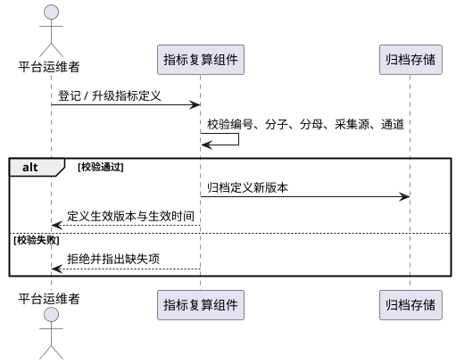
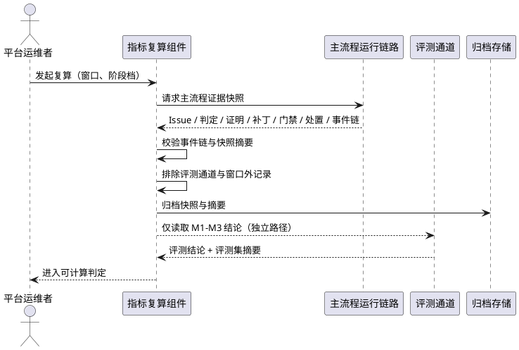
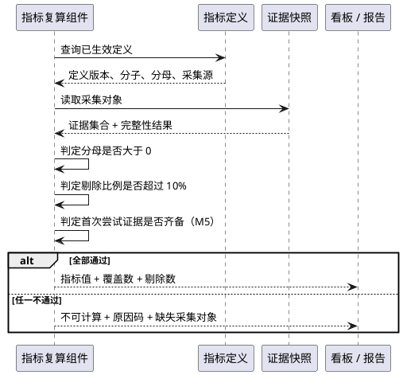
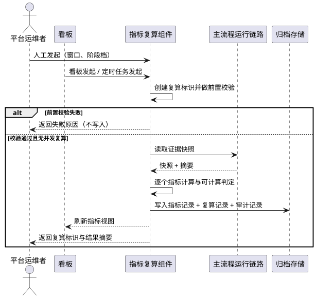
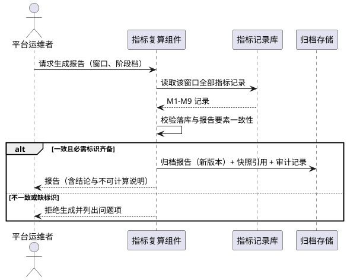
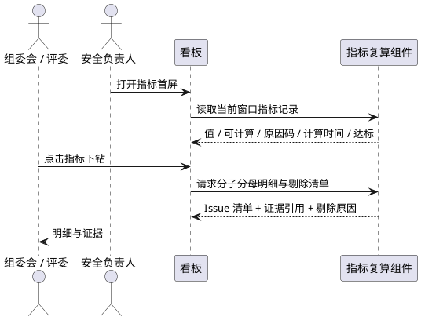

# **1. 组件定位**

## **1.1 核心职责**

本组件负责基于主流程真实运行证据复算 M1–M9 指标，产出可追溯、可下钻、可再审的指标记录与指标报告。

## **1.2 核心输入**

1. **主流程运行证据快照**：由主流程运行链路产生，包含受理范围内的 Issue、可达性判定、复现证明、补丁、门禁结论、处置结论与只追加事件链；来源为主流程 store 的证据导出，不含评测通道数据。
2. **评测通道结论**：M1、M2、M3 的评测结果行（含评测集内容摘要、评测运行标识、四类样本通过情况），来源为隔离评测通道。
3. **运行时计数器采样**：连续自运行时长的采样值、中断次数、最近心跳时间，来源为看板运行时。
4. **复算触发请求**：包含窗口、阶段档（初赛/总决赛）、触发方式、发起主体；来源为运维命令、看板操作或定时任务。
5. **指标定义登记信息**：M1–M9 的名称、分子、分母、单位、采集源、适用通道、生效版本与生效时间。

## **1.3 核心输出**

1. **指标记录**：每个（指标编号、阶段档、窗口）一条，包含值、可计算标记、不可计算原因码、采集源引用、定义版本、计算时间、复算标识、证据快照摘要、覆盖数与剔除数。
2. **复算记录**：一次复算的状态、触发方式、发起主体、窗口、阶段档、定义版本、开始与结束时间、参与统计的 Issue 数、剔除数、失败原因。
3. **M1–M9 指标报告**：含指标定义、分子分母口径、采集源、通道、值、是否达标、初赛目标、计算时间与复算标识，并给出总体结论（PASS / FAIL / 不可判定）。
4. **看板指标视图与下钻数据**：指标当前值与参与计算的 Issue 清单、证据引用。
5. **不可计算说明**：每个不可计算指标的缺失采集对象定位与原因码。
6. **复算审计记录**：复算发起、完成、报告生成的可追溯记录。

## **1.4 职责边界**

本组件明确不负责以下事项：

1. 不负责缺陷检测、可达性判定、复现执行、补丁生成、审计、门禁执行与处置分级；上述结果只作为输入证据被消费，本组件不得改写。
2. 不负责评测集执行、样本标注与对抗样本判定；M1–M3 由评测通道产出，本组件只做口径校验与报告合并，不重算评测通道指标。
3. 不负责修复主流程证据缺失；证据缺失时只允许标记不可计算，禁止补造、推断或估算数值。
4. 不负责 PR 创建、合并、门禁触发与回滚。
5. 不负责连续自运行计数器本身的采集实现，只消费运行时采样；无采样时标记不可计算。
6. 不负责以任何方式修改 Issue、证明、补丁、门禁结论、处置结论与事件链。
7. 不负责为达标而调整指标定义、窗口边界或分母范围。

# **2. 领域术语**

**主流程运行证据**
: 由主流程处置链路真实运行产生、并可从主流程 store 完整导出的 Issue 及其判定、证明、补丁、门禁、处置与事件记录集合。

**评测通道**
: 与主流程隔离、以固定评测集逐条执行并只产出 M1–M3 结论与四类通过率的独立执行通道。
: 备注：又称隔离通道；其数据不得计入 M4–M9 的分母或分子。

**通道标记**
: 用于区分主流程与评测通道来源的可识别标识；带通道标记的记录一律不计入主流程指标。

**采集源绑定**
: 指标与其分子、分母各自对应的具体证据对象与取值时点的一一对应关系。
: 备注：无绑定关系的指标不得写入对外材料。

**可计算**
: 指标具备已登记的采集源、可判定口径、非空分母、通过完整性校验的证据，能够产出唯一数值的状态。

**不可计算**
: 指标在采集源、口径、分母或证据完整性任一环节不满足要求，只能给出原因码而无权给出数值的状态。
: 备注：不可计算不等于 0，禁止以 0 或估算值代替。

**不可计算原因码**
: 标识不可计算根因的固定编码，取值限于：缺采集源、分母为空、证据缺失、证据不一致、证据覆盖不足、定义未登记、窗口未闭合、首次尝试证据缺失。

**复算**
: 依据指标定义，从证据快照重新计算指标值并落库、出报告的过程；复算不得复用上一次的计算中间值。

**复算标识**
: 一次复算的唯一标识，用于把指标记录、剔除清单、报告与审计记录关联起来。

**证据快照**
: 复算输入所用的主流程证据集合的只读副本，附带内容摘要与生成时间；快照一经生成不得修改。

**窗口**
: 指标统计的时间区间，按自然月标识（如 2026-12），且必须与 Issue 发生时间同一口径。

**阶段档**
: 指标目标与判定口径的档位，分为初赛档与总决赛档；两档结果不得混用。

**覆盖数 / 剔除数**
: 覆盖数为实际参与指标计算的 Issue 数；剔除数为因证据缺失、证据不一致或时间戳不可用而被排除的 Issue 数。

**首次补丁尝试**
: 某 Issue 生成的第一份补丁及其对应的门禁结论；"一次修复"语义只认首次尝试，后续重试不计入"一次"。

**PR 就绪**
: L1 处置结论已产生并附证据摘要的时刻；对 L0 则指自动合并完成时刻。

# **3. 角色与边界**

## **3.1 核心角色**

- **平台运维者**：发起复算、选择窗口与阶段档、查看不可计算原因、导出与归档报告。
- **安全负责人**：在运行看板查看 M1–M9 当前值、达标情况与处置分布，判断是否暂停处置。
- **组委会 / 评委**：按报告核对指标定义、采集源、复算依据与证据链，抽检不可计算项的真实性。

## **3.2 外部系统**

- **主流程运行链路**：提供主流程证据快照（Issue、判定、证明、补丁、门禁结论、处置结论、事件链）；只读。
- **评测通道**：提供 M1–M3 结论、四类样本通过率与评测集摘要；只读，且与主流程隔离。
- **看板运行时**：提供连续自运行时长、中断次数与心跳时间采样；只读。
- **归档存储**：保存证据快照、指标报告与复算审计记录，并支持按摘要校验回读。

## **3.3 交互上下文**

```plantuml
@startuml
left to right direction
actor "平台运维者" as Ops
actor "安全负责人" as Sec
actor "组委会 / 评委" as Judge
participant "指标复算组件" as MR
participant "主流程运行链路\n（证据快照）" as Main
participant "评测通道\n（隔离）" as Eval
participant "看板运行时\n（连续运行采样）" as Tracker
participant "归档存储" as Archive

Ops --> MR : 发起复算 / 选择窗口与阶段档
MR --> Main : 读取主流程证据快照
Main --> MR : 证据快照 + 摘要
MR --> Eval : 读取 M1–M3 结论与评测集摘要
Eval --> MR : 评测结论
MR --> Tracker : 读取连续运行采样
Tracker --> MR : 连续时长 / 中断次数
MR --> Archive : 归档快照、指标记录、报告、审计
MR --> Sec : 看板指标值 + 达标状态
MR --> Judge : M1–M9 报告 + 复算依据 + 下钻证据
@enduml
```

# **4. DFX约束**

## **4.1 性能**

1. **复算耗时**：单个窗口 50 条 Issue 规模下，一次全量复算（M1–M9）须在 5 秒内完成；1000 条规模下须在 60 秒内完成。
2. **读操作开销**：复算对主流程的读取不得阻塞主流程写入超过 200 毫秒。
3. **报告生成**：单份指标报告生成须在 3 秒内完成。

## **4.2 可靠性**

1. **原子性**：一次复算要么完整产出全部指标记录与复算记录，要么不留下任何部分结果。
2. **幂等**：同一（窗口、阶段档、定义版本）重复复算必须覆盖既有结果，不得累加，不得产生重复指标记录。
3. **互斥**：同一（窗口、阶段档）同时只允许一个复算进行，第二个请求必须被拒绝。
4. **可重放**：复算异常终止后，必须能以同一证据快照重跑并得到相同结果。
5. **失败不污染**：复算失败不得改变既有指标记录的值与可计算状态，只允许在复算记录中记录失败原因。

## **4.3 安全性**

1. **授权**：仅平台运维者角色可发起复算与生成对外报告，其他角色只读。
2. **审计**：复算发起、复算完成、报告生成必须记录发起主体、时间、窗口、阶段档、定义版本与结果状态。
3. **脱敏**：证据快照、指标记录与报告中禁止出现凭据、令牌与完整密钥值。
4. **防篡改**：复算必须校验证据快照摘要与事件链完整性；校验失败时拒绝以该证据计算。

## **4.4 可维护性**

1. **计算明细**：每次复算必须输出可检索的计算明细，包含复算标识、指标编号、分子数、分母数、剔除数与原因码分布。
2. **采集源映射可见**：任一指标必须能列出其分子、分母对应的采集对象与取值时点。
3. **时效可见**：报告必须展示每个指标的计算时间与最近一次成功复算时间。

## **4.5 兼容性**

1. **定义演进**：指标定义变更必须提升定义版本号，历史指标记录与历史报告保持原值与原定义，不得回改。
2. **规模演进**：评测集由 50 条扩至 100 条、窗口由月扩至更长周期时，指标定义与复算方法不得改变。
3. **阶段档隔离**：初赛档与总决赛档结果必须分别落库、分别报告，禁止互相替代。

# **5. 核心能力**

## **5.1 指标定义与口径固定**

### **5.1.1 业务规则**

1. **指标定义登记**：M1–M9 必须逐项登记名称、分子、分母、单位、采集源、适用通道与定义版本，未登记的指标禁止出现在任何报告中。
   a. 验收条件：When 发起指标报告生成，the VeriFix 平台 shall 校验 M1–M9 全部存在已生效定义，缺任一项则拒绝生成并指出缺失编号。
2. **指标定义与口径**：指标必须按下述口径计算，分子分母均以 Issue 或补丁为计数单位，比例型指标取值为 0–1 的实数，时长型指标以分钟为单位。
   1) M1 有效告警率：人工确认有价值的告警数 ÷ 告警总数，采集源为评测集人工标注，通道为评测通道。
   2) M2 漏洞检出率：靶场已知漏洞被检出数 ÷ 已知漏洞总数，采集源为评测结果，通道为评测通道。
   3) M3 可达性判定准确率：判定结论与人工结论一致的样本数 ÷ 有标注样本数，采集源为判定结论与评测集标注，通道为评测通道。
   4) M4 复现成功率：复现成功 Issue 数 ÷ 应复现 Issue 数；复现成功指存在补丁前必红结果；应复现指进入可达性判定且结论为可达、并被主流程尝试复现的范围内 Issue；复现失败计入分母不计入分子；结论为不可达、疑似后转人工、范围外的 Issue 不计入分母；同一 Issue 多次复现只计一次并取最新结果。采集源为主流程复现证明与 Issue 状态，通道为主流程。
   5) M5 一次修复通过率：首次补丁尝试即通过三闸并被接受的 Issue 数 ÷ 产生过首次补丁尝试的范围内 Issue 数；接受指 L0 或 L1 处置；同一 Issue 的后续重试不得计入分子；缺少首次尝试证据时该 Issue 从分子分母同时剔除并计入剔除数。采集源为主流程首次补丁尝试、门禁结论与处置结论，通道为主流程。
   6) M6 回归破坏率：引入新失败的补丁数 ÷ 有门禁结论的补丁数；引入新失败指门禁回归阶段失败、复扫新增告警大于 0、或覆盖率下降超过容忍阈值；无门禁结论的补丁不计入分母。采集源为主流程门禁结论，通道为主流程。
   7) M7 MTTR：从告警首次观测时刻到 PR 就绪时刻的时长均值（分钟）；只统计窗口内完成 L0 或 L1 处置且两端时间戳齐备的范围内 Issue；处置未完成、超时、失败、L2、L3 的 Issue 不计入；结束时刻早于开始时刻的 Issue 必须剔除并记录原因。采集源为主流程告警时间戳、处置结论时间戳与事件时间戳，通道为主流程。
   8) M8 自动处置率：L0 与 L1 处置完成的范围内 Issue 数 ÷ 窗口内范围内 Issue 总数；分母必须包含未处置、处置中 Issue，不得只取已处置 Issue；范围外 Issue 与评测通道 Issue 一律排除。采集源为主流程 Issue 与处置结论，通道为主流程。
   9) M9 连续自运行：看板运行时计数器给出的连续无人干预时长（小时），中断、心跳超时、人工暂停或重启必须使连续时长归零重计；取值必须附带采样时刻。采集源为看板运行时采样，通道为主流程。
   a. 验收条件：When 输出任一指标，the VeriFix 平台 shall 同时输出该指标的分子、分母、定义版本与采集源，且分子分母与实际参与计算的 Issue 清单可对应。
3. **禁止改口径**：禁止为达标而临时修改分子、分母、窗口边界、剔除规则或初赛/总决赛档位。
   a. 验收条件：If 同一窗口同一阶段的同一指标在定义版本未变时出现两套分子分母口径，then the VeriFix 平台 shall 判定后一次复算无效并告警。
4. **两档目标固定**：初赛档目标为 M1≥50%、M4≥60%、M5≥45%、M9≥24h 且评测集不少于 50 条；总决赛档目标单独登记，不得用于初赛判定。
   a. 验收条件：When 阶段档为初赛，the VeriFix 平台 shall 按初赛档目标判定每个必需指标是否达标。
5. **通道归属固定**：M1、M2、M3 只能来自评测通道；M4、M5、M6、M7、M8、M9 只能来自主流程。禁止跨通道补值。
   a. 验收条件：If 主流程证据缺失而评测通道存在同类记录，then the VeriFix 平台 shall 将对应主流程指标标记为不可计算，不得引用评测通道数值。

### **5.1.2 交互流程**



### **5.1.3 异常场景**

1. **定义缺失**
   a. 触发条件：报告中所需指标编号无法匹配到已生效定义。
   b. 系统行为：拒绝生成报告，列出缺失编号，不产出任何指标值。
   c. 用户感知：提示"指标定义未登记（编号：Mx），报告拒绝生成"。
2. **定义版本冲突**
   a. 触发条件：同一次复算所引用的定义版本与指标记录中的版本不一致。
   b. 系统行为：以登记的最新生效版本重算，并在报告中标注版本变更。
   c. 用户感知：报告显示"定义版本已由 vN 升级至 vM，本次按 vM 重算"。
3. **跨通道补值**
   a. 触发条件：主流程指标取数触及评测通道记录。
   b. 系统行为：丢弃该记录并标记不可计算（缺采集源），同时告警。
   c. 用户感知：报告中显示"该指标不可计算（缺采集源）"，并在说明中注明检测到跨通道取数。

## **5.2 主流程证据采集与通道隔离**

### **5.2.1 业务规则**

1. **唯一证据源**：M4–M9 的复算只允许读取主流程证据快照；禁止读取评测通道结论、手工构造数据或上一次的计算中间值。
   a. 验收条件：When 发起 M4–M9 复算，the VeriFix 平台 shall 记录所用证据快照的标识、生成时间与内容摘要，且该摘要必须与归档副本一致。
2. **通道隔离**：评测通道的 Issue、证明、补丁、处置记录必须带可识别通道标记，任何带通道标记的记录不得进入主流程指标的分子或分母。
   a. 验收条件：When 主流程快照中存在带通道标记的记录，the VeriFix 平台 shall 将其排除并在计算明细中记录排除数量。
3. **快照完备性**：主流程证据快照必须包含参与统计所需的 Issue、可达性判定、复现证明、补丁、门禁结论、处置结论与事件时间戳，且事件链必须可校验。
   a. 验收条件：When 快照缺少某类证据，the VeriFix 平台 shall 将该类证据依赖的指标标记为不可计算，并指明缺失的证据类别。
4. **快照只读**：快照生成后禁止修改；复算过程不得回写任何 Issue、证明、补丁、门禁或处置记录。
   a. 验收条件：When 复算执行完成，the VeriFix 平台 shall 保证主流程证据集合的记录数量与内容摘要与复算前一致。
5. **首次尝试证据保留**：主流程必须为每个 Issue 保留首次补丁尝试及其门禁结论的关联，后续重试不得覆盖首次尝试记录。
   a. 验收条件：If 某 Issue 仅保留最新补丁与门禁结论而无法识别首次尝试，then the VeriFix 平台 shall 将 M5 标记为不可计算（首次尝试证据缺失），并将受影响 Issue 计入剔除数。
6. **时间基准**：所有参与指标计算的时间戳必须为 UTC 且可比较；M7 必须使用业务事件时间戳，不得使用复算执行时间或报告生成时间。
   a. 验收条件：When 同一 Issue 的事件时间戳出现回退，the VeriFix 平台 shall 剔除该 Issue 并记录"证据不一致"原因。
7. **窗口归属**：参与统计的 Issue 必须以告警首次观测时间落入窗口为归属依据；窗口外的 Issue 不得计入分子或分母。
   a. 验收条件：When 快照中存在告警时间落在窗口外的 Issue，the VeriFix 平台 shall 将其排除并在计算明细中记录窗口外剔除数。

### **5.2.2 交互流程**



### **5.2.3 异常场景**

1. **快照缺失**
   a. 触发条件：主流程证据快照不存在或生成失败。
   b. 系统行为：M4–M9 全部标记不可计算（缺采集源），禁止使用评测通道数据替代。
   c. 用户感知：报告显示"主流程证据快照缺失，M4–M9 不可计算"。
2. **事件链断裂**
   a. 触发条件：事件链校验失败或快照摘要与归档副本不一致。
   b. 系统行为：拒绝以该快照计算，M4–M9 标记不可计算（证据不一致），并告警。
   c. 用户感知：提示"证据链校验失败，复算拒绝"，并给出快照标识。
3. **通道标记缺失**
   a. 触发条件：存在来源不明、无法判定是否属于评测通道的记录。
   b. 系统行为：该记录不计入任何指标，计入剔除数并告警。
   c. 用户感知：报告显示"存在 N 条来源不可判定记录，已剔除"。
4. **快照内缺首次尝试证据**
   a. 触发条件：补丁记录被最新一次覆盖，首次尝试与门禁结论无法关联。
   b. 系统行为：M5 标记不可计算（首次尝试证据缺失），M4、M7、M8 照常计算。
   c. 用户感知：报告显示"M5 不可计算（缺首次尝试采集源）"，并注明受影响 Issue 数。

## **5.3 可计算与不可计算判定**

### **5.3.1 业务规则**

1. **判定顺序**：每个指标必须依次通过"定义已登记 → 采集源存在 → 证据完整性校验通过 → 分母大于 0 → 口径可判定"五道判定，全部通过才可标记可计算。
   a. 验收条件：When 任一判定不通过，the VeriFix 平台 shall 将该指标标记为不可计算并记录首个未通过环节对应的原因码。
2. **不可计算必须无值**：不可计算指标的值必须为空，禁止写入 0、上次值或估算值。
   a. 验收条件：When 指标标记不可计算，the VeriFix 平台 shall 输出空值并给出原因码与缺失采集对象定位。
3. **分母为空**：分母为 0 时指标不可计算（分母为空），不得将 0 分母解释为 100% 或 0%。
   a. 验收条件：When 分母为 0，the VeriFix 平台 shall 标记不可计算（分母为空），并在报告中显示分母为 0 的采集范围。
4. **证据覆盖不足**：剔除数占该指标分母的比例超过 10% 时，指标必须标记不可计算（证据覆盖不足）；未超过 10% 时可计算，但报告必须同时显示覆盖率。
   a. 验收条件：When 剔除比例大于 10%，the VeriFix 平台 shall 标记不可计算（证据覆盖不足），并列出剔除原因分布。
   b. 验收条件：When 剔除比例不超过 10%，the VeriFix 平台 shall 正常给出数值，并在报告中标注"覆盖 N/M，剔除 K"。
5. **原因码唯一且可解释**：不可计算原因码必须取自固定集合（缺采集源、分母为空、证据缺失、证据不一致、证据覆盖不足、定义未登记、窗口未闭合、首次尝试证据缺失），禁止自造原因码或复合描述替代。
   a. 验收条件：When 输出不可计算指标，the VeriFix 平台 shall 输出单一原因码，并可下钻到触发该原因的具体采集对象。
6. **状态可切换**：不可计算不得因重复复算自动变为可计算；只有补齐采集源并再次复算后才允许切换，切换必须在复算记录中留痕。
   a. 验收条件：When 补齐采集源后重算，the VeriFix 平台 shall 在同一窗口记录中由不可计算切换为可计算，并在报告说明中标注切换原因与时间。
7. **窗口未闭合**：窗口尚未结束时发起的复算允许执行，但结果只能作为试算，标记不可计算（窗口未闭合），禁止进入对外报告结论。
   a. 验收条件：When 窗口结束时间晚于复算发起时间，the VeriFix 平台 shall 将本次结果标记为试算且不参与达标判定。

### **5.3.2 交互流程**



### **5.3.3 异常场景**

1. **部分采集源缺失**
   a. 触发条件：某指标的一个采集对象存在、另一必需采集对象缺失。
   b. 系统行为：该指标标记不可计算，原因码取首个缺失项的对应码（缺采集源或证据缺失）。
   c. 用户感知：报告显示"不可计算（缺采集源）"，并列出缺失对象名称。
2. **证据与结论矛盾**
   a. 触发条件：声称 L1 处置的 Issue 不存在对应门禁通过结论，或证明标注为必红但实际记录为通过。
   b. 系统行为：该 Issue 从分子分母剔除并计入剔除数；剔除比例超阈值则指标不可计算（证据不一致）。
   c. 用户感知：报告显示"证据与结论不一致，已剔除 N 条"。
3. **剔除比例超阈值**
   a. 触发条件：剔除数占比超过 10%。
   b. 系统行为：指标标记不可计算（证据覆盖不足），保留剔除清单供核对。
   c. 用户感知：报告显示"不可计算（证据覆盖不足）：覆盖 N/M"。
4. **重复复算试图改写状态**
   a. 触发条件：采集源未变化但连续复算导致可计算状态反复变化。
   b. 系统行为：以首次判定结果为准并记录异常，告警提示复算不稳定。
   c. 用户感知：看板提示"复算结果不稳定，请核对证据快照"。

## **5.4 复算触发与执行**

### **5.4.1 业务规则**

1. **三种触发方式**：复算必须支持人工按窗口发起、看板操作发起、窗口闭合后定时发起三种方式；每次触发都必须生成唯一复算标识。
   a. 验收条件：When 任一种方式触发复算，the VeriFix 平台 shall 生成复算标识并记录触发方式、发起主体、窗口、阶段档与发起时间。
2. **定时复算**：窗口闭合后 1 小时内必须自动完成该窗口的首次复算，此后每日至少复算 1 次直至该窗口结果被归档。
   a. 验收条件：When 窗口闭合满 1 小时而该窗口无成功复算记录，the VeriFix 平台 shall 自动发起复算，并记录"定时触发"。
3. **幂等覆盖**：同一窗口、阶段档、定义版本的复算必须覆盖同一条指标记录，禁止产生重复记录或累加数值。
   a. 验收条件：When 连续两次复算相同窗口，the VeriFix 平台 shall 保证指标记录条数不变，且记录中的复算标识为最后一次。
4. **互斥执行**：同一窗口与阶段档同时只允许一个复算执行；冲突请求必须被拒绝且不改变任何数据。
   a. 验收条件：When 复算执行中再次收到同窗口同阶段档请求，the VeriFix 平台 shall 返回冲突并提示进行中的复算标识。
5. **前置校验**：复算前必须校验证据快照可读、摘要可核、事件链可校验；任一失败则终止复算，不写入任何指标记录。
   a. 验收条件：When 前置校验失败，the VeriFix 平台 shall 记录失败原因并保持既有指标记录不变。
6. **只读原则**：复算过程禁止修改主流程证据；只允许新增指标记录、复算记录与审计记录。
   a. 验收条件：When 复算执行完毕，the VeriFix 平台 shall 保证主流程证据摘要与执行前一致。
7. **失败可见**：复算失败必须保留上一次成功结果及其计算时间，并在看板与报告中显示"最近一次复算失败"。
   a. 验收条件：When 复算失败，the VeriFix 平台 shall 展示上次成功复算时间、失败时间与失败原因，禁止用上次值伪装本次结果。
8. **复算不覆盖历史**：复算只更新当前窗口的当前结果，历史窗口的指标记录与报告不得因本次复算而改变。
   a. 验收条件：When 复算 2026-12 窗口，the VeriFix 平台 shall 保证 2026-11 及更早窗口记录的数值与计算时间不变。

### **5.4.2 交互流程**



### **5.4.3 异常场景**

1. **并发复算冲突**
   a. 触发条件：同窗口同阶段档已有复算在执行。
   b. 系统行为：拒绝新请求，不产生任何写入。
   c. 用户感知：返回冲突与进行中复算标识。
2. **复算中断**
   a. 触发条件：执行过程中进程退出或证据源不可用。
   b. 系统行为：复算标记失败，撤销未完成写入，保留既有指标记录。
   c. 用户感知：看板显示"复算失败，结果仍为 M 时 N 分计算"。
3. **快照摘要不一致**
   a. 触发条件：读取到的快照摘要与归档副本或登记摘要不符。
   b. 系统行为：终止复算，标记失败并告警，禁止产出任何数值。
   c. 用户感知：提示"证据快照校验失败，复算中止"。
4. **定时复算错过**
   a. 触发条件：定时任务在窗口闭合 1 小时后仍未执行（如服务停机）。
   b. 系统行为：恢复后立即补做一次复算，并在复算记录中标注"补做"。
   c. 用户感知：报告显示"本窗口复算为补做，发起时间晚于窗口闭合 1 小时"。

## **5.5 结果落库与指标报告**

### **5.5.1 业务规则**

1. **指标记录落库口径**：每个指标必须按（指标编号、阶段档、窗口）落库一条当前记录，包含值、可计算标记、原因码、采集源引用、定义版本、计算时间、复算标识、证据快照摘要、覆盖数与剔除数。
   a. 验收条件：When 复算完成，the VeriFix 平台 shall 为 M1–M9 各写入一条记录，且每条记录的复算标识与本次复算一致。
2. **评测指标合并**：报告中 M1–M3 必须来源于评测通道结论，并附带评测运行标识与评测集内容摘要；M4–M9 必须来源于主流程复算并附带复算标识与快照摘要。
   a. 验收条件：When 生成指标报告，the VeriFix 平台 shall 在每个指标行同时展示通道归属、采集源引用与对应标识，缺任一标识则该行不得出现在对外报告中。
3. **报告必备内容**：报告必须包含生成时间、窗口起止、阶段档、定义版本、M1–M9 的定义、分子、分母、采集源、通道、值、可计算状态、原因码、初赛目标、是否达标、计算时间与复算标识，以及剔除清单摘要与覆盖率。
   a. 验收条件：When 打开报告，the VeriFix 平台 shall 展示上述全部字段，任一字段缺失则报告视为无效。
4. **结论判定**：初赛档报告中必需指标（M1、M4、M5、M9）任一不可计算或不达标时，结论必须为"不可判定"或"FAIL"，禁止写 PASS。
   a. 验收条件：When 必需指标存在不可计算项，the VeriFix 平台 shall 将结论标记为"不可判定"并列出不可计算指标编号。
5. **不可计算如实披露**：报告中不可计算指标必须显示原因码与缺失采集对象，禁止以空表格、删除行或改写指标名称的方式隐藏。
   a. 验收条件：When 某指标不可计算，the VeriFix 平台 shall 在报告中保留该指标行并显示"不可计算（原因码）"。
6. **历史报告不可改写**：报告生成必须写入新版本或新文件并归档；同一窗口同一阶段档的历史报告内容不得被覆盖改写。
   a. 验收条件：When 对已归档报告所在窗口再次生成报告，the VeriFix 平台 shall 生成新版本报告并保留历史版本可检索。
7. **落库与报告一致**：报告中的数值与可计算状态必须与落库指标记录完全一致，禁止报告侧另行计算。
   a. 验收条件：If 报告生成时发现某指标值与落库记录不一致，then the VeriFix 平台 shall 拒绝生成报告并提示不一致指标。
8. **归档与校验**：报告、证据快照引用与复算审计记录必须归档，并可按摘要校验回读。
   a. 验收条件：When 评委按复算标识回读报告与快照，the VeriFix 平台 shall 返回与报告展示一致的摘要与内容。

### **5.5.2 交互流程**



### **5.5.3 异常场景**

1. **落库与报告不一致**
   a. 触发条件：报告值、可计算状态或复算标识与指标记录不符。
   b. 系统行为：拒绝生成报告，标记该窗口报告为无效。
   c. 用户感知：提示"指标记录与报告不一致（编号：Mx），报告拒绝生成"。
2. **报告要素缺失**
   a. 触发条件：某指标行缺少采集源引用、通道标记或标识。
   b. 系统行为：该指标行不得进入对外报告，报告结论置为"不可判定"。
   c. 用户感知：提示"采集源标识缺失，该指标不得对外披露"。
3. **归档失败**
   a. 触发条件：归档存储不可用。
   b. 系统行为：报告标记"未归档"，禁止对外发布；本地暂存并在恢复后补传。
   c. 用户感知：看板提示"报告归档积压，待补传"。
4. **达标但不达标证据**
   a. 触发条件：指标值达到初赛目标，但支撑该值的证据剔除比例超过 10%。
   b. 系统行为：不判定为达标，指标标记不可计算（证据覆盖不足）。
   c. 用户感知：报告显示"虽达目标值，但证据覆盖不足，不予判定"。

## **5.6 看板展示与下钻**

### **5.6.1 业务规则**

1. **首屏展示**：看板必须展示 M1–M9 当前值、可计算状态、最近计算时间与是否达标；不可计算项必须显示原因码。
   a. 验收条件：When 打开看板，the VeriFix 平台 shall 在首屏展示上述信息，并标明数据所属窗口与阶段档。
2. **下钻到证据**：任一指标必须支持下钻到参与计算的 Issue 清单、证据引用与剔除清单。
   a. 验收条件：When 点击指标，the VeriFix 平台 shall 展示参与计算的 Issue 数、剔除 Issue 数及其原因、以及证据引用。
3. **时效标注**：看板必须显示最近一次成功复算时间；若最近一次复算失败，必须并列显示失败时间与原因。
   a. 验收条件：When 最近一次复算失败，the VeriFix 平台 shall 在指标旁显示"复算失败，值为上次成功结果（时间）"。
4. **只读呈现**：看板不得提供修改指标值、修改定义或删除指标行的入口。
   a. 验收条件：When 任意角色打开看板，the VeriFix 平台 shall 保证指标相关字段均不可编辑。

### **5.6.2 交互流程**



### **5.6.3 异常场景**

1. **无指标记录**
   a. 触发条件：当前窗口尚无任何复算结果。
   b. 系统行为：显示"尚未复算"并给出可发起复算的入口（仅运维可用）。
   c. 用户感知：看板显示"本窗口指标尚未复算"。
2. **下钻证据失效**
   a. 触发条件：指标记录引用的证据快照已被清理或摘要校验失败。
   b. 系统行为：下钻展示"证据不可用"并保留指标值与计算时间，同时告警。
   c. 用户感知：提示"证据已不可用，指标值仍按原记录展示"。
3. **指标归属窗口混淆**
   a. 触发条件：看板请求的窗口与指标记录窗口不一致。
   b. 系统行为：拒绝展示并提示切换窗口，禁止跨窗口拼合数值。
   c. 用户感知：提示"请选择与记录一致的窗口"。

# **6. 数据约束**

## **6.1 指标定义**

1. **指标编号**：必须为 M1–M9 之一，全局唯一，与既定定义一一对应，禁止新增、合并或重命名。
2. **名称**：必须为业务名称，与指标编号固定对应。
3. **分子口径**：必须为可判定的计数规则，且可从具体采集对象逐条数出。
4. **分母口径**：必须明确计入与排除范围，必须包含未成功样本中应计入的部分（如 M4 计入复现失败、M8 计入未处置）。
5. **单位**：必须为比例（0–1）或分钟或小时，同一指标的单位不得随版本变化。
6. **采集源**：必须指向具体证据类别与取值时点，不得填写"日志""系统数据"等无定位描述。
7. **通道**：必须为评测通道或主流程之一，且与指标编号固定对应。
8. **定义版本**：必须以版本号标识，升级必须记录生效时间，历史版本必须保留。
9. **阶段档目标**：初赛档与总决赛档目标必须分别登记，禁止共用一行。

## **6.2 指标记录**

1. **唯一键**：由指标编号、阶段档、窗口三者共同确定，禁止重复。
2. **值**：可计算时必须为实数且与分子除以分母的结果一致（M7、M9 为对应时长值）；不可计算时必须为空。
3. **可计算标记**：必须为布尔值，且与值、原因码的取值组合一致。
4. **原因码**：不可计算时必填，取值限定于固定集合；可计算时必须为空。
5. **采集源引用**：必须非空，且可定位到具体证据对象或其摘要。
6. **定义版本**：必须是本次计算实际使用的已生效版本。
7. **计算时间**：必须记录且不得晚于报告生成时间。
8. **复算标识**：必须与产生该记录的复算记录一致。
9. **证据快照摘要**：必须记录；不可计算且缺采集源时允许为空但需说明。
10. **覆盖数与剔除数**：必须为非负整数，且覆盖数加剔除数等于该指标分母对应范围的总数。
11. **剔除清单引用**：存在剔除时必须非空，且逐条给出 Issue 标识与剔除原因码。

## **6.3 复算记录**

1. **复算标识**：必须全局唯一。
2. **触发方式**：必须为人工、看板或定时之一。
3. **发起主体**：人工与看板触发时必须记录角色与账号标识；定时触发必须记录调度主体。
4. **窗口与阶段档**：必须非空，且与指标记录一致。
5. **定义版本**：必须记录本次使用的版本集合。
6. **状态**：必须为进行中、成功、失败之一；失败时必须记录失败原因。
7. **时间**：开始时间必填；结束时间在成功或失败时必填，且不得早于开始时间。
8. **统计信息**：必须记录参与 Issue 总数、剔除数与各原因码分布。

## **6.4 证据快照引用**

1. **快照标识**：必须唯一，可由复算标识定位。
2. **内容摘要**：必须可校验，且与归档副本一致。
3. **生成时间**：必须记录，且早于复算开始时间。
4. **记录规模**：必须记录 Issue 数、事件数，用于判断快照是否被截断。
5. **校验结果**：必须记录事件链校验结论；校验未通过时不得被复算引用。

## **6.5 指标报告**

1. **报告标识与版本**：必须唯一；同一窗口同一阶段档再次生成时必须递增版本，历史版本保留。
2. **生成时间**：必须记录。
3. **窗口与阶段档**：必须非空，且与指标记录一致。
4. **定义版本**：必须记录，且与所有指标记录一致。
5. **指标行**：必须覆盖 M1–M9 全部编号，每行包含定义、分子、分母、采集源、通道、值、可计算、原因码、目标、是否达标、计算时间与复算标识。
6. **结论**：必须为 PASS、FAIL 或不可判定之一；存在不可计算的必需指标时禁止为 PASS。
7. **剔除与覆盖信息**：必须包含每个指标的覆盖数与剔除摘要，不得只给汇总。
8. **归档引用**：必须记录快照摘要与归档位置，支持按复算标识回读。