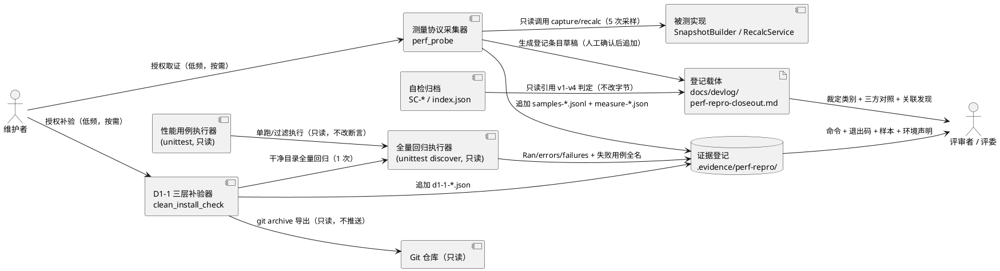
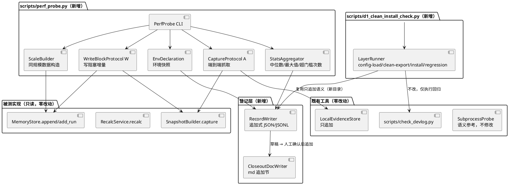
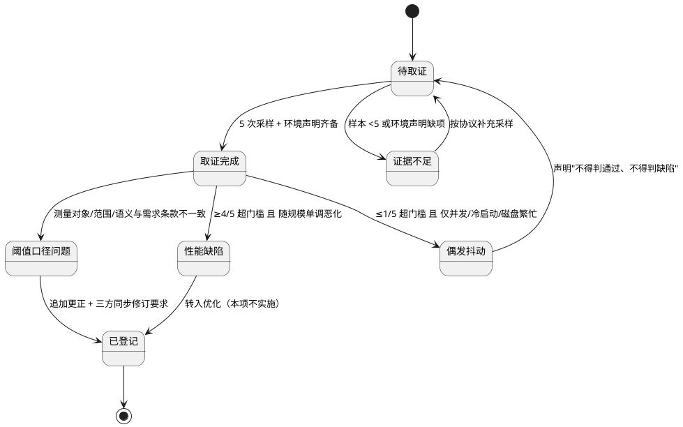
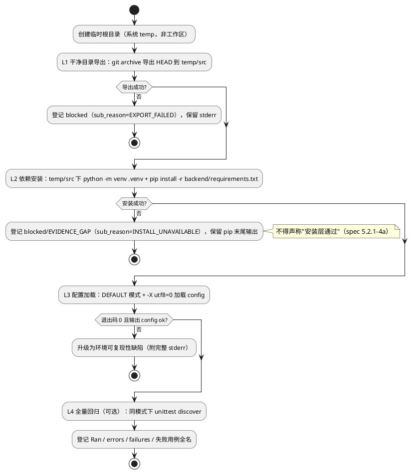
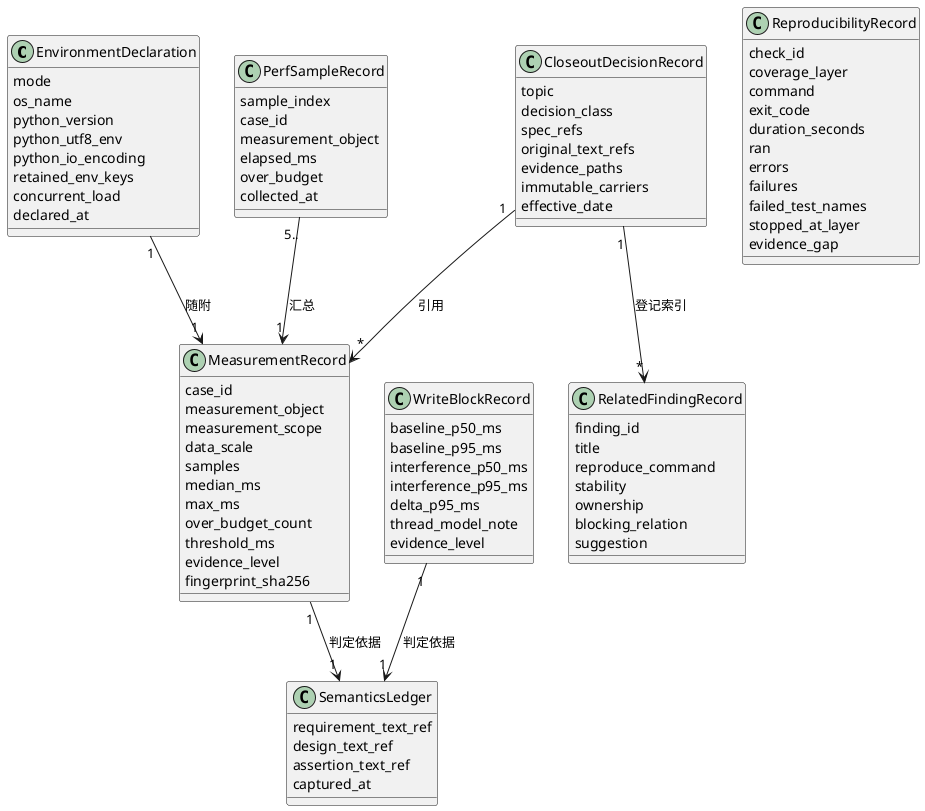

# PERF-02 阈值口径与 D1-1 编码依赖 · 实现方案（design）

> 版本：v1.0（2026-11-19）
> 上游需求：`.codeartsdoer/specs/perf_repro_closeout/spec.md`（393 行，v1.0）
> 本项性质：**裁定 + 测量协议 + 证据登记 + 验收**，不含产品代码修复、不含断言/阈值/sleep/skip/数据量调整（spec 1.4-1、1.4-2、5.1.1-6）
> 本文档只描述"如何构建"，不含实现代码；所有代码位置均经 2026-11-19 实检索确认
> 命名空间声明：`PERF-02` 在本轮一律带限定词——`PERF-02/metrics-capture`（200ms，快照抓取）与 `PERF-02/eval-digest`（500ms，评测摘要三元组）；`v1`–`v4` 指自检口径版本；`D-xx` 为本文设计决策编号；`IF-xx` 为实现缺口编号；`RF-xx` 为关联发现编号（spec 4.5-1、5.1.1-7）

---

# 一、需求与存量功能关系分析

## 1.1 需求功能与存量功能对比

### 1.1.1 已实现功能

| 需求功能 | 存量功能 | 代码位置 | 匹配度 |
|---|---|---|---|
| `PERF-02/metrics-capture` 端到端抓取耗时测量（spec 5.1.1-1） | 用例首段用 `perf_counter` 包裹 `SnapshotBuilder.capture` 并断言 `<0.2` | `backend/tests/test_metrics_perf.py:99-104` | 50% |
| `PERF-02` 全量复算 60s 门槛（spec 4.1-1 的门槛保持） | 同用例第二段包裹 `RecalcService.recalc` 并断言 `<60.0` | `backend/tests/test_metrics_perf.py:106-111` | 100% |
| 抓取预算登记值 200ms（spec 5.1.1-5） | `MetricsConfig.capture_budget_ms = 200` + `>=1` 校验 | `backend/app/config.py:140`、`273-276` | 100%（登记）/ 25%（消费） |
| 抓取耗时写入 `capture_ms`（spec 5.1.1-4 的设计语义） | `capture()` 内 `perf_counter` 计时并写入 `MetricSnapshotRef.capture_ms` | `backend/app/metrics/snapshot.py:148`、`164`、`176`；`backend/app/domain/models.py:355` | 100% |
| 多样本统计与门槛判定（spec 4.1-2、6.1-6） | 用例为**单次采样 + 硬断言**，无中位数/最大值/超门槛次数 | `backend/tests/test_metrics_perf.py:104`、`168` | 25% |
| 干净环境配置加载检查（spec 5.2.1-2a） | 自检 D1-1：`EnvMode.CLEAN` 下 `load_config()` 且 stdout 含 `config ok` | `backend/app/selfcheck/checks/d1_reproducible.py:24-58`；`backend/app/selfcheck/probes.py:23-47`、`76`+ | 75% |
| 全量回归计数解析（spec 6.2-4） | 自检 D1-2：正则解析 `Ran (\d+) tests?` / `errors=` / `failures=` | `backend/app/selfcheck/checks/d1_reproducible.py:61-100` | 100% |
| 自检归档不可变与可检索（spec 4.5-1、6.2-7） | `docs/devlog/selfcheck/index.json` 登记四版 `report_sha256` / `json_sha256` / `fingerprint` / `exit_code` | `docs/devlog/selfcheck/index.json`（实读） | 100% |
| 子进程环境净化（spec 4.3-1 的只读边界） | `SubprocessProbe` 统一子进程出口，`EnvMode.INHERIT / CLEAN`，`_CLEAN_ENV_KEYS` 白名单 | `backend/app/selfcheck/probes.py:23-47`、`76` | 75% |
| Git 提交前缀计数（spec 3.2 的 Git 只读） | `_git_commits()` 按五前缀统计主题计数 | `scripts/check_devlog.py:88-110` | 100% |
| 只读保证的可验证探针（spec 4.3-1） | `ReadOnlyProbe.capture/compare`（摘要 + 计数 + 事件链长度） | `backend/app/metrics/snapshot.py:64-74` | 100% |
| 证据只追加写入（spec 4.4-2） | `LocalEvidenceStore.put_locked` + `verify` | `backend/app/evidence/store.py`（`put_locked` 被 `snapshot.py:163` 调用） | 75% |
| 空转闭环可复现（spec 3.2 回归执行器） | `scripts/smoke_m0.py`，自检 D1-3 复用 | `backend/app/selfcheck/checks/d1_reproducible.py`（`_d1_3`） | 100% |
| 缺口登记位（spec 1.3-4、6.4） | 无（无 JSON 证据登记器，仅有 md 报告） | — | 0% |

**匹配度判定依据**

- **100%**：接口契约、字段语义与门槛数值可直接被本轮引用，无需新增能力。
- **75%**：能力存在但覆盖层次不足——D1-1 只覆盖"配置加载层"（spec 5.2.1-4 指出原始语义有三层）；`EnvMode` 只区分"继承/清空"，缺 spec 5.2.1-6 定义的"缺省环境"档；证据存储具备只追加语义但无登记 schema。
- **50%**：能力存在但**测量对象不一致**——用例测的是抓取端到端耗时（含容器拷贝、脱敏、两次序列化、摘要、落盘、链校验），spec 4.1-2 约束的是"读操作对主流程写入的阻塞"（spec 5.1.1-1）。
- **25%**：仅有字段或单次样本，缺 spec 4.1-2 要求的"≥5 次独立采样 + 中位数 + 最大值 + 超门槛次数"；`capture_budget_ms` 仅在配置层登记，全仓无消费点（实检索：`config.py:140`、`275`、`276` 三处命中，均为定义/校验）。
- **0%**：能力完全缺失（无登记 schema、无干净目录导出、无安装层归档）。

### 1.1.2 需要扩展的功能

| 需求功能 | 存量功能 | 差异说明 | 扩展方向 |
|---|---|---|---|
| 缺省环境与干净环境分列（spec 5.2.1-6、6.2-2） | `EnvMode.INHERIT` / `EnvMode.CLEAN` 两档 | 输入差异：`INHERIT` 会继承宿主 `PYTHONIOENCODING`；本次实测当前 shell 为 `PYTHONIOENCODING='utf8'`，`PYTHONUTF8=None`，故 `INHERIT` **不满足** spec 2 章"缺省环境"定义；输出差异：无环境快照字段；边界差异：`_CLEAN_ENV_KEYS` 未声明保留集合 | 采集器内部新增 `DEFAULT` 模式（剥离全部 `PYTHON*`、保留系统必要变量并回显保留集合），**不改动** `probes.py` 与自检检查项，避免自检基线指纹漂移（spec 4.5-1） |
| D1-1 覆盖层次显式声明（spec 5.2.1-4） | D1-1 仅返回"通过/阻塞 + 摘要"，无层次字段 | 输出差异：缺 `coverage_layer`；语义差异："配置加载通过"被当成"D1-1 全通过"（spec 5.2.3-2 明令拒绝） | 在新登记载体的记录模型中加入 `coverage_layer ∈ {config-load, clean-export, install, full-regression}`，未覆盖层以 `EVIDENCE_GAP` 显式登记 |
| 多样本统计取代单次断言（spec 4.1-2） | 用例单次计时 + `assertLess` | 语义差异：单次样本不得作为缺陷判定依据（spec 4.1-2）；不改用例（spec 1.4-1） | 采集器在用例**外部**按同规模数据重复测量 5 次，输出中位数/最大值/超门槛次数；用例断言原文只作为"口径证据"引用 |
| 测量对象可分离（spec 5.1.1-3c、5.1.3-3） | 仅有端到端抓取 | 输入差异：无"写阻塞增量"入口；业务逻辑差异：写路径为 `MemoryStore.append/add_run`（`backend/app/repo/memory.py:341`、`308`），读路径为 `snapshot_copy`（`snapshot.py:150`） | 新增"写阻塞增量"测量协议（W 协议）：基线写延迟分位数 vs 抓取并发期写延迟分位数，增量与 200ms 比较 |
| 三方语义对照（spec 5.1.1-4a） | 需求条款、设计条款、用例断言分散在三个载体 | 输入差异：无对照产出；边界差异：要求"规格原文 + 设计原文 + 断言原文 + 修订前后差异" | 采集器输出对照表（逐字引用原文与行号），写入新登记载体；**不回改**三方原文（spec 4.4-3） |
| 证据结构化登记（spec 6.1–6.4） | 仅 `docs/devlog/*.md` 叙述 + 自检 `selfcheck.json` | 输出差异：缺 `sample_index` / `measurement_scope` / `env_declaration` 等 8 个必填字段（spec 6.1） | 新增 `.evidence/perf-repro/*.json`（裁定）+ `*.jsonl`（样本），md 载体只做人类可读索引与更正登记 |
| `PERF-02` 编号消歧（spec 4.5-1） | README §8、`metrics-report.md:41`、`design.md(metrics_recalc):1408` 均裸写 `PERF-02` | 语义差异：同名用例实测门槛为 200ms（`test_metrics_perf.py:104`）与 500ms（`test_metrics_perf.py:168`） | 新载体强制限定词表；对历史裸写仅登记"原表述位置索引"，以追加更正说明（spec 4.4-3、5.2.1-7） |

### 1.1.3 需要新增的功能或接口

**A. 性能测量采集器（新，`scripts/perf_probe.py`）**

- 输入：用例限定编号（`PERF-02/metrics-capture` 或 `PERF-02/eval-digest`）、采样次数、环境模式（`default` / `clean`）、数据规模参数（Issue 数、每 Run 事件数）。
- 输出：`.evidence/perf-repro/samples-<case>-<ts>.jsonl`（逐样本）与 `measure-<case>-<ts>.json`（统计汇总 + 环境声明 + 测量范围）。
- 核心逻辑：构造与用例同规模的数据 → 按测量协议 A/B 重复采样 → 计算中位数/最大值/超门槛次数 → 附环境快照 → 输出判定输入。
- 依赖：`backend/app/metrics/snapshot.py`、`backend/app/metrics/service.py`、`backend/app/repo/memory.py`、标准库 `time`/`statistics`/`hashlib`（无新增第三方依赖）。
- 约束：**只读调用既有实现**，不修改被测量代码，不修改用例（spec 1.4-1、1.4-2）。

**B. 环境声明器（新，采集器内子模块 `env_declaration`）**

- 输入：环境模式。
- 输出：`os_name`、`os_release`、`python_version`、`PYTHONUTF8`、`PYTHONIOENCODING`、`PYTHONPATH` 状态、`retained_env_keys`、`concurrent_load`（是否处于并发回归负载）、`declared_at`（精确到分钟）。
- 依赖：`os`、`platform`、`sys`、`subprocess`（构造子进程环境）。
- 约束：禁止写入任何凭据（spec 4.3-3）；不出现令牌/密钥字段。

**C. D1-1 三层补验器（新，`scripts/d1_clean_install_check.py`）**

- 输入：源工作区根、目标临时目录、环境模式、层选择（`config-load` / `clean-export` / `install` / `full-regression`）。
- 输出：`.evidence/perf-repro/d1-1-<layer>-<ts>.json`（命令、退出码、耗时、`Ran/errors/failures`、失败用例全名、覆盖层次）。
- 核心逻辑：`git archive` 导出 → 临时 venv → 依赖安装 → 配置加载 → 可选全量回归；任一层失败即停止并如实登记（spec 5.2.1-5a）。
- 依赖：`git`（只读，`archive` 不推送）、`python -m venv`、`pip`；无网络时降级路径见 D-10。

**D. 裁定与证据登记载体（新，`docs/devlog/perf-repro-closeout.md` + `.evidence/perf-repro/`）**

- 输入：采集器与补验器输出、既有归档与文档原文引用。
- 输出：单一人类可读登记文档（8 节结构见 2.5.1）+ 机器可读 JSON。
- 核心逻辑：追加式写入，每条记录带日期与证据路径；历史文件清单显式列为"不可变载体"（spec 6.3-6）。

**E. 关联发现登记（新，登记于 D 的第 7 节）**

- `RF-01`：`check_devlog.test_real_repository_reports_blocking_not_pass` 在 Git 化后必然失败（实测见 1.2.5）。
- `RF-02`：`PERF-02` 200ms/500ms 同名歧义。
- `RF-03`：全量回归写真实且被 Git 跟踪的 `.evidence/self_run_samples.jsonl`（见 1.2.7）。

## 1.2 存量功能详细分析

### 1.2.1 `SnapshotBuilder.capture`：耗时构成与测量范围

**接口契约**（`backend/app/metrics/snapshot.py:147`）

- 入参：`window: str`、`tier: StageTier`；出参：`SnapshotEnvelope(payload, ref, reused)`。
- 副作用：首次抓取时 `evidence.put_locked(key, encoded)` 落盘（`:163`）；已存在时 `evidence.verify(key, digest)` 校验（`:158`）；**不写主流程 store**。
- 异常：`SnapshotIntegrityError`（已存在但摘要不符，`:160`）。
- 约束：`capture()` 自身再次取 `perf_counter`（`:148`）用于回填 `capture_ms`（`:164`、`:176`）——**这是产品内唯一的预算相关计时字段**，但从未与 `capture_budget_ms` 比较。

**端到端耗时构成**（逐项，决定 spec 5.1.1-1 的"测量范围"标注）

| 阶段 | 位置 | 是否包含 | 与"写阻塞"的关系 |
|---|---|---|---|
| 容器浅拷贝 `snapshot_copy()` | `:150` | 是 | 相关（读取主流程容器的开销） |
| 逐 Issue 通道/窗口标注 | `:187-213` | 是 | 相关（读遍历） |
| 记录规范化 `canonical_content` | `:221-244` | 是 | 弱相关（CPU 型） |
| 字段脱敏 `_redact` | `:247-282` | 是 | 不相关（CPU 型） |
| 序列化 #1 `_digest(payload)` | `:152`→`:321-323` | 是 | 不相关（CPU 型） |
| 序列化 #2 `json.dumps(...).encode()` | `:155` | 是 | 不相关（CPU 型） |
| 摘要 `sha256` | `:322-323` | 是 | 不相关（CPU 型） |
| 落盘 `put_locked` | `:163` | 是 | 不相关（I/O 型） |
| 事件链二次校验 `_chains_valid` | `:175`→`:284-293` | 是 | 不相关（12000 事件逐条 `sha256`） |
| 记录计数 `_count_records` | `:172-174`→`:313-318` | 是 | 不相关（CPU 型） |

**结论**：`capture()` 的耗时里有 6 项属于"读取后的加工与落盘"，与 spec 4.1-2 的"读操作阻塞主流程写入"不是同一测量对象；端到端数值不得直接用于该需求条款的判据（spec 5.1.3-3）。

**扩展点**：`SnapshotBuilder.__init__` 已可注入 `redactor` / `resolver` / `snapshot_dir`（`:132-145`），采集器无需侵入即可替换依赖。

### 1.2.2 `PERF-02/metrics-capture` 用例：双段测量与门槛语义

- 用例：`backend/tests/test_metrics_perf.py:76-111`（类 `PerfTest`），数据规模 `full=1000`、`repro_failed=100`、每 Run 12 事件 → 1100 Issue / 12000 事件（`:78-97`）；断言 `ref.event_count == 12000`（`:103`）。
- 首段断言 `capture_elapsed < 0.2`（`:104`）——**硬失败**；第二段断言 `elapsed < 60.0`（`:111`）。
- 模块级开关 `SKIP = os.environ.get("VERIFIX_SKIP_PERF") == "1"`（`:31`、`:34`、`:138`）——既有跳过能力，**本项不得使用**（spec 1.4-2、5.1.1-6）。
- 语义冲突定位：`metrics_recalc/design.md:766` 与 `:465` 明确"抓取耗时写入 `capture_ms`，超预算告警但不阻断"、"记录 `CAPTURE_SLOW` 告警（不阻断）"；用例以硬断言阻断，属**规格—设计—用例三方语义不一致**（spec 5.1.1-4）。
- 同名歧义：`EvalPerfBudgetTest.test_perf02_digest_triple_within_budget`（`:162-168`）门槛为 500ms，测量对象为 `digest_triple`（评测摘要三元组），与快照抓取无关（spec 5.1.1-7）。

### 1.2.3 `capture_budget_ms` 的"登记—消费"断层

- 登记点：`backend/app/config.py:140`（`= 200`）、校验 `:273-276`（`>=1`）。
- 消费点：**全仓 0 处**（`capture_budget_ms` 仅上述 3 处命中；`capture_ms` 仅 `models.py:355`、`snapshot.py:164/176`、`tests/test_metrics_snapshot.py:83` 命中）。
- 设计原文要求：`metrics_recalc/design.md:465`（`CAPTURE_SLOW` 告警）、`:766`（告警不阻断）、`:1315`（RK-02）。
- 判定：构成 **实现缺口 IF-01**（spec 5.1.1-5：无消费点即记实现缺口，不记性能缺陷），本轮只登记不修复（spec 1.4-1）。

### 1.2.4 自检 D1-1 探针：三层语义与单层覆盖

- 实现：`_d1_1`（`backend/app/selfcheck/checks/d1_reproducible.py:24-58`）在 `EnvMode.CLEAN` 下执行 `python -c "…load_config(); print('config ok')"`，判定条件 `exit_code == 0 and "config ok" in stdout_tail`（`:41-51`）。
- 环境净化：`SubprocessProbe.run(..., env_mode=EnvMode.CLEAN)`（`backend/app/selfcheck/probes.py:76`+），`_CLEAN_ENV_KEYS` 白名单 14 键（`probes.py:23-47`）。
- 覆盖差距：`m13-analysis-plan.md:46` 的原始定义为"新建目录 `git archive` 导出 → 装依赖"，即三层（导出 / 安装 / 加载）；现有探针只覆盖第 3 层（spec 5.2.1-4）。
- 实测补验（2026-11-19，本机）：清空全部 `PYTHON*` 后 `python -X utf8=0 -c "…load_config()…"` → `rc=0`、`config ok`、`Python 3.12.10`。
- 环境实测风险：当前 shell 环境 `PYTHONIOENCODING='utf8'`、`PYTHONUTF8=None`；`EnvMode.INHERIT`（D1-2 使用，`:63`）会继承该值 → **D1-2 的"默认环境"并非 spec 定义的"缺省环境"**，需在协议中显式声明（D-02）。

### 1.2.5 `check_devlog` 真实仓库用例：Git 化后必失

- 用例：`backend/tests/test_check_devlog.py:90-94`，断言 `returncode == 2`、stdout 含 `"非 Git 仓库"`、含 `"问题修复"`。
- 脚本：`_git_commits()` 在 `.git` 存在时返回五前缀计数（`scripts/check_devlog.py:88-110`）；`build_report` 仅在 `commits` 为空时追加"非 Git 仓库…"全局阻塞（`:125-126`）。
- 实测（2026-11-19，单跑）：`FAILED (failures=1)`，`AssertionError: '非 Git 仓库' not found`；实际输出为五前缀计数全 `0` + 5 条"缺少带前缀 … 的提交" + ④⑤ 未执行，`阻塞项合计：7`。
- 判定：**稳定复现**（每次全量回归必失败），归属**本项范围外**；阻断"failures 清零"，不阻断"口径裁定与验收"（spec 5.3.1-4）。

### 1.2.6 自检归档四版一致性（只读复核）

| 版本 | D1-1 | D1-2 | 用例数 | errors | failures | 唯一失败用例 |
|---|---|---|---|---|---|---|
| `SC-20261115T144308+0800-v1` | 通过 | 阻塞 `TEST_FAILED` | 777 | 0 | 1 | `test_perf02_thousand_issues_and_twelve_thousand_events` |
| `SC-20261115T144411+0800-v2` | 通过 | 阻塞 `TEST_FAILED` | 777 | 0 | 1 | 同上 |
| `SC-20261115T152810+0800-v3` | 通过 | 阻塞 `TEST_FAILED` | 789 | 0 | 1 | 同上 |
| `SC-20261115T165051+0800-v4` | 通过 | 阻塞 `TEST_FAILED` | 793 | 0 | 1 | 同上 |

依据：各版本 `selfcheck.json` 实读（`checks[].check_id ∈ {D1-1, D1-2}`）。**四版均 `errors=0`**，佐证"8 个编码 error"为计划值（spec 1.4-7、5.3.1-5）；D1-1 在四版中一致"通过"，但均只覆盖配置加载层（1.2.4）。

### 1.2.7 心跳接口写入被 Git 跟踪的证据文件

- 写入点：`backend/app/main.py:583-585`，`POST /api/v1/heartbeat` → `sample_reader.append(tracker.sample().to_dict())`；`sample_reader` 路径来自 `resolved.metrics.self_run_sample_path`（`main.py:162-165`），默认 `.evidence/self_run_samples.jsonl`（`config.py:134`），相对路径经 `project_root` 解析（`main.py:163-164`）。
- 触发用例：`backend/tests/test_api_m4.py:22-27`（`load_config()` 默认配置 + `create_app`）→ `test_heartbeat_and_dashboard`（`:93-95`）POST 心跳。
- 事实：`.evidence/self_run_samples.jsonl` **已被 Git 跟踪**（`git ls-files --error-unmatch` 命中），HEAD 版本 72 行，工作区当前一致；文件内最近写入时间 `2026-11-18T09:53:04Z`。
- 判定：**稳定追加**（每跑必增行），后果为工作区变脏、且与 spec 4.5-1"证据字节不可变"存在张力；归属范围外，登记为 `RF-03`，本轮不修（spec 5.3.3-2）。
- 注意：该写入属于产品路径（心跳即生产行为），并非测试缺陷；修复需另立项（例如测试注入隔离路径或对写入做环境门控），不在本项（spec 1.4-1）。

### 1.2.8 既有版本控制约束（本轮必须继承）

| 约束 | 位置 | 对本设计的影响 |
|---|---|---|
| Tier A/B/C 修订分级，Tier C 字节不变 | `docs/devlog/vcs-baseline.md` §2、§5 | 本轮新增载体须为**新文件**；历史报告正文一律不动（spec 4.5-1） |
| 基线提交不归属五步 | `docs/devlog/00-conventions.md` §2（vcs-baseline 引入第 6 条） | 本轮不补建任何步骤前缀提交（spec 1.4-5） |
| 8 个编码 error 为计划值 | `docs/devlog/vcs-baseline.md:360`、`.evidence/git-baseline/final-report.md:78`、`README.md:170` | 不得列为待修项（spec 5.3.1-5） |
| `check_devlog.py` 语义为 `0/2/3` | `docs/devlog/vcs-baseline.md:361` | 本轮不改脚本；`RF-01` 只登记 |

**不可变载体清单（本轮零字节改动）**：`docs/devlog/selfcheck/SC-*`（4 目录 × 2 文件）、`docs/devlog/selfcheck/index.json`、`docs/devlog/m13-analysis-plan.md`、`docs/devlog/m13-selfcheck-report.md`、`docs/devlog/m12-closure-and-blockers.md`、`docs/devlog/vcs-baseline.md`、`.evidence/git-baseline/*`、`README.md`、`docs/devlog/metrics-report.md`、`backend/tests/test_metrics_perf.py`、`backend/tests/test_check_devlog.py`、`backend/app/metrics/snapshot.py`、`backend/app/config.py`。

---
# 二、增量设计方案

## 2.1 实现模型

### 2.1.1 上下文视图



通信方式：全部为**本机进程内调用或子进程 CLI**，无网络（spec 4.3-2）。调用频率：采集器每次取证 5 次采样；补验器每层 1 次；登记为追加式写。

### 2.1.2 服务/组件总体架构



| 组件 | 职责 | 频率 | 配置项 |
|---|---|---|---|
| `PerfProbe CLI` | 唯一测量入口，输出可检索证据 | 按需（每次取证 1 次进程） | `--case`、`--samples`（默认 5，最小 5）、`--env`、`--issues`、`--events-per-run`、`--out` |
| `EnvDeclaration` | 生成环境声明，判定"缺省/干净"模式是否成立 | 每样本 | `--env default\|clean`；保留变量集合常量 |
| `ScaleBuilder` | 按 spec 6.1-4 构造 1100 Issue / 12000 事件，与用例同规模 | 每次取证 | 与 `test_metrics_perf.py:78-97` 同参数 |
| `CaptureProtocol A` | 端到端抓取 5 次，记录逐样本耗时 | 每次取证 | 门槛 200ms（只读引用，不写死为可调参数） |
| `WriteBlockProtocol W` | 写延迟基线与并发抓取期对比 | 每次取证 | `--write-ops`（默认 200）、`--samples` 5 |
| `StatsAggregator` | 中位数 / 最大值 / 超门槛次数 / 幅度 | 每次取证 | 无 |
| `LayerRunner` | 干净目录逐层补验，逐层独立可复现 | 每层 1 次 | `--layer`、`--keep-temp` |
| `RecordWriter` | 追加式写 JSON/JSONL，禁止覆盖既有文件 | 每次 | `--append`（缺省即追加） |
| `CloseoutDocWriter` | 生成 md 追加节（人工确认后落笔） | 每次结项 | 无 |

**架构约束**

1. **单向依赖**：登记层不反向依赖采集器；采集器不 import `backend/tests/*`（避免与测试代码耦合导致"改测试"嫌疑，D-04）。
2. **零改动优先**：被测实现、用例、自检探针、`check_devlog.py` 一律不改；新能力全部落在 `scripts/` 与 `.evidence/perf-repro/`。
3. **证据不可覆盖**：输出文件名含时间戳（精确到秒），`RecordWriter` 遇同名即报错退出（非覆盖），保证 spec 4.4-2 可检索唯一性。

### 2.1.3 实现设计文档

#### （1）取证与裁定主流程

```plantuml
@startuml
start
:维护者授权取证（记录授权日期）;
:生成环境声明（模式 + PYTHON* 状态 + 保留键）;
if (环境模式与声明一致?) then (否)
  :拒绝取证，返回 ENV_DECLARATION_INVALID;
  stop
endif
:按 spec 6.1-4 构造同规模数据（1100 Issue / 12000 事件）;
fork
  :协议 A：抓取端到端 5 次;
fork again
  :协议 W：写延迟基线 200 次 + 并发抓取 200 次;
end fork
:聚合中位数 / 最大值 / 超门槛次数;
:判定类别（见 2.1.3(3) 决策表）;
:写入 .evidence/perf-repro/measure-*.json;
:在登记载体追加"裁定条目"（含三方对照与证据路径）;
:登记关联发现（RF-01…）；
stop
@enduml
```

#### （2）裁定状态机（记录级）



分支触发条件与处理策略：`性能缺陷`／`阈值口径问题`／`偶发抖动`／`证据不足` 四态互斥，优先级为"口径一致性 > 统计证据"（spec 5.1.1-2c：语义不一致时无论采样是否达标均判口径问题）。

#### （3）判定决策表（可机械执行）

| 条件（全部满足） | 判定 | 处置 |
|---|---|---|
| 测量对象/范围/判定语义与 spec 4.1-2 不一致 | 阈值口径问题 | 登记 + 三方对照 + 禁止用该结论证明需求条款（spec 5.1.1-2c、5.1.3-3） |
| 语义一致 且 5 次中 ≥4 次超门槛 且 随数据规模单调恶化 | 性能缺陷 | 转优化立项，本项不实施（spec 5.1.1-2a） |
| 语义一致 且 5 次中 ≤1 次超门槛 且 仅在并发/冷启动/磁盘繁忙出现 | 偶发抖动 | 声明"证据不足，不得判通过、不得判缺陷"，补取证（spec 5.1.1-2b） |
| 样本 <5 或环境声明缺项 | 证据不足 | 结论无效，退回重取（spec 5.1.3-1、5.2.3-3） |
| 变更集含阈值调大 / sleep / skip / 数据量下降 / 删断言 | 不合规 | 拒绝验收（spec 5.1.1-6a） |
| 抓取超预算但无任何可观测标记 | 实现缺口（IF-01） | 只登记，不记性能缺陷；复算仍返回成功（spec 5.1.1-5a、5.1.3-4） |

#### （4）D1-1 三层补验流程



关键约束：L1–L4 **逐层独立登记**，任一层失败即停止后续层并在记录中标注 `stopped_at_layer`；L2 不可用（无网络/无缓存）时登记为 `EVIDENCE_GAP`，绝不折叠为"通过"（spec 5.2.1-4a、5.2.3-2）。

## 2.2 接口设计

### 2.2.1 总体设计

| 编号 | 接口 | 形态 | 稳定性 | 对应 spec |
|---|---|---|---|---|
| I-01 | `perf_probe capture` | CLI 子命令 | 稳定 | 5.1.1-1、4.1-2、6.1 |
| I-02 | `perf_probe write-block` | CLI 子命令 | 实验 | 5.1.1-1、5.1.3-3 |
| I-03 | `d1_clean_install_check run` | CLI 子命令 | 稳定 | 5.2.1-4、5.2.1-5、6.2 |
| I-04 | `record append`（记录写入契约） | 库函数契约 | 稳定 | 6.3、6.4、4.4-2 |
| I-05 | `closeout doc append`（md 追加节契约） | 文档契约 | 稳定 | 5.2.1-7、6.3-6 |
| I-06 | `env declaration`（结构） | 数据结构契约 | 稳定 | 6.1-5、6.2-2 |
| I-07 | `judge`（判定函数契约） | 库函数契约 | 稳定 | 5.1.1-2 |

命名与业务语言一致：`capture`、`write-block`、`clean-install`、`record`、`decision`、`related-finding`。版本策略：CLI 增加参数为兼容变更；删除/改名视为不兼容，需在新载体登记"接口变更"（spec 4.4-1 口径单一来源）。

### 2.2.2 接口清单

#### I-01 端到端抓取测量（协议 A）

```python
def measure_capture(
    *,
    case_id: Literal["PERF-02/metrics-capture"],
    samples: int = 5,
    env_mode: Literal["default", "clean"] = "default",
    issues: int = 1000,
    repro_failed: int = 100,
    events_per_run: int = 12,
    out_dir: Path,
) -> MeasurementRecord
```

- **业务说明**：以与 `test_metrics_perf.py:78-97` 同规模数据，重复调用 `SnapshotBuilder.capture`，得到端到端耗时分布，仅用于"阈值口径证据"与该用例判定的可复现性，不作为 spec 4.1-2 的判据。
- **前置条件**：`samples >= 5`；`out_dir` 位于 `.evidence/perf-repro/`（允许临时目录但需在记录中声明 `out_dir`）；环境声明已生成。
- **后置条件**：写入 `samples-<case>-<ts>.jsonl`（每行 1 条 `PerfSampleRecord`）与 `measure-<case>-<ts>.json`（1 条 `MeasurementRecord`）；不在工作区写业务数据、不改 `.evidence/self_run_samples.jsonl`。
- **异常映射**：`ENV_DECLARATION_INVALID`（模式与实测不一致）、`SAMPLE_COUNT_INSUFFICIENT`（<5）、`OUTPUT_EXISTS`（同名不覆盖）、`SUT_EXCEPTION`（被测实现抛出，原样透传并记录 stderr）。
- **调用示例**（干净环境，5 次）：

```bash
python scripts/perf_probe.py capture --case PERF-02/metrics-capture --samples 5 --env clean --out .evidence/perf-repro
```

#### I-02 写阻塞增量测量（协议 W）

```python
def measure_write_block(
    *,
    case_id: Literal["PERF-02/metrics-capture"],
    samples: int = 5,
    write_ops: int = 200,
    env_mode: Literal["default", "clean"] = "default",
    out_dir: Path,
) -> WriteBlockRecord
```

- **业务说明**：直接测量 spec 4.1-2 的约束对象——主流程写入（`MemoryStore.append` / `add_run`）在"复算读取（`capture`）并发执行"时的延迟增量。基线段：无并发读取下逐次 `append` 的延迟；干扰段：另一线程持续 `capture` 时逐次 `append` 的延迟；输出 `baseline_p50/p95/max`、`interference_p50/p95/max`、`delta_p95 = interference_p95 - baseline_p95`。
- **前置条件**：数据规模与 I-01 一致；两段使用**同一 store 实例与同一写入序列**，避免数据差异（spec 6.1-4 禁止跨规模比较）。
- **后置条件**：写入 `write-block-<case>-<ts>.json`；记录 `measurement_scope` 显式标注"含/不含容器拷贝、脱敏、序列化、摘要、落盘"。
- **异常映射**：`THREAD_UNAVAILABLE`（无法启动并发线程）、`SAMPLE_COUNT_INSUFFICIENT`、`OUTPUT_EXISTS`。
- **测量局限（必须在记录中声明）**：被测存储为内存实现（`backend/app/repo/memory.py:149-174`，实测无锁），CPython GIL 下"阻塞"主要表现为调度延迟而非 I/O 等待；因此本协议结论定级 **L3（环境相关）**，不得外推至 MySQL/持久化后端（与 `m13-analysis-plan.md` §1 的分级口径一致）。
- **调用示例**：

```bash
python scripts/perf_probe.py write-block --case PERF-02/metrics-capture --samples 5 --write-ops 200 --env clean --out .evidence/perf-repro
```

#### I-03 D1-1 逐层补验

```python
def run_layer(
    *,
    check_id: Literal["D1-1"],
    layer: Literal["config-load", "clean-export", "install", "full-regression"],
    env_mode: Literal["default", "clean"],
    keep_temp: bool = False,
    out_dir: Path,
) -> ReproducibilityRecord
```

- **业务说明**：按 2.1.3(4) 逐层补验 D1-1，补齐 spec 5.2.1-4/5 指出的"干净目录导出 + 装依赖"证据缺口。
- **前置条件**：工作区为 Git 仓库（只读）；`layer` 前缀层必须已通过（`install` 依赖 `clean-export`）；不得在网络受限时声称通过。
- **后置条件**：写入 `d1-1-<layer>-<ts>.json`；含 `command`（可直接复制）、`exit_code`、`duration_seconds`、`coverage_layer`、`env_mode`、`retained_env_keys`、`ran/errors/failures`、`failed_test_names`、`stopped_at_layer`。
- **异常映射**：`EXPORT_FAILED`、`INSTALL_UNAVAILABLE`（网络/依赖源不可用 → `EVIDENCE_GAP`）、`CONFIG_LOAD_FAILED`（含编码异常 → 升级为环境可复现性缺陷）、`TIMEOUT`。
- **调用示例**：

```bash
python scripts/d1_clean_install_check.py run --check D1-1 --layer clean-export --env clean --out .evidence/perf-repro
python scripts/d1_clean_install_check.py run --check D1-1 --layer install --env clean --out .evidence/perf-repro
```

#### I-04 记录追加写入

```python
def append_record(path: Path, record: BaseModel) -> None
```

- **业务说明**：所有证据与裁定的唯一写入通道；缺省追加，禁止覆盖。
- **前置条件**：目标父目录位于 `.evidence/perf-repro/` 或 `docs/devlog/`；`record` 通过 schema 校验（必填字段见 2.3.2）。
- **后置条件**：JSONL 追加 1 行；JSON 文件为"单次运行独占文件"，遇同名抛 `OUTPUT_EXISTS`。
- **异常映射**：`SCHEMA_INVALID`、`OUTPUT_EXISTS`、`READONLY_VIOLATION`（目标落在不可变载体清单内）。
- **约束**：`READONLY_VIOLATION` 是硬门——目标命中 1.2.8 清单时直接拒绝（spec 4.5-1、5.2.3-4）。

#### I-05 登记文档追加节

```python
def append_section(doc: Path, section: CloseoutSection) -> None
```

- **业务说明**：向 `docs/devlog/perf-repro-closeout.md` 追加带日期的条目；不修改既有段落字节。
- **前置条件**：条目含 `spec_refs`（条款编号列表）、`evidence_paths`、`decision_class`。
- **后置条件**：文档尾部新增一条记录；文档既有内容 sha256 前缀保持不变（写入前后各取一次校验，差异仅允许"长度增加"）。
- **异常映射**：`TARGET_NOT_ALLOWED`（非登记载体）、`MISSING_EVIDENCE`（引用路径不存在）。
- **调用示例**：由 `perf_probe`/`clean_install_check` 生成草稿，维护者确认后执行追加（**不自动落笔**，保证裁定权在人）。

#### I-06 环境声明结构

```python
class EnvironmentDeclaration(BaseModel):
    mode: Literal["default", "clean"]
    os_name: str
    os_release: str
    python_version: str
    python_utf8_env: str | None      # PYTHONUTF8 原值
    python_io_encoding: str | None   # PYTHONIOENCODING 原值
    python_path: str | None          # PYTHONPATH 原值
    retained_env_keys: tuple[str, ...]
    concurrent_load: bool
    declared_at: datetime            # 精确到分钟
```

- **业务说明**：满足 spec 6.1-5、6.2-2 的必填环境项；禁止只写"默认环境"（spec 5.2.3-3）。
- **前置条件**：`mode == "default"` 时三个 `PYTHON*` 变量必须实测为空；`mode == "clean"` 时必须提供 `retained_env_keys`。
- **后置条件**：结构随每条记录一并持久化。
- **异常映射**：`ENV_DECLARATION_INVALID`（模式与实测不符，如当前 shell 的 `PYTHONIOENCODING='utf8'` 被继承时声明为 `default`）。

#### I-07 判定函数

```python
def judge(record: MeasurementRecord, ledger: SemanticsLedger) -> DecisionClass
```

- **业务说明**：按 2.1.3(3) 决策表机械判定，禁止人工覆盖结论（人工只能在"证据不足"态下追加采样）。
- **前置条件**：`record.samples >= 5`；`ledger` 已登记三方条款原文。
- **后置条件**：返回 `阈值口径问题 | 性能缺陷 | 偶发抖动 | 证据不足` 之一，并写入 `decision_class` 与 `decision_reason`。
- **异常映射**：`SAMPLE_COUNT_INSUFFICIENT`、`LEDGER_INCOMPLETE`（缺任一原文引用）。

## 2.3 数据模型

### 2.3.1 设计目标

1. 支撑 spec 6.1–6.4 全部必填字段，做到"命令 + 环境声明 + 样本路径"三件套可唯一检索（spec 4.4-2）。
2. 追加式与不可变：已写记录不重算、不覆盖，便于"结转复读"（spec 4.5-1、5.2.1-7）。
3. 与 spec 术语一一对应（性能缺陷／阈值口径问题／环境可复现性缺陷／文档口径问题／测量协议／抓取预算／缺省环境／干净环境／同名用例歧义），禁止引入新术语。
4. 与存量数据兼容：不改变 `MetricSnapshotRef.capture_ms`（`models.py:355`）、不新增 config 键（避免 `_frozen_violations` 影响，`config.py:463`）。

### 2.3.2 模型实现



**字段口径表**

| 记录 | 必填字段（来源条款） | 存储形态 | 不可变策略 |
|---|---|---|---|
| `EnvironmentDeclaration` | `mode`、`os_name`、`python_version`、三个 `PYTHON*` 原值、`retained_env_keys`、`concurrent_load`、`declared_at`（6.1-5、6.2-2） | 内嵌于各记录 JSON | 随记录冻结 |
| `PerfSampleRecord` | `sample_index`、`case_id`（带限定词）、`measurement_object`、`elapsed_ms`、`over_threshold`、`collected_at`（6.1-1/2/6） | `samples-*.jsonl` 追加 | 只追加 |
| `MeasurementRecord` | `measurement_scope`（五项逐项标注）、`data_scale`（Issue/事件数）、`samples>=5`、`median_ms`、`max_ms`、`over_budget_count`、`threshold_ms`、`evidence_level`、`fingerprint_sha256`（6.1-3/4/6） | 单次独占 JSON | 同名不覆盖 |
| `WriteBlockRecord` | 基线与干扰段分位数、`delta_p95_ms`、`thread_model_note`（GIL 局限）、`evidence_level=L3`（5.1.1-1、4.1-2） | 单次独占 JSON | 同名不覆盖 |
| `ReproducibilityRecord` | `check_id`∈{D1-1,D1-2}、`coverage_layer`、`command`、`exit_code`、`ran/errors/failures`、`failed_test_names`、`stopped_at_layer`、`evidence_gap`（6.2-1…7） | 单次独占 JSON | 同名不覆盖 |
| `CloseoutDecisionRecord` | `topic`、`decision_class`、`spec_refs`、`original_text_refs`、`evidence_paths`、`immutable_carriers`、`effective_date`（6.3-1…6） | 单次独占 JSON + md 追加节 | 追加 |
| `RelatedFindingRecord` | `finding_id`（`RF-01`…）、`title`、`reproduce_command`、`stability`、`ownership`、`blocking_relation`、`suggestion`（6.4-1…7） | md 第 7 节表格 | 追加 |
| `SemanticsLedger` | 需求/设计/断言三方原文引用（含文件与行号）与采集时间（5.1.1-4a） | 内嵌于 JSON | 随记录冻结 |

**对象生命周期**：采集进程内构造 → 立即落盘 → 只读引用；不提供"更新"操作（更新只能新增记录并标注 `supersedes`）。

## 2.4 设计决策登记（每条标注 spec 条款）

| 编号 | 决策 | 理由 | spec 条款 |
|---|---|---|---|
| D-01 | 采用两级测量：协议 A（端到端抓取，仅作口径证据）与协议 W（写阻塞增量，作为需求条款判据） | 需求约束"读对写的阻塞"，用例测端到端，二者不得互相替代 | 5.1.1-1、5.1.1-2c |
| D-02 | 环境模式细分为 `default`（剥离全部 `PYTHON*`）与 `clean`（额外显式保留集合）；不使用 `EnvMode.INHERIT` 代表缺省环境 | 实测当前 shell `PYTHONIOENCODING='utf8'`，INHERIT 会污染结论；D1-2 用 INHERIT 故其"默认环境"表述需更正 | 5.2.1-6、6.2-2、5.2.3-3 |
| D-03 | 判定规则外置为决策表 + 纯函数 `judge`，禁止人工覆盖 | 防止"结论先行"与口径漂移 | 5.1.1-2a/b/c、4.1-2 |
| D-04 | 采集器不 import `backend/tests/*`，按同参数独立构造数据 | 避免与测试代码耦合、避免"改测试"嫌疑 | 1.4-1、6.1-4 |
| D-05 | 证据双写：JSONL（样本）+ 独占 JSON（汇总/裁定）+ md（人类索引与更正） | 机器可复读 + 人可审 + 唯一检索 | 4.4-2、6.3 |
| D-06 | 本轮不改 README／历史报告正文；过期结论以新载体追加更正 | 历史不可变；更正只能追加 | 4.4-3、5.2.1-7、4.5-1 |
| D-07 | D1-1 结论按层登记，未覆盖层一律 `EVIDENCE_GAP` | 现有探针只覆盖配置加载层 | 5.2.1-4a、5.2.3-2 |
| D-08 | `PERF-02` 一律带限定词（`metrics-capture` / `eval-digest`）；历史裸写只登记位置索引 | 同名 200ms/500ms 歧义 | 4.5-1、5.1.1-7 |
| D-09 | 不新增 unittest 用例；采集器自带 `--selftest` 不进 `discover` 集合 | 避免回归用例总数漂移，保证基线快照可比 | 5.3.2-1、5.3.1-3 |
| D-10 | 补验无网络时的降级：登记 `INSTALL_UNAVAILABLE` + `EVIDENCE_GAP`，不得声称通过；允许 `--system-site-packages` 仅用于"配置加载层"取证并显式降级 | 缺省环境定义与安装层证据不可折叠 | 5.2.1-5a、5.2.3-2 |
| D-11 | `capture_budget_ms` 无消费点只登记为 IF-01，不在本项实现告警 | 本项不含产品代码修复 | 1.4-1、5.1.1-5 |
| D-12 | 只读执行：采集/补验仅写 `.evidence/perf-repro/` 与系统临时目录；禁止写入 `.evidence/self_run_samples.jsonl`、`eval/`、指标报告 | 只读执行与不出网 | 4.3-1、4.3-2 |
| D-13 | `--env clean` 记录中必须回显保留变量集合，且每条证据写明环境模式；禁止只写"默认环境" | 环境声明缺失即证据不可复现 | 5.2.1-6a、6.2-2 |
| D-14 | 结论表述强制按类别（禁止"性能已优化""全部用例通过""可复现性已修复"） | 表述纪律 | 5.3.1-6a |

## 2.5 证据登记与口径更正方案

### 2.5.1 登记载体结构（新文件 `docs/devlog/perf-repro-closeout.md`）

| 章节 | 内容 | 来源 |
|---|---|---|
| 1. 摘要 | 本项性质、裁定类别、生效日期、四项产出索引 | spec 5.3.1-1 |
| 2. 口径单一来源表 | `PERF-02/metrics-capture`、`PERF-02/eval-digest`、D1-1、D1-2 四条口径的测量对象/门槛/判定规则 | spec 4.4-1 |
| 3. 三方语义对照 | 需求原文（`metrics_recalc/spec.md:133`）、设计原文（`metrics_recalc/design.md:465`、`766`、`1315`、`1408`）、断言原文（`test_metrics_perf.py:104`、`111`），逐字引用 + 行号 + 修订前后差异 | spec 5.1.1-4a |
| 4. 测量协议 | 协议 A / 协议 W / D1-1 三层，含采样次数、环境声明、统计取值、判定规则 | spec 1.3-2、4.1-2 |
| 5. 证据登记表 | 每条：命令、退出码、样本数、耗时分布、环境声明、证据路径、指纹 | spec 1.3-4、6.1 |
| 6. 关联发现 | `RF-01`…`RF-03` 七字段 | spec 6.4 |
| 7. 口径更正登记 | 更正日期、原表述位置、机器证据、新结论（不回改正文） | spec 1.3-6、5.2.1-7 |
| 8. 不可变载体清单 | 1.2.8 清单 + 本轮写入前后 sha256 对照 | spec 6.3-6 |

### 2.5.2 已确认的三条关联发现（只登记）

| 编号 | 标题 | 复现命令 | 稳定性 | 归属 | 阻断关系 | 建议 |
|---|---|---|---|---|---|---|
| `RF-01` | `check_devlog` 真实仓库用例断言"非 Git 仓库"，Git 化后必然失败 | `python -m unittest tests.test_check_devlog.CheckDevlogTest.test_real_repository_reports_blocking_not_pass`（`backend/` 下） | 稳定复现（实测 `failures=1`，输出"阻塞项合计：7"） | 范围外 | 阻断"全量回归 failures 清零"，不阻断本项验收 | 另立项改为"Git 化后如实报 7 条阻塞"的断言更新（需维护者决策，本项不做） |
| `RF-02` | `PERF-02` 同时指 200ms 抓取与 500ms 摘要三元组 | `backend/tests/test_metrics_perf.py:104`（`<0.2`）与 `:168`（`≤500ms`）对照 | 稳定（代码事实） | 本项范围（仅登记与消歧要求） | 不阻断 | 新载体强制限定词；历史裸写仅登记位置（`README.md:170/192`、`docs/devlog/metrics-report.md:41`、`metrics_recalc/design.md:1408`） |
| `RF-03` | 全量回归写真实且被 Git 跟踪的 `.evidence/self_run_samples.jsonl` | `python -m unittest tests.test_api_m4.ApiM4Test.test_heartbeat_and_dashboard`（`backend/` 下）→ `main.py:585` 追加→ `git status` 出现该文件改动 | 稳定追加（每跑必增行；HEAD 72 行、最近写入 `2026-11-18T09:53:04Z`） | 范围外 | 阻断"证据字节不可变"与"工作区干净" | 另立项：测试注入隔离样本路径或对写入加环境门控（本项不做） |

### 2.5.3 口径更正条目（预置模板，不预写结论）

| 目标原表述 | 位置 | 更正写法（追加，不改原文） |
|---|---|---|
| "`test_metrics_perf.py::PERF-02` 偶发抖动（0.25–0.37s > 0.2s）…单跑稳定通过" | `README.md:170`、`README.md:192`、`docs/devlog/03-build.md:51`、`docs/devlog/m12-closure-and-blockers.md:11` | 追加："〔口径更正 2026-11-19〕上述 `PERF-02` 指 `PERF-02/metrics-capture`（200ms，抓取端到端）；按 spec 4.1-2，该数值不构成'读阻塞'结论，缺陷归属为**阈值口径问题**，证据见 `.evidence/perf-repro/`" |
| D1-1"干净环境安装 ❌ 依赖 `PYTHONUTF8=1`" | `docs/devlog/m13-analysis-plan.md:46` | 追加："〔口径更正 2026-11-19〕该判定为**过期观测**；机器判定（v1–v4 D1-1 通过 + 本机 `-X utf8=0` 退出码 0）推翻此表述；D1-1 覆盖层次为配置加载层，安装层证据缺口见登记载体第 5 节" |
| D1-2"8 error + 1 failure" | `docs/devlog/m13-analysis-plan.md:47` | 追加："〔口径更正 2026-11-19〕`errors=8` 为计划值假设，四次归档实测均为 `errors=0`；当前 failures 唯一来源为 `PERF-02/metrics-capture` 抖动 + `RF-01`" |

**写入纪律**：以上更正**只写新载体**（`perf-repro-closeout.md` 第 7 节）；若维护者要求就地去重，也仅允许在目标文件"追加一行"，且须在登记表记录"追加前 sha256 → 追加后 sha256"。

## 2.6 与前 4 个提交的兼容边界

| 提交 | 内容 | 本项是否触碰 | 边界说明 |
|---|---|---|---|
| `ecfcad3` `[vcs-baseline] initialize repository baseline` | 仓库基线、清单、排除规则 | 否 | 不重算 `.merkle-snapshot.json`；不改变入库/排除计数结论（该结论为基线时刻事实） |
| `b61445b` `docs(vcs-baseline): 回填提交后真实计数并修正 AC-13 否定句误命中` | AC 计数口径修正 | 否 | 本项不引用 AC-13 否定句判定；新增文件不影响既有 AC 计数 |
| `bb93b31` `docs(vcs-baseline): AC-01 改判为 13/14 并回写 tasks 勾选` | AC-01 口径决策 | 否 | 本项不援引 AC-01/AC-01R 决策，独立按 spec 完成定义（四项产出）验收 |
| `9b24a95` `docs(vcs-baseline): 澄清 8 个编码 error 为计划值并回填三提交计数` | 8 error 口径澄清 | 否（仅引用） | 引用其结论作为 spec 5.3.1-5 的依据；不回改该文件字节 |

**兼容设计要点**

1. **只增不改**：本轮新增 4 个文件族（`scripts/perf_probe.py`、`scripts/d1_clean_install_check.py`、`docs/devlog/perf-repro-closeout.md`、`.evidence/perf-repro/*`），对 4 个提交涉及的文档零改动。
2. **不改变任何既有判定**：`check_devlog.py` 只解析 `docs/devlog/01-requirement.md`…`05-release.md`（`scripts/check_devlog.py` 的 `STEPS`），新增 `perf-repro-closeout.md` 不在解析范围 → 五步前缀判定结果不变（仍为 7 条阻塞）。
3. **不影响自检指纹的"未来"基线**：不改 `backend/app/selfcheck/**`；后续自检仍以 v4 为最近归档，新证据通过独立登记表引用，不并入 `selfcheck.json`。
4. **不影响用例计数**：不新增 unittest 用例（D-09），`Ran N tests` 计数除环境差异外不变，便于"≤1 次超门槛"判定的同基线比较。
5. **新增文件即为"未跟踪改动"**：结项证据需列出新增文件清单并说明"不补建五步留痕提交"（spec 1.4-5）；`RF-03` 导致的 `.evidence/self_run_samples.jsonl` 变更若出现，必须 `git checkout` 还原为 HEAD 版本后再结项（该文件不属于本轮写入目标，D-12）。
6. **不推送远端**：`git archive` 仅本地读取（spec 4.3-2）。

## 2.7 验收映射

| 验收编号 | 验收条件 | 证据路径 | spec 条款 |
|---|---|---|---|
| AC-P01 | 存在测量协议（对象/范围/规模/环境/采样/统计/判定七要素齐备） | `perf-repro-closeout.md` 第 4 节 | 1.3-2、4.1-2 |
| AC-P02 | `PERF-02/metrics-capture` 结论带测量对象、测量范围、环境声明 | 第 3、5 节 | 5.1.1-1a |
| AC-P03 | 裁定类别为"阈值口径问题"且附三方原文对照与差异 | 第 3 节 + `decision-*.json` | 5.1.1-3、5.1.1-4a |
| AC-P04 | 5 次采样记录含中位数、最大值、超门槛次数 | `samples-*.jsonl`、`measure-*.json` | 4.1-2、6.1-6 |
| AC-P05 | 门槛数值未被调大，变更集无 sleep/skip/删断言/减数据量 | 变更清单 + 本文件 D 表 | 5.1.1-6a、1.4-2 |
| AC-P06 | `capture_budget_ms` 无消费点登记为 IF-01（不记为性能缺陷） | 第 5 节缺口表 | 5.1.1-5a |
| AC-P07 | D1-1 按层登记：配置加载层通过；安装层结果如实（通过/证据缺口二选一） | `d1-1-*.json` | 5.2.1-4a、5.2.1-5a |
| AC-P08 | D1-1 结论不使用"依赖 PYTHONUTF8"表述，且附机器证据 | 第 3、7 节 | 5.2.1-2c、5.2.3-1 |
| AC-P09 | 关联发现 `RF-01`…`RF-03` 七字段齐备且标注范围外 | 第 6 节 | 6.4-1…7、5.3.1-4a |
| AC-P10 | 不可变载体清单给出，且写入前后 sha256 一致 | 第 8 节 | 4.5-1、6.3-6 |
| AC-P11 | 全量回归失败按四类分列（`PERF-02/metrics-capture`、`PERF-02/eval-digest`、过期用例、功能性） | 第 5 节基线快照 | 5.3.1-2a、5.3.2-1a |
| AC-P12 | 结项材料无绝对化表述 | 全文 | 5.3.1-6a |

## 2.8 风险与不做边界

| 风险 | 影响 | 缓解 |
|---|---|---|
| W 协议在 GIL 下测不到真实阻塞 | 结论外推风险 | 记录 `evidence_level=L3` + `thread_model_note`；协议 A 结果不得替代（D-01） |
| 干净目录安装需网络 | L2 层无法取证 | 登记 `INSTALL_UNAVAILABLE` + `EVIDENCE_GAP`；不得声称通过（D-10） |
| 全量回归触发 `RF-03` 写入被跟踪文件 | 工作区变脏、误提交 | 结项前校验 `git status`；出现即还原为 HEAD（D-12） |
| 采集器脚本本身成为"新增产品代码"争议 | 范围争议 | 明确其为**测量工具**（非产品路径、不被 `app/` import、不被 discover 收集），并在登记表声明 |
| 阈值口径裁定被误读为"放行" | 表述风险 | 四态判定只允许分类结论，禁止"通过/已修复"（D-14） |
| 证据文件命名冲突 | 覆盖历史 | `RecordWriter` 同名报错 + 时间戳到秒（D-05） |

**明确不做**（对齐 spec 1.4）：修改生产/测试代码与断言；调阈值、加 sleep、跳用例、减数据量；改动 SC-* 与已归档报告正文；重新定义 M1–M9 口径；补建五步留痕提交；接远端/华为云；修复 `RF-01`/`RF-03`；把"8 个编码 error"列为待修项（spec 1.4-7）。

---

> 本文档为设计基线，所有代码位置经 2026-11-19 实检索；后续 tasks 拆分时应逐条对应 2.4 决策编号与 2.7 验收编号。