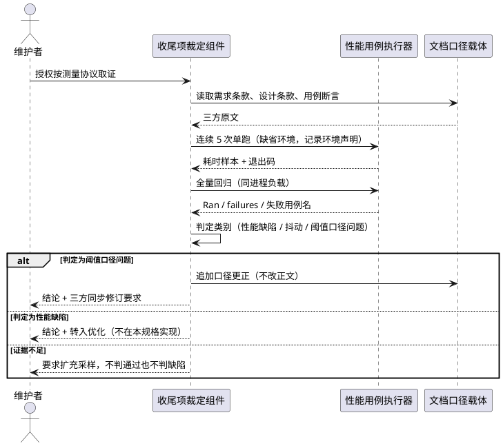
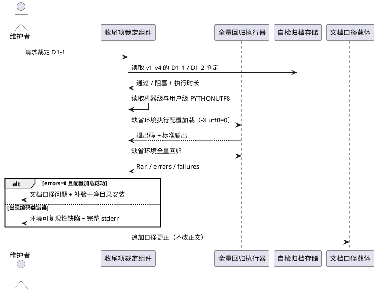
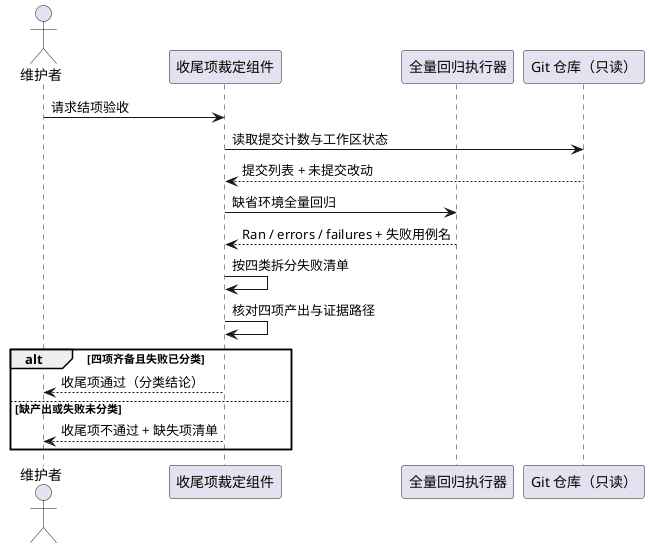

# **1. 组件定位**

## **1.1 核心职责**

本组件负责裁定 M14 收尾第 2 项的缺陷归属与判定口径，产出可复现的验收标准，供后续设计与编码直接引用。

## **1.2 核心输入**

1. **性能用例与运行输出**：`backend/tests/test_metrics_perf.py` 中两处同名 `PERF-02` 用例的执行结果（指标快照抓取耗时、评测摘要三元组耗时）与全量复算耗时；来源为缺省环境下的本机执行。
2. **缺省环境回归输出**：不预设 `PYTHONUTF8`、清空 `PYTHON*` 环境变量时全量回归的 `Ran/errors/failures` 计数与失败用例名；来源为归零执行与自检归档。
3. **自检归档**：`docs/devlog/selfcheck/SC-20261115T144308+0800-v1` 至 `SC-20261115T165051+0800-v4` 的 D1-1、D1-2 判定；只读，不得修改。
4. **既有需求与设计口径**：`.codeartsdoer/specs/metrics_recalc/spec.md` §4.1-2、`design.md` 的"性能预算与措施"、RK-02、PERF-02 验收表与 `capture_budget_ms` 定义。
5. **记录口径载体**：`README.md` §8、`docs/devlog/m13-analysis-plan.md` §2、`docs/devlog/m12-closure-and-blockers.md`、`docs/devlog/vcs-baseline.md` §7。
6. **维护者约束**：禁止调整断言阈值、禁止 sleep/跳过/减数据量"修绿"，禁止改动历史报告正文与已归档自检结果，禁止远端接入与补建五步留痕提交。

## **1.3 核心输出**

1. **缺陷归属裁定**：`PERF-02` 与 D1-1 各自的判定类别（性能缺陷 / 阈值口径问题；环境可复现性缺陷 / 文档口径问题）与判定依据。
2. **测量协议**：性能门槛的测量对象、测量范围、采样次数、环境声明与判定规则；D1-1 的环境定义与检查边界。
3. **验收标准与不在范围清单**：可被设计、编码、评审直接引用的验收条件与明确排除项。
4. **证据登记**：命令、退出码、样本数、耗时分布、环境声明、失败用例名的唯一登记位置。
5. **关联发现登记**：本项范围内外的新增事实（Git 化副作用、同名用例歧义、回归计数口径），只登记不擅自修复。
6. **口径更正登记**：对过期结论的追加式更正，不回改历史正文。

## **1.4 职责边界**

本组件明确不负责以下事项：

1. 不负责修改任何生产代码、测试代码、断言或性能门槛数值。
2. 不负责执行"调大阈值、加 sleep、跳过用例、削减数据量"等任何形式的修绿。
3. 不负责改动 `docs/devlog/selfcheck/SC-*` 归档、已归档报告正文与历史证据文件的既有内容。
4. 不负责重新定义 M1–M9 指标口径、窗口边界与阶段档。
5. 不负责补建五步留痕提交、接入远端仓库、接入华为云或任何云资源。
6. 不负责修复本项范围外的失败用例（含 Git 化后过期的 `check_devlog` 用例），只做登记与阻断关系说明。
7. 不负责把"8 个编码 error"作为待修项——经追溯该表述为计划值，全仓无缺陷清单、无归档输出，四次自检归档均为 `errors=0`。

# **2. 领域术语**

**性能缺陷**
: 在声明的环境与数据规模下可稳定复现的门槛超标，且能够归因于实现复杂度、资源占用或并发设计，而非一次性测量波动。

**阈值口径问题**
: 测量对象、测量范围、采样方法或判定语义与需求约束不一致，导致同一实现被不同口径判出不同结论的问题。

**环境可复现性缺陷**
: 在缺省环境（不预设编码类环境变量、清空 `PYTHON*`）下无法完成既定操作，或产生可复现的编码/解码失败。

**文档口径问题**
: 实现与机器判定已达标，但文档仍保留过期结论或未区分适用条件，导致对外表述与事实不一致的问题。

**测量协议**
: 对一个性能门槛所规定的测量对象、测量范围、数据规模、环境声明、采样次数、统计取值与判定规则的集合。

**抓取预算**
: 快照抓取阶段的时间预算，当前登记值为 200 毫秒，服务于复算读取不得阻塞主流程写入的目标。

**缺省环境**
: 不设置 `PYTHONUTF8`、`PYTHONIOENCODING`、`PYTHONPATH` 等 `PYTHON*` 变量的执行环境；Windows 下默认使用系统本地编码。

**干净环境**
: 显式清空全部 `PYTHON*` 变量、仅保留系统必要变量的子进程环境。

**稳定复现 / 偶发抖动**
: 稳定复现指相同输入与环境多次执行均得到同向结论；偶发抖动指仅在并发负载、冷启动或磁盘状态下出现、单跑不可复现的超门槛现象。

**同名用例歧义**
: 同一个编号 `PERF-02` 被同时用于"指标快照抓取预算"与"评测摘要三元组耗时"两个不同测量对象，导致报告与任务无法唯一指代。

**收尾项**
: 在既定路线中被明确列为下一项处理的最小工作单元，其完成以口径裁定与验收标准落地为准，不以代码改动数量为准。

# **3. 角色与边界**

## **3.1 核心角色**

- **维护者**：确认缺陷归属裁定、接受或驳回测量协议，对范围外事项作纳入/排除决策。
- **后续设计与编码执行者**：按本规格的验收标准产出技术设计与代码改动，不得自行解释门槛。
- **评审者 / 评委**：按本规格复核判定依据是否可复现、是否存在口径放宽。

## **3.2 外部系统**

- **性能用例执行器**：执行 `PERF-02` 等性能用例并输出耗时样本；只读调用，不修改用例。
- **全量回归执行器**：在缺省环境执行全量用例并输出 `Ran/errors/failures`；只读调用。
- **自检归档存储**：提供 SC-* 自检结论与 `selfcheck.json`；只读，禁止改写。
- **Git 仓库**：提供提交计数与工作区状态，用于证明改动边界；只读，禁止推送。
- **文档口径载体**：README、M13 计划、M12 收尾、VCS 基线等文档；只允许追加更正，不回改正文。

## **3.3 交互上下文**

```plantuml
@startuml
left to right direction
actor "维护者" as Owner
actor "后续设计与编码执行者" as Builder
actor "评审者 / 评委" as Reviewer
participant "收尾项裁定组件\n（本规格）" as Spec
participant "性能用例执行器" as Perf
participant "全量回归执行器" as Regress
participant "自检归档存储\n（SC-* / selfcheck.json）" as Archive
participant "文档口径载体" as Docs
participant "Git 仓库（只读）" as Git

Owner --> Spec : 确认范围与判定口径
Spec --> Perf : 按测量协议取样（只读执行）
Perf --> Spec : 耗时样本 + 环境声明
Spec --> Regress : 缺省环境全量回归（只读执行）
Regress --> Spec : Ran / errors / failures / 失败用例名
Spec --> Archive : 读取 D1-1 / D1-2 历史判定（只读）
Archive --> Spec : 判定 + 执行时长
Spec --> Docs : 追加口径更正（不改正文）
Spec --> Git : 读取提交计数与工作区状态（只读）
Spec --> Builder : 验收标准 + 禁止项 + 证据登记
Spec --> Reviewer : 判定结论 + 可复现证据
@enduml
```

# **4. DFX约束**

## **4.1 性能**

1. **门槛不得放宽**：`PERF-02` 的快照抓取 200ms、全量复算 60s、`PERF-01` 5s、`PERF-04` 3s 均保持原值；本规格不授权任何门槛调整。
2. **判定必须基于多样本**：任何性能结论必须基于不少于 5 次独立采样，并同时报告中位数、最大值与超门槛次数；单次样本不得作为性能缺陷的判定依据。
3. **测量范围必须显式**：每条耗时结论必须注明是否包含容器拷贝、字段脱敏、序列化、摘要计算与落盘写入。

## **4.2 可靠性**

1. **结论可复现**：任何判定必须附可重复执行的命令、退出码与输出摘要；换一台同规格机器按同一命令应得到同向结论。
2. **环境可声明**：每条证据必须声明操作系统、Python 版本、是否设置 `PYTHONUTF8` / `PYTHONIOENCODING`、并发负载状态。
3. **失败分类统计**：全量回归的 `failures` 必须按"性能抖动 / 过期用例 / 功能性失败"分类，不得合并为单一数字对外表述。

## **4.3 安全性**

1. **只读执行**：性能与回归取样不得写入业务数据、证据包或评测集；临时产物只落临时目录。
2. **不出网**：全部验证仅在本机执行，禁止访问远端仓库、云服务或外部目标。
3. **不涉凭据**：不得读取或写入任何真实凭据；环境声明中不得出现密钥、令牌。

## **4.4 可维护性**

1. **口径单一来源**：每个门槛的测量对象与判定规则只允许在本规格登记一次，其他文档只能引用，不得复制出新口径。
2. **证据可检索**：每条结论必须能按"命令 + 环境声明 + 样本文件路径"检索到唯一证据。
3. **追加式更正**：历史文档的过期结论只能以带日期的"口径更正"追加说明，禁止直接改写原文。

## **4.5 兼容性**

1. **历史不可变**：SC-* 自检归档、已归档报告正文与既有证据文件的字节内容保持不变。
2. **编号消歧**：涉及 `PERF-02` 的表述必须带限定词（`PERF-02/metrics-capture` 或 `PERF-02/eval-digest`），禁止裸写编号。
3. **持续可用**：本规格不改变既有复算服务、快照归档格式与只读保证。

# **5. 核心能力**

## **5.1 PERF-02 缺陷归属与阈值口径裁定**

### **5.1.1 业务规则**

1. **测量对象一致性**：`PERF-02` 的判定必须区分两类测量对象——"复算读取对主流程写入的阻塞时长"（需求约束对象）与"快照抓取端到端耗时"（含容器拷贝、字段脱敏、两次序列化、摘要计算与落盘写入）；两者不得互相替代。
   a. 验收条件：When 输出 `PERF-02` 结论，the 收尾项 shall 同时标注测量对象、测量范围与环境声明，缺任一项该结论无效。
2. **判定类别规则**：必须先判定类别，再讨论处置方案。
   a. 验收条件：When 5 次采样中不少于 4 次超门槛，且超门槛随数据规模增大而单调恶化，then the 收尾项 shall 判定为"性能缺陷"。
   b. 验收条件：When 5 次采样中不超过 1 次超门槛，且超门槛样本只出现在并发回归、冷启动或磁盘繁忙条件下，then the 收尾项 shall 判定为"偶发抖动"，并声明"证据不足，不得判通过、不得判缺陷"，要求按测量协议补充取证。
   c. 验收条件：When 测量对象、测量范围或判定语义与需求条款不一致，then the 收尾项 shall 判定为"阈值口径问题"，无论采样结果是否达标。
3. **本节裁定结论**：基于现有证据，`PERF-02/metrics-capture` 判定为**阈值口径问题（主）**，不判定为性能缺陷；理由为需求条款约束"读操作对主流程写入的阻塞"，而现有用例测量的是抓取端到端耗时，且设计明确"超预算告警但不阻断"，用例却以硬失败判定。
   a. 证据基线：缺省环境下单跑 5 次，抓取耗时依次为 177.2ms、169.2ms、171.1ms、168.7ms、181.4ms，5/5 低于 200ms；同次全量复算为 0.634s、0.517s、0.506s、0.515s、0.500s，5/5 低于 60s。
   b. 证据基线：自检归档 v4 的 D1-2 在同进程全量回归中出现 1 次 `PERF-02/metrics-capture` 超门槛（`failures=1`），与单跑结果相反，符合"偶发抖动"特征。
   c. 证据基线：README §8 已记录"0.25–0.37s > 0.2s，为测量抖动，单跑稳定通过"，与本次单跑样本同向。
4. **设计语义对齐**：既有设计规定"抓取耗时写入 `capture_ms`，超预算告警但不阻断"；用例以硬断言阻断，属规格、设计、用例三者语义不一致，必须三方同步修订，禁止只改用例。
   a. 验收条件：When 修订 `PERF-02` 判定语义，the 收尾项 shall 同时给出规格条款原文、设计条款原文与用例断言原文的对照，并标注修订前后差异。
5. **预算告警必须可观测**：配置中已登记 `metrics.capture_budget_ms = 200`，但当前全仓无消费点；"超预算告警不阻断"若作为设计语义保留，则必须有可观测的告警输出（报告中标记或告警记录），否则记为**实现缺口**而非性能缺陷。
   a. 验收条件：When 构造抓取耗时超过预算的样本，the 系统 shall 产出可检索的"超预算"标记，且复算仍继续执行并成功返回。
6. **禁止修绿**：禁止以提高门槛、加入等待、跳过用例、削减数据量、关闭校验等方式使 `PERF-02` "通过"。
   a. 验收条件：If 变更集包含门槛数值调大、`sleep`、`skip`、数据量下降或断言删除，then the 收尾项 shall 判定该变更不合规并拒绝验收。
7. **同名用例消歧**：`PERF-02` 同时指代"指标快照抓取预算"与"评测摘要三元组耗时"，两者测量对象、门槛（200ms / 500ms）与判定语义均不同。
   a. 验收条件：When 任一文档、任务或报告引用 `PERF-02`，the 收尾项 shall 要求带限定词，未带限定词的引用视为口径缺陷。
8. **结论必须附证据**：每条裁定必须给出命令、退出码、样本数、耗时分布、环境声明与失败用例名，缺任一项不得写入对外材料。
   a. 验收条件：When 裁定结果进入设计或结项材料，the 收尾项 shall 能按登记路径复读出同一组样本与退出码。

### **5.1.2 交互流程**



### **5.1.3 异常场景**

1. **单次样本超门槛即被判缺陷**
   a. 触发条件：仅凭一次失败样本将 `PERF-02/metrics-capture` 判为性能缺陷。
   b. 系统行为：拒绝该结论，要求补足不少于 5 次采样并区分并发负载与冷启动。
   c. 用户感知：提示"样本数不足，结论无效（需 ≥5 次，含中位数与最大值）"。
2. **用调阈值实现通过**
   a. 触发条件：变更集将 200ms 门槛调大或删除断言。
   b. 系统行为：判定不合规，拒绝验收并在证据登记中记录被拒原因。
   c. 用户感知：提示"门槛调整不在本项授权范围，需另行需求变更"。
3. **测量对象与门槛错配**
   a. 触发条件：以抓取端到端耗时直接证明"写阻塞 ≤200ms"。
   b. 系统行为：判定为阈值口径问题，并要求新增可区分"写阻塞增量"的测量。
   c. 用户感知：提示"测量对象不一致，结论不得用于该需求条款"。
4. **预算告警不可观测**
   a. 触发条件：抓取耗时超过 200ms 但系统无任何"超预算"标记。
   b. 系统行为：记为实现缺口，不记为性能缺陷；同时在复算结果中保留成功状态。
   c. 用户感知：报告中显示"抓取超预算（告警）"，复算结论仍有效。
5. **同名编号混用**
   a. 触发条件：报告中的 `PERF-02` 未限定，读者无法判断是抓取预算还是摘要三元组。
   b. 系统行为：拒绝该表述，要求补充限定词并重述门槛值。
   c. 用户感知：提示"PERF-02 存在同名歧义，请注明 metrics-capture 或 eval-digest"。

## **5.2 D1-1 环境可复现性口径裁定**

### **5.2.1 业务规则**

1. **以机器判定为准**：D1-1 的状态以可复现命令与自检归档为准，不以计划表中的历史观测为准。
   a. 验收条件：When 计划表与机器判定冲突，the 收尾项 shall 采用机器判定，并将计划表标注为"过期观测"，不得据此宣称存在编码缺陷。
2. **本节裁定结论**：D1-1 判定为**文档口径问题**，不判定为环境可复现性缺陷。
   a. 证据基线：自检归档 v4 的 D1-1 为"通过"，命令为干净环境加载配置，耗时 0.25s。
   b. 证据基线：本机 `python -X utf8=0 -c "<加载配置并打印 config ok>"` 退出码 0；机器级与用户级 `PYTHONUTF8` 均为空。
   c. 证据基线：配置加载对配置文件使用显式 UTF-8 解码；全量回归在缺省环境得到 `errors=0`，不存在"8 个编码 error"。
3. **缺陷判定条件**：只有当缺省环境出现可复现的编码/解码失败，或全量回归出现 `errors>0` 的编码类错误时，才可判定为环境可复现性缺陷。
   a. 验收条件：When 缺省环境下配置加载失败且错误信息含编码异常，then the 收尾项 shall 判定为"环境可复现性缺陷"并附完整 stderr。
   b. 验收条件：When 缺省环境下配置加载成功且全量回归 `errors=0`，then the 收尾项 shall 判定为"文档口径问题"，不得再使用"依赖 PYTHONUTF8"的表述。
4. **检查边界必须声明**：D1-1 的原始语义包含"干净目录导出、安装依赖、加载配置"三层；现有自动检查只覆盖配置加载一层，"干净目录从零安装 + 全量回归"尚未形成归档证据。
   a. 验收条件：When 声称 D1-1 通过，the 收尾项 shall 明确通过的是哪一层；未覆盖的层次必须登记为"证据缺口"，不得整体声称通过。
5. **证据缺口必须补验**：干净目录从零安装并执行全量回归必须作为独立验收项补验一次，产出命令、退出码与 `Ran/errors/failures`。
   a. 验收条件：When 补验在缺省环境执行完成，the 收尾项 shall 登记用例总数、错误数、失败数与失败用例名；若出现编码类错误，则按第 3 条升级为环境缺陷。
6. **缺省环境定义固定**：缺省环境指不设置 `PYTHONUTF8`、`PYTHONIOENCODING`、`PYTHONPATH`；干净环境指清空全部 `PYTHON*` 变量并仅保留系统必要变量。
   a. 验收条件：When 记录任一证据，the 收尾项 shall 写明使用的环境模式与保留变量集合，禁止只写"默认环境"。
7. **历史不可变**：不得修改 SC-* 归档与历史报告正文；过期结论只能以追加式更正登记。
   a. 验收条件：When 更正过期结论，the 收尾项 shall 在新文档中登记"更正日期、原表述位置、机器证据、新结论"，原文件字节不变。
8. **禁止新增隐式编码依赖**：后续改动不得引入对 `PYTHONUTF8` / `PYTHONIOENCODING` 的隐式依赖，文件读写必须显式声明编码。
   a. 验收条件：If 变更集新增未声明编码的文本读写，then the 收尾项 shall 判定该变更不可复现并拒绝验收。

### **5.2.2 交互流程**



### **5.2.3 异常场景**

1. **继续沿用"依赖 PYTHONUTF8"表述**
   a. 触发条件：在缺省环境已通过的情况下，文档仍写"依赖 PYTHONUTF8"。
   b. 系统行为：判定为文档口径问题，要求追加更正并停止对外使用该表述。
   c. 用户感知：提示"该结论已被机器判定推翻，需登记更正依据"。
2. **把"配置加载通过"等同于"D1-1 全通过"**
   a. 触发条件：仅凭配置加载成功即宣称干净目录安装与全量回归可复现。
   b. 系统行为：拒绝该结论，登记"证据缺口"，要求补验干净目录层。
   c. 用户感知：提示"D1-1 仅覆盖配置加载层，安装层待补验"。
3. **环境声明缺失**
   a. 触发条件：证据只写"默认环境"，未说明 `PYTHON*` 变量状态。
   b. 系统行为：判定证据不可复现，退回重取。
   c. 用户感知：提示"环境声明不完整，至少需声明 PYTHONUTF8 与 PYTHONIOENCODING 状态"。
4. **以修改归档实现"更正"**
   a. 触发条件：直接编辑 SC-* 归档或历史报告正文。
   b. 系统行为：拒绝该操作，要求在新文档追加更正并保留原文件字节。
   c. 用户感知：提示"历史载体不可修改，更正只能追加"。

## **5.3 收尾验收与回归基线治理**

### **5.3.1 业务规则**

1. **完成定义**：本收尾项的完成以"归属裁定 + 测量协议 + 验收标准 + 证据登记"四件产出为准，不以代码改动数量或失败用例清零为准。
   a. 验收条件：When 本项结项，the 收尾项 shall 同时提供四项产出及对应证据路径。
2. **回归失败分类**：全量回归的失败必须按 `PERF-02/metrics-capture`、`PERF-02/eval-digest`、过期用例、功能性失败四类分别统计。
   a. 验收条件：When 输出回归结论，the 收尾项 shall 给出 `Ran`、`errors`、`failures` 与四类失败清单，禁止只给总数。
3. **回归基线快照**：必须以缺省环境的一次全量回归作为本项基线，登记失败用例名与耗时。
   a. 验收条件：When 基线生成，the 收尾项 shall 记录命令、环境声明、用例总数、错误数、失败数与失败用例全名。
4. **关联发现只登记**：本项发现的范围外事实必须登记标题、复现命令、稳定性、归属与阻断关系，不得在本项内擅自修复。
   a. 验收条件：When 发现新的可复现失败，the 收尾项 shall 将其登记为关联发现并标注"本项范围外/后续决策"。
5. **"8 个编码 error"退出待修清单**：该表述经追溯为计划值，无缺陷清单、无归档输出，且四次自检归档均为 `errors=0`；本项不得将其列为待修项。
   a. 验收条件：When 对外复述待修项，the 收尾项 shall 只列 `PERF-02` 与 D1-1，并注明"8 个编码 error"的口径来源与排除依据。
6. **表述纪律**：不得把本项结论表述为"性能已优化""全部用例通过"或"可复现性已修复"；只允许按裁定类别表述。
   a. 验收条件：If 结项材料出现上述绝对化表述，then the 收尾项 shall 判定表述不合规并要求改为分类结论。

### **5.3.2 交互流程**



### **5.3.3 异常场景**

1. **合并统计掩盖失败**
   a. 触发条件：以"功能性失败 0"覆盖性能抖动与过期用例。
   b. 系统行为：拒绝该结论，要求四类分列并给出失败用例名。
   c. 用户感知：提示"回归结论缺少分类，不可作为结项依据"。
2. **关联发现被顺手修复**
   a. 触发条件：在未决策的情况下修改过期用例或产品逻辑。
   b. 系统行为：判定越界，回滚该改动并登记为待决策事项。
   c. 用户感知：提示"关联发现不在本项范围，需维护者单独立项"。
3. **结论表述绝对化**
   a. 触发条件：材料中出现"性能已优化""全部通过""已修复"等表述。
   b. 系统行为：判定表述不合规，要求按裁定类别改写。
   c. 用户感知：提示"结论必须带类别与证据，禁止绝对化表述"。

# **6. 数据约束**

## **6.1 性能测量样本**

1. **用例编号**：必须带限定词，取值为 `PERF-02/metrics-capture` 或 `PERF-02/eval-digest`，禁止裸写 `PERF-02`。
2. **测量对象**：必须明确是"抓取端到端耗时""写阻塞增量"还是"评测摘要三元组耗时"。
3. **测量范围**：必须逐项标注是否包含容器拷贝、字段脱敏、序列化、摘要计算、落盘写入。
4. **数据规模**：必须记录 Issue 数与事件数；禁止在不同数据规模之间比较耗时。
5. **环境声明**：必须记录操作系统、Python 版本、`PYTHONUTF8` 与 `PYTHONIOENCODING` 状态、是否处于并发回归负载。
6. **样本序号与取值**：必须记录采样序号、每次耗时、中位数与最大值；样本数不得少于 5。
7. **退出码**：必须记录用例退出码与失败用例全名。
8. **采集时间**：必须记录采集日期，精确到分钟。

## **6.2 可复现性检查记录**

1. **检查编号**：取值为 D1-1 或 D1-2。
2. **环境模式**：取值为缺省环境或干净环境；干净环境必须同时记录保留变量集合。
3. **命令**：必须为可直接复制的完整命令。
4. **退出码与计数**：必须记录退出码、用例总数、错误数、失败数。
5. **失败用例名**：存在失败时必须列出全名，不得只给数量。
6. **覆盖层次**：D1-1 必须标注覆盖的是"配置加载层"还是"干净目录安装层"。
7. **结论与依据**：结论必须可追溯至命令输出或自检归档，不得只写结论。

## **6.3 口径裁定记录**

1. **主题**：取值为 `PERF-02/metrics-capture` 或 `D1-1`。
2. **判定类别**：取值为性能缺陷、阈值口径问题、环境可复现性缺陷、文档口径问题之一。
3. **原口径引用**：必须给出原表述所在的文档路径与条款位置。
4. **依据**：必须列出命令、样本数、耗时分布或 `Ran/errors/failures`。
5. **生效日期**：必须记录裁定生效日期。
6. **不可变载体**：必须列出本次不修改的历史文件清单，确保更正为追加式。

## **6.4 关联发现登记**

1. **编号**：唯一且稳定，形如 `RF-01`。
2. **标题**：一句话描述现象。
3. **复现命令**：必须可直接执行。
4. **稳定性**：取值为稳定复现或偶发。
5. **归属**：取值为本项范围或范围外。
6. **阻断关系**：说明是否阻断"全量回归 failures 清零"或"结项验收"。
7. **处理建议**：只给建议，不在本项内实施。