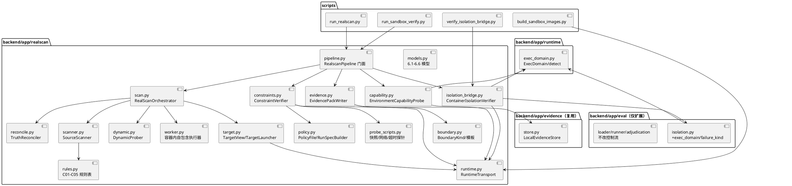
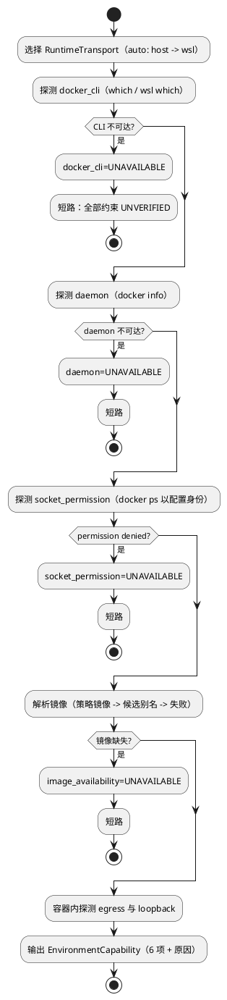
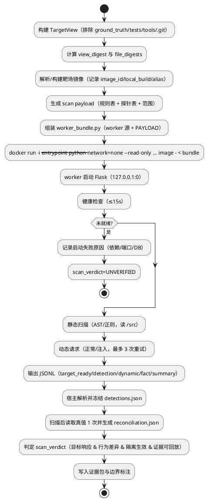
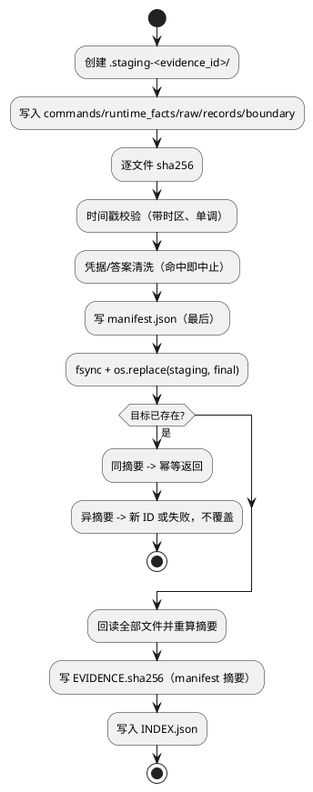
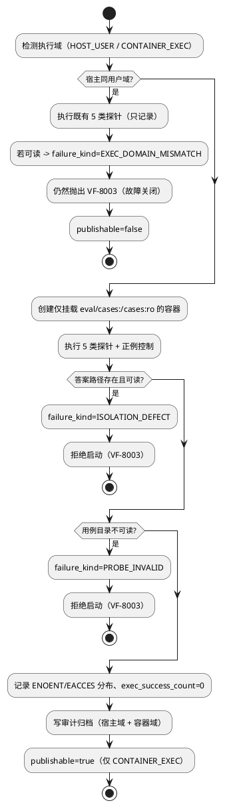
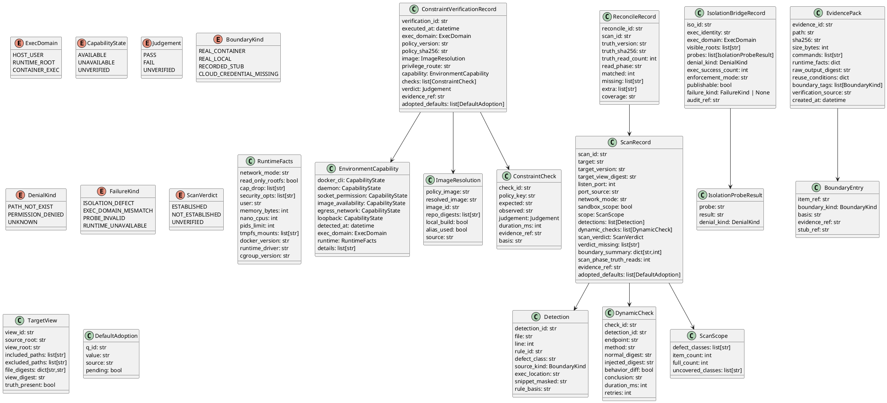

# 沙箱约束实测验证与靶场真扫 · 增量设计方案

> 需求依据：`.codeartsdoer/specs/sandbox_realscan/spec.md` v1.0（2026-11-13，677 行）
> 设计日期：2026-11-14
> 设计范围：spec 5.1（沙箱约束可执行验证）、5.2（靶场接入与真扫）、5.3（证据留痕与边界标注）、5.4（与 `eval_leak_hardening` 的口径衔接），以及 6.1–6.6 数据约束、7.1 K-01…K-10、7.2 Q-01…Q-10
> 本文档只描述"如何构建"，不包含可执行实现代码；不修改任何产品代码、测试代码、数据目录或历史报告。

---

## 0. 设计前置约定

### 0.1 需求编号映射规则

| 设计条目前缀 | 对应需求 |
|---|---|
| `DES-SBX-*` | spec 5.1 沙箱约束验证（含 P4-01…P4-05） |
| `DES-SCAN-*` | spec 5.2 靶场接入与真扫 |
| `DES-EVD-*` | spec 5.3 证据留痕与边界标注 |
| `DES-ISO-*` | spec 5.4 与 `eval_leak_hardening` 的口径衔接 |
| `DES-CFG-*` | 配置、错误码、CLI 与兼容性 |
| `DES-DOC-*` | 报告与证据交付 |
| `T-*` | 验证用例编号（unittest） |

编号格式固定为 `DES-<域>-<两位序号>`，供 tasks 阶段直接拆解；每条设计条目必须能追溯到至少一个 spec 条目和一个验证项。

### 0.2 代码事实基线（2026-11-14 实检索确认）

| 事实 | 代码/文件位置 | 对设计的约束 |
|---|---|---|
| 沙箱策略为 `sandbox/spec.json` v1.0.0，`isolation` 实际有 **11 个键**（network、source_mount、root_filesystem、timeout_seconds、memory_mb、cpu、user、cap_drop、no_new_privileges、pids_limit、tmpfs） | `sandbox/spec.json:2-16` | spec 5.1.1-3 表述"10 项"；设计按 **10 个判定类别**（把 root_filesystem 与 tmpfs 合并为"文件系统可写面"）覆盖 11 个键，缺项数仍为 0，并在报告中显式登记该口径差异 D-01 |
| 逃逸用例固定 5 条：P4-01 read_dot_git、P4-02 write_source_tree、P4-03 outbound_network、P4-04 privilege_escalation、P4-05 infinite_loop | `sandbox/spec.json:17-23` | 判定与证据必须逐条对应，禁止合并成一条 PASS |
| 策略声明镜像为 `verifix-sandbox:1.0.0`，但本地实际不存在该镜像；本地存在 `verifix-runner:latest`（ID `sha256:bcb47408…`，131 MB）与 `realscan-probe:local`（ID `sha256:78f36923…`，132 MB，Flask 3.1.3，`USER 10001`，`WORKDIR /target`） | `sandbox/spec.json:24`；`sandbox/Dockerfile.runner:1-7`；2026-11-14 实检 `docker images --digests` | 设计必须引入"镜像解析与别名登记"，不得静默替换；镜像别名使用必须在证据中可检索 |
| 现有沙箱执行器只做 argv 文本自检，不回读容器实际配置 | `backend/app/tools/sandbox.py:78-116` | 5.1.9 必须新增 `docker inspect` 实际配置比对，不能复用 `isolation_report()` 结案 |
| 现有超时由宿主侧 `subprocess.run(timeout=60)` 实现，超时仅杀死 docker CLI 进程，容器可能残留 | `backend/app/tools/sandbox.py:134-161` | P4-05 必须使用具名容器 + 显式 `docker kill/rm -f`，并在 `finally` 清理；该残留风险登记为 R-03 |
| 现有 `preflight()` 只检查 `docker` 是否在 PATH | `backend/app/tools/sandbox.py:118-125` | 环境能力四要素与 WSL2 执行域必须新增独立探测，不得把"CLI 存在"当作"沙箱可用" |
| 本地执行器如实声明 `network_disabled=False`、`read_only=False` | `backend/app/agents/reproducer/executor.py:34-45` | 可作为"真实本地执行"的边界依据；不得被引用为容器约束证据 |
| 沙箱执行器的 `env_snapshot` 是**声明值**，不是实测值 | `backend/app/agents/reproducer/executor.py:93-103` | 5.1.2 要求执行域与实测事实，新增记录不得复用该声明值作为证据 |
| 评测启动强制自检在宿主同用户域执行：`AnswerIsolationGuard.self_check()` 失败即抛 `EVAL_ISOLATION_UNMET`（VF-8003） | `backend/app/eval/isolation.py:172-197`；`backend/app/api/envelope.py:41,86` | K-02 处置只能"新增分类 + 保持故障关闭"，不得改放行分支 |
| 隔离探针 5 类：enumerate、open、relative、traversal、symlink | `backend/app/eval/isolation.py:90-109` | 5.4 的容器执行身份探针必须沿用同一探针集合与同一结论字段语义 |
| 审计记录为内存列表 + JSONL 追加归档；写入失败抛 VF-8008 | `backend/app/eval/isolation.py:27-55` | 容器域拒绝记录必须写入可检索归档；不得只留在内存 |
| 评测观测的 `detected` 来自"用例输入构造的告警经归一化"，不是源码扫描 | `backend/app/eval/runner.py:248-306` | 5.2.3 真扫必须新增独立扫描器；不得把评测路径当作真扫 |
| 评测复现使用 `LocalTestExecutor` | `backend/app/eval/runner.py:203` | M2 的 10/10 为本地执行结论，不得并入沙箱真扫统计 |
| 答案读取只允许 `JUDGE` 身份，`EXEC` 读取会写审计并抛 `EVAL_PATH_FORBIDDEN` | `backend/app/eval/loader.py:48-90` | 5.4.7 的"执行身份成功读取数恒为 0"可在应用层审计与容器域证据两侧同时验证 |
| 三摘要算法：`content_digest`、`file_digest`、`directory_digest`、`binding_digest` | `backend/app/eval/digest.py:9-44` | 证据摘要与靶场视图摘要复用同一 SHA-256 规范，不另立算法 |
| 泄漏扫描敏感词包含 `category`、`reachable`、`expected_fix_kind`、`ground_truth` 等 | `backend/app/eval/leak_scan.py:8-24` | 新证据字段必须避开这些键名：使用 `defect_class`、`dynamic_verdict`、`behavior_diff`，避免自触发泄漏扫描 |
| 靶场共 11 个路由，缺陷分布在 `app/main.py:31/41/50/58/66/74/81/87/93/99` 与 `app/config.py:1-2` | `verifix-target/app/main.py:23-100`；`verifix-target/app/config.py:1-4` | 扫描定位必须与真实源码行一致；C05 检出必须对字面量做掩码 |
| 真值清单 15 项：C01=3、C02=6、C03=4、C05=2，版本 1.0.0 | `verifix-target/ground_truth.json:1-161`；`verifix-target/tools/verify_ground_truth.py:9` | Q-05 默认全量 15 项；对账只在检出冻结后进行 |
| 靶场默认数据库路径位于源码树 `verifix-target/target.db`，但 `create_app(db_path)` 支持覆盖，`init_db.create(path)` 支持任意可写路径 | `verifix-target/app/main.py:12-18`；`verifix-target/init_db.py:7,25-34` | 真扫必须设置 `VERIFIX_TARGET_DB=/tmp/target.db`，否则只读根文件系统下启动即失败 |
| 靶场 `requirements.txt` pins 为 flask==1.1.1、requests==2.19.1、PyYAML==5.1、Jinja2==2.10.1 | `verifix-target/requirements.txt:1-4` | Python 3.12 下 flask 1.1.1 不可安装；必须另设运行期依赖 lock，**不得修改**该文件 |
| 现有 `scripts/m1_detect_acceptance.py` 直接读取 `ground_truth.json` 构造 `RecordedCheckClient` 告警 | `scripts/m1_detect_acceptance.py:23-57` | M1 10/10 确认为真值派生的录制桩结果；新报告必须单列并打 `RECORDED_STUB` |
| 现有 `scripts/smoke_m0.py` 是状态机事件链冒烟，不是沙箱验证脚本 | `scripts/smoke_m0.py:17-78` | M0 证据缺少可复现脚本；本轮必须新增 `scripts/run_sandbox_verify.py` |
| M0 报告结论 PASS，但 P4-05 明确"本轮未测" | `docs/devlog/m0-sandbox-verification.md:31-37` | K-04 必须补测 P4-05，不得沿用"整体 PASS"概括 |
| M1 报告 10/10 仅覆盖 C02/C03 | `docs/devlog/m1-detect-report.md:10-23` | K-07 必须声明范围，子集不得表述为全量 |
| 后端依赖无 pytest；镜像内 pytest 8.3.4 不作为项目测试依赖 | `backend/requirements.txt:1-7`；`sandbox/Dockerfile.runner:3` | 新增测试一律标准库 unittest |
| 宿主 Windows 无 docker CLI；WSL2 Debian 13 内 docker 26.1.5、daemon 运行、非 root socket `permission denied`、root 可用、cgroup v2、overlay2 | spec 1.5；2026-11-14 实检 `wsl.exe -d Debian -u root -- docker version`、`docker info --format`、`wsl.exe -d Debian -- docker ps` | 执行域必须声明 `RUNTIME_ROOT`；提权途径记录为 `WSL_DISTRO_ROOT`；不得尝试绕过 socket 权限 |
| 工作区非 Git 仓库；靶场源码树无 `.git` | 环境事实；`verifix-target/` 目录实检 | P4-01 只能以"合成等价夹具 + 挂载面裁剪"验证，并标注 `fixture=true`，不得声称验证了真实 `.git` 〔2026-11-18 前提变更：现已成为 Git 仓库；P4-01 仍以合成夹具为准，`fixture=true` 结论不升级。〕 |

### 0.3 设计范围与明确不改清单

**新增（允许）**

- `backend/app/realscan/` 新包（约束验证、靶场视图、独立扫描、证据、隔离桥接）
- `backend/app/runtime/exec_domain.py` 执行域判定
- `sandbox/Dockerfile.target`、`sandbox/requirements.target.txt`、`sandbox/Dockerfile.sandbox`（策略镜像构建）
- `scripts/run_sandbox_verify.py`、`scripts/run_realscan.py`、`scripts/verify_isolation_bridge.py`、`scripts/build_sandbox_images.py`
- `backend/tests/test_sandbox_verify_*.py`、`backend/tests/test_realscan_*.py`、`backend/tests/test_eval_isolation_bridge.py`
- `.evidence/sandbox-realscan/` 新证据根；`docs/devlog/m6-*.md`、`m7-*.md`、`m8-*.md`

**扩展（允许，语义只增不减）**

- `backend/app/eval/isolation.py`：`IsolationVerdict` 增加 `exec_domain/failure_kind/publishable`；`self_check` 增加可选 `exec_domain` 入参；**失败仍然抛出 VF-8003**
- `backend/app/config.py`：新增 `RealscanConfig` 子模型并接入 `AppConfig`
- `backend/app/api/envelope.py`：新增 3 个错误码及规格

**绝对不改**

- `sandbox/spec.json` 的 11 个隔离参数与 5 条逃逸用例（4.3.1、5.1.1-15）
- `verifix-target/app/main.py`、`app/config.py`、`requirements.txt`、`ground_truth.json`、`init_db.py`、`tests/`（1.4-1）
- `backend/app/eval/{loader,runner,adjudication,digest,models,leak_scan}.py` 的既有控制流与判定语义
- `backend/app/eval/isolation.py` 的故障关闭行为（只增字段，不放行）
- `backend/tests/` 既有测试文件的断言与通过数
- `eval/expected/`、`eval/runs/`、`eval/verdicts/`（Q-09=A）
- `docs/devlog/m0-sandbox-verification.md`、`m1-*.md`、`m2-*.md`、`m3-*.md`、`m5-*.md`
- `.evidence/sandbox/M0-SANDBOX-20261113T171337.txt`、`.evidence/metrics-recalc/`
- `backend/app/tools/mcp.py` 的 8 个白名单工具（不新增第 9 个工具）
- `backend/app/domain/models.py` 的 `EnvSnapshot` 语义（4.5.1）
- `backend/app/main.py` 的既有 API 路由（本轮以 CLI 为主，不新增对外路由）

### 0.4 实检索发现的五个关键差异（直接决定设计取舍）

1. **D-01 隔离参数计数差异**：spec 写"10 项"，策略文件实际 11 个键。设计按 10 个判定类别覆盖 11 个键（rootfs 与 tmpfs 合并为"文件系统可写面"），报告同时输出"策略键数 11 / 判定类别 10 / 缺项 0"。
2. **D-02 `:ro` 不能阻止读取 `.git`**：P4-01 若仅依赖 `--volume=...:ro`，读取 `.git/config` 会成功。P4-01 必须靠**挂载面裁剪**（视图不含 `.git`），`:ro` 只承担写入拒绝（P4-02）。M0 报告的 P4-01 判定依据不足以证明"不可读"。
3. **D-03 镜像名不一致**：策略镜像未构建，本地实际镜像是 `verifix-runner:latest` 与未登记的 `realscan-probe:local`。设计新增镜像构建与"策略镜像优先、别名显式登记"的解析规则。
4. **D-04 真值派生确证**：M1 脚本直接从 `ground_truth.json` 造告警，M1 的 10/10 不是真扫结果；本地已存在 `realscan-probe:local` 镜像也不构成真扫证据。新真扫必须使用裁剪视图 + 独立规则 + 真实 HTTP 请求。
5. **D-05 靶场运行依赖不可直接复用**：pins 的 Flask 1.1.1 无法在 Python 3.12 安装；运行镜像必须使用独立 lock（Flask 3.1.3），且 C01 只做静态版本检出，不依赖运行期安装旧版本。

---

# 一、需求与存量功能关系分析

## 1.1 需求功能与存量功能对比

### 1.1.1 已实现功能

| 需求功能 | 存量功能 | 代码位置 | 匹配度 |
|---|---|---|---|
| 隔离参数映射为容器运行参数 | `SandboxRunner.build_argv` 生成 network=none、read-only、cap-drop、no-new-privileges、user、memory、cpu、pids、两处 tmpfs、`:ro` 源挂载 | `backend/app/tools/sandbox.py:78-104` | 75%（参数齐全，但无 `--name`、无实际配置回读、镜像名与策略不一致） |
| 策略版本与资源上限约束 | `SandboxPolicy` + `SandboxConfig`（mem/cpu/seconds 上限硬校验） | `backend/app/tools/sandbox.py:19-48`；`backend/app/config.py:81-87` | 75%（策略文件不是唯一来源，`spec.json` 未被读取） |
| 超时执行机制 | `subprocess.run(timeout=60)`，超时返回 exit_code=124、`timed_out=True` | `backend/app/tools/sandbox.py:134-161` | 75%（机制存在，但无 P4-05 实测证据、无容器残留清理） |
| 容器可用前置检查 | `preflight()` 仅检查 `docker` 是否在 PATH + argv 文本自检 | `backend/app/tools/sandbox.py:118-125` | 50%（缺 daemon、socket 权限、镜像、网络能力） |
| 执行身份/能力面声明 | argv 文本含 `--user=10001:10001`、`--cap-drop=ALL`，`isolation_report` 做字符串包含判断 | `backend/app/tools/sandbox.py:88,106-116` | 50%（只证"命令行这样写"，不证"容器内实际生效"） |
| 环境快照结构 | `EnvSnapshot(network_disabled, read_only, timeout_seconds, memory_mb, uid)`；本地执行器如实标 False，沙箱执行器标 True | `backend/app/agents/reproducer/executor.py:34-45,93-103` | 100%（结构可用），但沙箱侧为声明值 |
| 沙箱测试执行入口 | `SandboxRunner.run_tests` + `LocalWorkspace.run_tests` | `backend/app/tools/sandbox.py:127-171`；`backend/app/tools/workspace.py:83-85` | 100%（既有 MCP `workspace.run_tests` 行为） |
| 应用层隔离探针 5 类 | `PermissionProbe.probe_denied` 覆盖 enumerate/open/relative/traversal/symlink；`cases_readable` 做反向探针 | `backend/app/eval/isolation.py:90-121` | 100%（宿主域），容器域 0% |
| 审计记录 | `AccessAuditLog.record/search/exec_success_count`，JSONL 追加归档 | `backend/app/eval/isolation.py:27-55` | 100%（宿主域），容器域合并 0% |
| 隔离失败关闭 | `self_check` 不满足即抛 `ApiError(EVAL_ISOLATION_UNMET)` | `backend/app/eval/isolation.py:172-197`；`backend/app/api/envelope.py:41,86` | 100%（必须保持） |
| 答案读取身份限制 | `ExpectedAnswerReader.load(actor=JUDGE)`，非 JUDGE 写审计并抛 `EVAL_PATH_FORBIDDEN` | `backend/app/eval/loader.py:48-90` | 100%（应用层） |
| 证据文件锁定写入与校验 | `LocalEvidenceStore.put_locked/read/verify` | `backend/app/evidence/store.py:35-74` | 100%（单文件级） |
| 摘要算法 | `content_digest/file_digest/directory_digest/binding_digest` | `backend/app/eval/digest.py:9-44` | 100%（可复用） |
| 评测观测与裁决分离 | `EvalObservation` + `AdjudicationService` + 三摘要绑定 | `backend/app/eval/models.py:71-90`；`backend/app/eval/adjudication.py:30-91` | 100%（评测内部），不含真扫 |
| 靶场 HTTP 服务 | Flask 11 个路由，含 SQL/命令注入与硬编码凭据 | `verifix-target/app/main.py:23-100` | 100%（被测目标） |
| 靶场建库与种子数据 | `init_db.create(path)`，支持任意可写路径 | `verifix-target/init_db.py:9-34` | 100% |
| 真值自校验 | `verify_ground_truth.verify()` 校验 15 项、文件行、needle、依赖声明、类别分布 | `verifix-target/tools/verify_ground_truth.py:9-41` | 100% |
| 测试框架 | 标准库 `unittest`；pytest 仅作为镜像内可选组件，不作为项目依赖 | `backend/tests/*.py`；`sandbox/Dockerfile.runner:3` | 100% |
| 开发留痕规范 | `docs/devlog/00-conventions.md`，历史报告只读 | `docs/devlog/00-conventions.md:1-30` | 100% |
| 容器运行时调用 | `subprocess.run` 直接调用 `docker` | `backend/app/tools/sandbox.py:136-144` | 50%（Windows 宿主无 CLI，未支持 WSL 执行域） |

### 1.1.2 需要扩展的功能

| 需求功能 | 存量功能 | 差异说明 | 扩展方向 |
|---|---|---|---|
| 环境能力前置探测（5.1.1-1） | `preflight()` 仅查 CLI | 输入差异：需 CLI/daemon/socket/镜像/外网/回环六项；输出差异：需逐项状态与原因；业务差异：四项任一不可用即全量未验证 | 新增 `EnvironmentCapabilityProbe`；`preflight` 保留原语义不动；CLI 通过 `RuntimeTransport` 抽象宿主/WSL 两种执行域 |
| 运行参数一致性（5.1.1-9） | `isolation_report()` 文本包含判断 | 事实来源差异：文本 argv vs `docker inspect` 实际配置；字段差异：需网络/只读/能力/安全选项/用户/资源/tmpfs 六类逐字段 | 新增 `RunSpecBuilder` + `ConfigReadbackComparator`；`SandboxRunner` 不改 |
| 执行域显式声明（5.1.1-2） | 无执行域字段 | 记录缺失；跨域继承无检测 | 新增 `ExecDomain` 枚举与 `detect_exec_domain()`；所有记录强制携带 |
| 提权方式留痕（5.1.1-12） | 无 | 需记录 `WSL_DISTRO_ROOT` 类别，不记录凭据 | `RuntimeTransport.privilege_route` 只输出类别字符串；证据写入前做凭据扫描 |
| 镜像摘要完整记录（5.1.1-11） | 无 | 需同时记录 image_id 与 repo digests；本地构建需显式标注 | 新增 `ImageResolution` 模型；镜像别名/本地构建布尔位进入证据 |
| 强制自检冲突分类（5.4.1-5） | `self_check` 只给 basis | 需新增"执行域不匹配"分类，且不得改变拒绝启动 | `IsolationVerdict` 增加 `failure_kind`；basis 前缀化；仍抛 VF-8003 |
| 审计合并可检索（5.4.1-7） | `search` 只查内存 | 需跨进程/跨域按 run_ref 检索 | 新增只读 `AuditArchiveQuery`，读取同一 JSONL 归档 |
| 配置承载（5.1/5.2） | 无 realscan 配置段 | 需策略路径、镜像候选、端口、扫描范围、超时、证据根、宿主回退开关 | `AppConfig` 新增 `RealscanConfig`，保持 `extra="forbid"` |
| 错误码（5.1/5.2 失败路径） | 无沙箱/真扫专用码 | 需区分"沙箱不可验证""真扫不成立""证据不一致" | 新增 VF-8010/8011/8012，沿用 VF-7001/8003/8005 |
| 留痕报告（5.3.1-7） | M0 手工报告、M1 派生报告 | 需新增可复算报告与并列关系，不改历史 | 新增 m6/m7/m8 与索引，历史摘要基线锁定 |

### 1.1.3 需要新增的功能或接口

**A. 执行域与环境能力（依赖：无）**

| 功能点 | 输入 | 输出 | 核心逻辑 | 依赖 |
|---|---|---|---|---|
| 执行域判定 | 进程环境（`/.dockerenv`、`os.geteuid`、运行时传输类型） | `HOST_USER / RUNTIME_ROOT / CONTAINER_EXEC` | 容器内非 root → CONTAINER_EXEC；容器内 root 或 WSL root 调 docker → RUNTIME_ROOT；否则 HOST_USER | 标准库 |
| 运行时传输 | argv、超时、工作目录 | `CommandResult(exit_code, stdout, stderr, duration_ms, timed_out)` | 宿主 `docker` 与 `wsl.exe -d Debian -u root -- docker` 两种；`WSL_UTF8=1`；不接受交互输入 | `subprocess` |
| 能力探测 | 传输、镜像候选、探测超时 | `EnvironmentCapability`（6 项状态 + 原因） | 六项独立探测；总时延 ≤15s；任一项 UNAVAILABLE 即短路到"沙箱不可验证" | 传输、镜像解析 |
| 镜像解析 | 策略镜像名、候选列表、`docker image inspect` | `ImageResolution(image_id, repo_digests, local_build, alias_used, source)` | 策略镜像优先；别名次之；缺失即不可用；别名必须登记 | 传输 |

**B. 约束验证（依赖：A）**

| 功能点 | 输入 | 输出 | 核心逻辑 | 依赖 |
|---|---|---|---|---|
| 策略装载 | `sandbox/spec.json` | `PolicyFile`（11 键、5 用例、版本、sha256） | 只读；启动前后摘要一致；缺键即拒绝 | 无 |
| 运行规格生成 | `PolicyFile` + 验证夹具 | `RunSpec`（argv/env/mounts/tmpfs/user/network/name） | 参数只从策略派生；`--name` 必填；运行期 `--network=none` 不可配置 | A |
| 容器内快照探针 | `RunSpec` | `snapshot.json`（uid/gid、CapEff、NoNewPrivs、rootfs/tmpfs 写结果、cgroup 值、源读写、`.git` 存在性、setuid 结果） | 单容器一次执行；≤10s；原始 stdout 保存 | A |
| 网络/回环探针 | `RunSpec` | 外网失败类型、回环成功标志 | 禁网下连接外网必须失败；回环 bind/listen/connect 必须成功 | A |
| 实际配置回读 | 运行中的具名容器 | `RuntimeFacts` | `docker inspect` 读取 HostConfig；逐字段与策略比对 | A |
| 超时用例 | 具名容器 + `while True` | 终止耗时、kill 信号、是否超时 | 宿主超时 60s；超时后 `docker kill` + `docker rm -f`；55–75s 窗口判 PASS | A |
| 逐项判定 | 全部探针事实 | `ConstraintVerificationRecord` | 10 类判定；任一 UNVERIFIED → 整体 UNVERIFIED；任一 FAIL → FAIL | A/B |

**C. 靶场视图与启动（依赖：A）**

| 功能点 | 输入 | 输出 | 核心逻辑 | 依赖 |
|---|---|---|---|---|
| 靶场裁剪视图 | `verifix-target/` 源码树 | `TargetView`（included/excluded/file_digests/view_digest） | 仅复制 `app/`、`init_db.py`、`requirements.txt`；排除 `ground_truth.json`、`tests/`、`tools/`、`__pycache__`、`.git` | 无 |
| P4-01 合成夹具 | 临时目录 | `app/main.py` + `.git/config` | 视图只含 `app/`；容器内 `/src/.git/config` 必须 ENOENT | 无 |
| 靶场镜像准备 | `sandbox/Dockerfile.target` + lock | 镜像 ID/别名 | 构建期允许联网；运行期禁出；优先策略镜像，别名需登记 | A |
| 靶场启动 | `TargetView`、动态端口 | 实际端口、健康检查耗时、DB 路径 | `werkzeug.serving.make_server("127.0.0.1", 0, app)`；DB 指向 `/tmp/target.db`；健康检查 ≤15s | C |
| 端口预检 | 端口配置 | 实际端口或失败原因 | 默认动态分配；绑定成功即独占；失败重试 ≤3 次 | 标准库 |

**D. 独立扫描与动态验证（依赖：C）**

| 功能点 | 输入 | 输出 | 核心逻辑 | 依赖 |
|---|---|---|---|---|
| 静态规则扫描 | 视图文件、规则表 | `Detection[]` | AST 优先、正则兜底；四类规则；不读取真值；不读取答案目录 | 无 |
| C01 依赖规则 | `requirements.txt` 行 | 组件/版本/CVE 依据/行号 | 公开漏洞事实登记表（component、affected、fixed、CVE、source_ref），与真值清单零耦合 | 规则表 |
| C05 凭据规则 | Python 赋值语句 | 组件名/文件/行/掩码片段 | 大写名匹配 + 字符串字面量长度阈值；输出前掩码 | 无 |
| 动态可达性 | 路由 AST、参数名、注入载荷 | `DynamicCheck[]` | 真实 HTTP 正常/注入两次请求；行数或标记差异判定；3 次重试；5s/次 | C |
| 扫描编排 | 视图、端口、范围 | `ScanRecord` | 先静态后动态；范围显式；结果不可由真值派生 | C/D |
| 对账 | 冻结的 detections + 真值 | `ReconcileRecord` | 扫描结束后读取真值 1 次；只对账不改写检出 | 无 |

**E. 证据与边界（依赖：B/C/D）**

| 功能点 | 输入 | 输出 | 核心逻辑 | 依赖 |
|---|---|---|---|---|
| 证据包组装 | 记录、命令、原始输出、运行时事实 | `EvidencePack` + 目录 | staging 全量写 → 摘要 → manifest 最后写 → 原子改名 | 全部 |
| 摘要与回读 | 证据目录 | sha256 清单 | 64 位十六进制；逐文件回读重算；manifest 摘要自校验 | 摘要算法 |
| 边界标注 | 全部结论 | `BoundaryEntry[]` | 每条结论恰好 1 类；真实类必须有 evidence_ref；桩类必须有 stub_ref | 无 |
| 凭据/答案清洗 | 待写文本 | 命中数 | 凭据模式 + 答案 token；命中即拒绝落盘 | 泄漏扫描词表 |
| 时间戳校验 | 全部记录 | 时间异常清单 | 带时区；单调不减；回拨即拒绝写入 | 标准库 |

**F. 隔离桥接（依赖：A/E）**

| 功能点 | 输入 | 输出 | 核心逻辑 | 依赖 |
|---|---|---|---|---|
| 容器域隔离验证 | 仅暴露 `eval/cases` 的容器 | `IsolationBridgeRecord` | 5 类探针 + 正例控制；区分 ENOENT/EACCES；成功读取数=0 | A/E |
| 拒绝方式区分 | 探针异常类型 | `PATH_NOT_EXIST / PERMISSION_DENIED` | `FileNotFoundError`→PATH_NOT_EXIST；`PermissionError`→PERMISSION_DENIED | 无 |
| 执行域分类 | 现有 guard 判定 | `failure_kind` | 宿主域可读 → EXEC_DOMAIN_MISMATCH；容器域可读 → ISOLATION_DEFECT；探针失效 → PROBE_INVALID | 无 |
| 审计合并 | 双轨记录 | 可检索归档 | 同一 JSONL；按 `run_ref` 检索；成功读取数恒 0 | 扩展 `AccessAuditLog` |

**G. CLI 与脚本（依赖：B/C/D/E/F）**

- `scripts/run_sandbox_verify.py`：约束验证入口，输出 `VER-*` 证据与报告摘要。
- `scripts/run_realscan.py`：真扫入口，输出 `SCAN-*` 证据与报告摘要。
- `scripts/verify_isolation_bridge.py`：容器域隔离验证入口，输出 `ISO-*` 证据。
- `scripts/build_sandbox_images.py`：构建策略镜像/靶场镜像，记录构建期网络放行事实与镜像摘要。

**H. 测试（依赖：全部）**

新增 8 个 unittest 文件、约 50 个用例，详见 2.7 与第四章覆盖矩阵。

## 1.2 存量功能详细分析

### 1.2.1 `SandboxPolicy` / `SandboxRunner`

**接口契约**

- `build_argv(source_dir: Path, test_path: str) -> list[str]`：固定 10 个隔离参数与 2 个 tmpfs，`--volume=source:/src:ro`，`--workdir=/workspace`，镜像 + `python -m unittest -v <test_path>`。
- `isolation_report(argv=None) -> IsolationReport`：6 个布尔检查（network_disabled、source_read_only、timeout_within_60s、memory_within_1g、non_root、cap_drop_all），全部基于字符串包含。
- `preflight() -> IsolationReport`：argv 自检 + `shutil.which(docker)`；不检查 daemon、socket、镜像。
- `run_tests(source_dir, test_path) -> SandboxResult`：再次 argv 自检 + CLI 存在性 + `subprocess.run(timeout=60)`；超时返回 `exit_code=124`。

**业务规则与约束**

- 参数硬上限来自 `config.py`：memory ≤1024MB、cpu ≤1.0、seconds ≤60；`SandboxPolicy` 缺省值与策略文件一致（除镜像名）。
- 异常只有一个类型 `SandboxInfraError`，不区分"CLI 缺失 / daemon 停止 / 权限拒绝 / 镜像缺失"——不满足 5.1.3 的四种用户感知。
- **约束 1**：`isolation_report` 不能作为"实际生效"证据；5.1.9 必须新增 inspect 比对。
- **约束 2**：`subprocess.run` 超时只终止 docker CLI；容器可能残留（R-03），P4-05 必须具名 + 显式清理。
- **约束 3**：镜像名 `verifix-sandbox:1.0.0` 与本地实际镜像不一致（D-03），必须解析并登记。

### 1.2.2 `LocalTestExecutor` / `SandboxTestExecutor`

- 本地执行器：`env_snapshot()` 明确 `network_disabled=False`、`read_only=False`、`uid=10001`，是"真实本地执行"的可信声明（4.3.7）。
- 沙箱执行器：`env_snapshot()` 根据策略**声明** `network_disabled=True`、`read_only=True`，并未实测；不能作为 5.1 证据。
- 两者 `TestExecution.backend` 分别 `local-dev` / `sandbox`；`infra_error` 在沙箱不可用/超时时填充。
- **约束**：不修改 `EnvSnapshot` 字段（4.5.1）；新验证记录使用独立模型。

### 1.2.3 `PermissionProbe` / `AnswerIsolationGuard`

- `probe_denied()` 构造 5 类探针：目录枚举、直接打开、相对路径、`..` 穿越、符号链接/当前目录同名文件；任一可读即加入 failures。
- `cases_readable()` 是反向探针：用例目录不可读 → 探针失效，必须失败。
- `self_check()` 判定 `ok = 无可读路径 && 用例可读 && 耗时 ≤ timeout_ms(2000)`；失败写审计（actor=judge）并抛 VF-8003。
- **约束**：`_sample_expected_file()` 会枚举 expected 目录，因此该 guard 只能在"答案目录存在"的应用层使用；容器域验证必须使用"裁剪后路径不存在"的独立探针，不能直接复用该实现。

### 1.2.4 `AccessAuditLog`

- `record()` 先入内存，再追加 JSONL；写失败回滚内存并抛 VF-8008。
- `search()` 只查内存，跨进程不可用；`exec_success_count()` 统计 actor=exec 且 result=成功。
- **约束**：容器域与宿主域记录必须进入同一归档文件；检索需新增只读归档查询，不改变 `record/search` 语义。

### 1.2.5 `EvalRunner` / `EvalObservation`

- `start()` 顺序：拒绝 legacy → `assert_load_path` → `self_check()` → manifest/摘要/绑定校验 → 创建 RUNNING。
- `step()` 每条用例：由 `EvalCaseInput` 构造 `RawAlert`（`alert_ref=eval:<case_id>`）→ 归一化 → `detected = outcome is CREATED` → 可达性 → `LocalTestExecutor` 复现 → 补丁。
- **结论**：`detected` 不是"扫描器对源码的独立匹配"，而是"用例输入指定的告警能否归一化"；`repro_status` 来自本地执行。M1/M2 的 10/10 不能作为真扫/沙箱证据（K-06）。
- `_persist` 全量重写运行 JSON，观测分片 append-only；新真扫不得写入该目录（Q-09=A）。

### 1.2.6 装载、裁决与摘要

- `ExpectedAnswerReader` 只允许 JUDGE 读取；exec 读取会写审计并拒绝。
- `AdjudicationService` 以 `binding_digest` 锁定版本；观测与答案 case_id 集合必须一致；幂等返回已有 verdict。
- `digest.py` 的 `file_digest/directory_digest` 可直接复用于靶场视图与证据文件摘要；`content_digest` 可用于规则表/探针载荷。
- **约束**：新证据字段不得触发 `LeakScanner` 的敏感词（8-24 行），故禁止使用 `category/reachable/expected_fix_kind/should_reject/ground_truth` 作为键名。

### 1.2.7 靶场

- `create_app(db_path=None)` 读取 `VERIFIX_TARGET_DB` 或默认 `parents[1]/target.db`；默认路径在源码树内，只读根文件系统下必然失败 → 真扫必须显式覆盖。
- `/user`、`/login`、`/search`、`/order`、`/report`、`/profile` 为 SQL 注入点；`/ping`、`/convert`、`/backup`、`/deploy` 为命令注入点；`app/config.py:1-2` 为硬编码凭据。
- 正常/注入行为差异可从源码直接推出：`WHERE id='1'` 返回 1 行；`1' OR '1'='1` 返回多行；`ping`/`convert` 等可用 shell 标记验证。
- **约束**：不得为扫描通过修改靶场源码/真值/依赖清单（5.2.1-13）。

### 1.2.8 证据存储

- `LocalEvidenceStore.put_locked` 写文件后 chmod 只读；`read(expected_sha256)` 与 `verify()` 支持回读校验。
- Windows 上 chmod 只读语义弱于 POSIX，但 SHA-256 回读仍有效；证据"原子性"需要目录级 staging + 改名，单文件存储不提供该能力。
- **约束**：`LocalEvidenceStore` 不改；新增 `EvidencePackWriter` 组合使用它。

### 1.2.9 历史留痕现状

| 报告 | 结论 | 缺口 | 本轮处置 |
|---|---|---|---|
| `docs/devlog/m0-sandbox-verification.md` | PASS，P4-01~04 实测，P4-05 未测 | 无验证脚本；P4-01 依据不足；镜像名与策略不一致 | 新报告并列，P4-05 补测，P4-01 用裁剪夹具重验；原文不改 |
| `.evidence/sandbox/M0-SANDBOX-20261113T171337.txt` | 手工命令证据，sha256 `a365c352…` | 不可一键复现 | 新证据包提供可复制命令；历史摘要锁定 |
| `docs/devlog/m1-detect-report.md` | 10/10（C02/C03） | 由 `ground_truth.json` 派生 | 新报告标 `RECORDED_STUB`；真扫独立产出 15/15 |
| `docs/devlog/m1-reachability-report.md` / `m2-reproduce-report.md` | 10/10 可达、10/10 造红 | 本地执行，非沙箱 | 边界标 `REAL_LOCAL`；不计入容器统计 |
| `docs/devlog/m5-eval-report.md` | 历史评测报告 | 保持只读 | 摘要基线 `931d2044…` 每阶段复算 |
---

# 二、增量设计方案

## 2.1 实现模型

### 2.1.1 上下文视图

```plantuml
@startuml
left to right direction
actor "验证执行者" as Runner
actor "安全审计者" as Auditor
actor "评测裁决者" as Judge
participant "realscan 编排\n（backend/app/realscan）" as RS
participant "运行时传输\nHost/WSL2" as RT
participant "WSL2 Docker Engine\n26.1.5 / cgroup v2" as Docker
participant "受限容器\n（network=none / ro / uid10001）" as Box
participant "裁剪靶场视图\n（无 ground_truth）" as View
participant "宿主文件系统\n（verifix-target / eval/cases）" as FS
participant "证据归档\n.evidence/sandbox-realscan" as EVD
participant "云端 Check / 门禁" as Cloud
participant "eval 隔离守卫" as Guard

Runner --> RS : run-sandbox-verify / run-realscan / verify-isolation
RS --> RT : docker version / info / image inspect / run / inspect / kill
RT --> Docker : 宿主 docker 或 wsl.exe -d Debian -u root -- docker
Docker --> Box : 创建具名容器
RS --> View : 构建裁剪视图（只读挂载）
View --> Box : /src:ro（无答案、无 .git、无 tests/tools）
RS --> Box : 管道注入 worker_bundle.py（stdin）
Box --> RS : 探针 JSON / 扫瞄 JSONL / 动态响应摘要
RS --> FS : 只读源码、对账阶段读 1 次真值
RS --> EVD : 原子写入证据包 + 摘要
RS --> Cloud : 仅占位
Cloud --> RS : CLOUD_CREDENTIAL_MISSING
RS --> Guard : 执行域分类 + 容器域零读取结论
Guard --> Judge : 仍按故障关闭拒绝/放行
EVD --> Auditor : 按 sha256 回读校验
@enduml
```

**调用频率与协议**

| 链路 | 方式 | 频率 |
|---|---|---|
| 编排 → 运行时传输 | 子进程（argv + 环境变量） | 每次验证 6–12 次命令 |
| 编排 → 容器 | stdin 注入 worker bundle | 每次约束/扫描 1 次主容器 + 1 次超时容器 |
| 容器 → 靶场 | TCP 回环（127.0.0.1，动态端口） | 每个动态检查 2 次请求 × 最多 3 次重试 |
| 编排 → 证据归档 | 本地文件系统 staging + rename | 每次验证 1 次 |
| 编排 → 云端 | 不发起真实请求 | 0 次；仅输出边界占位 |

### 2.1.2 服务/组件总体架构



**模块职责与依赖方向**

| 模块（新增） | 职责 | 依赖方向 | 稳定性 |
|---|---|---|---|
| `backend/app/runtime/exec_domain.py` | 执行域枚举与判定；被 eval 与 realscan 共用 | 只依赖标准库 | 稳定 |
| `backend/app/realscan/models.py` | 6.1–6.6 全部记录模型；字段命名避开泄漏词表 | 只依赖 pydantic | 稳定 |
| `backend/app/realscan/runtime.py` | 运行时命令传输与执行域记录 | → exec_domain | 稳定 |
| `backend/app/realscan/capability.py` | 六项环境能力探测，总时延 ≤15s | → runtime, models | 稳定 |
| `backend/app/realscan/policy.py` | 读取 `sandbox/spec.json`；生成不可放宽的 `RunSpec`；镜像解析 | → models | 稳定 |
| `backend/app/realscan/probe_scripts.py` | 容器内探针源码常量与载荷构造 | 无 | 实验（探针可增） |
| `backend/app/realscan/constraints.py` | 执行探针、回读配置、逐项判定 | → policy, capability, runtime | 稳定 |
| `backend/app/realscan/target.py` | 裁剪视图、合成夹具、镜像准备、动态端口与健康检查 | → runtime | 稳定 |
| `backend/app/realscan/rules.py` | 四类静态规则与 CVE 事实登记（与真值零耦合） | 无 | 实验（规则可增） |
| `backend/app/realscan/scanner.py` | AST/正则扫描，产出 Detection | → rules | 稳定 |
| `backend/app/realscan/dynamic.py` | 从 AST 推导路由/参数，构造正常/注入请求 | → scanner | 实验 |
| `backend/app/realscan/worker.py` | 自包含容器内驱动：启动靶场 → 静态扫描 → 动态验证 → JSONL | 标准库 + 目标镜像 Flask | 稳定 |
| `backend/app/realscan/scan.py` | 真扫编排、范围声明、verdict 判定 | → target, scanner, dynamic, worker, reconcile | 稳定 |
| `backend/app/realscan/reconcile.py` | 扫描后一次性真值对账 | → models, digest | 稳定 |
| `backend/app/realscan/evidence.py` | staging 原子写入、摘要、回读、清洗 | → evidence.store, boundary | 稳定 |
| `backend/app/realscan/boundary.py` | 四类边界标签与固定声明模板 | 无 | 稳定 |
| `backend/app/realscan/isolation_bridge.py` | 容器域零读取验证、拒绝方式、审计合并 | → runtime, eval.isolation | 稳定 |
| `backend/app/realscan/pipeline.py` | 门面：三种运行模式与产物汇总 | → 全部 | 稳定 |

**分层约束**

- 依赖只允许"realscan → runtime/eval/evidence/domain"单向；`eval` 不得反向依赖 `realscan`。
- `worker.py` 只允许标准库 + 目标镜像内的 Flask/Jinja2；禁止 import `app.*`，以保证可通过 stdin 注入容器并可在宿主单元测试中独立运行。
- `models.py` 不得引用 `eval.models` 的答案字段；仅可复用通用枚举/`Location` 之外的自定义结构，避免泄漏词表耦合。

### 2.1.3 实现设计文档

#### A. 环境能力探测与执行域（`DES-SBX-01`–`DES-SBX-05`）



- 传输选择顺序固定为 `host → wsl`；`auto` 模式不得跳过权限探测直接执行，避免用 root 身份掩盖"CLI 不可用"。
- `WslDockerTransport` 固定命令前缀 `wsl.exe -d <distro> -u <user> -- docker`，环境注入 `WSL_UTF8=1`；`distro=Debian`、`user=root` 来自配置；`privilege_route="WSL_DISTRO_ROOT"`。
- **双域 socket 探测（对应 5.1.3-2 与 Q-01=A）**：先用宿主/WSL 非 root 身份执行 `docker ps`，把拒绝结果记录为 `socket_permission(HOST_USER)=UNAVAILABLE` 的过程事实；再按配置的运行时 root 身份执行，记录 `exec_domain=RUNTIME_ROOT`、`privilege_route=WSL_DISTRO_ROOT`。该过程不执行 `sudo`、不输入密码、不修改 docker 组，不属于"绕过权限"；非 root 拒绝事实必须保留在 `capability.details` 中，不能把 root 成功写成"宿主用户可用"。
- 探测超时预算：CLI 2s、daemon 4s、socket 4s、镜像 3s、外网/回环各 2s；总预算 15s。任一超时记为 `UNVERIFIED` 并附 `timeout` 原因，不得当作可用。
- 失败降级规则：
  - 四要素（CLI/daemon/socket 权限/镜像）任一不可用 → `sandbox_verdict=UNVERIFIED`，所有约束项 `UNVERIFIED`，**不得**输出任何"通过"。
  - egress/loopback 探测失败只影响对应约束项与真扫前置，不推翻容器可用性。
  - 不可验证时报告头必须写 `exec_domain` 与缺失要素清单。

#### B. 约束验证（`DES-SBX-06`–`DES-SBX-18`）

**判定类别（10 类 / 11 键）**

| 类别 | 策略键 | 探针事实 | 判定口径 |
|---|---|---|---|
| 网络隔离 | `network` | 外网连接失败类型；容器内网卡 | 失败（OSError/Timeout）且 `HostConfig.NetworkMode=none` → PASS |
| 源树只读 | `source_mount` | `/src` 写入结果；允许文件读取 | 写入失败且正例文件可读 → PASS |
| 文件系统可写面 | `root_filesystem` + `tmpfs` | 根文件系统写入；`/tmp`、`/workspace` 写入 | 根写入 EROFS 且两个 tmpfs 可写 → PASS；任一相反 → FAIL |
| 超时终止 | `timeout_seconds` | P4-05 容器实际终止耗时、kill 信号 | 55–75s 被终止 → PASS；未执行 → UNVERIFIED |
| 内存上限 | `memory_mb` | inspect `Memory` + cgroup `memory.max` | 与 1024MB 一致 → PASS |
| CPU 上限 | `cpu` | inspect `NanoCpus` + cgroup `cpu.max` | 与 1.0 一致 → PASS |
| 执行用户 | `user` | 容器内 `getuid/getgid` + inspect `User` | 10001:10001 → PASS |
| 能力集 | `cap_drop` | `/proc/self/status CapEff` + inspect `CapDrop` | CapEff=0 且含 ALL → PASS |
| 禁止提权 | `no_new_privileges` | `/proc/self/status NoNewPrivs`、`setuid(0)` 结果、inspect `SecurityOpt` | 三项一致 → PASS |
| 进程上限 | `pids_limit` | inspect `PidsLimit` + cgroup `pids.max` | 128 → PASS |

**探针执行计划（时延预算）**

| 阶段 | 容器形态 | 预算 | 输出 |
|---|---|---|---|
| C1 快照 | `docker create` 具名容器 + `start` + `exec` 快照探针 + `inspect` | ≤10s | `snapshot.json`、`docker_inspect.json` |
| C2 外网 | `docker run --rm --network=none` 独立短进程 | ≤5s | `egress.json` |
| C3 回环 | 同上，bind/listen/connect | ≤5s | `loopback.json` |
| C4 P4-01 夹具 | 裁剪视图挂载 + `.git` 存在性探针 | ≤5s | `p4-01.json` |
| C5 P4-05 | `docker run -d --name vf-loop-*` + 宿主 60s 超时 + kill/rm | 60–70s | `p4-05.log` |
| 合计 | — | ≤95s（<180s） | — |

- 容器具名规则：`vf-verify-<verification_id>`、`vf-loop-<verification_id>`、`vf-scan-<scan_id>`、`vf-iso-<iso_id>`；所有路径 `finally` 执行 `docker rm -f`，避免残留（R-03）。
- 单条探针（除超时项）超过 10s：`docker kill` → 判定该类别 `UNVERIFIED`，原因 `probe_timeout`，不得判 FAIL。
- P4-05 不以"容器参数存在"推断；未执行时整份记录保留 `P4-05=UNVERIFIED`，报告不得写"整体 PASS"。
- P4-01 使用合成夹具：`.evidence/sandbox-realscan/<VER>/fixtures/p4-01/{app/main.py,.git/config}`；视图仅含 `app/`；探针断言 `/src/.git/config` 为 ENOENT 且 `/src/app/main.py` 可读；`basis="合成夹具；工作区非 Git 仓库"`。若工作区未来成为 Git 仓库，同一视图规则排除真实 `.git`，探针无需改动。〔2026-11-18：已成为 Git 仓库；同一视图规则继续排除真实 `.git`，探针无需改动；不得表述为"已验证真实仓库 `.git`"。〕
- 判定与证据映射：每个类别产出 `ConstraintCheck(evidence_ref=...)`；证据包内对应 `raw/*.json` 与 `records/verification.json` 的具体条目。
- 运行前后对 `sandbox/spec.json` 与靶场源码做 sha256，必须与记录一致（5.1.1-15）；不一致即整体 FAIL，原因 `policy_or_target_mutated`。

#### C. 靶场接入与真扫（`DES-SCAN-01`–`DES-SCAN-21`）



**靶场视图与真值消费边界**

- `TargetViewBuilder` 只复制允许清单：`app/`、`init_db.py`、`requirements.txt`；排除 `ground_truth.json`、`tests/`、`tools/`、`__pycache__`、`.git`、`target.db`。
- 视图构建后写 `view_manifest.json`：`included_paths`、`excluded_paths`、每文件 sha256、`view_digest`、`truth_present=false`；宿主与 worker 都只读视图。
- **真值消费边界**：
  - 扫描阶段：worker 代码中不存在读取 `ground_truth` 的路径；视图内也不存在该文件。`scan_phase_truth_reads=0` 由 `TruthAccessTripwire` 审计（在 worker 内包装 `open`/`Path.read_text`，记录路径命中 `ground_truth`/`expected` 的次数）。
  - 对账阶段：`TruthReconciler` 只读源树真值 1 次；`reconcile_phase_truth_reads=1`；对账只写 `reconciliation.json`，禁止改写 `detections.json` 或证据原始输出。
- 独立性硬证明：单元测试把同一视图复制到临时目录并删除 `ground_truth.json`，重新运行 `SourceScanner`，要求 `(file,line,rule_id,defect_class)` 集合完全一致（`T-RS-IND-01`）。

**端口与网络**

- Q-04=C：端口动态分配。worker 内 `make_server("127.0.0.1", 0, app)` 由内核分配；记录 `listen_port` 与实际 `port_source=DYNAMIC`。
- 端口预检：绑定失败（`OSError`）最多重试 3 次；3 次失败输出 `port_unavailable`，拒绝启动，不复用未知服务。
- 网络模式固定 `NONE_LOOPBACK`：容器 `--network=none`，靶场与扫描在同一容器内通过 127.0.0.1 通信；`sandbox_scope=true`。宿主回退（Q-06=A）显式标 `REAL_LOCAL`、`sandbox_scope=false`、`scan_verdict=NOT_ESTABLISHED`。
- 运行期禁止外网：不提供任何"放行网络"配置项；配置校验层硬拒 `network != none` 的组合（`DES-CFG-03`）。

**独立检出（不读真值）**

| 类别 | 规则实现 | 规则依据 | 定位 |
|---|---|---|---|
| C02 | AST 识别 `execute()` 实参中的 `%`、`+`、`f-string`、`.format` 且含请求参数 | CWE-89 | `app/main.py` 6 处 |
| C03 | AST 识别 `os.popen`、`subprocess.call/run(..., shell=True)` 的字符串拼接/格式化 | CWE-78 | `app/main.py` 4 处 |
| C01 | 解析 `requirements.txt` 的 `name==version`，命中公开漏洞事实表（component/affected/fixed/CVE/source_ref） | CVE 登记表 | 3 行 |
| C05 | AST 识别大写敏感名 + 字符串字面量（长度阈值） | CWE-798 | `app/config.py:1-2` |

- 规则表字段：`rule_id`、`defect_class`、`anchor`（AST 节点类型/正则）、`severity`、`cve_ref`、`fixed_version`、`source_ref`、`mask_output`。
- C01 的漏洞事实表必须独立于 `ground_truth.json`，登记来源为公开 CVE（requests 2.19.1 / PyYAML 5.1 / Jinja2 2.10.1 对应的公开漏洞与修复版本），并在 `rules.py` 中保留 `source_ref`；实现阶段必须用 `verify_advisories()` 单测校验表结构与版本区间单调性，禁止从真值文件生成。
- C05 输出掩码：`snippet_masked` 形如 `SECRET_KEY = "***"`；原始行不得进入 worker stdout、证据或报告。凭据命中数必须为 0。
- 定位精度：Detection 的 `line` 来自 AST `lineno`；宿主侧用源码行切片复核对齐，偏移必须为 0（5.2.1-11）。

**动态可达性**

- `DynamicProber` 从 AST 推导：Flask 路由装饰器（`app.get/post`）+ 函数体内 `request.args.get("<name>")` / `request.form.get("<name>")` + 危险 sink。规则模板无需按文件/行硬编码。
- 请求对：
  - C02：正常 `uid=1`；注入 `uid=1' OR '1'='1`（对 `/login` 用 `username=alice' OR '1'='1' --` + 任意密码，利用注释截断后续条件）。/user、/search、/order、/report、/profile 以 JSON 行数或计数严格增大判定；/login 以 `matched` 严格增大判定。
  - C03：正常 `host=127.0.0.1` / `name=sample.png` / `folder=data` / `env=staging`；注入统一追加 `; echo VF_INJECTED`。观测通道按端点区分：/ping、/backup、/deploy 看响应体中的 `VF_INJECTED` 标记；/convert 只返回 `exit_code`，以"正常 127（convert 不存在）→ 注入 0（echo 成功）"的退出码差异判定。
- 判定：C02 比较 JSON 行数/`matched` 计数严格增大；C03 比较标记出现或退出码变化。二者都必须同时满足"响应可解析 + 差异稳定"；仅凭状态码 200 不构成可达证据。
- 失败处理：单请求 5s 超时；最多 3 次重试；仍失败 → `NOT_REPRODUCIBLE`，记录两次响应摘要（sha256）与错误类型，不计入可达（5.2.3-4）。
- 动态覆盖单独统计：C02/C03 共 10 项为动态分母；C01/C05 为静态类别，`dynamic_status=STATIC_ONLY`，不得混入动态分母。

**范围与结论**

- Q-05=A：默认 `scope={C01,C02,C03,C05}`、`item_count=15`、`full_count=15`、`uncovered=[]`；配置子集时自动计算 `uncovered`，报告文案固定为"x/15，未覆盖 …"。
- `scan_verdict=ESTABLISHED` 必须四项同时为真：`target_responded`、`behavior_diff_reproducible`、`isolation_effective`、`evidence_replayable`；任一不满足 → `NOT_ESTABLISHED` + `verdict_missing` 列表，**不输出成功率**。
- 中断：保留已完成 detections 与证据，未完成项 `UNVERIFIED`；`scan_verdict=UNVERIFIED`，报告给"已完成条数"，不汇总成功率。
- 重复扫描：同参数两次运行，比较 `(file,line,rule_id,defect_class)` 序列与动态结论；差异项写入 `repeat_diff`，不得静默覆盖。
- 桩隔离：M1 的 10 条记录以 `RECORDED_STUB` 导入对照，`stub_count=10`，`real_count=15`，二者不合并分母；报告禁止把 10/10 写成真扫。

#### D. 证据原子写入（`DES-EVD-01`–`DES-EVD-09`）



- 原子性：目录级 staging + rename；任一步失败删除 staging，最终目录不存在；报告中 `evidence_ref=null` 且标记"未归档"（5.3.3-1）。
- 摘要：文件级 SHA-256（复用 `file_digest`），manifest 自身摘要写入 `EVIDENCE.sha256`；64 位十六进制；回读不一致即证据无效（5.3.1-3）。
- 时间：全部 `datetime` 带时区（UTC），按执行顺序单调不减；检测到回拨拒绝写入（5.3.3-5）。
- 清洗：`SecretScrubber` 拒绝 `SECRET_KEY=...`、`DB_PASSWORD=...`、`password=`、提权口令模式；`LeakScanner` 拒绝答案字段/token；命中即 `VF-8012`，不落盘。
- 命令可复制：`commands.txt` 每行以 `# cwd=` 开头，随后是完整命令；扫描命令含 `docker run -i ... < scan_bundle/worker_bundle.py` 的重定向，参数完整；不含凭据。

#### E. 隔离桥接与 K-02（`DES-ISO-01`–`DES-ISO-10`）



- `AnswerIsolationGuard.self_check(exec_domain=None)`：
  - `exec_domain=None` 时自动判定；返回值新增 `exec_domain`、`failure_kind`、`publishable`。
  - `failure_kind` 取值：`ISOLATION_DEFECT`（容器域仍可读）、`EXEC_DOMAIN_MISMATCH`（宿主域可读）、`PROBE_INVALID`（用例目录不可读）、`RUNTIME_UNAVAILABLE`（容器域无法建立）。
  - **控制流不变**：所有失败分支继续 `raise ApiError(EVAL_ISOLATION_UNMET, basis)`；`basis` 前缀加 `执行域不匹配（HOST_USER）：` 或 `隔离缺陷（CONTAINER_EXEC）：`。
  - `publishable` 仅用于报告口径，不参与是否抛出；宿主域 PASS 也不得作为对外结论（5.4.1-2）。
- `ContainerIsolationVerifier`：
  - 挂载面：仅 `/cases:ro`；`visible_roots=["/cases"]`；不挂载 `eval/expected`、`eval/runs`、宿主目录。
  - 探针：enumerate、open、relative、traversal、symlink（沿用既有命名），目标路径为 `/cases/../expected/EVAL-0001.answer.json` 等；预期结果全部拒绝。
  - 拒绝方式：`FileNotFoundError` → `PATH_NOT_EXIST`；`PermissionError` → `PERMISSION_DENIED`；其他异常 → `UNKNOWN` 并判 PROBE_INVALID。
  - 负例控制：额外挂载一个运行时生成的 `decoy-expected`（root:root 0700，执行身份 10001），要求 `PermissionError`，证明"权限拒绝"分支可观测且不依赖答案内容。
  - 正例控制：读取 `/cases/EVAL-0001.json` 必须成功，否则 PROBE_INVALID。
  - `exec_success_count` 由审计记录统计，必须为 0。
- 审计合并：`AccessAuditLog.archive_path` 指向 `.evidence/sandbox-realscan/<ISO>/audit/access.jsonl`；宿主域与容器域记录写同一文件；新增只读 `AuditArchiveQuery.search(run_ref=..., actor=...)`，按 `run_ref` 返回两域记录；`exec_success_count=0` 必须可在归档中复算。
- 字段兼容：`IsolationVerdict` 原有 `ok/basis/elapsed_ms/denied_probes` 语义不变；新增字段只增不改（5.4.1-8）。

#### F. 默认值登记与冲突处置（`DES-CFG-05`）

- 每个验证/扫描记录包含 `adopted_defaults: list[{q_id, value, source:"SPEC_DEFAULT", pending:true}]`；报告顶部固定输出"本轮采用默认值（待拍板）"表。
- CLI 支持 `--q01`…`--q10` 覆盖；覆盖后 `source="CLI_OVERRIDE"`、`pending=false`，并在报告中列出覆盖值。
- K-01…K-10 的处置说明由 `boundary.py` 的 `CONFLICT_DISPOSITIONS` 常量导出，报告附录逐条渲染，缺项即拒绝发布（7.3 闸门一）。

## 2.2 接口设计

### 2.2.1 总体设计

| 接口分组 | 主要接口 | 稳定性 | 变更策略 |
|---|---|---|---|
| 运行时 | `RuntimeTransport.run`、`select_transport` | 稳定 | 只增传输实现，不改协议 |
| 环境能力 | `EnvironmentCapabilityProbe.probe` | 稳定 | 只增探测项（需同步报告字段） |
| 策略与运行规格 | `PolicyFile.load`、`RunSpecBuilder.build` | 稳定 | 策略字段只增；禁止放宽 |
| 约束验证 | `ConstraintVerifier.verify` | 稳定 | 判定类别可增，口径不改 |
| 靶场 | `TargetViewBuilder.build`、`TargetLauncher.prepare/launch` | 稳定 | 端口/镜像策略可配置 |
| 扫描 | `SourceScanner.scan`、`DynamicProber.run`、`RealScanOrchestrator.run` | 实验（规则可增） | 规则表版本化；结果结构稳定 |
| 对账 | `TruthReconciler.reconcile` | 稳定 | 只读；字段只增 |
| 证据 | `EvidencePackWriter.write/verify` | 稳定 | 目录结构只增 |
| 边界 | `BoundaryTag`、`BoundaryStatement` | 稳定 | 四类固定，不增不减 |
| 隔离 | `ContainerIsolationVerifier.verify`、`AnswerIsolationGuard.self_check` | 稳定 | 只增分类字段；不放行 |
| CLI | 四个脚本入口 | 实验 | 参数只增 |

### 2.2.2 接口清单

#### （1）运行时传输

```python
# backend/app/realscan/runtime.py
@dataclass(frozen=True)
class CommandResult:
    argv: tuple[str, ...]
    exit_code: int
    stdout: str
    stderr: str
    duration_ms: int
    timed_out: bool

class RuntimeTransport(Protocol):
    name: str
    exec_domain: ExecDomain
    privilege_route: str
    def run(self, argv: Sequence[str], timeout_seconds: float, cwd: Path | None = None) -> CommandResult: ...

class HostDockerTransport(RuntimeTransport): ...
class WslDockerTransport(RuntimeTransport): ...
class UnavailableTransport(RuntimeTransport): ...

def select_transport(config: RealscanConfig) -> RuntimeTransport: ...
```

- 前置：`argv` 非空、首元素为 `docker` 或由传输补齐；`timeout_seconds>0`。
- 后置：返回完整 stdout/stderr；超时置 `timed_out=True`，退出码 124。
- 异常：`RuntimeUnavailableError`（映射 VF-8010）；不抛出底层 `TimeoutExpired`。
- 调用示例（证据命令）：

```text
# cwd=E:\shuangxingxi\ICT_agent
wsl.exe -d Debian -u root -- docker version --format '{{.Server.Version}}'
```

#### （2）环境能力探测

```python
# backend/app/realscan/capability.py
class EnvironmentCapabilityProbe:
    def __init__(self, transport: RuntimeTransport, images: ImageResolver, budget_seconds: float = 15.0): ...
    def probe(self, want_egress: bool = True, want_loopback: bool = True) -> EnvironmentCapability: ...
```

```python
# backend/app/realscan/policy.py
class ImageResolver:
    def __init__(self, transport: RuntimeTransport, candidates: Sequence[str]): ...
    def resolve(self, policy_image: str) -> ImageResolution: ...
    def inspect(self, image: str) -> ImageResolution: ...
```

- 前置：传输已选择；镜像候选已配置。
- 后置：六项状态均为 `AVAILABLE/UNAVAILABLE/UNVERIFIED` 之一；`detected_at` 带时区；总耗时 ≤15s。
- 异常：预算超时 → 返回 `UNVERIFIED`，不抛异常。
- 边界：`egress_network` 记录"对外网络是否可达"，用于构建期/运行期区分；运行期容器探测单独记录，不复用宿主结论。

#### （3）策略装载与运行规格

```python
# backend/app/realscan/policy.py
class PolicyFile:
    policy_version: str
    isolation: dict[str, object]
    escape_cases: tuple[EscapeCase, ...]
    image: str
    sha256: str
    @classmethod
    def load(cls, path: Path) -> "PolicyFile": ...

class RunSpecBuilder:
    def __init__(self, policy: PolicyFile, container_name: str): ...
    def build(self, view_dir: Path, *, stdin_mode: bool, workdir: str = "/src") -> RunSpec: ...
```

- 前置：策略文件 11 个键齐全；`network=="none"`；`root_filesystem=="read-only"`；`cap_drop==["ALL"]`；`no_new_privileges is True`。
- 后置：`RunSpec.argv` 不含任何可放宽参数；`--name` 必填；`--network=none` 不可被覆盖；tmpfs 挂载点集合等于策略集合。
- 异常：缺键/取值非法 → `PolicyInvalidError`（VF-8001 语义），不执行任何容器。
- 调用示例：

```text
# cwd=E:\shuangxingxi\ICT_agent
wsl.exe -d Debian -u root -- docker create --name vf-verify-VER-20261114T120000+0800-a1b2 \
  --network=none --read-only --cap-drop=ALL --security-opt=no-new-privileges \
  --user=10001:10001 --memory=1024m --memory-swap=1024m --cpus=1.0 --pids-limit=128 \
  --tmpfs=/tmp:rw,noexec,nosuid,size=64m --tmpfs=/workspace:rw,noexec,nosuid,size=256m \
  --volume=<view>:/src:ro --workdir=/src --entrypoint python verifix-sandbox:1.0.0 \
  -c "import time; time.sleep(30)"
```

> 说明：靶场/沙箱镜像均以 `python` 为 ENTRYPOINT（`sandbox/Dockerfile.runner:7`），因此必须显式 `--entrypoint python` 后再传 `-`（读 stdin）或 `-c`，不得写成 `image python ...`（会变成 `python python ...`）。

#### （4）约束验证

```python
# backend/app/realscan/constraints.py
class ConstraintVerifier:
    def __init__(self, policy: PolicyFile, capability: EnvironmentCapability,
                 transport: RuntimeTransport, evidence_dir: Path): ...
    def verify(self, verification_id: str, run_p4_05: bool = True) -> ConstraintVerificationRecord: ...
```

- 前置：能力探测四项可用；策略与靶场源码摘要已登记；证据 staging 可写。
- 后置：`checks` 覆盖 10 类（11 键）与 P4-01…P4-05；`verdict` 为 PASS/FAIL/UNVERIFIED；每条含 `evidence_ref` 与 `duration_ms`。
- 异常：证据写入失败 → 整体回滚并抛 VF-8012；不返回部分结论。
- 判定顺序：能力 → 快照 → 配置回读 → 网络/回环 → P4-01 → P4-05；任一 FAIL 立即标记但继续收集其余项（保证差异清单完整），最终整体 FAIL。
- 调用示例（CLI）：

```text
# cwd=E:\shuangxingxi\ICT_agent
python scripts/run_sandbox_verify.py --policy sandbox/spec.json --p4-05 on --evidence-root .evidence/sandbox-realscan
```

#### （5）靶场视图与启动

```python
# backend/app/realscan/target.py
class TargetViewBuilder:
    def build(self, source_root: Path, work_root: Path) -> TargetView: ...
    def build_p4_fixture(self, work_root: Path) -> TargetView: ...

class TargetLauncher:
    def __init__(self, transport: RuntimeTransport, view: TargetView,
                 image: ImageResolution, evidence_dir: Path): ...
    def prepare(self) -> ImageResolution: ...
    def launch(self, scan_id: str, timeout_seconds: float = 15.0) -> TargetRuntime: ...
```

- `TargetView.excluded_paths` 必须包含 `ground_truth.json`、`tests/`、`tools/`、`__pycache__`、`.git`、`target.db`；`truth_present=False`。
- `TargetLauncher.launch` 前置：镜像可用；视图摘要已记录；端口动态分配成功。
- 后置：返回 `listen_port>0`、`health_ok=True`、`db_path="/tmp/target.db"`；健康检查超时 → `TargetLaunchError(reason="health_timeout")`。
- 异常原因枚举：`MISSING_DEPENDENCY`、`PORT_UNAVAILABLE`、`DB_NOT_WRITABLE`、`HEALTH_TIMEOUT`、`IMAGE_UNAVAILABLE`。

#### （6）独立扫描

```python
# backend/app/realscan/scanner.py
class SourceScanner:
    def __init__(self, rules: RuleTable): ...
    def scan(self, view: TargetView) -> list[Detection]: ...

# backend/app/realscan/dynamic.py
class DynamicProber:
    def __init__(self, base_url: str, timeout_seconds: float = 5.0, retries: int = 3): ...
    def run(self, detections: list[Detection]) -> list[DynamicCheck]: ...

# backend/app/realscan/scan.py
class RealScanOrchestrator:
    def run(self, scan_id: str, scope: ScanScope, exec_mode: ExecMode) -> ScanRecord: ...
```

- `SourceScanner.scan` 前置：视图不含真值与答案；规则表版本已记录。
- 后置：每条 Detection 含 `file/line/rule_id/defect_class/source_kind/exec_location/snippet_masked`；行号与源码一致。
- `DynamicProber.run` 仅处理 C02/C03；C01/C05 返回 `STATIC_ONLY` 占位，不计入动态分母。
- `RealScanOrchestrator.run` 前置：能力/镜像/视图就绪；后置：`scope` 显式、`boundary_summary` 四类计数和等于结论总数、`scan_phase_truth_reads=0`。
- 异常：worker 输出不可解析 → `ScanVerdict.UNVERIFIED`，保留原始 stdout；不构造兜底检出。

#### （7）对账

```python
# backend/app/realscan/reconcile.py
class TruthReconciler:
    def __init__(self, truth_path: Path): ...
    def reconcile(self, scan_id: str, detections: list[Detection]) -> ReconcileRecord: ...
```

- 前置：`detections.json` 已冻结并记录 sha256；`truth_path` 在视图之外。
- 后置：`truth_read_count==1`；`read_phase=="POST_SCAN"`；`matched/missing/extra/coverage`；不修改 detections。
- 异常：真值版本与目标版本不一致 → `ReconcileError(version_mismatch)`；仍保留 detections。

#### （8）证据

```python
# backend/app/realscan/evidence.py
class EvidencePackWriter:
    def __init__(self, root: Path, scrubber: SecretScrubber, leak_scanner: LeakScanner): ...
    def write(self, evidence_id: str, records: EvidenceInput) -> EvidencePack: ...
    def verify(self, evidence_id: str) -> IntegrityReport: ...
```

- 前置：`records.commands` 至少一条；时间戳带时区；无凭据/答案命中。
- 后置：目录完整存在或完全不存在；`sha256` 64 位；回读一致；`INDEX.json` 已更新。
- 异常：清洗命中 → VF-8012；写失败 → 删除 staging 并抛 VF-8012；目标已存在且摘要不同 → 新 ID 或失败，不覆盖。

#### （9）隔离桥接

```python
# backend/app/realscan/isolation_bridge.py
class ContainerIsolationVerifier:
    def __init__(self, transport: RuntimeTransport, cases_dir: Path,
                 work_root: Path, audit: AccessAuditLog): ...
    def verify(self, iso_id: str) -> IsolationBridgeRecord: ...

# backend/app/eval/isolation.py（扩展）
class AnswerIsolationGuard:
    def self_check(self, run_ref: str = "", exec_domain: ExecDomain | None = None) -> IsolationVerdict: ...
```

- `ContainerIsolationVerifier.verify` 前置：`cases_dir` 存在且可读；容器运行时可用。
- 后置：`visible_roots` 不含 expected；5 类探针全部拒绝；`denial_kinds` 覆盖 ENOENT 与 EACCES；`exec_success_count=0`；`audit_ref` 可检索。
- 异常：运行时不可用 → `failure_kind=RUNTIME_UNAVAILABLE`，抛 VF-8003（故障关闭）。
- `self_check` 契约：失败必抛；成功返回 `ok=True`；`publishable` 仅在 `CONTAINER_EXEC` 且 `ok=True` 时为 true。

#### （10）CLI 入口

```text
python scripts/run_sandbox_verify.py [--policy PATH] [--p4-05 on|off] [--evidence-root PATH] [--q01..--q10 VALUE]
python scripts/run_realscan.py [--scope full|sql-cmd] [--port 0|N] [--exec container|host|auto] [--allow-host-fallback on|off] [--evidence-root PATH]
python scripts/verify_isolation_bridge.py [--cases eval/cases] [--evidence-root PATH]
python scripts/build_sandbox_images.py [--build-network on] [--sandbox-image verifix-sandbox:1.0.0] [--target-image verifix-target:1.0.0]
```

- 退出码：0=目标结论达成（VER 通过 / SCAN 成立 / ISO 可发布）；2=未验证；3=失败；4=证据归档失败。未验证不得返回 0。
- 所有脚本必须先做能力探测；不得在探测失败后继续执行容器命令。
## 2.3 数据模型

### 2.3.1 设计目标

1. 与 spec 6.1–6.6 字段一一对应，缺项数为 0；额外字段只增不改。
2. 与既有评测术语隔离：新模型不出现 `category/reachable/expected_fix_kind/should_reject/answer_digest/ground_truth` 作为键名，避免触发 `LeakScanner`。
3. 支撑"执行域不可继承"：每条结论必须自带 `exec_domain` 与 `source_kind`。
4. 支撑"证据可回读"：每个结论有 `evidence_ref`，每个证据有 `sha256`。
5. 支撑"真实/桩/云缺失"四类边界：每条结论恰好一个 `BoundaryKind`。

### 2.3.2 模型实现



**6.1 约束验证记录字段映射**

| spec 字段 | 模型字段 | 校验规则 |
|---|---|---|
| `verification_id` | `verification_id` | 前缀 `VER-` + UTC 时间 + 4 位短随机；全局唯一 |
| `executed_at` | `executed_at` | 带时区；单调 |
| `exec_domain` | `exec_domain` | 仅 `HOST_USER/RUNTIME_ROOT/CONTAINER_EXEC` |
| `docker_version/runtime_driver/cgroup_version` | `capability.runtime`（嵌入 `details` + 结构字段） | 版本非空；驱动/cgroup 未知时写 `"unknown"` |
| `policy_version` | `policy_version` | 与 `spec.json` 一致 |
| `image_id` | `image.image_id` | 非空；`sha256:` 前缀 |
| `image_repo_digests` | `image.repo_digests` | 可为空；空时 `local_build=true` + `image.source="LOCAL_BUILD"` |
| `checks` | `checks` | 覆盖 10 类/11 键；每条含期望、实测、判定、耗时、证据引用 |
| `verdict` | `verdict` | 任一 UNVERIFIED → 整体不得 PASS |
| `evidence_ref` | `evidence_ref` | 指向证据包 ID + sha256 |
| 禁止内容 | `scrubber_report` | 凭据/答案命中数必须为 0 |

**6.2 证据包字段映射**

| spec 字段 | 模型/文件 | 校验规则 |
|---|---|---|
| `evidence_id` | `evidence_id` | 与 VER/SCAN/ISO 关联 |
| `path/sha256/size_bytes` | `EvidencePack` + `manifest.json` | sha256 64 位；回读一致 |
| `commands` | `commands.txt` | ≥1 条；含 cwd；可直接复制；无凭据 |
| `runtime_facts` | `runtime_facts.json` | 网络/只读/能力/安全选项/用户/资源/tmpfs |
| `raw_output_digest` | `raw/*.sha256` | 原始输出内容摘要 |
| `reuse_conditions` | `reuse_conditions.json` | 镜像 ID、执行域、网络模式、依赖版本 |
| `boundary_tags` | `boundary.json` | 覆盖该证据涉及的全部类别 |
| 禁止内容 | `scrubber_report.json` | 答案字段/口令/密钥/个人目录命中 0 |

**6.3 真扫记录字段映射**

| spec 字段 | 模型字段 | 校验规则 |
|---|---|---|
| `scan_id` | `scan_id` | 前缀 `SCAN-`；全局唯一 |
| `target/target_version` | `target/target_version` | 版本与 `ground_truth.json` 一致（1.0.0） |
| `listen_port/network_mode` | `listen_port/network_mode` | 端口 >0；模式仅 `NONE_LOOPBACK/BRIDGE/HOST`，且 `sandbox_scope` 显式 |
| `scope` | `scope` | 类别集合 + 条目数；与 15 不一致时必须给出 `uncovered_classes` |
| `detections` | `detections` | 每条含标识/文件/行号/规则/类别/来源/执行位置 |
| `dynamic_checks` | `dynamic_checks` | 每条含两次响应摘要、是否可区分、结论 |
| `scan_verdict` | `scan_verdict` | `ESTABLISHED/NOT_ESTABLISHED/UNVERIFIED`；未验证给缺失项 |
| `boundary_summary` | `boundary_summary` | 四类计数之和 = 结论总数 |
| 禁止内容 | `scan_phase_truth_reads` | 必须为 0；不得含云端伪造结果 |

**6.4 边界标注字段映射**

- `item_ref`：`check_id` / `detection_id` / `dynamic_check_id` / `iso_probe`。
- `boundary_kind`：四类枚举；同一条目禁止同时真实与桩。
- `basis`：一句可核对事实，例如"容器 `vf-scan-*` 在 `network=none` 下真实响应 200"。
- `evidence_ref`：真实类必填；桩类必须有 `stub_ref`（如 `M1:RECORDED_STUB:scripts/m1_detect_acceptance.py:55`）。
- 缺失任一 → 拒绝发布（5.3.3-4）。

**6.5 环境能力声明字段映射**

- 六项状态 + `detected_at` + `exec_domain`；任一项 UNAVAILABLE 时，报告中对应约束不得出现 PASS（6.5-5）。
- `egress_network` 与 `loopback` 分别记录；构建期宿主外网可达不得写成"运行期容器可出网"。

**6.6 隔离衔接记录字段映射**

| spec 字段 | 模型字段 | 校验规则 |
|---|---|---|
| `exec_identity` | `exec_identity` | 形如 `uid=10001,gid=10001` |
| `visible_roots` | `visible_roots` | 不得包含 `expected` |
| `probes` | `probes` | 覆盖 5 类 + 正例控制；每类含结果/拒绝方式 |
| `denial_kind` | `denial_kind` + `probes[].denial_kind` | 枚举三值；整体取主导值 |
| `exec_success_count` | `exec_success_count` | 必须为 0 |
| `enforcement_mode` | `enforcement_mode` | `MANDATORY_SELF_CHECK` 或 `RECORD_ONLY`；`publishable` 仅在容器域 true |
| `audit_ref` | `audit_ref` | 归档路径 + `run_ref` |

**模型命名约束（防止自触发泄漏）**

- 使用 `defect_class`、`dynamic_verdict`、`behavior_diff`、`scope`、`coverage`。
- 禁止使用 `category`、`reachable`、`expected_fix_kind`、`should_reject`、`proof_pre_patch`、`ground_truth` 作为 JSON 键。
- C01 的 `fixed_version`、CVE 编号属于公开事实，不属于答案字段。

## 2.4 配置设计

### 2.4.1 `RealscanConfig`

| 字段 | 默认值 | 约束 | 说明 |
|---|---|---|---|
| `policy_path` | `sandbox/spec.json` | 必填且存在 | 唯一策略来源 |
| `target_root` | `verifix-target` | 必须存在 | 靶场源码 |
| `cases_dir` | 复用 `eval.cases_dir` | 不得与 expected 互为父子 | 隔离桥接输入 |
| `evidence_root` | `.evidence/sandbox-realscan` | 可写 | 证据根 |
| `runtime_transport` | `auto` | `auto/host/wsl` | 选择顺序 host→wsl |
| `wsl_distro` | `Debian` | 非空 | 执行域声明的一部分 |
| `wsl_user` | `root` | 非空 | 提权途径类别 `WSL_DISTRO_ROOT` |
| `sandbox_images` | `["verifix-sandbox:1.0.0","verifix-runner:latest"]` | 非空 | 策略镜像优先，别名需登记 |
| `target_images` | `["verifix-target:1.0.0","realscan-probe:local"]` | 非空 | 同上 |
| `listen_port` | `0` | 0 或 1024–65535 | 0=动态分配（Q-04=C） |
| `port_retries` | `3` | 1–5 | 端口失败重试 |
| `health_timeout_seconds` | `15` | 1–15 | 靶场就绪预算 |
| `request_timeout_seconds` | `5` | 1–5 | 单请求预算 |
| `request_retries` | `3` | 1–5 | 单条重试 |
| `scan_scope` | `full` | `full/sql-cmd` | 默认 15 项（Q-05=A） |
| `allow_host_fallback` | `true` | bool | Q-06=A；回退只标 REAL_LOCAL |
| `p4_05_enabled` | `true` | bool | Q-07=A；强制补测 |
| `probe_budget_seconds` | `10` | 1–10 | 单条探针 |
| `constraint_budget_seconds` | `180` | ≤180 | 总预算 |
| `scan_budget_seconds` | `180` | ≤180 | 真扫总预算 |
| `evidence_budget_seconds` | `3` | 1–3 | 证据落盘预算 |
| `q_defaults` | `Q-01..Q-10` 建议默认 | 只读登记 | 报告中标注"采用默认值" |

### 2.4.2 配置校验（`DES-CFG-03`）

1. `network` 不得配置：运行期网络模式由策略固定 `none`，配置层不提供放行项。
2. `listen_port` 为 0 或合法端口；禁止负数。
3. `p4_05_enabled=false` 时，验证记录必须保留 P4-05=UNVERIFIED，整体不得 PASS。
4. `allow_host_fallback=true` 不得改变 `scan_verdict` 的"沙箱成立"条件。
5. `evidence_root` 不得位于 `eval/expected`、`eval/runs`、`verdicts`、宿主用户目录内。
6. `cases_dir` 与 `expected_dir` 不得互为父子（复用既有校验）。
7. `sandbox_images/target_images` 任一为空即启动失败。
8. 所有 `*_budget_seconds` 不得超过 spec 4.1 上限；超限启动失败。

## 2.5 错误码与失败关闭

| 错误码 | HTTP/语义 | 触发 | 行为 |
|---|---|---|---|
| `VF-8010 SANDBOX_UNVERIFIABLE`（新增） | 503 沙箱不可验证 | CLI/daemon/socket/镜像任一不可用；WSL 不可达 | 全部约束 UNVERIFIED；不执行探针；不输出 PASS |
| `VF-8011 REALSCAN_NOT_ESTABLISHED`（新增） | 409 真扫不成立 | 目标未响应/行为差异不可复现/隔离未生效/证据不可回放 | 返回缺失项清单；不输出成功率 |
| `VF-8012 EVIDENCE_INTEGRITY`（新增） | 409 证据不可信 | 写入失败、摘要不一致、清洗命中、时间回拨 | 回滚 staging；结论降级 UNVERIFIED |
| `VF-8003 EVAL_ISOLATION_UNMET`（沿用） | 403 答案隔离不满足 | 宿主/容器域隔离失败 | **仍然拒绝启动**；新增 `failure_kind` 分类，不放行 |
| `VF-7001 EVIDENCE_MISSING`（沿用） | 500 | 证据不可解析 | 对应结论降级 UNVERIFIED |
| `VF-8005 EVAL_DIGEST_MISMATCH`（沿用） | 409 | 视图/真值/证据摘要不符 | 拒绝使用；要求重跑 |

- 新增错误码只在 CLI/记录层使用；`backend/app/main.py` 不新增路由，因此不改变既有 API 契约。
- 失败关闭矩阵：

| 场景 | 是否拒绝 | 是否可输出 PASS |
|---|---|---|
| 宿主无 docker CLI | 是（VF-8010） | 否 |
| WSL 非 root socket 拒绝 | 仅当配置身份为 HOST_USER 时拒绝（VF-8010）；配置为 RUNTIME_ROOT 时把拒绝记为过程事实，不阻断 | 仅 HOST_USER 阻断时禁止 PASS；RUNTIME_ROOT 结论只在容器域成立 |
| daemon 停止 | 是（VF-8010） | 否 |
| 镜像缺失/摘要漂移 | 是（VF-8010） | 否 |
| 探针超时 | 该项 UNVERIFIED | 整体否 |
| 宿主域可读答案 | 是（VF-8003 + EXEC_DOMAIN_MISMATCH） | 否 |
| 容器域仍可读答案 | 是（VF-8003 + ISOLATION_DEFECT） | 否 |
| 运行时不可用（隔离验证） | 是（VF-8003 + RUNTIME_UNAVAILABLE） | 否 |
| 真扫中断 | 记录已完成 | 否（UNVERIFIED） |

## 2.6 迁移与兼容策略

| 项 | 策略 |
|---|---|
| 策略文件 | 不改；通过 sha256 前后比对证明未变 |
| 靶场源码/真值/依赖 | 不改；新增 `sandbox/requirements.target.txt` 仅用于运行镜像 |
| 既有沙箱执行器 | 不改；新增 `RunSpecBuilder`，以单测交叉确认隔离标志一致 |
| 既有评测链路 | `EvalRunner` 仅可能透传自动执行域；不新增分支、不改判定 |
| 既有隔离 guard | 只增字段与可选入参；失败仍抛 VF-8003 |
| 既有测试 | 不修改；新增独立测试文件；基线通过数不得下降（以实跑记录为准） |
| 既有 API | 不新增、不删除、不改字段语义 |
| 历史报告 | 只读；新报告并列；锁定 sha256 见 2.9.3 |
| 旧运行产物 | `eval/runs/` 不改；新真扫只写 `.evidence/sandbox-realscan/`（Q-09=A） |
| 镜像命名 | 策略镜像优先；别名使用时 `alias_used=true` 且报告显式说明"策略镜像未构建，使用本地等价镜像，需构建后复测" |
| P4-01 | 非 Git 工作区用合成夹具；未来成为 Git 仓库时同规则适配真实 `.git`，无需改探针 〔2026-11-18：已成为 Git 仓库；同一视图规则继续排除真实 `.git`，探针无需改动；不得表述为"已验证真实仓库 `.git`"。〕 |

**兼容性验收**

1. 既有 `backend/tests` 全量通过数不低于改造前实测基线（上一阶段任务书记录 429；本轮以 tasks 阶段实跑锁定）。
2. 既有 8 个 MCP 工具名称/数量不变（`backend/tests/test_sandbox_mcp.py:83-89`）。
3. `LocalTestExecutor.env_snapshot` 语义不变（4.5.1）。
4. `AccessAuditLog.record/search` 行为不变；新增归档查询为只读扩展。

## 2.7 验证策略

### 2.7.1 测试分层

| 层 | 手段 | 能证明 | 不能证明 |
|---|---|---|---|
| L1 单元测试（unittest） | 伪传输、伪容器事实、临时目录 | 判定逻辑、字段完整性、原子性、失败关闭 | 容器真实生效 |
| L2 真实执行（证据） | WSL2 Docker / 真容器 / 真 HTTP | 约束实际生效、真扫成立 | 云端等价性 |
| L3 历史对照 | M0/M1 摘要与逐项矩阵 | 缺口与边界 | 新结论真实性 |

### 2.7.2 新增 unittest 用例清单

| 文件 | 用例编号 | 断言要点 |
|---|---|---|
| `backend/tests/test_sandbox_verify_policy.py` | `T-SBX-POL-01` | 策略 11 键/10 类/5 用例齐全；版本 1.0.0 |
| | `T-SBX-POL-02` | `RunSpec.argv` 含 10 类隔离标志；`--network=none` 不可覆盖 |
| | `T-SBX-POL-03` | 与 `SandboxRunner.build_argv` 的隔离标志一致（不改变旧行为） |
| | `T-SBX-POL-04` | 策略摘要稳定；加载前后文件 sha256 不变 |
| | `T-SBX-POL-05` | 缺键/放宽值 → 拒绝，不生成 RunSpec |
| `backend/tests/test_sandbox_verify_capability.py` | `T-SBX-CAP-01` | CLI 缺失 → 六项状态正确，整体 UNVERIFIED |
| | `T-SBX-CAP-02` | socket permission denied → UNAVAILABLE，无 PASS |
| | `T-SBX-CAP-03` | daemon 停止 → UNAVAILABLE，不创建容器 |
| | `T-SBX-CAP-04` | 镜像缺失 → UNAVAILABLE；别名使用被登记 |
| | `T-SBX-CAP-05` | 预算超时 → UNVERIFIED，耗时 ≤15s |
| | `T-SBX-CAP-06` | egress/loopback 分别记录，不互相替代 |
| `backend/tests/test_sandbox_verify_constraints.py` | `T-SBX-CST-01` | 11 键映射 10 类，缺项 0 |
| | `T-SBX-CST-02` | 外网连接成功 → 网络项 FAIL |
| | `T-SBX-CST-03` | 根写入成功 → FAIL；tmpfs 写入失败 → FAIL |
| | `T-SBX-CST-04` | CapEff 非 0 → 能力项 FAIL |
| | `T-SBX-CST-05` | 资源实际值与声明不一致 → FAIL + 差异字段 |
| | `T-SBX-CST-06` | 任一 UNVERIFIED → 整体非 PASS |
| | `T-SBX-CST-07` | P4-01 `.git` 可读 → FAIL；不可读且正例可读 → PASS |
| | `T-SBX-CST-08` | P4-05 未执行 → UNVERIFIED；55–75s 终止 → PASS 并记录耗时 |
| | `T-SBX-CST-09` | 记录不含凭据/答案；`privilege_route` 仅为类别 |
| `backend/tests/test_sandbox_verify_evidence.py` | `T-SBX-EVD-01` | 6.2 字段缺项 0 |
| | `T-SBX-EVD-02` | sha256 64 位；回读一致 |
| | `T-SBX-EVD-03` | 写入中断 → 最终目录不存在 |
| | `T-SBX-EVD-04` | 同 ID 同摘要幂等；异摘要不覆盖 |
| | `T-SBX-EVD-05` | 时间戳带时区、单调；回拨拒绝 |
| | `T-SBX-EVD-06` | 答案/凭据命中 0；命中即拒绝落盘 |
| | `T-SBX-EVD-07` | 边界标注缺失 → 拒绝发布 |
| | `T-SBX-EVD-08` | 单次写入 ≤3s（宽松断言，记录实测） |
| | `T-SBX-EVD-09` | 发布后历史报告/证据摘要与基线一致（4 项锁定摘要） |
| | `T-SBX-EVD-10` | 镜像/执行域/网络/依赖任一漂移 → 证据失效并要求重跑 |
| `backend/tests/test_realscan_rules.py` | `T-RS-RUL-01` | C02 6 类写法命中；参数化查询不误报 |
| | `T-RS-RUL-02` | C03 4 类写法命中；`shell=False` 不误报 |
| | `T-RS-RUL-03` | C01 版本区间与 CVE 登记表一致；不读真值 |
| | `T-RS-RUL-04` | C05 命中且输出掩码，原文不出现 |
| | `T-RS-RUL-05` | 规则表结构完整（rule_id/cve/source_ref） |
| `backend/tests/test_realscan_target.py` | `T-RS-TGT-01` | 视图排除 `ground_truth.json/tests/tools/.git`；`truth_present=false` |
| | `T-RS-TGT-02` | 动态端口 >0 且登记；占用模拟 → 重试/失败原因 |
| | `T-RS-TGT-03` | 健康检查超时 → 启动失败，不进入扫描 |
| | `T-RS-TGT-04` | DB 指向 `/tmp`；只读源码写入失败提示 |
| | `T-RS-TGT-05` | 镜像别名/本地构建登记；缺失 → VF-8010 |
| | `T-RS-TGT-06` | 启动失败原因枚举覆盖依赖缺失/端口占用/DB 不可写/健康超时 |
| `backend/tests/test_realscan_scan.py` | `T-RS-SCN-01` | 全量 scope=15，类别 C01/C02/C03/C05；子集显式未覆盖 |
| | `T-RS-SCN-02` | 检出含文件/行/规则/类别/来源/执行位置；行偏移 0 |
| | `T-RS-SCN-03` | 正常 1 行 vs 注入多行 → 可复现；无差异 → 不可复现 |
| | `T-RS-SCN-04` | 删除真值后重扫，检出集合一致 |
| | `T-RS-SCN-05` | 扫描期真值读取 0；对账期 1 |
| | `T-RS-SCN-06` | M1 10 条标 RECORDED_STUB，不并入真扫分母 |
| | `T-RS-SCN-07` | verdict 四条件缺一 → NOT_ESTABLISHED + 缺失项，无成功率 |
| | `T-RS-SCN-08` | 同参数两次扫描同构；差异标注 |
| | `T-RS-SCN-09` | 云端占位 CLOUD_CREDENTIAL_MISSING，不产出云端结论 |
| | `T-RS-SCN-10` | `network_mode=NONE_LOOPBACK` 且 `sandbox_scope=true`；宿主回退为 `REAL_LOCAL`、`sandbox_scope=false` |
| | `T-RS-SCN-11` | 扫描前后靶场源码/真值摘要不变；禁网外网失败记为约束证据而非扫描失败 |
| | `T-RS-SCN-12` | 扫描中断 → 保留已完成条目，未完成标 UNVERIFIED，不汇总成功率 |
| `backend/tests/test_eval_isolation_bridge.py` | `T-ISO-01` | 宿主域可读 → 抛 VF-8003 且 `EXEC_DOMAIN_MISMATCH` |
| | `T-ISO-02` | 容器域 expected 不存在 → 全部 ENOENT，PASS |
| | `T-ISO-03` | 诱饵 expected 0700 → EACCES，`PERMISSION_DENIED` |
| | `T-ISO-04` | 用例不可读 → PROBE_INVALID，拒绝 |
| | `T-ISO-05` | `exec_success_count==0` |
| | `T-ISO-06` | `visible_roots` 不含 expected |
| | `T-ISO-07` | 宿主域 `publishable=false`；容器域 true |
| | `T-ISO-08` | 审计归档按 run_ref 返回双域；成功读取 0 |
| | `T-ISO-09` | 强制模式无放行分支（所有失败路径均 raise） |

### 2.7.3 只能靠真实执行验证的属性

| 属性 | 证据字段 | 真实执行判定 |
|---|---|---|
| 容器实际网络模式 | `runtime_facts.network_mode` | `docker inspect HostConfig.NetworkMode == "none"` |
| 外网在容器内失败 | `raw/egress.json` | `OSError/Timeout`，且宿主外网探测结果单独记录 |
| 回环可用 | `raw/loopback.json` | bind/listen/connect 全成功 |
| cgroup 内存/CPU/进程上限 | `raw/docker_inspect.json` + `snapshot.json` | 声明值与实际值零差异 |
| P4-05 60s 终止 | `raw/p4-05.log` | 55–75s 窗口 + kill 信号 + 容器已删除 |
| 靶场真实响应 | `raw/scan_stdout.jsonl` | `target_ready` + HTTP 200 + DB 行数差异 |
| 真扫 15/15 | `records/reconciliation.json` | matched=15，missing/extra 明确 |
| 容器域零读取 | `records/isolation.json` + `audit/access.jsonl` | 5 类拒绝 + 成功计数 0 |
| 证据可回读 | `EVIDENCE.sha256` | 全文件重算一致 |

**区分口径**

- 每条记录带 `verification_source`：`UNIT_TEST` / `REAL_EXECUTION` / `UNVERIFIED`。
- 单测通过只能写"逻辑通过（UNIT_TEST）"；报告中的"约束通过/真扫成立"只接受 `REAL_EXECUTION` 证据。
- 证据包 `manifest.json` 中 `verification_source` 与 `evidence_ref` 必须同时存在，缺一即拒绝发布。

### 2.7.4 验收执行顺序

1. 构建镜像（`build_sandbox_images.py`，仅构建期放行网络）。
2. 运行新增 unittest 8 个文件。
3. 运行既有全量回归，记录通过数/失败数，确认不下降。
4. 运行 `run_sandbox_verify.py`（真实执行），生成 `VER-*` 证据。
5. 运行 `run_realscan.py`（真实执行），生成 `SCAN-*` 证据。
6. 运行 `verify_isolation_bridge.py`（真实执行），生成 `ISO-*` 证据。
7. 证据回读 + 边界审计 + `INDEX.json` 校验。
8. 发布 m6/m7/m8 报告（并列，不改历史）。

## 2.8 风险与不做的边界

| 编号 | 风险/边界 | 处置 |
|---|---|---|
| R-01 | 云上（CCE）未验证 | 所有云结论标 `CLOUD_CREDENTIAL_MISSING`；报告固定声明"仅在本机 WSL2 执行域成立" |
| R-02 | WSL root 提权执行 | 记录 `exec_domain=RUNTIME_ROOT`、`privilege_route=WSL_DISTRO_ROOT`；证据不含口令；不改宿主权限 |
| R-03 | `subprocess` 超时导致容器残留 | 具名容器 + `finally: docker rm -f`；P4-05 单测校验清理调用 |
| R-04 | 镜像名不一致/别名来源不明 | 别名必须登记 `alias_used=true`、`image_id`；报告建议构建策略镜像后复测 |
| R-05 | P4-01 合成夹具不等于真实 `.git` | `basis` 明确 `fixture=true`；不声称"已验证真实仓库 `.git`" |
| R-06 | 靶场运行依赖版本与 pins 不同 | 仅影响运行镜像；C01 只做静态检出；报告注明"运行期 Flask 3.1.3，静态依赖版本按 requirements.txt 检出" |
| R-07 | 端口竞态（动态分配后短暂窗口） | worker 内绑定即独占；重试 3 次；失败即拒绝启动 |
| R-08 | Windows chmod 语义弱 | 证据完整性依赖 SHA-256 回读，不依赖只读位 |
| R-09 | 真值对账泄漏 | 扫描视图不含真值；扫描期读取 0；对账后仅写 reconciliation |
| R-10 | 历史报告被误改 | 发布前复算锁定摘要（见 2.9.3）；不一致即 VF-7007 |

**明确不做**

1. 不做华为云/CCE 复测，不补齐云凭据，不伪造云端结果。
2. 不放开运行期网络；不提供 `network=bridge/host` 的沙箱配置。
3. 不以录制桩/真值派生冒充真扫；M1 10/10 永远标 `RECORDED_STUB`。
4. 不关闭、放宽或改造 `eval` 强制自检的故障关闭行为。
5. 不修改靶场源码、真值、依赖清单、数据库种子。
6. 不修改 `sandbox/spec.json` 的隔离参数或逃逸用例。
7. 不新增 MCP 工具，不改变 8 个白名单工具。
8. 不引入 pytest 作为项目依赖；新增测试仅用 unittest。
9. 不写 `eval/runs/`、`eval/verdicts/`、`eval/expected/`（Q-09=A）。
10. 不使用 Git 分支/提交/回滚操作（工作区非 Git 仓库）〔2026-11-18 前提变更：本条的"工作区非 Git 仓库"不再成立；"不使用分支/提交/回滚作为交付手段"仍然有效。〕。

## 2.9 证据与文档交付清单

### 2.9.1 证据目录结构

```text
.evidence/sandbox-realscan/
├── INDEX.json                         # 全局索引：evidence_id/path/sha256/size/kind/created_at
├── VER-<UTC时间>-<4位随机>/
│   ├── manifest.json                  # 6.2 必备字段 + verification_source
│   ├── EVIDENCE.sha256                # manifest 摘要
│   ├── commands.txt                   # 可复制命令（cwd + 完整参数）
│   ├── runtime_facts.json             # 网络/只读/能力/安全选项/用户/资源/tmpfs
│   ├── reuse_conditions.json          # 镜像/执行域/网络/依赖版本
│   ├── boundary.json                  # 边界条目
│   ├── scrubber_report.json           # 凭据/答案命中=0
│   ├── raw/
│   │   ├── snapshot.json
│   │   ├── egress.json
│   │   ├── loopback.json
│   │   ├── p4-01.json
│   │   ├── p4-05.log
│   │   ├── docker_inspect.json
│   │   └── image_inspect.json
│   └── records/
│       ├── verification.json          # 6.1
│       └── capability.json            # 6.5
├── SCAN-<...>/
│   ├── manifest.json / EVIDENCE.sha256 / commands.txt
│   ├── runtime_facts.json / reuse_conditions.json / boundary.json
│   ├── records/
│   │   ├── scan.json                  # 6.3
│   │   ├── detections.json            # 冻结
│   │   ├── dynamic_checks.json
│   │   └── reconciliation.json
│   ├── scan_bundle/
│   │   ├── worker_bundle.py           # worker + payload
│   │   └── worker_bundle.sha256
│   └── raw/
│       ├── scan_stdout.jsonl
│       └── scan_stderr.log
├── ISO-<...>/
│   ├── manifest.json / EVIDENCE.sha256 / commands.txt
│   ├── records/isolation.json         # 6.6
│   ├── audit/access.jsonl             # 宿主域+容器域
│   └── raw/iso_stdout.jsonl
└── fixtures/
    └── p4-01/{app/main.py,.git/config}
```

### 2.9.2 摘要与原子性

- 文件摘要：`sha256(file_bytes)`；清单：按相对路径排序后逐行 `"<sha256>  <path>"` 再取 SHA-256，写入 `EVIDENCE.sha256`。
- 证据包整体 `sha256` = manifest 摘要；`size_bytes` = 目录内全部文件字节数之和。
- 写入顺序：raw → records → commands → runtime_facts → reuse_conditions → boundary → scrubber → manifest → 改名 → INDEX。
- 回读：逐文件重算；任何不一致 → VF-8012 + 结论 UNVERIFIED。

### 2.9.3 历史摘要锁定（发布前强制复算）

| 文件 | 基线 sha256 |
|---|---|
| `.evidence/sandbox/M0-SANDBOX-20261113T171337.txt` | `a365c35284bd0be2ef5b8589283007a73a17c4fa9f4f3f73984ba274a9b17db6`（2026-11-14 实检一致） |
| `docs/devlog/m0-sandbox-verification.md` | `35b0c79267427a13041d431b14d4a3f9408621cd5c11e04af88e7aef24a68d30` |
| `docs/devlog/m1-detect-report.md` | `8892168ab81864c3f14397965419e6e20647e7cd45be6ca33559e868899ed6bb` |
| `docs/devlog/m5-eval-report.md` | `931d20442673b0922a32cfb42de1dcc9996925836607f6ddedbc5e8b1f165502` |

### 2.9.4 新增/更新文档

| 文档 | 内容 | 关系 |
|---|---|---|
| `docs/devlog/m6-sandbox-constraint-report.md` | 5.1 逐项判定、能力声明、执行域、P4-01…P4-05 矩阵、与 M0 对照 | 引用 `VER-*` 证据；不改 M0 |
| `docs/devlog/m7-target-realscan-report.md` | 5.2 靶场真实启动、端口/网络、范围、15 项检出、动态验证、对账、边界 | 引用 `SCAN-*`；明确 M1 为 `RECORDED_STUB` |
| `docs/devlog/m8-isolation-bridge-report.md` | 5.4 容器域零读取、拒绝方式、审计合并、K-02 分类、双轨结论 | 引用 `ISO-*`；不改 M5 |
| `docs/devlog/sandbox-realscan-index.md` | 证据索引 + K/Q 处置表 + 边界声明模板 | 索引三份报告 |
| `.evidence/sandbox-realscan/INDEX.json` | 机器可检索索引 | 被 index 文档引用 |

### 2.9.5 边界声明模板（固定文本，进入每份报告头部）

```text
【执行域】本结论仅在 WSL2 Debian 13 + Docker 26.1.5+dfsg1 + cgroup v2 + 执行域 RUNTIME_ROOT 下成立。
【未验证】华为云 CCE 节点等价性：凭据缺失/未验证；云端 Check/门禁：CLOUD_CREDENTIAL_MISSING。
【历史边界】M1 10/10 为 ground_truth.json 派生的录制桩结果，不是真扫；M0 P4-05 本轮补测前为未验证。
【禁止外推】本证据不得表述为"生产已验证"或"云上已通过"；需要时必须在目标执行域重新生成证据。
【隔离口径】宿主同用户域结论仅作过程记录，不作为对外结论；对外结论仅接受容器执行身份域。
```
---

# 三、设计条目索引（供 tasks 阶段直接拆解）

## 3.1 沙箱约束验证（DES-SBX）

| 编号 | 设计条目 | 关键产物 | spec 追溯 | 验证 |
|---|---|---|---|---|
| `DES-SBX-01` | 新增 `RuntimeTransport`（Host/WSL/Unavailable）与 `select_transport`，固定 `WSL_UTF8=1`，记录 `exec_domain` 与 `privilege_route` | `backend/app/realscan/runtime.py` | 5.1.1-1、5.1.1-2、5.1.1-12 | T-SBX-CAP-01、T-SBX-CAP-02 |
| `DES-SBX-02` | 新增六项环境能力探测（CLI/daemon/socket/image/egress/loopback），总预算 15s | `capability.py` | 5.1.1-1、6.5 | T-SBX-CAP-01…06 |
| `DES-SBX-03` | 新增 `ExecDomain` 判定（`HOST_USER/RUNTIME_ROOT/CONTAINER_EXEC`）并强制写入所有记录 | `backend/app/runtime/exec_domain.py` | 5.1.1-2、6.1-3 | T-SBX-EVD-01、T-ISO-07 |
| `DES-SBX-04` | 新增镜像解析：策略镜像优先、别名登记、`image_id` 与仓库摘要分离、本地构建标注 | `policy.py`、`models.ImageResolution` | 5.1.1-11、4.2-3 | T-SBX-CAP-04、T-RS-TGT-05 |
| `DES-SBX-05` | 能力缺失降级：四项任一不可用 → VF-8010 + 全量 UNVERIFIED | `pipeline.py` | 4.2-1、5.1.1-1、6.5-5 | T-SBX-CAP-01…04 |
| `DES-SBX-06` | 新增 `PolicyFile` 只读装载；11 键映射 10 类；版本与 sha256 | `policy.py` | 5.1.1-3、6.1-5 | T-SBX-POL-01、T-SBX-CST-01 |
| `DES-SBX-07` | 新增 `RunSpecBuilder`；`--name` 必填、`--network=none` 不可覆盖、策略值派生 | `policy.py` | 4.3-1、5.1.1-9、5.1.1-15 | T-SBX-POL-02、T-SBX-POL-05 |
| `DES-SBX-08` | 外网禁出探针：连接失败类型记录；成功即 FAIL | `probe_scripts.py`、`constraints.py` | 5.1.1-4、4.3-2 | T-SBX-CST-02 |
| `DES-SBX-09` | 回环探针：bind/listen/connect 成功；失败即"回环内真扫不可用" | 同上 | 5.1.1-5、5.2.1-2 | T-SBX-CAP-06 |
| `DES-SBX-10` | 根文件系统只读与 tmpfs 可写分项判定 | 同上 | 5.1.1-6 | T-SBX-CST-03 |
| `DES-SBX-11` | 身份/能力/提权三面验证：uid/gid、CapEff=0、NoNewPrivs=1、setuid 失败 | 同上 | 5.1.1-7 | T-SBX-CST-04 |
| `DES-SBX-12` | 资源与进程上限：inspect + cgroup 双源核对 | `constraints.py` | 5.1.1-8、6.1-8 | T-SBX-CST-05 |
| `DES-SBX-13` | 实际配置回读比对：网络/只读/能力/安全选项/用户/资源/tmpfs 零差异 | `constraints.py` | 5.1.1-9、5.1.3-6 | T-SBX-CST-05 |
| `DES-SBX-14` | P4-05：具名容器 + 宿主 60s 超时 + `docker kill/rm -f` + 55–75s 判定 | `probe_scripts.py`、`constraints.py` | 5.1.1-10、4.1-2、K-04 | T-SBX-CST-08 |
| `DES-SBX-15` | 镜像摘要完整记录：`image_id` 必填、仓库摘要为空时显式标注 | `models.py`、`evidence.py` | 5.1.1-11、6.1-7 | T-SBX-CAP-04 |
| `DES-SBX-16` | 提权留痕：只记录 `WSL_DISTRO_ROOT` 类别，禁止凭据入证 | `runtime.py`、`evidence.py` | 5.1.1-12、4.3-4 | T-SBX-CST-09 |
| `DES-SBX-17` | 未验证可解释：缺失条件 + 建议复测条件；禁止以 PASS/FAIL 代替 | `constraints.py`、`models.py` | 5.1.1-13、4.4-2 | T-SBX-CST-06 |
| `DES-SBX-18` | 禁止本地冒充：本地结论 `REAL_LOCAL`，不得进入容器约束分组 | `boundary.py`、`pipeline.py` | 5.1.1-14、4.3-7 | T-SBX-EVD-01、T-RS-SCN-10 |
| `DES-SBX-19` | 策略与靶场不可变：执行前后 sha256 比对，不一致整体 FAIL | `pipeline.py` | 5.1.1-15、5.2.1-13 | T-SBX-POL-04、T-RS-SCN-11 |
| `DES-SBX-20` | P4-01 挂载面裁剪：合成夹具含 `.git`，视图只含 `app/`，`.git` 必须 ENOENT，正例可读 | `target.py`、`probe_scripts.py` | 5.1.1-14、K-03、R-05 | T-SBX-CST-07 |

## 3.2 靶场真扫（DES-SCAN）

| 编号 | 设计条目 | 关键产物 | spec 追溯 | 验证 |
|---|---|---|---|---|
| `DES-SCAN-01` | 新增 `TargetViewBuilder`：只保留 `app/`、`init_db.py`、`requirements.txt`；排除真值/tests/tools/.git/db | `target.py` | 5.2.1-3、5.2.1-4 | T-RS-TGT-01 |
| `DES-SCAN-02` | 新增 `sandbox/Dockerfile.target` + `requirements.target.txt`（Flask 3.1.3）；不修改靶场依赖清单 | `sandbox/*`、`target.py` | 1.4-1、Q-02 | T-RS-TGT-05 |
| `DES-SCAN-03` | 靶场启动：`make_server("127.0.0.1",0,app)` + 健康检查 ≤15s | `worker.py`、`target.py` | 5.2.1-1、4.1-5 | T-RS-TGT-03 |
| `DES-SCAN-04` | 动态端口：绑定即独占、失败重试 3 次、记录实际端口 | `worker.py` | 5.2.1-9、Q-04=C | T-RS-TGT-02 |
| `DES-SCAN-05` | DB 落盘：`VERIFIX_TARGET_DB=/tmp/target.db`；只读源码写入显式失败 | `worker.py` | 5.2.1-10、5.2.3-3 | T-RS-TGT-04 |
| `DES-SCAN-06` | C02 静态规则：AST 识别 `%`/`+`/f-string/format 拼接进 `execute()` | `rules.py`、`scanner.py` | 5.2.1-3、5.2.1-11 | T-RS-RUL-01 |
| `DES-SCAN-07` | C03 静态规则：`os.popen`/`subprocess(shell=True)` 字符串拼接 | 同上 | 5.2.1-3 | T-RS-RUL-02 |
| `DES-SCAN-08` | C01 静态规则：`requirements.txt` pins × 公开漏洞事实表（CVE/source_ref） | `rules.py` | 5.2.1-3、K-07 | T-RS-RUL-03、T-RS-RUL-05 |
| `DES-SCAN-09` | C05 静态规则 + 掩码：敏感名 + 字面量；原文不落盘 | `rules.py`、`worker.py` | 4.3-3、4.3-4 | T-RS-RUL-04 |
| `DES-SCAN-10` | 独立性：worker 无真值读取路径；扫描期 `truth_reads=0`；删除真值重扫结果一致 | `worker.py`、`scanner.py` | 5.2.1-3、K-06 | T-RS-SCN-04、T-RS-SCN-05 |
| `DES-SCAN-11` | 动态可达性：AST 推导路由/参数；正常/注入两次请求；行数或标记差异 | `dynamic.py` | 5.2.1-6、5.2.3-4 | T-RS-SCN-03 |
| `DES-SCAN-12` | 范围声明：默认 15 项全量；子集显示未覆盖类别 | `scan.py` | 5.2.1-5、K-07、Q-05=A | T-RS-SCN-01 |
| `DES-SCAN-13` | 真扫成立四条件；不满足 → NOT_ESTABLISHED + 缺失项，无成功率 | `scan.py` | 5.2.1-7、4.2-5 | T-RS-SCN-07 |
| `DES-SCAN-14` | 桩隔离：M1 10 条标 `RECORDED_STUB`，不并入真扫分母 | `scan.py`、`boundary.py` | 5.2.1-8、5.2.1-14、K-06 | T-RS-SCN-06 |
| `DES-SCAN-15` | 定位精度：AST 行号 + 源码行复核，偏移 0 | `scanner.py` | 5.2.1-11 | T-RS-SCN-02 |
| `DES-SCAN-16` | 重复扫描：同参数同构；差异项显式标注 | `scan.py` | 5.2.1-12、4.2-4 | T-RS-SCN-08 |
| `DES-SCAN-17` | 真值对账：扫描后只读 1 次；matched/missing/extra；不改写检出 | `reconcile.py` | 5.2.1-4、6.3 | T-RS-SCN-05 |
| `DES-SCAN-18` | 云端占位：CLOUD_CREDENTIAL_MISSING；不产出云端结论 | `boundary.py`、`scan.py` | 5.2.3-7、Q-10=A | T-RS-SCN-09 |
| `DES-SCAN-19` | 中断处理：保留已完成、未完成 UNVERIFIED、不汇总成功率 | `scan.py` | 5.2.3-8、4.2-5 | T-RS-SCN-12 |
| `DES-SCAN-20` | worker 自包含注入：`worker_bundle.py` 经 stdin 进入容器；只挂 `/src:ro` | `worker.py`、`scan.py` | 5.2.1-2、K-08 | T-RS-SCN-10 |
| `DES-SCAN-21` | 宿主回退：允许但标 `REAL_LOCAL`、`sandbox_scope=false`、不计沙箱证据 | `scan.py` | Q-06=A、5.2.1-7 | T-RS-SCN-10 |

## 3.3 证据与边界（DES-EVD）

| 编号 | 设计条目 | 关键产物 | spec 追溯 | 验证 |
|---|---|---|---|---|
| `DES-EVD-01` | 证据包目录结构与 6.2 字段完整性；`manifest.json` 最后写 | `evidence.py` | 5.3.1-1、6.2 | T-SBX-EVD-01 |
| `DES-EVD-02` | 命令可复制：完整参数 + cwd + 无凭据；不可执行命令数 0 | `evidence.py` | 5.3.1-2、4.4-1 | T-SBX-EVD-02 |
| `DES-EVD-03` | staging 原子写入 + 逐文件 sha256 + 回读校验 | `evidence.py` | 5.3.1-3、4.2-2/7 | T-SBX-EVD-02/03 |
| `DES-EVD-04` | 结论绑定：每条判定引用证据片段/文件；缺失即拒绝发布 | `evidence.py`、`models.py` | 5.3.1-4 | T-SBX-EVD-01/04 |
| `DES-EVD-05` | 四类边界标签：每条结论恰好 1 类；真实需 evidence_ref、桩需 stub_ref | `boundary.py` | 5.3.1-5、6.4 | T-SBX-EVD-07 |
| `DES-EVD-06` | 时间规范：带时区、单调不减、回拨拒绝 | `evidence.py` | 5.3.1-6、5.3.3-5 | T-SBX-EVD-05 |
| `DES-EVD-07` | 历史留痕只读：4 项摘要基线复算，变动即 VF-7007 | `pipeline.py`、`docs` | 5.3.1-7、4.4-6 | T-SBX-EVD-09 |
| `DES-EVD-08` | 环境漂移：镜像/执行域/网络/依赖版本登记；不一致即失效 | `evidence.py` | 5.3.1-8、4.2-3 | T-SBX-EVD-10 |
| `DES-EVD-09` | 原始输出不可改写：原始摘要与报告引用一致 | `evidence.py` | 5.3.1-9 | T-SBX-EVD-04 |
| `DES-EVD-10` | 凭据/答案清洗：命中即拒绝落盘，命中数 0 | `evidence.py` | 4.3-3/4、6.1-11、6.2-8 | T-SBX-EVD-06 |

## 3.4 隔离衔接（DES-ISO）

| 编号 | 设计条目 | 关键产物 | spec 追溯 | 验证 |
|---|---|---|---|---|
| `DES-ISO-01` | 新增 `ContainerIsolationVerifier`：容器内 5 类探针 + 正例控制 | `isolation_bridge.py` | 5.4.1-1、6.6 | T-ISO-02 |
| `DES-ISO-02` | 可见根裁剪：仅 `/cases:ro`，无 expected/runs/宿主目录 | `isolation_bridge.py` | 5.4.1-3、4.3-8、K-03 | T-ISO-06 |
| `DES-ISO-03` | 拒绝方式区分：ENOENT→PATH_NOT_EXIST；EACCES→PERMISSION_DENIED；诱饵控制 | `isolation_bridge.py` | 5.4.1-4、K-03 | T-ISO-02/03 |
| `DES-ISO-04` | 执行域分类：新增 `failure_kind`，宿主可读→EXEC_DOMAIN_MISMATCH | `eval/isolation.py` | 5.4.1-5、K-02 | T-ISO-01 |
| `DES-ISO-05` | 故障关闭保持：所有失败分支继续抛 VF-8003，放行分支 0 | `eval/isolation.py` | 5.4.1-6、4.2-1 | T-ISO-09 |
| `DES-ISO-06` | 双轨：宿主域仅记录 `publishable=false`；容器域为对外口径 | `isolation_bridge.py` | 5.4.1-2、Q-08=A、K-01 | T-ISO-07 |
| `DES-ISO-07` | 审计合并：同一 JSONL，按 run_ref 检索双域；成功读取 0 | `eval/isolation.py`、`isolation_bridge.py` | 5.4.1-7、6.6-7 | T-ISO-08 |
| `DES-ISO-08` | 字段兼容：沿用 ok/basis/elapsed_ms/denied_probes，新增字段只增 | `eval/isolation.py` | 5.4.1-8 | T-ISO-01/07 |
| `DES-ISO-09` | 运行时不可用：failure_kind=RUNTIME_UNAVAILABLE，拒绝启动，不回退宿主 | `isolation_bridge.py` | 5.4.3-3、4.2-1 | T-ISO-09 |
| `DES-ISO-10` | 报告口径：容器域零读取结论与拒绝方式单列，宿主域降为过程记录 | `docs/devlog/m8-*` | 5.4.1-1/2、K-01/K-02 | T-ISO-01/07 |

## 3.5 配置、脚本与文档（DES-CFG / DES-DOC）

| 编号 | 设计条目 | 关键产物 | spec 追溯 | 验证 |
|---|---|---|---|---|
| `DES-CFG-01` | 新增 `RealscanConfig`（策略/镜像/端口/范围/预算/证据根/Q 默认） | `backend/app/config.py` | 5.1/5.2/5.3 | T-SBX-POL-01 |
| `DES-CFG-02` | 新增 VF-8010/8011/8012 并登记 `ERROR_SPECS` | `backend/app/api/envelope.py` | 5.1.3、5.2.3、5.3.3 | T-SBX-CAP-01、T-RS-SCN-07、T-SBX-EVD-03 |
| `DES-CFG-03` | 配置硬校验：网络不可放宽、端口合法、预算不超 spec 上限、证据根不在受保护目录 | `config.py` | 4.3-1、4.5-4 | T-SBX-POL-05 |
| `DES-CFG-04` | 回归基线：既有通过数不下降；8 个 MCP 工具不变；EnvSnapshot 语义不变 | 测试记录 | 5.4.1-9、4.5-1/3 | 全量回归 |
| `DES-CFG-05` | 默认值登记：`adopted_defaults` + 报告"采用默认值（待拍板）"表 + CLI 覆盖 | `models.py`、`boundary.py`、CLI | 7.2、7.3-2 | T-SBX-EVD-01 |
| `DES-CFG-06` | 四个 CLI 脚本与退出码（0/2/3/4），先探测后执行 | `scripts/*.py` | 1.2、5.1、5.2 | T-SBX-CAP-01 |
| `DES-DOC-01` | 新增 m6 沙箱约束报告，含 10 类/11 键与 P4-01…05 矩阵、M0 对照 | `docs/devlog/m6-sandbox-constraint-report.md` | 5.1、5.3 | T-SBX-EVD-09 |
| `DES-DOC-02` | 新增 m7 真扫报告，含范围/动态/对账/边界、M1 桩标注 | `docs/devlog/m7-target-realscan-report.md` | 5.2、K-06/K-07 | T-RS-SCN-01/06 |
| `DES-DOC-03` | 新增 m8 隔离桥接报告，含容器域零读取/拒绝方式/双轨 | `docs/devlog/m8-isolation-bridge-report.md` | 5.4、K-01/K-02/K-03 | T-ISO-01/02/07 |
| `DES-DOC-04` | 证据索引、边界声明模板、K/Q 附录；历史摘要锁定 | `docs/devlog/sandbox-realscan-index.md`、`.evidence/.../INDEX.json` | 5.3、7.1、7.2 | T-SBX-EVD-09 |

---

# 四、需求→设计→验证覆盖矩阵

## 4.1 spec 5.1.1（沙箱约束业务规则，15 条）

| # | 需求 | 设计 | 验证 |
|---|---|---|---|
| 1 | 环境能力前置探测，任一不满足全量未验证 | DES-SBX-01/02/05 | T-SBX-CAP-01…04 |
| 2 | 执行域显式声明，禁止跨域沿用 | DES-SBX-03、DES-ISO-06 | T-SBX-EVD-01、T-ISO-07 |
| 3 | 10 项隔离参数逐项可执行、缺项 0 | DES-SBX-06、DES-SBX-07 | T-SBX-CST-01 |
| 4 | 网络禁出验证，成功即失败 | DES-SBX-08 | T-SBX-CST-02 |
| 5 | 回环可用验证 | DES-SBX-09 | T-SBX-CAP-06 |
| 6 | 根只读 + tmpfs 可写分别判定 | DES-SBX-10 | T-SBX-CST-03 |
| 7 | 非 root、空能力集、禁止提权 | DES-SBX-11 | T-SBX-CST-04 |
| 8 | 资源与进程上限回读比对 | DES-SBX-12 | T-SBX-CST-05 |
| 9 | 运行参数逐字段一致性 | DES-SBX-13 | T-SBX-CST-05 |
| 10 | 超时用例单独判定，不推断 | DES-SBX-14 | T-SBX-CST-08 |
| 11 | 镜像 ID + 仓库摘要完整记录 | DES-SBX-04/15 | T-SBX-CAP-04 |
| 12 | 提权方式留痕，无凭据 | DES-SBX-16 | T-SBX-CST-09 |
| 13 | 未验证可解释 | DES-SBX-17 | T-SBX-CST-06 |
| 14 | 禁止本地执行冒充容器约束 | DES-SBX-18 | T-SBX-EVD-01、T-RS-SCN-10 |
| 15 | 禁止修改策略/容器参数/靶场源码 | DES-SBX-19 | T-SBX-POL-04、T-RS-SCN-11 |

## 4.2 spec 5.1.3（异常场景，7 条）

| # | 场景 | 设计 | 验证 |
|---|---|---|---|
| 1 | 宿主无运行时命令 | DES-SBX-01/05 | T-SBX-CAP-01 |
| 2 | 执行身份无接口权限 | DES-SBX-01/05 | T-SBX-CAP-02 |
| 3 | 守护进程未运行 | DES-SBX-02/05 | T-SBX-CAP-03 |
| 4 | 镜像缺失/摘要漂移 | DES-SBX-04/15 | T-SBX-CAP-04、T-SBX-EVD-10 |
| 5 | 约束探针超时 | DES-SBX-14 | T-SBX-CAP-05、T-SBX-CST-08 |
| 6 | 运行参数不一致 | DES-SBX-13 | T-SBX-CST-05 |
| 7 | 临时文件系统不可写 | DES-SBX-10 | T-SBX-CST-03 |

## 4.3 spec 5.2.1（靶场与真扫，14 条）

| # | 需求 | 设计 | 验证 |
|---|---|---|---|
| 1 | 靶场真实启动并健康检查 | DES-SCAN-03 | T-RS-TGT-03 |
| 2 | 网络模式显式、优先禁网回环 | DES-SCAN-20 | T-RS-SCN-10 |
| 3 | 检出不得读取真值 | DES-SCAN-01/10 | T-RS-SCN-04 |
| 4 | 真值只用于对账且读取 1 次 | DES-SCAN-17 | T-RS-SCN-05 |
| 5 | 扫描范围显式声明 | DES-SCAN-12 | T-RS-SCN-01 |
| 6 | 动态可达性真实判定 | DES-SCAN-11 | T-RS-SCN-03 |
| 7 | 真扫成立四条件 | DES-SCAN-13 | T-RS-SCN-07 |
| 8 | 桩结果隔离、单独计数 | DES-SCAN-14 | T-RS-SCN-06 |
| 9 | 端口可配置且预检 | DES-SCAN-04 | T-RS-TGT-02 |
| 10 | 数据库写入临时区域 | DES-SCAN-05 | T-RS-TGT-04 |
| 11 | 检出定位与真实源码行一致 | DES-SCAN-15 | T-RS-SCN-02 |
| 12 | 重复扫描可比较 | DES-SCAN-16 | T-RS-SCN-08 |
| 13 | 禁止修改靶场/真值/种子 | DES-SBX-19、DES-SCAN-01 | T-RS-SCN-11 |
| 14 | 禁止桩冒充真扫 | DES-SCAN-14 | T-RS-SCN-06 |

## 4.4 spec 5.2.3（真扫异常，8 条）

| # | 场景 | 设计 | 验证 |
|---|---|---|---|
| 1 | 靶场依赖缺失 | DES-SCAN-02/03 | T-RS-TGT-06 |
| 2 | 端口被占用 | DES-SCAN-04 | T-RS-TGT-02 |
| 3 | 数据库不可写 | DES-SCAN-05 | T-RS-TGT-04 |
| 4 | 注入行为未复现 | DES-SCAN-11 | T-RS-SCN-03 |
| 5 | 禁网下外网访问失败记为约束证据 | DES-SBX-08、DES-SCAN-20 | T-SBX-CST-02、T-RS-SCN-11 |
| 6 | 检出为空不回退真值 | DES-SCAN-13 | T-RS-SCN-07 |
| 7 | 云端来源不可用 | DES-SCAN-18 | T-RS-SCN-09 |
| 8 | 扫描中断不汇总成功率 | DES-SCAN-19 | T-RS-SCN-12 |

## 4.5 spec 5.3.1（证据业务规则，9 条）

| # | 需求 | 设计 | 验证 |
|---|---|---|---|
| 1 | 证据必备字段缺项 0 | DES-EVD-01 | T-SBX-EVD-01 |
| 2 | 命令可复制执行、无凭据 | DES-EVD-02 | T-SBX-EVD-02 |
| 3 | 摘要与回读一致 | DES-EVD-03 | T-SBX-EVD-02/03 |
| 4 | 结论与证据绑定 | DES-EVD-04 | T-SBX-EVD-01/04 |
| 5 | 四类边界标注完整 | DES-EVD-05 | T-SBX-EVD-07 |
| 6 | 时间带时区且单调 | DES-EVD-06 | T-SBX-EVD-05 |
| 7 | 历史留痕只读 | DES-EVD-07 | T-SBX-EVD-09 |
| 8 | 环境漂移可检测 | DES-EVD-08 | T-SBX-EVD-10 |
| 9 | 禁止改写原始输出/补写步骤 | DES-EVD-09 | T-SBX-EVD-04 |

## 4.6 spec 5.3.3（证据异常，5 条）

| # | 场景 | 设计 | 验证 |
|---|---|---|---|
| 1 | 证据写入失败整体回滚 | DES-EVD-03 | T-SBX-EVD-03 |
| 2 | 证据与结论不一致 | DES-EVD-04/08 | T-SBX-EVD-04 |
| 3 | 环境漂移 | DES-EVD-08 | T-SBX-EVD-10 |
| 4 | 边界标注缺失 | DES-EVD-05 | T-SBX-EVD-07 |
| 5 | 时间戳异常 | DES-EVD-06 | T-SBX-EVD-05 |

## 4.7 spec 5.4.1（口径衔接，10 条）

| # | 需求 | 设计 | 验证 |
|---|---|---|---|
| 1 | 补齐容器身份零读取验证 | DES-ISO-01/02 | T-ISO-02 |
| 2 | 探针执行域迁移，宿主结论不作对外口径 | DES-ISO-06 | T-ISO-07 |
| 3 | 权限面裁剪，答案目录不可见 | DES-ISO-02、DES-SCAN-01 | T-ISO-06、T-RS-TGT-01 |
| 4 | 拒绝方式区分 ENOENT/EACCES | DES-ISO-03 | T-ISO-02/03 |
| 5 | 强制自检冲突分类，不当作隔离缺陷 | DES-ISO-04 | T-ISO-01 |
| 6 | 启动判定不降低，故障关闭保持 | DES-ISO-05 | T-ISO-09 |
| 7 | 审计合并可检索，成功读取 0 | DES-ISO-07 | T-ISO-08 |
| 8 | 口径字段一致，不另设并行字段 | DES-ISO-08 | T-ISO-01/07 |
| 9 | 既有回归不变 | DES-CFG-04 | 全量回归基线 |
| 10 | 待确认项显式化 | DES-CFG-05 | T-SBX-EVD-01 |

## 4.8 spec 5.4.3（隔离异常，5 条）

| # | 场景 | 设计 | 验证 |
|---|---|---|---|
| 1 | 执行身份仍可读答案 | DES-ISO-02/04 | T-ISO-01/02 |
| 2 | 用例目录不可读（反向探针失败） | DES-ISO-01/05 | T-ISO-04 |
| 3 | 容器运行时不可用 | DES-ISO-09 | T-ISO-09 |
| 4 | 执行域混用 | DES-ISO-06 | T-ISO-07 |
| 5 | 审计写入失败 | DES-ISO-07（复用 VF-8008） | T-ISO-08 |

## 4.9 DFX（spec 4.1–4.5）

| 章节 | 需求组 | 设计 | 验证 |
|---|---|---|---|
| 4.1-1 | 能力探测 ≤15s | DES-SBX-02 | T-SBX-CAP-05 |
| 4.1-2 | 单探针 ≤10s | DES-SBX-14 | T-SBX-CST-08 |
| 4.1-3 | 约束总时长 ≤180s | DES-SBX-06/14 | 真实执行计时 |
| 4.1-4 | 镜像摘要 ≤3s | DES-SBX-04 | 真实执行计时 |
| 4.1-5 | 靶场就绪 ≤15s | DES-SCAN-03 | T-RS-TGT-03 |
| 4.1-6 | 单请求 ≤5s、3 次重试 | DES-SCAN-11 | T-RS-SCN-03 |
| 4.1-7 | 真扫总时长 ≤180s | DES-SCAN-13 | 真实执行计时 |
| 4.1-8 | 证据落盘 ≤3s | DES-EVD-03 | T-SBX-EVD-08 |
| 4.2-1 | 失败关闭，不降级宿主并沿用沙箱结论 | DES-SBX-05、DES-ISO-05 | T-SBX-CAP-01、T-ISO-09 |
| 4.2-2 | 证据原子性 | DES-EVD-03 | T-SBX-EVD-03 |
| 4.2-3 | 摘要漂移使结论失效 | DES-EVD-08 | T-SBX-EVD-10 |
| 4.2-4 | 执行幂等/同构 | DES-SCAN-16 | T-RS-SCN-08 |
| 4.2-5 | 中断可解释 | DES-SCAN-19 | T-RS-SCN-12 |
| 4.2-6 | 靶场启动失败给可执行原因 | DES-SCAN-03 | T-RS-TGT-06 |
| 4.2-7 | 证据可回读 | DES-EVD-03 | T-SBX-EVD-02 |
| 4.3-1 | 六项约束不放宽 | DES-SBX-07、DES-CFG-03 | T-SBX-POL-02/05 |
| 4.3-2 | 真扫禁出网、回环允许 | DES-SBX-08/09 | T-SBX-CST-02 |
| 4.3-3 | 答案零暴露 | DES-SCAN-09、DES-EVD-10 | T-RS-RUL-04、T-SBX-EVD-06 |
| 4.3-4 | 凭据零暴露 | DES-SBX-16、DES-EVD-10 | T-SBX-EVD-06 |
| 4.3-5 | 执行身份不可读答案 | DES-ISO-01/02/03 | T-ISO-02/03 |
| 4.3-6 | 审计完整性 | DES-ISO-07 | T-ISO-08 |
| 4.3-7 | 禁止本地冒充 | DES-SBX-18 | T-RS-SCN-10 |
| 4.3-8 | 权限最小化挂载面 | DES-ISO-02、DES-SCAN-01/20 | T-ISO-06、T-RS-TGT-01 |
| 4.4-1 | 证据命令可复现 | DES-EVD-02 | T-SBX-EVD-02 |
| 4.4-2 | 未验证可解释 | DES-SBX-17 | T-SBX-CST-06 |
| 4.4-3 | 边界可检索 | DES-EVD-05、DES-DOC-04 | T-SBX-EVD-07 |
| 4.4-4 | 日志脱敏 | DES-EVD-10 | T-SBX-EVD-06 |
| 4.4-5 | 版本可追溯 | DES-EVD-01/08 | T-SBX-EVD-01/10 |
| 4.4-6 | 历史留痕只读 | DES-EVD-07 | T-SBX-EVD-09 |
| 4.5-1 | 本地执行器保留、快照语义不变 | 不改 `EnvSnapshot` | 全量回归 |
| 4.5-2 | 报告字段只增 | DES-DOC-01/02/03 | T-SBX-EVD-09 |
| 4.5-3 | 既有用例不受影响 | DES-CFG-04 | 全量回归 |
| 4.5-4 | 评测口径兼容 | DES-ISO-08 | T-ISO-01/07 |
| 4.5-5 | 与 M0 逐项可对照 | DES-DOC-01 | T-SBX-CST-01/08 |

## 4.10 数据约束（spec 6.1–6.6）

| 章节 | 设计 | 验证 |
|---|---|---|
| 6.1 约束验证记录 | DES-SBX-03/06/12/15/16、DES-EVD-01 | T-SBX-EVD-01、T-SBX-CST-01/05/09 |
| 6.2 证据包 | DES-EVD-01/02/03/05/10 | T-SBX-EVD-01/02/03/06/07 |
| 6.3 真扫执行记录 | DES-SCAN-12/13/14/15/17/18 | T-RS-SCN-01/02/06/07/09 |
| 6.4 边界标注条目 | DES-EVD-05、DES-SCAN-14/18/21 | T-SBX-EVD-07、T-RS-SCN-06/09/10 |
| 6.5 环境能力声明 | DES-SBX-02/05 | T-SBX-CAP-01…06 |
| 6.6 隔离衔接记录 | DES-ISO-01/02/03/07/08 | T-ISO-02/03/06/07/08 |

## 4.11 覆盖统计

| 维度 | 数量 | 设计落点 | 缺口 |
|---|---|---|---|
| 5.1.1 业务规则 | 15 | 15 | 0 |
| 5.1.3 异常场景 | 7 | 7 | 0 |
| 5.2.1 业务规则 | 14 | 14 | 0 |
| 5.2.3 异常场景 | 8 | 8 | 0 |
| 5.3.1 业务规则 | 9 | 9 | 0 |
| 5.3.3 异常场景 | 5 | 5 | 0 |
| 5.4.1 业务规则 | 10 | 10 | 0 |
| 5.4.3 异常场景 | 5 | 5 | 0 |
| 6.1–6.6 数据约束 | 6 组 | 6 组 | 0 |
| 4.1–4.5 DFX | 5 组 / 34 条 | 34 | 0 |
| K-01…K-10 | 10 | 10 | 0 |
| Q-01…Q-10 | 10 | 10（默认登记） | 0 |

> 统计口径：Q 项以"采用建议默认 + 显式标注"计为已覆盖；用户拍板后可替换采用值，不改变覆盖结构。
---

# 五、冲突点 K-01…K-10 与待确认项 Q-01…Q-10

## 5.1 K-01…K-10 逐条处置

| 编号 | 冲突点 | 本轮处置 | 落地设计 | 验收证据 |
|---|---|---|---|---|
| K-01 | 执行身份定义：宿主应用层探针 vs 容器内非 root | 容器身份结论为唯一对外口径；宿主域保留为过程记录，`publishable=false`，不删除 | DES-ISO-06、DES-SBX-03 | `ISO-*` 的 `visible_roots`、`exec_domain`、`publishable`；m8 双轨表 |
| K-02 | 强制自检行为：宿主可读即失败，但可能是执行域不匹配 | **保持故障关闭**；新增 `failure_kind=EXEC_DOMAIN_MISMATCH`；拒绝启动行为与 VF-8003 不变；禁止计入隔离缺陷 | DES-ISO-04/05 | T-ISO-01/09；m8 分类表；代码审查确认无放行分支 |
| K-03 | 权限实现：仅靠文件权限无法零读取 | 改为权限面裁剪：只挂载 `eval/cases`；答案目录不存在；并区分 `PATH_NOT_EXIST` 与 `PERMISSION_DENIED`（诱饵控制） | DES-ISO-02/03、DES-SCAN-01 | T-ISO-02/03/06；`ISO-*` 的 `denial_kinds` |
| K-04 | 未验证项：M0 的 P4-05 未测 | Q-07=A 强制补测 60s 超时；未执行则维持 UNVERIFIED，整体不得 PASS；m6 给 P4-05 实际终止耗时 | DES-SBX-14/17 | T-SBX-CST-08；`raw/p4-05.log` |
| K-05 | 环境前提：旧结论基于"无 Docker" | 旧结论作为历史保留，不就地改写；受影响条目在 m6/m7/m8 重开并标注"前提已变更"；历史摘要锁定 | DES-EVD-07、DES-DOC-01/02/03 | T-SBX-EVD-09；4 项摘要复算 |
| K-06 | M1 检出性质：10/10 由真值派生 | 新真扫独立检出；M1 10 条标 `RECORDED_STUB`、`stub_ref` 指向 `scripts/m1_detect_acceptance.py:23-57`；报告禁止把 10/10 写成真扫 | DES-SCAN-10/14 | T-RS-SCN-04/06；m7 桩/真分栏 |
| K-07 | 扫描范围：M1 仅 C02/C03 10 项 vs 真值 15 项 | Q-05=A 全量 15 项；任何子集必须输出"x/15，未覆盖 …"；M1 的 10/10 单独列示 | DES-SCAN-12 | T-RS-SCN-01；m7 范围段 |
| K-08 | 网络与扫描：禁网 vs 需访问靶场 | 同容器回环：`--network=none` + 靶场与扫描在同一容器经 127.0.0.1 通信；宿主回退标"非沙箱真扫" | DES-SCAN-20/21、DES-SBX-09 | T-RS-SCN-10；`scan.json.network_mode` |
| K-09 | 证据口径：仅证容器层，不证生产等价 | 每份证据与报告固定携带边界声明模板；云结论一律 `CLOUD_CREDENTIAL_MISSING` | DES-EVD-05、DES-DOC-04 | T-SBX-EVD-07；`boundary.json` |
| K-10 | 测试框架：unittest，无 pytest | 新增测试全部 unittest；镜像内 pytest 不作为项目测试依赖 | DES-CFG-04/06 | 新增测试文件与全量回归记录 |

## 5.2 Q-01…Q-10 采用值一览

| 编号 | 待确认问题 | 采用值 | 依据 | 显式标注方式 |
|---|---|---|---|---|
| Q-01 | 容器运行时访问身份 | **A. 发行版 root 身份执行** | 实测非 root socket `permission denied`、root 可用；不改宿主权限可立即执行；非 root 拒绝保留为过程事实，不执行 sudo/密码提权 | `exec_domain=RUNTIME_ROOT`；`privilege_route=WSL_DISTRO_ROOT`；`capability.details` 保留 HOST_USER 拒绝记录；报告"采用默认值 Q-01=A（待拍板）"；证据不含凭据 |
| Q-02 | 镜像来源与可复现性 | **A. 本地构建镜像 + 镜像 ID** | 本地无策略镜像；`verifix-runner:latest`/`realscan-probe:local` 已存在；远端拉取不稳定 | `local_build=true`、`repo_digests=[]`、`image.source="LOCAL_BUILD"`；别名 `alias_used=true`；报告标注"本地构建、无仓库摘要" |
| Q-03 | 构建期是否联网 | **A. 仅构建期放行、运行期禁出** | 实测构建期可拉取依赖；运行期 `--network=none` 必须保持 | `build_sandbox_images.py --build-network on` 记录构建期事实；运行记录 `network_mode=NONE_LOOPBACK`；配置层无放行项 |
| Q-04 | 靶场监听端口 | **C. 动态分配并输出实际端口** | 避免与既有服务冲突；同容器回环无需固定端口 | `listen_port` 记录实际值；`port_source=DYNAMIC`；绑定失败重试 3 次后拒绝 |
| Q-05 | 扫描范围 | **A. 15 项全量（C01/C02/C03/C05）** | 与真值 15 项对齐；可直接对账 15/15 | `scope.item_count=15`、`uncovered_classes=[]`；报告写"15/15"；子集模式必须写未覆盖类别 |
| Q-06 | 是否接受宿主侧真扫回退 | **A. 接受但标 `REAL_LOCAL`，不计入沙箱证据** | 保留运行时不可用时的可行性，同时不污染容器结论 | `exec_mode=HOST`、`sandbox_scope=false`、`scan_verdict=NOT_ESTABLISHED`、`boundary=REAL_LOCAL`；报告单列 |
| Q-07 | 无限循环超时用例是否强制补测 | **A. 强制补测（60 秒量级）** | 消除 K-04 缺口；60s 在 180s 总预算内 | `p4_05_enabled=true`；未执行则 `P4-05=UNVERIFIED` 且整体非 PASS；报告记录实际终止耗时 |
| Q-08 | 隔离探针双轨是否保留宿主域 | **A. 双轨保留，容器域为对外口径** | 兼容既有测试与历史结论；宿主域结论仍有过程价值 | 宿主域 `publishable=false`；容器域 `publishable=true`；m8 双轨表；不删除历史记录 |
| Q-09 | 真扫结果是否写入既有评测运行记录 | **A. 只写新证据目录，不改既有运行产物** | 避免污染 `eval/runs` 与历史留痕；评测口径不变 | `evidence_root=.evidence/sandbox-realscan`；不写 `eval/runs`/`verdicts`/`expected`；报告声明 |
| Q-10 | 云端能力是否在报告中占位 | **A. 显式占位并标注"云凭据缺失"** | 边界完整，便于评委识别 | `boundary_kind=CLOUD_CREDENTIAL_MISSING`；`cloud_section` 固定输出"云凭据缺失，未验证"；不产出云端结论 |

**"采用默认值"的统一标注规则**

1. 每份报告头部必须有 `默认值登记表`：`Q-01=A（SPEC_DEFAULT，待拍板）`…`Q-10=A`。
2. 每条记录 `adopted_defaults[]` 写入 `q_id/value/source/pending`；缺一项即拒绝发布（7.3-2）。
3. CLI 覆盖后 `source=CLI_OVERRIDE`、`pending=false`，报告同时列出默认值与覆盖值。
4. 任何默认值不得被表述为"用户已确认"；本次仅"采用规格建议默认"。

## 5.3 仍需用户拍板或存疑的条目

| 编号 | 事项 | 设计默认处置 | 需要用户确认的点 |
|---|---|---|---|
| O-01 | D-01 参数计数口径：spec 写"10 项"，策略实际 11 键 | 按 10 个判定类别覆盖 11 键（rootfs+tmpfs 合并） | 是否接受该合并口径；若不接受，报告改为 11 类逐项 |
| O-02 | P4-01 以合成夹具验证 | 合成 `.git` 夹具 + 视图裁剪；标注 `fixture=true` | 是否接受"合成夹具"作为 P4-01 依据；若要求真实 `.git`，需先将工作区初始化为 Git 仓库（超出本设计范围）〔2026-11-18：O-02 的环境前提已变化；选项"要求真实 `.git`"仍不在本轮范围，合成夹具结论保持。〕 |
| O-03 | 镜像别名作为本轮证据前提 | 优先构建 `verifix-sandbox:1.0.0`/`verifix-target:1.0.0`；未构建时用本地别名并登记 | 是否要求在证据生成前必须完成策略镜像构建；若要求，别名仅作过渡不计入最终结论 |
| O-04 | 真扫结果是否需要对内 API 暴露 | 本轮仅 CLI + 证据包，不改 `main.py` | 是否需要 `/api/v1/realscan/*`；若需要，另行设计 API 契约，不在本轮范围 |
| O-05 | 靶场运行期 Flask 3.1.3 与依赖清单 pins 不一致 | 运行镜像独立 lock；C01 仅静态检出 | 是否接受"运行期框架版本与依赖清单不同"的说明口径 |
| O-06 | 宿主回退是否允许默认开启 | `allow_host_fallback=true`（Q-06=A） | 是否改为默认关闭、仅在显式 `--allow-host-fallback on` 时启用 |

## 5.4 冲突处置验收闸门

| 闸门 | 要求 | 设计落点 | 失败处置 |
|---|---|---|---|
| 闸门一 | K-01…K-10 全部登记，缺项 0 | `boundary.CONFLICT_DISPOSITIONS` + 5.1 表 | 拒绝发布报告 |
| 闸门二 | Q-01…Q-10 未拍板时采用建议默认并标注 | `adopted_defaults` + 报告默认值表 | 拒绝发布报告 |
| 闸门三 | 不引入"关闭强制自检/放开网络/以桩冒真" | DES-ISO-05、DES-CFG-03、DES-SCAN-14 | 代码审查 + 证据审计；出现即返工 |

## 5.5 设计完成定义（DoD）

1. `design.md` 覆盖 spec 5.1–5.4、6.1–6.6、7.1、7.2，覆盖矩阵缺口为 0。
2. 每个设计条目有唯一编号、文件落点、接口签名、验证用例编号。
3. 明确"新增/扩展/不改"三张清单，且不改清单与硬约束逐条对应。
4. 明确真实执行与单测的区分口径，报告不得用单测结果替代真实证据。
5. 明确默认值与待拍板项，未拍板项不得被表述为已确认。
6. 本阶段不产生任何代码、测试、数据或历史报告改动；后续由 tasks 阶段拆解。