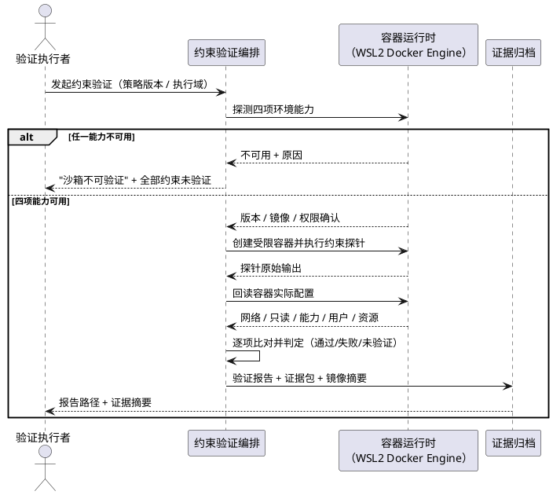
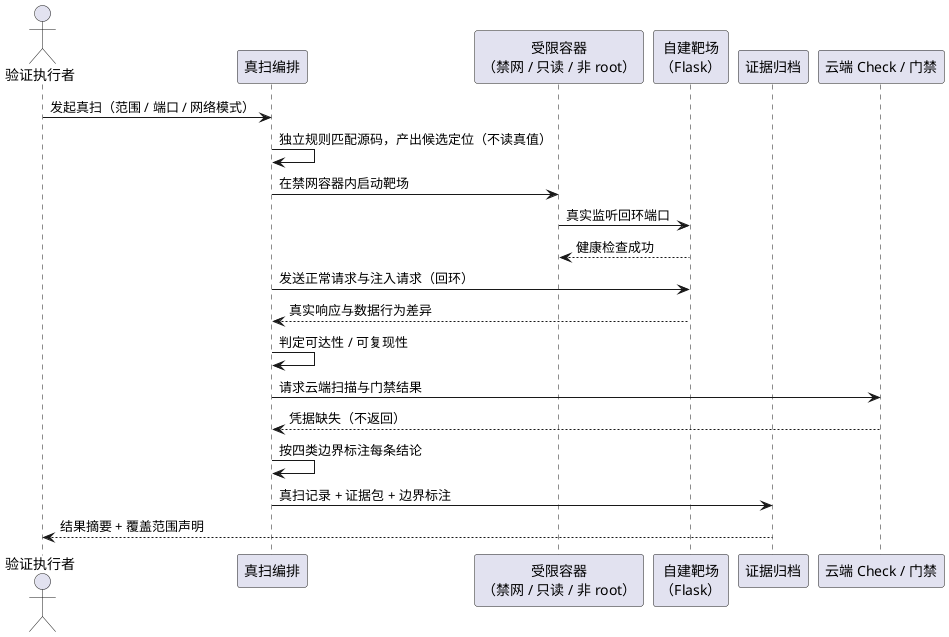
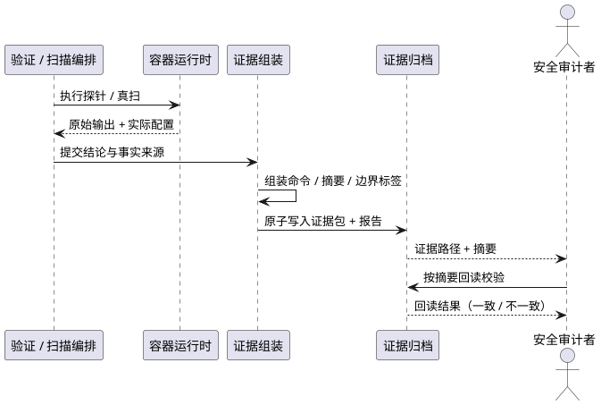
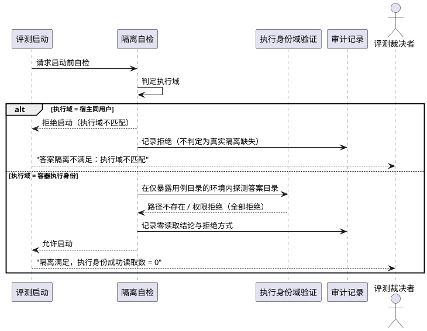

# 沙箱约束实测验证与靶场真扫 · 需求规格说明

> 版本：v1.0（2026-11-13）
> 范围：沙箱约束的可执行验证与判定口径、自建 Flask 靶场接入扫描链路并完成一次可留痕的真扫、证据留痕、与 `eval_leak_hardening` 的口径衔接
> 本文档只描述"要构建什么"与"如何验收"，不描述"如何构建"。
> 前提修正：本机 Docker 已实测可用（WSL2 Debian 13 内 Docker 26.1.5+dfsg1，daemon 运行中）；上一阶段"本机无 Docker"的记录作废，但"无华为云凭据、无 pytest、非 Git 仓库"仍然成立。**前提变更（2026-11-18）："非 Git 仓库"于本日被版本控制基线取代；"无华为云凭据、无 pytest"不变。**

---

# **1. 组件定位**

## **1.1 核心职责**

本组件负责在真实容器运行时下把沙箱约束逐项变成可执行、可取证、可判定的验证项，并把自建 Flask 靶场接入扫描链路完成一次真实扫描，同时显式标注"真实执行 / 录制桩 / 云凭据缺失"的边界。

## **1.2 核心输入**

1. **沙箱约束策略**：`sandbox/spec.json` v1.0.0 的隔离参数（network、source_mount、root_filesystem、timeout、memory、cpu、user、cap_drop、no_new_privileges、pids_limit、tmpfs）、逃逸用例 P4-01…P4-05 与镜像标识。
2. **执行器选择与配置**：本地执行器与沙箱执行器的选择、沙箱资源上限、超时上限、目标镜像名、容器运行时可达方式。
3. **容器运行时环境信息**：CLI 是否可达、daemon 是否运行、执行身份对容器 socket 的权限、镜像清单与镜像摘要、镜像仓库可达性、容器默认网络连通性。
4. **靶场输入**：`verifix-target` 源码树、靶场真值清单 `ground_truth.json`（15 项，C01/C02/C03/C05 四类）、靶场依赖与建库种子数据、靶场监听端口与扫描范围配置。
5. **扫描任务请求**：被扫目标（靶场仓库根）、扫描范围（全量/规则子集）、规则集标识、发起主体、是否要求容器内执行。
6. **评测隔离配置**：用例输入目录与预期答案目录、探针超时、越权阈值、执行身份定义、当前强制自检模式。
7. **证据归档请求**：证据包输出目录、证据版本号、是否需要与历史 M0 报告并列保留。

## **1.3 核心输出**

1. **沙箱约束验证报告**：逐项约束的判定（通过 / 失败 / 未验证）、判定依据、执行域声明、镜像摘要、运行参数与实际配置的逐字段一致性结论。
2. **证据包**：可复制的完整命令、容器运行时版本、镜像 ID 与仓库摘要（或"本地构建无仓库摘要"标注）、容器实际配置字段、容器内探针原始输出、结论对应关系与证据文件摘要。
3. **真扫执行记录**：扫描标识、目标与真值版本、监听端口、网络模式、扫描范围、逐项检出与动态验证结果、每条结果的事实来源与执行位置。
4. **边界标注清单**：按"真实容器执行 / 真实本地执行 / 录制桩 / 依赖云凭据缺失"四类，对本次所有结论逐条标注，缺项数为 0。
5. **靶场接入结论**：靶场是否真实启动、注入行为是否真实可复现、是否可用于可达性与复现环节的真实验证。
6. **评测隔离口径衔接结论**：容器身份下"执行身份不可读预期答案"的真实验证结果、探针执行域声明、强制自检冲突的处置结论与未决项。
7. **环境能力声明**：Docker 可用性四要素（CLI、daemon、socket 权限、镜像可用）与网络能力（外网、回环）的实测结果。
8. **冲突点与待确认项清单**：与 `eval_leak_hardening` 的口径冲突、影响范围、默认处置与需要人工拍板的事项。

## **1.4 职责边界**

本组件明确不负责以下事项：

1. **不负责修复靶场缺陷或修改靶场源码与真值**：只把靶场作为被扫目标接入，不得为通过验证而改动 `app/main.py`、`app/config.py`、`requirements.txt` 或 `ground_truth.json`。
2. **不负责实现新的云端扫描服务或补齐华为云凭据**：依赖云端 Check 服务与门禁的能力仍按"云凭据缺失"标注，不得伪造云端结果。
3. **不负责沙箱约束策略本身的放宽或重定义**：`sandbox/spec.json` 的隔离参数不得为了跑通扫描而降低（网络禁出、只读根文件系统、非 root、cap 清零、no-new-privileges 必须保持）。
4. **不负责生产环境（CCE 节点）等价性证明**：本轮结论只在已实测的执行域内成立，云上节点需另行复测，不得表述为"生产已验证"。
5. **不负责重算 M4–M9 主流程指标**：指标口径与 M9 未验证状态由 `eval_leak_hardening` 既有结论承担，本组件只做衔接与冲突标注。
6. **不负责改写历史留痕**：既有 M0 沙箱报告、M1–M5 报告与历史指标快照保持只读，补测只能以新版本报告并列。
7. **不负责权限系统实现与宿主账号改造**：只提出"执行身份对预期答案零读取"的可验证属性与执行域要求，不执行宿主权限变更。
8. **不负责代码实现、容器编排落地与自动化流水线搭建**：具体执行方式由后续实现方案决定。

## **1.5 本轮现状实测基线（用于判定口径，不作为结论）**

> 以下为 2026-11-13 在本机实测得到的事实，用于确定"哪些能做、哪些只能标注未验证"。

| 探测项 | 实测结果 | 对需求的约束 |
|---|---|---|
| 宿主 Windows 侧 Docker CLI | 不存在（`docker` 不在可执行路径中） | 不能在宿主进程内直接调用容器运行时 |
| WSL2 发行版内 Docker CLI | 存在，`26.1.5+dfsg1`，daemon `active (running)` | 执行域必须显式声明为 WSL2 发行版 |
| 非 root 用户访问容器 socket | `permission denied`（用户不在 docker 组，提权需密码） | 必须以"提权执行"作为待确认项，且记录执行域 |
| root 身份执行容器命令 | 可用，cgroup v2、overlay2 | 约束验证可在该执行域完成 |
| 镜像清单 | `verifix-runner:latest`（本地构建，无仓库摘要，131 MB）、`python:3.12-slim`、`hello-world`、`alpine:3.20` | 镜像摘要必须区分"镜像 ID"与"仓库摘要" |
| 镜像拉取 | `alpine:3.20` 拉取成功并返回仓库摘要 | 构建期可联网取依赖 |
| 容器默认网络 | 可访问外部 HTTPS（实测连通） | 构建/装依赖可放行，运行期必须禁出 |
| 容器 `network=none` 回环 | 回环监听与连接均成功 | "同容器内靶场 + 扫描"可行，不必放开外网 |
| 容器内 uid 10001 读 `eval/expected` | **可读**（宿主目录以宽松权限透传） | 仅靠 `--user` 无法实现答案隔离，必须做挂载面裁剪 |
| 容器隔离实测 | UID=10001、外网 `OSError`、根文件系统 `PermissionError`、tmpfs 可写 | 约束项可真实验证 |
| 宿主侧靶场真实启动 | `/health` 200、`/user?uid=1` 返回 1 行、注入后返回 2 行 | 缺陷真实可触发，存在真实动态判定依据 |
| 容器内闭环真扫 | `network=none` + 只读 + uid 10001 下靶场真实监听回环，正常 1 行 / 注入 2 行，外网 `OSError` | 真扫可在不放开网络的前提下完成 |
| 宿主同用户执行默认隔离自检 | 返回 `VF-8003 答案隔离不满足：enumerate,open,traversal`，评测拒绝启动 | 强制自检与同用户可读存在实质冲突 |

---

# **2. 领域术语**

**沙箱约束验证**
: 对 `sandbox/spec.json` 中每一项隔离参数，以可执行探针在真实容器内取得事实结果，并按固定口径判定通过、失败或未验证的过程。

**可执行定义**
: 一条约束被转换为"触发动作 → 观测事实 → 判定阈值"三要素后可被重复执行的定义；缺少任一要素的约束不得进入结论。

**执行域**
: 承载约束验证或扫描执行的真实身份与层级，取值为宿主用户、容器运行时内的 root 身份、容器内非 root 执行身份之一；不同执行域的结论不得互相继承。

**约束取证**
: 以容器实际配置与容器内原始输出作为事实凭证，证明声明参数确实生效，而不是仅凭命令行文本推断。

**运行参数一致性**
: 声明的隔离参数与容器实际生效配置逐字段相同的属性，包括网络模式、根文件系统只读、能力集、安全选项、执行用户、资源上限与临时文件系统。

**镜像摘要**
: 容器镜像的唯一标识；分为本地镜像 ID 与仓库内容摘要两种，本地构建镜像可以没有仓库内容摘要。

**真扫**
: 被测目标真实启动、真实响应请求、缺陷行为可真实复现，且检出结果不由真值文件或录制记录派生的扫描。

**录制桩**
: 由人工构造或从真值文件派生的输入记录，其内容不来自对目标的真实执行；使用录制桩的结论不得标注为真扫。

**回环内真扫**
: 靶场与扫描动作位于同一网络命名空间内、以回环地址通信，对外网络仍被禁止的真扫方式。

**扫描范围**
: 本次真扫声明覆盖的缺陷类别与真值条目集合；范围之外的项目不得计入检出分母。

**检出对账**
: 用独立真值清单核对扫描结果的过程；对账只在检出完成后进行，不得参与检出本身。

**边界标注**
: 对每一条结论标注其事实来源与执行位置的四类标签：真实容器执行、真实本地执行、录制桩、依赖云凭据缺失。

**未验证**
: 缺少可执行探针或缺少真实执行证据、既不能判定通过也不能判定失败的状态；必须给出缺失项，不得以"通过"或"失败"代替。

**权限面裁剪**
: 通过只向执行身份暴露必要目录、不把预期答案目录挂载进执行环境，从而取得零读取能力的做法。

**强制自检冲突**
: 应用层隔离探针在宿主同用户身份下必然读到预期答案目录、进而使评测启动失败，而该失败并非真实隔离缺失的现象。

**证据包**
: 一次验证或扫描产生的、可独立复算的事实集合，包含命令、环境标识、镜像摘要、实际配置、原始输出与摘要值。

---

# **3. 角色与边界**

## **3.1 核心角色**

- **验证执行者**：发起沙箱约束验证与真扫，查看逐项判定与证据包。
- **安全审计者**：核对约束是否真实生效、证据是否可复算、是否存在"以本地执行冒充沙箱"的表述。
- **平台运维者**：提供容器运行时可达方式与执行域，确认镜像来源与网络放行口径。
- **评测裁决者**：使用容器身份下的隔离验证结论，判断评测运行是否可启动。
- **指标复核者 / 评委**：核对"真扫"结论的覆盖范围与边界标注，判断哪些结论可用、哪些不可用。

## **3.2 外部系统**

- **容器运行时（WSL2 内 Docker Engine）**：提供容器创建、运行与配置回读能力，决定约束是否可验证。
- **宿主文件系统（Windows 卷经 WSL2 暴露）**：提供靶场源码、用例输入集与预期答案目录；其权限透传特性直接影响隔离结论。
- **自建 Flask 靶场（verifix-target）**：被扫目标，提供真实 HTTP 服务与真实数据库行为。
- **外部镜像仓库与依赖源**：提供基础镜像与靶场运行依赖，决定镜像可复现性。
- **云端 Check 服务与门禁服务**：既有链路的上游数据源，本轮无凭据，只能标注缺失。
- **证据归档存储**：保存证据包与报告，并支持按摘要回读校验。
- **评测隔离探针组件（既有）**：提供应用层隔离自检与审计记录，本轮需与其衔接。

## **3.3 交互上下文**

```plantuml
@startuml
left to right direction
actor "验证执行者" as Runner
actor "安全审计者" as Auditor
actor "平台运维者" as Ops
actor "评测裁决者" as Judge
participant "沙箱约束验证与真扫组件" as Comp
participant "容器运行时\n（WSL2 Docker Engine）" as Docker
participant "宿主文件系统\n（源码 / 用例 / 答案）" as FS
participant "自建 Flask 靶场\n（verifix-target）" as Target
participant "外部镜像仓库\n与依赖源" as Registry
participant "云端 Check / 门禁" as Cloud
participant "证据归档存储" as Archive

Runner --> Comp : 发起约束验证 / 真扫
Ops --> Comp : 提供执行域 / 镜像 / 网络口径
Comp --> Docker : 创建并运行受限容器 / 回读实际配置
Docker --> Comp : 容器实际配置 + 运行输出
Comp --> FS : 装载源码与用例输入（不装载答案）
Comp --> Target : 真实启动并发送真实请求（回环）
Target --> Comp : 真实响应与数据库行为
Comp --> Registry : 获取基础镜像与依赖（仅构建期）
Comp --> Cloud : 请求扫描/门禁结果
Cloud --> Comp : 凭据缺失（不返回结果）
Comp --> Archive : 报告 / 证据包 / 边界标注
Archive --> Auditor : 证据复核
Comp --> Judge : 隔离验证结论与启动判定
@enduml
```

---

# **4. DFX约束**

## **4.1 性能**

1. **环境能力探测时延**：Docker 可用性四要素（CLI、daemon、socket 权限、镜像可用）的探测必须在 15 秒内完成。
   a. 验收条件：When 发起约束验证，the 组件 shall 在 15 秒内返回四要素结果或明确的超时判定。
2. **单条约束探针时延**：单项约束探针从容器创建到结果返回不得超过 10 秒（超时类用例除外）。
   a. 验收条件：When 执行单条约束探针，the 组件 shall 记录耗时且不超过 10 秒，超时项判定为未验证并说明原因。
3. **约束验证总时延**：全部约束项（含超时用例）验证总时长不得超过 180 秒。
4. **镜像摘要读取时延**：镜像 ID 与仓库摘要读取不得超过 3 秒。
5. **靶场就绪时延**：靶场从启动到健康检查返回成功不得超过 15 秒；超过必须判定为启动失败，不得继续扫描。
6. **单次真扫请求时延**：单条靶场请求往返不得超过 5 秒；单条超过 3 次重试仍失败必须记录为不可复现。
7. **真扫总时延**：15 项真值范围内的真扫总时长不得超过 180 秒。
8. **证据落盘时延**：单次证据包写入与摘要计算不得超过 3 秒，且不得因证据写入导致扫描结果丢失。

## **4.2 可靠性**

1. **失败关闭**：容器运行时不可达、socket 权限不足、daemon 未运行或镜像不可用时，必须判定为"沙箱不可验证"，不得输出任何约束"通过"，也不得自动降级为宿主直跑并沿用沙箱结论。
2. **证据原子性**：证据包必须全量成功或完全不存在；写入中断不得留下半份证据，也不得留下与报告结论不一致的旧证据。
3. **结论可失效**：镜像 ID 或关键运行参数与证据记录不一致时，既有结论必须自动失效并标记需重跑。
4. **执行幂等**：同一扫描标识与同一参数重复执行，必须产生可比较的同构结果；非确定性差异必须显式标注，不得静默覆盖。
5. **中断可解释**：执行被中断时必须记录中断阶段与已完成的项数，不得把未完成的部分标记为通过。
6. **靶场可复现启动**：靶场启动失败必须给出可执行原因（依赖缺失、端口占用、数据库不可写），不得仅返回"扫描失败"。
7. **证据可回读**：证据归档后必须可按摘要回读且内容一致，回读失败即判定证据无效。

## **4.3 安全性**

1. **约束不放宽**：网络禁出、根文件系统只读、能力集清零、禁止提权、非 root 执行身份、资源与进程上限六项约束在真扫期间必须保持生效；任何一项放宽都必须显式标注为"非沙箱模式"。
2. **真扫禁出网**：真扫期间容器对外网络的连接尝试必须 100% 失败；回环通信允许。
3. **答案零暴露**：约束验证与真扫的任何输出、证据与日志中不得出现预期答案字段名或取值；命中数必须为 0。
4. **凭据零暴露**：证据包不得包含靶场密钥、数据库口令、容器运行时提权凭据；出现即视为缺陷。
5. **执行身份不可读答案**：以执行身份访问预期答案目录（直接读取、相对路径、路径穿越、链接跟随、目录枚举）必须 100% 失败，且拒绝方式必须可区分"路径不存在"与"权限拒绝"。
6. **审计完整性**：对预期答案目录的每一次访问尝试必须被记录，审计记录不得包含答案内容；执行身份的成功读取记录数必须为 0。
7. **禁止冒充**：本地执行器的环境快照必须如实记录"网络未禁用、文件系统非只读"，且不得被引用为容器约束证据。
8. **权限最小化**：容器只允许读取靶场源码与用例输入，不得挂载预期答案目录、归档目录与宿主用户目录。

## **4.4 可维护性**

1. **证据可复现**：证据包中的命令必须可直接复制执行并得到等价结论，缺参数或不可执行的命令数必须为 0。
2. **结论可解释**：每个未验证项必须给出缺失的探针或缺失的执行条件，不允许空白。
3. **边界可检索**：四类边界标注必须可按扫描标识、时间与类别检索。
4. **日志脱敏**：日志不得包含答案内容、数据库口令与运行时提权凭据。
5. **版本可追溯**：每次验证与真扫必须可通过标识关联到策略版本、镜像摘要、靶场真值版本与证据包摘要。
6. **历史留痕只读**：既有 M0 报告与 M1–M5 报告的内容与摘要必须保持不变，补测以新版本并列。

## **4.5 兼容性**

1. **本地执行器保留**：本地执行器必须继续可用，且其环境快照字段与既有结构兼容，语义不得改变。
2. **报告字段兼容**：新增的约束验证结论、证据引用与边界标注不得改变既有一级字段语义，只能新增。
3. **既有用例不受影响**：新增容器相关能力不得改变既有测试集在默认配置下的行为与通过数。
4. **评测口径兼容**：与 `eval_leak_hardening` 的隔离结论、审计记录与越权计数保持同一口径，不得另立一套判定标准。
5. **历史结论可对照**：新验证报告必须能与历史 M0 报告的逐项判定对照，缺项数为 0。

---

# **5. 核心能力**

## **5.1 沙箱约束的可执行验证与判定口径**

### **5.1.1 业务规则**

1. **环境能力前置探测**：任何约束判定之前，必须先实测容器运行时的四项能力：命令行可达、守护进程运行、执行身份对运行时接口有权限、目标镜像可用。
   a. 验收条件：When 四项中任一项不满足，the 组件 shall 返回"沙箱不可验证"与失败要素清单，且全部约束项标记为未验证。
2. **执行域显式声明**：每次验证必须记录执行域（宿主用户 / 容器运行时 root / 容器内非 root），并声明结论仅在该执行域成立。
   a. 验收条件：When 生成验证报告，the 组件 shall 在报告头包含执行域，且报告中不存在"跨执行域沿用"的结论行。
3. **约束可执行定义完整**：策略中的每一项隔离参数必须映射为至少一个可执行探针与一条判定口径。
   a. 验收条件：When 对策略的 10 项隔离参数执行验证，the 组件 shall 输出逐项判定，缺项数为 0。
4. **网络禁出验证**：必须在禁网模式下验证对外连接失败，并记录失败类型。
   a. 验收条件：When 在禁网容器内连接外部地址，the 组件 shall 观测到连接失败并判定该项通过；When 连接成功，the 组件 shall 判定该项失败。
5. **回环可用验证**：必须验证禁网模式下回环通信可用，作为真扫的前置条件。
   a. 验收条件：When 在禁网容器内建立回环连接，the 组件 shall 观测到连接成功；回环不可用时，the 组件 shall 判定"回环内真扫不可用"。
6. **根文件系统只读验证**：必须验证根文件系统写入失败，且临时文件系统可写。
   a. 验收条件：When 容器内尝试写入根文件系统，the 组件 shall 观测到拒绝；When 写入临时文件系统，the 组件 shall 观测到成功；两项必须分别判定。
7. **执行身份与提权面验证**：必须验证执行用户为非 root、能力集为空、禁止提权生效。
   a. 验收条件：When 读取容器内身份与能力集，the 组件 shall 得到非 root 用户标识与空能力集；任一不满足判定失败。
8. **资源与进程上限验证**：必须回读资源上限与实际生效配置，并验证超限行为可观测。
   a. 验收条件：When 回读容器实际配置，the 组件 shall 使内存、CPU、进程数上限与策略声明一致，差异数为 0。
9. **运行参数一致性**：声明参数与实际配置必须逐字段比对。
   a. 验收条件：When 比对网络模式、只读根、能力集、安全选项、执行用户、临时文件系统六项，the 组件 shall 报告零差异；任一不同即判定验证失败。
10. **超时约束单独判定**：策略中的无限循环用例必须由超时执行机制单独验证，不得由容器参数推断。
    a. 验收条件：When 未执行超时用例，the 组件 shall 将该用例标记为未验证；When 执行并被在阈值内终止，the 组件 shall 判定通过并记录实际终止耗时。
11. **镜像摘要完整记录**：必须同时记录本地镜像标识与仓库内容摘要；本地构建镜像无仓库摘要时必须显式标注。
    a. 验收条件：When 读取镜像信息，the 组件 shall 输出镜像标识；仓库摘要为空时，the 组件 shall 输出"本地构建、无仓库摘要"标注，不得留空。
12. **提权方式留痕**：使用提权执行时，必须记录提权途径与执行域，且不得把提权凭据写入证据。
    a. 验收条件：When 以提权身份执行容器命令，the 组件 shall 记录执行域与提权途径类别，且证据中凭据命中数为 0。
13. **未验证可解释**：无法执行的约束项必须给出缺失条件与建议复测条件。
    a. 验收条件：When 某约束项缺少探针，the 组件 shall 输出未验证与该原因，不得输出"通过"。
14. **禁止项**：禁止以宿主机直接执行的结果冒充容器约束验证结果。
    a. 验收条件：When 检查报告中的结论行，the 组件 shall 使每条结论都带执行域；执行域为本地的结论不得出现在"容器约束"分组。
15. **禁止项**：禁止为通过验证而修改策略参数、容器参数或靶场源码。
    a. 验收条件：When 比对验证前后策略文件与靶场源码摘要，the 组件 shall 报告摘要不变。

### **5.1.2 交互流程**



### **5.1.3 异常场景**

1. **宿主侧无容器运行时命令**
   a. 触发条件：宿主进程中无法找到容器运行时命令行。
   b. 系统行为：判定环境能力不足，不执行任何约束探针，不产出通过结论；提示应声明的执行域。
   c. 用户感知：返回"沙箱不可验证：命令行不可达"。
2. **执行身份无运行时接口权限**
   a. 触发条件：非特权身份访问运行时接口被拒绝。
   b. 系统行为：判定为权限能力缺失，标记全部约束未验证，并在报告中记录执行域；不得尝试绕过权限。
   c. 用户感知：返回"沙箱不可验证：运行时接口无权限"。
3. **守护进程未运行**
   a. 触发条件：运行时接口存在但服务未启动。
   b. 系统行为：判定不可验证，给出启动建议，不进行容器创建。
   c. 用户感知：返回"沙箱不可验证：守护进程未运行"。
4. **镜像缺失或摘要漂移**
   a. 触发条件：目标镜像不存在，或镜像标识与证据记录不一致。
   b. 系统行为：镜像缺失时拒绝验证并提示构建；摘要漂移时使既有结论失效并标记需重跑。
   c. 用户感知：返回"镜像不可用"或"镜像已变化，结论失效"。
5. **约束探针超时**
   a. 触发条件：单条探针超过 10 秒无结果。
   b. 系统行为：终止该容器，记录超时，判定该约束为未验证而不是失败。
   c. 用户感知：返回"约束未验证：探针超时"。
6. **运行参数与声明不一致**
   a. 触发条件：实际配置与策略声明存在差异。
   b. 系统行为：整体判定验证失败，列出差异字段，不作部分通过。
   c. 用户感知：返回"运行参数不一致"与差异字段清单。
7. **临时文件系统不可写**
   a. 触发条件：容器内临时目录写入失败。
   b. 系统行为：判定该项失败，并提示后续靶场数据库落盘不可用。
   c. 用户感知：返回"临时文件系统不可写"。

## **5.2 靶场接入与真扫**

### **5.2.1 业务规则**

1. **靶场真实启动**：真扫前必须使靶场真实监听并对健康检查返回成功。
   a. 验收条件：When 发起真扫，the 组件 shall 先取得健康检查成功结果；未取得时不得进入扫描。
2. **网络模式显式选择**：真扫必须声明网络模式；优先采用禁网容器内的回环方式；采用放行网络的宿主或桥接方式时，必须标注为"非沙箱真扫"。
   a. 验收条件：When 真扫完成，the 组件 shall 在记录中输出网络模式与是否属于沙箱约束范围。
3. **检出不得读取真值**：告警的来源必须是源码或规则的独立匹配，不得从真值清单、预期答案或录制记录派生。
   a. 验收条件：When 将真值清单移出可访问范围后重新扫描，the 组件 shall 产出相同数量与相同定位的告警，一致率为 100%。
4. **真值只用于对账**：真值清单只允许在检出完成后用于核对，且必须标注"仅对账"。
   a. 验收条件：When 检查扫描阶段的输入读取记录，the 组件 shall 不存在对真值清单的读取；对账阶段读取次数必须为 1。
5. **扫描范围显式声明**：每次真扫必须声明覆盖的缺陷类别与条目数；仅覆盖部分类别时不得把子集结果表述为全量检出率。
   a. 验收条件：When 扫描范围仅为 SQL 注入与命令注入两类，the 组件 shall 输出"10/15，未覆盖 C01、C05"；When 覆盖全部 15 项，the 组件 shall 输出"15/15"。
6. **动态可达性真实判定**：可达性必须由真实请求与真实数据行为差异判定，不得由静态标注推断。
   a. 验收条件：When 对注入点发送正常请求与注入请求，the 组件 shall 得到可区分的结果差异（正常返回单条、注入返回多条），并据此判定可达；无法取得差异时必须判定为"不可复现"。
7. **真扫成立条件**：一次真扫只有在目标真实响应、行为差异可复现、隔离参数依然生效、证据可回放四项同时满足时才可判定成立。
   a. 验收条件：When 四项中任一项不满足，the 组件 shall 判定"真扫不成立"并列出缺失项，不得输出成功率。
8. **桩结果隔离**：录制桩产生的告警、观测与结论必须带来源标签，且不得计入真扫统计。
   a. 验收条件：When 汇总真扫结果，the 组件 shall 只统计来源为真实执行的条目；桩来源条目数必须单列。
9. **端口可配置且预检**：靶场监听端口必须可配置，并在启动前检测占用；端口被占用时必须更换或失败，不得复用未知服务。
   a. 验收条件：When 配置端口已被占用，the 组件 shall 拒绝启动并提示占用；When 端口可用，the 组件 shall 在配置端口完成监听。
10. **靶场数据落盘约束**：靶场数据库必须写入可写的临时区域，不得写入只读源码目录。
    a. 验收条件：When 靶场启动，the 组件 shall 使数据库文件位于可写临时区域；写入只读目录时必须显式失败并提示。
11. **扫描结果可定位**：每条检出必须给出文件、行号、规则标识与缺陷类别，定位必须与真实源码行一致。
    a. 验收条件：When 核对任一条检出，the 组件 shall 使定位指向真实源码行，偏移数为 0。
12. **重复扫描可比较**：同参数重复真扫必须产出同构结果；因端口、时间或数据种子导致的差异必须标注。
    a. 验收条件：When 连续执行两次同参数真扫，the 组件 shall 输出两次结果对照，并标注差异项。
13. **禁止项**：禁止修改靶场源码、真值清单或数据库种子以使扫描通过。
    a. 验收条件：When 比对真扫前后的靶场源码与真值摘要，the 组件 shall 报告摘要不变。
14. **禁止项**：禁止把"录制桩 + 真值对账"表述为"真扫"。
    a. 验收条件：When 检查报告用词与边界标注，the 组件 shall 使桩来源结论一律带"录制桩"标签，且不存在"真扫"字样。

### **5.2.2 交互流程**



### **5.2.3 异常场景**

1. **靶场依赖缺失**
   a. 触发条件：运行环境缺少靶场所需框架依赖。
   b. 系统行为：判定启动失败，给出缺失依赖，不进入扫描；不得改用桩数据替代。
   c. 用户感知：返回"靶场启动失败：缺少依赖"。
2. **端口被占用**
   a. 触发条件：配置端口已被其他进程监听。
   b. 系统行为：拒绝启动并提示占用，允许更换端口重试。
   c. 用户感知：返回"端口被占用"与端口号。
3. **数据库不可写**
   a. 触发条件：只读根文件系统下数据库路径指向源码目录。
   b. 系统行为：判定启动失败并提示数据落盘位置非法。
   c. 用户感知：返回"靶场数据目录不可写"。
4. **注入行为未复现**
   a. 触发条件：正常与注入请求返回结果无差异。
   b. 系统行为：判定该条不可复现，记录两次响应摘要，不计入可达；不得推断为可达。
   c. 用户感知：返回"不可复现"与响应差异摘要。
5. **禁网模式下试图访问外部**
   a. 触发条件：扫描或靶场逻辑发起对外请求。
   b. 系统行为：观测到连接失败，判定网络约束仍生效，记录该失败为约束证据而非扫描失败。
   c. 用户感知：报告中标注"外网被拒绝（符合约束）"。
6. **检出为空**
   a. 触发条件：规则匹配未产出任何候选告警。
   b. 系统行为：判定为检出失败或规则未覆盖，不得回退到真值清单生成告警。
   c. 用户感知：返回"未检出，规则覆盖不足"。
7. **云端来源不可用**
   a. 触发条件：缺少凭据或云端返回不可用。
   b. 系统行为：标注"依赖云凭据缺失"，不产出云端结论、不降级为估算。
   c. 用户感知：结果中该部分显示"云凭据缺失，未验证"。
8. **扫描中断**
   a. 触发条件：容器被终止或执行被中断。
   b. 系统行为：保留已完成的条目与证据，标记未完成项为未验证，不得汇总成功率。
   c. 用户感知：返回"扫描中断"与已完成条数。

## **5.3 证据留痕与边界标注**

### **5.3.1 业务规则**

1. **证据必备字段**：证据包必须包含执行时间、执行域、运行时版本、镜像标识、仓库摘要或本地构建标注、完整命令、容器实际配置、原始输出、结论映射。
   a. 验收条件：When 校验证据包，the 组件 shall 使上述字段缺项数为 0。
2. **命令可复制执行**：证据中的命令不得依赖交互输入或省略参数，且不含凭据。
   a. 验收条件：When 复制证据中的命令执行，the 组件 shall 得到与证据一致的结论；不可执行命令数必须为 0。
3. **证据摘要与回读**：每份证据必须计算摘要并支持回读校验。
   a. 验收条件：When 回读证据并重算摘要，the 组件 shall 与登记值一致；不一致即判定证据无效。
4. **结论与证据绑定**：报告中每条判定必须引用对应证据片段或证据文件。
   a. 验收条件：When 抽查任一判定行，the 组件 shall 能定位到具体证据引用，缺失引用数必须为 0。
5. **四类边界标注完整**：本次全部结论必须按"真实容器执行 / 真实本地执行 / 录制桩 / 依赖云凭据缺失"标注。
   a. 验收条件：When 汇总报告，the 组件 shall 使四类标签覆盖全部结论，未标注数必须为 0。
6. **时间与时区规范**：证据时间必须为带时区的标准时间戳，且与实际执行顺序一致。
   a. 验收条件：When 校验证据时间，the 组件 shall 使全部时间戳带时区且单调不减，异常数为 0。
7. **历史留痕只读**：既有 M0 报告与历史报告不得就地改写；补测必须以新版本并列。
   a. 验收条件：When 完成本轮验证，the 组件 shall 使历史报告内容摘要不变，变动次数为 0。
8. **环境漂移可检测**：证据必须登记可复用性条件（镜像标识、执行域、网络模式、依赖版本）。
   a. 验收条件：When 当前环境与证据登记条件不一致，the 组件 shall 判定证据已失效并要求重跑。
9. **禁止项**：禁止在证据生成后修改原始输出或补写未执行的步骤。
   a. 验收条件：When 校验原始输出摘要与报告引用，the 组件 shall 使二者一致，改写次数为 0。

### **5.3.2 交互流程**



### **5.3.3 异常场景**

1. **证据写入失败**
   a. 触发条件：磁盘满、目录不可写或并发冲突。
   b. 系统行为：整体回滚，不保留半份证据，报告标记未归档。
   c. 用户感知：返回"证据归档失败"，不返回结论摘要。
2. **证据与结论不一致**
   a. 触发条件：结论更新后证据未同步，或证据被外部修改。
   b. 系统行为：判定证据无效，相关结论降级为未验证。
   c. 用户感知：返回"证据与结论不一致"。
3. **环境漂移**
   a. 触发条件：镜像重建、执行域变化或依赖版本变化。
   b. 系统行为：使既有结论失效，要求重跑并生成新版本证据。
   c. 用户感知：返回"环境已变化，需重跑"。
4. **边界标注缺失**
   a. 触发条件：新增结论未标注来源类别。
   b. 系统行为：拒绝发布报告，列出未标注条目。
   c. 用户感知：返回"存在未标注来源的结论"。
5. **时间戳异常**
   a. 触发条件：系统时区变化或时钟回拨导致时间倒退。
   b. 系统行为：拒绝写入证据，记录时间异常，要求重新生成。
   c. 用户感知：返回"证据时间异常"。

## **5.4 与 eval_leak_hardening 的口径衔接**

### **5.4.1 业务规则**

1. **补齐真实隔离验证**：容器运行时可用后，必须补齐"以执行身份读取预期答案目录 100% 失败"的真实验证，不得继续以"仅应用层探针"结案。
   a. 验收条件：When 完成本轮验证，the 组件 shall 产出一条容器身份下的零读取验证结论与对应证据，缺项数为 0。
2. **探针执行域迁移**：隔离探针的对外口径必须在执行身份域内取得，不得以宿主同用户身份的探测结果作为对外结论。
   a. 验收条件：When 生成隔离结论，the 组件 shall 标注探针执行域；执行域为宿主时，该结论不得作为对外口径。
3. **权限面裁剪**：容器内必须只暴露用例输入目录；预期答案目录不得出现在执行身份的可见路径中。
   a. 验收条件：When 以执行身份读取预期答案目录，the 组件 shall 观测到"路径不存在"；When 挂载了整个评测目录，the 组件 shall 判定隔离不满足并失败关闭。
4. **拒绝方式可区分**：零读取结论必须区分"路径不存在"与"权限拒绝"，二者都算拒绝但必须分别记录。
   a. 验收条件：When 输出零读取证据，the 组件 shall 分别标注两类拒绝原因，混同数为 0。
5. **强制自检冲突处置**：默认强制自检在宿主同用户身份下必然失败（实测返回"答案隔离不满足：目录枚举、打开、路径穿越"），必须明确两条路径的语义，不得把该失败当作真实隔离缺失。
   a. 验收条件：When 在宿主域执行强制自检，the 组件 shall 拒绝启动评测并标注"执行域不匹配"；When 在执行身份域执行，the 组件 shall 返回通过且执行身份成功读取数 = 0。
6. **启动判定不降低**：不得为规避冲突而关闭强制自检、放宽探针或把可读判定改为不阻断；故障关闭语义必须保持。
   a. 验收条件：When 检查启动路径，the 组件 shall 在隔离不满足时仍然拒绝启动；放行分支数必须为 0。
7. **审计合并可检索**：执行身份域产生的拒绝记录必须与既有审计记录统一可检索，且执行身份成功读取数恒为 0。
   a. 验收条件：When 按执行标识检索审计，the 组件 shall 返回宿主域与执行身份域的记录；成功读取记录数必须为 0。
8. **口径字段一致**：新增验证结论必须沿用既有隔离结论字段语义（是否满足、依据、耗时、拒绝探针清单），不得另设并行字段。
   a. 验收条件：When 对照新旧隔离结论结构，the 组件 shall 使字段语义一一对应，缺项数为 0。
9. **既有回归不变**：新增容器能力不得改变既有测试集在默认配置下的行为与通过数。
   a. 验收条件：When 执行既有全量回归，the 组件 shall 使通过数与改造前一致，新增失败数为 0（既有已知抖动项按原口径处置）。
10. **待确认项显式化**：所有影响口径的未决事项必须进入清单，不得以默认值静默生效。
    a. 验收条件：When 发布衔接结论，the 组件 shall 附带待确认项清单，未登记项数必须为 0。

### **5.4.2 交互流程**



### **5.4.3 异常场景**

1. **执行身份仍可读答案目录**
   a. 触发条件：挂载面未裁剪或目录权限透传过宽。
   b. 系统行为：判定隔离不满足，拒绝启动并保留证据；不得以"应用层已拦截"放行。
   c. 用户感知：返回"答案隔离不满足：执行身份可读"。
2. **用例目录也不可读**
   a. 触发条件：挂载缺失或执行身份对用例目录无权限。
   b. 系统行为：判定探针失效（反向探针失败），拒绝启动并提示挂载配置错误。
   c. 用户感知：返回"探针失效：用例目录不可读"。
3. **容器运行时不可用**
   a. 触发条件：运行时停止或权限丢失。
   b. 系统行为：判定隔离不可判定，按故障关闭拒绝启动；不得回退为宿主域结论。
   c. 用户感知：返回"权限不可判定，评测未启动"。
4. **执行域混用**
   a. 触发条件：宿主域结论被当作执行身份域结论使用。
   b. 系统行为：拒绝发布该结论，要求在执行身份域重跑。
   c. 用户感知：返回"执行域不匹配，需重跑"。
5. **审计写入失败**
   a. 触发条件：审计存储不可写。
   b. 系统行为：拒绝操作并保留失败原因，不丢弃拒绝事件。
   c. 用户感知：返回"审计写入失败，操作已拒绝"。

## **5.5 冲突点与待确认项**

详见第 7 章。本章只声明：冲突点与待确认项是本组件的正式输出物之一，未登记冲突不得进入实现。

---

# **6. 数据约束**

## **6.1 约束验证记录**

1. **verification_id**：必填，全局唯一，格式为固定前缀加时间与短随机串。
2. **executed_at**：必填，带时区时间戳。
3. **exec_domain**：必填，取值限于 `HOST_USER` / `RUNTIME_ROOT` / `CONTAINER_EXEC`，不得为空。
4. **docker_version / runtime_driver / cgroup_version**：必填，运行时版本非空，驱动与 cgroup 版本非空或标注未知。
5. **policy_version**：必填，必须与策略文件版本一致。
6. **image_id**：必填，镜像唯一标识。
7. **image_repo_digests**：可为空；为空时必须同时给出 `local_build=true` 与说明文本。
8. **checks**：必填，覆盖全部约束项的判定列表；每项含名称、期望、实测、判定、耗时、证据引用。
9. **verdict**：必填，取值限于通过 / 失败 / 未验证；存在任一未验证时整体不得为通过。
10. **evidence_ref**：必填，指向证据包标识与摘要。
11. **禁止内容**：不得包含运行时提权凭据、靶场口令与答案内容。

## **6.2 证据包**

1. **evidence_id**：必填，全局唯一，与验证标识或扫描标识关联。
2. **path / sha256 / size_bytes**：必填；摘要为 64 位十六进制；回读必须一致。
3. **commands**：必填，至少一条，参数完整、可直接执行、不含凭据。
4. **runtime_facts**：必填，含网络模式、根文件系统只读、能力集、安全选项、执行用户、资源上限、临时文件系统。
5. **raw_output_digest**：必填，原始输出内容的摘要。
6. **reuse_conditions**：必填，含镜像标识、执行域、网络模式、依赖版本。
7. **boundary_tags**：必填，覆盖该证据涉及的全部结论类别。
8. **禁止内容**：不得包含答案字段名与取值、口令、密钥、个人目录路径。

## **6.3 真扫执行记录**

1. **scan_id**：必填，全局唯一。
2. **target / target_version**：必填，目标为自建靶场，版本与真值清单版本一致。
3. **listen_port / network_mode**：必填；网络模式限于禁网回环、桥接、宿主三类，且必须标注是否属于沙箱约束范围。
4. **scope**：必填，含缺陷类别集合与条目数；与全量条目数不一致时必须给出未覆盖类别。
5. **detections**：必填，每条含标识、文件、行号、规则标识、缺陷类别、来源类别、执行位置。
6. **dynamic_checks**：必填，每条含正常响应摘要、注入响应摘要、是否可区分、判定结论。
7. **scan_verdict**：必填，取值限于成立 / 不成立 / 未验证；未验证时必须给出缺失项。
8. **boundary_summary**：必填，四类计数之和必须等于结论总数。
9. **禁止内容**：不得包含真值派生的告警作为真实检出、不得包含云端伪造结果。

## **6.4 边界标注条目**

1. **item_ref**：必填，指向被标注的结论。
2. **boundary_kind**：必填，取值限于 `REAL_CONTAINER` / `REAL_LOCAL` / `RECORDED_STUB` / `CLOUD_CREDENTIAL_MISSING`。
3. **basis**：必填，一句可核对的事实依据。
4. **evidence_ref**：可选，真实类结论必须提供；桩类结论必须提供桩来源标识。
5. **禁止内容**：不得对同一结论同时标注为真实执行与桩来源。

## **6.5 环境能力声明**

1. **docker_cli / daemon / socket_permission / image_availability**：必填，逐项为可用 / 不可用 / 未验证。
2. **egress_network / loopback**：必填，分别记录对外网络与回环能力。
3. **detected_at**：必填，带时区时间戳。
4. **exec_domain**：必填，声明探测所在执行域。
5. **约束**：任一项为不可用时，报告不得出现对应的"约束通过"结论。

## **6.6 隔离衔接记录**

1. **exec_identity**：必填，执行身份标识。
2. **visible_roots**：必填，执行身份可见的目录清单；不得包含预期答案目录。
3. **probes**：必填，覆盖直接读取、相对路径、路径穿越、链接跟随、目录枚举五类，每类含结果与拒绝方式。
4. **denial_kind**：必填，取值限于路径不存在 / 权限拒绝。
5. **exec_success_count**：必填，执行身份成功读取数必须为 0。
6. **enforcement_mode**：必填，取值限于强制自检 / 仅记录，且必须标注是否可作为对外结论。
7. **audit_ref**：必填，指向可检索的审计记录集合。

---

# **7. 冲突点与待确认项**

## **7.1 与 eval_leak_hardening 的冲突点**

| 编号 | 冲突点 | 双方口径 | 影响 | 本轮处理原则 |
|---|---|---|---|---|
| K-01 | 执行身份定义 | 上一阶段：应用层探针（宿主同用户）；本阶段：容器内非 root 身份 | 隔离"零读取"结论的可信度 | 容器身份结论作为对外口径，宿主域结论降为过程记录，不删除 |
| K-02 | 强制自检行为 | 上一阶段：同用户可读即启动失败（故障关闭）；本阶段：该失败可能是执行域不匹配而非真实隔离缺失 | 评测链路在本机默认配置下无法启动 | 保持故障关闭不放宽，新增"执行域不匹配"分类，禁止把该失败计入隔离缺陷 |
| K-03 | 权限实现方式 | 上一阶段：部署侧权限声明 + 应用层探针；本阶段实测：容器身份对透传目录仍可读 | 仅靠文件权限无法满足零读取 | 改为权限面裁剪（不暴露答案目录），并在证据中区分"路径不存在"与"权限拒绝" |
| K-04 | 未验证项 | 上一阶段 M0 报告：无限循环超时用例未测；本阶段：可执行 | 约束验证存在缺口 | 补测超时用例或显式维持未验证，不得以"已 PASS"概括 |
| K-05 | 环境前提 | 上一阶段任务书与结论基于"无 Docker"，多处标注"未实测" | Q1/C2 结论与任务范围失效 | 重开受影响条目，保留旧结论为历史，不得就地改写 |
| K-06 | M1 检出性质 | 上一阶段 M1 报告 10/10 由真值清单派生构造 | 该 10/10 不是真扫结果 | 本轮真扫必须独立检出；旧结论保留但必须标注"录制桩/真值派生" |
| K-07 | 扫描范围 | 上一阶段 M1 仅覆盖 C02/C03 共 10 项；真值清单共 15 项（含 C01 3 项、C05 2 项） | 10/10 与全量检出率不可混用 | 真扫必须声明范围；子集结果不得表述为全量 |
| K-08 | 网络与扫描的关系 | 上一阶段约束：网络禁用；本阶段真扫需要网络可达靶场 | 若在宿主扫描需放开网络，违背约束 | 采用同容器回环方式满足两者；如必须放行网络，标注"非沙箱真扫" |
| K-09 | 证据口径 | 上一阶段：M0 报告声明"仅证容器层约束，不证生产等价"；本阶段需延用 | 云上结论不可外推 | 证据包必须继续携带该边界声明 |
| K-10 | 测试框架 | 既有：标准库 unittest，无 pytest | 新增能力的验证手段受限 | 新增验证沿用 unittest；镜像内 pytest 不作为项目测试依赖 |

## **7.2 待确认项**

| 编号 | 待确认问题 | 可选项 | 建议默认 | 影响范围 |
|---|---|---|---|---|
| Q-01 | 容器运行时的访问身份 | A. 使用发行版 root 身份执行（无需改宿主权限）；B. 将宿主用户加入运行时用户组（需一次提权）；C. 改用无 root 运行时 | A：可立即执行，但必须在证据中声明执行域为运行时 root | 5.1、5.4、6.1 |
| Q-02 | 镜像来源与可复现性 | A. 使用本地构建镜像并记录镜像标识（无仓库摘要）；B. 使用远端基础镜像重建并记录仓库摘要；C. 两者并存，报告并列 | A：符合现状，但必须显式标注"本地构建、无仓库摘要" | 4.2、5.1、6.2 |
| Q-03 | 构建期是否允许联网 | A. 仅构建期放行、运行期禁出；B. 全程禁出（需预置离线依赖）；C. 全程放行 | A：与实测能力一致，且不破坏运行期约束 | 4.3、5.2、5.3 |
| Q-04 | 靶场监听端口 | A. 固定常用端口；B. 固定高位端口；C. 动态分配并输出实际端口 | C：避免与既有服务冲突，且便于并发 | 5.2、6.3 |
| Q-05 | 扫描范围 | A. 15 项全量（C01/C02/C03/C05）；B. 仅 C02/C03 共 10 项；C. 以 10 项为必选、其余为可选 | A：与真值清单对齐；若选 B/C 必须显式声明未覆盖类别 | 5.2、6.3、7.1 K-07 |
| Q-06 | 是否接受宿主侧真扫作为回退 | A. 接受但标注"真实本地执行"且不计入沙箱证据；B. 不接受，只能容器内；C. 接受且计入真扫统计 | A：保留可行性，同时不污染沙箱结论 | 5.2、6.4 |
| Q-07 | 无限循环超时用例是否强制补测 | A. 强制补测（单条 60 秒量级）；B. 维持未验证并写明原因 | A：消除 K-04 缺口，代价是单次验证时间增加 | 5.1、4.1 |
| Q-08 | 隔离探针双轨是否保留宿主域 | A. 双轨保留（宿主域仅记录、容器域为对外口径）；B. 只保留容器域；C. 只保留宿主域（不接受） | A：兼容既有测试与历史结论 | 5.4、6.6 |
| Q-09 | 真扫结果是否写入既有评测运行记录 | A. 只写入新证据目录，不改既有运行产物；B. 写入既有运行记录并新增来源字段；C. 另建运行标识 | A：避免污染既有评测口径与历史留痕 | 5.2、5.3、6.3 |
| Q-10 | 云端能力是否需要在报告中占位 | A. 显式占位并标注"云凭据缺失"；B. 整段省略 | A：边界完整，便于评委识别 | 5.2、6.4 |

## **7.3 冲突处置的验收闸门**

1. **闸门一**：发布前必须确认 K-01…K-10 全部登记，缺项数为 0。
   a. 验收条件：When 校验报告附录，the 组件 shall 输出 10 条冲突条目及处置说明。
2. **闸门二**：Q-01…Q-10 未拍板时，实现只能采用"建议默认"，并在报告中标注"采用默认值"。
   a. 验收条件：When 检查报告，the 组件 shall 对每个未决项标注默认值来源。
3. **闸门三**：任何冲突处置不得引入"关闭强制自检""放开网络""以桩冒真"三类行为。
   a. 验收条件：When 审计处置动作，the 组件 shall 使三类行为发生次数为 0。