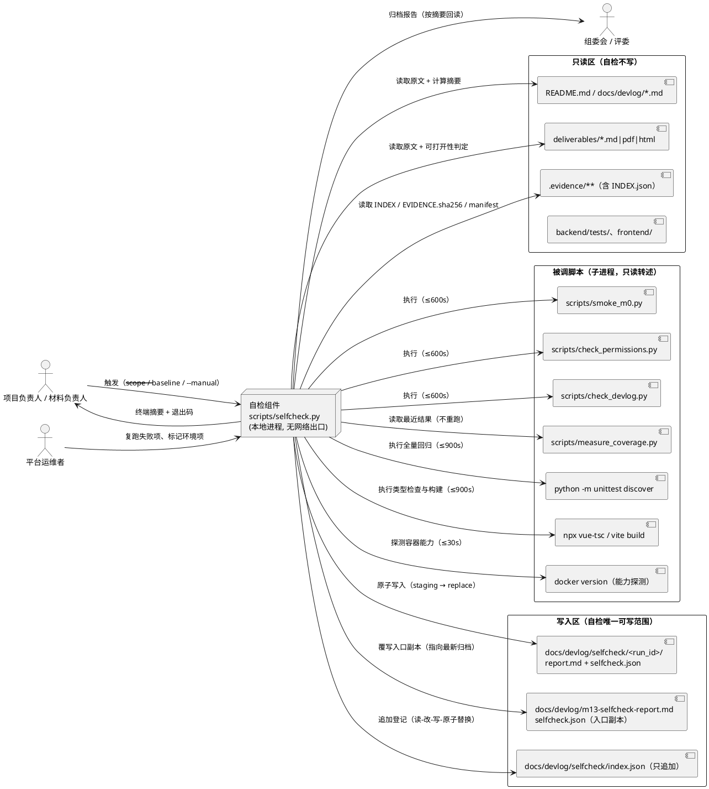
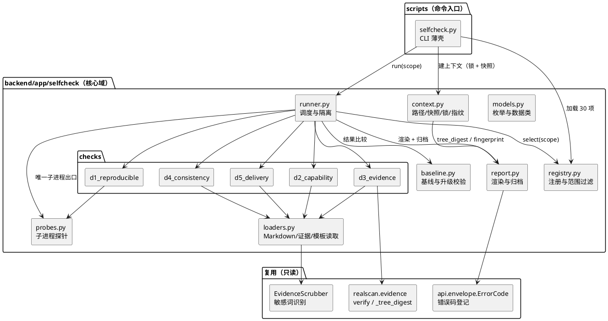
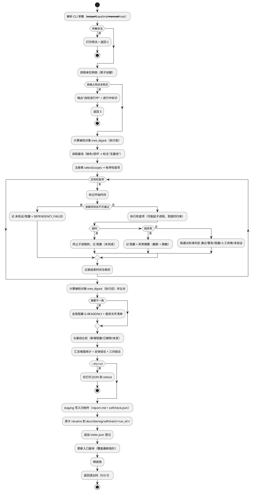
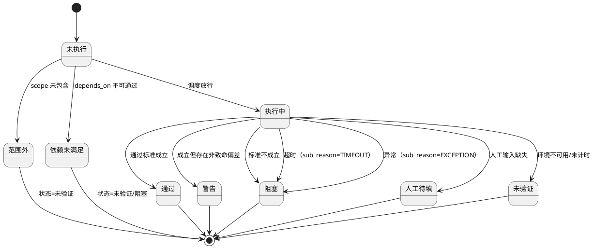
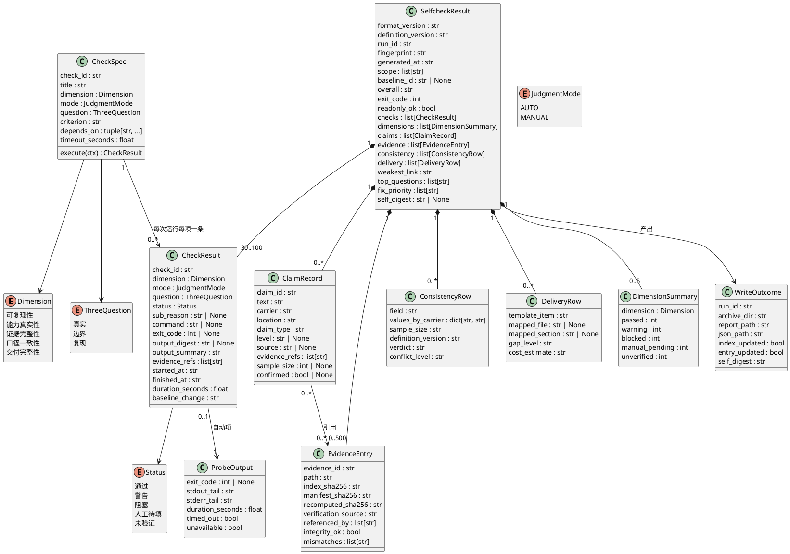

# 一、需求与存量功能关系分析

## 1.1 需求功能与存量功能对比

### 1.1.1 已实现功能

| 需求功能 | 存量功能 | 代码位置 | 匹配度 |
|---------|---------|---------|--------|
| 执行外部脚本并获取退出码与输出 | 既有脚本统一以 `main() -> int` + `raise SystemExit(main())` 提供 CLI，通过 `subprocess` 被再次调用的能力已具备 | `scripts/check_devlog.py:159-178`、`scripts/check_permissions.py:119-142`、`scripts/smoke_m0.py:17-82` | 75% |
| 退出码分级语义 | 沙箱与真扫已固定 `0=通过 / 2=未验证 / 3=失败 / 4=证据归档失败` | `scripts/run_sandbox_verify.py:168-170`、`scripts/run_realscan.py:131-134` | 75% |
| 证据包逐文件摘要校验 | `EvidencePackWriter.verify()` 按 `EVIDENCE.sha256` 逐行比对，缺失/不一致分类返回 | `backend/app/realscan/evidence.py:180-210` | 100% |
| 证据包整体摘要（tree digest） | `_tree_digest()` 以 `路径:sha256` 换行拼接再取 sha256，且排除 `manifest.json` 与 `EVIDENCE.sha256` | `backend/app/realscan/evidence.py:371-381` | 100% |
| 证据索引读取 | `INDEX.json` 结构固定（`packs[]`：`evidence_id/path/sha256/created_at/verification_source`），共 9 条登记 | `backend/app/realscan/evidence.py:244-259`、`.evidence/sandbox-realscan/INDEX.json` | 100% |
| 历史报告摘要校验 | `HISTORY_BASELINE` 硬编码 9 个被检对象摘要，`verify_history_digests()` 返回 `路径:missing` / `路径:实际摘要` | `backend/app/realscan/evidence.py:331-355` | 50% |
| 历史报告单点基线 | `m5-eval-report.md` 的 `expected_sha256` 与 `status=VERIFIED` 已有落盘记录 | `.evidence/metrics-recalc/history-baseline.json` | 100% |
| 敏感值识别与掩码 | `EvidenceScrubber` 提供 8 类正则（私钥、JWT、Bearer、带凭据 URL、口令赋值等），返回命中规则名 | `backend/app/realscan/evidence.py:270-303` | 75% |
| 凭据明文与权限基线扫描 | `build_report()` 输出 `branch_guard/secret_scan/env_example` 三段并归并为 `blocking_total` | `scripts/check_permissions.py:22-116` | 100% |
| 五步留痕结构性校验 | `_parse_step()` 校验文件存在、记录时间、状态声明与提交前缀；`build_report()` 校验时间单调与非 Git 仓库 | `scripts/check_devlog.py:57-131` | 100% |
| 空转闭环可判定输出 | `smoke_m0.py` 打印 `chain_valid=`，并在失败时返回 1 | `scripts/smoke_m0.py:64`、`scripts/smoke_m0.py:71-78` | 100% |
| 行覆盖率度量 | `measure()` 以 `sys.settrace` + `dis.findlinestarts` 计算行覆盖，输出 `passed=False` | `scripts/measure_coverage.py:63-105` | 75% |
| JSON 结构化输出与文本双通道 | 三个脚本均提供 `--json` 开关，同时保留可读文本渲染 | `scripts/check_devlog.py:166-178`、`scripts/check_permissions.py:125-141`、`scripts/measure_coverage.py:115-129` | 75% |
| WSL 路径映射 | `wsl_path` 与 `_mapper()` 处理 Windows ↔ WSL 路径差异 | `backend/app/realscan/runtime.py`、`scripts/run_sandbox_verify.py:29-30` | 100% |

### 1.1.2 需要扩展的功能

| 需求功能 | 存量功能 | 差异说明 | 扩展方向 |
|---------|---------|---------|---------|
| 退出码语义固定为 `0/2/3` | 沙箱脚本为 `0/2/3/4` | 多出 `4=证据归档失败`；自检的归并规则未定义 | 建立统一映射表：`4` 归并为 `3` 并标注 `sub_reason=EVIDENCE_ARCHIVE_FAILED`；不改动既有脚本返回码 |
| 历史报告只读性覆盖全部归档 | `HISTORY_BASELINE` 仅 9 项，且为硬编码常量 | 覆盖范围不足，无法覆盖 `docs/devlog/` 全部历史报告与历次自检报告 | 改为"登记索引驱动"：`selfcheck-index.json` 只追加登记历次报告摘要，首次运行时把既有 `HISTORY_BASELINE` 全量并入登记 |
| 证据批量只读校验 | `verify()` 需 `EvidencePackWriter` 实例，且 `write()` 会追加索引 | 批量扫描需要遍历 INDEX，且必须保证零写入；直接复用写对象存在误写风险 | 新增只读适配层，仅调用 `verify()` 与 `_tree_digest()`；实现上禁止调用 `write()` / `_update_index()` |
| 报告级脱敏 | `Scrubber.redact()` 只返回命中规则名，不返回掩码文本 | 报告需要落盘"已掩码"的输出摘要 | 新增独立的 `mask()` 辅助函数，保留 `redact()` 既有返回值语义不变（避免影响 `check_permissions.py:72` 的调用约定） |
| 覆盖率双口径 | 仅"核心判定模块"单口径 54.5% | D4 要求全模块口径与判定函数口径并列，并保留未达标表述 | 复用 `measure()` 并对 `targets` 参数化，得到两组数值；不修改度量算法本身 |
| 子进程执行可注入 | 既有脚本内直接 `subprocess.run` | 单元测试无法在不依赖 Docker / npm 的情况下验证调度、超时与隔离 | 抽出 `Probe` 协议（默认 `SubprocessProbe`，测试用 `FakeProbe`），既有脚本不改 |
| 文本渲染升级为结构化报告 | `check_devlog.render_text()` 为面向终端的短文本 | 自检报告需含五维度汇总、三问结论、修复优先级与逐项明细 | 新建报告渲染模块；不扩展 `render_text`，避免改变其既有输出契约 |
| 错误码登记 | `ErrorCode` 现有 `VF-7xxx/8xxx/9xxx` 三段，且 `ERROR_SPECS` 必须与枚举数量一致 | 自检需要锁冲突、超时、只读违规、报告写入失败、基线损坏等专用码 | 新增 `VF-7010–VF-7015` 六项并同步登记 `ERROR_SPECS`；须同步更新 `backend/tests/test_envelope.py:25-29` 的枚举完整性断言 |

### 1.1.3 需要新增的功能或接口

**A. 检查项模型与注册（新增）**

1. 检查项定义（`CheckSpec`）
   - 输入：编号、名称、维度、判定方式、三问映射、通过标准、执行依赖、超时阈值。
   - 输出：不可变注册项，供调度与报告共用。
   - 核心逻辑：构造期校验编号格式 `D<1-5>-<序号>`、维度合法、三问非空、判定方式为自动/人工、通过标准非空。
   - 依赖：`models.py` 枚举定义。
2. 检查项注册表（`CheckRegistry`）
   - 输入：`CheckSpec` 集合，或按维度/编号查询条件。
   - 输出：本次范围过滤后的有序检查项清单。
   - 核心逻辑：编号全局唯一、注册顺序稳定、按 `scope` 过滤；新增项不得影响既有项判定语义（spec 4.4.3）。
   - 依赖：`CheckSpec`。

**B. 执行调度（新增）**

3. 执行上下文（`SelfcheckContext`）
   - 输入：仓库根、输出目录、范围、基线路径、超时配置、探针实例、人工输入路径。
   - 输出：只读访问器（读取文档/证据/测试结果）+ 只读快照句柄 + 幂等指纹。
   - 核心逻辑：所有路径解析集中在上下文，检查项不得自行拼接路径（保证路径解码与跨平台一致）。
   - 依赖：`probes.py`、`loaders.py`。
4. 检查项执行器（`CheckRunner`）
   - 输入：有序检查项清单、上下文。
   - 输出：`CheckResult` 列表（每项含状态、命令、退出码摘要、输出摘要、证据引用、起止时间、耗时）。
   - 核心逻辑：逐项执行、异常隔离、超时终止、依赖失败传导、耗时记录。
   - 依赖：`CheckSpec.execute(ctx)` 契约。

**C. 只读快照、幂等与并发（新增）**

5. 只读快照（`ReadOnlySnapshot`）
   - 输入：被检路径白名单与排除规则。
   - 输出：执行前 `tree_digest`；执行后二次计算并返回差异文件清单。
   - 核心逻辑：算法与 `_tree_digest()` 同构（`相对路径:sha256` 换行拼接再 sha256），仅做"前后一致"判定。
   - 依赖：`hashlib`（标准库）。
6. 单实例锁（`RunLock`）
   - 输入：锁路径、本次 `run_fingerprint`。
   - 输出：获取成功或"自检进行中"（含进行中标识）。
   - 核心逻辑：原子创建 + 陈旧锁判定（心跳超时且进程不存在才可接管）。
   - 依赖：`os.open(O_CREAT|O_EXCL)`。
7. 幂等指纹（`fingerprint`）
   - 输入：范围、基线标识、被检对象 `tree_digest`、检查项定义版本、工具版本。
   - 输出：稳定 64 位十六进制摘要。
   - 核心逻辑：同一指纹必须得到同一结果状态集合与同一退出码（允许多次运行时间戳不同）。

**D. 报告生成（新增）**

8. 结果序列化（`SelfcheckResult` → `selfcheck.json`）
   - 输入：全部 `CheckResult`。
   - 输出：带 `format_version=1.0`、`definition_version=v1` 的结构化结果。
   - 核心逻辑：字段缺失以显式空值表示、不省略字段、维度汇总自动派生。
   - 依赖：`report.py`。
9. 报告渲染（Markdown）
   - 输入：结果集合 + 基线比较 + 人工项统计。
   - 输出：`m13-selfcheck-report.md`（归档件）。
   - 核心逻辑：固定章节顺序，必含 spec 5.6.3 列出的全部要素。
   - 依赖：`report.py`。
10. 归档与版本递增（`ReportWriter`）
    - 输入：结果文件与报告内容。
    - 输出：`docs/devlog/selfcheck/<run_id>/` 下的归档件 + 追加索引。
    - 核心逻辑：staging → 原子 rename；历史件永不覆写；同基线重复执行版本号递增。
    - 依赖：`os.replace`。

**E. 人工项骨架（新增）**

11. 人工输入文件与解析器（`manual.py`、`docs/devlog/selfcheck-manual.md`）
    - 输入：负责人填写的条目块（声称/真实来源/级别/确认）。
    - 输出：结构化 `ClaimRecord` 列表或"人工待填"判定。
    - 核心逻辑：缺失字段一律判人工待填并按阻塞处理，禁止默认通过。
    - 依赖：`loaders.py` 的 Markdown 解析。
12. 人工项草稿生成（`manual-draft.md`）
    - 输入：`m12-closure-and-blockers.md` §4、各阶段报告、`deliverables/CodeArts方案.md` 章节结构。
    - 输出：候选声称行与候选模板项映射（级别、结论列留空）。
    - 核心逻辑：只做"抽取与定位"，不做定级判断。
    - 依赖：`loaders.py`。

**F. 基线与增量（新增）**

13. 基线读取与比较（`baseline.py`）
    - 输入：上一次 `selfcheck.json`。
    - 输出：每项状态变化（`NEW_BLOCKER` / `RESOLVED` / `UNCHANGED`）、级别提升校验结论。
    - 核心逻辑：基线不可解析时按首次执行处理并标注"无基线"；不得用基线结果冒充本次结果。
    - 依赖：`report.py` 的格式版本。

**G. 命令入口（新增）**

14. CLI（`scripts/selfcheck.py`）
    - 输入：`--scope`、`--baseline`、`--root`、`--json`、`--jobs`、`--timeout`、`--manual`、`--dry-run`、`--no-report`。
    - 输出：终端摘要 + 归档件 + 退出码。
    - 核心逻辑：参数校验 → 锁 → 执行 → 写报告 → 返回退出码（`0/2/3`）。
    - 依赖：以上全部模块。

## 1.2 存量功能详细分析

### 1.2.1 子进程执行与退出码语义（`run_sandbox_verify.py` / `run_realscan.py`）

- **接口契约**：CLI 参数以 `argparse` 声明，参数名采用 kebab-case（`--evidence-root`）；成功时向 stdout 打印单份 JSON 摘要；失败时打印 `{"stage","code","detail"}` 三元组并返回非 0。调用方无需解析文本即可以退出码定性。
- **业务规则**：`PASS→0`、`UNVERIFIED→2`、其余（含 `FAIL`/`NOT_ESTABLISHED`）→`3`、证据落盘失败→`4`。`2` 与 `3` 的区分口径是"是否有结论"，而非"是否严重"。
- **扩展点**：`--policy`、`--evidence-root`、`--p4-05` 可参数化，说明执行域与证据根均可替换；`_transport_prefix()` 让命令前缀可随传输方式变化。
- **约束**：依赖容器运行时与特定镜像；容器不可用时既有脚本本身即返回 `2`，而非报错崩溃——自检可直接沿用该语义映射为"未验证"。

### 1.2.2 证据包写入、校验与索引（`backend/app/realscan/evidence.py`）

- **接口契约**：`write(prefix, payload, evidence_id) -> EvidencePack`；`verify(evidence_id) -> IntegrityReport(evidence_id, ok, mismatches)`；`verification_source` 取值受 `VerificationSource` 枚举约束；`manifest.json` 字段固定为 12 项。
- **业务规则**：
  1. 写入路径为 staging → 逐文件摘要 → 最后写 `manifest.json` → `os.replace` 原子改名，保证不出现半成品目录。
  2. `verify()` 先逐行校验 `EVIDENCE.sha256`（格式 `<sha256>␠␠<posix 相对路径>`），再校验 `manifest.sha256 == _tree_digest(包目录)`。
  3. `_tree_digest()` 排除 `manifest.json` 与 `EVIDENCE.sha256` 自身，因此"摘要文件不自我覆盖"。
- **扩展点**：`root` 可为任意证据目录；`verify()` 与 `_tree_digest()` 为纯读操作，可被自检直接复用。
- **约束**：`write()` 会触发 `_assert_monotonic()` 与 `_update_index()`，两者均写盘；自检**禁止**调用。`verify()` 对不存在包返回 `ok=False, mismatches=['EVIDENCE.sha256']`，需在报告中区分为"缺失"而非"篡改"。

### 1.2.3 历史报告摘要基线（`HISTORY_BASELINE` / `verify_history_digests`）

- **接口契约**：`verify_history_digests(project_root, baseline=None) -> list[str]`；返回值元素形如 `相对路径:missing` 或 `相对路径:实际sha256`；`assert_history_intact()` 在非空时抛出 `HISTORY_TAMPERED`（`VF-7007`）。
- **业务规则**：只做"当前摘要 == 登记摘要"的相等判定，不区分"被改写"与"被删除"，两者均为违规。
- **扩展点**：`baseline` 参数可外部注入，允许自检用自有登记表替换硬编码表。
- **约束**：硬编码表覆盖 9 项，新增报告需手工登记；自检必须以外部登记（`selfcheck-index.json`）为主、硬编码表为兜底，避免"未登记即通过"的假阴性。

### 1.2.4 五步留痕自检（`check_devlog.py`）

- **接口契约**：`build_report(devlog, skip_git) -> Report`（含 `steps[]`、`global_blocking[]`、`git_commits{}`）；`render_text(Report) -> str`；`main(argv) -> int` 返回 `0/2`。
- **业务规则**：状态串命中 `未执行|阻塞|UNVERIFIED` 即判该环节阻塞；非 Git 仓库或无法读取提交历史时追加全局阻塞，且**不视为通过**。
- **扩展点**：`--devlog` 可指向任意目录，`--skip-git-check` 仅供脚本自测；说明该脚本已被设计为可在临时目录夹具上运行。
- **约束**：当前工作区未初始化为 Git 仓库，D5 与 D1 引用其结果时必然得到阻塞；自检必须如实转述，不得以"其他项已通过"抵消。注意其"3 个阻塞"指阻塞条目数，进程退出码仍为 `2`。〔2026-11-18：自基线提交起，本约束改为"提交前缀缺失"阻塞；全局阻塞由 1 条变为 5 条、阻塞合计由 3 条变为 7 条，须如实转述。〕

### 1.2.5 覆盖率度量与指标口径（`measure_coverage.py` / `00-conventions.md` §4）

- **接口契约**：`measure(targets, tests) -> dict`，字段含 `total_line_coverage`、`threshold=0.8`、`passed`、`modules{}`；`main()` 返回 `0/2`。
- **业务规则**：行覆盖 ≠ 分支覆盖；报告明确"不能声称分支覆盖率达标"。指标口径以 `metrics-report.md` 与 `RPT-*` 归档为准，定义版本 `v2`。
- **扩展点**：`--target` / `--test` 可重复传入，允许按模块前缀切分统计范围——这为 D4 的"判定函数口径"提供了不改算法的实现路径。
- **约束**：度量会执行测试，属于长耗时操作（接近全量回归）；D4-4 不得在每次自检时重复度量，应读取最近一次度量结果并在报告中标注"度量时间"。

### 1.2.6 存量约束清单（对增量设计的硬约束）

| 约束 | 来源 | 对设计的影响 |
|---|---|---|
| `ERROR_SPECS` 数量必须等于 `ErrorCode` 数量 | `backend/tests/test_envelope.py:25-29` | 新增错误码必须同步登记，否则全量回归失败 |
| 证据包一经写出不可改写 | `backend/app/realscan/evidence.py:98-103` | 自检只能 `verify()`，不得 `write()` |
| 证据时间戳必须单调递增 | `backend/app/realscan/evidence.py:212-225` | 自检禁止触发任何证据写入，避免破坏单调性 |
| 历史报告只读 | `docs/devlog/00-conventions.md` §4、`m12` §8 | 报告必须版本化归档，入口文件与归档件分离 |
| 退出码不得改变既有含义 | spec 4.5.2 | 自检新增 `2`/`3` 使用点，但不得重新定义既有脚本语义 |
| 平台双兼容（Windows/Linux） | spec 4.5.1 | 路径分隔、进程终止、锁文件行为均需分支处理并标注执行域 |
# 二、增量设计方案

## 2.1 实现模型

### 2.1.1 上下文视图

自检组件不对外提供网络接口，只作为一个本地命令运行；它与外部的关系是"只读读取 + 只调既有脚本 + 只写自有归档目录"。



通信约定：

| 对端 | 协议 | 调用频率 | 超时 | 失败语义 |
|---|---|---|---|---|
| 文档/交付/证据文件系统 | 本地文件读 | 每项 1 次，全量约 30 次 | 单文件 5s | 不可读 → 该项阻塞 |
| 既有脚本子进程 | `subprocess`，捕获 stdout/stderr | 每次自检 1 次/脚本 | 600s（回归与构建 900s） | 超时 → 阻塞（未完成） |
| 容器能力探测 | `docker version`（必要时经 `wsl.exe`） | 每次自检 1 次 | 30s | 不可用 → 该项未验证 |
| 归档写入 | 本地文件写 | 每次自检 3 次（归档、入口、索引） | 5s | 失败 → 退出码 3 |

> **不设网络出口**：报告生成、证据校验、口径比对全部为本地计算；spec 4.3.2"不外发"由此在设计上成立，而非依赖运行时约束。

### 2.1.2 服务/组件总体架构



**模块与文件划分**

| 模块 | 文件 | 职责 | 允许的副作用 |
|---|---|---|---|
| 模型 | `backend/app/selfcheck/models.py` | 枚举（`Dimension`/`Status`/`JudgmentMode`/`ThreeQuestion`/`VerificationKind`）、数据类（`CheckSpec`/`CheckResult`/`ProbeOutput`/`ClaimRecord`/`EvidenceEntry`/`ConsistencyRow`/`DeliveryRow`/`DimensionSummary`/`SelfcheckResult`） | 无 |
| 注册表 | `backend/app/selfcheck/registry.py` | 30 项注册、编号与三问校验、`select(scope)` 范围过滤 | 无 |
| 上下文 | `backend/app/selfcheck/context.py` | 根路径与输出路径解析、只读快照、单实例锁、幂等指纹、时钟注入 | 仅锁文件（`docs/devlog/selfcheck/.lock`） |
| 探针 | `backend/app/selfcheck/probes.py` | 子进程执行、环境净化、超时终止、输出截断、脱敏 | 仅子进程及其临时输出目录 |
| 调度 | `backend/app/selfcheck/runner.py` | 逐项执行、异常隔离、依赖传导、耗时统计 | 无 |
| 基线 | `backend/app/selfcheck/baseline.py` | 读取上次结果、状态变化、级别提升校验 | 无 |
| 读取器 | `backend/app/selfcheck/loaders.py` | 载体遍历、Markdown 章节/表格/数值抽取、证据索引读取、模板清单、人工输入解析 | 无 |
| 报告 | `backend/app/selfcheck/report.py` | Markdown 渲染、JSON 序列化、staging 写入、自摘要、索引追加、入口副本更新、遗留 staging 修复 | `docs/devlog/selfcheck/`、入口副本、索引 |
| D1 检查 | `backend/app/selfcheck/checks/d1_reproducible.py` | D1-1…D1-6 | 经探针的临时目录 |
| D2 检查 | `backend/app/selfcheck/checks/d2_capability.py` | D2-1…D2-6 | 无 |
| D3 检查 | `backend/app/selfcheck/checks/d3_evidence.py` | D3-1…D3-7 | 无 |
| D4 检查 | `backend/app/selfcheck/checks/d4_consistency.py` | D4-1…D4-6 | 无 |
| D5 检查 | `backend/app/selfcheck/checks/d5_delivery.py` | D5-1…D5-5 | 无 |
| 人工输入 | `docs/devlog/selfcheck-manual.md` | 人工项填写（输入，人工维护） | 人 |
| 人工草稿 | `docs/devlog/selfcheck-manual-draft.md` | 机器生成的候选行（供人工确认） | 自检覆写（独立文件） |
| 命令入口 | `scripts/selfcheck.py` | 参数解析、调用链编排、退出码 | 同上下文与报告 |

> **为什么核心逻辑放 `backend/app/selfcheck/` 而非 `scripts/`**：`backend/tests/` 现有对 `scripts/*.py` 的验证方式是 `subprocess` 调用（见 `backend/tests/test_check_devlog.py`、`test_check_permissions.py`），只能做端到端断言；把 30 项判定逻辑放入 `backend/app` 包内可被直接 import，才能对"编号校验、项间隔离、超时、摘要比对"做单元测试。CLI 仍保留在 `scripts/`，与既有脚本入口习惯一致。

**检查项注册清单（30 项）**

| 编号 | 名称 | 维度 | 判定方式 | 三问映射 | 执行方式 | 通过标准 | 本期落地 |
|---|---|---|---|---|---|---|---|
| D1-1 | 干净环境配置加载 | 可复现性 | 自动 | 复现 | 探针：净化 `PYTHON*` 环境变量后执行 `python -c "...load_config()"` | 退出码 0 且输出含 `config ok` | 自动 |
| D1-2 | 全量回归 | 可复现性 | 自动 | 复现 | 探针：`python -m unittest discover -s backend/tests -p "test_*.py"`（默认环境） | `errors=0` 且 `failures=0`；记录用例数 | 自动 |
| D1-3 | 空转闭环 | 可复现性 | 自动 | 复现 | 探针：`python scripts/smoke_m0.py` | 退出码 0 且 stdout 含 `chain_valid=True` | 自动 |
| D1-4 | 15 分钟路径 | 可复现性 | 自动（计时） | 复现 | 按 README §3 顺序执行 5 步并累计计时；遇 `VF-8003` 前提不满足即停止 | 全链 ≤900s 且产出指标报告 | 自动（当前预期"未验证"） |
| D1-5 | 前端构建 | 可复现性 | 自动 | 复现 | 探针：`npx vue-tsc --noEmit`，随后 `npx vite build --outDir <临时目录>` | 两条命令退出码 0 且产物目录非空 | 自动（缺 `node_modules` 时"未验证"） |
| D1-6 | 沙箱复现 | 可复现性 | 自动（只读） | 复现 | 容器能力探测 + 最近 `VER-*` 包摘要校验；**默认不重跑写证据** | 容器可用且最近 `VER` 包 `verify().ok=True` | 自动（不可用时"未验证"） |
| D2-1 | 声称登记完整性 | 能力真实性 | 人工 + 自动抽取 | 真实 | 抽取固定载体中的数值型/能力型表述，与人工清单比对 | 未登记项 = 0 | 骨架（自动出候选清单） |
| D2-2 | 四级互斥定级 | 能力真实性 | 人工 + 自动校验 | 真实 | 读取人工输入的级别列，校验取值 ∈ {L1,L2,L3,L4} 且非空 | 100% 条目有级别 | 骨架 |
| D2-3 | L4 四要素 | 能力真实性 | 自动 | 真实 | 对判 L4 的条目校验命令/退出码/证据文件/证据摘要四项 | 四项齐备且摘要校验通过；缺项降 L3 并阻塞 | 自动（级别来自人工输入） |
| D2-4 | L2/L1 表述限制 | 能力真实性 | 自动 | 真实 | 按级别加载禁用词表（已集成/已打通/已上线）扫描载体原文 | 0 命中 | 自动 |
| D2-5 | 混级表述禁止 | 能力真实性 | 自动 | 真实 | 段落级扫描"全部实测通过/整体已完成"类合并表述与段落内级别集合 | 0 命中 | 自动 |
| D2-6 | 级别不得无证据升级 | 能力真实性 | 自动 | 真实 | 与基线级别比较；级别提高时要求新增证据标识 | 无新增证据 → 回退基线级别并阻塞 | 自动（依赖基线） |
| D3-1 | 声称→证据映射 | 证据完整性 | 自动 | 真实 | 每条声称在 `INDEX.json` 中定位证据并校验摘要 | 每条 ≥1 个证据且摘要通过 | 自动 |
| D3-2 | 孤儿证据率 | 证据完整性 | 自动 | 边界 | `INDEX` 证据集 − 文档引用集，计算占比 | ≤10% 通过；>10% 警告（不删除） | 自动 |
| D3-3 | 逐文件摘要一致性 | 证据完整性 | 自动 | 真实 | 逐行校验 `EVIDENCE.sha256` | 100% 一致 | 自动 |
| D3-4 | 索引包摘要一致性 | 证据完整性 | 自动 | 真实 | `INDEX.sha256` vs `manifest.sha256` vs 重算 `tree_digest` | 三方一致 | 自动 |
| D3-5 | 引用可解析 | 证据完整性 | 自动 | 真实 | 载体中的 `VER-/SCAN-/ISO-` 标识 → `INDEX` 唯一定位 + 格式校验 | 100% 可解析 | 自动 |
| D3-6 | 证据包四类内容完备 | 证据完整性 | 自动 | 真实 | 检查 `commands.txt`、`raw/`、`runtime_facts.json`、`EVIDENCE.sha256` | 四类齐备 | 自动 |
| D3-7 | 历史报告只读性 | 证据完整性 | 自动 | 真实 | `selfcheck/index.json` 登记摘要 + `HISTORY_BASELINE` 兜底 | 摘要全部不变 | 自动 |
| D4-1 | 三类文字载体齐全 | 口径一致性 | 自动 | 边界 | 检查 README、收尾与阻塞文档、交付方案三类**文字载体**（`TEXT_CARRIERS`）；演示材料不参与本项 | 三类均存在、可读且正文非空 | 自动（v1.1-R1） |
| D4-2 | 同数同值 | 口径一致性 | 自动 | 边界 | 按字段抽取后跨载体比对取值集合 | 取值集合大小 = 1 | 自动 |
| D4-3 | 样本量随行 | 口径一致性 | 自动 | 真实 | 百分比结论同段查找样本量标注 | 0 处缺失（`n<5` 记警告） | 自动 |
| D4-4 | 覆盖率双口径 | 口径一致性 | 自动 | 真实 | 载体覆盖率声明 vs 最近度量结果（全模块 / 判定函数） | 双列且保留未达标表述 | 自动（读最近度量，不重跑） |
| D4-5 | 未验证统一表述 | 口径一致性 | 自动 | 边界 | 对 `m12` §4 不可声称清单在各载体扫描完成类词 | 0 命中 | 自动 |
| D4-6 | 支出口径一致 | 口径一致性 | 自动 | 边界 | 扫描合并目标分支表述 | 统一为"合并到 `release/auto`，永不并 `main`" | 自动 |
| D5-1 | 模板十项映射 | 交付完整性 | 人工 + 自动定位 | 边界 | 自动定位文件与章节，人工确认覆盖度 | 十项均有文件+章节位置 | 骨架 |
| D5-2 | 模板外必交三件 | 交付完整性 | 自动 | 边界 | 扫描演示文稿、演示视频、可访问演示入口 | 三项齐备 | 自动（当前预期阻塞） |
| D5-3 | 缺项定级与补齐成本 | 交付完整性 | 人工 | 边界 | 读取人工输入中的等级与成本估计 | 每缺项有等级与成本 | 骨架 |
| D5-4 | 材料可打开且非占位 | 交付完整性 | 自动 | 真实 | 文件头/正文长度/占位特征判定 | 非空且超过最小阈值 | 自动 |
| D5-5 | 使用说明真实痕迹 | 交付完整性 | 人工 + 自动线索 | 真实 | 自动检索日志/截图/发布单引用，人工确认充分性 | ≥1 处真实痕迹 | 骨架 |

合计 30 项（D1 6 / D2 6 / D3 7 / D4 6 / D5 5），与 spec 4.5.4"30 项扩展至 100 项"的基线规模一致。

**检查项注册与执行调度规则**

1. **注册顺序即执行顺序**：维度内按编号升序；`registry.select(scope)` 只做过滤，不做重排，保证同一输入执行顺序稳定（幂等前提）。
2. **依赖声明**：`CheckSpec.depends_on: tuple[str, ...]`，当前依赖关系为 `D1-2→D1-1`、`D1-4→D1-1`、`D2-3→D3-1`、`D2-6→D2-2`；v1.1-R2 起**删除** `D5-1→D4-1`，D5-1 自身经 `loaders.py` 定位模板十项，不因 D4-1 阻塞被传导。被依赖项为"阻塞/人工待填"时，依赖项不得判通过，记 `sub_reason=DEPENDENCY_FAILED` 并继承最严格状态。
3. **范围过滤**：未纳入 `--scope` 的检查项状态为 `未验证`，`sub_reason=SCOPE_EXCLUDED`，报告中单列"未执行（范围外）"；按 spec 5.6.1-1，此时退出码不得为 0（本文档取 `2`，理由见 2.4.4）。
4. **并发策略**：默认 `--jobs 1` 全串行；`--jobs N` 仅允许"维度间并行"，D1 维度始终内部串行（回归与构建争用 CPU 且都会启动大量子进程）。并行结果按注册顺序落位，保证 JSON 顺序稳定。
5. **中断粒度**：调度以"检查项"为事务边界；单项异常/超时只影响该项，已产生的部分输出摘要随该项结果落盘。
6. **判定方式隔离**：人工项（`judgment=MANUAL`）不执行探针，只读人工输入；自动项不得引用人工输入的"结论"，只允许引用"级别"与"声称原文"这两类事实输入。

### 2.1.3 实现设计文档

**主流程（活动图）**



**单检查项状态机**



状态互斥（spec 6.1-5）：任一 `CheckResult` 只持有一个 `status`；`sub_reason` 为附属说明字段，不参与互斥判定。

**总体结论推导（非"多数票"）**

| 条件（按序判定，命中即停） | 总体结论 | 退出码 |
|---|---|---|
| 存在全局阻塞（只读违规、锁冲突、报告写入失败） | 不通过 | 3 |
| 存在任一 `阻塞` | 不通过 | 3 |
| 存在任一 `人工待填` | 未完成 | 3 |
| 存在任一 `警告`，且无阻塞/待填 | 通过（附警告） | 2 |
| 存在任一 `未验证`（含范围外），且无阻塞/待填/警告 | 未完成 | 2 |
| 全部为 `通过` | 通过 | 0 |

> 该表刻意**不以通过项数量**参与判定，落实 spec 5.6.1-4"结论不可宽松"。

**扩展点设计**

| 扩展点 | 契约 | 默认实现 | 使用方 |
|---|---|---|---|
| 新增检查项 | 在 `checks/` 新增模块并 `@register` 一个 `CheckSpec` | 无（必须显式注册） | 维度维护者 |
| 新增载体字段 | `loaders.py` 的 `FIELD_RULES` 表加一条（字段名 + 正则 + 归一化方式） | 现有 6 字段：覆盖率/用例数/连续运行时长/缺陷类别数/支出口径/样本量 | D4 |
| 判定阈值调整 | `context.py` 的 `Thresholds`（孤儿率 10%、样本量 5、单项超时 600s、回归超时 900s） | 与 spec 4.1 一致 | 运维者 |
| 探针替换 | `Probe` 协议（`run(argv, timeout, cwd, env_mode) -> ProbeOutput`） | `SubprocessProbe` | 测试、CI |

**事务与一致性设计**

自检的写操作有 4 个目标：归档目录、入口副本、索引文件、锁文件。写入顺序与失败处置如下：

1. **先归档**（`staging/<run_id>/*` → `os.replace` 成目录）：失败则整个自检不产生可见产物，报告记"未生成"，退出码 3。
2. **再索引**（读 → 追加 → 写临时文件 → `os.replace`）：失败则归档件已存在但未登记；下次启动时 `report.repair_index()` 扫描归档目录补登记（幂等），并记 `sub_reason=INDEX_REPAIRED`。
3. **最后入口副本**（覆盖 `docs/devlog/m13-selfcheck-report.md` 与 `selfcheck.json`）：失败不影响归档件完整性，报告终端提示"入口副本未更新"。
4. **锁**在 `finally` 中释放；进程被强杀时残留锁按陈旧规则接管。

**幂等与"不允许复用上次结果"的边界**：本次执行只允许从基线读取"上一次的状态"用于**比较**，不得把基线的 `status` 填入本次结果（spec 4.2.4）。实现上 `CheckResult` 由本次执行构造，基线只产出 `baseline_change` 字段。
## 2.2 接口设计

### 2.2.1 总体设计

接口分为 6 类，均遵循"入参强类型、出参不可变数据类、异常只走 `ApiError`/专用异常"的统一约定。

| 分类 | 接口 | 稳定性 | 变更策略 |
|---|---|---|---|
| 命令契约（对外） | `scripts/selfcheck.py` CLI | 稳定 | 新增参数只能有默认值；`--scope` 取值语义不变 |
| 检查项契约（内部） | `CheckSpec.execute(ctx) -> CheckResult` | 稳定 | 新增项不改既有签名；如需新增上下文能力，只扩 `SelfcheckContext` 的只读属性 |
| 探针契约（内部） | `Probe.run(...) -> ProbeOutput` | 稳定 | 测试替身与真实实现共用同一签名 |
| 读取器契约（内部） | `loaders.*` 纯函数 | 实验 | 抽取规则可迭代，但输出结构字段只增不改名 |
| 报告契约（对外产物） | `selfcheck.json`（`format_version=1.0`） | 稳定 | 字段只增不删；口径变更时提升 `format_version` |
| 人工输入契约（对外） | `docs/devlog/selfcheck-manual.md` 条目格式 | 实验 | 格式变更需同步版本字段并在报告中提示"人工输入格式已变更" |

### 2.2.2 接口清单

#### 2.2.2.1 命令入口 `scripts/selfcheck.py`

```python
def main(argv: list[str] | None = None) -> int: ...
```

| 参数 | 取值 | 默认 | 说明 |
|---|---|---|---|
| `--scope` | 逗号分隔的 `D1,D2,D3,D4,D5` | 全量 | 范围外项记 `未验证` |
| `--baseline` | 路径 | `docs/devlog/selfcheck.json` | 上次结果；缺失按首次执行 |
| `--root` | 路径 | 仓库根 | 供测试指向临时夹具 |
| `--manual` | 路径 | `docs/devlog/selfcheck-manual.md` | 人工输入 |
| `--jobs` | 1–5 | 1 | 维度间并行度 |
| `--timeout` | 秒 | 600 | 单项上限；回归与构建内部固定 900 |
| `--json` | 开关 | 关 | 仅输出 JSON 到 stdout，不写文件 |
| `--dry-run` | 开关 | 关 | 不写归档、不更新索引、不更新入口副本 |
| `--no-report` | 开关 | 关 | 同 `--json`，但保留归档写入 |
| `--allow-writes` | 开关 | 关 | 允许 D1-4 真正执行 15 分钟链路（会写 `eval/runs`）；开启后报告必须声明"只读豁免" |
| `--refresh-evidence` | 开关 | 关 | 允许 D1-6 重跑沙箱并写 `.evidence/`；开启后报告必须声明豁免范围 |

- **业务说明**：全量自检、单维度复跑、CI 内嵌调用三条路径共用同一入口。
- **前置条件**：`--root` 下存在 `README.md` 与 `docs/devlog/`；三类文字载体缺失时 D4-1 阻塞，流程继续（v1.1-R1；演示材料不计入 D4-1）。
- **后置条件**：退出码与归档件一致；`--dry-run` 时仓库无任何写入（锁文件也在退出前删除）。
- **异常映射**：见 2.6.1 错误码表。
- **调用示例**：

```python
import subprocess, sys
r = subprocess.run([sys.executable, "scripts/selfcheck.py", "--scope", "D1,D3,D4", "--json"], capture_output=True, text=True)
print(r.returncode)  # 0 通过 / 2 警告或未验证 / 3 阻塞或人工待填
```

#### 2.2.2.2 检查项契约 `CheckSpec` / `CheckResult`

```python
class CheckSpec:
    check_id: str              # "D3-2"，构造期校验格式与全局唯一
    title: str
    dimension: Dimension
    mode: JudgmentMode         # AUTO | MANUAL
    question: ThreeQuestion    # REAL | BOUNDARY | REPRODUCE
    criterion: str             # 可判定标准，禁止模糊词
    depends_on: tuple[str, ...] = ()
    timeout_seconds: float     # 默认 600

    def execute(self, ctx: "SelfcheckContext") -> "CheckResult": ...
```

- **业务说明**：一个实例承载"定义 + 执行"两职，注册表只持有定义，执行由调度器触发。
- **前置条件**：`ctx` 已通过只读快照初始化，且 `ctx.tmp_dir` 可写（仅临时目录）。
- **后置条件**：返回的 `CheckResult.check_id` 必须与 `spec.check_id` 一致；调度器校验不一致则记阻塞。
- **异常映射**：`CheckSpec` 内抛 `ApiError` → 结果状态按 `code` 映射（`VF-7011`→阻塞+超时）；其他异常 → 阻塞 + `EXCEPTION`。
- **调用示例**：

```python
spec = registry.get("D1-3")
result = spec.execute(ctx)
assert result.status in {Status.PASS, Status.WARNING, Status.BLOCKED, Status.MANUAL_PENDING, Status.UNVERIFIED}
```

#### 2.2.2.3 探针契约 `Probe`

```python
class Probe:
    def run(self, argv: list[str], *, timeout: float, cwd: Path,
            env_mode: EnvMode = EnvMode.INHERIT,
            summary_limit: int = 2000) -> "ProbeOutput": ...
```

| `env_mode` | 语义 | 用途 |
|---|---|---|
| `INHERIT` | 继承父进程环境 | 既有脚本、回归 |
| `CLEAN` | 清空 `PYTHON*`、`PYTHONPATH`、`PYTHONUTF8`，保留 `PATH`/`SYSTEMROOT`/`HOME` | D1-1 干净环境验证 |

- **业务说明**：所有子进程必须经此接口，便于统一超时、截断、脱敏与进程树清理。
- **前置条件**：`cwd` 必须位于 `ctx.root` 或 `ctx.tmp_dir` 之内（越界拒绝，抛 `VF-7012`）。
- **后置条件**：返回 `exit_code`、`stdout_tail`、`stderr_tail`、`duration_seconds`、`timed_out`；不返回完整输出（spec 6.1-8）。
- **异常映射**：`TimeoutExpired` → `timed_out=True` + 清理进程树；`OSError`（可执行文件不存在）→ `exit_code=None` + `unavailable=True`，由调用方决定记"未验证"。
- **调用示例**：

```python
out = ctx.probe.run([sys.executable, "scripts/smoke_m0.py"], timeout=600, cwd=ctx.root)
status = Status.PASS if out.exit_code == 0 and "chain_valid=True" in out.stdout_tail else Status.BLOCKED
```

#### 2.2.2.4 注册与调度

```python
class CheckRegistry:
    def register(self, spec: CheckSpec) -> None: ...   # 重复编号抛 ValueError
    def select(self, scope: tuple[Dimension, ...] | None) -> tuple[CheckSpec, ...]: ...
    def get(self, check_id: str) -> CheckSpec: ...

class SelfcheckRunner:
    def run(self, scope: tuple[Dimension, ...] | None = None) -> "SelfcheckResult": ...
```

- **业务说明**：`select` 保证"过滤不重排"；`run` 内部完成依赖传导、隔离、计时与汇总。
- **前置条件**：`runner` 已绑定 `SelfcheckContext`，锁已获取。
- **后置条件**：返回的 `SelfcheckResult.checks` 顺序与注册顺序一致，且条数等于 `--scope` 内注册项数（范围外项同样出现在结果中，状态为 `未验证`）。
- **异常映射**：依赖环/配置非法 → `VF-1006 CONFIG_INVALID` 在注册期即失败，而非运行期（**实现偏差**：`VF-7003` 已被 `RECALC_FAILED` 占用，不得改其语义；v1.1-R2 后默认依赖表不含 `D5-1→D4-1`）。
- **调用示例**：

```python
result = SelfcheckRunner(context, registry).run(scope=(Dimension.D1, Dimension.D3, Dimension.D4))
print(len(result.checks), result.overall.value, result.exit_code)
```

#### 2.2.2.5 报告写入 `ReportWriter`

```python
class ReportWriter:
    def write(self, result: "SelfcheckResult") -> "WriteOutcome": ...
    # WriteOutcome: run_id, archive_dir, report_path, json_path, index_updated, entry_updated, self_digest
```

- **业务说明**：负责版本号分配、staging 写入、原子改名、索引追加、入口副本更新与遗留 staging 修复。
- **前置条件**：`result.fingerprint` 非空；`docs/devlog/selfcheck/` 可创建。
- **后置条件**：归档件存在且摘要登记进索引；历史归档摘要不变；`self_digest` 可由 `verify_report()` 回读校验。
- **异常映射**：目录不可写/磁盘满 → `VF-7013`，退出码 3，结果文件保留在 staging 并在终端摘要打印路径。
- **调用示例**：

```python
outcome = ReportWriter(context).write(result)
print(outcome.run_id, outcome.archive_dir)   # SC-20261115T170000+0800-v1
```

#### 2.2.2.6 人工输入契约 `docs/devlog/selfcheck-manual.md`

- **格式**：每个条目一个三级标题块；字段以 `- 字段名：值` 单行声明，字段名固定。

```markdown
### CLM-001
- 声称：690 用例，功能性失败 0
- 载体：README.md §8
- 真实来源：python -m unittest discover -s backend/tests（本机默认环境）
- 级别：L3
- 证据：无
- 样本量：不适用
- 确认：待确认
```

- **业务说明**：`级别`、`样本量`、`确认` 三字段是判定输入；`确认` 非 `是` 时一律 `人工待填`。
- **前置条件**：文件存在且编码为 UTF-8（无 BOM）。
- **后置条件**：解析器产出 `ClaimRecord` 列表；未闭合的条目块整块判 `人工待填`。
- **异常映射**：文件缺失 → `VF-7015`，D2 全部条目（除可自动判定的 D2-3/D2-4/D2-5）记 `人工待填`。
- **调用示例**：

```python
records = load_manual_claims(ctx.manual_path)
pending = [r for r in records if r.confirmed is not True]
```

#### 2.2.2.7 错误码新增登记

| 枚举 | 值 | HTTP | 语义 | 触发 |
|---|---|---|---|---|
| `SELFCHECK_LOCKED` | `VF-7010` | 409 | 自检进行中 | 锁被非陈旧持有 |
| `SELFCHECK_TIMEOUT` | `VF-7011` | 504 | 检查项超时 | 单项超过阈值 |
| `SELFCHECK_READONLY_VIOLATION` | `VF-7012` | 500 | 只读违规 | 执行前后摘要不一致，或探针越界写 |
| `SELFCHECK_REPORT_WRITE_FAILED` | `VF-7013` | 500 | 报告写入失败 | 归档目录不可写 |
| `SELFCHECK_BASELINE_INVALID` | `VF-7014` | 422 | 基线不可用 | 基线 JSON 不合法 |
| `SELFCHECK_MANUAL_PENDING` | `VF-7015` | 422 | 人工项未填 | 人工输入缺失/未确认 |

> 这 6 项必须同时加入 `ErrorCode` 与 `ERROR_SPECS`，否则 `backend/tests/test_envelope.py:25-29` 的"数量一致 + 逐项存在"断言会使全量回归失败。

## 2.3 数据模型

### 2.3.1 设计目标

1. **术语对齐**：对象名与 spec 第 2 章术语一一对应（检查项 / 声称条目 / 证据引用 / 口径条目 / 自检报告 / 结果状态），避免自造同义词。
2. **规模演进**：检查项 30 → 100 时不改结构（仅多行）；证据包 152 → 500 时仅线性增加遍历量，无嵌套聚合。
3. **兼容性**：结果文件带 `format_version="1.0"` 与 `definition_version="v1"`；基线读取按 `format_version` 分支，未知版本按"无基线"处理并告警。
4. **可回读**：结果文件与报告各自可计算摘要，摘要计算范围必须确定（见 2.4.3）。
5. **显式空值**：所有字段必出现；无值时为 `null` / `[]` / `""`，禁止省略键（spec 4.4.5）。

### 2.3.2 模型实现



**生命周期与创建策略**

| 对象 | 创建时机 | 销毁 | 说明 |
|---|---|---|---|
| `CheckSpec` | 模块导入期注册 | 进程结束 | 不可变；重复注册在启动期失败 |
| `CheckResult` | 每项执行结束时一次性构造 | 序列化后 | 不在执行中修改，避免"边跑边写" |
| `EvidenceEntry` | D3 遍历 INDEX 时 | 序列化后 | 一个证据包一条，含三方摘要 |
| `SelfcheckResult` | 全部项结束后 | 序列化后 | 汇总派生字段（维度统计、总体结论）在此计算一次 |
| `WriteOutcome` | 归档完成后 | 进程结束 | 用于终端摘要与索引登记 |

**持久化策略**

1. 结果以单个 JSON 文件落盘，不引入数据库；证据包本体不复制、不缓存（避免"自检生成新证据"）。
2. 归档目录按 `run_id` 隔离：`docs/devlog/selfcheck/<run_id>/{report.md,selfcheck.json}`。
3. 索引 `docs/devlog/selfcheck/index.json` 只追加，每条含 `run_id`、`generated_at`、`scope`、`overall`、`exit_code`、`fingerprint`、`report_sha256`、`json_sha256`。
4. 基线来源固定为入口副本 `docs/devlog/selfcheck.json`；若缺失则回退到索引中最新一条对应的归档 JSON。
## 2.4 报告与 `selfcheck.json` 生成策略

### 2.4.1 版本与归档

- `run_id = SC-<YYYYMMDDTHHMMSS+ZZZZ>-v<N>`，其中 `N` = 该基线（`baseline_id`）下已有版本数 + 1；无基线时为 `v1`。
- 归档路径：`docs/devlog/selfcheck/<run_id>/report.md` 与 `.../selfcheck.json`（同目录，便于整体校验）。
- 入口副本：`docs/devlog/m13-selfcheck-report.md` 与 `docs/devlog/selfcheck.json`，内容为最新归档件的逐字副本，末尾追加一行指针 `<!-- archive: <run_id> -->`。
- 索引：`docs/devlog/selfcheck/index.json`，只追加，不修改历史条目。

> **"历史不可覆写"与"固定输出路径"的调和**：spec 1.3 要求产出路径为 `m13-selfcheck-report.md` 与 `selfcheck.json`，spec 4.2.6 / 5.6.1-8 要求历史不可覆写。设计上将固定路径定义为**入口副本（entry pointer）**，真正的报告是 `selfcheck/<run_id>/` 下的归档件；历史归档件与索引条目永不修改，入口副本被覆写只改变"指向哪一版"。报告首屏同时标注"当前版本 / 归档路径 / 前一版本"，评委按归档路径回读得到稳定摘要。

### 2.4.2 Markdown 报告章节结构（固定顺序）

| 顺序 | 章节 | 必含内容 | 对应 spec |
|---|---|---|---|
| 1 | 头部元信息 | 生成时间、基线、范围、`run_id`、退出码、执行域 | 5.6.1-3 |
| 2 | 总体结论 | 通过/不通过/未完成 + 阻塞与待填计数 + 结论推导依据 | 5.6.1-4 |
| 3 | 五维度汇总表 | 每维度：通过/警告/阻塞/未验证/待填 | 6.5.4 |
| 4 | 三问必答 | 最弱环节、高危提问前三、工期判断与建议顺序（各附检查项编号） | 5.6.1-5 |
| 5 | 检查项明细 | 全部范围内检查项（含通过项），逐项给命令/依据、输出摘要、证据引用、耗时、基线变化 | 5.6.1-3 |
| 6 | 阻塞与警告清单 | 编号、原因、影响范围、解除条件 | 5.6.1-6 |
| 7 | 修复优先级 | 按"阻塞优先 → 依赖优先 → 成本优先"排序，每条含依据编号与预计解除的阻塞 | 5.6.1-6 |
| 8 | 声称来源追溯表 | 声称、载体、真实来源、级别、证据、可否对外、禁止表述 | 1.3-3 |
| 9 | 口径冲突清单 | 字段、各载体取值、样本量、一致性结论、处置建议 | 1.3-4 |
| 10 | 证据完整性明细 | 声称→证据映射、孤儿清单、摘要校验、历史只读性结论 | 1.3-5 |
| 11 | 交付缺口清单 | 模板项映射、缺失项、等级、补齐方式 | 1.3-6 |
| 12 | 未执行与未验证说明 | 范围外项、环境不可用项、执行域与不得外推范围 | 4.3.4 |
| 13 | 报告自摘要 | 归档路径 + sha256 | 5.6.1-9 |

**三问结论的自动推导规则（避免"编答案"）**

| 项 | 自动推导 | 何时转人工待填 |
|---|---|---|
| 最弱环节 | 按"该维度阻塞数 → 该维度未验证数 → 该维度平均匹配度"三级排序取首 | 全部维度阻塞数均为 0 时输出"当前运行未发现阻塞"，不推测 |
| 高危提问前三 | 将阻塞项映射到三问（真实/边界/复现），按阻塞数降序取前三，附编号 | 阻塞项少于 3 项时按实际数量输出，并注明"本次不足三项" |
| 工期是否足够与顺序 | **不做自动判断** | 恒为 `人工待填`，由负责人填写；未填则总体结论不得为通过 |

### 2.4.3 自摘要算法（自指问题的确定性处理）

- `selfcheck.json`：先构造完整对象，将 `self_digest` 置为 `null`，按 `json.dumps(..., sort_keys=True, ensure_ascii=False, indent=2)` 序列化求 sha256，再回填 `self_digest` 写入磁盘。
- `report.md`：`self_digest` 计算范围为"除最后 3 行（摘要章节）以外的全部内容"，即渲染时先拼接正文求摘要，再追加摘要章节。
- 回读校验 `ReportWriter.verify_report(path)`：按同一规则重算并与登记值比对；不一致即判 `REPORT_INCONSISTENT`（`VF-7005`）。

### 2.4.4 退出码与"范围外"的处置

| 情形 | 退出码 | 报告结论 | 理由 |
|---|---|---|---|
| 全量运行，存在阻塞 | 3 | 不通过 | spec 5.6.1-2 |
| 全量运行，无阻塞但有 `人工待填` | 3 | 未完成 | spec 5.6.1-7 |
| 仅跑 `D1,D3,D4`（D2/D5 范围外 → 未验证） | 2 | 未完成 | spec 5.6.1-1 要求"不得为 0"；`2` 为最轻的非零码 |
| 仅跑 `D1,D3,D4` 且全部通过、无警告 | **仍为 2** | 未完成 | 与上一行一致，避免"范围裁剪后声称全通过" |
| 全量运行，仅有警告 | 2 | 通过（附警告） | spec 5.6.1-2 |
| 全部通过 | 0 | 通过 | spec 5.6.1-2 |
| 全局只读违规 / 报告写入失败 / 锁冲突 | 3 | 不通过 | spec 4.2.1、5.6.3-1、5.6.3-3 |

> 该规则意味着"只跑自动化维度永远拿不到 0"，这是刻意的：范围裁剪不得转化为对外通过声明。若需 0，必须跑全量并把人工项填完。

### 2.4.5 幂等保证

- `fingerprint = sha256(scope | baseline_id | tree_digest(被检集合) | definition_version | tool_version)`。
- 同一 `fingerprint` 重跑：`checks[].status` 集合、`dimensions[]`、`overall`、`exit_code` 必须完全一致；`generated_at`、`run_id`、`duration_seconds` 允许不同。
- 若 `fingerprint` 相同但结果不同 → 报告追加一行"幂等性破坏"，并把不一致的检查项编号列入阻塞（防止"同输入不同结论"被用于挑结果）。
- 报告中记录 `fingerprint`，便于评委复跑比对。

## 2.5 只读与幂等保证的落地方式

### 2.5.1 被检集合定义（快照范围）

| 纳入快照 | 排除（自检自身写路径或易变缓存） |
|---|---|
| `README.md`、`NOTES.md` | `docs/devlog/selfcheck/**` |
| `docs/devlog/**/*.md`、`docs/devlog/metrics/**` | `docs/devlog/m13-selfcheck-report.md`、`docs/devlog/selfcheck.json` |
| `deliverables/**` | 所有 `__pycache__/`、`.pytest_cache/` |
| `.evidence/**`（排除 `.work/`） | `frontend/node_modules/`、`frontend/dist/`（构建改写到临时目录后仍排除） |
| `backend/tests/**`、`frontend/src/**` | `.git/`、`docs/devlog/selfcheck-manual-draft.md` |
| `sandbox/spec.json`、`verifix-target/ground_truth.json` | 系统临时目录、`.evidence/**/.work/` |

`tree_digest` 算法与 `backend/app/realscan/evidence.py:377-381` 同构：对每个文件取 `相对路径:sha256`，以 `\n` 连接后再 sha256；因此 D3 与只读校验共用一套算法语义，无需两套实现。

### 2.5.2 写入通道白名单

只允许 4 类写操作，全部集中于 `report.py` 与 `context.py`：

| 目标 | 写入方 | 保护措施 |
|---|---|---|
| `docs/devlog/selfcheck/<run_id>/` | `ReportWriter.write` | staging → `os.replace` |
| `docs/devlog/selfcheck/index.json` | `ReportWriter._append_index` | 读-改-写-临时文件-`os.replace` |
| 入口副本两文件 | `ReportWriter.write` | 同 staging 策略 |
| `docs/devlog/selfcheck/.lock` | `RunLock.acquire` | `O_CREAT｜O_EXCL`，`finally` 释放 |

**禁止调用的存量接口**（评审红线）：`EvidencePackWriter.write()`、`EvidencePackWriter._update_index()`、`FileStore` 任何写方法、`realscan` 任何 `verify()` 之外的方法。检查项模块不得 `import` 上述写接口，由代码评审 + 静态检查兜底。

### 2.5.3 会写盘的既有脚本如何被"只读"地复用

| 检查项 | 直接调用的副作用 | 设计处置 |
|---|---|---|
| D1-2 全量回归 | 生成 `__pycache__`、可能写 `eval/runs`（若用例覆盖） | `PYTHONDONTWRITEBYTECODE=1`；`__pycache__` 已在快照排除；若用例写 `eval/runs`，输出的新目录会出现在快照差异中 → 记 `READONLY_VIOLATION` 并提示"该用例含写操作" |
| D1-4 15 分钟路径 | `run_eval.py` 会写 `eval/runs`、`docs/devlog/eval-report.md` | **不执行链路**：仅做前提检测（隔离自检是否拒绝），记"未验证（前提不满足）"；若负责人显式 `--allow-writes`，才执行并登记豁免 |
| D1-5 前端构建 | `vite build` 默认写 `frontend/dist` | 改为 `npx vue-tsc --noEmit` + `npx vite build --outDir <tmp>`，产物落临时目录 |
| D1-6 沙箱复现 | `run_sandbox_verify.py` 会写 `.evidence/`，并向 `INDEX.json` 追加 | **默认只读**：探测容器能力 + 校验最近 `VER` 包；`--refresh-evidence` 才重跑，且报告标注"本项发生写操作，豁免范围：.evidence/sandbox-realscan" |
| D5-1/D5-3 | 无 | — |

> `--allow-writes` / `--refresh-evidence` 均为**显式开关且默认关闭**，开关状态写入报告头部"只读豁免"小节；未开启时只读保证为"全量成立"，开启时为"白名单豁免"。

### 2.5.4 并发互斥

- 锁文件内容：`{"pid": 12345, "started_at": "...", "fingerprint": "...", "scope": [...]}`。
- 获取失败时：读取锁内容，若 `pid` 不存在或 `started_at` 距今 > 30 分钟 → 判定陈旧，原子接管并记 `sub_reason=STALE_LOCK_TAKEN`；否则返回 `VF-7010` 并打印"自检进行中（run_id/pid）"。
- 不使用"无限重试等待"，避免 CI 挂起。

## 2.6 异常与超时处理

### 2.6.1 异常场景与处置总表

| 场景 | 检测点 | 系统行为 | 结果状态 | 退出码 |
|---|---|---|---|---|
| 单项超时（>600s，回归/构建 >900s） | `Probe` 计时 | 终止子进程树，保留已产生输出摘要 | 阻塞（`TIMEOUT`） | 3 |
| 单项抛异常 | `Runner` 捕获 `Exception` | 记录异常类型 + 消息摘要（≤400 字符，脱敏） | 阻塞（`EXCEPTION`） | 3 |
| 依赖项未通过 | `Runner` 预检 `depends_on` | 不执行本项，继承最严格状态 | 未验证/阻塞（`DEPENDENCY_FAILED`） | 3 |
| 文件不可读/不存在 | 各检查项 | 记缺失，不猜测路径 | 阻塞（`MISSING`） | 3 |
| 证据库不可读 | D3 前置 | D3 全部依赖项记阻塞；D1/D4 继续 | 阻塞（`EVIDENCE_UNREADABLE`） | 3 |
| 容器运行时不可用 | D1-6 探测 | 明确"未执行"，不记通过 | 未验证（`RUNTIME_UNAVAILABLE`） | 2/3 由其他项决定 |
| 基线缺失/损坏 | `baseline.load` | 按首次执行，跳过升级校验与只读比较，报告标注"无基线" | 不影响单项状态 | 由其他项决定 |
| 锁冲突 | `RunLock.acquire` | 拒绝执行，输出进行中的 `run_id`/`pid` | 全局阻塞 | 3 |
| 报告写入失败 | `ReportWriter` | 保留 staging 与终端摘要，报告标记未生成 | 全局阻塞 | 3 |
| 索引追加失败 | `_append_index` | 归档件保留，下次启动自动补登记 | 全局阻塞（`INDEX_REPAIRED` 后降为警告） | 3 |
| 只读违规 | 前后 `tree_digest` 比对 | 列出差异文件，禁止"自动还原" | 全局阻塞 | 3 |
| 用户中断（Ctrl+C） | `KeyboardInterrupt` | 清理 staging 与锁，不写归档、不覆盖入口 | 不产出结果 | 3 |
| 人工项与自动项冲突 | 汇总期 | 取更严格者（阻塞优先），记录冲突原文 | 按严格项 | 3 |

### 2.6.2 超时阈值与执行域

| 类别 | 阈值 | 依据 | 备注 |
|---|---|---|---|
| 单项通用 | 600s | spec 4.1.2 | 超时即阻塞（未完成） |
| 全量回归 | 900s | 690 用例实测余量 | 超出视为环境异常 |
| 前端构建 | 900s | 首次 `npm ci` 可能较慢 | `npm ci` 仅在 `node_modules` 缺失时执行 |
| 容器能力探测 | 30s | 仅 `docker version` | WSL 启动慢时允许一次重试（间隔 5s） |
| 报告生成 | 5s | spec 4.1.3 | 30 项 × 单行渲染，远低于阈值 |

**进程树清理**：Windows 使用 `taskkill /PID <pid> /T /F`；POSIX 使用 `start_new_session=True` + `os.killpg(os.getpgid(pid), SIGKILL)`。两处均为"超时后必须执行"，避免 `npm`/`vite` 子进程残留导致后续运行互斥失败。

### 2.6.3 输出摘要与脱敏

1. 截断规则：`stdout_tail` 保留末尾 2000 字符，`stderr_tail` 保留末尾 1000 字符；截断时前置 `...[truncated N chars]`。
2. 脱敏规则：先经 `EvidenceScrubber.redact()` 判定命中，命中后对命中片段替换为 `***MASKED***`（`mask()` 为新增函数，不改 `redact()` 返回语义）。
3. 路径脱敏：报告中的路径统一转 POSIX 风格相对路径；绝对路径中若含用户名目录，只保留仓库段（如 `E:\shuangxingxi\ICT_agent\README.md` → `README.md`）。
4. 明确禁止进入报告的内容：完整环境变量值、任何 `VERIFIX_*` 密钥值、证据包 `raw/output.txt` 全文。

### 2.6.4 性能预算与规模约束

| 指标 | 目标 | 设计保障 |
|---|---|---|
| 全量自检（不含回归与前端构建） | ≤60s | D1 中的长耗时项（D1-2、D1-4、D1-5）标注为"重项"，其耗时不计入该预算并在报告中单列；其余 25 项均为文件读取与本地计算 |
| 含全量回归与前端构建 | ≤20min | 回归 900s + 构建 900s + 其余 60s，超时阈值本身即预算上限 |
| 报告与结果生成 | ≤5s | 单次 JSON 序列化 + 13 段 Markdown 渲染，无二次遍历 |
| 证据扫描（≤500 包） | 单项 ≤60s | 单次 `rglob` 遍历 + 每文件摘要缓存（同一文件在一次运行内只算一次）；引用反查用 `dict[str, list[str]]` 一次构建，避免"每包扫全量文档"的 O(n×m) |

**规模演进不变式**：检查项 30→100 只增加结果条数与渲染行数；证据 152→500 只增加遍历条目数。两者均不改变判定规则、退出码与 JSON 结构（spec 4.5.4）。

## 2.7 测试与验证方案

### 2.7.1 分层策略

| 层 | 文件 | 覆盖点 | 依赖 |
|---|---|---|---|
| 单元 | `backend/tests/test_selfcheck_models.py` | 枚举互斥、`CheckSpec` 构造校验（编号格式/三问非空/标准非空）、`status` 单值 | 无 |
| 单元 | `backend/tests/test_selfcheck_registry.py` | 30 项齐全、编号唯一、`select` 不重排、新增项不改既有语义、依赖环检测 | 无 |
| 单元 | `backend/tests/test_selfcheck_probes.py` | 退出码捕获、输出截断、脱敏、`CLEAN` 环境变量净化、超时标记、越界 `cwd` 拒绝 | 本地进程（无 Docker） |
| 单元 | `backend/tests/test_selfcheck_runner.py` | 项间隔离（一项抛异常不影响其他）、依赖传导、耗时记录、顺序稳定 | `FakeProbe` |
| 集成 | `backend/tests/test_selfcheck_evidence.py` | 用 `EvidencePackWriter` 在临时目录造包 → 校验通过；篡改单文件 → 判阻塞；删除 `EVIDENCE.sha256` → 判缺失；INDEX 摘要不符 → 判阻塞 | 临时目录，无 Docker |
| 集成 | `backend/tests/test_selfcheck_consistency.py` | 数值抽取、百分比+样本量配对、模糊词（约/不低于/最高）识别、四载体取值差异、覆盖率双口径缺失 | 临时 Markdown 夹具 |
| 集成 | `backend/tests/test_selfcheck_report.py` | 13 个章节齐全、JSON 字段无缺失、`self_digest` 可回读、同基线版本递增、历史归档摘要不变、索引只追加 | 临时 `docs/` 夹具 |
| 集成 | `backend/tests/test_selfcheck_readonly.py` | 前后 `tree_digest` 一致；人为改动被检文件 → 全局阻塞；写白名单外路径 → 拒绝 | 临时目录 |
| 端到端 | `backend/tests/test_selfcheck_cli.py` | 经 `subprocess` 调 `scripts/selfcheck.py`：`--dry-run` 无写入、`--scope` 退出码 2、`--json` 只输出 JSON、锁冲突返回 3、`--no-report` 保留归档 | 临时夹具仓库 |

### 2.7.2 夹具设计

- 最小夹具仓库（`tempfile.TemporaryDirectory`）：
  - `README.md`（含 1 条百分比 + 样本量、1 条"未验证"表述）
  - `docs/devlog/m12-closure-and-blockers.md`（含可声称/不可声称两节）
  - `docs/devlog/selfcheck-manual.md`（含 1 条已确认、1 条待确认）
  - `deliverables/方案.md`（含覆盖率 54.5% 与目标 80%）
  - `.evidence/sandbox-realscan/INDEX.json` + 1 个 `VER-*` 包（用 `EvidencePackWriter` 生成真实摘要）
  - `backend/tests/dummy_test.py`（1 条通过用例，供 D1-2 走"小规模回归"路径）
- 所有夹具均不联网、不依赖 Docker / npm；容器与前端路径用 `FakeProbe` 返回固定输出验证"未验证"分支。

### 2.7.3 验收口径

1. `python scripts/selfcheck.py --dry-run --json` 在真实仓库上可完整输出 JSON 且退出码可解释（预期 3，因 D2/D5 人工待填）。
2. `python scripts/selfcheck.py --scope D1,D3,D4` 得到退出码 2（范围外项为未验证）。
3. 重复执行两次（不改任何文件）：`checks[].status` 集合、`overall`、`exit_code` 完全一致。
4. 手工修改 `docs/devlog/m6-sandbox-constraint-report.md` 一个字符后重跑：D3-7 判阻塞，退出码 3。
5. 手工篡改某个 `VER-*` 包内 `runtime_facts.json` 后重跑：D3-3/D3-4 判阻塞并列出文件与两侧摘要。
6. 全量回归仍为 `≥690` 用例、`failures=0`、`errors=0`。

## 2.8 实施步骤与依赖顺序

| 阶段 | 动作 | 依赖 | 完成标志 |
|---|---|---|---|
| P1 骨架 | `models.py` + `registry.py` + 30 项定义（`execute` 先返回 `未验证`）+ `scripts/selfcheck.py` 参数解析 | 无 | `--dry-run` 可输出 30 条 `未验证` |
| P2 基座 | `context.py`（路径/快照/锁/指纹）+ `probes.py` | P1 | 锁冲突、只读违规、超时三条路径可被假探针触发 |
| P3 调度与报告 | `runner.py` + `baseline.py` + `report.py`（JSON/MD/归档/索引/入口）+ 错误码登记 | P2 | 产出可回读的归档件与索引条目 |
| P4 D1 | D1-1/2/3/5 实装；D1-4 前提检测；D1-6 只读校验 | P3 | `--scope D1` 可给出有依据的 6 条结果 |
| P5 D3 | D3-1…D3-7 实装（复用 `verify()`、`_tree_digest()`） | P3 | 篡改夹具能被稳定识别 |
| P6 D4 | 载体遍历 + 字段抽取 + 6 项比对 | P3 | 覆盖率双口径与"未验证统一表述"可判定 |
| P7 人工项 | D2 骨架 + D5 骨架 + 草稿生成 + 人工输入解析 | P5、P6 | 全量运行得"未完成/3"，并列出待填条数 |
| P8 收敛 | 测试补齐、全量回归、首次真实自检、报告归档 | P4–P7 | 全量回归 ≥690 通过；首次 `m13-selfcheck-report.md` 归档 |

**关键顺序约束**：

1. P2 必须在 P4 之前——否则 D1 的只读语义无法验证，后续返工成本最高。
2. P3 的错误码登记必须在跑全量回归前完成——`test_envelope.py` 会立刻暴露遗漏。
3. P5 必须在 P7 之前——D2-3（L4 四要素）依赖 D3-1 的映射结果。
4. P6 与 P5 可并行（无数据依赖），但都依赖 P3。

## 2.9 开放问题：备选方案与推荐项（**待用户确认**）

### 2.9.1 开放问题一：检查范围（D1–D5 全量 vs 先只做 D1+D3+D4）

| 方案 | 内容 | 优点 | 缺点 | 风险 |
|---|---|---|---|---|
| **A（推荐）** | 框架全量注册 30 项；D1/D3/D4 本期自动化实装；D2/D5 本期只做"人工待填"骨架 + 草稿生成 | 报告结构完整（五维度汇总、三问必答）；不伪造判定；后续补人工只需填表；与 spec 6.5.4 一致 | 全量运行必然得"未完成/3"，需在报告首屏解释 `3` 的来源 | 负责人可能误读为"项目不通过"，需在报告头部显著区分"人工待填"与"实质阻塞" |
| B | 本期只注册 D1/D3/D4，D2/D5 不出现 | 首次运行即可得 0/2；实现量最小 | 违反 spec 6.5.4（五维度汇总）与 5.6.3（报告必备要素）；后续加入会改变报告结构与退出码分布 | 交付时被质疑"自检只挑能测的做"，反而削弱可信度 |
| C | 全量实装 D1–D5 全自动 | 一次到位 | D2 的"桩 vs 真"与 D5 的"覆盖度"本质需人工判断；自动判定必然引入误判，且违反 spec 1.4-5 | 一旦自动误判为"通过"，构成虚假声称，风险最高 |

**推荐 A**，并给出落地口径：

- 默认 `--scope` 为全量，退出码 3、结论"未完成"，报告中"人工待填 N 项"与"实质阻塞 M 项"分列，两者不混计。
- 提供 `--scope D1,D3,D4` 作为"自动化子集"运行方式，退出码固定不为 0（见 2.4.4），避免被当作对外通过声明。
- 若负责人只想要一份可对外引用的自动化结论，正确做法是跑全量 + 填完人工项，而不是裁剪范围。

### 2.9.2 开放问题二：人工项（D2 定级、D5 模板对照）的落地形态

| 方案 | 内容 | 优点 | 缺点 | 与 spec 1.4-5 的关系 |
|---|---|---|---|---|
| **A（推荐）** | 骨架 + 机器草稿：自检生成 `selfcheck-manual-draft.md`（候选声称行、候选模板项映射，**级别与结论列留空**）；负责人把它整理进 `selfcheck-manual.md` 并填 `确认：是` | 减少人工搬运成本；判定权仍在人；不触碰"代填"红线 | 需要一次人工整理（预计 1–1.5 小时） | 不冲突：草稿只有"抽取与定位"，无判定结论 |
| B | 骨架 + 初填判定内容（直接给出 L2/L3 与覆盖度结论），负责人逐条签字 | 首次运行即可接近完成 | 自检对"桩/真"下判断，正是 spec 明令禁止的"代填人工判定项"；且初填错误会被当成自检结论 | 冲突风险高 |
| C | 纯空白骨架（只给条目编号与字段模板，无候选内容） | 最保守 | 人工需从零梳理 20+ 条声称与 10 项模板，成本最高；易拖延导致自检长期停在"未完成" | 不冲突但效率最差 |

**推荐 A**，并给出边界：

1. 草稿文件是**独立产物**（`docs/devlog/selfcheck-manual-draft.md`），不进入 `selfcheck.json` 的判定路径；即使草稿存在，未填 `确认：是` 的条目仍为 `人工待填`。
2. `selfcheck-manual.md` 不存在时，D2-1/D2-2/D5-1/D5-3/D5-5 全部 `人工待填`，退出码 3，报告提示"请先运行一次以生成草稿"。
3. 人工项与自动项冲突时（如人工判 L4 但证据摘要校验失败），按更严格者处理并保留冲突原文（spec 5.6.3-4）。

### 2.9.3 待确认项汇总（需负责人拍板后更新本文档）

| 编号 | 待确认内容 | 本文档默认处置 | 影响面 |
|---|---|---|---|
| OQ-1 | 是否采用"全量框架 + D1/D3/D4 自动化 + D2/D5 人工骨架" | 采用（方案 A） | 首次运行的退出码、报告首屏结论措辞 |
| OQ-2 | 人工项是否采用"草稿 + 人工确认"形态 | 采用（方案 A） | 需新增 `selfcheck-manual-draft.md` 产物与一次人工整理 |
| OQ-3 | `D1-4` 是否允许写盘以真正计时 15 分钟路径 | 默认不写盘，记"未验证" | 影响 D1 维度是否可能全通过 |
| OQ-4 | `D1-6` 是否允许 `--refresh-evidence` 重跑沙箱并写证据 | 默认关闭 | 影响只读保证的豁免范围声明 |
| OQ-5 | 覆盖率"判定函数口径"的模块边界是否沿用 `measure_coverage.py` 的 `DEFAULT_TARGETS` | 沿用，不新增口径定义 | 影响 D4-4 的比对基准与 `definition_version` |

> 以上 5 项均未获得用户确认，本文档按默认处置继续设计；**在用户确认前不得把相关结论写入对外材料**。