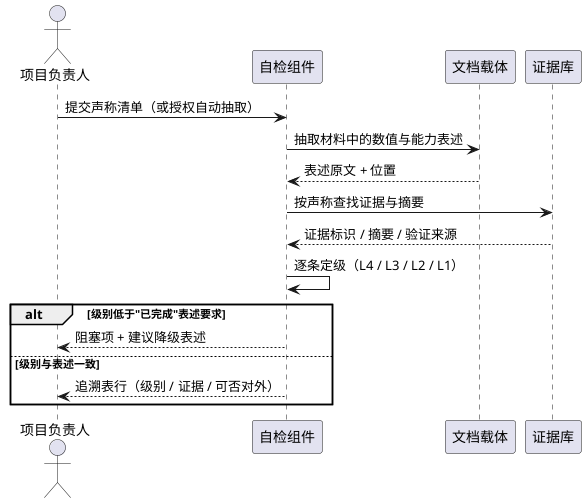
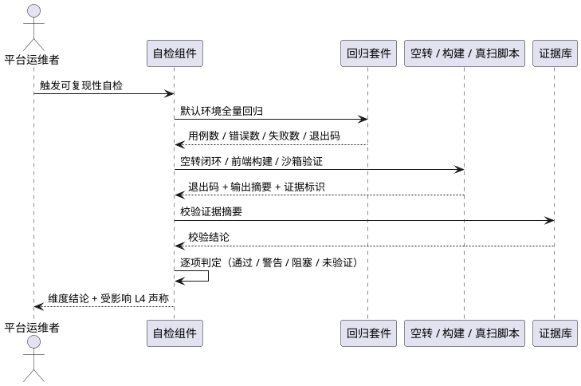
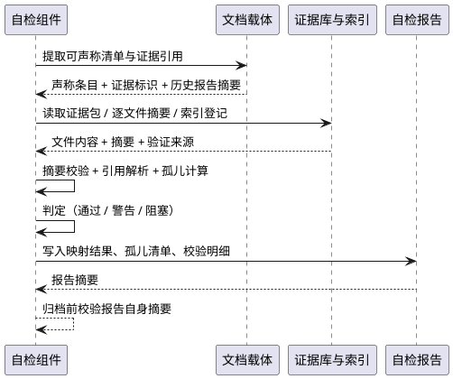
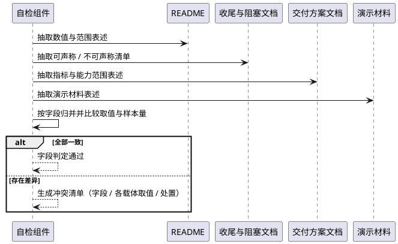
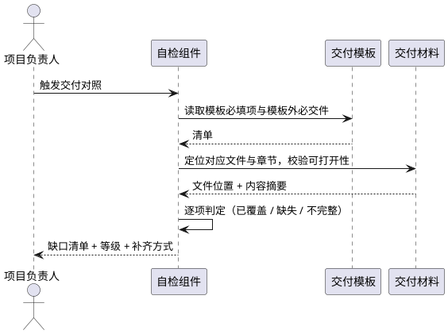
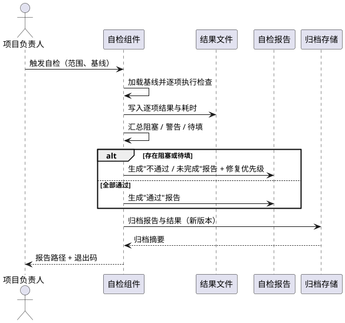

# **1. 组件定位**

## **1.1 核心职责**

本组件负责把项目全部对外声称逼到证据上，产出分级自检报告与退出码。

## **1.2 核心输入**

1. **自检触发请求**：包含自检范围（全量 / 单一维度 D1–D5）、基线时间、报告用途（内部自检 / 材料定稿前）；来源为项目负责人手工执行或 CI 流水线调用。
2. **仓库当前状态**：`README.md`、`docs/devlog/` 下全部报告与方案文档、`deliverables/` 下交付材料、`backend/tests/`、`frontend/`、`scripts/` 的实际内容与文件摘要；来源为本地代码仓库。
3. **证据库与索引**：`.evidence/` 下全部证据包及其索引登记（证据标识、包摘要、验证来源、生成时间）；来源为只追加证据目录。
4. **声称边界清单**：可声称项、不可声称项及其依据报告；来源为收尾与阻塞文档。
5. **交付模板清单**：模板要求的必填项与模板外必交件；来源为评审模板原文。
6. **上一次自检结果**：上一次自检报告与机器可读结果（用于比较历史报告只读性、回归通过数、阻塞项变化）；首次执行时允许为空。
7. **人工判定输入**：来源追溯结论、可信度级别判定、交付缺口认定（由负责人填写）。

## **1.3 核心输出**

1. **自检报告**：`docs/devlog/m13-selfcheck-report.md`，含总体结论、最弱环节、高危提问前三项、五维度检查明细、阻塞清单与修复优先级。
2. **机器可读自检结果**：`docs/devlog/selfcheck.json`，逐检查项给出编号、维度、判定方式、结果状态、命令、退出码摘要、证据引用与耗时。
3. **声称来源追溯表**：每个对外数字一行，含声称、真实来源、可信度级别、证据引用、可否对外与禁止表述。
4. **口径冲突清单**：冲突字段、各载体取值、样本量、一致性与处置建议。
5. **证据完整性明细**：声称到证据的映射结果、孤儿证据清单、摘要校验结果、历史报告只读性结论。
6. **交付缺口清单**：模板项到现有材料的映射结果与缺失项。
7. **进程退出码**：`0` 全部通过、`2` 存在警告、`3` 存在阻塞。

## **1.4 职责边界**

本组件明确不负责以下事项：

1. 不负责修复被检问题；只诊断、定级、排序，不修改代码、测试、文档数值与证据内容。
2. 不负责生成证据；禁止补造、拼接、推断任何证据或摘要；证据缺失只允许记为阻塞。
3. 不负责重跑被测业务链路本身；只允许调用既有自检、回归、构建与真扫脚本，并如实转述其结果。
4. 不负责判断业务功能是否正确；只判断"声称是否有证据支撑"与"口径是否一致"。
5. 不负责代填人工判定项；人工项未填时必须记为阻塞，禁止默认通过。
6. 不负责修改指标定义或覆盖率算法；口径变更只能以冲突项形式提出并交回责任人。
7. 不负责云上部署、真实连续运行、真实凭据接入、PPT 与演示视频制作。
8. 不负责对外发布材料；报告只作为定稿前的自检依据。

# **2. 领域术语**

**对外声称**
: 出现在 README、阶段报告、方案文档、交付材料或演示材料中，可被评委理解为"已完成""已实测""已达标"的任何数值、能力描述或范围声明。

**可信度级别**
: 对一条声称可被独立复核程度的固定分级，取值为 L4 可复现、L3 环境相关、L2 有桩、L1 只有承诺，四者互斥且必须显式标注。

**L4 可复现**
: 任何人按给定命令执行均得到同一结果，且同时具备命令、退出码、证据文件与证据摘要四项要素的声称级别。
: 备注：四要素缺任一，不得判为 L4。

**L3 环境相关**
: 存在真实执行，但结果依赖特定环境（如特定发行版、容器运行时、特定镜像），且已声明执行域与不得外推范围的声称级别。

**L2 有桩**
: 代码路径完整但外部系统为录制桩或模拟实现，未接入真实凭据的声称级别。
: 备注：L2 只能表述为"接口就绪、待接真凭据"，不得表述为"已集成""已打通"。

**L1 只有承诺**
: 仅有设计或计划、无代码执行、无证据支撑的声称级别。
: 备注：L1 只能出现在演进规划中，不得出现在"已完成""已实现""已达标"栏。

**降级**
: 因缺少证据、证据摘要不符、执行域未声明或依赖隐式环境，将声称从较高级别下调一级或多级的处理动作。

**声称来源追溯**
: 对每条对外声称记录其真实产出对象、执行方式、证据引用与级别判定的过程；追溯不完整即视为未定级。

**证据包**
: 一次真实执行落盘得到的只追加目录，含执行命令、原始输出、运行事实、复用条件与逐文件摘要清单。

**证据摘要**
: 证据包内容或其逐文件清单的密码学摘要，用于校验证据未被篡改；摘要必须可由证据标识定位。

**孤儿证据**
: 存在于证据库中、但未被任何报告、方案文档或交付材料引用的证据包。

**可声称清单**
: 经证据校验后允许对外表述的能力与数值集合；清单之外的内容一律按不可声称处理。

**不可声称清单**
: 明确禁止对外表述的能力与数值集合（如未实测的云上部署、未验证的连续运行、未达成的覆盖率目标）。

**口径**
: 同一指标或同一能力描述所采用的分子、分母、统计范围、时间窗口、样本量与表述方式的统一定义。

**载体**
: 承载对外声称的具体文档。口径核对（D4）固定为 README、收尾与阻塞文档、交付方案文档三类文字载体；演示材料不计入 D4 载体，其存在性由 D5-2 判定、可打开性由 D5-4 判定（v1.1-R1）。

**样本量**
: 支撑某一比例型结论的实际样本条数；样本量必须与结论同时出现。

**人工待填**
: 需要负责人判断、组件无权自动推断的检查项状态；该状态一律按阻塞处理。

**检查项**
: 自检的最小执行单元，具有稳定编号、所属维度、判定方式（自动 / 人工）、通过标准与结果状态。

**三问映射**
: 每个检查项必须可映射到"数字是真的吗""边界在哪""换个人能复现吗"三个评审提问之一；无法映射的检查项不得存在。

**结果状态**
: 检查项结论的固定取值：通过、警告、阻塞、人工待填、未验证；五者互斥。

**基线快照**
: 上一次自检的结果集合，用于比较阻塞项增减、回归用例数与历史报告摘要是否变化。

# **3. 角色与边界**

## **3.1 核心角色**

- **项目负责人 / 材料负责人**：发起自检、填写人工判定项、按报告修复、决定材料定稿。
- **平台运维者**：执行自动化检查、处理环境相关项、复跑失败项。
- **组委会 / 评委**：按报告与证据摘要抽检声称真实性，核对口径一致性。

## **3.2 外部系统**

- **代码仓库与文档载体**：提供 README、阶段报告、方案文档、交付材料的当前内容；只读。
- **证据库与索引**：提供证据包、逐文件摘要与索引登记；只读，禁止写入。
- **既有自检与验证脚本**：提供回归、空转、权限、留痕、覆盖率、沙箱与真扫的执行结果与退出码；本组件只调用并转述。
- **回归测试套件**：提供全量用例执行结果（用例数、错误数、失败数）。
- **前端构建工具链**：提供类型检查与构建结果。
- **交付模板**：提供必填项清单与模板外必交件要求。

## **3.3 交互上下文**

```plantuml
@startuml
left to right direction
actor "项目负责人 / 材料负责人" as Owner
actor "平台运维者" as Ops
actor "组委会 / 评委" as Judge
participant "自检组件" as SC
participant "代码仓库与文档载体\n（只读）" as Repo
participant "证据库与索引\n（只读）" as Evid
participant "既有自检 / 回归 / 构建脚本" as Scripts
participant "交付模板" as Template

Owner --> SC : 发起自检（范围、基线）
Owner --> SC : 填写人工判定项
SC --> Repo : 读取文档、材料、测试与代码状态
Repo --> SC : 文件内容 + 文件摘要
SC --> Evid : 读取证据包与索引
Evid --> SC : 证据内容 + 摘要
SC --> Scripts : 调用回归 / 空转 / 构建 / 真扫
Scripts --> SC : 退出码 + 输出摘要
SC --> Template : 读取模板必填项
Template --> SC : 十项清单 + 模板外必交件
SC --> Ops : 阻塞项与需复跑命令
SC --> Owner : 自检报告 + 修复优先级 + 退出码
SC --> Judge : 追溯表 + 证据摘要 + 口径对照
@enduml
```

# **4. DFX约束**

## **4.1 性能**

1. **自检总耗时**：不含被调用的全量回归与前端构建时，全量自检必须在 60 秒内完成；含全量回归与前端构建时，必须在 20 分钟内完成。
2. **单项超时**：任一检查项执行时间超过 10 分钟必须终止该项并记为阻塞（未完成），不得继续等待。
3. **报告生成**：报告与机器可读结果生成必须在 5 秒内完成。
4. **证据扫描规模**：证据包数量在 500 个以内时，扫描与摘要校验不得出现单项耗时超过 60 秒。

## **4.2 可靠性**

1. **只读保证**：自检过程不得修改证据包、历史报告、测试代码与被检文档；执行前后被检对象的摘要必须一致。
2. **幂等**：相同输入与相同基线重复执行，必须得到相同的检查项结果状态与相同退出码；允许时间戳字段不同。
3. **项间隔离**：单个检查项抛出异常不得中断其他检查项；该项必须记为阻塞并保留异常摘要。
4. **失败不掩盖**：任一检查项执行失败时，不得复用上一次结果冒充本次通过。
5. **中断可重跑**：自检中断后可重新执行并得到完整结果，不得残留半份报告覆盖历史报告。
6. **历史不可覆写**：已归档的自检报告不得被新一次执行覆盖；新一次执行必须生成新版本。

## **4.3 安全性**

1. **不读凭据**：自检不得读取、输出或记录任何令牌、口令、私钥与完整密钥值；命中敏感字段必须掩码。
2. **不外发**：自检不得向外部网络发送仓库内容、证据内容或执行输出。
3. **脱敏输出**：报告中禁止出现宿主绝对路径中的用户名以外的敏感目录、连接串与凭据片段。
4. **执行域声明**：凡结果依赖特定环境的检查项，报告必须显式标注执行域与不得外推范围。
5. **证据不可改**：自检不得写证据库；校验过程只允许读取与计算摘要。

## **4.4 可维护性**

1. **检查项编号稳定**：检查项编号一经发布不得复用或改义；废弃项必须标记为停用并保留说明。
2. **可定位**：每个检查项结果必须给出执行命令或判定依据、输出摘要与证据引用，支持逐项复核。
3. **可增删**：新增检查项不得要求改动既有检查项的判定逻辑与编号语义。
4. **耗时可见**：每个检查项必须记录开始与结束时间及耗时。
5. **结果结构稳定**：机器可读结果必须带格式版本号，字段缺失必须以显式空值表示，不得省略字段。

## **4.5 兼容性**

1. **平台兼容**：在 Windows 与 Linux 下均可执行；平台差异导致的结论差异必须显式标注为环境相关。
2. **退出码语义固定**：`0` 全部通过、`2` 存在警告、`3` 存在阻塞；新增检查项不得改变既有退出码含义。
3. **口径升级策略**：口径或模板变更时必须提升结果格式版本或定义版本，历史报告保持原值。
4. **规模演进**：检查项由 30 项扩展至 100 项、证据包由 152 个扩展至 500 个时，判定规则与退出码不得改变。

# **5. 核心能力**

## **5.1 可信度定级与声称登记**

### **5.1.1 业务规则**

1. **四级互斥定级**：每条对外声称必须且只能判定为 L4、L3、L2、L1 之一，并显式标注级别；未定级的声称视同 L1。
   a. 验收条件：When 报告中出现任一条对外声称，the 自检组件 shall 输出该声称的级别，无级别标注时记为阻塞。
2. **L4 四要素**：判为 L4 的声称必须同时具备可执行命令、退出码、证据文件与证据摘要四项要素，且摘要可校验通过。
   a. 验收条件：If 四项要素缺任一或摘要校验失败，then the 自检组件 shall 将该声称降级为 L3 并记录缺失要素。
3. **L3 执行域声明**：判为 L3 的声称必须附带执行域与不得外推范围；未声明执行域的 L3 一律降级为 L2。
   a. 验收条件：When 声称依赖特定环境，the 自检组件 shall 输出执行域标识与"不得外推"说明，缺失时降级并告警。
4. **L2 表述限制**：L2 声称在材料中只允许表述为"接口就绪、待接真凭据"或"桩验证"，禁止出现"已集成""已打通""已上线"等表述。
   a. 验收条件：If 材料中对 L2 项使用已完成类表述，then the 自检组件 shall 记为阻塞并给出建议表述。
5. **L1 位置限制**：L1 声称只允许出现在演进规划章节，禁止出现在"已完成""已实现""已达标"栏位。
   a. 验收条件：If L1 声称出现在已完成类栏位或材料首屏，then the 自检组件 shall 记为阻塞。
6. **禁止无依据升级**：同一声称的级别不得在无新增证据时提高；级别提高必须与新增证据标识同时登记。
   a. 验收条件：When 本次级别高于基线级别，the 自检组件 shall 校验是否存在新增证据引用，无新增证据时判定升级无效并回退基线级别。
7. **登记范围完整**：登记范围必须覆盖可声称清单全部条目、材料中出现的全部数值型声称（比率、用例数、覆盖率、时长、类别数）与全部能力型声称（如集成、部署、连续运行）。
   a. 验收条件：When 材料中存在未登记的数值或能力声称，the 自检组件 shall 记为阻塞并列出原文位置。
8. **混级禁止**：同一材料中不得把不同级别的结论合并表述为单一结论（如把 L4 与 L2 合并写为"全部实测通过"）。
   a. 验收条件：If 同一段落把不同级别结论合并表述，then the 自检组件 shall 记为阻塞，并要求按级别拆分表述。
9. **禁止项**：禁止以"已自测""基本可用""接近达标"等模糊表述替代级别标注。
   a. 验收条件：When 检出模糊表述，the 自检组件 shall 将该表述视为未定级并记为阻塞。

### **5.1.2 交互流程**



### **5.1.3 异常场景**

1. **声称无任何证据**
   a. 触发条件：声称在证据库中找不到对应证据包。
   b. 系统行为：定为 L1 或按代码现状降级为 L2，记阻塞；禁止以其他维度的证据替代。
   c. 用户感知：报告显示"该声称无证据支撑（L1/L2），不得写入已完成栏"。
2. **级别与证据能力不匹配**
   a. 触发条件：声称引用的是录制桩证据或单元测试推断结果，却声称为实测。
   b. 系统行为：按证据的验证来源重新定级，并记录不匹配原因。
   c. 用户感知：报告显示"验证来源为桩/推断，级别已由 L4 降为 L2"。
3. **同一声称多个级别**
   a. 触发条件：不同载体对同一声称给出不同级别。
   b. 系统行为：取最低级别作为全局级别，并把差异列入口径冲突清单。
   c. 用户感知：报告显示"同一声称存在 N 个级别，按最低级别 Lx 计"。
4. **人工判定缺失**
   a. 触发条件：负责人未填写某条声称的真实来源或级别。
   b. 系统行为：该项记为人工待填并按阻塞处理，报告结论不得为通过。
   c. 用户感知：报告显示"存在 N 项人工待填，自检未完成"。

## **5.2 可复现性自检**

### **5.2.1 业务规则**

1. **干净环境安装**：必须在父进程不注入隐式环境变量（如字符编码、路径前缀）的条件下完成依赖安装与配置加载，并验证不存在隐式环境依赖。
   a. 验收条件：When 在不设置任何项目私有环境变量的父进程中执行安装与配置加载，the 自检组件 shall 得到成功结果；若失败则记为阻塞并列出缺失变量。
2. **全量回归**：必须以默认环境执行全量用例发现，且必须满足 0 错误、0 失败。
   a. 验收条件：When 执行全量回归，the 自检组件 shall 记录用例数、错误数与失败数，错误或失败非 0 时记为阻塞。
3. **空转闭环**：必须执行空转闭环自检并校验闭环有效标记为真。
   a. 验收条件：When 执行空转闭环，the 自检组件 shall 校验闭环有效标记为真，否则记为阻塞。
4. **15 分钟路径**：必须按快速开始章节逐条执行并计时，从零到产出第一份指标报告不超过 15 分钟；前提不满足导致链路按设计拒绝时，该检查项记为未验证而非通过。
   a. 验收条件：When 15 分钟路径执行完成，the 自检组件 shall 记录总耗时；未计时或前提不满足时记为未验证并说明原因。
5. **前端构建**：必须执行类型检查与生产构建，且必须成功产出构建目录。
   a. 验收条件：When 执行前端构建，the 自检组件 shall 记录构建结果与产物目录是否存在，失败时记为阻塞。
6. **沙箱复现**：必须在满足容器运行时前提的环境下复跑沙箱验证与真扫，并校验退出码与证据落盘。
   a. 验收条件：When 容器运行时不可用，the 自检组件 shall 将该检查项记为未验证（环境不可用），不得记为通过或失败。
7. **阻塞传导**：可复现性维度存在任一阻塞项时，全部 L4 声称必须降级说明，报告总体结论不得为通过。
   a. 验收条件：When 可复现性维度存在阻塞，the 自检组件 shall 在报告中输出"L4 声称需降级说明"并列出受影响声称。
8. **禁止项**：禁止以单元测试通过替代干净环境可复现，禁止以"本机能跑"替代执行域声明。
   a. 验收条件：When 仅存在本机执行记录，the 自检组件 shall 标注执行域并禁止外推表述。

### **5.2.2 交互流程**



### **5.2.3 异常场景**

1. **隐式环境依赖**
   a. 触发条件：不设置编码类环境变量时安装或配置加载失败。
   b. 系统行为：记为阻塞，标注依赖的具体变量与失败输出摘要。
   c. 用户感知：报告显示"存在隐式环境依赖，干净环境不可复现"。
2. **回归失败**
   a. 触发条件：全量回归出现错误或失败。
   b. 系统行为：记为阻塞，输出失败用例标识与失败摘要，禁止只给汇总数。
   c. 用户感知：报告显示"N 错误 / M 失败，可复现性不成立"。
3. **容器运行时不可用**
   a. 触发条件：容器运行时或沙箱镜像不可用。
   b. 系统行为：相关项记为未验证，明确"未执行"而非"通过"；不因此阻塞整个维度。
   c. 用户感知：报告显示"沙箱验证未验证（环境不可用）"。
4. **检查项超时**
   a. 触发条件：单项执行超过 10 分钟。
   b. 系统行为：终止该项并记为阻塞（未完成），保留已产生的输出摘要。
   c. 用户感知：报告显示"该项超时未完成，不得视为通过"。

## **5.3 证据完整性自检**

### **5.3.1 业务规则**

1. **声称到证据映射**：可声称清单中每条声称必须至少关联一个证据包，且该证据包的摘要必须可校验通过。
   a. 验收条件：When 校验可声称清单，the 自检组件 shall 为每条声称输出至少一个证据标识与摘要校验结果，缺证据时记为阻塞。
2. **孤儿证据率**：证据库中未被任何文档引用的证据包占比不得超过 10%。
   a. 验收条件：When 孤儿率大于 10%，the 自检组件 shall 记为警告并列出孤儿证据标识；孤儿率不予通过但不得删除证据。
3. **摘要一致性**：证据包逐文件摘要清单与文件实际摘要必须 100% 一致；索引登记的包摘要与包内容摘要必须一致。
   a. 验收条件：When 任一摘要不一致，the 自检组件 shall 记为阻塞并列出不一致文件路径与两侧摘要。
4. **引用可解析**：文档中出现的证据标识必须能在证据库中定位到唯一证据包；引用格式不合规同样视为不可解析。
   a. 验收条件：When 证据引用无法定位，the 自检组件 shall 记为阻塞并列出引用原文与所在文档。
5. **历史报告只读性**：已归档的历史报告摘要必须与登记摘要一致，不得因后续步骤被改写。
   a. 验收条件：When 历史报告摘要变化，the 自检组件 shall 记为阻塞，并指出被改写的报告与变化时间。
6. **证据包完备性**：证据包必须包含执行命令、原始输出、运行事实与摘要清单四类内容；缺任一类视为证据不完整。
   a. 验收条件：When 证据包缺少四类内容之一，the 自检组件 shall 将该证据标记为不完整，并使其支撑的声称降级。
7. **验证来源如实**：证据包的验证来源必须如实标注为真实执行、桩或推断；标注为真实执行但内容显示为模拟的，按不实证据处理。
   a. 验收条件：When 验证来源与证据内容矛盾，the 自检组件 shall 记为阻塞并降级其支撑声称。
8. **只增不改**：自检不得写入或删除证据库内容，校验前后证据库摘要集合必须一致。
   a. 验收条件：When 自检执行完毕，the 自检组件 shall 保证证据库文件摘要集合与执行前一致。

### **5.3.2 交互流程**



### **5.3.3 异常场景**

1. **证据引用失效**
   a. 触发条件：文档引用的证据标识在证据库中不存在或被重命名。
   b. 系统行为：记为阻塞，标注引用原文与期望路径；不得尝试按相似名称猜测匹配。
   c. 用户感知：报告显示"证据引用不可解析（文档：位置）"。
2. **摘要不符**
   a. 触发条件：证据文件被修改或摘要清单被替换。
   b. 系统行为：记为阻塞，输出文件路径、登记摘要与实际摘要；该证据支撑的声称全部降级。
   c. 用户感知：报告显示"证据摘要不符，支撑声称已降级"。
3. **孤儿率超阈值**
   a. 触发条件：未被引用证据包占比超过 10%。
   b. 系统行为：记为警告，输出孤儿清单与被引用次数；禁止自动删除或移动证据。
   c. 用户感知：报告显示"孤儿证据 N 个（X%），建议补充引用或说明用途"。
4. **证据库不可读**
   a. 触发条件：证据目录不存在、权限不足或索引损坏。
   b. 系统行为：所有依赖证据的检查项记为阻塞，报告结论不得为通过。
   c. 用户感知：报告显示"证据库不可读，证据完整性未校验"。

## **5.4 口径一致性核对**

### **5.4.1 业务规则**

1. **三类文字载体集合**：口径核对必须覆盖 README、收尾与阻塞文档、交付方案文档三类文字载体，且正文不得为空；任一载体缺失、不可读或正文为空记为阻塞。演示材料由 D5-2 判定存在性、D5-4 判定可打开性，不计入 D4 载体（v1.1-R1）。
   a. 验收条件：When 任一类文字载体不存在、不可读或正文为空，the 自检组件 shall 记为阻塞并说明缺失载体与相对路径。
2. **同数同值**：同一数值型声称在所有载体中的取值必须完全一致，不得出现区间、约数或换算后不同值。
   a. 验收条件：When 同一声称在不同载体取值不同，the 自检组件 shall 记为阻塞并输出各载体取值对照。
3. **样本量随行**：比例型结论必须在同一位置标注样本量；样本量缺失的百分比不得对外使用。
   a. 验收条件：When 百分比结论缺少样本量，the 自检组件 shall 记为阻塞，并给出"标注样本量或以方向性结论表述"的建议。
4. **覆盖率双列**：覆盖率必须同时给出全模块口径与判定函数口径两组数值，且必须同时保留未达目标值的表述。
   a. 验收条件：When 材料只出现单一口径覆盖率，the 自检组件 shall 记为阻塞，并要求补齐双口径与未达标说明。
5. **禁止只改口径**：禁止通过更换统计口径、缩窗口、改分母使指标"达标"；口径变更必须提升定义版本并在全部载体同步修订。
   a. 验收条件：If 同一指标在定义版本未变时出现两套口径，then the 自检组件 shall 记为阻塞，并指出未同步的载体。
6. **未验证统一表述**：凡未真实执行的项（连续运行、云上部署、生产性能、真实凭据集成）在所有载体必须统一表述为"未验证"或"未执行"，禁止出现"已验证""已部署""已达标"。
   a. 验收条件：When 未验证项在任一载体出现完成类表述，the 自检组件 shall 记为阻塞并列出该载体位置。
7. **能力范围一致**：能力上限类别数与本轮交付类别数必须成对出现；材料中出现能力上限表述时，必须同时出现本轮交付范围表述。
   a. 验收条件：When 只出现能力上限类别数而无交付范围，the 自检组件 shall 记为警告，并给出补齐建议。
8. **支出口径一致**：自动处置的合并目标分支必须统一为同一表述，禁止在不同载体出现"自动合并主干"与"仅合并预发分支"两种口径。
   a. 验收条件：When 支出口径不一致，the 自检组件 shall 记为阻塞并输出各载体原文。
9. **禁止项**：禁止以删除冲突段落的方式消除冲突；冲突只能通过统一数值与补充说明消除。
   a. 验收条件：When 冲突段落被删除而数值未在其他载体同步，the 自检组件 shall 记为阻塞。

### **5.4.2 交互流程**



### **5.4.3 异常场景**

1. **数值歧义**
   a. 触发条件：同一字段出现"约""不低于""最高"等模糊表述导致无法比较。
   b. 系统行为：记为阻塞，输出原文并要求改为确定值加样本量。
   c. 用户感知：报告显示"存在 N 处模糊数值表述，无法核对口径"。
2. **载体版本过期**
   a. 触发条件：某载体仍引用旧定义版本或旧基线时间。
   b. 系统行为：记为阻塞，标注该载体的定义版本与当前版本差异。
   c. 用户感知：报告显示"载体定义版本过期（vN → vM）"。
3. **样本量分母过小**
   a. 触发条件：比例型结论的样本量小于 5。
   b. 系统行为：记为警告，建议只给方向性结论、不单列百分比。
   c. 用户感知：报告显示"样本量 n<N，建议改为方向性表述"。
4. **仅改口径未重跑**
   a. 触发条件：口径已变更但指标值与证据未重新计算。
   b. 系统行为：记为阻塞，要求重算并同步全部载体。
   c. 用户感知：报告显示"口径变更未伴随重算，结论无效"。

## **5.5 交付完整性对照**

### **5.5.1 业务规则**

1. **模板逐项映射**：必须以模板必填项为清单逐项映射到现有材料，每项给出对应文件位置或"缺失"结论。
   a. 验收条件：When 执行交付对照，the 自检组件 shall 为每个模板项输出映射文件与位置，未映射项记为缺失。
2. **模板外必交件**：除模板项外，必须单独核对演示文稿、演示视频与可访问演示入口三项；缺任一项记阻塞。
   a. 验收条件：When 三项中任一项缺失，the 自检组件 shall 记为阻塞并说明缺口。
3. **缺项定级**：缺失项必须给出阻塞等级（阻塞 / 警告）与补齐成本估计（小时或依赖外部条件）。
   a. 验收条件：When 存在缺失项，the 自检组件 shall 输出缺失项等级与补齐方式，禁止只写"待补"。
4. **禁止替代声称**：不得以"其他文档已覆盖"替代模板项映射；必须给出具体文件与章节位置。
   a. 验收条件：When 映射结果只有文档名而无章节位置，the 自检组件 shall 记为警告并要求补充位置。
5. **材料可打开**：交付材料必须可正常打开与阅读；损坏或为占位内容（仅标题、无正文、无数据）视为缺失。
   a. 验收条件：When 材料无法打开或正文为空，the 自检组件 shall 记为阻塞。
6. **指标项必须实测**：模板中可量化指标项若含未验证指标，必须在材料中标注"未验证"，不得只列目标值。
   a. 验收条件：When 指标章节列有未验证指标而未标注，the 自检组件 shall 记为阻塞。
7. **使用说明可追溯**：平台使用说明项必须包含可核对的真实使用痕迹（日志、截图、发布单或运行记录），仅有结构说明视为不完整。
   a. 验收条件：When 使用说明缺少真实痕迹，the 自检组件 shall 记为警告并标注缺口。

### **5.5.2 交互流程**



### **5.5.3 异常场景**

1. **模板版本变化**
   a. 触发条件：模板项与已知清单不一致。
   b. 系统行为：保留已知清单结果，新增项记为未对照并告警，禁止静默忽略。
   c. 用户感知：报告显示"模板新增 N 项，尚未对照"。
2. **材料损坏**
   a. 触发条件：交付文件无法解析或内容为空。
   b. 系统行为：记为阻塞，标注文件路径与失败原因。
   c. 用户感知：报告显示"材料不可读（路径）：视为缺失"。
3. **同一项多份材料**
   a. 触发条件：同一模板项对应多份不同版本材料。
   b. 系统行为：取最新版本为准，并把版本差异列入警告。
   c. 用户感知：报告显示"该项存在多版本材料，已取最新版本并标注差异"。

## **5.6 自检执行、报告与退出码**

### **5.6.1 业务规则**

1. **触发与范围**：必须支持全量自检与按维度自检两种范围；范围外检查项必须标记为未执行，不得默认通过。
   a. 验收条件：When 以单一维度触发自检，the 自检组件 shall 将其余维度标记为未执行，退出码不得为 0。
2. **退出码固定**：全部检查项为通过时退出码为 0；存在警告且无阻塞时为 2；存在阻塞或人工待填时为 3。
   a. 验收条件：When 自检结束，the 自检组件 shall 按上述规则返回退出码，并在报告中复述该退出码。
3. **报告必备要素**：报告必须包含生成时间、基线与范围、总体结论、五维度汇总、阻塞与警告清单、最弱环节、高危提问前三项、修复优先级、每个检查项的命令或依据、输出摘要、证据引用与耗时。
   a. 验收条件：When 打开报告，the 自检组件 shall 展示上述全部要素；缺任一要素则报告无效。
4. **结论不可宽松**：存在任一阻塞项时总体结论必须为"不通过"；存在人工待填时结论必须为"未完成"；禁止以通过项数量多寡推出通过结论。
   a. 验收条件：When 存在阻塞项，the 自检组件 shall 将总体结论置为"不通过"并列出阻塞编号。
5. **三问必答**：报告必须明确回答"最弱的一环是什么""评委最可能先问的三个问题""剩余工期是否足够及正确顺序"，每项给出依据检查项编号。
   a. 验收条件：When 生成报告，the 自检组件 shall 输出上述三项结论并关联检查项编号，无法回答时标记为阻塞。
6. **修复优先级**：报告必须按"阻塞优先、依赖优先、成本优先"给出排序后的修复动作，且每条动作须指明依据检查项与预计解除的阻塞编号。
   a. 验收条件：When 存在阻塞项，the 自检组件 shall 输出排序后的修复清单，禁止只列问题不排序。
7. **人工项不默认通过**：人工判定项未填时记为人工待填并按阻塞处理；报告不得把待填项计为通过。
   a. 验收条件：When 存在人工待填项，the 自检组件 shall 在汇总中单列待填数量并置退出码为 3。
8. **历史报告不可覆盖**：新一次自检必须生成新版本报告与结果文件，历史版本保留且可检索。
   a. 验收条件：When 同一基线再次执行自检，the 自检组件 shall 生成递增版本，并保证历史报告摘要不变。
9. **报告自身可校验**：报告与结果文件生成后必须记录其摘要，支持后续按摘要校验回读。
   a. 验收条件：When 评委回读自检报告，the 自检组件 shall 给出与登记一致的摘要。
10. **禁止项**：禁止手工改写自检报告中的检查项结论；发现报告结论与结果文件不一致时按无效报告处理。
    a. 验收条件：When 报告结论与结果文件中同一检查项状态不一致，the 自检组件 shall 判定报告无效并记为阻塞。

### **5.6.2 交互流程**



### **5.6.3 异常场景**

1. **报告写入失败**
   a. 触发条件：目标目录不可写或磁盘空间不足。
   b. 系统行为：保留结果文件与终端摘要，退出码置为 3，报告标记未生成。
   c. 用户感知：提示"报告写入失败（路径），自检结论不完整"。
2. **基线缺失或损坏**
   a. 触发条件：首次执行或基线文件不可解析。
   b. 系统行为：按首次执行处理，跳过级别提升校验与历史只读性比较，并在报告中标注"无基线"。
   c. 用户感知：报告显示"未找到可用基线，相关比较项已跳过"。
3. **并发执行冲突**
   a. 触发条件：同一目录同时运行两个自检。
   b. 系统行为：后发请求被拒绝，不产生第二份结果与报告。
   c. 用户感知：返回"自检进行中"，并给出进行中的自检标识。
4. **人工项与自动项冲突**
   a. 触发条件：人工判定结果与自动校验结果矛盾（如人工判为通过但证据校验失败）。
   b. 系统行为：以更严格结果为准（阻塞优先），并在报告中记录冲突。
   c. 用户感知：报告显示"人工结论与自动校验冲突，按阻塞处理"。

# **6. 数据约束**

## **6.1 检查项**

1. **编号**：必须符合"维度编号-序号"格式，全局唯一，发布后不得复用或改义。
2. **维度**：必须为可复现性、能力真实性、证据完整性、口径一致性、交付完整性之一。
3. **判定方式**：必须为自动或人工之一；人工项不得由自动逻辑代判。
4. **通过标准**：必须可判定（是/否），禁止"基本符合""大致一致"等模糊标准。
5. **结果状态**：必须为通过、警告、阻塞、人工待填、未验证之一。
6. **三问映射**：必须非空，且取值限于真实、边界、复现三者之一。
7. **执行依据**：自动项必须记录命令或判定依据；人工项必须记录判定说明。
8. **输出摘要**：必须有截断后的输出摘要，不得记录完整凭据或敏感值。
9. **证据引用**：存在证据时必须非空且可解析；无证据时必须显式标注"无"。
10. **耗时**：必须为非负数值（秒），超时项必须标注超时阈值。
11. **基线对比**：必须给出与基线相比的状态变化（新增阻塞、已解除、未变）。

## **6.2 声称条目**

1. **声称原文**：必须可定位到载体与位置（文件、章节或行），不得只保留摘要。
2. **声称类型**：必须为数值型或能力型之一。
3. **声称值**：数值型必须为确定值（含单位）；比率型必须为 0–1 或百分比中的一种且全项目统一。
4. **可信度级别**：必须为 L1–L4 之一，且与证据能力一致。
5. **真实来源**：必须指向具体执行方式与产出对象，禁止填写"系统数据""日志"等无定位描述。
6. **证据引用**：L4 与 L3 必填且可解析；L2 必须标注为桩；L1 必须为空并说明原因。
7. **证据摘要**：L4 必填且校验通过；L2/L1 必须为空。
8. **可否对外**：必须为"可"或"不可"；不可对外项必须给出禁止表述清单。
9. **样本量**：比例型必填且为正整数；非比例型必须显式标注"不适用"。
10. **级别变更记录**：级别提高时必须记录新增证据标识与变更时间；无记录时视为无效升级。

## **6.3 证据引用**

1. **证据标识**：必须唯一，且可定位到唯一证据包目录。
2. **包摘要**：必须可校验并与索引登记一致。
3. **逐文件摘要**：必须覆盖包内全部文件，缺文件或多文件均视为不完整。
4. **验证来源**：必须为真实执行、桩或推断之一，且与包内容一致。
5. **生成时间**：必须记录，且不得晚于引用它的报告生成时间。
6. **被引用次数**：必须为整数；为 0 时标记为孤儿证据。
7. **不复用声明**：环境相关证据必须记录执行域与不得外推范围。

## **6.4 口径条目**

1. **字段名**：必须为业务可识别名称（如覆盖率、连续运行时长、缺陷类别数、支出口径）。
2. **各载体取值**：每个固定载体必须记录取值或"未出现"；不得留空。
3. **样本量**：必须记录，或显式标注"不适用"。
4. **定义版本**：必须记录该字段所依据的定义版本。
5. **一致性结论**：必须为一致、不一致或无法比较之一；无法比较必须说明原因。
6. **处置建议**：不一致时必须给出统一取值与同步载体清单，禁止只写"需统一"。
7. **冲突等级**：必须为阻塞或警告之一，且与是否影响对外结论一致。

## **6.5 自检报告**

1. **报告标识与版本**：必须唯一；同一基线再次生成时必须递增版本，历史版本保留。
2. **生成时间与基线**：必须记录生成时间、基线时间与自检范围，范围外的维度必须标注未执行。
3. **总体结论**：必须为通过、不通过或未完成之一；与阻塞项、人工待填项数量一致。
4. **维度汇总**：必须覆盖五个维度，每维度给出通过数、警告数、阻塞数、未验证数与待填数。
5. **检查项明细**：必须覆盖本次范围内全部检查项，不得只列失败项。
6. **三问结论**：必须包含最弱环节、高危提问前三项、工期判断与建议顺序。
7. **修复优先级清单**：每条必须有依据检查项编号、动作、解除的阻塞编号与预计成本。
8. **退出码**：必须记录并与实际进程退出码一致。
9. **报告摘要**：必须记录，支持按摘要校验回读。
10. **只读历史**：历史报告与历史结果文件的摘要不得因本次生成而改变。