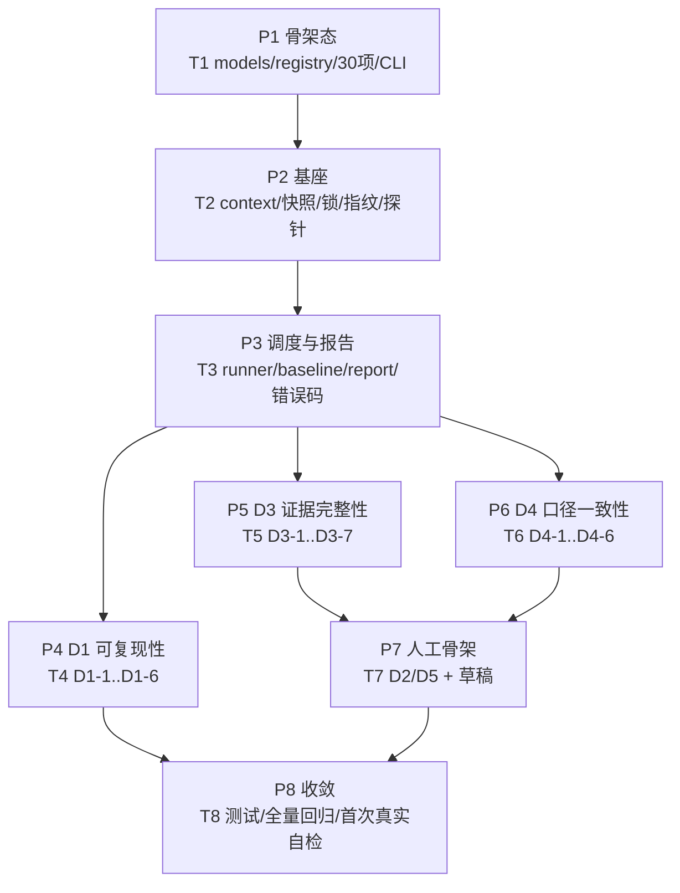

# M13 自检框架（selfcheck_harness）编码任务清单

- 依据：`.codeartsdoer/specs/selfcheck_harness/spec.md`（633 行）、`.codeartsdoer/specs/selfcheck_harness/design.md`（1132 行）、`docs/devlog/m13-analysis-plan.md`
- 实施顺序：严格按 design §2.8 的 P1 → P8；P5 与 P6 可并行，其余串行
- 仓库现状基线：`backend/app/selfcheck/` 与 `docs/devlog/selfcheck/` 均为**新建**；`.evidence/sandbox-realscan/` 已有 9 个证据包与 `INDEX.json`；`backend/tests/` 现有 690 用例；工作区**尚未**初始化为 Git 仓库

**修订版本：v1.1（增量修订，用户已确认"按正常做法"）**

| 修订条目 | 内容 | 影响的任务 |
|---|---|---|
| R1 | D4-1 载体由"四类（含演示材料）"收敛为"三类文字载体"，演示材料归 D5-2 | 6.1、6.2、6.8、6.9、8.7 |
| R2 | D5-1 去除 `D5-1→D4-1` 依赖，D4-1 通过时 D5-1 显示 `人工待填` | 1.2、7.3、7.5、6.9、8.7 |

> v1.1 **未改动**：其余 28 项定义、退出码 `0/2/3` 语义、只读保证、`--scope D1,D3,D4` 固定为 `2`、OQ-1…OQ-5 当前口径；`VF-7003`（`RECALC_FAILED`）与依赖环所用 `VF-1006` 维持原状。修订登记与受影响文件见 §0.4 / §0.5。

## 0. 范围声明与已拍板口径

### 0.1 范围外（本任务清单**不编排**，见 spec §1.4）

1. 不编排修复被检问题（含 `D1-1` 的 `PYTHONUTF8` 依赖、`D1-2` 的 8 error + 1 failure、`D4` 的覆盖率未达标）。
2. 不编排补造、拼接、推断证据，不编排清理孤儿证据。
3. 不编排代填 D2 级别判定与 D5 覆盖度结论。
4. 不编排修改指标定义、覆盖率算法、`DEFAULT_TARGETS` 边界或任何对外口径。
5. 不编排云上部署、24h 连续运行、PPT/视频制作与对外发布。

### 0.2 开放问题按推荐项执行的显式标注

| 编号 | 采用口径 | 落到任务 |
|---|---|---|
| OQ-1（推荐 A） | 全量注册 30 项；D1/D3/D4 自动化实装；D2/D5 人工骨架；`--scope D1,D3,D4` 退出码固定为 `2` | 1.2 注册 30 项、3.7 与 8.1 固定范围外码为 `2`、7.2/7.3 只做骨架 |
| OQ-2（推荐 A） | 人工项骨架 + `selfcheck-manual-draft.md` 机器草稿；级别与结论列留空，须负责人填 `确认：是` | 7.1 解析器、7.4 草稿生成 |
| OQ-3（默认） | `D1-4` 默认不写盘，记"未验证"；仅 `--allow-writes` 才执行并在报告头部登记豁免 | 4.5 |
| OQ-4（默认） | `D1-6` 默认只读校验最近 `VER` 包；仅 `--refresh-evidence` 才重跑 | 4.6 |
| OQ-5（默认） | 覆盖率"判定函数口径"沿用 `measure_coverage.py` 的 `DEFAULT_TARGETS`，不新增口径定义 | 6.5 |

> 上述 5 项在用户正式拍板前，相关结论**不得**写入对外材料（design §2.9.3）。

### 0.3 已识别的设计内部偏差（需在执行中按此处处置，不得静默忽略）

| 偏差 | 事实 | 处置 |
|---|---|---|
| 依赖环错误码 | design §2.2.2.4 写"依赖环 → `VF-7003`（配置非法）"，但 `VF-7003` 在 `backend/app/api/envelope.py:33` 已登记为 `RECALC_FAILED` | 3.3 中依赖环/配置非法改用 `VF-1006 CONFIG_INVALID` 承载，**不改** `VF-7003` 既有语义；在 `registry.py` 模块文档串注明该偏差，待用户补充确认 |
| 快照范围含 `sandbox/` | design §2.5.1 纳入 `sandbox/spec.json` 与 `verifix-target/ground_truth.json`，两者同时出现在 `HISTORY_BASELINE` | 2.2 实现时纳入快照但**只读**；若被纳入 A-Items 的既有内容在自检中被改动，一律判只读违规，不做"自动还原" |
| 前端产物目录 | design §2.5.1 排除 `frontend/dist/`，同时 §2.5.3 要求构建产物落临时目录 | 4.4 构建固定 `--outDir <tmp>`；`frontend/dist/` 仅在快照排除表中出现，实现不得改写它 |

### 0.4 v1.1 口径修订登记（R1/R2，已由用户确认"按正常做法"）

| 编号 | 偏差（修订前，现状） | 正常做法（修订后） | 落点 |
|---|---|---|---|
| **R1** | D4-1 把 `deliverables/演示材料.md` 当作第四类必检载体，缺失即阻塞 → 全量运行 D4-1 **必然阻塞**，掩盖真实口径问题 | D4-1 只检查三类**文字载体**是否齐全可读：`README.md`、`docs/devlog/m12-closure-and-blockers.md`、`deliverables/CodeArts方案.md`；演示文稿、演示视频、可访问演示入口统一由 D5-2「模板外必交三件」检查，**不再由 D4-1 承担** | 6.1、6.2、6.8、6.9、8.7 |
| **R2** | `D5-1→D4-1`，D4-1 阻塞时 D5-1 被 `runner` 传导为 `DEPENDENCY_FAILED` 阻塞，而不是"人工待填" | D5-1 **不再依赖 D4-1**（`depends_on=()`），自身经 `loaders.py` 定位模板十项的文件与章节；D4-1 通过时 D5-1 显示 `人工待填`，由负责人确认模板十项覆盖度 | 1.2、7.3、7.5、6.9、8.7 |

**连带口径确认点 C-1（执行时必须在 design 与报告中显式登记，不得静默处理）**

1. D4 章节内"固定载体集合"自 v1.1 起统一指上述**三类文字载体**，由 `loaders.py` 单一常量 `TEXT_CARRIERS` 出口；D4-2…D4-6 的比对范围与 D4-1 保持一致（不缩小也不扩大）。
2. 演示材料不再进入 D4 数值比对：其**存在性**由 D5-2 判定，**可打开性/非占位**由 D5-4 判定。若日后负责人要求文字版演示稿也参与数值比对，必须在 `TEXT_CARRIERS` 中以"附加载体"显式登记并在 design 提升 `definition_version`，**不得**通过恢复 D4-1 第四类实现。
3. 载体定义变化属口径变更，按 spec §4.5.3 必须提升定义版本：新基线 `definition_version="v2"`，`format_version` 维持 `"1.0"`（字段结构不变）；跨定义版本比较时 `baseline_change` 记 `DEFINITION_CHANGED`，**不得**把 R1/R2 引起的结果差异误报为 `NEW_BLOCKER`/`RESOLVED`。
4. 需同步修订 design 侧（本文档不代改 spec/design 正文，由下列任务落地）：§2.1.2 注册清单 **D4-1 行**的"执行方式/通过标准"、§2.1.2「检查项注册与执行调度规则」**第 2 条依赖声明**（删除 `D5-1→D4-1`）、§2.2.2.4 依赖说明与 `VF-7003` 偏差注记、§2.2.2.1 前置条件中"D4-1 阻塞但流程继续"的措辞（改为"三类文字载体缺失时 D4-1 阻塞"）。

### 0.5 v1.1 受影响文件与验收命令（供 6.9 / 8.7 直接引用）

**受影响文件清单**

| 类别 | 文件 | v1.1 变更点 |
|---|---|---|
| 载体常量与判定 | `backend/app/selfcheck/loaders.py` | 新增 `TEXT_CARRIERS`（三类）；原演示材料常量改为仅 D5-2/D5-4 使用 |
| D4 检查 | `backend/app/selfcheck/checks/d4_consistency.py` | `D4-1` 只校验三类文字载体；`output_summary` 列缺失载体名 + 相对路径 |
| D5 检查 | `backend/app/selfcheck/checks/d5_delivery.py` | `D5-1` 不读 D4-1 结果；`D5-2` 明确承担演示文稿/视频/入口 |
| 依赖登记 | `backend/app/selfcheck/registry.py` | 默认依赖表删除 `D5-1→D4-1`；`D5-1.depends_on=()`；环检测仍抛 `VF-1006` |
| 基线 | `backend/app/selfcheck/baseline.py` | `definition_version` 不一致 → `DEFINITION_CHANGED` |
| 报告 | `backend/app/selfcheck/report.py` | 口径冲突清单头部标注"核对载体：三类文字载体"；交付缺口清单标注"模板十项 + 模板外必交三件" |
| 测试 | `backend/tests/test_selfcheck_registry.py`、`test_selfcheck_consistency.py`、新增 `backend/tests/test_selfcheck_delivery.py` | R1/R2 回归断言（见 6.9） |
| 测试夹具 | `backend/tests/support/selfcheck_fixtures.py` | 交付方案文档改名为 `deliverables/CodeArts方案.md`；默认**不**创建 `deliverables/演示材料.md`；新增"三类载体缺失"可切换分支（见 1.4） |
| 设计文档 | `.codeartsdoer/specs/selfcheck_harness/design.md` | 见 §0.4 第 4 点 |
| 归档产物 | `docs/devlog/selfcheck/<run_id>/`、`docs/devlog/selfcheck/index.json`、`docs/devlog/m13-selfcheck-report.md`、`docs/devlog/selfcheck.json` | 见 8.7（新版本，不改旧版本） |

**固定验收命令（v1.1 新增或复验均使用；`PYTHONPATH=backend` 视调用位置而定）**

```bash
# 1) 依赖登记（R2）
python -c "from app.selfcheck.registry import default_registry as r; print(r.get('D5-1').depends_on)"
# 期望：()

# 2) D4-1 三类载体（R1）
python scripts/selfcheck.py --scope D4 --json --dry-run --root .
# 期望：演示材料缺失时 D4-1 仍为"通过"；output_summary 含三类载体相对路径

# 3) D5-1 人工待填（R2）
python scripts/selfcheck.py --scope D5 --json --dry-run --root .
# 期望：D5-1 状态为"人工待填"，sub_reason 不为 "DEPENDENCY_FAILED"

# 4) 口径修订回归（R1+R2）
python -m unittest discover -s backend/tests -p "test_selfcheck_registry.py" -v
python -m unittest discover -s backend/tests -p "test_selfcheck_consistency.py" -v
python -m unittest discover -s backend/tests -p "test_selfcheck_delivery.py" -v

# 5) 范围外退出码不被 R1/R2 影响（原约束复验）
python scripts/selfcheck.py --scope D1,D3,D4 --dry-run --json --root .
# 期望：退出码恒为 2

# 6) 新基线（8.7）
python scripts/selfcheck.py --json --root .
# 期望：新增 definition_version=v2 的归档版本，旧版本摘要不变
```

## 1. 总体实施顺序与阻塞依赖



**不可打乱的 5 条硬约束**

1. **P2 必须先于 P4**：D1 的只读语义依赖快照与探针；否则后续返工成本最高（design §2.8）。
2. **T3.3 错误码登记必须先于 T8.3 全量回归**：`test_envelope.py:24-29` 的数量一致性断言会立即暴露遗漏。
3. **P5 必须先于 P7**：`D2-3`（L4 四要素）直接消费 `D3-1` 的声称→证据映射结果。
4. **P6 与 P5 可并行，但都必须在 P3 之后**：两者都需要 `loaders.py` 与 `report.py` 的可序列化结果结构。
5. **T3.7 退出码推导必须先于 T4/T5/T6 的验收**：否则各维度无法给出可解释的维度结论与总退出码。

**标记图例**

- 🔴 **关键路径**：本项未完成会使后续多个主任务无法验收
- 🟡 **依赖前置**：有明确前置任务，前置未完成则本项不得标记完成
- 🔵 **可并行**：与相邻主任务无数据依赖，可按 `--jobs` 并行推进

---

## 1. P1 骨架态：模型、注册表、30 项定义、CLI 参数解析

> 本组拆为 5 次可独立提交。完成标志（design §2.8 P1）：`--dry-run` 可输出 30 条 `未验证`。

### 1.1 建立 `backend/app/selfcheck` 包与领域模型
- [ ] 创建 `backend/app/selfcheck/__init__.py` 与 `backend/app/selfcheck/models.py`：定义 `Dimension`（5 值）、`Status`（通过/警告/阻塞/人工待填/未验证）、`JudgmentMode`（AUTO/MANUAL）、`ThreeQuestion`（真实/边界/复现）、`VerificationKind`（REAL_EXECUTION/STUB/INFERRED）五个枚举；定义 `CheckSpec`、`CheckResult`、`ProbeOutput`、`ClaimRecord`、`EvidenceEntry`、`ConsistencyRow`、`DeliveryRow`、`DimensionSummary`、`SelfcheckResult`、`WriteOutcome` 十个数据类，字段与 design §2.3.2 类图逐字段对齐（不得增删语义）
  - 验收：`python -m py_compile backend/app/selfcheck/models.py` 通过；`python -m unittest discover -s backend/tests -p "test_selfcheck_models.py" -v` 全绿（测试随 1.5 提交）
  - 依赖：无
  - 检查项：支撑 D1-1…D5-5 的模型契约
  - 标记：🔴 全阶段前置

### 1.2 实现注册表与 30 项检查项定义（`execute` 先返回未验证）
- [ ] 在 `backend/app/selfcheck/registry.py` 实现 `CheckRegistry.register/get/select`，`select` 只过滤不重排；`CheckSpec.__post_init__` 校验编号格式 `^D[1-5]-\d+$`、维度合法、三问非空、判定方式为 AUTO/MANUAL、`criterion` 非空；重复编号抛 `ValueError`
- [ ] 在 `backend/app/selfcheck/checks/{d1_reproducible,d2_capability,d3_evidence,d4_consistency,d5_delivery}.py` 按 design §2.1.2 注册清单逐项定义 30 个 `CheckSpec`（编号/名称/维度/判定方式/三问/通过标准/`depends_on`/`timeout_seconds` 全部对齐该表）；本阶段 `execute` 统一返回 `Status.UNVERIFIED` + `sub_reason="NOT_IMPLEMENTED"`
- [ ] 登记依赖关系：`D1-2→D1-1`、`D1-4→D1-1`、`D2-3→D3-1`、`D2-6→D2-2`；**`D5-1` 不登记任何依赖**（`depends_on=()`，v1.1-R2，见 §0.4），默认依赖表内不得出现 `D5-1→D4-1`；注册期做环检测，命中即抛配置非法（`VF-1006`，见 3.3 偏差处置；**不得**改用 `VF-7003`，该码已被 `RECALC_FAILED` 占用）
  - 验收：`python -c "from app.selfcheck.registry import default_registry as r; print(len(r.select(None)))"`（在 `backend` 目录下或设置 `PYTHONPATH=backend`）输出 `30`；`select((Dimension.D1,))` 返回 6 条且顺序为 `D1-1..D1-6`；`r.get("D5-1").depends_on == ()` 且 `r.default_dependencies` 中不含键 `D5-1`（v1.1-R2）
  - 依赖：1.1
  - 检查项：D1-1…D5-5（定义层）
  - 标记：🔴 全阶段前置

### 1.3 实现 `scripts/selfcheck.py` 参数解析薄壳（占位遍历）
- [ ] 在 `scripts/selfcheck.py` 实现 `main(argv) -> int`：`argparse` 声明 `--scope/--baseline/--root/--manual/--jobs/--timeout/--json/--dry-run/--no-report/--allow-writes/--refresh-evidence`（默认值与 design §2.2.2.1 一致）；`--scope` 非法取值返回 `2` 并打印用法；非 dry-run 阶段先只做"遍历注册表 → 逐项构造未验证结果 → 打印 JSON/文本"
- [ ] 在 `scripts/selfcheck.py` 保留 `if __name__ == "__main__": raise SystemExit(main())` 入口，与既有脚本约定一致
  - 验收：`python scripts/selfcheck.py --dry-run --json --root .` 输出 JSON 且 `checks` 长度 `30`、每项 `status="未验证"`；退出码为 `2`（按 design §2.4.4 未验证规则；3.7 落地完整推导后由 T3.7 复验）
  - 依赖：1.2
  - 检查项：D1-1…D5-5（占位态）
  - 标记：🟡

### 1.4 建立测试骨架与夹具目录约定
- [ ] 新建 `backend/tests/test_selfcheck_models.py`、`backend/tests/test_selfcheck_registry.py`；在 `backend/tests/support/` 下新增 `selfcheck_fixtures.py`，提供最小夹具仓库构造器（`README.md` 含 1 条百分比+样本量、1 条"未验证"表述；`docs/devlog/m12-closure-and-blockers.md` 含可声称/不可声称两节；`docs/devlog/selfcheck-manual.md` 含 1 条已确认+1 条待确认；`deliverables/CodeArts方案.md` 含覆盖率 54.5% 与目标 80%（**夹具文件名必须与 `TEXT_CARRIERS` 精确一致**，v1.1-R1）；`.evidence/<root>/INDEX.json` + 1 个 `VER-*` 包；`backend/tests/dummy_test.py`）
- [ ] 夹具**不得**创建 `deliverables/演示材料.md`，以此固化"演示材料缺失不阻塞 D4-1"的默认场景（v1.1-R1，与 6.8/6.9 断言配套）；另需提供可切换的"三类载体缺失"分支夹具供 D4-1 反向用例使用
- [ ] `selfcheck_fixtures.py` 生成证据包时必须调用 `EvidencePackWriter` 产出真实摘要，禁止手写假摘要；夹具不得联网、不得依赖 Docker/npm
  - 验收：`python -m unittest discover -s backend/tests -p "test_selfcheck_models.py" -v` 与 `-p "test_selfcheck_registry.py" -v` 全绿；测试覆盖：枚举五值互斥、编号格式非法被拒、三问为空被拒、`criterion` 为空被拒、30 项齐全、编号唯一、`select` 不重排、依赖环被拒
  - 依赖：1.1、1.2
  - 检查项：D1-1…D5-5（契约测试）
  - 标记：🟡

### 1.5 P1 阶段自检：`--dry-run` 全量 30 条可解释
- [ ] 用 1.3 的 CLI 在真实仓库执行一次 `--dry-run`，人工核对 30 条编号与维度归属均与 design §2.1.2 注册清单一致；核对 `--scope D1,D3,D4` 时其余 **17 项**状态为 `未验证` 且 `sub_reason="SCOPE_EXCLUDED"`
  - 验收：`python scripts/selfcheck.py --dry-run --json --root . --scope D1,D3,D4` 输出的 JSON 中 `scope` 为 `["D1","D3","D4"]`，范围内 19 项 + 范围外 11 项（D2 6 + D5 5）合计 30 条；仓库无任何新增文件（`git status` 不可用则以文件摘要对比代替）
  - 依赖：1.3
  - 检查项：D1-1…D5-5（范围过滤）
  - 标记：🔴 P1 完成标志

---

## 2. P2 基座：上下文、只读快照、单实例锁、幂等指纹、探针

> 本组拆为 6 次可独立提交。完成标志（design §2.8 P2）：锁冲突、只读违规、超时三条路径可被假探针触发。**本组必须先于 P4 完成。**

### 2.1 实现 `SelfcheckContext`（路径集中解析 + 依赖注入）
- [ ] 在 `backend/app/selfcheck/context.py` 实现 `SelfcheckContext`：持有 `root`、`output_dir`（`docs/devlog/selfcheck`）、`entry_report`/`entry_json`、`manual_path`、`baseline_path`、`tmp_dir`、`probe`、`clock`（可注入，用于幂等测试）、`thresholds`；提供只读访问器与 `Thresholds`（孤儿率 10%、样本量 5、单项超时 600s、回归/构建 900s、容器探测 30s）
- [ ] 检查项模块**不得**自行拼接路径，只能经上下文访问器取路径（为跨平台与路径脱敏提供单一出口）
  - 验收：`python -c "from app.selfcheck.context import SelfcheckContext, Thresholds; print(Thresholds().orphan_rate)"`（`PYTHONPATH=backend`）输出 `0.1`
  - 依赖：1.1
  - 检查项：支撑 D1-1…D5-5 的路径契约
  - 标记：🔴 全阶段前置

### 2.2 实现只读快照 `ReadOnlySnapshot`（前后 tree_digest 比对）
- [ ] 在 `backend/app/selfcheck/context.py` 实现 `ReadOnlySnapshot.capture()/diff()`：纳入/排除规则严格按 design §2.5.1 表；`tree_digest` 算法与 `backend/app/realscan/evidence.py` 的 `_tree_digest()` 同构（`相对路径:sha256` 以 `\n` 连接后再 sha256），实现时**直接复用**该函数或抽取公共实现，禁止写第二套算法
- [ ] `diff()` 返回差异文件清单（`新增/删除/改动` 三类分开），供全局只读违规判定使用；不得提供任何"还原"能力
  - 验收：`python -m unittest discover -s backend/tests -p "test_selfcheck_readonly.py" -v` 中"改一个被检文件后 `diff()` 返回该文件"用例通过（测试随 2.6 提交）
  - 依赖：2.1
  - 检查项：D3-7 前置能力、spec §4.2.1
  - 标记：🔴 P4 前置

### 2.3 实现单实例锁 `RunLock`（原子创建 + 陈旧接管）
- [ ] 在 `backend/app/selfcheck/context.py` 实现 `RunLock.acquire(release_on_exit=True)`：`os.open(path, O_CREAT|O_EXCL)` 原子创建；锁内容 `{"pid","started_at","fingerprint","scope"}`；被占用时读取内容，`pid` 不存在或 `started_at` 距今 > 30 分钟判陈旧并原子接管（`sub_reason="STALE_LOCK_TAKEN"`），否则抛 `VF-7010` 并附带进行中的 `pid`/`run_id`
- [ ] 锁路径固定 `docs/devlog/selfcheck/.lock`；`finally` 释放，`--dry-run` 退出前也必须删除；**不使用**无限重试等待
  - 验收：连续两次并发启动（第二个在第一个持锁期间执行）第二个退出码 `3`、终端含"自检进行中"；手工写入 `pid=999999` 的过期锁后重跑可接管且报告含 `STALE_LOCK_TAKEN`
  - 依赖：2.1
  - 检查项：spec §5.6.3-3、§4.2.5
  - 标记：🟡

### 2.4 实现幂等指纹 `fingerprint`
- [ ] 在 `backend/app/selfcheck/context.py` 实现 `fingerprint = sha256(scope | baseline_id | tree_digest(被检集合) | definition_version | tool_version)`，字段拼接顺序固定并以分隔符防碰撞；`tool_version` 与 `definition_version` 作为常量集中声明
  - 验收：同一仓库状态连续两次计算得到相同 64 位十六进制摘要；改动任一纳入快照的文件后摘要必变
  - 依赖：2.1、2.2
  - 检查项：spec §4.2.2
  - 标记：🟡

### 2.5 实现 `Probe` 协议与 `SubprocessProbe`（超时终止、截断、脱敏、越界拒绝）
- [ ] 在 `backend/app/selfcheck/probes.py` 实现 `Probe` 协议与 `SubprocessProbe.run(argv, *, timeout, cwd, env_mode, summary_limit)`：`EnvMode.INHERIT` 继承父环境；`EnvMode.CLEAN` 清空 `PYTHON*`/`PYTHONPATH`/`PYTHONUTF8`，保留 `PATH`/`SYSTEMROOT`/`HOME`
- [ ] 超时终止进程树：Windows `taskkill /PID <pid> /T /F`，POSIX `start_new_session=True` + `os.killpg(os.getpgid(pid), SIGKILL)`；超时返回 `timed_out=True` 并保留已产生输出的截断摘要
- [ ] 输出处理：`stdout_tail` 末尾 2000 字符、`stderr_tail` 末尾 1000 字符，截断时前置 `...[truncated N chars]`；脱敏调用新增的 `mask()`（见 3.4），命中片段替换为 `***MASKED***`
- [ ] `cwd` 必须位于 `root` 或 `tmp_dir` 之内，越界抛 `VF-7012`（`SELFCHECK_READONLY_VIOLATION`）；可执行文件不存在时返回 `exit_code=None, unavailable=True`，不抛异常
  - 验收：`python -m unittest discover -s backend/tests -p "test_selfcheck_probes.py" -v` 全绿（用例见 2.6）
  - 依赖：1.1、1.4
  - 检查项：D1-1、D1-2、D1-3、D1-5 的执行基座；spec §4.1.2、§4.3.1
  - 标记：🔴 P4 前置

### 2.6 探针与只读快照的正反例测试（超时无残留、越界拒绝）
- [ ] 新建 `backend/tests/test_selfcheck_probes.py`，正向例：退出码捕获、输出截断长度与截断标记、`mask()` 掩码命中、`CLEAN` 模式下子进程读不到 `PYTHONUTF8`、超时后 `timed_out=True` 且**无残留子进程**（用一个自增计数子进程验证）、越界 `cwd` 抛 `VF-7012`
- [ ] 新建 `backend/tests/test_selfcheck_readonly.py` 的 P2 部分：`tree_digest` 前后一致判通过；人为改动被检文件 → `diff()` 列出该文件并判只读违规；**反例**证明写白名单外路径被拒绝
  - 验收：`python -m unittest discover -s backend/tests -p "test_selfcheck_probes.py" -v` 与 `-p "test_selfcheck_readonly.py" -v` 全绿；两类测试均在 60 秒内完成且不依赖 Docker/npm
  - 依赖：2.2、2.5
  - 检查项：D1-1…D1-6 的执行隔离前提；spec §4.2.3、§4.2.1
  - 标记：🔴 P2 完成标志

---

## 3. P3 调度与报告：Runner、基线、错误码、JSON/MD、归档与退出码

> 本组拆为 9 次可独立提交。完成标志（design §2.8 P3）：产出可回读的归档件与索引条目。**T3.3 必须先于 T8.3。**

### 3.1 实现 `SelfcheckRunner`（依赖传导、异常隔离、超时、顺序稳定）
- [ ] 在 `backend/app/selfcheck/runner.py` 实现 `run(scope)`：按注册顺序逐项执行；执行前预检 `depends_on`，被依赖项为"阻塞/人工待填"时不执行本项，记 `DEPENDENCY_FAILED` 并继承最严格状态；范围内但未执行的项记 `SCOPE_EXCLUDED` + `Status.UNVERIFIED`
- [ ] 异常处理：捕获 `Exception` → `Status.BLOCKED` + `sub_reason="EXCEPTION"` + 异常类型与消息摘要（≤400 字符、经 `mask()`）；`ApiError(VF-7011)` → `Status.BLOCKED` + `sub_reason="TIMEOUT"`；每项记录 `started_at`/`finished_at`/`duration_seconds`
- [ ] 校验 `result.check_id == spec.check_id`，不一致记阻塞；`--jobs N` 仅允许维度间并行，D1 维度内部强制串行，并行结果按注册顺序落位
  - 验收：`python -m unittest discover -s backend/tests -p "test_selfcheck_runner.py" -v` 全绿（用例见 3.8）
  - 依赖：2.1、2.5、1.2
  - 检查项：D1-1…D5-5（调度层）
  - 标记：🔴 P4/P5/P6 前置

### 3.2 实现基线读取与比较 `baseline.py`
- [ ] 在 `backend/app/selfcheck/baseline.py` 实现 `load(path)`：读取上次 `selfcheck.json`，校验 `format_version`；缺失/不可解析/未知版本 → 按首次执行处理，返回 `baseline_id=None` 并标注"无基线"，不抛异常
- [ ] 实现 `compare(previous, current)`：逐项给出 `NEW_BLOCKER`/`RESOLVED`/`UNCHANGED`；实现 `check_level_escalation(claims)`：级别高于基线时要求存在新增证据标识，否则回退基线级别并判阻塞（供 D2-6 消费）
- [ ] 明确边界：基线只产出 `baseline_change` 字段，**不得**把基线 `status` 填入本次结果（spec §4.2.4）
  - 验收：篡改基线 JSON 为非法内容后运行，报告首屏含"无基线"，且各项状态仍由本次执行决定；同一输入两次运行的 `baseline_change` 第二次全为 `UNCHANGED`
  - 依赖：3.1、3.4
  - 检查项：D2-6、D3-7、spec §5.6.3-2
  - 标记：🟡

### 3.3 错误码登记（6 项枚举 + `ERROR_SPECS`，阻塞式前置）
- [ ] 在 `backend/app/api/envelope.py` 的 `ErrorCode` 新增 `SELFCHECK_LOCKED=VF-7010`、`SELFCHECK_TIMEOUT=VF-7011`、`SELFCHECK_READONLY_VIOLATION=VF-7012`、`SELFCHECK_REPORT_WRITE_FAILED=VF-7013`、`SELFCHECK_BASELINE_INVALID=VF-7014`、`SELFCHECK_MANUAL_PENDING=VF-7015`，并**同步**补齐 `ERROR_SPECS` 六条（HTTP 409/504/500/500/422/422）
- [ ] 在 `backend/tests/test_envelope.py` 的枚举一致性用例中追加对这 6 个新码的存在性与 HTTP 状态断言；**不改** `VF-7003` 既有语义（`RECALC_FAILED` 保持），依赖环/配置非法使用 `VF-1006`
  - 验收：`python -m unittest discover -s backend/tests -p "test_envelope.py" -v` 全绿；`python -c "from app.api.envelope import ERROR_SPECS, ErrorCode; assert len(ERROR_SPECS)==len(ErrorCode)"`（`PYTHONPATH=backend`）通过
  - 依赖：无（仅依赖存量 `envelope.py`）
  - 检查项：spec §4.5.2 的退出码/错误码稳定性
  - 标记：🔴 阻塞 T8.3 全量回归

### 3.4 实现 `report.py` 的 JSON 序列化与自摘要
- [ ] 在 `backend/app/selfcheck/report.py` 实现 `to_json(result)`：`format_version="1.0"`、`definition_version="v1"`；所有字段必出现（无值为 `null`/`[]`/`""`）；`dimensions` 由 `checks` 派生（每维度 通过/警告/阻塞/未验证/待填 五计数）
- [ ] 实现自摘要：`self_digest=null` → `json.dumps(sort_keys=True, ensure_ascii=False, indent=2)` → sha256 → 回填；新增 `mask()` 辅助函数（复用 `EvidenceScrubber.redact()` 判命中后替换 `***MASKED***`），**不得**改变 `redact()` 返回值语义（`scripts/check_permissions.py:72` 有既有调用）
  - 验收：`python -m unittest discover -s backend/tests -p "test_selfcheck_report.py" -v` 中"JSON 字段无缺失""`self_digest` 可回读"用例通过；`git diff` 视角下 `check_permissions.py` 行为不变（`python scripts/check_permissions.py --json` 输出结构不变）
  - 依赖：1.1
  - 检查项：D2-3、D3-1 的数据出口；spec §4.3.1、§4.4.5、§5.6.1-9
  - 标记：🟡

### 3.5 实现 Markdown 报告渲染（13 章固定顺序）
- [ ] 在 `backend/app/selfcheck/report.py` 实现 `render_markdown(result)`，章节顺序与必含内容严格按 design §2.4.2 表（头部元信息 → 总体结论 → 五维度汇总 → 三问必答 → 检查项明细 → 阻塞警告清单 → 修复优先级 → 声称追溯表 → 口径冲突清单 → 证据完整性明细 → 交付缺口 → 未执行/未验证说明 → 报告自摘要）
- [ ] 实现三问自动推导（design §2.4.2）：最弱环节按"阻塞数 → 未验证数 → 平均匹配度"三级排序取首；高危提问按三问映射分组取前三并在不足三项时注明；**工期判断恒为 `人工待填`**，不得自动编答案
- [ ] 修复优先级按"阻塞优先 → 依赖优先 → 成本优先"排序，每条含依据检查项编号与预计解除的阻塞编号；无阻塞时输出"本次运行未发现阻塞"，禁止推测
  - 验收：`python -m unittest discover -s backend/tests -p "test_selfcheck_report.py" -v` 中"13 个章节齐全且顺序正确""缺失章节即断言失败"用例通过；`--dry-run` 输出的 Markdown 不含任何宿主绝对路径用户名段
  - 依赖：3.4
  - 检查项：spec §5.6.1-3、§5.6.1-5、§5.6.1-6、§4.3.3
  - 标记：🟡

### 3.6 实现 `ReportWriter`（版本递增、staging 原子改名、索引只追加、入口副本）
- [ ] 在 `backend/app/selfcheck/report.py` 实现 `write(result)`：`run_id = SC-<YYYYMMDDTHHMMSS+ZZZZ>-v<N>`（`N` = 同 `baseline_id` 已有版本数 + 1，无基线为 `v1`）；先写 `staging/<run_id>/{report.md,selfcheck.json}`，再 `os.replace` 成目录；失败抛 `VF-7013` 并使退出码 `3`
- [ ] 实现索引 `docs/devlog/selfcheck/index.json` 只追加（读 → 追加 → 临时文件 → `os.replace`），条目含 `run_id/generated_at/scope/overall/exit_code/fingerprint/report_sha256/json_sha256`；实现 `repair_index()` 扫描归档目录补登记（幂等，记 `INDEX_REPAIRED`）
- [ ] 实现入口副本：`docs/devlog/m13-selfcheck-report.md` 与 `docs/devlog/selfcheck.json` 为最新归档件逐字副本 + 末尾指针 `<!-- archive: <run_id> -->`；实现 `verify_report(path)` 按 design §2.4.3 规则回读校验
  - 验收：同一基线连续执行两次，`run_id` 版本号递增（`v1`→`v2`），第一次的归档目录与索引条目摘要不变；删除入口副本后重跑，`repair_index()` 不产生重复条目
  - 依赖：3.4、3.5
  - 检查项：spec §4.2.6、§5.6.1-8、§5.6.1-9
  - 标记：🔴 P3 完成标志

### 3.7 实现退出码与总体结论推导（含"范围外固定为 2"）
- [ ] 在 `backend/app/selfcheck/report.py`（或 `runner.py` 汇总段）实现总体结论与退出码推导，严格按 design §2.4.4 与 §2.1.3 两张表且**按序命中即停**：全局阻塞/任一阻塞 → `不通过/3`；任一人工待填 → `未完成/3`；任一警告 → `通过（附警告）/2`；任一未验证（含范围外）→ `未完成/2`；全通过 → `通过/0`
- [ ] 明确落实：`--scope D1,D3,D4` 即使全部通过且无警告，退出码**仍为 2**（范围裁剪不得转化为通过声明）；不得以通过项数量参与判定
  - 验收：`python scripts/selfcheck.py --dry-run --json --root . --scope D1,D3,D4` 退出码 `2`；全量 `--dry-run` 在 D2/D5 为骨架时退出码 `3` 且 `overall="未完成"`
  - 依赖：3.1、3.4
  - 检查项：spec §5.6.1-1、§5.6.1-2、§5.6.1-4、§4.5.2
  - 标记：🔴 各维度验收前置

### 3.8 调度与基线单元测试（`FakeProbe`，项间隔离正反例）
- [ ] 新建 `backend/tests/test_selfcheck_runner.py`，基于 `FakeProbe` 覆盖：一项抛异常不影响其他项（项间隔离正向）；依赖失败传导为 `DEPENDENCY_FAILED`；超时项记 `TIMEOUT` 且不污染相邻项（超时清理正向）；`status` 单值互斥；注册顺序在 `--jobs 2` 下仍稳定
- [ ] 反例：`check_id` 与 `spec.check_id` 不一致时调度器判阻塞；基线 `status` 被误写入本次结果时断言失败
  - 验收：`python -m unittest discover -s backend/tests -p "test_selfcheck_runner.py" -v` 全绿，全程不依赖 Docker/npm，耗时 < 30 秒
  - 依赖：3.1、3.2
  - 检查项：spec §4.2.3、§4.2.4
  - 标记：🟡

### 3.9 报告与只读集成测试（历史不可覆写、索引只追加）
- [ ] 扩展 `backend/tests/test_selfcheck_report.py`：13 章齐全、JSON 字段无缺失、`self_digest` 回读一致、同基线版本递增、历史归档摘要不变、索引只追加（重复运行不产生重复条目）、`VF-7013` 分支（只读目录模拟）
- [ ] 扩展 `backend/tests/test_selfcheck_readonly.py`：自检**自身**写入目录（`docs/devlog/selfcheck/**`、入口副本）不在快照内，故正常运行不触发只读违规；人为改动被检文件 → 全局阻塞 `G-READONLY` 并列出差异文件
  - 验收：两组测试全绿；在临时夹具上重复执行两次后，第一次归档目录的 `report_sha256`/`json_sha256` 与索引登记值一致
  - 依赖：3.6
  - 检查项：D3-7 前置、spec §4.2.6、§5.3.1-5
  - 标记：🟡

---

## 4. P4 D1 可复现性：D1-1…D1-6 实装

> 本组拆为 7 次可独立提交。完成标志（design §2.8 P4）：`--scope D1` 可给出有依据的 6 条结果。**依赖 P2 与 P3。**

### 4.1 实装 D1-1 干净环境配置加载
- [ ] 在 `backend/app/selfcheck/checks/d1_reproducible.py` 实现 D1-1：经 `Probe(env_mode=CLEAN)` 执行 `python -c "<load_config 并打印 config ok>"`；判定 `exit_code==0` 且 stdout 含 `config ok` 为通过；失败时列出缺失变量名（不输出变量值）
  - 验收：`python scripts/selfcheck.py --scope D1 --json --dry-run` 中 D1-1 有 `command`、`exit_code`、`output_summary`、`duration_seconds`；当前仓库若依赖 `PYTHONUTF8` 则判阻塞并在摘要中标注变量名
  - 依赖：2.5、3.1、3.7
  - 检查项：D1-1
  - 标记：🟡

### 4.2 实装 D1-2 全量回归
- [ ] 实现 D1-2：经 `Probe` 执行 `python -m unittest discover -s backend/tests -p "test_*.py"`，`env_mode=INHERIT` 且设置 `PYTHONDONTWRITEBYTECODE=1`，超时 `900s`；解析 `Ran <N> tests` 与 `FAILED (errors=<E>, failures=<F>)`/`OK`，记录用例数、错误数、失败数
- [ ] 判定：`errors==0 and failures==0` 为通过；非 0 为阻塞并输出失败用例标识与摘要（不得超过 2000 字符）；若本次执行在被检集合中产生新文件（如 `eval/runs/**`），由 3.9 的只读比对判 `READONLY_VIOLATION`，本项**不得**自行清理
- [ ] 本任务**不修复**任何失败用例（属 spec §1.4 排除范围），只如实转述
  - 验收：`python scripts/selfcheck.py --scope D1 --json --dry-run` 中 D1-2 的 `output_summary` 含用例数与 `errors=`/`failures=`；退出码与 design §2.4.4 一致
  - 依赖：4.1
  - 检查项：D1-2
  - 标记：🔴 D1 维度结论的决定项

### 4.3 实装 D1-3 空转闭环
- [ ] 实现 D1-3：经 `Probe` 执行 `python scripts/smoke_m0.py`，判定 `exit_code==0` 且 stdout 含 `chain_valid=True`；保留 `[smoke] PASS` 与事件计数摘要
  - 验收：`python scripts/selfcheck.py --scope D1 --json --dry-run` 中 D1-3 `status="通过"`
  - 依赖：4.1
  - 检查项：D1-3
  - 标记：🟡

### 4.4 实装 D1-5 前端构建（产物落临时目录）
- [ ] 实现 D1-5：`node_modules` 缺失时先经 `Probe` 执行 `npm ci`（`cwd=frontend`，超时 900s），随后 `npx vue-tsc --noEmit` 与 `npx vite build --outDir <ctx.tmp_dir>/dist`；两条命令退出码均为 `0` 且产物目录非空判通过
- [ ] `node_modules` 缺失且无法安装（如离线）时记 `Status.UNVERIFIED` + `sub_reason="DEPENDENCY_UNAVAILABLE"`，**不得**记通过；不得写 `frontend/dist`
  - 验收：`python scripts/selfcheck.py --scope D1 --json --dry-run` 中 D1-5 有两条命令摘要；执行前后 `frontend/dist` 摘要不变
  - 依赖：4.1
  - 检查项：D1-5
  - 标记：🟡

### 4.5 实装 D1-4 十五分钟路径（默认仅前提检测，不写盘）
- [ ] 实现 D1-4 默认分支：不执行链路，仅按 README §3 顺序做前提检测（配置加载、隔离自检是否拒绝等），遇 `VF-8003` 前提不满足即停止并记 `Status.UNVERIFIED` + `sub_reason="PRECONDITION_UNMET"`，不得记通过
- [ ] 实现 `--allow-writes` 分支：仅在显式开启时执行 5 步并累计计时，全链 ≤900s 且产出指标报告为通过；开启后必须在报告头部"只读豁免"小节登记豁免范围 `eval/runs`、`docs/devlog/eval-report.md`
  - 验收：默认 `--dry-run` 下 D1-4 为 `未验证` 且 `command` 非空（说明检测了哪些前提）；加 `--allow-writes` 时报告头部出现豁免声明
  - 依赖：4.1
  - 检查项：D1-4；OQ-3
  - 标记：🟡

### 4.6 实装 D1-6 沙箱复现（默认只读校验最近 VER 包）
- [ ] 实现 D1-6 默认分支：先经 `Probe` 执行容器能力探测（Windows 必要时经 `wsl.exe docker version`，超时 30s，允许一次间隔 5s 重试）；不可用 → `Status.UNVERIFIED` + `RUNTIME_UNAVAILABLE`；可用 → 取 `INDEX.json` 中最近 `VER-*` 包执行 `EvidencePackWriter.verify()`，`ok=True` 判通过
- [ ] 实现 `--refresh-evidence` 分支：仅显式开启时执行 `build_sandbox_images.py` + `run_sandbox_verify.py` 并重跑写证据；开启后报告登记豁免范围 `.evidence/sandbox-realscan`；默认分支**禁止**调用 `write()` / `_update_index()`
  - 验收：默认分支运行后 `.evidence/**` 与 `INDEX.json` 摘要集合与执行前一致；容器不可用时 D1-6 状态为 `未验证` 且原因明确
  - 依赖：4.1
  - 检查项：D1-6；OQ-4
  - 标记：🟡

### 4.7 D1 维度收敛验收（依赖关系 + 维度内串行）
- [ ] 确认 `D1-2→D1-1`、`D1-4→D1-1` 依赖已在注册表生效；确认 `--jobs N>1` 时 D1 维度内部仍串行；`--scope D1` 的 6 条结果每条均含命令、退出码、输出摘要、耗时、证据引用（无证据时显式 `"无"`）
  - 验收：`python scripts/selfcheck.py --scope D1 --json --dry-run` 输出 6 条且范围外 24 条为 `SCOPE_EXCLUDED`；退出码非 `0`（含未验证）
  - 依赖：4.1–4.6
  - 检查项：D1-1…D1-6
  - 标记：🔴 P4 完成标志

---

## 5. P5 D3 证据完整性：D3-1…D3-7 实装

> 本组拆为 9 次可独立提交。完成标志（design §2.8 P5）：篡改夹具能被稳定识别。**依赖 P3；可与 P6 并行。全组禁止写证据库。**

### 5.1 实现证据索引只读读取与引用反查（`loaders.py`）
- [ ] 在 `backend/app/selfcheck/loaders.py` 实现 `load_evidence_index(root)`：解析 `INDEX.json` 的 `packs[]`（`evidence_id/path/sha256/created_at/verification_source`）为 `EvidenceEntry`；实现 `build_reference_map(carriers)` 在**一次遍历**内构建 `dict[evidence_id, list[文档位置]]`，避免每包重扫全量文档
- [ ] 证据库不可读（目录缺失/权限不足/索引损坏）时返回显式错误，由 D3 全部项统一记 `EVIDENCE_UNREADABLE` 阻塞，D1/D4 继续执行（design §2.6.1）
- [ ] 实现层禁止 `import` 或调用 `EvidencePackWriter.write()`、`_update_index()`、`FileStore` 任何写方法；只允许 `verify()`、`_tree_digest()`、`INDEX.json` 读取
  - 验收：`python -m py_compile backend/app/selfcheck/loaders.py` 通过；静态检查 `grep -rn "\.write(\|_update_index(" backend/app/selfcheck/` 无命中
  - 依赖：3.1
  - 检查项：D3-1…D3-7 共同前置
  - 标记：🔴 P5/P7 前置

### 5.2 实装 D3-1 声称→证据映射
- [ ] 实现 D3-1：对可声称清单每条声称在 `INDEX.json` 定位证据并校验摘要；每条 ≥1 个证据且 `verify().ok=True` 判通过；缺证据记阻塞并输出声称原文与载体位置
- [ ] 判定须区分"未引用"与"引用不可解析"，前者交 D3-2/D3-5，后者记阻塞（不得按相似名称猜测匹配）
  - 验收：`test_selfcheck_evidence.py` 中"缺证据 → 阻塞且含声称位置"用例通过
  - 依赖：5.1
  - 检查项：D3-1
  - 标记：🔴 D2-3 前置

### 5.3 实装 D3-2 孤儿证据率
- [ ] 实现 D3-2：`INDEX` 证据集 − 文档引用集 = 孤儿集，计算占比；`≤10%` 通过、`>10%` 警告并列出孤儿标识与被引用次数；**不删除、不移动**任何证据
  - 验收：夹具中新增 1 个未被引用包（9 包中 1 孤儿 → 约 11.1%）判警告；9 包中 0 孤儿判通过
  - 依赖：5.1
  - 检查项：D3-2
  - 标记：🟡

### 5.4 实装 D3-3 逐文件摘要一致性（区分缺失与篡改）
- [ ] 实现 D3-3：逐行校验 `EVIDENCE.sha256`（格式 `<sha256>␠␠<posix 相对路径>`），100% 一致判通过；不一致列出文件路径与两侧摘要
- [ ] 必须区分"摘要文件缺失"（`missing:EVIDENCE.sha256` → `sub_reason="MISSING"`）与"内容不一致"（`digest:<path>` → `sub_reason="TAMPERED"`），不得混为一个原因
  - 验收：`test_selfcheck_evidence.py` 中"篡改单文件 → 阻塞含路径与两侧摘要""删除 `EVIDENCE.sha256` → 判缺失而非篡改"两条用例通过
  - 依赖：5.1
  - 检查项：D3-3
  - 标记：🔴 证据完整性核心项

### 5.5 实装 D3-4 索引/清单/重算三方摘要一致
- [ ] 实现 D3-4：比对 `INDEX.sha256`、`manifest.sha256` 与重算 `_tree_digest()`，三方一致判通过；不一致列出三侧取值
  - 验收：篡改 `runtime_facts.json` 后 D3-3 与 D3-4 同时判阻塞，报告列出文件与两侧摘要（对应 design §2.7.3 验收第 5 条）
  - 依赖：5.1、5.4
  - 检查项：D3-4
  - 标记：🟡

### 5.6 实装 D3-5 引用可解析
- [ ] 实现 D3-5：抽取载体中 `VER-*`/`SCAN-*`/`ISO-*` 标识，校验能在 `INDEX` 唯一定位且格式合规；无法定位记阻塞并列出引用原文与所在文档；格式不合规同样判不可解析
  - 验收：夹具中写入 `VER-20260101T000000+0800-dead` 引用 → 阻塞且含"文档 + 位置"；合法引用全部可解析判通过
  - 依赖：5.1
  - 检查项：D3-5
  - 标记：🟡

### 5.7 实装 D3-6 证据包四类内容完备
- [ ] 实现 D3-6：逐包检查 `commands.txt`、`raw/`（至少 1 个文件）、`runtime_facts.json`、`EVIDENCE.sha256` 四类齐备；缺任一类标记该证据不完整，并使其支撑的声称降级（与 D3-1 结果联动）
  - 验收：夹具中删除某包 `runtime_facts.json` → 该包判不完整，且引用它的声称在报告中标注降级
  - 依赖：5.1、5.2
  - 检查项：D3-6
  - 标记：🟡

### 5.8 实装 D3-7 历史报告只读性（登记驱动 + 硬编码兜底）
- [ ] 实现 D3-7：以 `docs/devlog/selfcheck/index.json` 登记摘要为主，`HISTORY_BASELINE`（9 项）为兜底；首次运行时把 `HISTORY_BASELINE` 全量并入登记；摘要变化记阻塞并指出被改写报告与变化时间（可取文件 mtime，仅作说明不参与判定）
- [ ] 明确：不得把"未登记"判为通过；新生成的归档件在下次运行时才纳入登记，本次不自校验
  - 验收：手工修改 `docs/devlog/m6-sandbox-constraint-report.md` 一个字符后重跑 → D3-7 判阻塞、退出码 `3`（design §2.7.3 验收第 4 条）；恢复原文后判通过
  - 依赖：3.6、5.1
  - 检查项：D3-7
  - 标记：🔴 只读保证的核心证据

### 5.9 D3 集成测试（造包 → 校验 → 篡改 → 缺失 → 索引不符）
- [ ] 新建 `backend/tests/test_selfcheck_evidence.py`，用 `EvidencePackWriter` 在临时目录造真实包：校验通过；篡改单文件判阻塞；删除 `EVIDENCE.sha256` 判缺失；篡改 `INDEX.sha256` 判三方不一致；孤儿率跨阈值正反例；引用不可解析正反例
- [ ] 断言每个用例执行前后临时证据目录的 `tree_digest` 完全一致（证明 D3 全组零写入）
  - 验收：`python -m unittest discover -s backend/tests -p "test_selfcheck_evidence.py" -v` 全绿，不依赖 Docker/npm，耗时 < 30 秒
  - 依赖：5.1–5.8
  - 检查项：D3-1…D3-7
  - 标记：🔴 P5 完成标志

---

## 6. P6 D4 口径一致性：载体遍历、字段抽取与 6 项比对

> 本组拆为 8 次可独立提交。完成标志（design §2.8 P6）：覆盖率双口径与"未验证统一表述"可判定。**依赖 P3；可与 P5 并行。**

### 6.1 实现载体遍历与 `FIELD_RULES` 六字段抽取
- [ ] 在 `backend/app/selfcheck/loaders.py` 定义载体常量单一出口 `TEXT_CARRIERS`，**固定为三类文字载体**：`README.md`、`docs/devlog/m12-closure-and-blockers.md`（收尾与阻塞文档）、`deliverables/CodeArts方案.md`（交付方案文档）；实现基于该常量的载体遍历与 Markdown 章节定位；**不得**在 `TEXT_CARRIERS` 中登记演示材料（v1.1-R1，见 §0.4）
- [ ] 实现 `FIELD_RULES` 表：覆盖率、用例数、连续运行时长、缺陷类别数、支出口径、样本量（字段名 + 正则 + 归一化方式）；抽取范围遍历 `TEXT_CARRIERS`，不遍历演示文稿/视频/入口
- [ ] 原演示材料常量（如 `DEMO_CARRIER`）若已存在，改为仅供 D5-2（存在性）与 D5-4（可打开性）使用，并在模块文档串注明"演示材料不参与 D4 数值比对"（C-1-2）
- [ ] 每个抽取结果必须携带"文件 + 章节/行"位置；归一化只做字符串规范化（百分比与小数统一、单位保留），**不得**换算或改写数值语义
  - 验收：`python -c "from app.selfcheck.loaders import TEXT_CARRIERS as c; print(len(c))"`（`PYTHONPATH=backend`）输出 `3`，且三个元素分别为 `README.md`、`docs/devlog/m12-closure-and-blockers.md`、`deliverables/CodeArts方案.md`；对真实仓库执行后，覆盖率字段能抽到 `m11`/`m12`/`deliverables` 三处取值；样本量字段能抽到 `n=<int>` 或"不适用"；演示材料路径不出现在任何抽取来源中
  - 依赖：5.1（共用 `loaders.py`）
  - 检查项：D4-1…D4-6 共同前置
  - 标记：🔴 P6 前置

### 6.2 实装 D4-1 三类文字载体齐全可读（v1.1-R1）[v1.1-R1]
- [ ] 实现 `D4-1`（`_d4_1`）：只遍历 `TEXT_CARRIERS` 三类文字载体，逐项判定"存在 + 可读 + 正文非空（不含仅标题的占位）"；三类齐全判通过
- [ ] 缺失/不可读时记 `Status.BLOCKED` + `sub_reason="MISSING"`，`output_summary` 列出**缺失载体名 + POSIX 相对路径**；**不得**把演示材料纳入本项判定（演示文稿/演示视频/可访问演示入口由 D5-2 判定，见 0.4-R1）
- [ ] 在 `d4_consistency.py` 模块文档串与 `D4-1` 的 `criterion` 文案中写明"三类文字载体"，与 design §2.1.2 注册清单该行修订后保持一致
  - 验收（正向）：`python scripts/selfcheck.py --scope D4 --json --dry-run --root .` 中 D4-1 为 `"通过"`，`output_summary` 含三条相对路径，且**即使 `deliverables/演示材料.md` 不存在也不阻塞**
  - 验收（反向）：夹具中删除 `deliverables/CodeArts方案.md` → D4-1 阻塞且 `output_summary` 含该载体名与相对路径
  - 验收（反向）：夹具中把 `README.md` 置为仅标题的空正文 → D4-1 阻塞（不得因"文件存在"判通过）
  - 依赖：6.1
  - 检查项：D4-1
  - 标记：🔴 D4 维度齐备性判定项（v1.1 起不再阻塞 D5-1，见 7.3）

### 6.3 实装 D4-2 同数同值
- [ ] 实现 D4-2：按字段跨载体比对取值集合，集合大小 `=1` 判通过；不一致记阻塞并输出各载体取值对照（含位置）；不得自动"选一个数"
  - 验收：夹具中 README 写"12 类"、能力边界写"3 类" → 阻塞并输出两处原文
  - 依赖：6.1
  - 检查项：D4-2
  - 标记：🟡

### 6.4 实装 D4-3 样本量随行
- [ ] 实现 D4-3：百分比结论在同段/同表查找样本量标注；缺失记阻塞并建议"标注样本量或以方向性结论表述"；`n<5` 记警告；识别"约/不低于/最高"等模糊数值表述并记阻塞
  - 验收：夹具中 1 条"54.5%"无样本量 → 阻塞；补 `n=3` 后转为警告；"约 60%" → 阻塞并输出原文
  - 依赖：6.1
  - 检查项：D4-3
  - 标记：🟡

### 6.5 实装 D4-4 覆盖率双口径（读最近度量，不重跑）
- [ ] 实现 D4-4：读取最近一次度量结果（`docs/devlog/metrics-report.md` 与 `RPT-*` 归档），比对载体声明是否并列"全模块口径"与"判定函数口径"两组数值，且是否保留未达标表述；判定函数口径沿用 `measure_coverage.py` 的 `DEFAULT_TARGETS`，**不新增口径定义**
- [ ] 明确禁止在自检中重跑 `measure_coverage.py`（属长耗时），报告中标注所读度量的生成时间；口径变更检测：同 `definition_version` 下出现两套口径 → 阻塞
  - 验收：夹具中只出现单一"54.5%" → 阻塞并提示补齐双口径与未达标说明；补双口径后判通过；自检前后 `scripts/measure_coverage.py` 未被调用（探针调用日志断言）
  - 依赖：6.1
  - 检查项：D4-4；OQ-5
  - 标记：🟡

### 6.6 实装 D4-5 未验证统一表述
- [ ] 实现 D4-5：从 `m12-closure-and-blockers.md` §4 读取"不可声称"清单（如 M9 24h、云上部署、真实凭据），在各载体扫描"已验证/已部署/已上线/已达标"等完成类词；0 命中判通过，命中记阻塞并列出载体位置
- [ ] 词表集中声明，新增词不得改变既有项判定语义；不得以"该段已删除"判定通过（删除冲突段落不算消除冲突）
  - 验收：夹具中 README 写"M9 已通过 24h 连续运行" → 阻塞并给出建议表述"未验证"
  - 依赖：6.1
  - 检查项：D4-5
  - 标记：🔴 与 D2-4 共同构成"不可声称"防线

### 6.7 实装 D4-6 支出口径一致
- [ ] 实现 D4-6：扫描各载体中合并目标分支表述，统一基准为"合并到 `release/auto`，永不并 `main`"；出现"自动合并主干""仅合并预发分支"等不一致表述记阻塞并输出各载体原文
  - 验收：夹具中一处写"自动合并主干" → 阻塞；统一表述后判通过
  - 依赖：6.1
  - 检查项：D4-6
  - 标记：🟡

### 6.8 D4 集成测试（抽取、配对、模糊词、三类载体差异、双口径缺失）[v1.1-R1]
- [ ] 新建 `backend/tests/test_selfcheck_consistency.py`，用临时 Markdown 夹具覆盖：数值抽取与位置定位；百分比+样本量配对；模糊词识别；**三类文字载体**取值差异；覆盖率双口径缺失；未验证完成类表述；支出口径不一致
- [ ] D4-1 专项用例（v1.1-R1）：三类齐全 + 演示材料缺失 → **通过**；删除 `deliverables/CodeArts方案.md` → 阻塞并含载体名；空正文载体 → 阻塞（正反例均需存在，防止回退到"四类载体"旧口径）
- [ ] 反例：字段在三类载体均"未出现"时必须记"无法比较"并说明原因，不得判通过
- [ ] 反例：断言 `TEXT_CARRIERS` 长度恒为 3，且任何用例都不得通过把演示材料加入该常量来"补齐"载体
  - 验收：`python -m unittest discover -s backend/tests -p "test_selfcheck_consistency.py" -v` 全绿；不联网、不依赖前端构建
  - 依赖：6.1–6.7
  - 检查项：D4-1…D4-6
  - 标记：🔴 P6 完成标志

### 6.9 v1.1 口径修订联合回归（D4-1 三类载体 + D5-1 去依赖）[v1.1-R1/R2]

> 本项虽列于 P6 章节末尾，但**跨阶段执行**：需在 7.3（D5 骨架）完成后才能全绿，因此**不阻塞 P6 其余任务标记完成**，只阻塞 8.7 新基线生成。

- [ ] 基线回归：`backend/tests/test_selfcheck_registry.py` 增补断言——30 项仍齐全、`D5-1.depends_on == ()`、默认依赖表不含 `D5-1`、既有 4 条依赖（`D1-2→D1-1`、`D1-4→D1-1`、`D2-3→D3-1`、`D2-6→D2-2`）未变、依赖环仍抛 `VF-1006`（不得是 `VF-7003`）
- [ ] 新增 `backend/tests/test_selfcheck_delivery.py`（若 7.3 已建则在此补齐断言），覆盖两条关键回归：
  1. **D4-1 阻塞时 D5-1 仍是 `人工待填`**，`sub_reason` 不为 `DEPENDENCY_FAILED`（R2 核心断言，防止依赖登记被"顺手加回"）
  2. **D5-2 承担三件必交**：缺演示文稿/演示视频/可访问入口任一 → D5-2 阻塞；三项齐备 → D5-2 通过（证明 R1 的检查责任确实迁移，而非被删除）
- [ ] D4-1 与 D5-1 的 `criterion`/`command`/`output_summary` 文案互不引用对方判定结果；`grep` 层面确认 `d5_delivery.py` 中不出现 `D4-1` 的读取
  - 验收：
    1. `python -m unittest discover -s backend/tests -p "test_selfcheck_registry.py" -v` 全绿
    2. `python -m unittest discover -s backend/tests -p "test_selfcheck_delivery.py" -v` 全绿，且包含上述两条关键回归用例
    3. `python scripts/selfcheck.py --scope D4 --json --dry-run --root .` 与 `--scope D5 --json --dry-run --root .` 输出中 D4-1/D5-1 状态符合 §0.5 命令 2、3 的期望
    4. `python scripts/selfcheck.py --scope D1,D3,D4 --dry-run --json --root .` 退出码仍为 `2`（范围外约束未被本次修订破坏）
  - 依赖：6.2、6.8、7.3
  - 检查项：D4-1、D5-1、D5-2；约束复验 `--scope D1,D3,D4` 退出码 2
  - 标记：🔴 v1.1 门禁（未通过不得生成新基线，见 8.7）

---

## 7. P7 人工项：D2/D5 骨架、人工输入解析、草稿生成

> 本组拆为 5 次可独立提交。完成标志（design §2.8 P7）：全量运行得"未完成/3"，并列出待填条数。**依赖 P5、P6。**

### 7.1 实现人工输入解析 `manual.py` 与 `docs/devlog/selfcheck-manual.md` 契约
- [ ] 在 `backend/app/selfcheck/manual.py` 实现 `load_manual_claims(path)`：解析三级标题条目块与固定字段（声称/载体/真实来源/级别/证据/样本量/确认）；`确认` 非"是" → `人工待填`；未闭合条目块整块判 `人工待填`；文件缺失/不可解析 → 抛 `VF-7015`，D2 除可自动判定项外全部 `人工待填`
- [ ] 新建空白模板 `docs/devlog/selfcheck-manual.md`（仅格式说明 + 1 条示例注释块），模板本身不含任何判定内容；编码 UTF-8 无 BOM
- [ ] 人工项与自动项冲突时取更严格结果（阻塞优先）并记录冲突原文（spec §5.6.3-4）
  - 验收：`python -c "from app.selfcheck.manual import load_manual_claims; ..."` 对 1 条已确认 + 1 条待确认夹具返回 1 条 `confirmed=True`、1 条 `confirmed=False`；删除文件后 D2 全部转 `人工待填`
  - 依赖：3.1、1.4
  - 检查项：D2-1、D2-2、D5-1、D5-3、D5-5
  - 标记：🔴 P7 前置

### 7.2 实装 D2 骨架（6 项：抽取/定级校验/四要素/表述限制/混级/升级校验）
- [ ] D2-1（人工+自动抽取）：抽取固定载体中的数值型与能力型表述，与人工清单比对，未登记项数记为待填/阻塞候选；本阶段不自动判定"是否已登记完整"，仅输出候选差异
- [ ] D2-2（人工+自动校验）：读取人工输入的级别列，校验取值 ∈ {L1,L2,L3,L4} 且非空；缺失 → `人工待填`
- [ ] D2-3（自动，依赖 D3-1）：对判 L4 条目校验命令/退出码/证据文件/证据摘要四要素，缺任一项降为 L3 并记阻塞
- [ ] D2-4（自动）：按级别加载禁用词表扫描载体原文（L2：已集成/已打通/已上线；L1：出现在已完成栏），0 命中通过
- [ ] D2-5（自动）：段落级扫描"全部实测通过/整体已完成"类合并表述与段落内级别集合，0 命中通过
- [ ] D2-6（自动，依赖 D2-2 与基线）：与基线级别比较，级别提高但无新增证据标识 → 回退基线级别并阻塞
  - 验收：`python scripts/selfcheck.py --json --dry-run` 中 D2-1/D2-2 为 `人工待填`，D2-4/D2-5 可独立给出判定（不依赖人工输入），D2-3 在无 L4 条目时记"未验证（无输入）"而非通过
  - 依赖：7.1、5.2（D3-1）、3.2
  - 检查项：D2-1…D2-6
  - 标记：🟡

### 7.3 实装 D5 骨架（5 项：模板映射/三件必交/缺项定级/可打开性/使用痕迹）[v1.1-R2]
- [ ] D5-1（人工+自动定位，**不依赖 D4-1**，`depends_on=()`，v1.1-R2）：自动定位模板十项对应的文件与章节位置，人工确认覆盖度；无章节位置只有文档名 → 警告（spec §5.5.1-4）；D4-1 阻塞**不得**传导为本项阻塞
- [ ] D5-2（自动）：扫描演示文稿、演示视频、可访问演示入口三项；缺任一项记阻塞并说明缺口（当前仓库预期阻塞）；本项为 R1 迁移后的**唯一**承担方
- [ ] D5-3（人工）：读取人工输入中的缺口等级与补齐成本；无输入 → `人工待填`
- [ ] D5-4（自动）：文件头/正文长度/占位特征判定，空正文或占位内容记阻塞
- [ ] D5-5（人工+自动线索）：自动检索日志/截图/发布单/运行记录引用，人工确认充分性；无真实痕迹记警告
  - 验收：全量 `--dry-run` 中 D5-1/D5-3/D5-5 为 `人工待填`，且 D5-1 的 `sub_reason` **不为** `DEPENDENCY_FAILED`；D5-2 为阻塞（无 PPT/视频/公网入口）；D5-4 对 `deliverables/CodeArts方案.md` 判通过
  - 验收（R2 专项）：在强制 D4-1 阻塞的夹具（删除 `deliverables/CodeArts方案.md`）上运行 `--scope D5`，D5-1 **仍为** `人工待填`，不得出现 `DEPENDENCY_FAILED`
  - 依赖：7.1、6.1（`loaders.py` 定位能力，**不再**依赖 6.2 的 D4-1）
  - 检查项：D5-1…D5-5
  - 标记：🟡

### 7.4 实现草稿生成 `selfcheck-manual-draft.md`（只抽取定位，不做判定）
- [ ] 在 `backend/app/selfcheck/manual.py` 实现 `render_draft(ctx)`：从 `m12-closure-and-blockers.md` §4、各阶段报告、`deliverables/CodeArts方案.md` 章节结构抽取候选声称行与候选模板项映射，写入 `docs/devlog/selfcheck-manual-draft.md`；**级别列、结论列、确认列一律留空**
- [ ] 草稿为独立产物：不进入 `selfcheck.json` 判定路径、不纳入只读快照、每次运行可覆写；草稿存在与否不改变任何检查项状态
  - 验收：删除 `selfcheck-manual.md` 后运行，草稿生成且条数 ≥ 报告中的可声称条目数；`--dry-run` 下**不生成**草稿（无写入）；存在草稿但 `selfcheck-manual.md` 未填确认时退出码仍为 `3`
  - 依赖：7.1、7.2、7.3
  - 检查项：D2-1、D5-1；OQ-2
  - 标记：🟡

### 7.5 P7 收敛验收（依赖登记 + 全量"未完成/3"）
- [ ] 确认 `D2-3→D3-1`、`D2-6→D2-2` 依赖生效；确认默认依赖表中**已不存在** `D5-1→D4-1`（v1.1-R2），且 D4-1 阻塞时 D5-1 的 `sub_reason` 不为 `DEPENDENCY_FAILED`
- [ ] 确认"人工待填 N 项"与"实质阻塞 M 项"在报告中**分列不混计**；v1.1 后 R2 使 D5-1 由"阻塞"转为"人工待填"，两类计数会随之变化，报告中必须体现且不得把差值掩盖
- [ ] 确认全量运行时不因人工待填而把 D1/D3/D4 的阻塞掩盖（结论取最严格）
  - 验收：`python scripts/selfcheck.py --dry-run --json --root .` 退出码 `3`、`overall="未完成"`；JSON 中按 `status` 分类统计：人工待填条数 ≥ 3（D2-1/D2-2/D5-3 等），并可从 `checks[]` 逐条回溯编号
  - 依赖：7.1–7.4
  - 检查项：D2-1…D2-6、D5-1…D5-5
  - 标记：🔴 P7 完成标志

---

## 8. P8 收敛：端到端测试、全量回归、首次真实自检与归档

> 本组拆为 6 次可独立提交。完成标志（design §2.8 P8）：全量回归 ≥690 通过；首次 `m13-selfcheck-report.md` 归档。

### 8.1 端到端 CLI 测试（`--dry-run` 无写入 / `--scope` 退出码 2 / `--json` / 锁冲突 / `--no-report`）
- [ ] 新建 `backend/tests/test_selfcheck_cli.py`，经 `subprocess` 调 `scripts/selfcheck.py`，覆盖：`--dry-run` 前后仓库 `tree_digest` 完全一致（含锁文件已删除）；`--scope D1,D3,D4` 退出码 `2`；`--json` stdout 可 `json.loads` 且不含其他日志行；锁被占时退出码 `3` 且输出"自检进行中"；`--no-report` 保留归档写入
- [ ] 反例：`--scope D9` 等非法取值退出码 `2` 且不产生任何归档或索引条目
  - 验收：`python -m unittest discover -s backend/tests -p "test_selfcheck_cli.py" -v` 全绿；临时夹具仓库上运行，不触碰真实 `.evidence/`
  - 依赖：3.7、7.5
  - 检查项：spec §5.6.1-1、§4.2.5、§5.6.3-3
  - 标记：🔴 P8 完成标志之一

### 8.2 幂等性、只读性、项间隔离、超时清理四类探针正反例
- [ ] 幂等：同一 `fingerprint` 连续两次运行，`checks[].status` 集合、`dimensions[]`、`overall`、`exit_code` 完全一致（仅 `generated_at`/`run_id`/`duration_seconds` 允许不同）；若同指纹结果不同，报告追加"幂等性破坏"并把不一致项列入阻塞
- [ ] 只读：运行前后 `tree_digest` 一致判通过；人为改动被检文件 → 全局阻塞 + 差异清单 + **不自动还原**
- [ ] 项间隔离：注入一个必抛异常的假检查项，其余项仍产出结果且该假项记 `EXCEPTION`
- [ ] 超时清理：假探针返回超时后，检查项记 `阻塞` + `sub_reason="TIMEOUT"`，已产生的输出摘要保留（截断且在限额内），进程树被清理且后续项可继续执行；另设"子进程已自行退出后再触发超时"的反例，确认不误杀、不重复终止
  - 验收：四类用例集中放入 `test_selfcheck_cli.py` 与 `test_selfcheck_runner.py`；`python -m unittest discover -s backend/tests -p "test_selfcheck_*.py" -v` 全绿；超时用例结束后进程表中无残留子进程（用例内以计数子进程断言）
  - 依赖：8.1、3.8、2.6
  - 检查项：spec §4.2.1、§4.2.2、§4.2.3、§4.1.2
  - 标记：🔴 质量门禁

### 8.3 全量回归（≥690 用例，0 error / 0 failure）
- [ ] 在**默认环境**（不预设 `PYTHONUTF8`）执行 `python -m unittest discover -s backend/tests -p "test_*.py"`，记录 `Ran N tests`、`errors`、`failures`
- [ ] 若存量 8 error + 1 failure 仍在（属 spec §1.4 排除范围），本任务**只如实记录**，不修复、不跳过、不按用例名剔除；需要将结果写入 `selfcheck.json` 的 D1-2 条目作为阻塞依据
- [ ] 归档前必须已通过 3.3（否则 `test_envelope.py` 的数量一致性断言会失败）
  - 验收：`python -m unittest discover -s backend/tests -p "test_*.py"` 的 `Ran` 数 ≥ 690；`errors`/`failures` 数值与 D1-2 报告一致（若为非 0，报告结论必须为"不通过"）
  - 依赖：3.3、4.7、5.9、6.8、8.1、8.2
  - 检查项：D1-2
  - 标记：🔴 交付门禁

### 8.4 首次真实自检并归档（入口副本 + 归档件 + 索引）
- [ ] 先在真实仓库执行 `python scripts/selfcheck.py --dry-run --json` 复核，再执行正式运行（默认全量、不开启 `--allow-writes`/`--refresh-evidence`），产出 `docs/devlog/selfcheck/<run_id>/{report.md,selfcheck.json}`、`docs/devlog/m13-selfcheck-report.md`、`docs/devlog/selfcheck.json`、`docs/devlog/selfcheck/index.json`
- [ ] 报告首屏必须标注：生成时间、基线、范围、`run_id`、退出码、执行域、只读豁免状态（默认"全量只读成立"）；"人工待填 N"与"实质阻塞 M"分列
- [ ] 已存在的 `docs/devlog/m12-closure-and-blockers.md`、`m11-coverage-report.md` 等历史文件摘要必须不变（除入口副本与被检集合外，自检只写自有归档目录）
  - 验收：归档目录存在且 `index.json` 含 1 条登记；`python -c "from app.selfcheck.report import verify_report; ..."` 回读摘要一致；`docs/devlog/m13-analysis-plan.md` 等历史文档摘要与运行前一致
  - 依赖：7.5、8.3
  - 检查项：spec §1.3-1、§1.3-2、§5.6.1-8、§4.2.6
  - 标记：🔴 P8 完成标志

### 8.5 报告回读校验与历史不可覆写复验
- [ ] 用 `verify_report()` 对归档件与入口副本各回读一次；对同一基线再跑一次（如确有必要）验证版本递增且第一次归档摘要不变；确认入口副本末尾指针 `<!-- archive: <run_id> -->` 指向正确版本
  - 验收：两次回读摘要均一致；第二次运行的 `run_id` 为 `v2`（或按基线增量），`index.json` 含 2 条且第 1 条字节级不变；入口副本指针指向最新版本
  - 依赖：8.4
  - 检查项：D3-7、spec §5.6.1-9、§4.2.6
  - 标记：🟡

### 8.6 使用说明与执行域声明更新（不改口径、不改数值）
- [ ] 在 `README.md` 增补"自检入口"小节：仅说明 `python scripts/selfcheck.py [--scope] [--dry-run]` 用法、退出码 `0/2/3` 语义、归档路径、`--allow-writes`/`--refresh-evidence` 的豁免含义；**不得**修改任何指标数值、覆盖率结论或能力范围表述
- [ ] 在 `docs/devlog/m13-analysis-plan.md` 末尾追加"实施状态"小节，标注 P1–P8 完成情况与 OQ-1…OQ-5 的当前口径（推荐项执行中，待拍板）；不得改写方案正文与既有结论
  - 验收：`git diff`（或文件摘要对比）显示仅新增小节，无既有数值/结论行被修改；`python scripts/check_devlog.py --devlog docs/devlog --json` 输出与运行前一致（该脚本当前的非 Git 阻塞结果不得被"抵消"）〔2026-11-18：该"非 Git 阻塞结果不得被抵消"的表述适用范围截至基线提交；基线后以"五步前缀缺失"阻塞为准，同样不得抵消。〕
  - 依赖：8.4
  - 检查项：D5-1、D5-4、spec §4.3.4
  - 标记：🟡

### 8.7 重新生成自检基线（v1.1 口径修订后生成新版本，不改旧版本）[v1.1-R1/R2]
- [ ] 前置确认：6.9 全绿（R1/R2 回归通过），否则**不得**生成新基线，避免把旧口径结论重复归档
- [ ] 历史不可覆写检查：运行前记录 `docs/devlog/selfcheck/` 下**全部既有**归档目录、`index.json` 现有条目、`docs/devlog/m13-selfcheck-report.md`、`docs/devlog/selfcheck.json` 的 `sha256` 清单（落临时文件，不写入被检集合）
- [ ] 以 `definition_version="v2"` 执行一次**全量正式**自检（默认不开启 `--allow-writes` / `--refresh-evidence`），生成新 `run_id`：
  - 已存在 `v1` 基线时 → 版本号递增（`v2`/`v3`…），旧归档目录与索引条目**字节级不变**；
  - 尚无任何基线时 → 本次即首版（`v1`），但仍必须 `definition_version="v2"`。
- [ ] 报告首屏"口径修订"小节必须写明：`R1：D4-1 载体四类 → 三类文字载体（演示材料移交 D5-2）`、`R2：D5-1 去除 D4-1 依赖`、`definition_version: v1 → v2`；并在"未执行与未验证说明"章节保留原口径归档的可检索路径（供评委对照）
- [ ] `baseline.py` 对跨 `definition_version` 比较输出 `DEFINITION_CHANGED`，报告"基线变化"列标注"口径变更，不视为回归"；**不得**把 D4-1 由阻塞转通过、D5-1 由阻塞转人工待填记为 `RESOLVED`
- [ ] 新基线期望结果（写入报告与验收记录）：
  - `D4-1`：三类文字载体齐全 → `通过`（演示材料缺失不影响）
  - `D5-1`：`人工待填`（`sub_reason` 不为 `DEPENDENCY_FAILED`）
  - `D5-2`：`阻塞`（缺演示文稿/视频/可访问入口）
  - 总体：`overall="未完成"`、退出码 `3`（存在人工待填）；"人工待填 N"与"实质阻塞 M"分列
  - `--scope D1,D3,D4` 仍为 `2`（原约束不变）
  - 验收：
    1. `docs/devlog/selfcheck/` 出现新 `<run_id>` 目录，`index.json` 新增 1 条 `definition_version="v2"` 条目，且既有条目摘要与运行前清单一致（逐条比对）
    2. 运行前后对既有归档目录做 `tree_digest` 比对，结果一致（证明"新版本而非改旧版本"）
    3. `python scripts/selfcheck.py --json --dry-run --root .` 输出的 `checks[]` 中 D4-1/D5-1/D5-2 状态与上述期望逐条一致
    4. 新归档件 `python -c "from app.selfcheck.report import verify_report; ..."` 回读摘要一致；入口副本末尾 `<!-- archive: <run_id> -->` 指向新版本
    5. 报告中 `definition_version` 为 `"v2"`、`format_version` 仍为 `"1.0"`（结构未变）
  - 依赖：6.9、8.3、8.4（8.5 的回读校验由本项验收第 4 条复验）
  - 检查项：D4-1、D5-1、D5-2、D3-7；spec §4.2.6、§5.6.1-8、§4.5.3
  - 标记：🔴 v1.1 交付门禁

---

## 9. 交付完成判定（不新增任务）

全部主任务完成时，以下 8 条必须同时成立，否则视为未收敛：

1. `python scripts/selfcheck.py --dry-run --json` 在真实仓库可完整输出 30 条结果，且退出码可被 design §2.4.4 表逐行解释。
2. `python scripts/selfcheck.py --scope D1,D3,D4` 退出码恒为 `2`（无论范围内是否全通过）。
3. 同一仓库状态连续两次运行：`checks[].status` 集合、`dimensions[]`、`overall`、`exit_code` 完全一致。
4. 篡改任一 `VER-*` 包内文件 → D3-3/D3-4 判阻塞并列出文件与两侧摘要；篡改任一历史报告一个字符 → D3-7 判阻塞、退出码 `3`。
5. `python -m unittest discover -s backend/tests -p "test_*.py"` 用例数 ≥ 690，且 `errors`/`failures` 与 D1-2 条目记录一致（不一致即报告无效）。
6. `docs/devlog/selfcheck/<run_id>/` 归档件、入口副本、`index.json` 三者齐备；归档件 `self_digest` 可回读一致；历史归档与历史报告摘要未变。
7. **v1.1-R1**：D4-1 只判三类文字载体（`README.md`、`docs/devlog/m12-closure-and-blockers.md`、`deliverables/CodeArts方案.md`）；`deliverables/演示材料.md` 缺失时 D4-1 **不阻塞**，同一缺口由 D5-2 判阻塞。
8. **v1.1-R2**：默认依赖表不含 `D5-1→D4-1`；D4-1 通过（或被强制阻塞）时 D5-1 均为 `人工待填` 且 `sub_reason` 不为 `DEPENDENCY_FAILED`；新基线已按 `definition_version="v2"` 生成新版本，旧版本摘要未变（见 8.7）。

**执行边界提醒**：本清单只覆盖"生成自检框架"，不覆盖"按报告修复问题"。`D1-1` 的隐式环境依赖、`D1-2` 的存量失败用例、`D4` 的覆盖率未达标均只记阻塞，修复动作属于后续独立任务，不在此文档内。