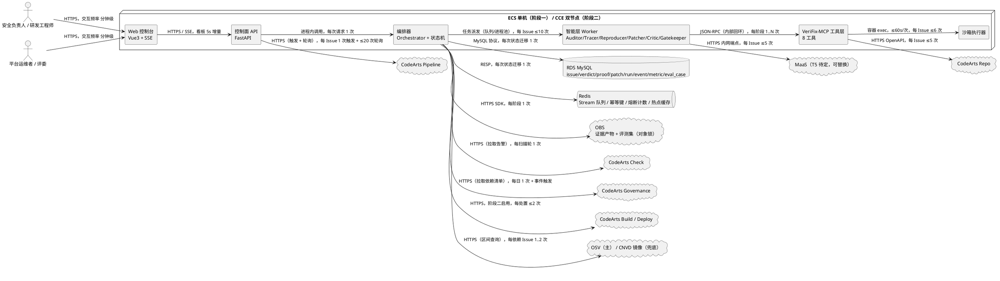
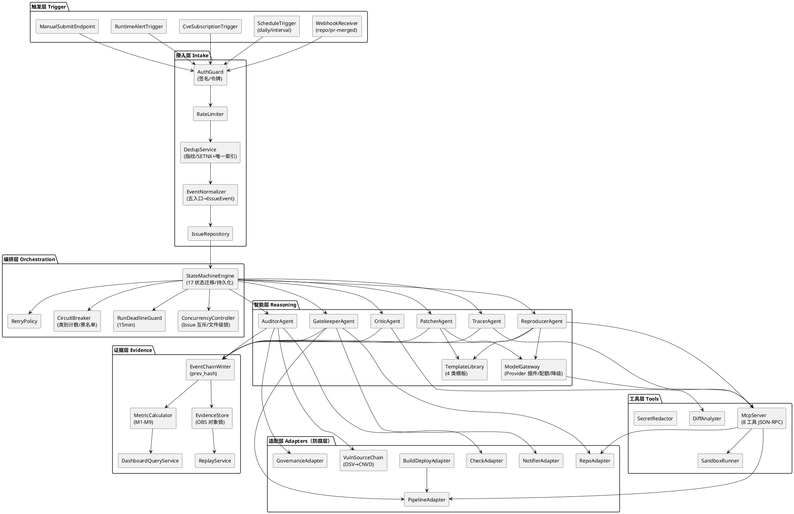
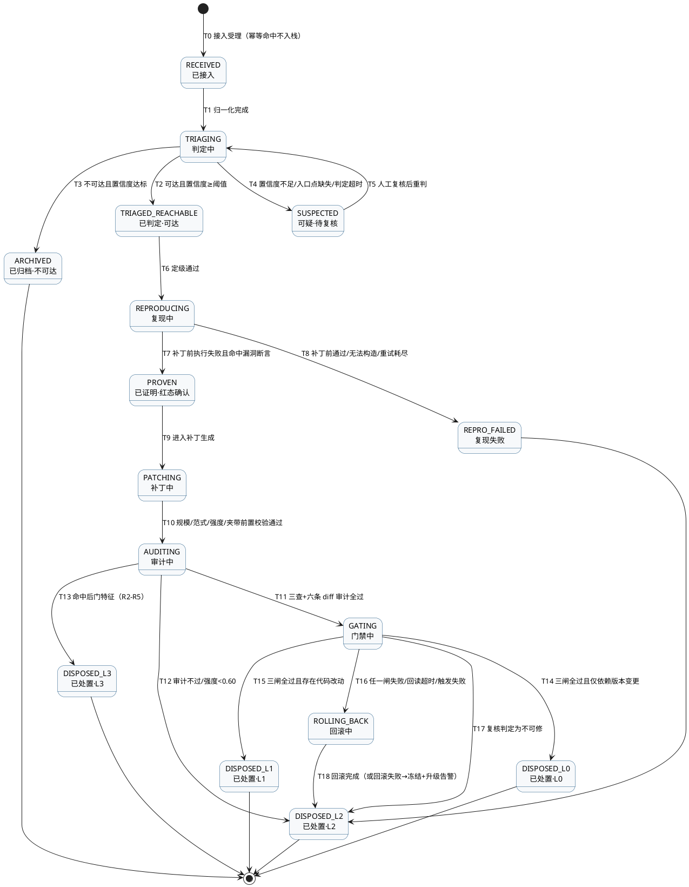
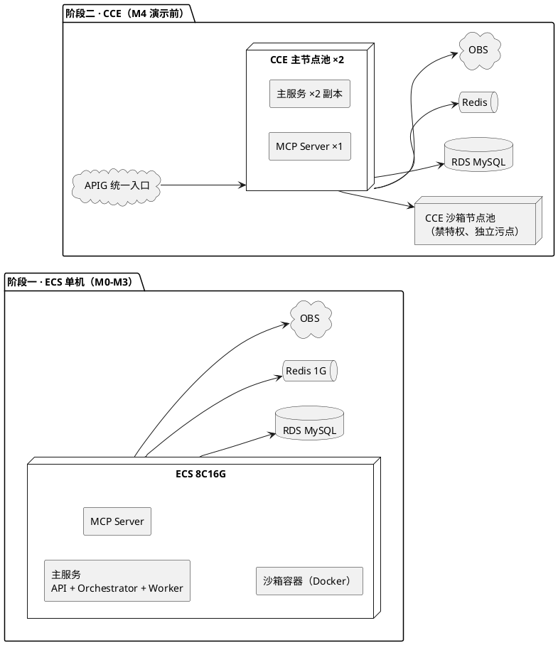
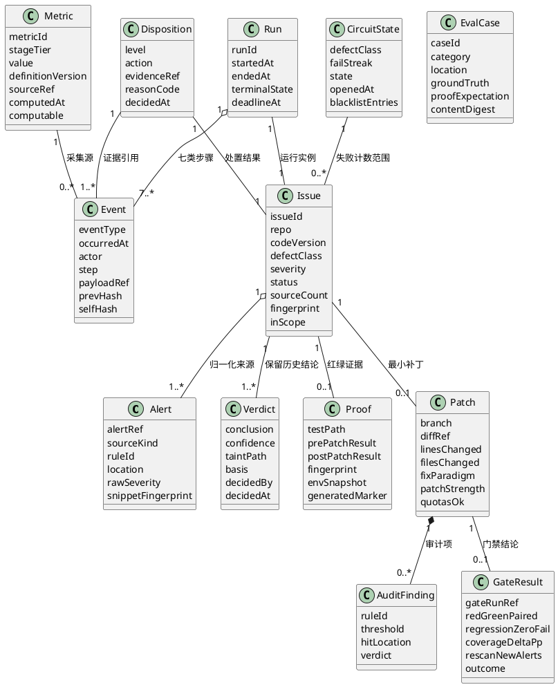
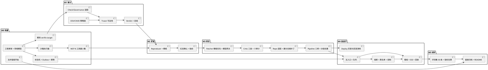

# VeriFix 安全自愈平台 · 技术实现方案（design）

> 对应需求：`.codeartsdoer/specs/verifix/spec.md`（v2.1 对齐版）
> 方案依据：`deliverables/CodeArts方案.md` v2.1（赛题 1 口径）＋ `deliverables/总方案.md` v1.1（内部施工图）
> 本文档只描述"如何构建"，不描述"做什么"，不含可直接执行的实现代码。
> 定稿前提：Python × C01/C02/C03/C05 的 MVP 范围；L0 只合并到 `release/auto`（永不自动并 `main`）；T3 = OSV 主 + CNVD 兜底；T4 = 自建 Flask 靶场。T1（产品名）、T5（模型选型）保持可替换。

---

## 分析口径声明（阅读前必读）

本工程当前为**绿地项目**：CodeArts 状态为"空项目 · 3 源文件 · 无可探索代码"，仓库内不存在任何业务实现。根目录的 `app.js`、`rc.js`、`main.js`、`dom.html`、`shell.html` 是大赛页面 headless 抓取留下的残留物（`main.js` 为 2.1 MB 前端打包产物，`dom.html` 为 265 KB 页面 DOM 转储），**不构成本产品的任何功能，也不作为设计依据**。

因此本章的"存量功能"指两类对象，并对两类分别给出可核查的引用位置：

| 存量类型 | 含义 | 引用位置口径 |
|---|---|---|
| 仓库内静态资产 | 已经产出、可被设计复用的文档与静态材料（架构图、能力矩阵、威胁模型、标注 schema 示例） | 精确到 `deliverables/` 下的文件与行号 |
| 被集成方能力 | CodeArts 五服务 + MaaS + OSV/CNVD + RDS/Redis/OBS 已具备的对外能力 | 无源码可引用，改为给出"契约来源"（方案文档章节 + 华为云 API Explorer 服务名 + 集成点编号 I1–I4） |

匹配度判定依据统一为：**是否可直接产生运行时行为**。仅提供设计约束、不能直接运行的资产一律不高于 25%；无任何运行时代码的需求功能匹配度记为 0%，统一归入 1.1.3 新增清单，不进 1.1.1 表格（1.1.1 表格严格使用 100%/75%/50%/25% 四档）。

---

# 一、需求与存量功能关系分析

## 1.1 需求功能与存量功能对比

### 1.1.1 已实现功能

需求侧的九大能力域（spec 5.1–5.10）在仓库内**没有任何运行时实现**。可被设计直接复用的只有 4 项静态资产，匹配度均在 25% 档（提供约束或示例，不提供行为）：

| 需求功能 | 存量功能 | 代码位置 | 匹配度 |
|---|---|---|---|
| 总体架构与六层职责划分（spec 3.3、4.4 可维护性） | 静态架构材料：六层结构、层间职责与"智能层无直接副作用"约束 | `deliverables/总方案.md:108-122`（§4.1 六层结构表）、`deliverables/architecture.html:1`、`deliverables/CodeArts方案.md:186-227`（§3.1/§3.2） | 25% |
| 补丁审计六条规则与自身威胁模型（spec 5.5.1 第 2 条） | 规则清单 R1–R6 与 P1–P7 攻击路径的静态描述，无判定实现 | `deliverables/总方案.md:508-521`（§14.3）、`deliverables/self-attack-report.html:1` | 25% |
| 评测样本标注字段（spec 6.7） | 标注 schema 示例（含 ground_truth 四项、proof 前后态） | `deliverables/CodeArts方案.md:365-378`（§5.2） | 25% |
| 指标定义 M1–M9 与复算口径（spec 6.8） | 指标表与三档目标，无采集代码 | `deliverables/CodeArts方案.md:463-499`（§7.1–§7.3） | 25% |

> 除上述 4 项外，spec 中其余全部能力（五源接入、归一化去重、可达性判定、复现、补丁、审计、门禁、分级处置、熔断、看板、评测）匹配度均为 **0%**，实现方式统一在 1.1.3 与第二章给出。

### 1.1.2 需要扩展的功能

"扩展"在本项目中不表现为"改造仓库内的旧代码"，而表现为**在被集成方已有能力之上增加适配与语义封装的增量层**。这些能力已在平台侧存在，但语义、字段、错误模型与本平台的领域模型不匹配，属于部分匹配。

| 需求功能 | 存量功能（被集成方已有能力） | 差异说明 | 扩展方向 |
|---|---|---|---|
| 问题接入 I1：拉取 Check 告警清单（spec 1.2 第 1 条、5.1.1 第 1 条） | CodeArts Check 开放 API / 任务完成回调，可返回规则 ID、文件、行号、严重度 | 差异①输入：Check 只有告警语义，无"缺陷类别"概念，需映射到 C01/C02/C03/C05；差异②输出：无 Issue 归一化结构；差异③边界：字段名随 API 版本漂移，无版本兼容承诺 | 新增 `CodeArtsCheckPort` 适配层 + 字段映射表 + 契约测试（用录制报文做回归），语义差异在映射层吸收 |
| 依赖漏洞源 I4：Governance + OSV/CNVD（spec 5.1.1 第 5 条） | Governance 给出组件/当前版本/建议修复版本；OSV 给出 PyPI 受影响区间；CNVD 兜底 | 差异①来源优先级：平台侧无"主源/兜底"概念；差异②冲突裁决：无"区间取更严"逻辑；差异③置信度：兜底来源需降置信度并标注 | 新增 `VulnSourceChain`（OSV 主 → CNVD 兜底）+ 区间合并裁决器 + 来源冲突标注 |
| 补丁落地 I2：分支 / 提交 / PR（spec 5.6.1 第 8 条） | CodeArts Repo 提供分支创建、文件提交、PR 创建、分支删除 | 差异①命名空间：需强制 `verifix/<issue_id>`，且需预检无 `main` 写权限；差异②PR 描述：需自动注入证据摘要与 run_id；差异③回滚：需保证分支删除 100% 成功并留痕 | 新增 `CodeArtsRepoPort` 适配层 + 权限预检器 + PR 证据模板渲染器 |
| 门禁执行 I3：三闸（spec 5.6.1 第 1–4 条） | CodeArts Pipeline 支持手动/API 触发、运行实例查询、stage/job 结果回读 | 差异①语义：Pipeline 只知道 stage 成败，不知道"红态是否存在"；差异②闸一判据：需把平台侧红态记录与 Pipeline 绿态配对；差异③时限：需 10 分钟回读窗口与超时判失败 | 新增 `CodeArtsPipelinePort` + `GateJudger`（闸位判定器，红绿配对/覆盖率差/复扫新增数）+ 回读超时器 |
| 构建产物复用（spec 3.2 CodeArts Build） | Build 任务执行 pytest 与镜像构建，产物入 Artifact | 差异：需记录产物 digest 供沙箱与环境复用，避免每次重装依赖 | 新增 `CodeArtsBuildPort`（可选路径，未接通时沙箱自装依赖）+ 产物 digest 归档 |
| 发布与回滚（spec 3.2 CodeArts Deploy，阶段二） | Deploy 发布单、版本保留、回滚 | 差异：需生成"灰度/回滚演练记录"作为留痕证据 | 新增 `CodeArtsDeployPort`（阶段二启用，阶段一以 ECS 直部 + 记录替代） |
| 模型能力（spec 3.2 MaaS） | MaaS 提供模型推理端点（T5 选型待定） | 差异①输出：模型返回自由文本，需强约束为结构化候选补丁；差异②可替换：选型未定，不得让模型差异渗入编排；差异③成本：需单 Issue ≤5 次调用约束 | 新增 `ModelGateway`（Provider 插件 + 结构化 Schema 校验 + 调用配额 + 超时降级到模板路径） |
| 存储与证据（spec 4.3、6.6） | RDS MySQL / Redis / OBS 托管服务可用 | 差异：无领域模型、无 append-only 约束、无哈希链、无对象锁 | 新增 Repository 层 + `EvidenceStore`（对象锁 + sha256）+ Event 哈希链 |
| 代码执行（spec 4.3 第 1 条沙箱） | ECS / CCE 可运行容器 | 差异：默认可联网、默认 root、无资源与时限约束 | 新增沙箱执行器（断网/只读/60s/1G/非 root/cap-drop） |

### 1.1.3 需要新增的功能或接口

以下为全部新增项，按 spec 5 的能力域分组。每项标注输入、输出、核心逻辑与依赖；依赖编号对应 2.2 接口清单。

**A. 接入与归一化（spec 5.1）**

| 功能点 | 输入 | 输出 | 核心逻辑 | 依赖 |
|---|---|---|---|---|
| 五入口事件接收 | Repo 合并 Webhook、定时信号、CVE 订阅、运行时告警、人工提交 | 统一 `IssueEvent` | 鉴权（签名/令牌）→ 限流 → 幂等判重 → 统一转事件 | API-01…API-05 |
| 归一化 | `RawAlert` / `RawDependencyAlert` / `ManualRequest` | `Issue` 草稿 | 字段映射、类别收敛、定位补齐（依赖类以组件+版本定位） | PORT-CHECK、PORT-GOV |
| 去重 | 一批 `Issue` 草稿 | 唯一 `Issue` + 来源计数 | 指纹 = hash(repo, file, rule_id, 规范化代码片段)，同版本内合并并累加来源 | 无（纯计算 + 唯一索引） |
| 范围收敛 | `Issue` 草稿 | 范围外归档标记 | 类别 ∈ {C01,C02,C03,C05} 才进处置，否则归档不计分母 | 无 |
| 依赖漏洞裁决 | 组件名 + 版本 | 受影响区间 + 修复版本 + 来源标记 | OSV 主查 → 缺失/不可用切 CNVD → 区间取更严 → 冲突标注 | PORT-VULN |

**B. 可达性判定与定级（spec 5.2）**

| 功能点 | 输入 | 输出 | 核心逻辑 | 依赖 |
|---|---|---|---|---|
| 入口点识别 | 目标仓库源码（指定 commit） | 入口点集合（HTTP 路由/定时任务/消息消费者） | Python AST 扫描装饰器与框架注册点 | TOOL-02（读代码） |
| 调用图构建 | 源码 + 入口点 | 函数级有向图 | AST 解析 + 模块导入图，跨文件建边 | 无 |
| 污点传播 | 调用图 + 漏洞点 + 入口点 | `Verdict`（可达/不可达/可疑 + 路径 + 置信度） | 从入口 BFS，参数污点传播至 sink，命中即记路径 | 无 |
| 置信度降级 | 传播结果 + 图完整性信号 | 可疑结论 | 动态调用/反射/装饰器链断裂 → 降置信度 → 可疑 | 无 |
| 优先级定级 | `Verdict` + 严重度 + 类别 | 队列排序 | 可达且高置信优先，禁按严重度单维排序 | 无 |

**C. 复现证据（spec 5.3）**

| 功能点 | 输入 | 输出 | 核心逻辑 | 依赖 |
|---|---|---|---|---|
| 复现测试生成 | `Verdict` 路径 + 漏洞点上下文 | 测试文件（带 AUTOGENERATED 标记 + issue_id） | 模板优先（注入/命令/凭据/依赖四类模板），未命中走模型适配 | MODEL-01、TOOL-03 |
| 红态确认 | 测试文件 + 未修复工作区 | `Proof`（pre_patch=fail + 执行记录 + 环境快照） | 沙箱执行一次，非零退出且失败原因命中漏洞断言才记红 | TOOL-05 |
| 断言有效性审查 | 测试源码 AST | 通过/拒绝 | 拒绝恒真断言、skip 标记、外网依赖 | 无 |
| 测试指纹登记 | 测试文件内容 | sha256 指纹 | 落库并与 Issue 一一绑定，供反作弊比对 | 无 |

**D. 最小补丁（spec 5.4）**

| 功能点 | 输入 | 输出 | 核心逻辑 | 依赖 |
|---|---|---|---|---|
| 模板补丁 | 缺陷类别 + 代码上下文 | `Patch` 候选 | 四类模板：版本升级 / 参数化查询 / 参数化命令 / 凭据外置 | TOOL-04 |
| 模型补丁 | 结构化 JSON（issue_id/rule_id/file/line/代码上下文/可达路径） | `Patch` 候选 | 仅接收结构化字段，不接收自由文本；输出强校验 | MODEL-02 |
| 规模前置校验 | diff | 通过/超限 | ≤30 行且 ≤3 文件，超限直接 L2，不裁剪 | 无 |
| 补丁强度评分 | diff + 缺陷类别 + 修复范式 | `patch_strength` ∈ [0,1] | 结构性修复高分、黑名单式过滤低分；<0.60 锁 L2 | 无 |
| 夹带检测 | diff | 通过/拒绝 | 无关注释、格式化、重命名、依赖新增即拒绝 | 无 |

**E. 审计与防作弊（spec 5.5）**

| 功能点 | 输入 | 输出 | 核心逻辑 | 依赖 |
|---|---|---|---|---|
| 三查 | 补丁分支 + 全量测试结果 + 复扫结果 | 三查结论 | 红转绿配对、回归 0 失败、复现测试与扫描配置未被改 | TOOL-05、PORT-PIPE |
| 六条 diff 审计 | 补丁 diff | `AuditFinding[]` | R1 邻近性 / R2 无新增分支 / R3 无新增 IO / R4 无字符串常量比较 / R5 未动鉴权常量 / R6 规模上限 | PORT-REPO |
| 后门判定 | 审计命中项 | L3 拒绝 + 告警 | R2–R5 命中即 L3，含"审计项编号 + 阈值 + diff 位置" | NOTIFY |
| 哈希链留痕 | 事件流 | 不可篡改事件链 | 每条事件记 prev_hash，写入后禁止更新 | OBS |

**F. 门禁与分级处置（spec 5.6）**

| 功能点 | 输入 | 输出 | 核心逻辑 | 依赖 |
|---|---|---|---|---|
| 分支与推补丁 | `Patch` + `Proof` | `verifix/<issue_id>` 分支 | 建分支 → 提交（含测试文件）→ 校验推送权限 | PORT-REPO |
| 门禁触发 | 分支 + 测试路径 | Pipeline 运行实例 ID | API 触发，只允许手动触发不挂 push 自动触发 | PORT-PIPE |
| 三闸判定 | Pipeline 结论 + 平台侧红态 | `GateResult` | 闸一红绿配对、闸二 0 失败且覆盖率降幅 ≤0.5pp、闸三同文件同规则不再命中且新增为 0 | PORT-PIPE + PROOF |
| 分级处置 | 审计结论 + 门禁结论 + 强度 | `Disposition`（L0/L1/L2/L3） | L0 仅"仅依赖版本变更 + 三闸全过"；L1 审计全过；L2 审计不过/强度不足/闸失败；L3 后门 | PORT-REPO、NOTIFY |
| 合并与开 PR | 处置级别 | 分支合并结果或 PR 链接 | L0 合并到 `release/auto`；L1 开 PR 并写证据摘要；一律拒绝 `main` | PORT-REPO |
| 失败回滚 | 闸失败 | 回滚结果 | 删分支 + 清产物，失败即冻结该仓库自动处置并升级告警 | PORT-REPO、NOTIFY |

**G. 熔断与自运行（spec 5.7）**

| 功能点 | 输入 | 输出 | 核心逻辑 | 依赖 |
|---|---|---|---|---|
| 同类熔断 | 失败事件流 | `CircuitState` | 按缺陷类别计数，连续 3 次失败置熔断 + 告警 | 无（Redis 计数） |
| 失败黑名单 | 失败指纹 | 命中标记 | TTL 7 天，命中直接跳过自动处置 | 无（Redis TTL） |
| 人工解除/暂停 | 控制指令 | 控制状态 | 解除清零计数；暂停期间新 Issue 排队不丢弃 | API-11…API-13 |
| 自运行时计数 | 健康心跳 | 连续自运行时长 | 心跳缺失不计入，中断后重算，禁止虚增 | 无 |
| 超时终止 | Run 截止时间 | 超时终态 | 单 Issue 15 分钟硬截止，保留已完成证据 | 无 |

**H. 证据留痕与看板（spec 5.8）**

| 功能点 | 输入 | 输出 | 核心逻辑 | 依赖 |
|---|---|---|---|---|
| 七类事件留痕 | 各阶段结果 | `Event` 序列 | 接入/判定/复现/补丁/审计/门禁/处置，缺失显式标"未执行" | 无 |
| 证据归档 | 日志、diff、测试报告、复扫结果 | OBS 对象 | 路径 `runs/{run_id}/{issue_id}/{stage}/`，写后开对象锁 | OBS |
| 结论下钻 | `Disposition` | 证据引用链 | 引用缺失时结论标"证据缺失"，不得视为通过 | 无 |
| 看板指标 | 事件与处置数据 | 首屏指标 + SSE 实时流 | 在办数/级别分布/熔断/自运行时/失败 Top N/M1–M9 | API-14、API-15 |
| 脱敏 | 任意输出文本 | 脱敏文本 | 凭据模式识别后替换并记录脱敏事件 | 无 |

**I. 评测与指标（spec 5.9）**

| 功能点 | 输入 | 输出 | 核心逻辑 | 依赖 |
|---|---|---|---|---|
| 评测集装载 | OBS 对象 | `EvalCase[]` | 拉取 → sha256 校验 → 配比校验（40:30:20:10，负例 ≥30%） | OBS |
| 逐条评测 | `EvalCase[]` | 逐条结果 + 中断点 | 复用主流程（隔离评测通道），沙箱或模型不可用即中断并保存进度 | 主流程 |
| 指标计算 | 记录集合 | `Metric`（M1–M9） | 每项指标绑定采集源；无源标"不可计算"，不填估算 | 无 |
| 报告归档 | 指标 + 摘要 | 报告对象 | 报告与评测集摘要一并归档，摘要不一致拒绝评测 | OBS |

**J. 开发链路留痕（spec 5.10，赛题硬门槛）**

| 功能点 | 输入 | 输出 | 核心逻辑 | 依赖 |
|---|---|---|---|---|
| 五步留痕规范 | 开发活动 | 可核查记录 | 需求/生成/构建/修复/发布各有落点；commit 带 `[step-N/xxx]` 前缀；产物入 `docs/devlog/` | CodeArts Repo/Build/Deploy |
| 自举修复 | 自身仓库缺陷 | 自举 Issue → PR 链路 | 平台修自身缺陷，产出可在看板回放的 run | 主流程 |

## 1.2 存量功能详细分析

本节对 1.1.2 中的部分匹配项做深入分析，重点在**接口契约、业务规则边界、可扩展点与硬约束**，因为这些约束直接决定第二章设计能否落地。

### 1.2.1 CodeArts Check（I1）

- **接口契约**：拉取型。输入为任务标识（或时间窗 + 仓库），输出为告警条目集合，含规则 ID、文件路径、行号、严重度、代码片段。无"缺陷类别"字段，无去重字段，无"是否可达"字段。
- **业务规则边界**：Check 的规则严重度是**规则级**而非**实例级**，同一规则在不同上下文严重度相同。因此 spec 5.2.1 第 5 条要求的"可达性 + 严重度 + 类别"共同定级，必须由本平台另行计算，不能复用 Check 排序。
- **可扩展点**：支持自定义规则集，可用于靶场与自举场景构造稳定输入；任务完成回调可作为拉取的替代触发。
- **约束**：字段名以 API Explorer 最新版本为准（spec 4.5 第 1 条），因此适配层必须**不把外部字段名泄漏进领域模型**，映射关系集中在一张表内；拉取失败不得等同于"无告警"（spec 5.1.3 第 1 条）。

### 1.2.2 CodeArts Governance 与 OSV / CNVD（I4 + T3）

- **接口契约**：Governance 输出"组件 + 当前版本 + 受影响区间 + 建议修复版本"；OSV 以 ecosystem=PyPI 输出受影响区间与修复版本；CNVD 镜像提供国内组件兜底。
- **业务规则边界**：三个来源的区间可能不一致。spec 5.1.1 第 5 条要求"取更严 + 标注冲突"，因此裁决器必须能表达"区间并集/交集"两种合并语义，并在 Issue 上保留**原始区间**以便复算。
- **可扩展点**：`VulnSource` 作为策略链接口，后续可插入私有漏洞库，不改编排。
- **约束**：OSV 不可用时降置信度并标"需人工确认"（spec 5.1.3 第 2 条），意味着兜底路径必须**携带来源标记**一路传到 Verdict 与看板，不能在中途丢失。

### 1.2.3 CodeArts Repo（I2）

- **接口契约**：分支创建、文件提交、PR 创建、分支删除、diff 读取、分支保护查询。
- **业务规则边界**：机器人账号仅有 `verifix/*` 与 `release/*` 推送权限，无 `main` 写权限（spec 4.3 第 2 条）。这是**硬约束**而非配置建议，因此"L0 自动合并到 `release/auto`"是可以实现的，而"自动并 `main`"在权限层就不可能出现，设计上仍要显式拒绝以留下违规事件记录（spec 5.6.1 第 6 条）。
- **可扩展点**：PR 描述模板、检查项（check runs）可承载证据摘要。
- **约束**：回滚必须 100% 成功（spec 4.2 第 5 条），因此分支删除需要幂等语义（分支已不存在视为成功），并记录每次尝试；回滚失败必须冻结该仓库自动处置。

### 1.2.4 CodeArts Pipeline（I3）

- **接口契约**：按流水线标识触发运行、查询运行状态与 stage/job 结果。
- **业务规则边界**：Pipeline 判定的是"这次运行的各 stage 是否成功"，它**不掌握"补丁前是否红过"**。闸一的"红转绿"必须由平台把沙箱红态记录与 Pipeline 绿态结果**配对**才能成立；只有绿没有红，一律判闸一失败（spec 5.6.1 第 2 条）。这是全系统最关键的一处语义缺口，也是本设计的核心增量点。
- **可扩展点**：三闸可落为一条流水线的三个 stage，也可拆三条流水线；本设计按"一条流水线三 stage"设计，闸位通过 stage 名映射，避免三次触发带来三次排队。
- **约束**：只允许 API 触发（不挂 push 自动触发，防刷）；回读窗口 10 分钟，超时按失败处理（spec 4.1 第 6 条）。

### 1.2.5 MaaS 模型服务（T5 待定）

- **接口契约**：内网推理端点，输入 prompt 或结构化消息，输出文本。
- **业务规则边界**：模型输出**不具备确定性**，因此不能直接作为补丁落地：必须经结构化解析 + 强校验 + 模板优先策略兜底。spec 4.3 第 7 条要求模型不得直接执行命令或写仓库，模型只能请求工具调用。
- **可扩展点**：Provider 可替换（DeepSeek-V3 / Qwen-Max / 其他），因此提示词、输出 Schema、调用配额必须与 Provider 解耦。
- **约束**：单 Issue ≤5 次调用、成本上限；超限即降级（转模板路径或 L2），不得让成本失控影响自运行。

### 1.2.6 沙箱执行环境

- **接口契约**：给定工作区（代码 + 测试）与命令，返回退出码、stdout/stderr、耗时、资源使用。
- **业务规则边界**：沙箱只负责"执行"，不负责"判定"；红/绿判定在平台侧依据退出码与断言命中分析得出。
- **约束（不可协商）**：断网、只读挂载源码、单次 60 秒、内存 1G、非 root、cap-drop ALL。任一不满足则该次执行结果不得作为证据（spec 4.3 第 1 条、6.3 第 4 条）。

### 1.2.7 仓库残留物的约束识别

根目录 `app.js`（413 B）、`rc.js`（3.4 KB）、`main.js`（2.1 MB）、`dom.html`（265 KB）、`shell.html`（30 KB）的判定依据：

1. `main.js` 体积与内容形态符合前端打包产物，与赛题页面脚本同源；
2. `dom.html` 为单页应用渲染后的 DOM 转储，含页面导航与赛事信息，不含产品逻辑；
3. `app.js` / `rc.js` 为页面启动配置残留。

**约束结论**：这五个文件**不得被引用、不得被复制进新工程、不得作为前端骨架**。前端需从零建立（见 2.1.2 与 2.1.5），并在工程初始化时清理根目录残留，避免评审误判为"贴牌"。
---

# 二、增量设计方案

## 2.1 实现模型

### 2.1.1 上下文视图

本平台在运行期是一个**单集群、内外分离**的部署单元：对外只暴露 Web 控制台与 API 入口，对内通过适配层调用 CodeArts 五服务、模型服务与存储。所有跨系统调用都是"本平台发起、平台侧回读"的同步 HTTP，只有事件入口是"外部推送、平台异步消费"。



**上下文决策与理由**

| 决策 | 选择 | 理由 |
|---|---|---|
| 外部事件入口 | 异步（Webhook 只做接收与入队，立即 202 返回） | spec 4.1 第 2 条要求 P95 ≤2s 且不同步等待全流程；Repo 推送重试不应导致长连接占用 |
| CodeArts 调用 | 同步短请求 + 显式超时 + 有限重试 | 五服务均为请求-响应型，无事件回调保证；超时由编排层统一裁切，避免线程悬挂 |
| 门禁结果获取 | 轮询（可退化为回调） | Pipeline 提供运行状态查询；轮询周期固定，总窗口 10 分钟，超时即判失败，语义确定 |
| 模型调用 | 同步 + 硬配额 + 超时降级 | 模型不可用不得阻塞全链路，降级到模板路径，模板也未命中则 L2 |
| 代码执行 | 严格隔离在沙箱内，平台进程永不执行目标代码 | spec 4.3 第 1 条、第 7 条；平台的 Python 进程只做静态解析（AST），不做动态导入 |

### 2.1.2 服务/组件总体架构

沿用 `总方案.md` 六层结构，但把"智能层"从"6 个 Agent"细化为"6 个专职阶段处理器 + 1 个可替换模型网关"，因为 T5 未定，模型不能成为架构的一部分。



**分层职责与关键类型（不含实现）**

| 层 | 关键类型/组件 | 职责 | 明确不做 |
|---|---|---|---|
| 触发层 | `WebhookReceiver`、`ScheduleTrigger`、`CveSubscriptionTrigger`、`RuntimeAlertTrigger`、`ManualSubmitEndpoint` | 五入口统一转为 `IssueEvent`，只做协议解包与验签 | 不做任何业务判断、不碰代码 |
| 接入层 | `AuthGuard`、`RateLimiter`、`DedupService`、`EventNormalizer`、`IssueRepository` | 鉴权、限流、幂等、归一化、去重、落库 | 不做可达性与修复决策 |
| 编排层 | `StateMachineEngine`、`RunDeadlineGuard`、`ConcurrencyController`、`RetryPolicy`、`CircuitBreaker` | 状态推进、超时、并发、重试、熔断 | 不构造提示词、不解析 diff 语义 |
| 智能层 | `AuditorAgent`…`GatekeeperAgent`、`ModelGateway`、`TemplateLibrary` | 每个阶段只产出一份结构化结论 | 不直接执行命令、不直接写仓库（经工具层） |
| 工具层 | `McpServer`、`SandboxRunner`、`DiffAnalyzer`、`SecretRedactor` | 所有副作用（读代码/跑测试/改文件/开 PR/合并）集中于此 | 不做业务裁决 |
| 适配层 | `CheckAdapter`…`NotifierAdapter` | 把外部字段与错误码翻译成领域模型与稳定异常 | 不承载业务规则 |
| 证据层 | `EventChainWriter`、`EvidenceStore`、`MetricCalculator`、`DashboardQueryService`、`ReplayService` | 留痕、归档、指标、看板、回放 | 不参与决策、不修改结论 |

**依赖方向铁律**：只能"上层依赖下层的接口"，反向一律通过事件。智能层依赖的是适配层与工具层的**接口（Protocol）**，不依赖具体服务客户端，从而保证 CodeArts 字段漂移与模型更换不影响决策层。

**配置项与取值策略**

| 配置键 | 含义 | 缺省值 | 变更策略 |
|---|---|---|---|
| `product.brand` | 展示用产品名（T1 待定） | `VeriFix` | 随时可改，只影响文案；分支前缀与存储标识不随之变化 |
| `branch.namespace` | 补丁分支前缀 | `verifix/` | 冻结，不随 T1 改名（保证历史 Issue 可回放） |
| `release.auto_branch` | L0 合并目标 | `release/auto` | 冻结；`main` 在代码层硬拒 |
| `run.deadline_seconds` | 单 Issue 总时限 | `900` | 只可缩短不可超过 900 |
| `stage.timeout.*` | 判定/复现/补丁/审计/门禁回读 | 30s/120s/120s/60s/600s | 受总时限约束，配置加载时校验 |
| `sandbox.cpu/mem/seconds` | 沙箱规格 | `1 / 1g / 60` | 只可收紧 |
| `patch.max_lines/max_files` | 最小补丁上限 | `30 / 3` | 冻结（与 spec 6.4 一致） |
| `patch.strength_l0_l1_min` | 强度门槛 | `0.60` | 冻结 |
| `suspicion.threshold` | 可疑阈值 | `0.60` | 可调，需写入事件留痕 |
| `circuit.fail_streak` | 熔断阈值 | `3` | 可调，需留痕 |
| `blacklist.ttl_hours` | 失败指纹黑名单 | `72` | 可调，需留痕 |
| `model.provider` | 模型 Provider（T5 待定） | `deepseek-v3` | 可切换，需重跑契约测试 |
| `model.max_calls_per_issue` | 单 Issue 模型调用上限 | `5` | 只可收紧 |
| `check.ruleset` / `gate.pipeline_id` | CodeArts 资源标识 | 环境变量注入 | 环境相关，不入库 |

> 配置加载即校验：`stage.timeout` 之和必须小于 `run.deadline_seconds`；`sandbox.mem` 不得超过 1g。任一不满足则拒绝启动，这是把 DFX 约束"编译期化"的手段。

### 2.1.3 实现设计文档

#### （1）单 Issue 状态机（17 条主迁移 + 2 条辅助迁移）

状态取值严格对齐 spec 6.1 第 7 条，不得新增未定义的对外状态；终态严格对齐 spec 6.5 第 4 条（已处置/失败/超时/熔断跳过/范围外），禁止"未知"。



**迁移契约表**（T0 为受理入栈、T5 为人工复核回退，属辅助迁移；状态推进主迁移共 17 条：T1–T4、T6–T18）

| 迁移 | 触发条件 | 守卫（前置断言） | 副作用 | 失败处理 |
|---|---|---|---|---|
| T1 | 事件已归一化且未命中幂等 | 类别 ∈ 四类；定位信息完整 | 落 `Issue`，写接入事件 | 缺定位 → 范围外归档 |
| T2 | 判定结论=可达 且 置信度 ≥ `suspicion.threshold` | 污点路径非空且起终点合法 | 落 `Verdict`，写判定事件，入可修队列 | 路径非法 → 降可疑 |
| T3 | 结论=不可达 且 置信度达标 | 已记录"未找到传播路径"依据 | 归档，计入无价值告警 | 依据缺失 → 降可疑 |
| T4 | 置信度不足 / 入口点为空 / 判定超时 | 必须写明降级原因 | 入人工复核队列 | 复核队列不可用 → 保持可疑并告警 |
| T6 | 定级完成 | 存在有效 `Verdict` | 写定级事件 | 无 Verdict → 驳回（spec 5.2.1 第 6 条） |
| T7 | 红态记录 `pre_patch=fail` | 执行环境快照完整、断言命中漏洞点 | 落 `Proof`，登记测试指纹 | 环境异常 → 基础设施异常重试，不计业务失败 |
| T8 | 补丁前通过 / 无法构造 / 重试耗尽 | 失败原因分类已写入 | 转 L2，计入"复现困难"分类 | — |
| T9 | 红态有效 | `Proof.pre_patch=fail` | 派发补丁任务 | 无 Proof → 拒绝 |
| T10 | 规模 ≤30 行/3 文件、范式匹配类别、强度 ≥0.60、无夹带 | diff 完整可读 | 落 `Patch`，写审计请求 | 超限不裁剪，直接 L2 |
| T11 | 三查全过 + 六条审计全过 | 复现测试指纹与登记一致 | 允许送门禁 | 指纹不符 → 反作弊事件 + L2 |
| T12 | 审计任一不过 或 强度 <0.60 | 拒绝项编号与阈值已记录 | 转 L2 | — |
| T13 | 命中 R2–R5 | 命中片段位置已定位 | 转 L3 + 告警 | 告警失败 → 看板顶栏警示 |
| T14 | 三闸全过 且 diff 仅依赖版本号 | 红态与绿态配对成立 | 合并到 `release/auto`，写处置事件 | 合并失败 → 回滚 + L2 |
| T15 | 三闸全过 且 存在代码改动 | 审计全过 | 开 PR 并写入证据摘要与 run_id | PR 失败 → 保留分支 + 集成异常 |
| T16 | 任一闸失败 / 回读超时 / 触发失败 | 失败闸位已记录 | 进入回滚 | 回滚失败 → 冻结仓库 + 升级告警 |
| T17 | 人工复核判为不可修 | 复核主体与理由已记录 | 转 L2 | — |
| T18 | 分支删除幂等成功 | 保留分支与产物清理记录 | 转 L2，写回滚事件 | 见 T16 失败分支 |

#### （2）关键判定：闸一"红转绿"配对流程

这是全系统最容易做错、也最能体现"门禁不是自评"的位置。设计把"红"与"绿"拆成两个不同来源的证据，缺一即失败。

```plantuml
@startuml
start
:取得 Issue 的红态记录\nProof.pre_patch = fail ?
if (红态记录存在且\n执行环境快照合法?) then (是)
  :触发 Pipeline 三闸\n记录 run 实例 ID;
  :在回读窗口内轮询\n(≤10 分钟, 固定周期);
  if (取得运行终态?) then (是)
    :读取 stage: proof / regression / rescan;
    if (proof=成功 且 红态=失败?) then (是)
      :闸一通过\n(平台红 + 流水线绿 配对成立);
    else (否)
      :闸一失败\n(只有绿无红 → 无效证据);
      stop
    endif
    if (regression: 0 失败 且 覆盖率降幅 ≤0.5pp?) then (是)
      :闸二通过;
    else (否)
      :闸二失败;
      stop
    endif
    if (rescan: 同文件同规则未再命中 且 新增告警=0?) then (是)
      :闸三通过 → 允许分级处置;
    else (否)
      :闸三失败;
      stop
    endif
  else (否)
    :回读超时 → 按门禁失败处理;
    stop
  endif
else (否)
  :闸一直接失败\n不得以绿态替代;
  stop
endif
stop
@enduml
```

**分支策略**

| 分支条件 | 处理策略 | 记录要求 |
|---|---|---|
| 红态缺失但流水线绿 | 判闸一失败，回滚 | `gate.red_missing` 事件，含闸位与 run_id |
| 流水线未触发成功 | 不判通过，保持待处置；有限重试后记集成异常 | `gate.trigger_failed` 事件 + 看板集成异常标记 |
| 回读超时 | 按失败处理并回滚 | `gate.timeout` 事件 + 已等待时长 |
| 覆盖率降幅恰为 0.5pp | 通过（不大于 0.5pp） | 记录基线值与实测值，供复算 |
| 复扫命中但为同一 Issue 的新规则 | 判闸三失败（新增 >0） | 记录新增告警清单 |

#### （3）扩展点设计

四个扩展点覆盖所有"可能变"的地方，保证 MVP 定稿项不被后续变更推翻：

| 扩展点 | 接口职责 | 默认实现 | 扩展方式 | 对应待定/演进 |
|---|---|---|---|---|
| `DefectPlugin` | `matches(alert)`、`normalize(alert)`、`assertion_policy()`、`template_candidates()`、`is_dependency_only()` | 四个内置插件：`C01DependencyCve`、`C02SqlInjection`、`C03CommandInjection`、`C05HardcodedSecret` | 新增类 + 注册，不改编排 | v2 扩缺陷类别（spec 4.5 第 2 条：不得改变既有分级与门禁语义） |
| `ModelProvider` | `infer(task_kind, structured_payload) -> ModelResult`、`health()`、`cost_estimate()` | `DeepSeekProvider`（或 `QwenProvider`），由 `model.provider` 选择 | 实现 Protocol + 配置切换 | T5 模型选型待定 |
| `VulnSource` | `query_by_component(name, version) -> RangeResult` | `OsvSource`（主）→ `CnvdMirrorSource`（兜底） | 策略链追加/重排 | v2 私有漏洞库 |
| `Notifier` | `notify(channel, level, payload)` | 控制台内通知 + Webhook 通道 | 追加通道 | 告警通道演进 |
| `EvidenceSink` | `put(object_key, content) -> EvidenceRef`、`verify(ref)` | OBS（对象锁 + sha256） | 替换存储后端 | 部署形态演进（spec 4.5 第 4 条） |

**扩展点约束**：任何扩展点实现不得绕过 `CriticAgent` 与 `GateJudger`；新增缺陷插件必须声明 `is_dependency_only()`，因为它是 L0 准入的唯一依据（spec 5.6.1 第 5 条）。

#### （4）事务与一致性设计

| 一致性问题 | 设计手段 | 失败后果控制 |
|---|---|---|
| 状态迁移与事件写入的原子性 | 本地事务内写 `Issue` 当前状态 + `Event` + `Run` 步骤；跨系统副作用走 Outbox（同事务写待执行任务表，由投递器执行并回写结果） | 进程崩溃后从 Outbox 重放，状态不回退；外部副作用按幂等键去重 |
| 重复触发 | 双保险：Redis `SETNX` 指纹键（TTL 覆盖一个处置周期）+ RDS 指纹唯一索引 | 命中返回既有 `issue_id` 与当前状态（spec 5.1.3 第 3 条） |
| 证据与结论脱耦 | `Disposition` 必须携带 `evidence_ref`；读取时校验引用可解析 | 引用失效 → 结论标"证据缺失"，禁止视为通过（spec 4.2 第 6 条） |
| 回滚与合并的补偿 | 分支删除幂等（已删除视为成功）；合并前校验目标分支为 `release/auto` | 回滚失败 → 冻结仓库自动处置 + 高优先级告警（spec 5.6.3 第 4 条） |
| 事件不可篡改 | `Event.prev_hash` 形成链；表仅允许 INSERT，禁止 UPDATE/DELETE（应用层 + 数据库账号权限双约束） | 启动时校验链尾，断裂即告警并拒绝计算受影响指标 |
| 并发处置冲突 | 同 Issue 互斥（Redis 分布式锁，键含 issue_id）；跨 Issue 同文件串行（文件级锁，键含 repo+file） | 后者排队不丢弃，提示"存在并行任务，已排队"（spec 5.6.3 第 3 条） |

#### （5）超时与并发

| 对象 | 时限 | 计时起点 | 超时行为 |
|---|---|---|---|
| 全流程 Run | 900s | 接入受理 | 落"超时"终态，保留已完成证据，释放锁 |
| 可达性判定 | 30s/Issue（对应 5k 函数项目） | 进入判定 | 结论降"可疑"，原因=判定超时 |
| 沙箱单次执行 | 60s | 容器启动完成 | kill，记基础设施失败（不计业务失败） |
| 门禁回读 | 600s 总窗口 | 触发成功 | 判门禁失败 → 回滚 → L2 |
| 模型单次调用 | 60s；单 Issue ≤5 次 | 请求发出 | 超时重试 1 次后降级模板路径 |
| 提交接口响应 | P95 ≤2s | 请求到达 | 只做受理与入队，不做同步处理 |

**并发模型**：编排器按 Issue 为并发单元，默认 3 并发（spec 4.1 第 5 条下限），可通过配置放大到 8；超出即入 Redis Stream 排队。沙箱执行与模型调用各自有独立并发上限，避免一个慢模型拖住全部 Issue。进程内用 asyncio 处理 I/O，静态解析（AST/调用图）放入进程池，避免 GIL 阻塞与 30s 判定时限冲突。
### 2.1.4 开发链路留痕与自举设计（赛题 1 硬门槛）

留痕不是材料工作，而是**工程结构的一部分**：目录、提交规范、构建任务、部署流程在设计阶段就固定，避免 D18 补造（spec 5.10.1 第 7 条禁止项）。

| 步骤 | CodeArts 落点 | 工程内产出位置 | 可核查方式 |
|---|---|---|---|
| ① 需求理解 | 代码智能体对话（输入本 design.md 与 spec.md） | `docs/devlog/01-requirement.md`（模块清单 + 接口草案 + 对话导出） | 文件时间戳早于首次代码提交 |
| ② 代码生成 | 代码智能体生成骨架，提交带 `[step-2/codegen]` 前缀 | 提交历史（作者 + 时间 + diff） | 按提交信息前缀可筛选出完整生成序列 |
| ③ 项目构建 | Build 任务：`pytest` + `docker build` | `docs/devlog/03-build.md`（执行记录 + 产物 digest） | 构建记录可追溯到具体 commit |
| ④ 问题修复 | 用 VeriFix 修 VeriFix 自身缺陷（自举） | `docs/devlog/04-bootstrap.md`（Issue 编号 + PR 链接 + run_id） | 看板可按 run_id 回放完整七步 |
| ⑤ 部署上线 | Deploy 发布 + 灰度/回滚演练 | `docs/devlog/05-release.md`（发布单 + 演练记录 + Demo 地址） | 发布单时间与 commit 时间一致 |

**自举修复的选点标准**（避免"为了留痕而造 bug"）：

1. 必须是真实存在的缺陷，优先选边界条件类（如空 diff、异常分类错误、超大文件行号偏移）；
2. 缺陷必须落在本轮支持的四类之一，否则平台自身会判"范围外"，无法闭环；
3. 修复后的补丁必须 ≤30 行/≤3 文件，否则会被自身规则判 L2，拿不到 L1 PR；
4. 自举 Issue 与普通 Issue 走**同一条状态机**，不得开后门，否则回放记录不可信。

**留痕自检**：交付前执行一次自检脚本，逐项检查五个环节的记录是否存在、时间序列是否单调、commit 前缀是否完整；缺失项作为阻塞项列出，不允许以说明文字替代（spec 5.10.3 第 1 条）。

### 2.1.5 部署形态与演进



**演进不变式**（spec 4.5 第 4 条：两种形态对外行为与接口必须一致）：

1. 对外 API 路径、鉴权方式、SSE 语义在两种形态下完全相同；
2. 沙箱在两种形态下都满足"断网 / 只读 / 60s / 1G / 非 root"；CCE 上用独立节点池 + 禁特权，绝不为跑通而放开；
3. 会话状态不落进程内存（分布式锁与队列在 Redis），保证主服务多副本时可任意漂移；
4. 证据路径 `runs/{run_id}/{issue_id}/{stage}/` 在两种形态下不变，保证历史回放可用；
5. 若 CCE 沙箱跑不通，允许回退"沙箱留 ECS 单机、主服务上 CCE"，但必须在材料中明示（spec 5.10.3 第 2 条同类处理方式）。

**公网 Demo**：采用"弹性 IP + 8443 + 自签/Let's Encrypt 证书"，不使用 80/443（避免备案周期阻塞赛程）；同时保留本地 `docker compose` 一键启动路径，供评委在断网环境复跑。

**工程初始化约束**：新建工程时先清理根目录抓取残留（`app.js`、`rc.js`、`main.js`、`dom.html`、`shell.html`），再建立 `backend/`（FastAPI 应用）、`frontend/`（Vue3 + TS）、`mcp/`（工具层）、`sandbox/`（镜像与运行规范）、`docs/devlog/`、`scripts/`（评测与自检）、`deploy/`（compose 与 CCE 清单）七个顶层目录。

### 2.1.6 控制台设计（安全负责人视角）

控制台只承担"看、判、控"三件事，不承担配置管理以外的业务操作。

| 页面 | 核心内容 | 数据来源 | 刷新方式 |
|---|---|---|---|
| 运行看板（首屏） | 在办 Issue 数、L0–L3 分布、熔断状态、连续自运行时、失败原因 Top N、M1–M9 当前值 | `DashboardQueryService` 聚合 + `MetricCalculator` | 首屏快照 + SSE 增量 |
| 告警/Issue 队列 | 按状态、类别、级别、可达性过滤；范围外归档单独分组 | `IssueRepository` | 分页查询 + SSE 状态变更 |
| Issue 详情 | 判定结论与污点路径、红态记录、补丁 diff、审计项、三闸结论、处置结果 | `ReplayService` | 按需拉取 |
| 运行回放 | 七步时间线 + 每步证据引用 + 结论下钻 | `EventChainWriter` + `EvidenceStore` | 按 run_id 拉取 |
| 控制面板 | 熔断解除、暂停/恢复某类处置、转人工、重试 | 控制类 API | 操作即写事件 |
| 评测 | 发起评测、进度、逐条结果、指标报告与评测集摘要 | 评测服务 | SSE 进度 |
| 留痕自检 | 五步记录完整性、时间序列一致性、缺失项标红 | 自检脚本结果 | 手动触发 |

**前端类型安全**：由后端 OpenAPI 生成 TypeScript 类型，前端禁止 `any`；所有枚举（状态、类别、级别、事件类型）在后端定义为枚举并同步生成前端联合类型，避免"看板显示的状态名与后端不一致"这类低级错误。
## 2.2 接口设计

### 2.2.1 总体设计

#### 接口分类与稳定性

| 类别 | 前缀/形态 | 使用方 | 稳定性 | 变更策略 |
|---|---|---|---|---|
| 触发入口 API | `POST /api/v1/...` | CodeArts Repo Webhook、定时器、CVE 订阅、运行时告警、控制台 | **稳定** | 只增字段不删字段；新增入口用新路径 |
| 查询与控制 API | `GET/POST /api/v1/...` | Web 控制台 | **稳定** | 破坏性变更升 `v2`，同版本内并行 |
| 流式接口 | `GET /api/v1/stream/events`（SSE） | Web 控制台 | **稳定** | 事件类型只增不改语义 |
| 外部适配 Port | Python `Protocol`（进程内） | 智能层/工具层 | **稳定（语义级）** | 外部字段漂移只在 Adapter 内吸收，Port 签名不随外部版本变化 |
| 工具层 MCP | JSON-RPC 方法名 | 智能层（经 MCP Server） | **稳定** | 工具只增不删；废弃工具保留只读别名 |
| 模型网关 | Python `Protocol` + 任务枚举 | 智能层 | **实验** | T5 未定，Provider 可替换；任务枚举冻结 |

#### 关键不变量（接口层强制）

1. **模型无处置权**：`CriticAgent` 与 `GatekeeperAgent` 为**纯规则实现**，不调用模型做裁决；模型最多产出"候选补丁/候选测试/解释文本"。
2. **工具白名单**：智能层只能调用 2.2.2 列出的 8 个 MCP 工具，工具内部再做权限与命名空间校验；不存在"任意命令执行"工具。
3. **分支命名空间硬校验**：任何推分支动作在 Adapter 层校验前缀为 `verifix/` 或目标为 `release/auto`；命中 `main` 一律抛 `ForbiddenBranchError` 并写违规事件。
4. **入口幂等**：全部五个触发入口都必须携带或可计算幂等键；重复请求返回 `202 + 既有 issue_id`，不新建流程。
5. **类型安全**：所有请求/响应使用显式模型（Pydantic v2），禁止 `dict[str, Any]` 作为跨层传输载体；枚举承载状态、类别、级别、结论、事件类型；数值字段带范围约束（如 `confidence ∈ [0,1]`、`patch_strength ∈ [0,1]`）。

#### 统一响应信封与错误码

所有 REST 响应统一为信封结构：`{code, message, data, trace_id}`；`code=0` 表示受理/成功。错误码按域分段，便于看板与材料复算：

| 错误码 | 语义 | HTTP | 触发场景 | 对外表现 |
|---|---|---|---|---|
| `VF-1001` | 未归一化 | 422 | 告警缺规则/定位/类别 | 拒绝进入处置（spec 5.1.1 第 6 条） |
| `VF-1002` | 范围外 | 202 | 类别不在四类内 | 入队但标"范围外，已归档" |
| `VF-1003` | 幂等命中 | 202 | 指纹已存在 | 返回既有 issue_id 与当前状态 |
| `VF-2001` | 无可达性结论 | 409 | 跳过判定直接请求复现 | 驳回并提示补判定 |
| `VF-2002` | 判定超时 | 202 | 判定超过 30s | Issue 转可疑 |
| `VF-3001` | 复现失败 | 202 | 补丁前已通过 | 转 L2 并计失败原因 |
| `VF-4001` | 补丁超限 | 422 | >30 行或 >3 文件 | 转 L2，不裁剪 |
| `VF-4002` | 补丁强度不足 | 422 | <0.60 | 处置上限锁 L2 |
| `VF-4003` | 审计命中 | 422 | R1–R6 任一 | 返回审计项编号 + 阈值 + 位置 |
| `VF-4004` | 后门特征 | 403 | R2–R5 | L3 拒绝 + 告警 |
| `VF-5001` | 门禁未执行 | 503 | Pipeline 触发失败 | 禁止放行，标集成异常 |
| `VF-5002` | 门禁超时 | 504 | 回读 >10min | 回滚 + L2 |
| `VF-5003` | 红态缺失 | 409 | 有绿无红 | 闸一失败 |
| `VF-6001` | 熔断中 | 423 | 类别已熔断 | 拒绝自动修复并返回熔断原因 |
| `VF-6002` | 黑名单命中 | 202 | 指纹 7 天内失败 | 跳过自动处置并标注 |
| `VF-7001` | 证据缺失 | 500 | 引用不可解析 | 结论降级为"证据缺失" |
| `VF-8001` | 评测集校验失败 | 422 | 配比/摘要不符 | 拒绝评测并告警 |
| `VF-9001` | 凭据泄露风险 | 500 | 输出含疑似凭据 | 脱敏后返回并记事件 |

#### 版本管理策略

| 对象 | 版本载体 | 兼容规则 |
|---|---|---|
| REST API | URL `v1` | 同版本内仅加字段；语义变更必须新版本路径，旧版本保留一个赛程周期 |
| 领域模型 | 代码内 `schema_version` 字段（事件与证据对象） | 事件只追加，不重写；读取时按 `schema_version` 适配，禁止批量迁移历史证据 |
| 外部适配 | Adapter 内部映射表版本 | CodeArts 字段变化只改映射表，Port 与领域模型不动（spec 4.5 第 1 条） |
| MCP 工具 | 工具名 + `tool_version` | 新版本并存；旧版本保留只读能力，保证历史 run 可回放 |

### 2.2.2 接口清单

#### A. 触发入口（五入口统一为 IssueEvent）

**API-01 Repo 合并 Webhook**｜`POST /api/v1/webhooks/codearts-repo`｜稳定

- 入参：`RepoPushEnvelope{repo_id, branch, base_sha, head_sha, commits, signature}`
- 出参：`Accepted{issue_ids: list[IssueId], deduped: bool}`
- 前置：签名校验通过；`head_sha` 可解析
- 后置：生成/合并 Issue 并入队；写接入事件
- 异常映射：签名错 → 401；字段缺失 → `VF-1001`
- 说明：仅处理**合并到受管分支**的推送；`main` 上的推送不触发自动修复（只做检测与提示）

**API-02 定时扫描触发**｜`POST /api/v1/triggers/scheduled`｜稳定

- 入参：`ScheduledTrigger{repo_id, ruleset_id, window_start, window_end, idempotency_key}`
- 出参：`Accepted{scan_task_id}`
- 前置：`idempotency_key` 唯一（同一时间窗重复触发不重复扫描）
- 后置：登记扫描任务，后续按 I1 拉取告警

**API-03 CVE 订阅触发**｜`POST /api/v1/triggers/cve-subscription`｜稳定

- 入参：`CveTrigger{components: list[ComponentRef], advisory_ref, idempotency_key}`
- 出参：`Accepted{issue_ids}`
- 前置：组件名与版本可解析
- 后置：走依赖漏洞裁决（OSV 主 / CNVD 兜底）后生成 C01 Issue

**API-04 运行时告警触发**｜`POST /api/v1/triggers/runtime-alert`｜实验

- 入参：`RuntimeAlert{runtime_source, signature_or_rule, file, line, evidence_ref, idempotency_key}`
- 出参：`Accepted{issue_ids}`
- 约束：运行时告警视为"可达"的强证据，但仍需静态判定补齐污点路径；缺失路径时结论不得直接判"可达"

**API-05 人工提交修复任务**｜`POST /api/v1/issues`｜稳定

- 入参：`ManualIssueRequest{repo_id, file, line?, rule_id, severity, defect_class, note?, operator}`
- 出参：`Accepted{issue_id, status}`（P95 ≤2s，spec 4.1 第 2 条）
- 前置：操作者已鉴权；定位信息完整（依赖类以组件+版本代替行号）
- 后置：立即返回受理，不同步等待全流程
- 示例场景：安全负责人对一条 C02 告警点"立即修复"，接口返回 `issue_id` 后前端订阅 SSE 观察状态推进

#### B. 查询与控制

| 编号 | 接口 | 方法/路径 | 入参要点 | 出参要点 | 稳定性 |
|---|---|---|---|---|---|
| API-06 | Issue 列表 | `GET /api/v1/issues` | 状态/类别/级别/可达性/分页 | `Page[IssueSummary]` + 总数 | 稳定 |
| API-07 | Issue 详情 | `GET /api/v1/issues/{issue_id}` | — | `IssueDetail`（含最新 Verdict/Proof/Patch/Disposition 引用） | 稳定 |
| API-08 | 重试 | `POST /api/v1/issues/{issue_id}/retry` | 重试原因、操作者 | `Accepted{run_id}` | 稳定 |
| API-09 | 转人工 | `POST /api/v1/issues/{issue_id}/escalate` | 原因分类、操作者 | `Disposition(L2 转人工)` | 稳定 |
| API-10 | 复核判定 | `POST /api/v1/verdicts/{verdict_id}/review` | `conclusion`（可达/不可达/可疑）、理由、操作者 | 更新后的 `Verdict` + 新状态 | 稳定 |
| API-11 | 解除熔断 | `POST /api/v1/circuits/{defect_class}/reset` | 操作者、理由 | `CircuitState`（计数清零） | 稳定 |
| API-12 | 暂停处置 | `POST /api/v1/controls/pause` | 范围（全局/某类别）、操作者 | `ControlState` | 稳定 |
| API-13 | 恢复处置 | `POST /api/v1/controls/resume` | 范围、操作者 | `ControlState` | 稳定 |
| API-14 | 看板摘要 | `GET /api/v1/dashboard/summary` | 时间窗 | `DashboardSummary`（在办数/级别分布/熔断/自运行时/失败 Top N/M1–M9） | 稳定 |
| API-15 | 事件流 | `GET /api/v1/stream/events`（SSE） | 订阅范围、上次事件游标 | 事件流（状态变更/告警/进度） | 稳定 |
| API-16 | 运行回放 | `GET /api/v1/runs/{run_id}` | — | `RunTimeline`（七步步骤 + 每步证据引用） | 稳定 |
| API-17 | 指标查询 | `GET /api/v1/metrics` | 指标编号、阶段档（初赛/总决赛） | `MetricReport`（含定义、采集源、计算值、计算时间） | 稳定 |
| API-18 | 发起评测 | `POST /api/v1/evals/runs` | 评测集对象键、阶段档、操作者 | `Accepted{eval_run_id}` | 稳定 |
| API-19 | 评测结果 | `GET /api/v1/evals/runs/{eval_run_id}` | 游标 | 逐条结果 + 已中断位置 + 报告引用 | 稳定 |
| API-20 | 健康检查 | `GET /healthz` | — | `{status, version}` | 稳定 |
| API-21 | 就绪检查 | `GET /readyz` | — | 依赖连通性（RDS/Redis/OBS/MaaS/CodeArts） | 稳定 |

**控制类接口的前置/后置一致性要求**：API-11/12/13 均需写 `ControlEvent`（操作主体、时间、范围、理由），且必须在 5 分钟内对看板与告警可见（spec 4.4 第 5 条）。暂停期间到达的 Issue 一律置 `QUEUED_BY_PAUSE`（排队态，不丢弃、不计入失败）。

#### C. 外部适配 Port（防腐层，进程内 `Protocol`）

这些接口不是 HTTP，而是设计契约；实现放在 `adapters/`，所有外部字段名只在这里出现。

```python
# 仅列出签名契约，不含实现
class CodeArtsCheckPort(Protocol):
    def fetch_alerts(self, task: ScanTaskRef) -> list[RawAlert]: ...
    def fetch_task_status(self, task: ScanTaskRef) -> ScanTaskStatus: ...

class CodeArtsGovernancePort(Protocol):
    def fetch_dependency_findings(self, repo: RepoRef, base_sha: str) -> list[RawDependencyAlert]: ...

class VulnSourcePort(Protocol):
    def query(self, component: ComponentRef) -> RangeResult: ...
    # RangeResult{source: VulnSourceKind, affected: VersionRange, fixed: Version|None, fetched_at: datetime}

class CodeArtsRepoPort(Protocol):
    def create_branch(self, repo: RepoRef, branch: BranchName, base_sha: str) -> BranchRef: ...
    def commit_files(self, repo: RepoRef, branch: BranchName, files: list[FileChange], message: str) -> CommitRef: ...
    def get_diff(self, repo: RepoRef, base_sha: str, head_sha: str) -> UnifiedDiff: ...
    def open_pull_request(self, repo: RepoRef, source: BranchName, target: BranchName, title: str, body: str) -> PullRequestRef: ...
    def merge_to_release_auto(self, repo: RepoRef, source: BranchName) -> MergeResult: ...
    def delete_branch(self, repo: RepoRef, branch: BranchName) -> DeletionResult: ...
    def get_file_fingerprint(self, repo: RepoRef, ref: str, path: RepoPath) -> ContentFingerprint: ...

class CodeArtsPipelinePort(Protocol):
    def trigger_gate(self, pipeline_id: PipelineId, params: GateParams) -> PipelineRunRef: ...
    def poll_gate_result(self, run: PipelineRunRef) -> GateRunSnapshot: ...

class CodeArtsBuildPort(Protocol):
    def get_artifact_digest(self, run: BuildRunRef) -> ArtifactDigest: ...

class CodeArtsDeployPort(Protocol):
    def release(self, env: DeployEnv, version: ReleaseVersion) -> ReleaseRecord: ...
    def rollback(self, env: DeployEnv, to_version: ReleaseVersion) -> ReleaseRecord: ...

class EvidenceStorePort(Protocol):
    def put_locked(self, key: EvidenceKey, content: bytes, content_type: str) -> EvidenceRef: ...
    def read(self, ref: EvidenceRef) -> bytes: ...
    def verify(self, ref: EvidenceRef) -> IntegrityCheck: ...

class NotifierPort(Protocol):
    def notify(self, level: AlertLevel, title: str, payload: AlertPayload) -> DeliveryResult: ...
```

| 编号 | Port | 对应集成点 | 关键约束 |
|---|---|---|---|
| PORT-CHECK | `CodeArtsCheckPort` | I1 拉 | 超时 10s，退避重试 ≤3 次；失败不得视为"无告警" |
| PORT-GOV | `CodeArtsGovernancePort` | I4 拉 | 每日 + 事件触发；结果与 OSV 交叉校验 |
| PORT-VULN | `VulnSourcePort` | T3 | 策略链顺序固定：OSV → CNVD；冲突取更严并保留原始区间 |
| PORT-REPO | `CodeArtsRepoPort` | I2 推 | `verifix/` 与 `release/auto` 白名单；`main` 硬拒；删除幂等 |
| PORT-PIPE | `CodeArtsPipelinePort` | I3 双向 | 只允许 API 触发；回读总窗口 600s |
| PORT-BUILD | `CodeArtsBuildPort` | Build | 可选；未接通时沙箱自行安装依赖 |
| PORT-DEPLOY | `CodeArtsDeployPort` | Deploy | 阶段二启用；需产出演练记录 |
| PORT-EVIDENCE | `EvidenceStorePort` | OBS | 写后加锁；返回 sha256；读取必须校验 |
| PORT-NOTIFY | `NotifierPort` | 通知 | 失败降级为看板显著告警并记录未送达 |

#### D. 工具层 MCP（8 工具，白名单）

| 编号 | 工具 | 入参 | 出参 | 权限边界 | 调用方 |
|---|---|---|---|---|---|
| TOOL-01 | `repo.read_tree` | repo, ref, path_prefix, depth | 文件树（路径 + 大小 + 是否测试文件） | 只读 | Tracer / Reproducer |
| TOOL-02 | `repo.read_file` | repo, ref, path, line_range | 内容片段 + 行号 | 只读，禁止读 `.git`、凭据文件 | Tracer / Patcher |
| TOOL-03 | `repo.search_symbol` | repo, ref, symbol, kind | 定义与引用位置列表 | 只读（AST 检索） | Tracer |
| TOOL-04 | `workspace.write_file` | workspace_id, path, content | 写入确认 + 新指纹 | 仅沙箱工作区，禁止写仓库；禁止越出 workspace | Patcher |
| TOOL-05 | `workspace.run_tests` | workspace_id, test_path, timeout_s | 退出码 / stdout 摘要 / 耗时 / 环境快照 | 沙箱内、断网、≤60s、非 root | Reproducer / Critic |
| TOOL-06 | `workspace.diff` | workspace_id, base_ref | 规范化 diff + 行/文件计数 | 只读 | Critic |
| TOOL-07 | `repo.publish_branch` | repo, branch, files, message, issue_id | 分支与提交引用 | 前缀必须 `verifix/`；禁止 `main` | Gatekeeper |
| TOOL-08 | `repo.open_pr` / `repo.merge_release_auto` | repo, source, title, body, issue_id | PR 引用或合并结果 | 目标只能是 `release/auto`；`main` 硬拒 | Gatekeeper |

**为什么只有 8 个**：工具越少，权限面越小，可审计性越强。模型无法通过工具做"任意命令执行/任意文件读取/直接改仓库"，所有代码执行被收敛到 `workspace.run_tests` 一个入口，所有仓库写入被收敛到 `publish_branch`/`open_pr` 两个入口。

#### E. 模型网关

```python
class TaskKind(str, Enum):
    REPRO_GEN = "repro_gen"      # 生成复现测试骨架
    PATCH_GEN = "patch_gen"      # 生成候选补丁
    CONTEXT_ADAPT = "context_adapt"  # 适配上下文（解释/定位补全）

class ModelProvider(Protocol):
    def infer(self, task: TaskKind, payload: StructuredTaskPayload) -> ModelResult: ...
    def health(self) -> ProviderHealth: ...
    def estimate_cost(self, task: TaskKind, payload: StructuredTaskPayload) -> CostEstimate: ...

class ModelGatewayPort(Protocol):
    def generate_test(self, ctx: BugContext) -> TestCandidate: ...
    def generate_patch(self, ctx: BugContext, proof: ProofRef) -> PatchCandidate: ...
    def adapt_context(self, ctx: BugContext) -> AdaptedContext: ...
```

| 约束 | 取值 | 说明 |
|---|---|---|
| 输入形态 | 只有 `BugContext` 结构化字段（issue_id/rule_id/defect_class/file/line/code_context/reachability_path） | 不接收自由文本，天然削弱间接提示词注入（P1 缓解） |
| 输出校验 | 结构解析 + 语法校验 + 规模校验，任一失败即弃用 | 模型输出不可直接落地 |
| 调用配额 | 单 Issue ≤5 次；超限中止并降级 | 成本闸门 |
| 降级顺序 | 模板 → 模型 → L2 | 模板优先，保证 ≥50% 修复零模型成本 |
| Provider 切换 | `model.provider` 配置 + 契约测试 | T5 待定，切换不改编排与提示词结构 |
| 失败处理 | 单次超时 60s，重试 1 次 | 仍失败 → 转模板或 L2，不计入同类熔断的业务失败（除非确属生成失败） |

#### F. 异常映射（外部 → 领域）

| 外部异常 | 领域异常 | 处置 |
|---|---|---|
| Check 超时/5xx | `UpstreamUnavailable(source=check)` | 重试 ≤3；仍失败记数据源不可用，保留上轮结果 |
| OSV 超时 | `UpstreamUnavailable(source=osv)` | 切 CNVD；降置信度并标"需人工确认" |
| Repo 403（无权推 main） | `ForbiddenBranchError` | 拒绝 + 违规事件 + 告警 |
| Pipeline 不存在/触发失败 | `GateNotExecuted` | 不放行；重试后记集成异常 |
| Pipeline 回读超时 | `GateTimeout` | 回滚 + L2 |
| 沙箱超时/OOM/启动失败 | `SandboxInfraError` | 不计业务失败；重试有限次 |
| OBS 写入失败 | `EvidenceWriteError` | 本地暂存 + 补传；期间禁止标"已完成" |
| 模型超时/超配额 | `ModelBudgetExceeded` / `ModelTimeout` | 降级模板或 L2 |
## 2.3 数据模型

### 2.3.1 设计目标

| 目标 | 具体要求 | 设计回应 |
|---|---|---|
| 支撑全链路回放 | 任一 Issue 可按 `run_id` 还原接入→判定→复现→补丁→审计→门禁→处置七步 | `Run` 聚合 + 七类 `Event` 强制覆盖，缺失步骤显式标"未执行" |
| 支撑指标可复算 | M1–M9 每项能指到采集对象与计算口径 | `Metric` 必带 `source_ref`（记录集合引用）与 `definition_version` |
| 支撑证据不可篡改 | 事件写入后不可修改；证据带完整性校验 | `Event.prev_hash` 哈希链 + OBS 对象锁 + `Proof` 测试指纹 |
| 支撑结论可信 | 结论与证据强绑定，引用失效即降级 | `Disposition.evidence_ref` 非空约束，读取时校验可解析 |
| 与存量数据兼容 | 规则升级不得改写历史结论；外部字段变化不改领域模型 | 事件只追加；`schema_version` 适配读取；外部字段仅存在于 Adapter |
| 容量与性能 | 单仓库日均 Issue 量级数百；历史保留 ≥ 一个赛程周期；看板首屏 P95 ≤1s | 主表按 `repo + occurred_at` 索引；看板走 Redis 聚合缓存；证据本体存 OBS，库内只存引用 |

**领域术语一致性**：模型中的 `Issue`、`Verdict`、`Proof`、`Patch`、`Run`、`Event`、`Metric`、`EvalCase` 与 spec 第 2 章术语及第 6 章数据约束一一对应，不引入同义异名（如不用 "Finding" 代替 Issue）。

### 2.3.2 模型实现



> 类图中保留 `issueId`、`runId`、`occurredAt` 三个字段：`issue_id` 是业务标识（写进分支名与 URL，spec 6.1 第 1 条要求不可变更），`run_id` 是全链路回放键（spec 6.5 第 1 条），`occurredAt` 是事件时间语义（spec 6.6 第 2 条要求可比较时间戳）。自增主键、创建/更新审计字段等纯技术字段不出现在类图中。

**对象创建与销毁策略**

| 对象 | 创建时机 | 唯一性 | 生命周期 |
|---|---|---|---|
| `Issue` | 归一化 + 幂等通过后 | `fingerprint` 在"同仓库同代码版本"内唯一 | 永久保留（结论与证据长期保留，spec 4.5 第 5 条）；不可删除，只可归档 |
| `Alert` | 归一化时逐条登记 | `alertRef` | 随 Issue 永久保留，用于"来源数 ≥2"可回溯 |
| `Verdict` | 判定完成或人工复核 | 每次判定一条，最新一条标 `isEffective` | 历史结论保留，禁止覆盖；人工复核产生新 Verdict |
| `Proof` | 红态确认成功 | 每 Issue 一条有效 Proof（重试则新增并标记最新） | 永久保留；测试指纹与内容绑定 |
| `Patch` | 前置校验通过 | 每次补丁尝试一条 | 被拒绝的补丁保留（审计证据），不删除 |
| `AuditFinding` | 审计执行时 | `(patchRef, ruleId)` 唯一 | 随 Patch 永久保留 |
| `GateResult` | 门禁回读完成 | 每个 `gateRunRef` 一条 | 永久保留；引用失效时标记 `evidenceMissing` |
| `Disposition` | 终态确定 | 每 Issue 一条最终结论（修正通过新事件表达） | 不可改写；更正必须新增事件并注明原因（spec 6.6 第 4 条） |
| `Run` | 受理入队 | `runId` 全局唯一 | 终态后冻结；超时/失败同样落终态 |
| `Event` | 每步执行前后 | `(runId, seq)` 单调 | append-only，永不删除 |
| `Metric` | 指标计算任务 | `(metricId, stageTier, window)` | 保留最近 N 个窗口 + 每次对外报告的快照 |
| `EvalCase` | 评测集装载 | `caseId` | 不入库为权威源，库内只存摘要与装载记录；权威副本在 OBS |
| `CircuitState` | 失败事件累计 | `defectClass` | 常驻；人工解除后计数归零但保留历史统计 |

**关键不变式（模型层强约束）**

1. 无 `evidence_ref` 的 `Disposition` 视为无效，不参与指标（沿用 `总方案.md` §7.2 的证据链规则）。
2. `Verdict.conclusion = 可达` 时 `taintPath` 非空，且首元素为受支持入口点、末元素为漏洞点（spec 6.2 第 3 条）。
3. `Proof.prePatchResult` 必须为失败，否则 `Proof` 不成立（spec 6.3 第 1 条）；没有 Proof 的 Patch 不得进入 GATING。
4. `Patch.patchStrength < 0.60` 时 `Disposition.level` 只允许 L2（spec 6.4 第 2 条）。
5. `Disposition.level ∈ {L0, L1}` 时 `GateResult.outcome` 必须为全过，且 `GateResult.gateRunRef` 可解析（spec 6.1 第 8 条）。
6. `Issue.status` 只允许在 spec 6.1 第 7 条列举的状态间流转，禁止跳步（无 `Verdict` 不得进 `REPRODUCING`）。
7. `EvalCase` 不入代码仓库，库内记录的 `contentDigest` 与 OBS 实际内容不一致时，该次评测判无效。

**持久化策略（只讲策略，不含表结构）**

| 关注点 | 策略 |
|---|---|
| 存储分工 | RDS 存领域对象与事件元数据；Redis 存队列、幂等键、熔断计数、看板聚合缓存；OBS 存证据本体（日志、diff、测试报告、复扫结果、评测报告） |
| 主表组织 | 按领域对象一聚合一主表；`Event` 单独 append-only 表，不与其他对象混存；`AuditFinding` 独立表按 `patchRef` 索引 |
| 索引意图 | `Issue(repo, occurredAt)`、`Issue(status)`、`Issue(fingerprint)` 唯一；`Run(issueId)`；`Event(runId, seq)` 唯一；`Metric(metricId, stageTier, window)` 唯一 |
| 写入模式 | 状态迁移与事件写入同事务；跨系统副作用走 Outbox 表；事件表账号仅授予 INSERT |
| 不可篡改性 | `Event.prevHash` 链接；启动校验链尾；OBS 写入即开启对象锁；`Proof.contentDigest` 与测试文件逐字节比对 |
| 大字段 | diff、stdout、复扫原始输出一律入 OBS，库内只存 `ref + sha256 + 大小`，避免主表膨胀 |
| 保留与归档 | Issue/Event/Disposition 永久保留；Metric 窗口明细保留 90 天，报告快照永久；OBS 证据按 `runs/` 前缀分生命周期策略，赛程内不删除 |
| 兼容读取 | 事件带 `schemaVersion`；读取适配器向后兼容至少两个版本，禁止批量重写历史证据 |
| 多环境隔离 | 评测通道与生产处置共用模型但独立 `run` 空间（`evalRunId` 前缀），评测数据不计入对外指标分母 |

## 2.4 DFX 约束落地对照

| spec 约束 | 设计手段 | 验证方式 |
|---|---|---|
| 4.1.1 单 Issue ≤15 分钟 | `RunDeadlineGuard` 硬截止 + 各阶段超时之和校验（<900s） | 注入慢模型/慢沙箱用例，检查超时终态与证据保留 |
| 4.1.2 提交响应 P95 ≤2s | 触发入口只做验签 + 入队 + 落库，全流程异步 | 压测 API-05，统计 P95 |
| 4.1.3 5k 函数项目判定 ≤30s | AST 解析进程池 + 调用图邻接表 + BFS；不做全量符号执行 | 靶场 + 中型开源项目计时 |
| 4.1.4 沙箱单次 ≤60s | 沙箱执行器 `timeout=60` 硬 kill | 死循环测试用例 |
| 4.1.5 ≥3 并发且不阻塞 | Issue 级并发 + 队列排队；沙箱/模型独立并发池 | 并发 3/6/8 压测 |
| 4.1.6 门禁回读 ≤10 分钟 | 固定轮询周期 + 总窗口计时器，超时判失败 | 故意不返回结论的流水线桩 |
| 4.2.2 MTTR ≤10 分钟 | 模板优先（≥50% 零模型）、阶段并行度受控、门禁等待有上限 | 指标 M7 复算 |
| 4.2.3 幂等 | Redis SETNX + 指纹唯一索引；分支/PR 创建前查重 | 重复 Webhook 重放测试 |
| 4.2.4 可恢复 | 状态机持久化 + Outbox 重放 + 幂等副作用 | 处置中途 kill 进程后重启续跑 |
| 4.2.5 回滚 100% | 删除幂等 + 失败即冻结 + 升级告警 | 模拟删除失败 |
| 4.2.6 结论与证据一致 | 引用校验器 + 证据缺失降级 | 删除证据对象后查询结论 |
| 4.3.1 沙箱隔离 | 断网/只读/tmpfs/非 root/cap-drop/1G/60s | 沙箱逃逸用例（P4） |
| 4.3.2 最小权限 | 机器人仅 `verifix/*`、`release/*`；代码层 `main` 硬拒 | 权限基线检查脚本 |
| 4.3.3 敏感数据保护 | 统一脱敏器（日志/PR 描述/看板/报告出口必过），凭据不落盘不落库 | 注入假凭据样本，检查全部出口 |
| 4.3.4 关键操作审计 | 建分支/推补丁/开 PR/合并/触发门禁/拒绝/熔断/暂停均写 `Event`（含操作主体） | 按 run_id 回放核对 |
| 4.3.5 证据防篡改 | 自动生成标记 + 指纹比对 + 改动即拒 | 篡改测试文件后重跑 |
| 4.3.6 评测集保护 | OBS 受控存储 + 摘要校验 + 不入仓库 | 修改评测集后发起评测 |
| 4.3.7 模型越权防护 | 模型仅结构化输出；8 工具白名单；Critic/Gatekeeper 纯规则 | 提示词注入样本（P1） |
| 4.4.1 全链路回放 | run_id + 七步事件 + OBS 引用 | 回放 API-16 |
| 4.4.2 可观测指标 | 看板首屏 + SSE | 首屏验收 |
| 4.4.3 日志规范 | 日志字段固定：run_id/issue_id/stage/result/duration_ms，敏感字段过滤 | 日志样例评审 |
| 4.4.4 指标可复算 | Metric 必带 sourceRef + definitionVersion | 抽取 M4/M5/M8 手工复算比对 |
| 4.4.5 告警 5 分钟内可达 | Notifier 超时 10s + 失败降级看板顶栏 | 断开通知通道测试 |
| 4.5.1 CodeArts 兼容 | 外部字段只在 Adapter；契约测试用录制报文 | 字段改名演练（改映射表即可） |
| 4.5.2 缺陷范围兼容 | `DefectPlugin` 注册制，分级与门禁语义不变 | 新增插件回归既有分级用例 |
| 4.5.3 评测集演进 | 配比按比例校验（非绝对条数）；指标定义与复算方法版本化 | 50 → 100 条扩容量验证 |
| 4.5.4 部署形态演进 | 会话与状态外置，两形态同接口 | CCE 形态回归同一套 API 用例 |
| 4.5.5 历史数据 | 事件 append-only + schemaVersion 适配 | 规则升级后查询历史结论不变 |

## 2.5 待定项与定稿项的处理

| 项 | 状态 | 设计落点 | 换掉时要改什么 |
|---|---|---|---|
| T1 产品名 | 待定（默认 VeriFix） | 仅 `product.brand` 配置 + 前端文案；分支前缀 `verifix/`、存储标识、API 路径均与品牌名解耦 | 改配置与文档标题，不动接口、分支、历史 run |
| T5 模型选型 | 待定（DeepSeek-V3 / Qwen-Max） | `ModelProvider` 插件 + `model.provider` 配置 + 契约测试；提示词以结构化字段为输入，不依赖特定模型的格式偏好 | 新增 Provider 实现与契约测试；`TaskKind` 与输出 Schema 不变 |
| 赛题 1 口径 | 已定 | Adapter 只对接 CodeArts 五服务；门禁结论只来自 Pipeline；五步留痕写进工程结构 | —— |
| Python × C01/C02/C03/C05 | 已定 | 四个 `DefectPlugin` 为唯一内置集合；范围外一律归档不计分母 | 扩类只加插件，不改编排 |
| L0 → `release/auto` | 已定 | `release.auto_branch` 冻结；`main` 在 RepoAdapter 与 Gatekeeper 双重硬拒 | —— |
| T3 OSV 主 + CNVD 兜底 | 已定 | `VulnSource` 策略链 + 区间取更严裁决 + 来源冲突标注 | 加私有源只追加链路 |
| T4 自建 Flask 靶场 | 已定 | 靶场作为独立仓库（`verifix-target`）接入同一 Check 任务与同一流水线；不特殊化代码路径 | 靶场内容变化不影响平台 |

## 2.6 实施顺序与里程碑映射

设计不规定具体排期，但给出**依赖顺序**，避免出现"门禁没通就先做看板"这类返工。



**阶段验收锚点（与 spec 验收条件对应）**

| 阶段 | 必须能演示的事实 | 对应 spec 条目 |
|---|---|---|
| M0 | 空转可跑通：事件入队 → 状态推进 → 事件留痕 → 可回放（无真实修复） | 4.2.1、4.4.1 |
| M1 | 靶场 10 个已知漏洞检出 ≥8；可达性判定给出路径与置信度；不可达归档 | 5.1、5.2 |
| M2 | ≥6/10 能造红；红态记录含环境快照；改测试即拒 | 5.3 |
| M3 | ≥4/6 一次修好；审计能拦黑名单式浅修复；L0/L1/L2/L3 分级正确；三闸任一失败自动回滚 | 5.4、5.5、5.6 |
| M4 | 五入口全部可用；连续自运行 ≥24h；熔断与解除可演示；看板首屏指标齐全 | 5.7、5.8 |
| M5 | 50 条评测集跑完并产出 M1–M9 报告；五步留痕完整；评委可按 README 复跑 | 5.9、5.10 |

---

## 附：设计交付边界

- 本文档只定义架构、接口契约、领域模型与约束，**不包含实现代码**；接口签名块是契约声明，不是可执行实现。
- 缺陷类别、L0 目标分支、依赖数据源、靶场形态等定稿结论在设计中已固化为常量与不变量，不因后续实现调整而改变语义。
- 产品名（T1）与模型选型（T5）以可替换方式接入，替换不触发架构变更。
- 任务拆解（tasks.md）由后续任务阶段生成，本文档不承担拆解职责。