# VeriFix 安全自愈平台 · 需求规格说明

> 版本：v2.1 对齐版（依据 `deliverables/CodeArts方案.md` v2.1）
> 赛题口径：第十一届华为 ICT 大赛 · 中国创新赛 · 赛题 1（基于华为云产品打造 AI 创新应用）
> 本文档只描述"要构建什么"，不描述"如何构建"。

---

# 1. 组件定位

## 1.1 核心职责

VeriFix 负责把华为云 CodeArts 发现的 Python 代码安全问题自动判定为可修或不可修、生成可复现证据与最小补丁、并以 CodeArts Pipeline 门禁结论为唯一依据完成分级处置，实现"每个补丁自带证据"的安全自愈闭环。

## 1.2 核心输入

| # | 输入 | 来源 | 内容概要 |
|---|---|---|---|
| 1 | 代码扫描告警清单 | CodeArts Check（开放 API 拉取，或任务完成回调） | 规则 ID、文件、行号、严重度、代码片段 |
| 2 | 依赖漏洞清单 | CodeArts Governance / 开源治理 | 组件名、当前版本、受影响版本区间、建议修复版本 |
| 3 | 外部漏洞库数据 | OSV（主）+ CNVD 镜像（兜底） | 按 PyPI 生态组织的受影响版本区间与修复版本 |
| 4 | 代码变更事件 | CodeArts Repo Webhook（PR 合并） | 仓库、分支、变更提交范围 |
| 5 | 定时扫描触发信号 | 平台定时任务 | 到点的扫描周期信号，携带目标仓库与规则集 |
| 6 | 人工操作指令 | 安全负责人 / 研发工程师（Web 控制台） | 提交修复任务、重试、转人工、复核判定、暂停某类处置 |
| 7 | 评测样本集 | OBS 中的受控评测集（初赛 50 条 / 总决赛 100 条） | 带人工标注的可修性、可达性、期望修复方式 |
| 8 | 凭据与配置 | 环境配置 | MaaS、CodeArts、RDS、Redis、OBS 访问凭据 |

## 1.3 核心输出

| # | 输出 | 目标 | 内容概要 |
|---|---|---|---|
| 1 | 规范化问题单（issue） | 平台内队列与看板 | 归一化后的缺陷记录、去重结果、定级结论 |
| 2 | 可达性判定结论（verdict） | 平台内看板 + 人工复核 | 是否可达、置信度、一条完整污点路径 |
| 3 | 复现测试证据（proof） | 补丁分支 + 门禁流水线 | "补丁前必红、补丁后必绿"的测试文件与执行记录 |
| 4 | 最小补丁 | CodeArts Repo 的 `verifix/<issue_id>` 分支 | 不超过 30 行 / 3 个文件的 diff |
| 5 | 门禁触发请求与结果回读 | CodeArts Pipeline（双向） | 三闸执行请求、三闸结论与证据引用 |
| 6 | 分级处置结果 | CodeArts Repo | L0 合并到 `release/auto`；L1 开出 PR 并附证据摘要；L2 仅报告；L3 拒绝并告警 |
| 7 | 证据与运行记录 | OBS + RDS 证据层 + 看板 | 事件、补丁、判定、指标、运行回放所需全链路留痕 |
| 8 | 通知与告警 | 安全负责人 | 熔断告警、高危漏洞告警、需人工复核通知、PR 就绪通知 |
| 9 | 指标报告 | 组委会/评委 + 团队 | M1–M9 指标值及其复算依据 |

## 1.4 职责边界

本组件**不负责**以下事项：

1. **不实现代码扫描引擎**：告警来源固定为 CodeArts Check 与 Governance；不做自研 SAST/SCA 规则引擎。
2. **不实现代码托管**：所有补丁与 PR 落地必须经 CodeArts Repo，不自建 Git 服务、不做自建 PR 接口。
3. **不实现门禁执行引擎**：红转绿、回归、复扫三闸的执行方是 CodeArts Pipeline；本平台只触发与回读结论，不做自评式"通过"。
4. **不实现部署平台**：上线与回滚由 CodeArts Deploy 承担。
5. **不自动合并 `main`**：任何级别（含 L0）都不取得 `main` 写权限；L0 的自动化边界止于"合并到 `release/auto` 预发分支"。
6. **不做多语言支持**：本轮只处理 Python；Java / Go 属 v2 演进边界。
7. **不做 12 类缺陷全覆盖**：本轮只交付 3 类（依赖 CVE、注入、硬编码凭据）。`capability-matrix.html` 的 12 类是引擎能力地图（上限），不是交付承诺。
8. **不做资产面扩张**：IaC、容器镜像、API 契约扫描属 v2。
9. **不承担人工复核的最终责任**：L1 的合并决定权在人；平台只负责把证据准备到可 review。
10. **不把评测集纳入代码仓库**：评测集存放于 OBS，防标注被篡改。

---

# 2. 领域术语

**Issue（问题单）**
: Issue 是经过归一化与去重后的单条待处置安全缺陷记录，一个 Issue 对应一次独立的修复尝试序列。

**告警（Alert）**
: 告警是扫描器或漏洞库给出的原始条目，未经归一化、未去重，不能直接进入处置流程。
: 备注：Issue 由一条或多条 Alert 归一化合并而成，易与 Issue 混用。

**可达性（Reachability）**
: 可达性指从代码入口点出发，污点数据能否经调用链与数据流传播到漏洞点，取值为"可达 / 不可达 / 可疑"。

**入口点（Entry Point）**
: 入口点是外部可控数据进入被扫描应用的位置，本轮包含 HTTP 路由、定时任务、消息消费者三类。

**污点路径（Taint Path）**
: 污点路径是从入口点到漏洞点的一条完整函数调用序列，用于让判定结论可被人工一眼核实或反驳。

**Test-as-Proof（复现即证据）**
: Test-as-Proof 是一条硬性约束——补丁必须附带一个在补丁前失败、补丁后通过的测试，否则该补丁一律不予处置。

**红态确认（Pre-patch Red）**
: 红态确认指复现测试在应用补丁之前执行并失败，用于证明漏洞客观存在；没有红态记录的"绿"不构成证据。

**最小补丁（Minimal Patch）**
: 最小补丁是仅修复目标缺陷、不引入其他行为的代码变更，约束为不超过 30 行且不超过 3 个文件。

**补丁强度（patch_strength）**
: 补丁强度是衡量修复是否为结构性修复（而非黑名单式浅修复）的量化评分，取值 0–1，低于 0.60 一律降为 L2。

**黑名单式浅修复**
: 黑名单式浅修复指通过过滤已知 payload 片段来"堵住"漏洞的修复方式，换一个 payload 即可绕过，判定为不合格修复。

**对抗样本**
: 对抗样本是同一漏洞的两种修复并存时的评测数据，用于检验平台是否会把黑名单式浅修复误判为通过。

**三闸（Three Gates）**
: 三闸是 CodeArts Pipeline 上的三道门禁——闸一红转绿、闸二全量回归、闸三复扫无新增，任一不过即回滚。

**处置级别（L0–L3）**
: 处置级别是平台根据门禁结论与审计结果给出的处置动作分级，分别为自动合并到预发分支、开 PR 待人审、仅报告、拒绝并告警。

**熔断（Circuit Break）**
: 熔断指同类缺陷连续 3 次修复失败后，平台停止该类自动处置并告警，失败指纹 7 天内不再尝试。

**失败指纹（Failure Fingerprint）**
: 失败指纹是对"同类失败"的可比对标识，用于熔断计数与黑名单命中判断。

**有效告警率**
: 有效告警率是人工确认有处置价值的告警数占总告警数的比例，本轮目标由约 20% 提升到不低于 60%（初赛不低于 50%）。

**MTTR**
: MTTR 是从告警产生到补丁准备就绪（PR 就绪或已合并到 `release/auto`）的端到端时长。

**自举修复（Bootstrap Fix）**
: 自举修复指用 VeriFix 修复 VeriFix 自身的真实缺陷，作为赛题"问题修复"环节的真实使用证据。

**五步留痕**
: 五步留痕是赛题 1 的硬性要求，指需求理解、代码生成、项目构建、问题修复、部署上线五个环节都在 CodeArts 上留下可核查的真实记录。

---

# 3. 角色与边界

## 3.1 核心角色

- **安全负责人**：查看告警队列与运行看板，复核 L1 PR，处理熔断告警与 L2 转人工项，决定是否暂停某类处置。
- **研发工程师**：在 CodeArts Repo 上 review L1 PR，接收复现证据与门禁报告，处理平台转交的人工修复。
- **平台运维者**：维护凭据、监控自运行状态、执行评测与指标复算、归档留痕证据。
- **组委会 / 评委**：按 README 复跑系统、抽检 CodeArts 五步留痕、核对指标数值与证据链。

## 3.2 外部系统

- **CodeArts Check**：问题源，提供告警清单与规则集执行结果（I1，拉取）。
- **CodeArts Governance**：依赖漏洞与 license 扫描源（I4，拉取）。
- **CodeArts Repo**：修复产物唯一出口，提供 Webhook 事件、分支与 PR 操作（I2，推送）。
- **CodeArts Pipeline**：门禁执行方，接收触发并回读三闸结论（I3，双向）。
- **CodeArts Build**：构建与测试执行，产物供沙箱与部署复用。
- **CodeArts Deploy**：发布与回滚（阶段一 ECS 单机，阶段二 CCE）。
- **OSV**：依赖漏洞主数据源，按 PyPI 生态提供受影响版本区间与修复版本。
- **CNVD 镜像**：依赖漏洞兜底数据源，在国内组件覆盖上补位。
- **MaaS 大模型服务**：为判定、复现、补丁、审计各环节提供模型能力（具体模型选型待定）。
- **OBS**：评测集与证据归档存储。

## 3.3 交互上下文

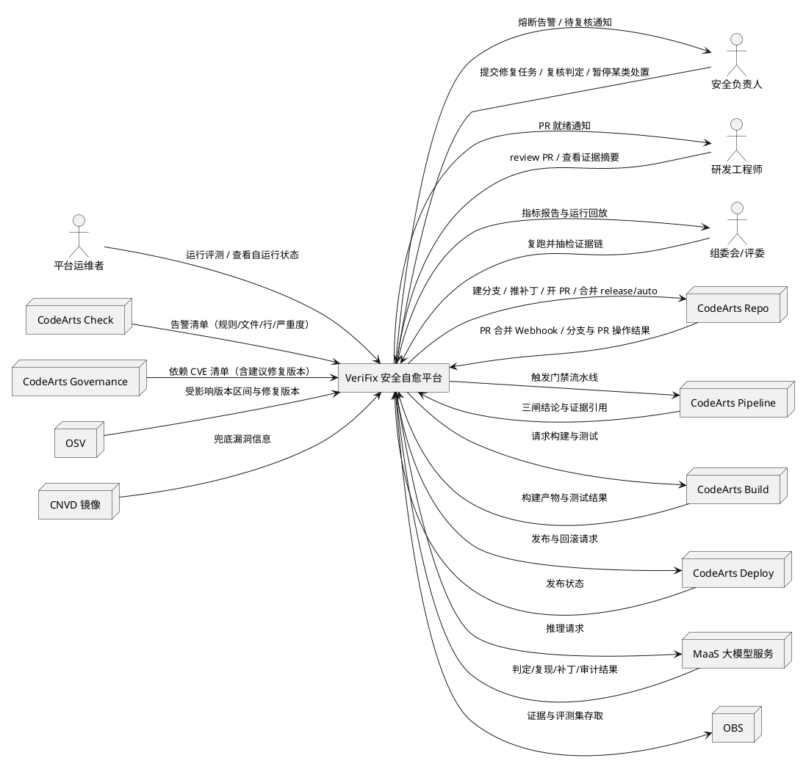

---

# 4. DFX 约束

## 4.1 性能

1. **单 Issue 端到端时限**：从 Issue 接入到产生处置结论，时限不超过 15 分钟；超时必须进入超时终止路径。
2. **任务提交响应**：人工提交修复任务的接口响应时间 P95 不超过 2 秒，提交即返回受理结果，不同步等待全流程。
3. **可达性判定耗时**：对 5 千函数规模的项目，单次可达性判定不超过 30 秒。
4. **沙箱单次执行上限**：任何沙箱内的测试或命令执行不超过 60 秒，超时即终止并记为失败。
5. **并发能力**：平台应支持至少 3 个 Issue 并行处置且互不阻塞；超出并发上限的任务必须排队而非丢弃。
6. **门禁回读时限**：Pipeline 触发后，结论回读轮询的总等待不超过 10 分钟，超时按门禁失败处理。

## 4.2 可靠性

1. **连续自运行**：无人干预连续自运行时长，初赛不低于 24 小时，中国总决赛不低于 72 小时。
2. **MTTR**：单 Issue 从告警到 PR 就绪的平均时长不超过 10 分钟（对照人工基线约 3 天）。
3. **幂等性**：同一 Issue 的重复触发（重复 Webhook、重复定时信号、人工重试）必须不产生重复分支、重复 PR 或重复计数。
4. **失败可恢复**：任一环节异常终止后，Issue 必须可从中断处重试，且不丢失已产生的证据。
5. **回滚能力**：门禁任一闸失败必须自动回滚分支与产物，回滚成功率必须为 100%，不允许残留半成品分支等待人工清理。
6. **数据一致性**：处置结论必须与其引用的门禁证据保持一致；证据引用失效时结论必须标记为"证据缺失"而非保留"通过"。

## 4.3 安全性

1. **沙箱隔离**：所有代码执行必须在沙箱内进行，沙箱必须断网、只读挂载源码、限时 60 秒、内存上限 1G、以非 root 身份运行。
2. **最小权限**：机器人的仓库权限仅限推送 `verifix/*` 与 `release/*` 分支，禁止对 `main` 有写权限。
3. **敏感数据保护**：凭据、访问令牌不得出现在代码、日志、PR 描述、看板与评测报告中；落盘与传输必须加密。
4. **关键操作审计**：建分支、推补丁、开 PR、合并 `release/auto`、触发门禁、拒绝、熔断、暂停处置等操作必须可追溯到操作主体、时间与关联 Issue。
5. **证据防篡改**：复现测试文件必须带自动生成标记；检测到该文件被人工修改时必须拒绝该 Issue 处置。
6. **评测集保护**：评测集不得进入代码仓库，每次评测必须记录评测集内容摘要，用于证明指标未被通过改标注的方式做假。
7. **模型越权防护**：模型不得直接执行命令或直接写仓库，一切副作用必须经工具层请求并由沙箱执行。

## 4.4 可维护性

1. **全链路可回放**：每个 Issue 必须有唯一运行标识，能按运行标识回放从接入到处置的完整步骤序列与每步证据。
2. **可观测指标**：看板必须展示在办 Issue 数、各处置级别分布、熔断状态、连续自运行时、失败原因 Top N。
3. **日志规范**：日志必须包含运行标识、Issue 标识、环节名称、结果与耗时；禁止输出敏感数据。
4. **指标可复算**：M1–M9 每一项都必须能指向具体的采集对象与计算口径，指不到采集点的指标不得写入对外材料。
5. **告警可达**：熔断、连续失败、门禁集成异常、自运行中断必须在 5 分钟内推送告警给安全负责人。

## 4.5 兼容性

1. **CodeArts 接口兼容**：与 CodeArts 各服务的集成只约定调用语义，字段名以华为云 API Explorer 中对应服务最新版本为准，接口版本变化不得导致处置流程中断。
2. **缺陷范围兼容**：本轮交付固定为 Python 3 类缺陷；新增缺陷类别不得改变既有分级与门禁语义。
3. **评测集规模演进**：初赛 50 条、总决赛 100 条；扩容不得改变指标定义与复算方法。
4. **部署形态演进**：阶段一 ECS 单机、阶段二 CCE，两种形态下对外行为与接口必须一致。
5. **历史数据处理**：处置结论与证据需长期保留，后续规则升级不得改写既有 Issue 的历史结论。

---

# 5. 核心能力

## 5.1 问题接入与归一化

### 5.1.1 业务规则

1. **多源接入**：平台必须支持五种触发入口——Repo PR 合并事件、定时扫描、CVE 订阅、运行时告警、人工提交，且五种入口必须统一转为同一类 Issue 事件。
   a. 验收条件：When 任一触发入口产生事件，the VeriFix 平台 shall 在接入层完成鉴权、限流、幂等判重并生成统一 Issue 事件。
2. **归一化**：来自 Check、Governance、OSV/CNVD 的原始条目必须映射为统一 Issue 结构，至少包含规则标识、文件、行号、严重度、问题来源、缺陷类别。
   a. 验收条件：When 收到一批告警，the VeriFix 平台 shall 输出结构一致的 Issue 记录，且每条记录可追溯回其原始告警。
3. **去重**：同一文件同一缺陷在同一代码版本上的重复报告必须合并为一条 Issue，并保留全部来源计数。
   a. 验收条件：When 同一定位被 Check 与 Governance 同时报告，the VeriFix 平台 shall 只生成一条 Issue，并将来源数记为 2。
4. **缺陷类别收敛**：本轮 Issue 的缺陷类别必须且仅限于三类——依赖 CVE（C01）、注入（C02 SQL 注入 / C03 命令注入）、硬编码凭据（C05）。
   a. 验收条件：When 接入一条不属于上述三类（或 C02/C03 之外的注入子类）的告警，the VeriFix 平台 shall 标记为"超出本轮范围"并归档，不进入处置流程。
5. **依赖漏洞数据源优先级**：依赖类 Issue 必须以 OSV 为主数据源，OSV 不可用或缺失时以 CNVD 镜像兜底，两者结论冲突时以"受影响区间取更严"为准则并标注冲突。
   a. 验收条件：When OSV 与 CNVD 对同一组件给出不同受影响区间，the VeriFix 平台 shall 采用更保守的区间并在 Issue 上标注来源冲突。
6. **禁止项**：禁止在原始告警未归一化、未去重前直接触发修复处置。
   a. 验收条件：If 一条告警未完成归一化，then the VeriFix 平台 shall 拒绝其进入处置阶段并返回"未归一化"状态。

### 5.1.2 交互流程

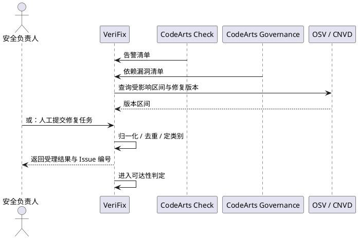

### 5.1.3 异常场景

1. **Check 告警拉取失败**
   a. 触发条件：Check 开放 API 超时或返回错误。
   b. 系统行为：按退避策略重试有限次数，仍失败则记录事件并保留上一轮结果，不将"无告警"当作"无漏洞"。
   c. 用户感知：看板显示"数据源不可用（Check）"，Issue 列表标注数据可能滞后。
2. **OSV 不可用**
   a. 触发条件：OSV 查询超时或不可达。
   b. 系统行为：切换 CNVD 镜像兜底，并降低该类 Issue 的可达性判定置信度，标记为需人工确认。
   c. 用户感知：Issue 上出现"依赖数据兜底来源：CNVD"标记。
3. **重复触发**
   a. 触发条件：同一 PR 合并事件被重复推送或人工重复提交。
   b. 系统行为：命中幂等判重，返回已有 Issue 标识，不新建处置流程。
   c. 用户感知：提示"该 Issue 已受理，当前状态：X"。
4. **超出本轮范围的告警**
   a. 触发条件：接入告警的规则类别不在三类范围内。
   b. 系统行为：记录并归档，不计入处置分母，不计入自动处置率。
   c. 用户感知：队列中显示"范围外，已归档"。

## 5.2 可达性判定与定级

### 5.2.1 业务规则

1. **入口点驱动**：可达性判定必须从入口点（HTTP 路由、定时任务、消息消费者）出发，沿调用关系与数据流传播至漏洞点。
   a. 验收条件：When 一个 Issue 进入判定阶段，the VeriFix 平台 shall 给出"可达 / 不可达 / 可疑"三值结论，而非布尔值。
2. **路径可解释**：每条"可达"结论必须附带一条从入口点到漏洞点的完整路径；"不可达"结论必须说明未找到传播路径的判定依据。
   a. 验收条件：When 结论为可达，the VeriFix 平台 shall 在判据中展示完整污点路径，供人工核实或反驳。
3. **置信度与降级**：结论必须携带 0–1 置信度；调用关系不完整（动态调用、反射等）导致置信度不足时，不得直接归档，必须标为"可疑"并交人工复核。
   a. 验收条件：If 判定置信度低于平台设定的可疑阈值，then the VeriFix 平台 shall 将 Issue 标记为"可疑"并纳入人工复核队列。
4. **归档规则**：判定为"不可达"且置信度足够的 Issue 必须归档，不计入待修队列，但仍需保留判定依据。
   a. 验收条件：When 判定为不可达且置信度达标，the VeriFix 平台 shall 将 Issue 状态置为已归档，并在有效告警率统计中计为"无价值告警"。
5. **定级规则**：Issue 的处置优先级必须由可达性结论、严重度、缺陷类别共同决定，禁止仅按规则严重度排序。
   a. 验收条件：When 两条 Issue 规则严重度相同，the VeriFix 平台 shall 优先处置可达性为"可达"且置信度更高者。
6. **禁止项**：禁止对未完成可达性判定的 Issue 直接进入复现或补丁生成阶段。
   a. 验收条件：If Issue 无可达性结论，then the VeriFix 平台 shall 驳回其进入复现阶段的请求。

### 5.2.2 交互流程

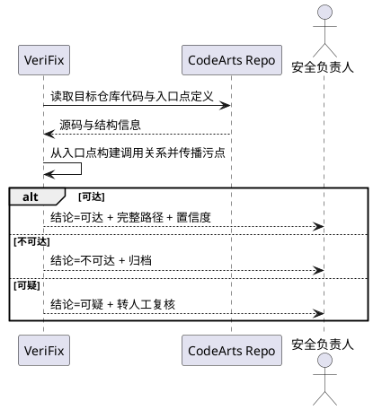

### 5.2.3 异常场景

1. **入口点缺失**
   a. 触发条件：被扫描项目中未识别到任何受支持的入口点。
   b. 系统行为：整批 Issue 结论置为"可疑"，不批量归档，并记录"入口点识别为空"事件。
   c. 用户感知：看板提示"入口点识别为空，请核对入口点配置"。
2. **调用关系不完整**
   a. 触发条件：存在动态调用、反射、运行时代理等无法静态解析的传播。
   b. 系统行为：降低置信度并扩大"可疑"范围，不臆断为不可达。
   c. 用户感知：判据中标注"路径可能不完整"。
3. **判定超时**
   a. 触发条件：项目规模超出单次判定时限。
   b. 系统行为：终止判定并将 Issue 降级为"可疑"。
   c. 用户感知：返回"判定超时，已转人工"。

## 5.3 复现证据生成

### 5.3.1 业务规则

1. **必须先红**：每个进入补丁阶段的 Issue 必须先生成复现测试，并在补丁前执行一次且必须失败；未取得红态记录的 Issue 不得进入补丁阶段。
   a. 验收条件：When 复现测试在补丁前执行通过，the VeriFix 平台 shall 判定该 Issue 复现失败并停止处置，而不是继续生成补丁。
2. **测试自动生成标记**：自动生成的复现测试必须带机器可识别的自动生成标记，并与 Issue 一一对应。
   a. 验收条件：When 复现测试生成完成，the VeriFix 平台 shall 在测试文件头部写入自动生成标记与对应 Issue 标识。
3. **禁止改测试**：复现测试文件在被提交后禁止人工修改；一旦检测到该文件变更，必须拒绝该 Issue 的处置。
   a. 验收条件：If 复现测试文件在补丁提交中出现内容变更，then the VeriFix 平台 shall 拒绝该补丁并将 Issue 转为"仅报告"。
4. **断言有效性**：复现测试的断言必须能区分"漏洞存在"与"漏洞已修"，禁止使用恒真断言、跳过标记或依赖外部网络。
   a. 验收条件：When 复现测试被审查，the VeriFix 平台 shall 识别并拒绝含恒真断言、跳过标记或外网依赖的测试。
5. **红态证据留存**：红态执行结果必须有可回读的记录（执行时间、退出状态、关键输出），作为门禁闸一的比对依据。
   a. 验收条件：When 门禁闸一执行时，the VeriFix 平台 shall 能出示对应的红态记录；缺失红态记录的绿态一律判为无效证据。

### 5.3.2 交互流程

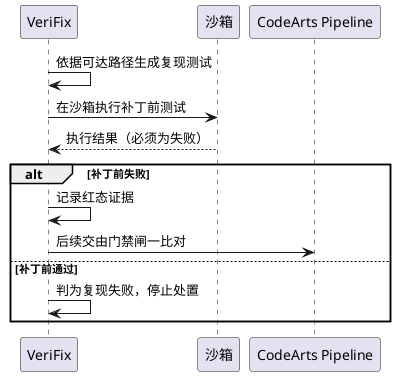

### 5.3.3 异常场景

1. **无法构造复现**
   a. 触发条件：漏洞点依赖外部服务、特定环境或难以在沙箱内构造输入。
   b. 系统行为：标记"复现困难"，转 L2 仅报告，并记录失败原因分类。
   c. 用户感知：Issue 显示"复现困难，已转人工"，不计入复现成功率分子。
2. **沙箱执行失败**
   a. 触发条件：沙箱启动失败、超时或资源超限。
   b. 系统行为：不计入"复现失败"业务统计，记录为基础设施异常并重试有限次数。
   c. 用户感知：提示"沙箱异常，任务已重试 N 次"。
3. **复现测试被改动**
   a. 触发条件：检测到自动生成测试文件在补丁 diff 中被修改。
   b. 系统行为：直接拒绝补丁，记录反作弊事件，Issue 转 L2。
   c. 用户感知：返回"检测到测试被修改，补丁已拒绝"。

## 5.4 最小补丁生成

### 5.4.1 业务规则

1. **最小改动约束**：补丁必须不超过 30 行变更且不超过 3 个文件；超出者不得进入门禁。
   a. 验收条件：When 生成补丁的变更规模超限，the VeriFix 平台 shall 判定补丁不合格并转 L2 仅报告。
2. **修复范式约束**：三类缺陷必须分别采用结构性修复范式——依赖 CVE 走版本升级到建议修复版本、注入走参数化查询或参数化命令调用、硬编码凭据走外置到配置/密钥管理并替换字面量。
   a. 验收条件：When 注入类补丁仅对已知 payload 做字符串过滤，the VeriFix 平台 shall 判定为黑名单式浅修复并拒绝。
3. **补丁强度门槛**：每个补丁必须计算 0–1 的补丁强度；低于 0.60 的补丁不得进入 L0 或 L1，只能 L2 仅报告。
   a. 验收条件：If 补丁强度低于 0.60，then the VeriFix 平台 shall 将处置级别上限锁定为 L2。
4. **不得夹带**：补丁禁止包含与目标缺陷无关的格式化、重命名、依赖新增、注释清理等改动。
   a. 验收条件：When 补丁 diff 中存在与缺陷无关的改动，the VeriFix 平台 shall 判定为夹带并拒绝。
5. **依赖类特殊约束**：依赖 CVE 类补丁只允许调整依赖版本，禁止同时修改业务代码；若升级引发不兼容，必须降级处置而非连带改代码。
   a. 验收条件：If 依赖升级导致测试失败，then the VeriFix 平台 shall 回滚该补丁并转入 L2，不得改写业务逻辑迁就升级。
6. **禁止项**：禁止生成删除或弱化测试断言、关闭扫描规则、加入运行时开关默认关闭漏洞路径的"修复"。
   a. 验收条件：If 补丁包含删除断言、修改扫描配置或加入绕过开关，then the VeriFix 平台 shall 直接拒绝并记录为对抗性补丁。

### 5.4.2 交互流程

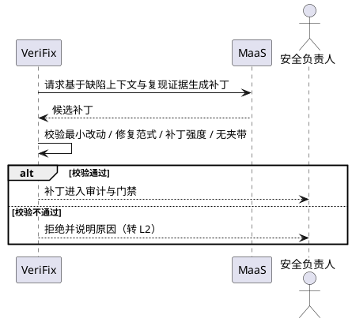

### 5.4.3 异常场景

1. **补丁规模超限**
   a. 触发条件：单次生成结果超过 30 行或 3 个文件。
   b. 系统行为：不裁剪后强推，直接判不合格并转 L2。
   c. 用户感知：提示"补丁超出最小改动上限（X 行 / Y 文件）"。
2. **生成结果不可用**
   a. 触发条件：模型返回无法解析或语法错误的补丁。
   b. 系统行为：有限次重试；仍失败则本次修复记为失败并计入同类熔断计数。
   c. 用户感知：Issue 状态显示"补丁生成失败"。
3. **依赖升级冲突**
   a. 触发条件：建议修复版本与现有依赖约束冲突。
   b. 系统行为：标记"版本冲突"，不强行改写依赖声明，转 L2。
   c. 用户感知：提示"依赖冲突，需人工决策升级路径"。

## 5.5 补丁审计与防作弊

### 5.5.1 业务规则

1. **三查必过**：补丁必须通过三查——红转绿（复现测试补丁前红、补丁后绿）、全量回归（无新增失败）、反作弊（复现测试与扫描配置未被改动）。
   a. 验收条件：When 任一查不通过，the VeriFix 平台 shall 判定补丁不合格并停止后续处置。
2. **六条 diff 审计**：补丁必须通过 diff 形态审计，至少覆盖：无新增条件分支、无新增网络/文件/环境变量访问、无新增字符串常量比较、未改动鉴权与加密常量、变更行数不超上限、变更文件数不超上限。
   a. 验收条件：When diff 命中任一审计项，the VeriFix 平台 shall 以"审计项编号 + 原因"说明拒绝理由。
3. **后门特征拒绝**：命中后门特征（如新增神秘常量比较、改动鉴权常量）的补丁必须直接判为 L3 拒绝并告警。
   a. 验收条件：If 补丁出现新增字符串常量比较且常量来源不可解释，then the VeriFix 平台 shall 判为 L3 拒绝并向安全负责人告警。
4. **审计结论必须可解释**：任何拒绝都必须给出可复核的判定依据，不得只返回"不合格"。
   a. 验收条件：When 补丁被拒绝，the VeriFix 平台 shall 输出拒绝项、具体阈值与命中的 diff 片段位置。
5. **审计与门禁分离**：diff 审计结论不能替代门禁结论；通过审计仅代表"可以送门禁"。
   a. 验收条件：When 补丁通过全部审计，the VeriFix 平台 shall 仍要求其通过 Pipeline 三闸才可处置。

### 5.5.2 交互流程

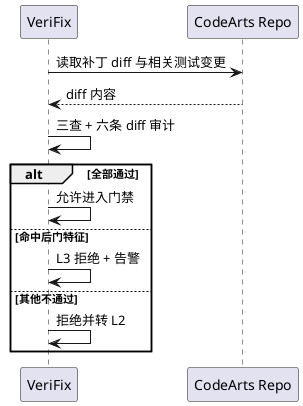

### 5.5.3 异常场景

1. **diff 无法完整获取**
   a. 触发条件：补丁过大或仓库读取失败导致 diff 截断。
   b. 系统行为：视为审计不通过，不得"跳过审计放行"。
   c. 用户感知：提示"补丁 diff 不完整，已拒绝"。
2. **审计项相互冲突**
   a. 触发条件：结构性修复必需的条件分支被判为"新增条件分支"。
   b. 系统行为：进入人工裁定队列，不做自动放行。
   c. 用户感知：提示"审计规则冲突，需人工裁定"。
3. **测试文件指纹不符**
   a. 触发条件：复现测试文件的标记或内容与生成时记录不一致。
   b. 系统行为：判为反作弊失败，拒绝补丁并记录事件。
   c. 用户感知：返回"复现测试指纹不一致，已拒绝"。

## 5.6 门禁校验与分级处置

### 5.6.1 业务规则

1. **门禁唯一来源**：补丁是否放行必须由 CodeArts Pipeline 三闸结论决定，平台内不得以自评结论替代门禁结论。
   a. 验收条件：When 需要判定补丁是否可处置，the VeriFix 平台 shall 仅在取得 Pipeline 回读结论后给出处置动作。
2. **闸一红转绿**：必须同时具备补丁前失败记录与补丁后通过结果；只有绿、没有红记录的一律判为无效。
   a. 验收条件：If 缺少红态记录，then the VeriFix 平台 shall 判闸一失败。
3. **闸二回归**：全量测试必须 0 失败，且覆盖率不得低于基线 0.5 个百分点以上。
   a. 验收条件：When 全量测试出现任一失败或覆盖率下降超过 0.5 个百分点，the VeriFix 平台 shall 判闸二失败。
4. **闸三复扫**：同一规则在同一文件不得再次命中，且新增告警数必须为 0。
   a. 验收条件：When 复扫在同一文件同一规则再次命中或新增告警大于 0，the VeriFix 平台 shall 判闸三失败。
5. **分级处置映射**：L0 仅适用于"仅依赖版本号变更且三闸全过"的 Issue，合并目标固定为 `release/auto`；L1 适用于三查与六条审计全过的情况，开出 PR 等人审；L2 适用于审计不过或补丁强度低于 0.60；L3 适用于命中后门特征。
   a. 验收条件：When 一个依赖类 Issue 三闸全过且无代码改动，the VeriFix 平台 shall 判定为 L0 并合并到 `release/auto`。
6. **永不自动并 main**：任何级别都不得自动合并到 `main`；L1 的 PR 必须由人 review 后合并。
   a. 验收条件：If 存在向 `main` 自动合并的请求，then the VeriFix 平台 shall 拒绝该操作并记录违规事件。
7. **失败即回滚**：任一闸失败必须自动回滚分支与产物，Issue 转为 L2 转人工。
   a. 验收条件：When 任一闸失败，the VeriFix 平台 shall 在处置结论中记录回滚结果与失败闸位。
8. **证据随 PR 落地**：L1 的 PR 描述必须包含证据摘要（可达路径、红转绿记录、三闸结论、运行标识）。
   a. 验收条件：When L1 PR 被创建，the VeriFix 平台 shall 在 PR 描述中自动写入证据摘要与运行标识。

### 5.6.2 交互流程

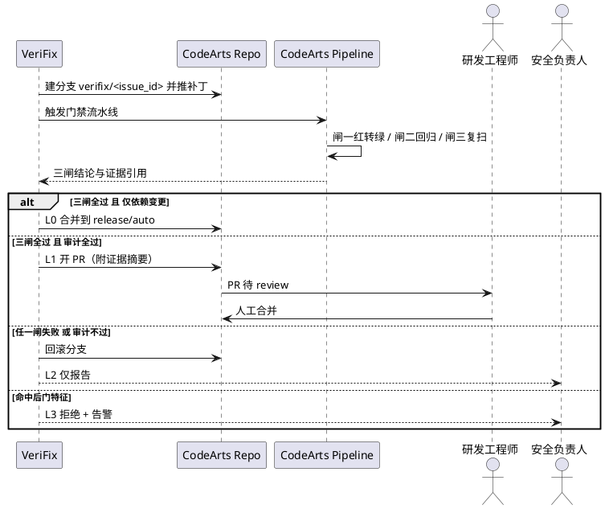

### 5.6.3 异常场景

1. **Pipeline 触发失败**
   a. 触发条件：门禁流水线触发接口报错或流水线不存在。
   b. 系统行为：有限次重试；仍失败则不得放行，Issue 保持待处置并记录集成异常。
   c. 用户感知：提示"门禁未执行，禁止放行"，看板标记集成异常。
2. **门禁结果回读超时**
   a. 触发条件：超过回读时限仍未取得结论。
   b. 系统行为：按门禁失败处理，回滚分支，转 L2。
   c. 用户感知：提示"门禁超时，已回滚"。
3. **并发处置冲突**
   a. 触发条件：同一 Issue 被并行触发或同一文件被多个 Issue 同时修改。
   b. 系统行为：同一 Issue 加互斥；跨 Issue 冲突时后者排队，不覆盖前者分支。
   c. 用户感知：提示"存在并行任务，已排队"。
4. **回滚失败**
   a. 触发条件：分支删除或产物清理异常。
   b. 系统行为：升级为高优先级告警并冻结该仓库的自动处置，避免继续叠加半成品。
   c. 用户感知：看板出现"回滚失败，已冻结自动处置"红色告警。

## 5.7 熔断与自运行保障

### 5.7.1 业务规则

1. **同类熔断**：同类缺陷连续 3 次修复失败必须停止该类自动处置并告警。
   a. 验收条件：When 同类缺陷第 3 次修复失败，the VeriFix 平台 shall 将该类处置置为熔断状态并向安全负责人告警。
2. **失败黑名单**：失败指纹必须进入黑名单，7 天内不再尝试同一指纹。
   a. 验收条件：When 同一失败指纹在 7 天内再次出现，the VeriFix 平台 shall 直接跳过自动处置并标注黑名单命中。
3. **熔断可恢复**：熔断后必须支持人工解除；解除后计数归零，不保留历史失败作为继续熔断的依据（历史仅作统计）。
   a. 验收条件：When 安全负责人解除熔断，the VeriFix 平台 shall 恢复该类处置并清零连续失败计数。
4. **自运行不中断**：在无人干预条件下，平台必须持续处理新到达的 Issue 不少于 72 小时（初赛不少于 24 小时）。
   a. 验收条件：While 处于自运行观察期，the VeriFix 平台 shall 保持调度、队列消费与告警通路可用，且自运行时计数器持续累计。
5. **暂停与恢复**：安全负责人必须能暂停某一类处置或整个自运行，暂停期间新 Issue 必须排队而非丢弃。
   a. 验收条件：When 暂停某类处置，the VeriFix 平台 shall 停止该类自动处置并将新 Issue 置为排队状态。
6. **禁止项**：禁止在被熔断期间继续以隐藏方式对同类缺陷发起自动修复尝试。
   a. 验收条件：If 某类缺陷处于熔断状态，then the VeriFix 平台 shall 拒绝该类自动修复请求并返回熔断原因。

### 5.7.2 交互流程

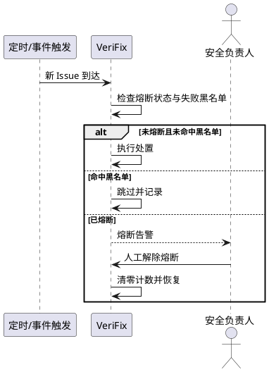

### 5.7.3 异常场景

1. **连续失败达到阈值**
   a. 触发条件：同类缺陷连续 3 次失败。
   b. 系统行为：置熔断、发告警、保留失败证据。
   c. 用户感知：看板显示"该类已熔断，需人工介入"。
2. **自运行中断**
   a. 触发条件：调度停止、队列消费中断或健康检查失败。
   b. 系统行为：自动重启并补偿未完成 Issue；连续中断超阈值升级告警，自运行计数不可虚增。
   c. 用户感知：提示"自运行中断，已重启并重算时长"。
3. **告警无法送达**
   a. 触发条件：通知通道异常。
   b. 系统行为：降级为看板显著告警并记录未送达事件。
   c. 用户感知：看板顶部出现未送达警示条。

## 5.8 证据留痕与运行看板

### 5.8.1 业务规则

1. **全链路留痕**：每个 Issue 必须留存接入、判定、复现、补丁、审计、门禁、处置七类事件记录，且事件不可被事后覆盖。
   a. 验收条件：When 一个 Issue 处置完成，the VeriFix 平台 shall 能按运行标识还原完整步骤序列。
2. **数据不可篡改**：证据记录必须可校验完整性；评测相关记录必须附带评测集内容摘要。
   a. 验收条件：When 评测完成，the VeriFix 平台 shall 在事件记录中写入评测集摘要，且同一摘要与既有记录不一致时告警。
3. **看板必含指标**：看板必须展示在办数量、处置级别分布、熔断状态、连续自运行时、失败原因 Top N、M1–M9 当前值。
   a. 验收条件：When 打开看板，the VeriFix 平台 shall 在首屏展示上述指标且数据可下钻到 Issue 明细。
4. **结论可下钻**：任一处置结论必须可下钻到其引用的门禁证据与红态记录。
   a. 验收条件：When 点击某条处置结论，the VeriFix 平台 shall 展示其证据引用与执行时间。
5. **敏感信息脱敏**：证据与看板中禁止出现凭据、令牌、完整密钥值。
   a. 验收条件：If 证据内容包含疑似凭据字面量，then the VeriFix 平台 shall 脱敏展示并记录脱敏事件。

### 5.8.2 交互流程

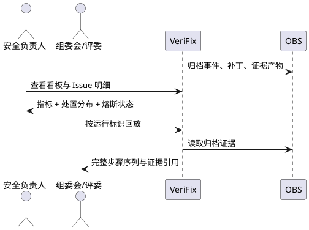

### 5.8.3 异常场景

1. **证据缺失**
   a. 触发条件：某步骤证据未写成功或归档失败。
   b. 系统行为：将该 Issue 结论标记为"证据缺失"，禁止视为通过。
   c. 用户感知：看板显示"证据缺失，结论不可信"。
2. **证据与结论不一致**
   a. 触发条件：结论声称门禁通过但引用的门禁记录不存在或结论不同。
   b. 系统行为：自动降级该结论并告警。
   c. 用户感知：提示"结论与证据不一致，已降级"。
3. **归档存储不可用**
   a. 触发条件：OBS 写入失败。
   b. 系统行为：本地暂存并在恢复后补传，期间禁止对结论做"已完成"标记。
   c. 用户感知：看板提示"归档积压，待补传"。

## 5.9 评测与指标复算

### 5.9.1 业务规则

1. **评测集构成**：评测集必须包含正例、负例、边界、对抗四类，比例为目标 40:30:20:10（按 100 条口径）；初赛规模不低于 50 条。
   a. 验收条件：When 提交评测集，the VeriFix 平台 shall 校验四类配比并拒绝只有正例的评测集。
2. **负例强制**：评测集必须包含负例（误报、不可达、测试代码中的假漏洞），占比不低于三成（100 条口径）。
   a. 验收条件：If 负例占比不足，then the VeriFix 平台 shall 拒绝该评测集并提示补充负例。
3. **对抗样本**：对抗类样本必须成对给出结构性修复与黑名单式浅修复的期望标注，用于检验平台是否会把浅修复误判为通过。
   a. 验收条件：When 评测遇到对抗样本，the VeriFix 平台 shall 输出是否将其误判为合格修复的结论。
4. **指标定义固定**：M1–M9 必须按既定定义与复算方法计算，不得为达标而临时改定义。
   a. 验收条件：When 输出指标报告，the VeriFix 平台 shall 同时给出指标定义、采集对象与计算结果。
5. **两档目标**：初赛与中国总决赛分别按两档目标判定达标，初赛不得以总决赛目标替代。
   a. 验收条件：When 处于初赛阶段，the VeriFix 平台 shall 以初赛档（M1≥50%、M4≥60%、M5≥45%、M9≥24h、评测集 50 条）判定达标。
6. **禁止项**：禁止在评测后修改标注、剔除失败样本或改写评测口径来提升指标。
   a. 验收条件：If 检测到评测后标注变更，then the VeriFix 平台 shall 标记该次评测结果无效。

### 5.9.2 交互流程

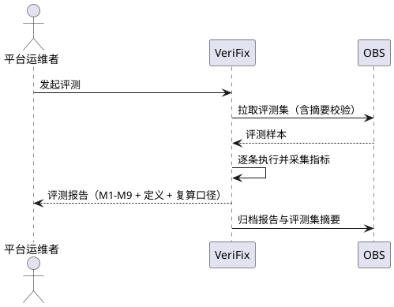

### 5.9.3 异常场景

1. **评测集中断**
   a. 触发条件：执行过程中沙箱或模型服务不可用。
   b. 系统行为：保存已完成进度，标记中断，不产出"部分样本"结论冒充全量报告。
   c. 用户感知：提示"评测中断于第 N 条，可续跑"。
2. **摘要不一致**
   a. 触发条件：评测集内容摘要与历史记录不符。
   b. 系统行为：拒绝本次评测并告警，避免"改样本刷分"。
   c. 用户感知：返回"评测集已被修改，评测拒绝"。
3. **指标采集源缺失**
   a. 触发条件：某指标引用的记录缺失。
   b. 系统行为：该指标标记"不可计算"，不填估算值。
   c. 用户感知：报告中显示"该指标不可计算（缺采集源）"。

## 5.10 CodeArts 开发链路留痕（赛题 1 硬门槛）

### 5.10.1 业务规则

1. **五步必须留痕**：需求理解、代码生成、项目构建、问题修复、部署上线五个环节必须在 CodeArts 上留下可核查记录，且从项目第一天开始留痕，不得最后补造。
   a. 验收条件：When 组委会抽检，the VeriFix 平台交付材料 shall 能出示五个环节各自的记录（文档、提交、构建记录、自举修复 PR、发布记录）。
2. **需求理解留痕**：必须存在需求拆解产物（模块清单与接口草案）与对应对话记录，归档在仓库开发日志目录。
   a. 验收条件：When 检查需求理解环节，the 交付材料 shall 包含需求拆解文档与对话记录归档。
3. **代码生成留痕**：AI 生成代码必须有带时间戳与作者的提交，提交信息带环节标记前缀。
   a. 验收条件：When 检查代码生成环节，the 交付材料 shall 提供可按提交信息筛选的生成提交列表。
4. **项目构建留痕**：构建任务必须真实执行测试与镜像构建，并保留执行记录与产物标识。
   a. 验收条件：When 检查构建环节，the 交付材料 shall 提供构建执行记录与产物标识。
5. **自举修复留痕**：问题修复环节必须用 VeriFix 修复 VeriFix 自身的真实缺陷，产出完整的 Issue→补丁→PR 链路。
   a. 验收条件：When 检查问题修复环节，the 交付材料 shall 提供自举 Issue、对应 PR 与看板运行记录。
6. **部署上线留痕**：必须存在发布记录与至少一次灰度/回滚演练记录，并提供可访问 Demo 地址。
   a. 验收条件：When 检查部署环节，the 交付材料 shall 提供发布单、演练记录与可访问地址。
7. **禁止项**：禁止用伪造截图、补造时间戳或事后批量提交的方式满足留痕要求。
   a. 验收条件：If 留痕记录的时间序列与提交历史矛盾，then 该环节 shall 被判为不成立。

### 5.10.2 交互流程

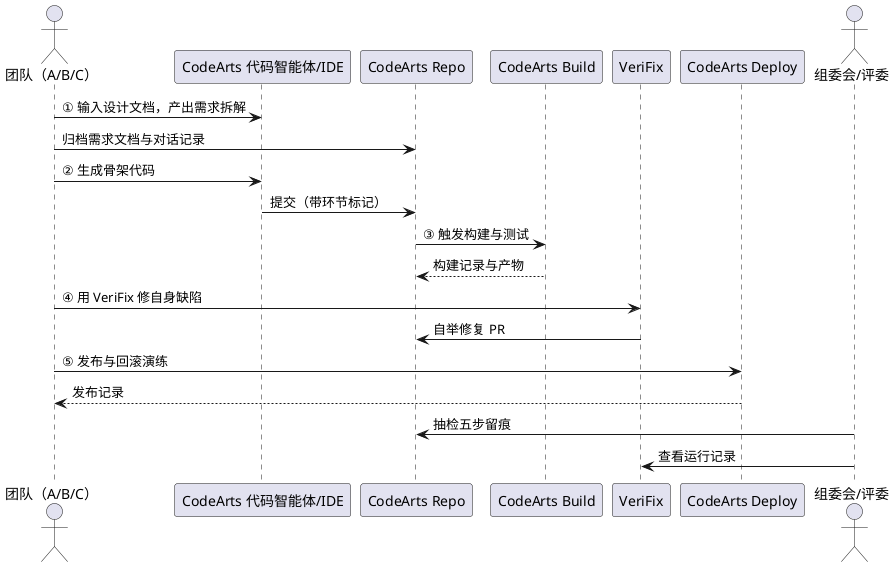

### 5.10.3 异常场景

1. **某环节记录缺失**
   a. 触发条件：五步中任一环节无法出示记录。
   b. 系统行为：交付前自检必须显式列出缺失环节，并以"补齐记录"为阻塞项，不允许以说明文字替代。
   c. 用户感知：自检清单中标红缺失项。
2. **CodeArts 集成阻塞**
   a. 触发条件：门禁集成在约定节点前未打通。
   b. 系统行为：允许门禁临时以本地脚本兜底，但材料中必须明示"Pipeline 集成在某阶段完成"，不得暗示已完成。
   c. 用户感知：材料中标注集成状态与兜底方式。
3. **演示环境不可访问**
   a. 触发条件：公网 Demo 地址无法打开。
   b. 系统行为：启用预录视频与本地镜像的固定用例作为兜底证据。
   c. 用户感知：交付材料中同时给出在线地址与本地复现方式。

---

# 6. 数据约束

## 6.1 Issue（问题单）

1. **issue_id**：全局唯一，创建后不可变更，作为分支名与运行关联的唯一标识。
2. **缺陷类别**：必须属于 C01 依赖 CVE、C02 SQL 注入、C03 命令注入、C05 硬编码凭据之一；其他取值一律标记为范围外。
3. **来源**：必须至少记录一个来源（Check / Governance / OSV / CNVD / 运行时），多来源时来源数必须大于 1 且可回溯。
4. **定位信息**：文件路径与行号必须与代码版本对应；依赖类 Issue 以"组件名 + 当前版本"定位代替行号。
5. **严重度**：必须取自来源系统给出的等级，并可被可达性结论调整优先级，但不得被随意改写。
6. **代码版本**：必须记录定位所依据的代码版本标识，版本变化后原结论不得直接复用。
7. **状态**：必须在"已接入 → 判定中 → 已判定/已归档 → 复现中 → 已证明/复现失败 → 补丁中 → 审计中 → 门禁中 → 已处置（L0/L1/L2/L3）"的流转范围内变化；禁止跳过判定直接进入复现或补丁。
8. **处置级别**：取值为 L0/L1/L2/L3；未取得门禁结论前不得写入 L0 或 L1。
9. **超时**：单 Issue 必须设置不超过 15 分钟的总时限，超时必须落为超时终止状态并保留已完成证据。

## 6.2 Verdict（判定结论）

1. **结论**：必须为"可达 / 不可达 / 可疑"三值之一，禁止空值。
2. **置信度**：0–1 数值；低于可疑阈值时结论必须为"可疑"。
3. **污点路径**：结论为"可达"时必须非空，且路径起点必须是受支持的入口点、终点必须是漏洞点。
4. **关联 Issue**：必须与唯一 Issue 关联，同一 Issue 可保留多次判定但必须标记最新有效结论。
5. **判定时间**：必须可记录，用于 MTTR 与复算。

## 6.3 Proof（复现证据）

1. **补丁前结果**：必须为"失败"，否则该 Issue 视为复现失败。
2. **补丁后结果**：必须为"通过"，否则不得进入处置。
3. **测试标识**：必须与 Issue 一一对应，且带自动生成标记。
4. **执行环境**：必须记录沙箱执行条件（断网、只读、限时、内存、身份），用于证明证据在受控条件下产生。
5. **指纹**：必须记录测试文件内容指纹，用于反作弊比对。

## 6.4 Patch（补丁）

1. **变更规模**：变更行数不超过 30，变更文件数不超过 3；超限即不合格。
2. **强度评分**：0–1 数值，低于 0.60 时处置级别上限为 L2。
3. **修复范式**：必须标注所用范式（版本升级 / 参数化 / 凭据外置），并可与缺陷类别对应。
4. **分支**：必须位于 `verifix/<issue_id>` 命名空间；L0 合并目标固定为 `release/auto`。
5. **证据引用**：必须引用对应的复现证据与门禁结论；任一引用缺失时补丁不得标记为可处置。
6. **审计结论**：必须记录通过或拒绝项列表；拒绝时必须含审计项编号与原因。

## 6.5 Run（运行实例）

1. **运行标识**：每次处置必须唯一，且可与 Issue 关联，用于全链路回放。
2. **起止时间**：必须记录，用于计算 MTTR 与耗时分布。
3. **步骤序列**：必须覆盖接入、判定、复现、补丁、审计、门禁、处置七类步骤，缺失步骤必须显式标注"未执行"。
4. **结果**：必须为一个明确终态（已处置 / 失败 / 超时 / 熔断跳过 / 范围外），禁止"未知"终态。

## 6.6 Event（事件）

1. **事件类型**：必须可在枚举范围内识别（接入、判定、复现、补丁、审计、门禁、处置、回滚、熔断、告警、脱敏）。
2. **时间戳**：必须单调可比较，用于指标复算与回放。
3. **主体**：必须记录触发主体（系统组件、机器人账号、人工角色），用于审计追溯。
4. **不可篡改**：写入后禁止修改；更正必须新增事件并标注更正原因。

## 6.7 EvalCase（评测样本）

1. **样本编号**：全局唯一，格式可读（如 EVAL-0001）。
2. **缺陷定位**：必须含规则标识、文件、行号与严重度，且与所属项目版本一致。
3. **标注**：必须含"是否可达""是否可修""期望修复范式""是否应拒绝"四项人工标注，禁止空缺。
4. **类别**：必须属于正例、负例、边界、对抗之一，且整体配比满足 40:30:20:10（100 条口径）。
5. **证明信息**：正例必须给出复现测试路径与补丁前后期望结果。
6. **存放位置**：禁止存放于代码仓库，必须存放于受控存储并以摘要校验。

## 6.8 Metric（指标）

1. **指标编号**：必须为 M1–M9 之一，与既定定义一一对应。
2. **取值**：必须为可复算的实数或比例，禁止估算值；无法计算的指标必须标记"不可计算"。
3. **采集来源**：必须可指向具体采集对象（判定结论记录、运行记录、门禁结论、事件时间戳、看板运行时）。
4. **阶段**：必须区分初赛档与中国总决赛档，两档目标不得混用。
5. **计算时间**：必须可记录，用于说明指标的时效。

---

## 附：与 v2.1 定稿项的对齐说明

| 定稿项 | 本文档落点 |
|---|---|
| 赛题 1 口径（CodeArts 应用 + 五步留痕硬门槛） | 1.1、1.4、5.10、4.5、3.2 |
| Python × 3 类缺陷 MVP（C01/C02/C03/C05） | 1.4 第 7 条、5.1.1 第 4 条、5.4.1 第 2 条、6.1 第 2 条 |
| L0 目标分支 `release/auto`，永不自动并 `main` | 1.4 第 5 条、5.6.1 第 5–6 条、6.4 第 4 条 |
| T3 = OSV 主 + CNVD 兜底 | 1.2 第 3 条、5.1.1 第 5 条、5.1.3 第 2 条 |
| T4 = 自建 Flask 靶场（10 注入点 / 3 依赖 CVE / 2 硬编码密钥） | 1.2 第 7 条、5.9.1、6.7 |